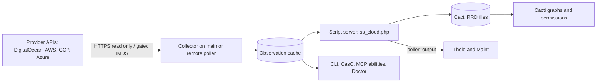

<!-- translations:start -->
[English](README.md) | [简体中文](docs/i18n/zh-CN/README.md) | [हिन्दी](docs/i18n/hi-IN/README.md) | [Español (España)](docs/i18n/es-ES/README.md) | [Español (Latinoamérica)](docs/i18n/es-419/README.md) | [العربية (السعودية)](docs/i18n/ar-SA/README.md) | [Afrikaans](docs/i18n/af-ZA/README.md) | [አማርኛ](docs/i18n/am-ET/README.md) | [العربية (مصر)](docs/i18n/ar-EG/README.md) | [العربية (المغرب)](docs/i18n/ar-MA/README.md) | [বাংলা](docs/i18n/bn-BD/README.md) | [Bosanski](docs/i18n/bs-BA/README.md) | [Deutsch](docs/i18n/de-DE/README.md) | [فارسی](docs/i18n/fa-IR/README.md) | [Filipino](docs/i18n/fil-PH/README.md) | [Français](docs/i18n/fr-FR/README.md) | [Français (Maroc)](docs/i18n/fr-MA/README.md) | [Français (Sénégal)](docs/i18n/fr-SN/README.md) | [Hausa](docs/i18n/ha-NG/README.md) | [עברית](docs/i18n/he-IL/README.md) | [Hrvatski](docs/i18n/hr-HR/README.md) | [Bahasa Indonesia](docs/i18n/id-ID/README.md) | [Igbo](docs/i18n/ig-NG/README.md) | [Italiano](docs/i18n/it-IT/README.md) | [日本語](docs/i18n/ja-JP/README.md) | [한국어](docs/i18n/ko-KR/README.md) | [Malagasy](docs/i18n/mg-MG/README.md) | [मराठी](docs/i18n/mr-IN/README.md) | [Bahasa Melayu](docs/i18n/ms-MY/README.md) | [Nederlands](docs/i18n/nl-NL/README.md) | [Polski](docs/i18n/pl-PL/README.md) | [Português (Brasil)](docs/i18n/pt-BR/README.md) | [Русский](docs/i18n/ru-RU/README.md) | [Kinyarwanda](docs/i18n/rw-RW/README.md) | [Soomaali](docs/i18n/so-SO/README.md) | [Српски](docs/i18n/sr-RS/README.md) | [Svenska](docs/i18n/sv-SE/README.md) | [Kiswahili](docs/i18n/sw-KE/README.md) | [தமிழ்](docs/i18n/ta-IN/README.md) | [తెలుగు](docs/i18n/te-IN/README.md) | [ไทย](docs/i18n/th-TH/README.md) | [Türkçe](docs/i18n/tr-TR/README.md) | [Українська](docs/i18n/uk-UA/README.md) | [اردو](docs/i18n/ur-PK/README.md) | [Tiếng Việt](docs/i18n/vi-VN/README.md) | [isiXhosa](docs/i18n/xh-ZA/README.md) | [Yorùbá](docs/i18n/yo-NG/README.md) | [繁體中文](docs/i18n/zh-TW/README.md) | [isiZulu](docs/i18n/zu-ZA/README.md)
<!-- translations:end -->

# plugin_cloud

A Cacti 1.2 plugin that brings resources and metrics from public cloud providers into Cacti as ordinary devices, data sources, and graphs. Cloud workloads sit next to the network that carries them, under Cacti's permissions, and Thold and Maint alert on and suppress them. One plugin covers DigitalOcean, Amazon Web Services, Google Cloud, and Microsoft Azure through pure-PHP, read-only provider drivers.

> **Status: in development, no release yet (`0.1.0-dev`).** This branch implements pure-PHP drivers for DigitalOcean, AWS, Google Cloud, and Azure, remote data collector replication and read-only agent health, a CasC provider and operator CLI, MCP abilities, and Doctor checks. Shipped Cacti templates currently cover DigitalOcean Droplets and load balancers (`templates/cloud_digitalocean.xml`); Cacti template packages for AWS, Google Cloud, and Azure and live-account qualification beyond DigitalOcean ([provider facts](docs/research/provider-facts.md)) are not finished yet. Do not run in production.

## Supported providers

Every provider driver is registered in `Drivers::production()`, offered by `Provider::released()`, and runs in pure PHP using `ext-openssl` and stream sockets with zero SDK or Composer runtime dependencies.

| Provider | Scope fields | Credential sources | Authentication | Discovered resources | Metric collection |
|---|---|---|---|---|---|
| DigitalOcean (`digitalocean`) | None (token-scoped) | `vault`, `file` | Bearer token | `droplet`, `load_balancer` | `/v2/monitoring/metrics` with rate-limit share awareness; ships Cacti templates and data queries |
| Amazon Web Services (`aws`) | `account_id` (12 digits), `regions` | `vault`, `file`, `instance` | Pure-PHP AWS SigV4 (`AWS4-HMAC-SHA256`), STS `GetCallerIdentity` verify, optional STS `AssumeRole`, EC2 IMDSv2 (`169.254.169.254`) for `instance` accounts | `ec2_instance`, `rds_instance`, `aws_elb` (ALB/NLB) | Batched CloudWatch `GetMetricData` (up to 500 queries per call) |
| Google Cloud (`gcp`) | `project` | `vault`, `file`, `instance` | Pure-PHP RS256 service-account JWT via `ext-openssl` exchanged at `oauth2.googleapis.com/token`, or GCE metadata server (`metadata.google.internal`) for `instance` accounts | `gce_instance` via `instances.aggregatedList` | Cloud Monitoring `timeSeries.list` |
| Microsoft Azure (`azure`) | `tenant`, `subscription`, `regions` | `vault`, `file`, `instance` | Pure-PHP Entra ID OAuth2 client-credentials flow (`client_secret` only; certificate assertions excluded), or Azure IMDS (`169.254.169.254`) managed identity for ARM and Monitor tokens | `azure_vm` via ARM Resource Graph (paginated with `$skipToken` and deduplicated) | Azure Monitor `metrics:getBatch` (up to 50 resources per call, handling HTTP 429 and 529 throttling) |

## Implemented capabilities

### Core platform, vault, and collector

- **Guarded install and lifecycle.** Entry points (`setup.php`, `cli/cloud.php`, `poller_cloud.php`, `ss_cloud.php`, and page scripts) parse on PHP 8.0 and refuse PHP below 8.2 or missing `ext-openssl` without breaking Cacti. Upgrades are ordered, idempotent (`Schema::VERSION = 3`, 9 tables), and survive interruption. Uninstall keeps plugin tables unless *Keep Plugin Tables on Uninstall* is cleared.
- **Accounts and credentials.** Add, edit, verify, and delete accounts under **Management > Cloud Accounts**. Credentials come from the AES-256-GCM encrypted vault (`plugin_cloud_secret`, keyed by `/etc/cacti/cloud-vault.key` by default), from a file restricted inside the configured *Credential File Directory* (`cloud_credential_dir`, empty by default to refuse files), or from provider instance identity. Credentials are write-only in the UI and redacted from logs.
- **Strict outbound and read-only controls.** Every driver operates behind `GuardedTransport` and `OutboundPolicy`: HTTPS port 443 to exact per-provider hostnames, with link-local HTTP port 80 metadata endpoints (`169.254.169.254`, `metadata.google.internal`) enabled only for `instance` accounts. Only allowlisted read-only operations are permitted.
- **Collector and cost controls.** `poller_cloud.php` runs from `poller_bottom` (one process per poller via Cacti's process registry) within `cloud_collector_budget`, acquires per-account leases, runs discovery on `discover_interval`, reads metrics only for active Cacti data sources (`plugin_cloud_series`), respects `request_share` and `monthly_ceiling`, and caches latest datapoints in `plugin_cloud_observation` for `ss_cloud.php`.
- **Cacti objects and request estimates.** Maintains a scope device per account (`plugin_cloud_device`), preserves scope device reindex methods across device saves, imports DigitalOcean templates and script server data queries (`templates/cloud_digitalocean.xml`, `cloud_do_droplet.xml`, `cloud_do_load_balancer.xml`), and displays request and list-price estimates on **New Graphs** (`graphs_new_top_links`) and **Cloud Health**.

### Remote data collectors

- `INFO` declares `remote_collect:1`. Accounts can be assigned to any enabled Cacti poller (`poller_id >= 1`), and `poller_cloud.php --poller=N` collects only accounts owned by that poller.
- **`replicate_out` hook.** Replicates poller-scoped rows from `plugin_cloud_account`, `plugin_cloud_device`, `plugin_cloud_series`, and encrypted ciphertext rows from `plugin_cloud_secret` (only for vault-backed accounts owned by the target poller) via `replicate_out_table()`. Raw vault key files are never stored in the database or replicated and remain local on each poller.
- **`remote_agent` hook.** Exposes a read-only JSON health summary (`action=cloud_health`) accepting only integer `poller_id` and `account_id` parameters and returning zero credentials, file paths, or secrets.

### Ecosystem hooks (CasC, MCP abilities, and Doctor)

- **CasC provider (`casc_register_providers`).** Registers the `cloud` provider (schema version `1`) with deterministic pure-PHP YAML and XML export, manifest validation, diff planning, and confirmed apply. Vault credentials are exported as `vault:account:<name>` references; raw secret fields (`secret`, `secrets`, `token`, `access_token`, `refresh_token`, `password`, `private_key`, `access_key_id`, `secret_access_key`, `session_token`, `client_secret`, `credential`, `credentials`, `vault_key`) are rejected. Applying requires an exact SHA-256 `--confirm=<PLAN_HASH>`.
- **MCP / Abilities API (`abilities_register`).** Registers three strictly read-only abilities gated on the Cloud View realm (`cloud_health.php`) and Cacti device scope for non-admin callers, emitting zero credentials, vault keys, or credential file paths:
  - `cloud-list-accounts` (optional `provider`, `poller_id`)
  - `cloud-list-resources` (optional `account_id`, `type`, `lifecycle`)
  - `cloud-get-health` (optional `account_id`)
- **Doctor checks (`doctor_register_checks`).** Registers five diagnostic checks that expose no secret values or key material:
  - `cloud_schema`: schema version currency
  - `cloud_vault_key`: vault key file readability, permissions, and size
  - `cloud_drivers`: production driver registration for all released providers
  - `cloud_accounts_health`: failed, throttled, or stale enabled accounts
  - `cloud_poller_intervals`: alignment of enabled account collection intervals with Cacti's poller interval

## CLI

Run from the Cacti root directory with PHP 8.2 or later:

```sh
# Operator and CasC CLI (options use --key=value form)
php plugins/cloud/cli/cloud.php export [--format=yaml|xml]
php plugins/cloud/cli/cloud.php validate --file=<path> [--format=yaml|xml]
php plugins/cloud/cli/cloud.php plan --file=<path> [--format=yaml|xml]
php plugins/cloud/cli/cloud.php apply --file=<path> --confirm=<PLAN_HASH> [--format=yaml|xml]
php plugins/cloud/cli/cloud.php health [--format=text|json] [--poller=<id>]

# Collector entry point (normally started by poller_bottom)
php plugins/cloud/poller_cloud.php [--poller=N] [--force] [--debug]
```

## Access roles

| Realm | Access |
| --- | --- |
| Cloud View | Existing monitoring pages. |
| Cloud Operator | Monitoring plus the Operations page and personal triage acknowledgments. |
| Cloud Admin | Operator access plus the existing configuration and administrative actions. |

After copying upgrade files, open the Plugins page as an administrator to register the realms. Assign the Operator realm explicitly under **Configuration > Users** or user groups. Upgrades retain the existing View and Admin realm IDs and grants. Admin access inherits Operator access, and Operator access inherits View access on each request; this does not add stored grants to users or groups. Plugin settings also require Cloud Admin access in addition to Cacti's Settings permission.

Cacti device permissions limit the rows and actions available to each user; unmapped objects require an administrator. Operators can verify the stored credential for an account whose Cacti device they may access. Credentials, configuration, mapping, deletion, and other administrative changes remain in the administrative pages. Acknowledgments last only in the current user's session, for at most one hour and only while the same observation remains fresh. New or changed observations invalidate them. They never mark a failed measurement healthy or suppress alerts.

## Why

Each cloud provider has its own monitoring console. Run alongside Cacti, they leave three gaps:

- **Separate access control.** Showing a Cacti user cloud metrics means giving them a cloud login.
- **No network context.** On-premises links are graphed in Cacti; the workloads behind them are graphed in each provider's console.
- **Separate alerting.** Thold and Maint work on Cacti data sources and devices, so provider alarms are configured and suppressed separately, once per provider.

The plugin reads each provider's monitoring API on a Cacti poller, caches the latest datapoints, and serves them to Cacti's script server. Cacti's poller writes the RRD files, so graphing, permissions, Thold, Maint, and boost work as they do for any Cacti data.

## Design commitments

- **Read-only.** Each driver can build only the provider operations on its allowlist; the plugin never changes a cloud resource. ([ADR 0002](docs/decisions/0002-read-only-with-operation-allowlist.md))
- **PHP only, no SDKs.** Signing and token exchange are implemented in PHP with the extensions Cacti already requires. No Composer runtime dependencies. ([ADR 0003](docs/decisions/0003-php-only-without-sdks.md))
- **Cost before collection.** The plugin reads only metrics that have a Cacti data source, shows the expected request count and list-price cost before graphs are created, and enforces a monthly ceiling. ([ADR 0005](docs/decisions/0005-collect-only-what-is-graphed.md))
- **No plaintext credentials in the database.** Credentials come from an encrypted vault keyed by a file outside the database, from a credential file, or from the provider's instance identity. ([ADR 0007](docs/decisions/0007-credentials-outside-the-database-in-the-clear.md))

## Scope and status

| Phase | Scope | Milestones | Status |
|---|---|---|---|
| 0, research | Provider fact confirmation, metric catalogs, cost and rate model, signing test vectors, transport spike | [M1](https://github.com/somethingwithproof/plugin_cloud/milestone/1) | Done, except checks that need live provider accounts |
| 1, core and DigitalOcean | Accounts, credential vault, transport, collector, observation cache, Cacti objects, templates, request estimates, health page, DigitalOcean Droplets and load balancers | [M2](https://github.com/somethingwithproof/plugin_cloud/milestone/2), [M3](https://github.com/somethingwithproof/plugin_cloud/milestone/3), [M4](https://github.com/somethingwithproof/plugin_cloud/milestone/4) | Implemented; M4 pilot qualification pending |
| 2, AWS | Pure-PHP SigV4, STS `AssumeRole`, IMDSv2 instance roles, EC2/RDS/ELB inventory, CloudWatch `GetMetricData` | [M5](https://github.com/somethingwithproof/plugin_cloud/milestone/5) | Driver implemented; Cacti templates and live-account qualification pending |
| 3, Google Cloud | Pure-PHP RS256 service-account JWT, GCE metadata server, Compute Engine inventory, Cloud Monitoring `timeSeries.list` | [M6](https://github.com/somethingwithproof/plugin_cloud/milestone/6) | Driver implemented; Cacti templates and live-account qualification pending |
| 4, Azure | Entra ID client credentials, IMDS managed identity, ARM Resource Graph VM inventory, Azure Monitor `metrics:getBatch` | [M7](https://github.com/somethingwithproof/plugin_cloud/milestone/7) | Driver implemented; Cacti templates and live-account qualification pending |
| 5, remote collectors and ecosystem | Remote data collectors (`replicate_out`, `remote_agent`), CasC provider and CLI, MCP abilities, Doctor checks | [M8](https://github.com/somethingwithproof/plugin_cloud/milestone/8) | Implemented |

Out of scope: changing cloud resources, creating or mirroring provider alarms, billing reports, logs and traces, and a plugin-owned alerting engine. Further providers (Hetzner Cloud, Akamai Cloud, Oracle Cloud, and others) are research issues.

## Install and configure

These steps install the development code for evaluation. They require Cacti 1.2.31 or later on PHP 8.2 or later.

1. Copy the repository to `plugins/cloud` under your Cacti directory. The directory must be named `cloud`.
2. Create the vault key outside the web root on each poller that uses vault-backed credentials. Put it in a directory that only root and the Cacti user can write, and make the file readable only by the user that runs the web server and the poller. The plugin never creates or writes this file:

   ```sh
   sudo install -d -m 0750 -o root -g cacti /etc/cacti
   head -c 32 /dev/urandom | sudo tee /etc/cacti/cloud-vault.key > /dev/null
   sudo chown cacti:cacti /etc/cacti/cloud-vault.key
   sudo chmod 0600 /etc/cacti/cloud-vault.key
   ```

   Replace `cacti` with the user that runs your web server and poller. The file holds 32 raw bytes or 64 hexadecimal characters. Back it up with the database; without it, stored credentials must be entered again.
3. In Cacti, open **Configuration > Plugins**, then install and enable *Cloud*.
4. Under **Configuration > Settings > Cloud**, set *Vault Key File* if you used another path, configure *Credential File Directory* if you plan to use file-based credentials, and keep *Collector Time Budget* (default 240 seconds) below the poller interval.
5. Grant *Cloud Admin*, *Cloud Operator*, or *Cloud View* to users and groups under **Configuration > Users**. Installing grants Cloud Admin and Cloud View to the administrator; Cloud Admin includes Operator access, so the administrator needs no separate Operator grant.
6. Add accounts under **Management > Cloud Accounts**, then check **Management > Cloud Health** for warnings.

## Compatibility targets

| Component | Target |
|---|---|
| Cacti | 1.2.31 or later, no core patches |
| PHP | 8.2 or later; entry points stay parseable on 8.0 so an unsupported runtime gets a refusal instead of a broken Cacti UI |
| PHP extensions | `ext-openssl` (required by Cacti 1.2.31); no `ext-curl` and no Composer runtime dependencies |
| Thold, Maint | No changes required |

## Design

- [docs/performance.md](docs/performance.md) has the collector and health page measurements, with the hardware and settings used.
- [docs/PLAN.md](docs/PLAN.md) is the full plan: architecture, the provider and Cacti facts it depends on (with sources), the driver contract, cost arithmetic, security boundaries, testing, and risks.
- [docs/decisions/](docs/decisions/) holds architecture decision records for choices already made.
- [docs/REQUIREMENTS.md](docs/REQUIREMENTS.md) maps every requirement ID to its issue.



## How work is tracked

- **Milestones** follow the plan's milestones. Each has an epic issue listing its sub-issues and exit evidence.
- **Issues** are typed by label: `type: requirement`, `type: research`, `type: decision`, `type: epic`. Requirement issues state numbered, testable requirements (`REQ-AREA-NNN`) and acceptance criteria.
- **Labels** also carry `area:`, `provider:`, `phase:`, `priority:`, and `status:`. See [CONTRIBUTING.md](CONTRIBUTING.md#labels).
- The [project board](https://github.com/users/somethingwithproof/projects/7) shows all issues across milestones.

## Development

CI ([.github/workflows/plugin-ci-workflow.yml](.github/workflows/plugin-ci-workflow.yml)) checks the release archive and semantic version (`bash tests/bin/archive-check.sh`), lints entry points on PHP 8.0, runs Pest unit (`phpunit.xml`) and lifecycle integration (`phpunit-integration.xml`) tests and PHPStan level 9 across PHP 8.2 to 8.5 against Cacti `release/1.2.31` and `1.2.x` with `CLOUD_OFFLINE=1`, checks refusal on PHP 8.1, verifies gettext catalogs, measures 1,000-series collection and health page performance, and runs workflow linting and REUSE compliance.

Local checks before pushing:

```sh
bash tests/bin/archive-check.sh
sh tests/lint-workflows.sh
sh locales/build_gettext.sh --check
CACTI_PATH=/path/to/cacti phpstan analyse -c phpstan.neon --no-progress
```

Run Pest with `--configuration=phpunit.xml` for unit and source-rule tests, or `--configuration=phpunit-integration.xml` with `CACTI_PATH` and `CLOUD_TEST_DATABASE=disposable` against a disposable Cacti database for lifecycle integration tests.

## Contributing

Read [CONTRIBUTING.md](CONTRIBUTING.md). Commits need a DCO sign-off. Design discussion happens on issues; open decisions carry the `type: decision` label.

## Security

Report vulnerabilities privately; see [SECURITY.md](SECURITY.md).

## License

GNU General Public License v2.0, the same license as Cacti and its plugins. See [LICENSE](LICENSE).
