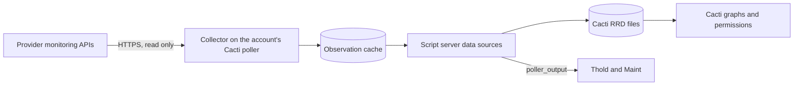

# plugin_cloud

A proposed Cacti 1.2 plugin that brings resources and metrics from public cloud providers into Cacti as ordinary devices, data sources, and graphs. Cloud workloads then sit next to the network that carries them, under Cacti's permissions, and Thold and Maint can alert on and suppress them. One plugin covers every provider, with a driver per provider: DigitalOcean, AWS, Google Cloud, and Azure first.

> **Status: proposal.** This repository contains no plugin code yet. It holds the design, its decision records, and the requirements tracked as issues and milestones. Nothing below describes shipped behavior.

## Why

Each cloud provider has its own monitoring console. Run alongside Cacti, they leave three gaps:

- **Separate access control.** Showing a Cacti user cloud metrics means giving them a cloud login.
- **No network context.** On-premises links are graphed in Cacti; the workloads behind them are graphed in each provider's console.
- **Separate alerting.** Thold and Maint work on Cacti data sources and devices, so provider alarms are configured and suppressed separately, once per provider.

The plugin reads each provider's monitoring API on a Cacti poller, caches the latest datapoints, and serves them to Cacti's script server. Cacti's poller writes the RRD files, so graphing, permissions, Thold, Maint, and boost work as they do for any Cacti data.

## Design commitments

- **Read-only.** Each driver can build only the provider operations on its allowlist; the plugin never changes a cloud resource. ([ADR 0002](docs/decisions/0002-read-only-with-operation-allowlist.md))
- **PHP only, no SDKs.** Signing and token exchange are implemented in PHP with the extensions Cacti already requires. No Composer runtime dependencies. ([ADR 0003](docs/decisions/0003-php-only-without-sdks.md))
- **Cost before collection.** The plugin reads only metrics that have a Cacti data source, shows the expected request count and list-price cost before graphs are created, and enforces a monthly ceiling. ([ADR 0005](docs/decisions/0005-collect-only-what-is-graphed.md))
- **No plaintext credentials in the database.** Credentials come from an encrypted vault keyed by a file outside the database, from a credential file, or from the provider's instance identity. ([ADR 0007](docs/decisions/0007-credentials-outside-the-database-in-the-clear.md))

## Planned scope

| Phase | Scope | Milestones |
|---|---|---|
| 0, research | Provider fact confirmation, metric catalogs, cost and rate model, signing test vectors, transport spike | [M1](https://github.com/somethingwithproof/plugin_cloud/milestone/1) |
| 1, core and DigitalOcean | Accounts, credential vault, transport, collector, observation cache, Cacti objects, health page, DigitalOcean Droplets and load balancers | [M2](https://github.com/somethingwithproof/plugin_cloud/milestone/2), [M3](https://github.com/somethingwithproof/plugin_cloud/milestone/3), [M4](https://github.com/somethingwithproof/plugin_cloud/milestone/4) |
| 2, AWS | Signature Version 4, `AssumeRole`, instance roles, CloudWatch `GetMetricData`, regional inventory | [M5](https://github.com/somethingwithproof/plugin_cloud/milestone/5) |
| 3, Google Cloud | Service account JWT, metadata server, Cloud Monitoring `timeSeries.list` | [M6](https://github.com/somethingwithproof/plugin_cloud/milestone/6) |
| 4, Azure | Entra client credentials, managed identity, Resource Graph, `metrics:getBatch` | [M7](https://github.com/somethingwithproof/plugin_cloud/milestone/7) |
| 5, remote collectors | Accounts on Cacti remote data collectors | [M8](https://github.com/somethingwithproof/plugin_cloud/milestone/8) |

Out of scope: changing cloud resources, creating or mirroring provider alarms, billing reports, logs and traces, and a plugin-owned alerting engine. Further providers (Hetzner Cloud, Akamai Cloud, Oracle Cloud, and others) are research issues.

## Compatibility targets

| Component | Target |
|---|---|
| Cacti | 1.2.31 or later, no core patches |
| PHP | 8.2 or later; `setup.php` stays parseable on 8.0 so an unsupported runtime gets a refusal instead of a broken Cacti UI |
| PHP extensions | None beyond those Cacti 1.2.31 requires |
| Thold, Maint | No changes required |

## Design

- [docs/PLAN.md](docs/PLAN.md) is the full plan: architecture, the provider and Cacti facts it depends on (with sources), the driver contract, cost arithmetic, security boundaries, testing, and risks.
- [docs/decisions/](docs/decisions/) holds architecture decision records for choices already made.
- [docs/REQUIREMENTS.md](docs/REQUIREMENTS.md) maps every requirement ID to its issue.

## How work is tracked

- **Milestones** follow the plan's milestones. Each has an epic issue listing its sub-issues and exit evidence.
- **Issues** are typed by label: `type: requirement`, `type: research`, `type: decision`, `type: epic`. Requirement issues state numbered, testable requirements (`REQ-AREA-NNN`) and acceptance criteria.
- **Labels** also carry `area:`, `provider:`, `phase:`, `priority:`, and `status:`. See [CONTRIBUTING.md](CONTRIBUTING.md#labels).
- The [project board](https://github.com/users/somethingwithproof/projects) shows all issues across milestones.

## Contributing

Read [CONTRIBUTING.md](CONTRIBUTING.md). Commits need a DCO sign-off. Design discussion happens on issues; open decisions carry the `type: decision` label.

## Security

Report vulnerabilities privately; see [SECURITY.md](SECURITY.md).

## License

GNU General Public License v2.0, the same license as Cacti and its plugins. See [LICENSE](LICENSE).
