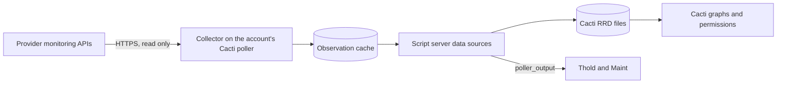

# plugin_cloud

A Cacti 1.2 plugin that brings cloud resources and metrics into Cacti as devices, data sources, and graphs. The current implementation has a DigitalOcean driver; AWS, Google Cloud, and Azure remain planned providers. Cacti's poller stores the observations in RRDs, so cloud graphs use Cacti permissions and can feed existing Thold and Maint workflows.

> **Status: milestone 2 and milestone 3 code are present in this checkout.** The code includes DigitalOcean collection, Cacti scope devices and graph templates, request estimates, and a disposable-stack test of Thold alerts and Maint suppression. The DigitalOcean API has not been checked against a live account, so this code snapshot is not production-validated.

## Why

Each cloud provider has its own monitoring console. Run alongside Cacti, they leave three gaps:

- **Separate access control.** Showing a Cacti user cloud metrics means giving them a cloud login.
- **No network context.** On-premises links are graphed in Cacti; the workloads behind them are graphed in each provider's console.
- **Separate alerting.** Thold and Maint work on Cacti data sources and devices, so provider alarms are configured and suppressed separately, once per provider.

The plugin reads each provider's monitoring API on a Cacti poller, caches the latest datapoints, and serves them to Cacti's script server. Cacti's poller writes the RRD files, so graphing, permissions, Thold, Maint, and boost work as they do for any Cacti data.

## Design commitments

- **Read-only.** Each driver can build only the provider operations on its allowlist; the plugin never changes a cloud resource. ([ADR 0002](docs/decisions/0002-read-only-with-operation-allowlist.md))
- **PHP only, no SDKs.** Signing and token exchange are implemented in PHP with the extensions Cacti already requires. No Composer runtime dependencies. ([ADR 0003](docs/decisions/0003-php-only-without-sdks.md))
- **Cost before collection.** The plugin reads only metrics that have a Cacti data source, shows the expected request count and list-price cost before graphs are created, and enforces a monthly ceiling. ([ADR 0005](docs/decisions/0005-collect-only-what-is-graphed.md))
- **No plaintext credentials in the database.** The implemented DigitalOcean driver uses an encrypted vault keyed by a file outside the database or a credential file. Instance identity is reserved for future providers that support it. ([ADR 0007](docs/decisions/0007-credentials-outside-the-database-in-the-clear.md))

## Scope and status

| Phase | Scope | Milestones | Status |
|---|---|---|---|
| 0, research | Provider fact confirmation, metric catalogs, cost and rate model, signing test vectors, transport spike | [M1](https://github.com/somethingwithproof/plugin_cloud/milestone/1) | Done, except the checks that need a live provider account |
| 1, core and DigitalOcean | Accounts, credential vault, transport, collector, observation cache, Cacti objects, health page, DigitalOcean Droplets and load balancers | [M2](https://github.com/somethingwithproof/plugin_cloud/milestone/2), [M3](https://github.com/somethingwithproof/plugin_cloud/milestone/3), [M4](https://github.com/somethingwithproof/plugin_cloud/milestone/4) | M2 and M3 implementation is present in this checkout; live-account validation remains; M4 is not started |
| 2, AWS | Signature Version 4, `AssumeRole`, instance roles, CloudWatch `GetMetricData`, regional inventory | [M5](https://github.com/somethingwithproof/plugin_cloud/milestone/5) | Not started |
| 3, Google Cloud | Service account JWT, metadata server, Cloud Monitoring `timeSeries.list` | [M6](https://github.com/somethingwithproof/plugin_cloud/milestone/6) | Not started |
| 4, Azure | Entra client credentials, managed identity, Resource Graph, `metrics:getBatch` | [M7](https://github.com/somethingwithproof/plugin_cloud/milestone/7) | Not started |
| 5, remote collectors | Accounts on Cacti remote data collectors | [M8](https://github.com/somethingwithproof/plugin_cloud/milestone/8) | Not started |

Out of scope: changing cloud resources, creating or mirroring provider alarms, billing reports, logs and traces, and a plugin-owned alerting engine. Further providers (Hetzner Cloud, Akamai Cloud, Oracle Cloud, and others) are research issues.

## Milestone 2 foundation

- **A guarded install.** On PHP below 8.2, or without ext-openssl, install and enable are refused with a message, and the rest of Cacti keeps working.
- **Lifecycle.** Install, upgrade, and uninstall through Cacti's Plugins page. Upgrades are ordered and survive interruption. Uninstall keeps the plugin's tables unless you clear *Keep Plugin Tables on Uninstall*.
- **Two realms.** *Cloud Admin* opens **Cloud Accounts**; *Cloud View* opens **Cloud Health**. Both pages are under Management.
- **Accounts and credentials.** Add, edit, verify, and delete accounts. A credential is either encrypted in the database with a key file kept outside it (AES-256-GCM), or read from a file on the poller. Credentials are write-only in the UI and are redacted from logs.
- **The collector.** It starts from each poller run, one instance per poller, within a time budget. It takes a lease per account, runs discovery on its own interval, and reads metrics only for the plugin's own active data sources.
- **Health.** Per-account collection, discovery, resource, and freshness state, plus warnings for an unusable vault key, unsafe credential files, and intervals the poller cannot honour.

## Milestone 3: DigitalOcean graphs and alert flow

The current code adds the DigitalOcean driver for Droplets and load balancers, Cacti data-query and graph templates, a scope device for each account, and a script-server input that serves cached observations. New Graphs and Cloud Health show the expected request count and estimated API cost before collection. Provider operations are read-only and limited by the driver's operation allowlist.

The repository includes source-level and disposable-Cacti evidence for these paths:

| Behavior | Implementation | Evidence in the repository |
|---|---|---|
| DigitalOcean requests and metric mapping | [DigitalOceanDriver.php](lib/DigitalOceanDriver.php), [DigitalOceanCatalog.php](lib/DigitalOceanCatalog.php) | [DigitalOceanDriverTest.php](tests/Unit/DigitalOceanDriverTest.php) |
| Cacti scope devices, data queries, and graph templates | [DeviceRepository.php](lib/DeviceRepository.php), [Templates.php](lib/Templates.php), [templates/](templates/) | [ScopeDeviceTest.php](tests/Integration/ScopeDeviceTest.php), [TemplatesTest.php](tests/Integration/TemplatesTest.php) |
| Request estimates and collection cost limits | [UsageEstimate.php](lib/UsageEstimate.php), [EstimateView.php](lib/EstimateView.php) | [CostPreviewTest.php](tests/Unit/CostPreviewTest.php) |
| Thold alert/restoral and Maint suppression through normal poller values | [alerting.php](tests/bin/alerting.php) | Disposable Cacti integration script; requires Cloud, Thold, and Maint installed and enabled |

The alerting script exercises Cacti's poller and Thold checker with test observations. It does not call a live DigitalOcean account. The performance results and fixture setup are in [docs/performance.md](docs/performance.md).

## Install and configure

These steps install the code in this checkout for evaluation. They require Cacti 1.2.31 or later on PHP 8.2 or later.

1. Copy the repository to `plugins/cloud` under your Cacti directory. The directory must be named `cloud`.
2. Create the vault key outside the web root. Put it in a directory that only root and the Cacti user can write, and make the file readable only by the user that runs the web server and the poller. The plugin never creates or writes this file:

   ```sh
   sudo install -d -m 0750 -o root -g cacti /etc/cacti
   head -c 32 /dev/urandom | sudo tee /etc/cacti/cloud-vault.key > /dev/null
   sudo chown cacti:cacti /etc/cacti/cloud-vault.key
   sudo chmod 0600 /etc/cacti/cloud-vault.key
   ```

   Replace `cacti` with the user that runs your web server and poller. The file holds 32 raw bytes or 64 hexadecimal characters. Back it up with the database; without it, stored credentials must be entered again.
3. In Cacti, open **Configuration > Plugins**, then install and enable *Cloud*.
4. Under **Configuration > Settings > Cloud**, set *Vault Key File* if you used another path. *Collector Time Budget* (default 240 seconds) must stay below the poller interval.
5. Grant *Cloud Admin* or *Cloud View* to users and groups under **Configuration > Users**. Installing grants both realms to the administrator.
6. Add accounts under **Management > Cloud Accounts**, then check **Management > Cloud Health** for warnings.

## Compatibility targets

| Component | Target |
|---|---|
| Cacti | 1.2.31 or later, no core patches |
| PHP | 8.2 or later; `setup.php` stays parseable on 8.0 so an unsupported runtime gets a refusal instead of a broken Cacti UI |
| PHP extensions | None beyond those Cacti 1.2.31 requires |
| Thold, Maint | No changes required |

## Design

- [docs/performance.md](docs/performance.md) has the collector and health page measurements, with the hardware and settings used.
- [docs/PLAN.md](docs/PLAN.md) is the full plan: architecture, the provider and Cacti facts it depends on (with sources), the driver contract, cost arithmetic, security boundaries, testing, and risks.
- [docs/decisions/](docs/decisions/) holds architecture decision records for choices already made.
- [docs/REQUIREMENTS.md](docs/REQUIREMENTS.md) maps every requirement ID to its issue.



## How work is tracked

- **Milestones** follow the plan's milestones. Each has an epic issue listing its sub-issues and exit evidence.
- **Issues** are typed by label: `type: requirement`, `type: research`, `type: decision`, `type: epic`. Requirement issues state numbered, testable requirements (`REQ-AREA-NNN`) and acceptance criteria.
- **Labels** also carry `area:`, `provider:`, `phase:`, `priority:`, and `status:`. See [CONTRIBUTING.md](CONTRIBUTING.md#labels).
- The [project board](https://github.com/users/somethingwithproof/projects/7) shows all issues across milestones.

## Development

CI lints the entry points on PHP 8.0, runs unit and integration tests and PHPStan level 9, and installs the plugin on PHP 8.2 to 8.5 against Cacti 1.2.31 and the 1.2.x branch. It also checks that PHP 8.1 is refused without breaking Cacti. The tests use Pest from Cacti core's plugin harness. That choice is provisional until [#12](https://github.com/somethingwithproof/plugin_cloud/issues/12) is decided. [.github/workflows/plugin-ci-workflow.yml](.github/workflows/plugin-ci-workflow.yml) lists every step. Run `sh tests/lint-workflows.sh` and `sh locales/build_gettext.sh --check` locally before pushing.

## Contributing

Read [CONTRIBUTING.md](CONTRIBUTING.md). Commits need a DCO sign-off. Design discussion happens on issues; open decisions carry the `type: decision` label.

## Security

Report vulnerabilities privately; see [SECURITY.md](SECURITY.md).

## License

GNU General Public License v2.0, the same license as Cacti and its plugins. See [LICENSE](LICENSE).
