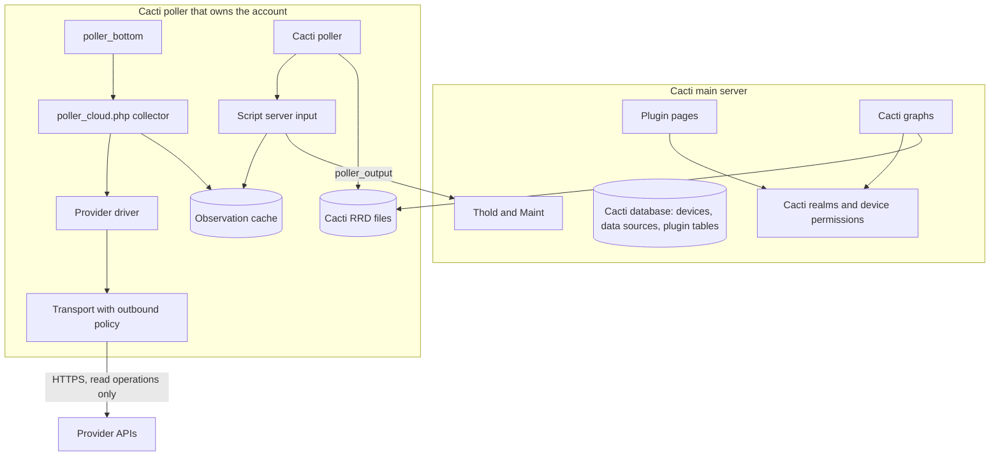

# Cacti 1.2 Cloud Plugin Plan

Status: in development, plan revision 2 (2026-11-14). Milestone 2 (foundation) is merged on `main`: the PHP guard, lifecycle, realms and settings, accounts, credential vault, transport and outbound policy, provider driver contract, collector, observation cache, health page, and test harness. No provider driver is merged, so the plugin collects nothing yet. Milestone 3 is in progress and not on `main`; later milestones are not started. There is no release. Statements about cloud providers, Cacti core, Thold, and Maint describe current upstream behavior and cite the page or file that was checked. Revision 2 applies the milestone 1 documentation checks and spikes in [`docs/research/`](research/); facts that need a live provider account are still marked and listed under [live checks](research/provider-facts.md#live-checks). Estimates are in [research/estimates.md](research/estimates.md).

`plugin_cloud` brings resources and metrics from public cloud providers into Cacti 1.2 as ordinary Cacti devices, data sources, and graphs. Operators see cloud workloads next to the network that carries them, under Cacti's permissions, and alert on them with Thold and Maint. One plugin covers every provider, with a driver per provider: DigitalOcean, AWS, Google Cloud, and Azure first.

## Why this plugin

Each provider has its own monitoring console. Running it next to Cacti leaves three gaps:

1. **Separate access control.** Provider consoles use provider identities. Giving a Cacti user a view of cloud metrics means giving them a cloud login.
2. **No network context.** Latency and interface counters for on-premises links live in Cacti; CPU, bandwidth, and load balancer health for the workloads behind them live in each provider's console.
3. **Separate alerting.** Thold and Maint work on Cacti data sources and devices. Provider alarms are configured, routed, and suppressed separately, once per provider.

The Cacti GitHub organization has no cloud provider plugin today (checked 2026-11-14). [plugin_cloudflare](https://github.com/somethingwithproof/plugin_cloudflare) covers Cloudflare Tunnels and is the source of this plan's credential and outbound request design.

The plugin closes these gaps by reading each provider's monitoring API on a Cacti poller, caching the latest datapoints, and serving them to Cacti's script server. Cacti's poller writes the RRD files, so graphing, permissions, Thold, Maint, boost, and remote data collectors work as they do for any Cacti data.

## Goals and non-goals

**Goals**

- One plugin with one driver per provider ([ADR 0001](decisions/0001-one-plugin-with-provider-drivers.md)).
- Read-only operation enforced by an allowlist of provider operations ([ADR 0002](decisions/0002-read-only-with-operation-allowlist.md)).
- Everything shipped is PHP, with no SDKs and no Composer runtime dependencies ([ADR 0003](decisions/0003-php-only-without-sdks.md)).
- Cost and rate limits visible before collection starts, and collection limited to what is graphed ([ADR 0005](decisions/0005-collect-only-what-is-graphed.md)).
- Alerting and maintenance through Thold and Maint ([ADR 0006](decisions/0006-alert-through-cacti-data-sources.md)).
- No credential stored in the clear in the Cacti database ([ADR 0007](decisions/0007-credentials-outside-the-database-in-the-clear.md)).
- No required Cacti core patches.

**Non-goals**

- Creating, changing, starting, stopping, or deleting cloud resources.
- Creating or mirroring provider alarms, dashboards, or log queries.
- Billing and cost reporting. The plugin estimates its own API cost; it does not report the operator's cloud bill. Billing data is research.
- Logs, traces, and custom application metrics.
- Kubernetes workloads inside a cluster. Managed cluster nodes appear as the provider's virtual machines; anything deeper is research.
- A plugin-owned alerting engine, a public HTTP API, or a CLI in the first releases.

## Release phases

Each phase ships to users ([ADR 0008](decisions/0008-providers-in-releasing-phases.md)). Later phases are re-estimated after the phase before them.

| Phase | Label | Scope | Depends on |
|---|---|---|---|
| 0 | Research | Provider fact confirmation, metric catalogs, cost and rate model, signing test vectors, HTTP transport spike, Cacti object model (milestone 1) | Nothing |
| 1 | Core and DigitalOcean | Accounts, credential vault, transport, collector, observation cache, Cacti objects, script server input, health page, DigitalOcean Droplets and load balancers | Phase 0 |
| 2 | AWS | Signature Version 4, access keys, `AssumeRole`, instance roles, CloudWatch `GetMetricData`, EC2 and load balancer inventory across regions, cost ceiling | Phase 1, security review |
| 3 | Google Cloud | Service account JWT, metadata server credentials, Cloud Monitoring `timeSeries.list`, Compute Engine inventory | Phase 2 |
| 4 | Azure | Entra client credentials, managed identity, Resource Graph inventory, Azure Monitor `metrics:getBatch` | Phase 2 |
| 5 | Remote collectors | Accounts assigned to Cacti remote data collectors, replication, offline and recovery behavior | Phase 1 |
| - | Research | Further providers, billing data, provider alarms, Cloudflare consolidation, Kubernetes, proxies with authentication | Demand after phase 1 |

Phases 3, 4, and 5 depend only on what they list, so they can run in parallel if contributors are available.

## Compatibility

**Cacti.** Minimum Cacti release is 1.2.31, with no core patches. The plugin uses only APIs present in that release, each checked at `release/1.2.31`:

- Plugin lifecycle and hooks: `api_plugin_register_hook()`, `api_plugin_register_realm()`, `api_plugin_db_table_create()` ([lib/plugins.php](https://github.com/Cacti/cacti/blob/release/1.2.31/lib/plugins.php)). The two register functions refuse to run unless the function calling them has `install`, `upgrade`, or `setup` in its name, so `plugin_cloud_install()` and `plugin_cloud_upgrade()` call them directly, not through a class method. `api_plugin_db_table_create()` skips an existing table on 1.2.31 but refreshes its schema on `1.2.x`; the plugin's migrations depend on neither.
- Devices: `api_device_save()` ([lib/api_device.php](https://github.com/Cacti/cacti/blob/release/1.2.31/lib/api_device.php)); permissions: `is_device_allowed()` and `get_allowed_devices()` (`lib/auth.php`).
- Data queries: `run_data_query()` ([lib/data_query.php](https://github.com/Cacti/cacti/blob/release/1.2.31/lib/data_query.php)); poller cache rebuild: `push_out_host()` (`lib/utility.php`).
- Templates: `import_xml_data()` ([lib/import.php](https://github.com/Cacti/cacti/blob/release/1.2.31/lib/import.php)).
- Background work: `exec_background()`, `register_process_start()`, `unregister_process()` ([lib/poller.php](https://github.com/Cacti/cacti/blob/release/1.2.31/lib/poller.php)). `exec_background()` takes one executable path and its arguments separately; `1.2.x` shell-quotes the path, so the PHP binary is the path and the script goes in the arguments.
- Settings and logging: `read_config_option()`, `cacti_log()` (`lib/functions.php`).
- Remote collectors (phase 5): `replicate_out()` (`lib/poller.php`), `call_remote_data_collector()` (`lib/functions.php`), and the `remote_agent` hook (`remote_agent.php`). On `1.2.x`, `remote_agent.php` authorizes callers by TCP peer address. A collector reached through a proxy therefore needs the proxy's address registered, and the proxy must be restricted to the collectors; otherwise every client that reaches it passes the check.

Milestone 1 confirmed every signature at `release/1.2.31` and on `1.2.x` ([Cacti core](research/cacti-core.md)); the differences that matter are the two noted above.

**PHP.** The plugin requires PHP 8.2 or later, matching the Cacti 1.2.x floor ([ADR 0004](decisions/0004-php-82-floor-with-80-parse-guard.md)). The `1.2.x` branch declares `"php": ">=8.2"` and pins Composer resolution to `platform.php: 8.2.0` ([branch composer.json](https://github.com/Cacti/cacti/blob/1.2.x/composer.json)). Released 1.2.31 still declares `>=8.0` ([release composer.json](https://github.com/Cacti/cacti/blob/release/1.2.31/composer.json)), and Cacti includes plugin files on every request, so:

- `setup.php`, `INFO`, and every file Cacti includes before the version check use only PHP 8.0 syntax.
- `plugin_cloud_check_config()` and `plugin_cloud_install()` refuse to proceed when `version_compare(PHP_VERSION, '8.2.0', '<')`, with a message naming the required version.
- Hook shims return early under the same condition, before the autoloader is registered, so no class file is ever parsed on an unsupported runtime.
- CI lints `setup.php` and the shim files under PHP 8.0.

Code loaded after the check uses PHP features through 8.2 where they make the code clearer:

- **8.0:** `match`, the nullsafe operator, named arguments, constructor property promotion, union types, `mixed`, `str_contains()`, `str_starts_with()`, `str_ends_with()`.
- **8.1:** enums, `readonly` properties, `never`, first-class callable syntax, `array_is_list()`.
- **8.2:** `readonly` classes, DNF types, and the standalone `null`, `true`, and `false` types.

Features from PHP 8.3 and later are not used: typed class constants, `#[\Override]`, and `json_validate()`. Properties are always declared, because PHP 8.2 deprecates dynamic properties. PHPStan runs at `phpVersion` 8.2. No upper PHP bound is declared; the CI matrix defines the tested ceiling.

**PHP extensions.** The plugin requires nothing beyond what Cacti 1.2.31's `composer.json` already requires; the relevant ones are `ext-openssl`, `ext-json`, `ext-dom`, and `ext-xml`. `ext-curl` is not on that list, so the transport uses `stream_socket_client()` ([ADR 0009](decisions/0009-http-transport.md)), and the plugin does not need `allow_url_fopen` either.

**Plugin metadata.** `INFO` declares `compat = 1.2.31` and `capabilities = online_view:1, online_mgmt:1, offline_view:0, offline_mgmt:0, remote_collect:1`. Remote collection is declared from the start so that account rows carry a poller from phase 1; phase 1 accepts only the main poller. On a remote collector Cacti runs `poller_bottom` only for plugins declaring `remote_poller:1`, so phase 5 adds that capability.

## Upstream behavior the design depends on

Each row is a milestone 1 test, because a change in any of them changes the design. All rows were re-read against their sources on 2026-11-14 ([provider facts](research/provider-facts.md)); rows marked *live* need a call against a test account and are listed under [live checks](research/provider-facts.md#live-checks).

**DigitalOcean**

| Fact | Consequence | Source |
|---|---|---|
| Requests use `Authorization: Bearer <token>`. Custom-scoped tokens exist; `droplet:read`, `load_balancer:read`, and `monitoring:read` cover inventory and metrics. Tokens can expire. | The plugin asks for a custom token with read scopes only, and treats 401 as expired or revoked and 403 as a missing scope. The metrics endpoints declare no 403 response, so that mapping is *live*. | [Scopes](https://docs.digitalocean.com/reference/api/scopes/), [tokens](https://docs.digitalocean.com/reference/api/create-personal-access-token/) |
| Droplet metrics are one `GET` per metric under `/v2/monitoring/metrics/droplet/` (`cpu`, `bandwidth`, `load_1`, `memory_*`, `filesystem_*`), with `host_id`, `start`, and `end`. `bandwidth` also needs `interface` and `direction`, and is in megabits per second. There is no disk I/O or packet metric in the API. | A Droplet's CPU and four bandwidth series cost five requests per collection, and are its only agent-free series. | [OpenAPI spec](https://docs.digitalocean.com/reference/api/reference/openapi.json) |
| Responses are Prometheus-style matrices with string values. No step parameter, sample interval, or retention is documented. | The real resolution, and whether `cpu` values are cumulative, are *live* and are measured before templates fix an RRD step. | OpenAPI spec |
| Memory, load, and filesystem metrics need the metrics agent on the Droplet. | Without it those series are empty; the plugin reports "agent not installed" rather than an error, and does not offer those graphs. | [Monitoring features](https://docs.digitalocean.com/products/monitoring/details/features/) |
| Rate limits are 5,000 requests per hour and 250 per minute per token, with `ratelimit-limit`, `ratelimit-remaining`, `ratelimit-reset`, and `retry-after` on 429. | Request budget, not cost, bounds DigitalOcean collection. Five requests per Droplet every five minutes is 60 per hour, so one token covers about 80 Droplets at that rate with nothing else using it. | OpenAPI spec, "Rate Limit" |
| Lists page with `page` and `per_page`; `/v2/droplets` and `/v2/load_balancers` accept up to 200. | The plugin uses 200 (*live*: confirm the server accepts it) and follows `links.pages.next`. | OpenAPI spec |

**AWS**

| Fact | Consequence | Source |
|---|---|---|
| Signature Version 4 derives a signing key by chained HMAC-SHA256 over the secret, date, region, service, and `aws4_request`, and signs a canonical request. Temporary credentials add `x-amz-security-token`. | The signer is a small PHP class. URI encoding follows AWS's rules, not `urlencode()`. | [SigV4](https://docs.aws.amazon.com/IAM/latest/UserGuide/reference_sigv-create-signed-request.html) |
| CloudWatch at `monitoring.<region>.amazonaws.com` accepts the Query protocol and AWS JSON 1.0; AWS says Query remains supported. | The client uses either form-encoded `Action=GetMetricData` with XML responses, or JSON 1.0 with `X-Amz-Target`. Milestone 5 chooses after the *live* check confirms the JSON headers. | [API reference](https://docs.aws.amazon.com/AmazonCloudWatch/latest/APIReference/Welcome.html), [protocols FAQ](https://docs.aws.amazon.com/AmazonCloudWatch/latest/monitoring/cloudwatch-protocols-faq.html), [endpoints](https://docs.aws.amazon.com/general/latest/gr/cw_region.html) |
| `GetMetricData` takes up to 500 queries per call and pages with `NextToken`. | One call per region covers 500 series. | [GetMetricData](https://docs.aws.amazon.com/AmazonCloudWatch/latest/APIReference/API_GetMetricData.html) |
| `GetMetricData` costs $0.01 per 1,000 metrics requested and is excluded from the free API requests. | Cost grows with series and collection frequency, not with calls. 1,000 series every five minutes is 8.64 million metrics a month, about $86 at list price (arithmetic). | [Pricing](https://aws.amazon.com/cloudwatch/pricing/), [billing](https://docs.aws.amazon.com/AmazonCloudWatch/latest/monitoring/metrics-classic-getdata.html) |
| EC2 basic monitoring publishes five-minute data; one-minute data needs detailed monitoring. The latest period's value can change as samples arrive. No publication delay is documented. Load balancer metrics are published every 60 seconds, and only while traffic flows. | Collection defaults to 300 seconds and never runs faster than a metric's period. The query window ends before the current period. The EC2 delay is *live*. A missing datapoint reads as 0 only for a load balancer count whose reporting criterion is a nonzero value, and only when the query returned complete data; anything else missing is `U`. | [Concepts](https://docs.aws.amazon.com/AmazonCloudWatch/latest/monitoring/cloudwatch_concepts.html), [ALB metrics](https://docs.aws.amazon.com/elasticloadbalancing/latest/application/load-balancer-cloudwatch-metrics.html) |
| The Resource Groups Tagging API does not return untagged resources. `DescribeRegions` returns the regions enabled for the account. | Inventory uses per-service describe calls in enabled regions, not tags alone. | [GetResources](https://docs.aws.amazon.com/resourcegroupstagging/latest/APIReference/API_GetResources.html), [DescribeRegions](https://docs.aws.amazon.com/AWSEC2/latest/APIReference/API_DescribeRegions.html) |
| `AssumeRole` accepts an `ExternalId` and returns credentials valid for 900 to 43,200 seconds. IMDSv2 issues a session token by `PUT` to `169.254.169.254` with a default hop limit of 1. | Role credentials are cached per run and refreshed before expiry. Instance roles may fail inside containers; the health page says why. | [AssumeRole](https://docs.aws.amazon.com/STS/latest/APIReference/API_AssumeRole.html), [IMDS](https://docs.aws.amazon.com/AWSEC2/latest/UserGuide/configuring-instance-metadata-service.html) |
| The managed `CloudWatchReadOnlyAccess` policy grants many unrelated reads and lacks the EC2 describe actions. | The documentation ships a minimal custom policy. | [Policy reference](https://docs.aws.amazon.com/aws-managed-policy/latest/reference/CloudWatchReadOnlyAccess.html) |
| Throttling errors include `Throttling`, `ThrottlingException`, and EC2's `RequestLimitExceeded`; AWS recommends jittered exponential backoff. | One retry policy covers all AWS calls; `AccessDenied` is never retried. | [Retries](https://docs.aws.amazon.com/general/latest/gr/api-retries.html) |

**Google Cloud**

| Fact | Consequence | Source |
|---|---|---|
| A service account gets an access token by posting an RS256-signed JWT (`iss`, `scope`, `aud`, `iat`, `exp` at most one hour later) to `https://oauth2.googleapis.com/token` with `grant_type=urn:ietf:params:oauth:grant-type:jwt-bearer`. | `openssl_sign()` with SHA-256 is enough. Tokens are cached until shortly before expiry. | [Service accounts](https://developers.google.com/identity/protocols/oauth2/service-account) |
| On Compute Engine, the metadata server issues tokens at `metadata.google.internal` with `Metadata-Flavor: Google`. | Instance identity needs no key file. | [Metadata](https://docs.cloud.google.com/compute/docs/metadata/querying-metadata) |
| `timeSeries.list` accepts the `monitoring.read` scope, needs one metric type per filter, supports server-side alignment, and pages with `nextPageToken`. Customer support for MQL ended July 22, 2025; existing MQL still runs. | One call per metric type per project, aligned server-side. MQL is not used. | [timeSeries.list](https://docs.cloud.google.com/monitoring/api/ref_v3/rest/v3/projects.timeSeries/list), [MQL](https://docs.cloud.google.com/monitoring/mql) |
| Since October 2, 2025, reads cost $0.50 per million time series returned, at least one per call, after one million free per billing account. Whether `crossSeriesReducer` is counted before or after reduction is *live*. | 1,000 series every five minutes is 8.64 million series a month, about $3.82 at list price (arithmetic). | [Pricing](https://cloud.google.com/products/observability/pricing) |
| Compute Engine CPU utilization is sampled every 60 seconds and may not be visible for up to 240 seconds. | The query window ends at least 240 seconds before now for that metric. Delay is recorded per metric. | [GCP metrics](https://docs.cloud.google.com/monitoring/api/metrics_gcp_c) |
| `instances.aggregatedList` lists instances in every zone of a project, up to 500 per page. The read-request quota for Monitoring is not published as a number; the project's quota page shows it. | Inventory is per project. The collector backs off on 429 rather than relying on a fixed quota. | [aggregatedList](https://docs.cloud.google.com/compute/docs/reference/rest/v1/instances/aggregatedList), [quotas](https://docs.cloud.google.com/monitoring/quotas) |

**Azure**

| Fact | Consequence | Source |
|---|---|---|
| Client credentials are a `POST` to `login.microsoftonline.com/{tenant}/oauth2/v2.0/token` with scope `<resource>/.default`, one resource per token. | Two tokens per run: ARM (`management.azure.com`) and metrics (`metrics.monitor.azure.com`). | [Client credentials](https://learn.microsoft.com/en-us/entra/identity-platform/v2-oauth2-client-creds-grant-flow) |
| Certificate credentials use a client assertion that the current documentation says should be PS256 with an `x5t#S256` header. | `openssl_sign()` has no PSS option, so certificate authentication is research. Phase 4 ships client secrets and managed identity. | [Certificate credentials](https://learn.microsoft.com/en-us/entra/identity-platform/certificate-credentials) |
| Managed identity tokens come from `169.254.169.254/metadata/identity/oauth2/token` with `Metadata: true`. | Instance identity needs no secret. | [Managed identity](https://learn.microsoft.com/en-us/entra/identity/managed-identities-azure-resources/how-to-use-vm-token) |
| `metrics:getBatch` on `{region}.metrics.monitor.azure.com` takes up to 50 resources of one subscription, region, and type per call, needs Monitoring Reader at subscription scope, and is billed. | Resources are grouped by subscription, region, and type for batching. | [Batch API](https://learn.microsoft.com/en-us/rest/api/monitor/metrics-batch/batch), [migration guide](https://learn.microsoft.com/en-us/azure/azure-monitor/metrics/migrate-to-batch-api) |
| Metrics query calls cost $0.01 per 1,000 after one million free per subscription a month. Whether one `metrics:getBatch` call for 50 resources bills as one call is not stated. Batch hosts are `{region}.metrics.monitor.azure.cn` in Azure China; none is documented for Azure Government. | Estimates show the one-call-per-batch and one-call-per-resource figures until the *live* billing check. Azure Government is out of scope until a host is documented. | [Pricing](https://azure.microsoft.com/pricing/details/monitor/), [Retail Prices API](https://prices.azure.com/api/retail/prices) |
| ARM reads are throttled by a token bucket of 250 refilled at 25 per second per subscription and principal. Per-resource metrics calls are a common cause of throttling. | Batch is the default; per-resource calls are a fallback for namespaces batch does not support. | [Throttling](https://learn.microsoft.com/en-us/azure/azure-resource-manager/management/request-limits-and-throttling) |
| Resource Graph returns at most 1,000 rows per page with `$skipToken`, is free, and is eventually consistent. | Inventory uses Resource Graph; a newly created resource may appear a cycle late. | [Resource Graph](https://learn.microsoft.com/en-us/rest/api/azureresourcegraph/resourcegraph/resources/resources) |

**Cacti core 1.2.31**

| Fact | Consequence | Source |
|---|---|---|
| The script server includes a named file once and calls a named function for each data source. The file and the function's source must resolve under Cacti's `base_path`, and the function must return a scalar and print nothing. | One function serves every cloud data source from the observation cache. | `script_server.php` |
| Script server data queries are XML files naming a script and function; `snmp_query.xml_path` may point into a plugin directory. Index and query steps run the script as a separate PHP CLI process; only polling uses the persistent script server. | Each resource type is a data query whose indexes are the resources. The plugin's script has both a function entry point and a CLI entry point. | `resource/script_server/`, `lib/data_query.php` |
| Thold receives values through the `poller_output` hook. Maint provides `plugin_maint_check_cacti_host($device_id)`, which Thold and core call directly when Maint is enabled; Maint's `is_device_in_maintenance` hook has no caller. | Polled script server values reach Thold with no change to either plugin. Maintenance on the scope device suppresses Thold's notifications, not collection. The plugin checks maintenance the same way: when Maint is enabled it loads Maint's `functions.php` (or `includes/functions.php`), as Thold does, then makes the guarded call. | plugin_thold `includes/polling.php`, plugin_maint `includes/functions.php` |
| `call_remote_data_collector()` fetches with `file_get_contents()` and a stream context. Its timeout sits under an `https` context key, which PHP does not read. | Core's use of the stream wrapper was not enough to choose it; the spike found limits core does not hit ([ADR 0009](decisions/0009-http-transport.md)). | `lib/functions.php` |
| On a remote data collector, CLI processes use the local database; only web requests switch to the main database. The mode is `recovery` when the local `poller_output_boost` table holds rows and the main database is reachable, and `offline` when it is unreachable (offline wins). | Remote collector code must state which database it writes (phase 5). | `include/global.php` |

## Architecture



| Component | Responsibility | Interfaces | Failure behavior |
|---|---|---|---|
| Plugin pages | Accounts, credentials, inventory, graph selection with cost estimate, health | Cacti page framework, csrf-magic, realms | Show cached data with its age; never call a provider during a page request except Verify |
| Collector (`poller_cloud.php`) | For each due account: refresh credentials, run discovery when due, read metrics for enabled data sources, update the cache and health | `poller_bottom`, `exec_background()`, `register_process_start()`, filtered by `poller_id` | One instance per poller; time budget per run; per-account lease; resumes next cycle |
| Provider driver | Authentication, endpoints, discovery, metric reads, cost and request estimates for one provider | `ProviderDriver` interface | Returns typed errors (`auth`, `permission`, `throttled`, `transient`, `malformed`, `config`); never throws provider text into pages |
| Transport | One HTTPS request at a time with timeouts, size cap, no redirects, outbound allowlist | `HttpTransport` interface | A refused URL never resolves a name or opens a socket |
| Observation cache | Latest complete datapoint per resource and metric, with its timestamp and the fetch time | Plugin table on the poller's database | Rows older than the metric's window read as `U` |
| Script server input | Print values and `age` for one resource | Cacti script server | `U` for stale or missing values; `age` always numeric |
| Cacti object services | Devices, data queries, data sources, graphs | Cacti APIs only | Never writes Cacti tables directly |

### Provider driver contract

A driver is one class per provider implementing an interface along these lines. Names are illustrative; milestone 2 fixes them.

```php
interface ProviderDriver
{
	public function provider(): Provider;

	/** Hosts this account may reach, built from fixed tables and validated account fields. */
	public function endpoints(Account $account): EndpointPolicy;

	public function verify(Account $account, CredentialSet $credentials): VerifyResult;

	public function discover(Account $account, CredentialSet $credentials): Inventory;

	/** @param list<MetricRequest> $requests */
	public function collect(Account $account, CredentialSet $credentials, array $requests): CollectResult;

	/** @param list<MetricRequest> $requests */
	public function estimate(array $requests, int $intervalSeconds): UsageEstimate;
}
```

Each driver also ships a metric catalog: for each resource type, the metrics it supports, with provider metric name, statistic, native period, publication delay, unit, conversion to a per-second or absolute value, data source name, and RRD minimum and maximum. Templates, data source names, and the script server's fields come from the catalog, so they cannot drift apart.

### HTTP transport

The transport is the only code that opens a network connection. Its behavior follows plugin_cloudflare's `OutboundPolicy` and transport: HTTPS only, certificate and host name verification on, no redirects, a connect timeout and a total timeout, a response size cap, and a URL check that refuses user info, fragments, backslashes, control or non-ASCII bytes, and ports that are not plain digits.

The implementation is a `stream_socket_client()` TLS connection with a small HTTP/1.1 reader ([ADR 0009](decisions/0009-http-transport.md)). The milestone 1 [spike](research/transport.md) built the stream wrapper, the socket client, and an ext-curl client and ran the same cases against each. The stream wrapper could not bound total time or header size and returned malformed chunked bodies as data. ext-curl met them except on libcurl 8.14.1, which accepted conflicting `Content-Length` values, and it is not required by Cacti and is missing from stock Debian and Ubuntu installs. The socket client passed every spike case, needs no `allow_url_fopen`, and limits the parser to a status line, at most 64 KiB of headers, strict `Content-Length`, and strict chunked decoding. Plain HTTP is allowed only to the instance metadata addresses.

## Cacti objects

The mapping, decided in [ADR 0010](decisions/0010-scope-devices-with-resource-data-queries.md):

| Object | Created from | Notes |
|---|---|---|
| Scope device | A device template per provider, for example "Cloud: DigitalOcean Scope", carrying that provider's data queries; each device created with availability method None (`AVAIL_NONE`, 0) and the account's poller, because a Cacti 1.2 device template has no availability field | One per account and scope: a DigitalOcean team, an AWS account and region, a Google Cloud project, an Azure subscription and region |
| Resource data query | Script server data query per resource type, for example "Cloud: DigitalOcean Droplets" | Indexes are provider resource IDs; descriptions are resource names; reindexing follows Cacti's normal behavior |
| Data sources and graphs | A data template and a graph template per catalog graph, generated from the metric catalog | A graph's data source holds only that graph's metrics, so creating a graph collects nothing else ([ADR 0005](decisions/0005-collect-only-what-is-graphed.md)); polled through the script server; reach Thold through `poller_output` |

This follows plugin_cloudflare's pattern of one account device with resources as data query indexes. It keeps device counts proportional to accounts, not to resources, and Cacti's reindexing handles resources that come and go. The cost is that Maint suppresses a whole scope, not one resource, and a virtual machine's cloud graphs do not sit on the Cacti device that polls the same machine over SNMP. Mapping resources onto existing devices is a research issue.

Templates ship as Cacti template XML in `templates/`, generated from the catalog by `php tests/bin/generate-templates.php templates`; a unit test fails when the shipped files and the catalog disagree. Install and upgrade import them with `import_xml_data()` when the package changed or an object is missing, matched by fixed hashes so re-imports update rather than duplicate. Each data query definition is copied into `<path_cacti>/resource/script_server/`, because Cacti 1.2 refuses a data query file outside `<path_cacti>/resource`; uninstall leaves the templates and those files, because devices and graphs may still use them.

## Collection and measurement state

**Due work.** Each account has a collection interval, defaulting to the shortest native period among its enabled metrics and never shorter. Discovery runs on its own longer interval (default one hour) and on demand from Verify.

**What is read.** The collector builds its requests from the plugin's mapping of enabled Cacti data sources to resources and metrics ([ADR 0005](decisions/0005-collect-only-what-is-graphed.md)). For each metric it queries a window that ends at the metric's publication delay before now and spans two native periods, then keeps the newest complete datapoint.

**Request budget.** Each driver knows its provider's documented limits. Before a run, the collector computes the requests it needs; if they would exceed the account's share of the limit (default 50 percent for DigitalOcean, where the limit is per token and other tools may share it) or the account's monthly ceiling, it reads in a fixed order up to the budget, marks the rest unknown with reason `budget`, and reports it on the health page. On 429 or a provider throttling error it honors `Retry-After` and stops that account for the run.

**States.**

| Dimension | States | Evidence |
|---|---|---|
| Freshness | Current, delayed, stale, never observed | Datapoint time against the metric's period and delay: current within period plus delay plus collection interval; stale beyond twice that |
| Collection | Ok, partial, failed (with error class), budget exceeded, not collected | Last run's result per account and resource |
| Resource lifecycle | Active, missing, deleted | Present in the last discovery; missing after one discovery without it; deleted after a configurable number |
| Administrative | Enabled, disabled | Plugin records |
| Maintenance | In maintenance, not | Maint's `plugin_maint_check_cacti_host()` for the scope device, when Maint is enabled |
| Credential | Valid, expiring, invalid, permission missing | Verify result and the last authentication error |

A recent page refresh never counts as a recent measurement.

**Script server values.** For each resource the data source returns the catalog's fields plus `age`, the seconds since the newest datapoint. A field is `U` when the value is stale, never collected, over budget, or the resource is not active. `age` is always numeric so Thold can alert on staleness.

Stated limits:

- **Delay.** Cacti records values at poll time. A cloud graph lags the provider's console by the metric's publication delay plus up to one collection interval.
- **Sampling alignment.** If Cacti polls more often than the collection interval, values repeat; if less often, datapoints are skipped. The documentation tells operators to match Cacti's poller interval to the collection interval and to set Thold durations to at least one interval.
- **Restatement.** A provider may revise a recent datapoint after Cacti has recorded it. The revision is not applied to the RRD.

## Accounts and credentials

An account row holds provider, display name, poller, scope fields (team, AWS account and regions, Google Cloud project, Azure tenant, subscription, and regions), credential source, collection and discovery intervals, request ceiling, and enabled state. Scope fields are validated against strict patterns per provider before they reach a URL.

Credential sources are vault, credential file, and instance identity ([ADR 0007](decisions/0007-credentials-outside-the-database-in-the-clear.md)):

| Provider | Vault or file content | Instance identity |
|---|---|---|
| DigitalOcean | Personal access token | None |
| AWS | Access key ID and secret access key, optional role ARN and external ID for `AssumeRole` | IMDSv2 instance role (phase 2) |
| Google Cloud | Service account JSON key; only `client_email`, `private_key`, and `private_key_id` are used | Metadata server (phase 3) |
| Azure | Tenant ID, client ID, client secret | Managed identity (phase 4) |

Short-lived tokens are cached per collector run. When a provider limits how often tokens can be issued, they are cached in the vault with their expiry.

## Security

| Boundary | Control |
|---|---|
| Browser to Cacti | Cacti session, csrf-magic, two plugin realms (Cloud View, Cloud Admin), device and graph permissions, prepared queries, contextual escaping |
| Cacti to stored credentials | Vault encryption with a key file outside the database, file checks on credential and key files, secrets never returned to the browser or logged, redaction of known secrets and `Authorization` values from every error |
| Cacti to provider APIs | Outbound allowlist built from fixed per-provider host tables and validated scope fields; HTTPS with verification; no redirects; size and time limits; operation allowlist ([ADR 0002](decisions/0002-read-only-with-operation-allowlist.md)) |
| Cacti to instance metadata | Reachable only for an account whose credential source is instance identity, only at the provider's documented address, and only for the token path |
| Provider data to Cacti | Every provider string (names, tags, IDs) is untrusted: length-limited, validated where it becomes an identifier, escaped where printed; JSON parsed with depth limits; XML parsed with network and entity loading off |
| Main server to remote collector (phase 5) | Cacti's `remote_agent` authorization and the configured scheme; credentials replicate only to the collector that owns the account |

Phases 1, 2, 3, and 4 each need a security review of their driver's signing, credential handling, and endpoint tables before release. Phase 5 needs a review of replication and `remote_agent` actions.

## Code structure

Plugin code is object-oriented wherever Cacti's plugin contract allows it, following plugin_smokeping's layout.

**Where procedural code remains.** Cacti calls plugins by function name, so these entry points stay procedural. Each is a thin shim, parseable on PHP 8.0, that checks the PHP version, validates input, and hands off to a class:

- `setup.php` lifecycle functions: `plugin_cloud_install()`, `plugin_cloud_uninstall()`, `plugin_cloud_version()`, `plugin_cloud_check_config()`, `plugin_cloud_upgrade()`.
- Hook callbacks: `config_arrays`, `config_settings`, `draw_navigation_text`, `poller_bottom`, `api_device_save`, `device_remove`, `graph_buttons`; `replicate_out` and `remote_agent` in phase 5.
- Page scripts such as `cloud_accounts.php` and `cloud.php`, which include `include/auth.php`, read request variables with `get_filter_request_var()`, and call a page class.
- The script server input function and the `poller_cloud.php` CLI entry point.

**Layout.**

- Classes live in `lib/*.php` under the `Somethingwithproof\Cloud` namespace, one class per file, loaded by a small `spl_autoload_register()` loader registered only after the PHP version check. Provider classes are prefixed by provider (`AwsSigner`, `DigitalOceanDriver`) rather than nested, because the gettext build scans only `find . -maxdepth 2`.
- Settings use the `config_settings` hook. Logging uses `cacti_log()` with a `CLOUD` tag. Forms rely on Cacti's csrf-magic.
- Strings use the `cloud` text domain, with a `locales/` directory and POT file.

**Planned classes.** Names are illustrative; milestone 2 settles the final set.

| Kind | Examples | Notes |
|---|---|---|
| Value objects | `Account`, `ResourceRef`, `Resource`, `MetricDefinition`, `MetricRequest`, `Observation`, `UsageEstimate` | `readonly` classes built by named constructors such as `Account::fromRow()` |
| Enums | `Provider`, `CredentialSource`, `Freshness`, `ErrorClass`, `Lifecycle` | String-backed and stored as `varchar` values, never as list positions |
| Drivers | `DigitalOceanDriver`, `AwsDriver`, `GoogleCloudDriver`, `AzureDriver` | Implement `ProviderDriver`; depend on the transport and a signer |
| Signers and token sources | `BearerToken`, `AwsSigV4Signer`, `AwsAssumeRole`, `GoogleServiceAccountToken`, `EntraClientCredentials`, instance identity sources | Pure functions of inputs and a `Clock`, tested against published vectors |
| Repositories | `AccountRepository`, `ResourceRepository`, `ObservationRepository`, `JobRepository` | The only classes that issue SQL, always through prepared statements |
| Infrastructure | `HttpTransport` and its implementation, `OutboundPolicy`, `RetryPolicy`, `Vault`, `Clock`, `Redactor` | Interfaces only at real boundaries |
| Services | `Collector`, `Discovery`, `Reconciler`, `UsageEstimator`, `FreshnessEvaluator`, `Provisioner` | Return decisions as objects; a runner applies side effects |

**Rules.**

- Dependencies come in through constructors. No service locators and no static state, apart from Cacti's globals, which only shims touch.
- Interfaces exist only at real boundaries: the network, providers, the database, the clock, the filesystem, and remote collectors.
- `fromRow()` is the only place loose database values are normalized, and tests pin its behavior on empty strings, `NULL`, and malformed values.
- No Composer runtime dependencies; nothing under `vendor/` ships.
- PHPStan runs on the class tree with Cacti core on its scan path.

## Storage, jobs, upgrades, and recovery

Plugin tables hold accounts, encrypted credentials, resources, mappings from Cacti data sources to resources and metrics, the observation cache, job leases, health, and an audit log of account changes. They are created and upgraded with Cacti's tracked plugin table API, and the stored plugin version changes only after a migration succeeds.

The collector runs from `poller_bottom` through `exec_background()` as one `register_process_start()` process per poller, with a time budget below the poller interval. Each account's work holds a lease, so an interrupted run leaves the cache consistent and the next run continues.

Disabling the plugin stops collection. Uninstalling asks whether to drop plugin tables and whether to delete plugin-created devices, and never touches cloud resources. Backup documentation covers the Cacti database, the vault key file, and credential files; a restore without the key file requires re-entering vault credentials.

## Performance and cost

Capacity is stated in series: one resource and one metric field. Fixtures cover 100, 1,000, and 10,000 series.

Arithmetic at 1,000 series collected every 300 seconds (8,640 collections a month), at list prices checked on 2026-11-14:

| Provider | Requests per collection | Monthly cost of reads |
|---|---|---|
| DigitalOcean | 1,000 (one per series) | None, but 12,000 requests an hour exceeds one token's 5,000-an-hour limit. One token carries about 416 series at this interval using the whole limit, or about 208 at the default 50 percent share |
| AWS | 2 per region (500 queries per call) | About $86 (8.64 million metrics at $0.01 per 1,000) |
| Google Cloud | One or more per metric type and project | About $3.82 (8.64 million series, first million free, $0.50 per million) |
| Azure | One per 50 resources, region, and type (if a batch bills as one call) | Within the free million calls per subscription: 20 calls per collection, 172,800 a month. If each resource bills separately, about $76 ([cost model](research/cost-model.md)) |

Engineering targets, to be measured, not yet demonstrated:

- A collector run for 1,000 series finishes within one poller interval, including provider latency.
- No page request calls a provider, except Verify on the account page.
- The plugin's overview page renders in under two seconds at 10,000 series.

## Testing

- **Signers.** AWS Signature Version 4 against AWS's published examples; Google JWTs verified with `openssl_verify()` against the key's public half; Entra token requests compared byte for byte with the documented form.
- **Drivers.** Recorded provider responses, with secrets removed, for success, empty results, paging, throttling, expired credentials, missing permissions, malformed bodies, and oversized bodies.
- **Transport.** A local HTTPS server in the test environment, extending the milestone 1 spike's cases: redirects not followed, self-signed certificates and wrong host names refused, oversized bodies and headers cut off, slow and stalled responses stopped at the total timeout, malformed framing refused, refused URLs never connecting. The test server is reached through a test-only transport binding, never through a setting.
- **Read-only.** A test enumerates every operation each driver can build and compares it with the allowlist.
- **Cost and budget.** Estimates for fixture selections match hand-computed values; a run over budget reads nothing beyond it.
- **Cacti.** Fresh install and upgrade at 1.2.31 and current `1.2.x`, on every PHP minor in the CI matrix; `setup.php` and shims linted under PHP 8.0; permissions for every page and graph as an administrator, a scoped user, and a user with no access.
- **Alerting.** Thold fires and recovers on fixture values and on staleness; Maint suppresses its notifications.
- **Live.** Before each provider phase is released, a manual suite runs against a real account with least-privilege credentials and records request counts and cost.
- **Harness.** The same harness as plugin_smokeping (Pest from Cacti core), confirmed with maintainers before CI infrastructure is added.

## Milestones

| Milestone | Phase | Deliverables | Exit evidence |
|---|---|---|---|
| 1. Research | 0 | Confirmation of every fact table row; metric catalogs for phase 1 to 4 resource types; measured publication delays; cost and rate model; signing test vectors; transport spike; estimates | Every row confirmed or the plan updated; transport decision recorded; estimates published |
| 2. Foundation | 1 | PHP guard, lifecycle, realms, settings, accounts, vault, transport, driver contract, collector, cache, health page, test harness | Fresh install and upgrade at 1.2.31; install refused cleanly on PHP 8.1; unauthorized access rejected; transport tests pass |
| 3. DigitalOcean and Cacti objects | 1 | DigitalOcean driver, templates, scope devices, data queries, script server input, budget enforcement, cost and request preview | Droplet and load balancer graphs from a live account; budget holds under a fixture of 500 Droplets; Thold fires on fixture CPU and on staleness; Maint suppresses it |
| 4. Phase 1 release | 1 | Documentation, packaging, failure qualification, backup and restore, security review | Pilot on a live DigitalOcean account; security review complete |
| 5. AWS | 2 | Signer, credentials, regional inventory, `GetMetricData` batching, cost ceiling | Live suite passes in two regions with the minimal policy; cost of the live suite matches the estimate; security review complete |
| 6. Google Cloud | 3 | JWT token source, metadata server, inventory, `timeSeries.list` | Live suite passes with `roles/monitoring.viewer` and Compute read; security review complete |
| 7. Azure | 4 | Client credentials, managed identity, Resource Graph inventory, `metrics:getBatch` | Live suite passes with Monitoring Reader; security review complete |
| 8. Remote collectors | 5 | Poller affinity, replication, `remote_agent` health, offline and recovery | Collector offline, recovery, and reconnect scenarios produce correct state; security review complete |

## Open decisions

| Decision | Options | Needed before | Decided by |
|---|---|---|---|
| Repository home and plugin name | `Cacti/plugin_cloud`, or remain a community plugin | Before code is proposed upstream | Cacti maintainers |
| Test harness | Whatever maintained plugins use | Milestone 2 | Cacti maintainers |
| Outbound proxy support | No proxy (proposed for phase 1); an explicit proxy setting | Milestone 4 | Pilot feedback |
| Cloudflare | Keep plugin_cloudflare separate (proposed); fold it in as a driver | After phase 2 | Maintainer of both plugins, with evidence from the driver interface |

## Risks

| Risk | Effect | Mitigation |
|---|---|---|
| An operator graphs many AWS metrics at a short interval | An unexpected CloudWatch bill | Collect only what is graphed, cost preview, monthly ceiling, interval floor at the metric's period |
| A signing bug | Requests fail, or worse, look valid but sign the wrong thing | Published test vectors, live suites, signer code reviewed separately |
| Provider API or price changes | Broken collection or wrong estimates | Fact tables are tests; price tables carry their check date; driver changes are releases |
| Rate limits shared with other tools | Collection gaps and 429s for other users of the token | Default budget share, header-driven backoff, health page warning |
| Credential theft from the Cacti host | Read access to cloud metrics and inventory | Read-only credentials documented per provider, vault key outside the database, instance identity where available |
| Device and data source counts at 10,000 series | Slower Cacti pages | Measure at milestone 3; document a supported series count |
| Volunteer capacity | Later providers stall | Each phase ships on its own |

## Research

Not scheduled; revisited after phase 1:

- Further providers. Triage on 2026-11-14 found token-based REST metrics APIs at Hetzner Cloud and Akamai Cloud (Linode); request signing at Oracle Cloud Infrastructure and Alibaba Cloud; PromQL only at Scaleway; bandwidth only at Vultr; and no documented per-instance metrics API at OVHcloud or UpCloud.
- Azure certificate credentials, which need RSA-PSS signing.
- Mapping cloud resources onto existing Cacti devices.
- Billing and cost data.
- Importing provider alarm state as read-only data.
- Kubernetes workloads.
- Authenticated outbound proxies.
- Folding plugin_cloudflare in as a driver.

## Upstream process

This repository holds the plan and tracks its requirements as GitHub issues and milestones. Before code is proposed for the Cacti organization, open an issue there describing the problem, the phase plan, and the open decisions, and ask maintainers about the repository, name, object model, and test harness. No Thold or Maint change is needed.
