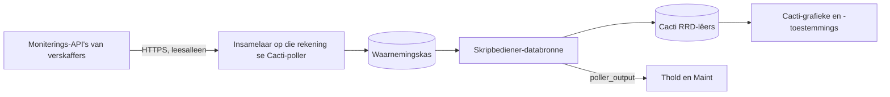

<!-- Source: README.md; SHA256: 7c621642e5f1a46bac66e4bc744f70aebb014c610d22de034088845fdc170405 -->

<!-- translations:start -->
[English](../../../README.md) | [简体中文](../zh-CN/README.md) | [हिन्दी](../hi-IN/README.md) | [Español (España)](../es-ES/README.md) | [Español (Latinoamérica)](../es-419/README.md) | [العربية (السعودية)](../ar-SA/README.md) | [Afrikaans](README.md) | [አማርኛ](../am-ET/README.md) | [العربية (مصر)](../ar-EG/README.md) | [العربية (المغرب)](../ar-MA/README.md) | [বাংলা](../bn-BD/README.md) | [Bosanski](../bs-BA/README.md) | [Deutsch](../de-DE/README.md) | [فارسی](../fa-IR/README.md) | [Filipino](../fil-PH/README.md) | [Français](../fr-FR/README.md) | [Français (Maroc)](../fr-MA/README.md) | [Français (Sénégal)](../fr-SN/README.md) | [Hausa](../ha-NG/README.md) | [עברית](../he-IL/README.md) | [Hrvatski](../hr-HR/README.md) | [Bahasa Indonesia](../id-ID/README.md) | [Igbo](../ig-NG/README.md) | [Italiano](../it-IT/README.md) | [日本語](../ja-JP/README.md) | [한국어](../ko-KR/README.md) | [Malagasy](../mg-MG/README.md) | [मराठी](../mr-IN/README.md) | [Bahasa Melayu](../ms-MY/README.md) | [Nederlands](../nl-NL/README.md) | [Polski](../pl-PL/README.md) | [Português (Brasil)](../pt-BR/README.md) | [Русский](../ru-RU/README.md) | [Kinyarwanda](../rw-RW/README.md) | [Soomaali](../so-SO/README.md) | [Српски](../sr-RS/README.md) | [Svenska](../sv-SE/README.md) | [Kiswahili](../sw-KE/README.md) | [தமிழ்](../ta-IN/README.md) | [తెలుగు](../te-IN/README.md) | [ไทย](../th-TH/README.md) | [Türkçe](../tr-TR/README.md) | [Українська](../uk-UA/README.md) | [اردو](../ur-PK/README.md) | [Tiếng Việt](../vi-VN/README.md) | [isiXhosa](../xh-ZA/README.md) | [Yorùbá](../yo-NG/README.md) | [繁體中文](../zh-TW/README.md) | [isiZulu](../zu-ZA/README.md)
<!-- translations:end -->

# plugin_cloud

'n Cacti 1.2-inprop wat hulpbronne en metrieke vanaf openbare wolkverskaffers na Cacti bring as gewone toestelle, databronne en grafieke. Wolkwerkladings sit dan langs die netwerk wat hulle dra, onder Cacti se toestemmings, en Thold en Maint kan daaroor waarskuwings gee en dit onderdruk. Een inprop dek elke verskaffer, met 'n drywer per verskaffer: DigitalOcean, AWS, Google Cloud en Azure eerste.

> **Status: mylpaal 3 (DigitalOcean en Cacti-objekte), onder hersiening.** Die mylpaal voeg die DigitalOcean-drywer, Cacti-sjablone, 'n bestektoestel per rekening met 'n datanavraag per hulpbrontipe, die skripbediener-invoer, en 'n versoekberaming op New Graphs en die gesondheidsbladsy by. Aanvanklike kontroles teenoor 'n lewendige DigitalOcean-rekening is aangeteken in [verskafferfeite](../../research/provider-facts.md). Moenie dit in produksie laat loop nie.

## Toegangsrolle

| Ryk | Toegang |
| --- | --- |
| Cloud View | Bestaande moniteringsbladsye. |
| Cloud Operator | Monitering plus die Operations-bladsy en persoonlike siftingsbevestigings. |
| Cloud Admin | Operateurtoegang plus die bestaande opstelling- en administratiewe aksies. |

Na die kopiëring van opgraderingslêers, maak die Plugins-bladsy as 'n administrateur oop om
die nuwe ryk te registreer. Ken die Operateur-ryk uitdruklik toe onder **Configuration > Users** of gebruikersgroepe.
Opgraderings behou die bestaande View- en Admin-ryk-ID's en -toekennings. Admin-toegang
erf Operateurtoegang, en Operateurtoegang erf View-toegang by elke versoek;
dit voeg nie gestoorde toekennings by gebruikers of groepe nie. Inpropinstellings vereis ook
Cloud Admin-toegang benewens Cacti se Settings-toestemming.

Cacti-toesteltoestemmings beperk steeds die rye en aksies wat vir elke gebruiker beskikbaar is; ongekarteerde objekte vereis 'n administrateur. Operateurs kan die gestoorde geloofsbrief verifieer vir 'n rekening tot wie se Cacti-toestel hulle toegang het.
Geloofsbriewe, opstelling, kartering, skrapping en ander administratiewe veranderinge
bly in die administratiewe bladsye. Bevestigings duur slegs in die huidige
gebruiker se sessie, vir hoogstens een uur en slegs solank dieselfde waarneming vars bly.
Nuwe of gewysigde waarnemings maak dit ongeldig. Dit merk nooit 'n mislukte
meting as gesond nie en onderdruk nooit waarskuwings nie.

## Waarom

Elke wolkverskaffer het sy eie moniteringskonsole. Wanneer dit langs Cacti loop, laat dit drie gapings:

- **Afsonderlike toegangsbeheer.** Om vir 'n Cacti-gebruiker wolkmetrieke te wys, beteken om vir hulle 'n wolkaanmelding te gee.
- **Geen netwerkkonteks nie.** Plaaslike skakels word in Cacti in grafieke voorgestel; die werkladings daaragter word in elke verskaffer se konsole voorgestel.
- **Afsonderlike waarskuwings.** Thold en Maint werk op Cacti-databronne en -toestelle, dus word verskafferalarms afsonderlik opgestel en onderdruk, een keer per verskaffer.

Die inprop lees elke verskaffer se moniterings-API op 'n Cacti-poller, kas die jongste datapunte en bedien dit aan Cacti se skripbediener. Cacti se poller skryf die RRD-lêers, sodat grafieke, toestemmings, Thold, Maint en boost net so werk as vir enige Cacti-data.

## Ontwerpverbintenisse

- **Leesalleen.** Elke drywer kan slegs die verskafferbewerkings op sy toelaaglys bou; die inprop verander nooit 'n wolkhulpbron nie. ([ADR 0002](../../decisions/0002-read-only-with-operation-allowlist.md))
- **Slegs PHP, geen SDK's nie.** Ondertekening en tekenuitruiling word in PHP geïmplementeer met die uitbreidings wat Cacti reeds vereis. Geen Composer-looptydafhanklikhede nie. ([ADR 0003](../../decisions/0003-php-only-without-sdks.md))
- **Koste voor insameling.** Die inprop lees slegs metrieke wat 'n Cacti-databron het, wys die verwagte versoektelling en lyspryskoste voordat grafieke geskep word, en dwing 'n maandelikse perk af. ([ADR 0005](../../decisions/0005-collect-only-what-is-graphed.md))
- **Geen gewoneteks-geloofsbriewe in die databasis nie.** Geloofsbriewe kom vanaf 'n geënkripteerde kluis wat deur 'n lêer buite die databasis gesleutel word, vanaf 'n geloofsbrieflêer, of vanaf die verskaffer se instansie-identiteit. ([ADR 0007](../../decisions/0007-credentials-outside-the-database-in-the-clear.md))

## Bestek en status

| Fase | Bestek | Mylpale | Status |
|---|---|---|---|
| 0, navorsing | Bevestiging van verskafferfeite, metriekkatalogusse, koste- en tempomodel, ondertekeningstoetsvektore, vervoerverkenning | [M1](https://github.com/somethingwithproof/plugin_cloud/milestone/1) | Gedoen, behalwe die kontroles wat 'n lewendige verskafferrekening benodig |
| 1, kern en DigitalOcean | Rekeninge, geloofsbriefkluis, vervoer, insamelaar, waarnemingskas, Cacti-objekte, gesondheidsbladsy, DigitalOcean Droplets en lasbalanseerders | [M2](https://github.com/somethingwithproof/plugin_cloud/milestone/2), [M3](https://github.com/somethingwithproof/plugin_cloud/milestone/3), [M4](https://github.com/somethingwithproof/plugin_cloud/milestone/4) | M2 gedoen ([#81](https://github.com/somethingwithproof/plugin_cloud/pull/81)); M3-drywer, -sjablone en -bestektoestelle saamgevoeg; versoekberamings, toestemmings en werkverrigtingkontroles onder hersiening; M4 nie begin nie |
| 2, AWS | Signature Version 4, `AssumeRole`, instansierolle, CloudWatch `GetMetricData`, streekinventaris | [M5](https://github.com/somethingwithproof/plugin_cloud/milestone/5) | Nie begin nie |
| 3, Google Cloud | Diensrekening-JWT, metadatabediener, Cloud Monitoring `timeSeries.list` | [M6](https://github.com/somethingwithproof/plugin_cloud/milestone/6) | Nie begin nie |
| 4, Azure | Entra-kliëntgeloofsbriewe, bestuurde identiteit, Resource Graph, `metrics:getBatch` | [M7](https://github.com/somethingwithproof/plugin_cloud/milestone/7) | Nie begin nie |
| 5, afgeleë insamelaars | Rekeninge op Cacti se afgeleë data-insamelaars | [M8](https://github.com/somethingwithproof/plugin_cloud/milestone/8) | Nie begin nie |

Buite bestek: verandering van wolkhulpbronne, skepping of spieëling van verskafferalarms, faktureringsverslae, logboeke en spore, en 'n waarskuwingsenjin wat deur die inprop besit word. Verdere verskaffers (Hetzner Cloud, Akamai Cloud, Oracle Cloud en ander) is navorsingskwessies.

## Wat mylpaal 2 lewer

- **'n Beskermde installasie.** Op PHP onder 8.2, of sonder ext-openssl, word installasie en aktivering met 'n boodskap geweier, en die res van Cacti bly werk.
- **Lewensiklus.** Installeer, gradeer op en deïnstalleer deur Cacti se Plugins-bladsy. Opgraderings is georden en oorleef onderbreking. Deïnstallasie behou die inprop se tabelle tensy jy *Keep Plugin Tables on Uninstall* skoonmaak.
- **Afsonderlike ryke.** *Cloud Admin* maak **Cloud Accounts** oop; *Cloud Operator* maak **Cloud Operations** oop; *Cloud View* maak **Cloud Health** oop. Admin erf Operator, en Operator erf View. Al drie bladsye is onder Management.
- **Rekeninge en geloofsbriewe.** Voeg rekeninge by, wysig, verifieer en skrap dit. 'n Geloofsbrief word óf in die databasis geënkripteer met 'n sleutellêer wat buite dit gehou word (AES-256-GCM), óf vanaf 'n lêer op die poller gelees. Geloofsbriewe is slegs-skryf in die gebruikerskoppelvlak en word uit logboeke geredigeer.
- **Die insamelaar.** Dit begin vanaf elke poller-lopie, een instansie per poller, binne 'n tydsbeperking. Dit neem 'n huurkontrak per rekening, voer ontdekking op sy eie interval uit, en lees metrieke slegs vir die inprop se eie aktiewe databronne.
- **Gesondheid.** Per-rekening insameling-, ontdekking-, hulpbron- en varsheidstatus, plus waarskuwings vir 'n onbruikbare kluissleutel, onveilige geloofsbrieflêers, en intervalle wat die poller nie kan nakom nie.

## Installeer en stel op

Hierdie stappe installeer die mylpaal 2-kode vir evaluering. Dit vereis Cacti 1.2.31 of later op PHP 8.2 of later.

1. Kopieer die bewaarplek na `plugins/cloud` onder jou Cacti-gids. Die gids moet `cloud` genoem word.
2. Skep die kluissleutel buite die webwortel. Plaas dit in 'n gids waarin slegs root en die Cacti-gebruiker kan skryf, en maak die lêer slegs leesbaar vir die gebruiker wat die webbediener en die poller laat loop. Die inprop skep of skryf nooit hierdie lêer nie:

   ```sh
   sudo install -d -m 0750 -o root -g cacti /etc/cacti
   head -c 32 /dev/urandom | sudo tee /etc/cacti/cloud-vault.key > /dev/null
   sudo chown cacti:cacti /etc/cacti/cloud-vault.key
   sudo chmod 0600 /etc/cacti/cloud-vault.key
   ```

   Vervang `cacti` met die gebruiker wat jou webbediener en poller laat loop. Die lêer bevat 32 rou grepe of 64 heksadesimale karakters. Maak 'n rugsteun daarvan saam met die databasis; daarsonder moet gestoorde geloofsbriewe weer ingevoer word.
3. In Cacti, maak **Configuration > Plugins** oop, en installeer en aktiveer *Cloud*.
4. Onder **Configuration > Settings > Cloud**, stel *Vault Key File* as jy 'n ander pad gebruik het. *Collector Time Budget* (verstek 240 sekondes) moet onder die poller-interval bly.
5. Ken *Cloud Admin*, *Cloud Operator* of *Cloud View* toe aan gebruikers en groepe onder **Configuration > Users**. Installasie ken Cloud Admin en Cloud View aan die administrateur toe; Cloud Admin sluit Operator-toegang in, dus benodig die administrateur geen afsonderlike Operator-toekenning nie.
6. Voeg rekeninge by onder **Management > Cloud Accounts**, en kyk dan onder **Management > Cloud Health** vir waarskuwings.

## Versoenbaarheidsteikens

| Komponent | Teiken |
|---|---|
| Cacti | 1.2.31 of later, geen kernlappe nie |
| PHP | 8.2 of later; `setup.php` bly ontleedbaar op 8.0 sodat 'n nie-ondersteunde looptyd 'n weiering kry in plaas van 'n gebreekte Cacti-gebruikerskoppelvlak |
| PHP-uitbreidings | Geen behalwe dié wat Cacti 1.2.31 vereis nie |
| Thold, Maint | Geen veranderinge vereis nie |

## Ontwerp

- [docs/performance.md](../../performance.md) bevat die metings vir die insamelaar en gesondheidsbladsy, met die hardeware en instellings wat gebruik is.
- [docs/PLAN.md](../../PLAN.md) is die volledige plan: argitektuur, die verskaffer- en Cacti-feite waarop dit staatmaak (met bronne), die drywerkontrak, kosteberekening, sekuriteitsgrense, toetsing en risiko's.
- [docs/decisions/](../../decisions) bevat argitektuurbesluitrekords vir keuses wat reeds gemaak is.
- [docs/REQUIREMENTS.md](../../REQUIREMENTS.md) karteer elke vereiste-ID na sy kwessie.



## Hoe werk nagespoor word

- **Mylpale** volg die plan se mylpale. Elkeen het 'n epiese kwessie wat sy subkwessies en uitgangsbewyse lys.
- **Kwessies** word volgens etiket getipeer: `type: requirement`, `type: research`, `type: decision`, `type: epic`. Vereistekwessies meld genommerde, toetsbare vereistes (`REQ-AREA-NNN`) en aanvaardingskriteria.
- **Etikette** dra ook `area:`, `provider:`, `phase:`, `priority:`, en `status:`. Sien [CONTRIBUTING.md](../../../CONTRIBUTING.md#labels).
- Die [projekbord](https://github.com/users/somethingwithproof/projects/7) wys alle kwessies oor mylpale heen.

## Ontwikkeling

CI lint die toegangspunte op PHP 8.0, voer eenheids- en integrasietoetse en PHPStan vlak 9 uit, en installeer die inprop op PHP 8.2 tot 8.5 teen Cacti 1.2.31 en die 1.2.x-tak. Dit kyk ook dat PHP 8.1 geweier word sonder om Cacti te breek. Die toetse gebruik Pest vanaf Cacti-kern se inproptuig. Daardie keuse is voorlopig totdat [#12](https://github.com/somethingwithproof/plugin_cloud/issues/12) beslis is. [.github/workflows/plugin-ci-workflow.yml](../../../.github/workflows/plugin-ci-workflow.yml) lys elke stap. Laat loop `sh tests/lint-workflows.sh` en `sh locales/build_gettext.sh --check` plaaslik voordat jy stoot.

## Bydraes

Lees [CONTRIBUTING.md](../../../CONTRIBUTING.md). Byvoegings (commits) benodig 'n DCO-ondertekening. Ontwerpbespreking vind op kwessies plaas; oop besluite dra die `type: decision`-etiket.

## Sekuriteit

Rapporteer kwesbaarhede privaat; sien [SECURITY.md](../../../SECURITY.md).

## Lisensie

GNU General Public License v2.0, dieselfde lisensie as Cacti en sy inproppe. Sien [LICENSE](../../../LICENSE).
