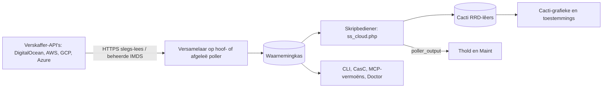

<!-- Source: README.md; SHA256: ac2074a40238686915802803c5efe773f33677f934281e0605e6e87a71a9d27d -->

<!-- translations:start -->
[English](../../../README.md) | [简体中文](../zh-CN/README.md) | [हिन्दी](../hi-IN/README.md) | [Español (España)](../es-ES/README.md) | [Español (Latinoamérica)](../es-419/README.md) | [العربية (السعودية)](../ar-SA/README.md) | [Afrikaans](README.md) | [አማርኛ](../am-ET/README.md) | [العربية (مصر)](../ar-EG/README.md) | [العربية (المغرب)](../ar-MA/README.md) | [বাংলা](../bn-BD/README.md) | [Bosanski](../bs-BA/README.md) | [Deutsch](../de-DE/README.md) | [فارسی](../fa-IR/README.md) | [Filipino](../fil-PH/README.md) | [Français](../fr-FR/README.md) | [Français (Maroc)](../fr-MA/README.md) | [Français (Sénégal)](../fr-SN/README.md) | [Hausa](../ha-NG/README.md) | [עברית](../he-IL/README.md) | [Hrvatski](../hr-HR/README.md) | [Bahasa Indonesia](../id-ID/README.md) | [Igbo](../ig-NG/README.md) | [Italiano](../it-IT/README.md) | [日本語](../ja-JP/README.md) | [한국어](../ko-KR/README.md) | [Malagasy](../mg-MG/README.md) | [मराठी](../mr-IN/README.md) | [Bahasa Melayu](../ms-MY/README.md) | [Nederlands](../nl-NL/README.md) | [Polski](../pl-PL/README.md) | [Português (Brasil)](../pt-BR/README.md) | [Русский](../ru-RU/README.md) | [Kinyarwanda](../rw-RW/README.md) | [Soomaali](../so-SO/README.md) | [Српски](../sr-RS/README.md) | [Svenska](../sv-SE/README.md) | [Kiswahili](../sw-KE/README.md) | [தமிழ்](../ta-IN/README.md) | [తెలుగు](../te-IN/README.md) | [ไทย](../th-TH/README.md) | [Türkçe](../tr-TR/README.md) | [Українська](../uk-UA/README.md) | [اردو](../ur-PK/README.md) | [Tiếng Việt](../vi-VN/README.md) | [isiXhosa](../xh-ZA/README.md) | [Yorùbá](../yo-NG/README.md) | [繁體中文](../zh-TW/README.md) | [isiZulu](../zu-ZA/README.md)
<!-- translations:end -->

# plugin_cloud

'n Cacti 1.2-inprop wat hulpbronne en metrieke vanaf openbare wolkverskaffers na Cacti bring as gewone toestelle, databronne en grafieke. Wolkwerkladings sit langs die netwerk wat hulle dra, onder Cacti se toestemmings, en Thold en Maint kan daaroor waarsku en dit onderdruk. Een inprop dek DigitalOcean, Amazon Web Services, Google Cloud en Microsoft Azure deur suiwer PHP-, leesalleen-verskafferdrywers.

> **Status: in ontwikkeling, nog geen vrystelling nie (`0.1.0-dev`).** Hierdie tak implementeer suiwer PHP-drywers vir DigitalOcean, AWS, Google Cloud en Azure, afgeleë dataversamelaar-replikasie en leesalleen-agentgesondheid, 'n CasC-verskaffer en operateur-CLI, MCP-vermoëns, en Doctor-kontroles. Cacti-sjablone wat tans verskeep word, dek DigitalOcean Droplets en lasbalanseerders (`templates/cloud_digitalocean.xml`); Cacti-sjabloonpakkette vir AWS, Google Cloud en Azure en kwalifikasie met lewendige rekeninge buite DigitalOcean ([verskafferfeite](../../research/provider-facts.md)) is nog nie klaar nie. Moenie in produksie laat loop nie.

## Ondersteunde verskaffers

Elke verskafferdrywer is geregistreer in `Drivers::production()`, word aangebied deur `Provider::released()`, en loop in suiwer PHP met `ext-openssl` en stroomsokke met nul SDK- of Composer-looptydafhanklikhede.

| Verskaffer | Bestekvelde | Geloofsbriefbronne | Verifikasie | Ontdekte hulpbronne | Metriekversameling |
|---|---|---|---|---|---|
| DigitalOcean (`digitalocean`) | Geen (token-bestek) | `vault`, `file` | Bearer-token | `droplet`, `load_balancer` | `/v2/monitoring/metrics` met tempobeperking-deelbewustheid; verskeep Cacti-sjablone en datanavrae |
| Amazon Web Services (`aws`) | `account_id` (12 syfers), `regions` | `vault`, `file`, `instance` | Suiwer PHP AWS SigV4 (`AWS4-HMAC-SHA256`), STS `GetCallerIdentity`-verifikasie, opsionele STS `AssumeRole`, EC2 IMDSv2 (`169.254.169.254`) vir `instance`-rekeninge | `ec2_instance`, `rds_instance`, `aws_elb` (ALB/NLB) | Gebondelde CloudWatch `GetMetricData` (tot 500 navrae per oproep) |
| Google Cloud (`gcp`) | `project` | `vault`, `file`, `instance` | Suiwer PHP RS256 diensrekening-JWT via `ext-openssl` omgeruil by `oauth2.googleapis.com/token`, of GCE-metadatabediener (`metadata.google.internal`) vir `instance`-rekeninge | `gce_instance` via `instances.aggregatedList` | Cloud Monitoring `timeSeries.list` |
| Microsoft Azure (`azure`) | `tenant`, `subscription`, `regions` | `vault`, `file`, `instance` | Suiwer PHP Entra ID OAuth2 kliëntgeloofsbriefvloei (slegs `client_secret`; sertifikaatbewerings uitgesluit), of Azure IMDS (`169.254.169.254`) bestuurde identiteit vir ARM- en Monitor-tokens | `azure_vm` via ARM Resource Graph (gepagineer met `$skipToken` en gedupliseer-verwyder) | Azure Monitor `metrics:getBatch` (tot 50 hulpbronne per oproep, met hantering van HTTP 429- en 529-versmoring) |

## Geïmplementeerde vermoëns

### Kernplatform, kluis en versamelaar

- **Beskermde installasie en lewensiklus.** Ingangspunte (`setup.php`, `cli/cloud.php`, `poller_cloud.php`, `ss_cloud.php`, en bladsyskrifte) ontleed op PHP 8.0 en weier PHP onder 8.2 of ontbrekende `ext-openssl` sonder om Cacti te breek. Opgraderings is georden, idempotent (`Schema::VERSION = 3`, 9 tabelle), en oorleef onderbreking. Deïnstallasie behou inproptabelle tensy *Keep Plugin Tables on Uninstall* skoongemaak word.
- **Rekeninge en geloofsbriewe.** Voeg rekeninge by, wysig, verifieer en skrap onder **Management > Cloud Accounts**. Geloofsbriewe kom vanaf die AES-256-GCM-geënkripteerde kluis (`plugin_cloud_secret`, standaard gesleutel deur `/etc/cacti/cloud-vault.key`), vanaf 'n lêer beperk binne die gekonfigureerde *Credential File Directory* (`cloud_credential_dir`, standaard leeg om lêers te weier), of vanaf verskaffer-instansie-identiteit. Geloofsbriewe is slegs-skryf in die UI en word uit logboeke gesensureer.
- **Streng uitgaande en leesalleen-kontroles.** Elke drywer werk agter `GuardedTransport` en `OutboundPolicy`: HTTPS-poort 443 na presiese gasheername per verskaffer, met skakel-plaaslike HTTP-poort 80 metadata-eindpunte (`169.254.169.254`, `metadata.google.internal`) slegs geaktiveer vir `instance`-rekeninge. Slegs goedgekeurde leesalleen-bewerkings word toegelaat.
- **Versamelaar- en kostekontroles.** `poller_cloud.php` loop vanaf `poller_bottom` (een proses per poller via Cacti se prosesregister) binne `cloud_collector_budget`, verkry huurkontrakte per rekening, voer ontdekking uit op `discover_interval`, lees metrieke slegs vir aktiewe Cacti-databronne (`plugin_cloud_series`), respekteer `request_share` en `monthly_ceiling`, en kas nuutste datapunte in `plugin_cloud_observation` vir `ss_cloud.php`.
- **Cacti-objekte en versoekberamings.** Handhaaf 'n bestektoestel per rekening (`plugin_cloud_device`), behou bestektoestel-herindekseringsmetodes oor toestelstorings heen, voer DigitalOcean-sjablone en skripbediener-datanavrae (`templates/cloud_digitalocean.xml`, `cloud_do_droplet.xml`, `cloud_do_load_balancer.xml`) in, en wys versoek- en lysprysberamings op **New Graphs** (`graphs_new_top_links`) en **Cloud Health**.

### Afgeleë dataversamelaars

- `INFO` verklaar `remote_collect:1`. Rekeninge kan toegewys word aan enige geaktiveerde Cacti-poller (`poller_id >= 1`), en `poller_cloud.php --poller=N` versamel slegs rekeninge wat deur daardie poller besit word.
- **`replicate_out`-haak.** Repliseer poller-bestekrye vanaf `plugin_cloud_account`, `plugin_cloud_device`, `plugin_cloud_series`, en geënkripteerde syferteksrye vanaf `plugin_cloud_secret` (slegs vir kluisgesteunde rekeninge wat deur die teikenpoller besit word) via `replicate_out_table()`. Rou kluissleutellêers word nooit in die databasis gestoor of gerepliseer nie en bly plaaslik op elke poller.
- **`remote_agent`-haak.** Stel 'n leesalleen JSON-gesondheidsopsomming (`action=cloud_health`) bloot wat slegs heelgetal `poller_id`- en `account_id`-parameters aanvaar en nul geloofsbriewe, lêerpaaie of geheime terugstuur.

### Ekosisteemhake (CasC, MCP-vermoëns, en Doctor)

- **CasC-verskaffer (`casc_register_providers`).** Registreer die `cloud`-verskaffer (skemaweergawe `1`) met deterministiese suiwer PHP YAML- en XML-uitvoer, manifesvalidering, verskilbeplanning, en bevestigde toepassing. Kluisgeloofsbriewe word uitgevoer as `vault:account:<name>`-verwysings; rou geheimvelde (`secret`, `secrets`, `token`, `access_token`, `refresh_token`, `password`, `private_key`, `access_key_id`, `secret_access_key`, `session_token`, `client_secret`, `credential`, `credentials`, `vault_key`) word geweier. Toepassing vereis 'n presiese SHA-256 `--confirm=<PLAN_HASH>`.
- **MCP / Abilities API (`abilities_register`).** Registreer drie streng leesalleen-vermoëns wat beperk word deur die Cloud View-ryk (`cloud_health.php`) en Cacti-toestelbestek vir nie-admin-roepers, en lewer nul geloofsbriewe, kluissleutels of geloofsbrieflêerpaaie:
  - `cloud-list-accounts` (opsionele `provider`, `poller_id`)
  - `cloud-list-resources` (opsionele `account_id`, `type`, `lifecycle`)
  - `cloud-get-health` (opsionele `account_id`)
- **Doctor-kontroles (`doctor_register_checks`).** Registreer vyf diagnostiese kontroles wat geen geheime waardes of sleutelmateriaal blootstel nie:
  - `cloud_schema`: geldigheid van skemaweergawe
  - `cloud_vault_key`: leesbaarheid, toestemmings en grootte van die kluissleutellêer
  - `cloud_drivers`: registrasie van produksiedrywers vir alle vrygestelde verskaffers
  - `cloud_accounts_health`: mislukte, versmoorde of verouderde geaktiveerde rekeninge
  - `cloud_poller_intervals`: belyning van geaktiveerde rekening-versamelingsintervalle met Cacti se poller-interval

## CLI

Laat loop vanaf die Cacti-wortelgids met PHP 8.2 of later:

```sh
# Operator and CasC CLI (options use --key=value form)
php plugins/cloud/cli/cloud.php export [--format=yaml|xml]
php plugins/cloud/cli/cloud.php validate --file=<path> [--format=yaml|xml]
php plugins/cloud/cli/cloud.php plan --file=<path> [--format=yaml|xml]
php plugins/cloud/cli/cloud.php apply --file=<path> --confirm=<PLAN_HASH> [--format=yaml|xml]
php plugins/cloud/cli/cloud.php health [--format=text|json] [--poller=<id>]

# Collector entry point (normally started by poller_bottom)
php plugins/cloud/poller_cloud.php [--poller=N] [--force] [--debug]
```

## Toegangsrolle

| Ryk | Toegang |
| --- | --- |
| Cloud View | Bestaande moniteringsbladsye. |
| Cloud Operator | Monitering plus die Operations-bladsy en persoonlike triage-erkennings. |
| Cloud Admin | Operateurtoegang plus die bestaande konfigurasie- en administratiewe aksies. |

Nadat opgraderingslêers gekopieer is, maak die Plugins-bladsy as administrateur oop om die ryke te registreer. Ken die Operator-ryk eksplisiet toe onder **Configuration > Users** of gebruikersgroepe. Opgraderings behou die bestaande View- en Admin-ryk-ID's en toekennings. Admin-toegang erf Operator-toegang, en Operator-toegang erf View-toegang by elke versoek; dit voeg nie gestoorde toekennings by gebruikers of groepe nie. Inpropinstellings vereis ook Cloud Admin-toegang benewens Cacti se Settings-toestemming.

Cacti-toesteltoestemmings beperk die rye en aksies wat vir elke gebruiker beskikbaar is; ongekarteerde objekte vereis 'n administrateur. Operateurs kan die gestoorde geloofsbrief verifieer vir 'n rekening waartoe hulle toegang tot die Cacti-toestel het. Geloofsbriewe, konfigurasie, kartering, skrapping en ander administratiewe veranderinge bly in die administratiewe bladsye. Erkennings duur slegs in die huidige gebruiker se sessie, vir hoogstens een uur en slegs terwyl dieselfde waarneming vars bly. Nuwe of veranderde waarnemings maak dit ongeldig. Hulle merk nooit 'n mislukte meting as gesond of onderdruk waarskuwings nie.

## Hoekom

Elke wolkverskaffer het sy eie moniteringskonsole. Saam met Cacti gebruik, laat hulle drie gapings:

- **Afsonderlike toegangsbeheer.** Om vir 'n Cacti-gebruiker wolkmetrieke te wys, beteken om vir hulle 'n wolkaanmelding te gee.
- **Geen netwerkkonteks nie.** Plaaslike skakels word in Cacti gegrafiek; die werkladings daaragter word in elke verskaffer se konsole gegrafiek.
- **Afsonderlike waarskuwings.** Thold en Maint werk op Cacti-databronne en -toestelle, dus word verskaffer-alarms afsonderlik gekonfigureer en onderdruk, een keer per verskaffer.

Die inprop lees elke verskaffer se moniterings-API op 'n Cacti-poller, kas die nuutste datapunte en bedien dit aan Cacti se skripbediener. Cacti se poller skryf die RRD-lêers, dus werk grafieke, toestemmings, Thold, Maint en boost net soos vir enige ander Cacti-data.

## Ontwerpverbintenisse

- **Leesalleen.** Elke drywer kan slegs die verskafferbewerkings op sy toelaaglys bou; die inprop verander nooit 'n wolkhulpbron nie. ([ADR 0002](../../decisions/0002-read-only-with-operation-allowlist.md))
- **Slegs PHP, geen SDK's nie.** Ondertekening en token-uitruiling word in PHP geïmplementeer met die uitbreidings wat Cacti reeds vereis. Geen Composer-looptydafhanklikhede nie. ([ADR 0003](../../decisions/0003-php-only-without-sdks.md))
- **Koste voor versameling.** Die inprop lees slegs metrieke wat 'n Cacti-databron het, wys die verwagte versoektelling en lyspryskoste voordat grafieke geskep word, en dwing 'n maandelikse plafon af. ([ADR 0005](../../decisions/0005-collect-only-what-is-graphed.md))
- **Geen skoon-teks geloofsbriewe in die databasis nie.** Geloofsbriewe kom vanaf 'n geënkripteerde kluis gesleutel deur 'n lêer buite die databasis, vanaf 'n geloofsbrieflêer, of vanaf die verskaffer se instansie-identiteit. ([ADR 0007](../../decisions/0007-credentials-outside-the-database-in-the-clear.md))

## Bestek en status

| Fase | Bestek | Mylpale | Status |
|---|---|---|---|
| 0, navorsing | Verskafferfeite-bevestiging, metriekkatalogusse, koste- en tempomodel, ondertekeningtoetsvektore, vervoerspyker | [M1](https://github.com/somethingwithproof/plugin_cloud/milestone/1) | Klaar, behalwe kontroles wat lewendige verskafferrekeninge vereis |
| 1, kern en DigitalOcean | Rekeninge, geloofsbriefkluis, vervoer, versamelaar, waarnemingkas, Cacti-objekte, sjablone, versoekberamings, gesondheidsbladsy, DigitalOcean Droplets en lasbalanseerders | [M2](https://github.com/somethingwithproof/plugin_cloud/milestone/2), [M3](https://github.com/somethingwithproof/plugin_cloud/milestone/3), [M4](https://github.com/somethingwithproof/plugin_cloud/milestone/4) | Geïmplementeer; M4-loodskwalifikasie hangende |
| 2, AWS | Suiwer PHP SigV4, STS `AssumeRole`, IMDSv2-instansierolle, EC2/RDS/ELB-voorraad, CloudWatch `GetMetricData` | [M5](https://github.com/somethingwithproof/plugin_cloud/milestone/5) | Drywer geïmplementeer; Cacti-sjablone en lewendige-rekeningkwalifikasie hangende |
| 3, Google Cloud | Suiwer PHP RS256 diensrekening-JWT, GCE-metadatabediener, Compute Engine-voorraad, Cloud Monitoring `timeSeries.list` | [M6](https://github.com/somethingwithproof/plugin_cloud/milestone/6) | Drywer geïmplementeer; Cacti-sjablone en lewendige-rekeningkwalifikasie hangende |
| 4, Azure | Entra ID-kliëntgeloofsbriewe, IMDS-bestuurde identiteit, ARM Resource Graph VM-voorraad, Azure Monitor `metrics:getBatch` | [M7](https://github.com/somethingwithproof/plugin_cloud/milestone/7) | Drywer geïmplementeer; Cacti-sjablone en lewendige-rekeningkwalifikasie hangende |
| 5, afgeleë versamelaars en ekosisteem | Afgeleë dataversamelaars (`replicate_out`, `remote_agent`), CasC-verskaffer en CLI, MCP-vermoëns, Doctor-kontroles | [M8](https://github.com/somethingwithproof/plugin_cloud/milestone/8) | Geïmplementeer |

Buite bestek: verandering van wolkhulpbronne, skepping of spieëling van verskaffer-alarms, faktuurverslae, logboeke en spore, en 'n inprop-besit waarskuwingsenjin. Verdere verskaffers (Hetzner Cloud, Akamai Cloud, Oracle Cloud, en ander) is navorsingskwessies.

## Installeer en konfigureer

Hierdie stappe installeer die ontwikkelingskode vir evaluasie. Hulle vereis Cacti 1.2.31 of later op PHP 8.2 of later.

1. Kopieer die bewaarplek na `plugins/cloud` onder jou Cacti-gids. Die gids moet `cloud` genoem word.
2. Skep die kluissleutel buite die webwortel op elke poller wat kluisgesteunde geloofsbriewe gebruik. Plaas dit in 'n gids waar net root en die Cacti-gebruiker kan skryf, en maak die lêer slegs leesbaar vir die gebruiker wat die webbediener en die poller laat loop. Die inprop skep of skryf nooit hierdie lêer nie:

   ```sh
   sudo install -d -m 0750 -o root -g cacti /etc/cacti
   head -c 32 /dev/urandom | sudo tee /etc/cacti/cloud-vault.key > /dev/null
   sudo chown cacti:cacti /etc/cacti/cloud-vault.key
   sudo chmod 0600 /etc/cacti/cloud-vault.key
   ```

   Vervang `cacti` met die gebruiker wat jou webbediener en poller laat loop. Die lêer hou 32 rou grepe of 64 heksadesimale karakters. Maak 'n rugsteun daarvan saam met die databasis; daarsonder moet gestoorde geloofsbriewe weer ingevoer word.
3. In Cacti, maak **Configuration > Plugins** oop, installeer en aktiveer dan *Cloud*.
4. Onder **Configuration > Settings > Cloud**, stel *Vault Key File* as jy 'n ander pad gebruik het, konfigureer *Credential File Directory* as jy van plan is om lêergebaseerde geloofsbriewe te gebruik, en hou *Collector Time Budget* (standaard 240 sekondes) onder die poller-interval.
5. Ken *Cloud Admin*, *Cloud Operator*, of *Cloud View* aan gebruikers en groepe toe onder **Configuration > Users**. Installasie ken Cloud Admin en Cloud View aan die administrateur toe; Cloud Admin sluit Operator-toegang in, so die administrateur het geen aparte Operator-toekenning nodig nie.
6. Voeg rekeninge by onder **Management > Cloud Accounts**, en kontroleer dan **Management > Cloud Health** vir waarskuwings.

## Versoenbaarheidsteikens

| Komponent | Teiken |
|---|---|
| Cacti | 1.2.31 of later, geen kernregstellings nie |
| PHP | 8.2 of later; ingangspunte bly ontleedbaar op 8.0 sodat 'n onondersteunde looptyd 'n weiering kry in plaas van 'n gebreekte Cacti-UI |
| PHP-uitbreidings | `ext-openssl` (vereis deur Cacti 1.2.31); geen `ext-curl` en geen Composer-looptydafhanklikhede nie |
| Thold, Maint | Geen veranderinge vereis nie |

## Ontwerp

- [docs/performance.md](../../performance.md) het die versamelaar- en gesondheidsbladsy-metings, met die hardeware en instellings wat gebruik is.
- [docs/PLAN.md](../../PLAN.md) is die volledige plan: argitektuur, die verskaffer- en Cacti-feite waarvan dit afhang (met bronne), die drywerkontrak, kosterekenkunde, sekuriteitsgrense, toetsing en risiko's.
- [docs/decisions/](../../decisions/) hou argitektuur-besluitrekords vir keuses wat reeds gemaak is.
- [docs/REQUIREMENTS.md](../../REQUIREMENTS.md) karteer elke vereiste-ID na sy kwessie.



## Hoe werk nagespoor word

- **Mylpale** volg die plan se mylpale. Elkeen het 'n epiese kwessie wat sy sub-kwessies en uitgangsbewyse lys.
- **Kwessies** word volgens etiket getipeer: `type: requirement`, `type: research`, `type: decision`, `type: epic`. Vereistekwessies meld genommerde, toetsbare vereistes (`REQ-AREA-NNN`) en aanvaardingskriteria.
- **Etikette** dra ook `area:`, `provider:`, `phase:`, `priority:`, en `status:`. Sien [CONTRIBUTING.md](../../../CONTRIBUTING.md#labels).
- Die [projekbord](https://github.com/users/somethingwithproof/projects/7) wys alle kwessies oor mylpale heen.

## Ontwikkeling

CI ([.github/workflows/plugin-ci-workflow.yml](../../../.github/workflows/plugin-ci-workflow.yml)) kontroleer die vrystellingsargief en semantiese weergawe (`bash tests/bin/archive-check.sh`), lint ingangspunte op PHP 8.0, voer Pest-eenheidstoetse (`phpunit.xml`), lewensiklus-integrasietoetse (`phpunit-integration.xml`) en PHPStan-vlak 9 oor PHP 8.2 tot 8.5 teen Cacti `release/1.2.31` en `1.2.x` met `CLOUD_OFFLINE=1` uit, kontroleer weiering op PHP 8.1, verifieer gettext-katalogusse, meet 1,000-reeks-versameling en gesondheidsbladsy-werkverrigting, en voer werkvloei-linting en REUSE-nakoming uit.

Plaaslike kontroles voor druk:

```sh
bash tests/bin/archive-check.sh
sh tests/lint-workflows.sh
sh locales/build_gettext.sh --check
CACTI_PATH=/path/to/cacti phpstan analyse -c phpstan.neon --no-progress
```

Laat Pest loop met `--configuration=phpunit.xml` vir eenheids- en bronreëltoetse, of `--configuration=phpunit-integration.xml` met `CACTI_PATH` en `CLOUD_TEST_DATABASE=disposable` teen 'n weggooibare Cacti-databasis vir lewensiklus-integrasietoetse.

## Bydraes

Lees [CONTRIBUTING.md](../../../CONTRIBUTING.md). Toewydings benodig 'n DCO-aftekening. Ontwerpbespreking vind op kwessies plaas; oop besluite dra die `type: decision`-etiket.

## Sekuriteit

Rapporteer kwesbaarhede privaat; sien [SECURITY.md](../../../SECURITY.md).

## Lisensie

GNU General Public License v2.0, dieselfde lisensie as Cacti en sy inproppe. Sien [LICENSE](../../../LICENSE).
