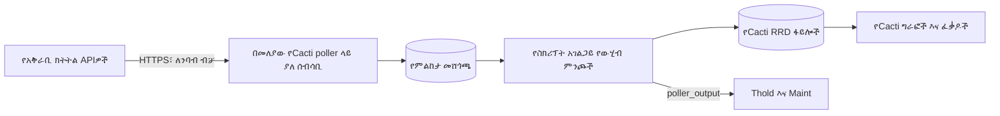

<!-- Source: README.md; SHA256: 7c621642e5f1a46bac66e4bc744f70aebb014c610d22de034088845fdc170405 -->

<!-- translations:start -->
[English](../../../README.md) | [简体中文](../zh-CN/README.md) | [हिन्दी](../hi-IN/README.md) | [Español (España)](../es-ES/README.md) | [Español (Latinoamérica)](../es-419/README.md) | [العربية (السعودية)](../ar-SA/README.md) | [Afrikaans](../af-ZA/README.md) | [አማርኛ](README.md) | [العربية (مصر)](../ar-EG/README.md) | [العربية (المغرب)](../ar-MA/README.md) | [বাংলা](../bn-BD/README.md) | [Bosanski](../bs-BA/README.md) | [Deutsch](../de-DE/README.md) | [فارسی](../fa-IR/README.md) | [Filipino](../fil-PH/README.md) | [Français](../fr-FR/README.md) | [Français (Maroc)](../fr-MA/README.md) | [Français (Sénégal)](../fr-SN/README.md) | [Hausa](../ha-NG/README.md) | [עברית](../he-IL/README.md) | [Hrvatski](../hr-HR/README.md) | [Bahasa Indonesia](../id-ID/README.md) | [Igbo](../ig-NG/README.md) | [Italiano](../it-IT/README.md) | [日本語](../ja-JP/README.md) | [한국어](../ko-KR/README.md) | [Malagasy](../mg-MG/README.md) | [मराठी](../mr-IN/README.md) | [Bahasa Melayu](../ms-MY/README.md) | [Nederlands](../nl-NL/README.md) | [Polski](../pl-PL/README.md) | [Português (Brasil)](../pt-BR/README.md) | [Русский](../ru-RU/README.md) | [Kinyarwanda](../rw-RW/README.md) | [Soomaali](../so-SO/README.md) | [Српски](../sr-RS/README.md) | [Svenska](../sv-SE/README.md) | [Kiswahili](../sw-KE/README.md) | [தமிழ்](../ta-IN/README.md) | [తెలుగు](../te-IN/README.md) | [ไทย](../th-TH/README.md) | [Türkçe](../tr-TR/README.md) | [Українська](../uk-UA/README.md) | [اردو](../ur-PK/README.md) | [Tiếng Việt](../vi-VN/README.md) | [isiXhosa](../xh-ZA/README.md) | [Yorùbá](../yo-NG/README.md) | [繁體中文](../zh-TW/README.md) | [isiZulu](../zu-ZA/README.md)
<!-- translations:end -->

# plugin_cloud

ከሕዝብ ደመና አቅራቢዎች ሀብቶችን እና መለኪያዎችን እንደ መደበኛ መሣሪያዎች፣ የውሂብ ምንጮች እና ግራፎች ወደ Cacti የሚያመጣ የCacti 1.2 ተሰኪ ነው። የደመና የሥራ ጫናዎች ከሚያስተላልፋቸው አውታረ መረብ ጎን ለጎን በCacti ፈቃዶች ሥር ይቀመጣሉ፤ Thold እና Maint ደግሞ ማንቂያዎችን ሊያስነሱባቸው እና ሊገድቧቸው ይችላሉ። አንድ ተሰኪ ለእያንዳንዱ አቅራቢ አንድ ነጂ በመጠቀም ሁሉንም አቅራቢዎች ይሸፍናል፤ በመጀመሪያ DigitalOcean፣ AWS፣ Google Cloud እና Azure።

> **ሁኔታ፦ ምዕራፍ 3 (DigitalOcean እና የCacti ነገሮች)፣ በግምገማ ላይ።** ይህ ምዕራፍ የDigitalOcean ነጂን፣ የCacti አብነቶችን፣ ለእያንዳንዱ መለያ ለአንድ የሀብት ዓይነት አንድ የውሂብ መጠይቅ ያለው የወሰን መሣሪያ፣ የስክሪፕት አገልጋይ ግብዓት፣ እንዲሁም በNew Graphs እና በጤና ገጹ ላይ የጥያቄ ግምትን ያክላል። በቀጥታ የDigitalOcean መለያ ላይ የተደረጉ የመጀመሪያ ማረጋገጫዎች በ[የአቅራቢ እውነታዎች](../../research/provider-facts.md) ውስጥ ተመዝግበዋል። በምርት አካባቢ አያሂዱት።

## የመዳረሻ ሚናዎች

| ክልል | መዳረሻ |
| --- | --- |
| Cloud View | ነባር የክትትል ገጾች። |
| Cloud Operator | ክትትል፣ በተጨማሪም የOperations ገጽ እና የግል የማጣሪያ ማረጋገጫዎች። |
| Cloud Admin | የOperator መዳረሻ፣ በተጨማሪም ነባር የውቅር እና የአስተዳደር እርምጃዎች። |

የማሻሻያ ፋይሎችን ከገለበጡ በኋላ አዲሱን ክልል ለመመዝገብ እንደ አስተዳዳሪ የPlugins ገጹን ይክፈቱ። የOperator ክልልን በ**Configuration > Users** ወይም በተጠቃሚ ቡድኖች ሥር በግልጽ ይመድቡ። ማሻሻያዎች ነባሮቹን የView እና የAdmin ክልል መታወቂያዎች እና ፈቃዶች ይጠብቃሉ። የAdmin መዳረሻ የOperator መዳረሻን ይወርሳል፣ እንዲሁም የOperator መዳረሻ በእያንዳንዱ ጥያቄ ላይ የView መዳረሻን ይወርሳል፤ ይህ በተጠቃሚዎች ወይም በቡድኖች ላይ የተከማቹ ፈቃዶችን አይጨምርም። የተሰኪ ቅንብሮች ከCacti የSettings ፈቃድ በተጨማሪ የCloud Admin መዳረሻንም ይፈልጋሉ።

የCacti መሣሪያ ፈቃዶች አሁንም ለእያንዳንዱ ተጠቃሚ የሚገኙትን ረድፎች እና እርምጃዎች ይገድባሉ፤ ያልተዛመዱ ነገሮች አስተዳዳሪ ይፈልጋሉ። ኦፕሬተሮች የCacti መሣሪያውን መድረስ ለሚችሉበት መለያ የተከማቸ የማረጋገጫ መረጃ ማረጋገጥ ይችላሉ። የማረጋገጫ መረጃዎች፣ ውቅር፣ ማዛመድ፣ መሰረዝ እና ሌሎች የአስተዳደር ለውጦች በአስተዳደር ገጾች ውስጥ ይቆያሉ። ማረጋገጫዎች የሚቆዩት በአሁኑ የተጠቃሚ ክፍለ ጊዜ ውስጥ ብቻ፣ ቢበዛ ለአንድ ሰዓት እና ተመሳሳይ ምልከታ ትኩስ ሆኖ እስከቆየ ድረስ ብቻ ነው። አዲስ ወይም የተለወጡ ምልከታዎች ውድቅ ያደርጓቸዋል። የወደቀ መለኪያን ጤናማ ብለው አይመዘግቡም ወይም ማንቂያዎችን አያግዱም።

## ለምን

እያንዳንዱ የደመና አቅራቢ የራሱ የክትትል መቆጣጠሪያ አለው። ከCacti ጎን ለጎን ሲሄዱ ሦስት ክፍተቶችን ይተዋሉ፦

- **የተለየ የመዳረሻ ቁጥጥር።** ለአንድ የCacti ተጠቃሚ የደመና መለኪያዎችን ማሳየት ማለት የደመና መግቢያ መስጠት ማለት ነው።
- **የአውታረ መረብ አውድ አለመኖር።** የውስጥ አገናኞች በCacti ውስጥ በግራፍ ይታያሉ፤ ከኋላቸው ያሉት የሥራ ጫናዎች ግን በእያንዳንዱ አቅራቢ መቆጣጠሪያ ውስጥ በግራፍ ይታያሉ።
- **የተለየ ማንቂያ።** Thold እና Maint የሚሰሩት በCacti የውሂብ ምንጮች እና መሣሪያዎች ላይ ስለሆነ፣ የአቅራቢ ማንቂያዎች ለእያንዳንዱ አቅራቢ አንድ ጊዜ ተለይተው ይዋቀራሉ እና ይታገዳሉ።

ተሰኪው በCacti poller ላይ የእያንዳንዱን አቅራቢ የክትትል API ያነባል፣ የቅርብ ጊዜ የውሂብ ነጥቦችን በመሸጎጫ ያስቀምጣል፣ እና ለCacti ስክሪፕት አገልጋይ ያቀርባቸዋል። የCacti poller የRRD ፋይሎችን ስለሚጽፍ ግራፍ ማውጣት፣ ፈቃዶች፣ Thold፣ Maint እና boost እንደማንኛውም የCacti ውሂብ ይሰራሉ።

## የንድፍ ቃል ኪዳኖች

- **ለንባብ ብቻ።** እያንዳንዱ ነጂ በፍቃድ ዝርዝሩ ላይ ያሉትን የአቅራቢ ክዋኔዎችን ብቻ መገንባት ይችላል፤ ተሰኪው የደመና ሀብትን በፍጹም አይለውጥም። ([ADR 0002](../../decisions/0002-read-only-with-operation-allowlist.md))
- **PHP ብቻ፣ ምንም SDKs የሉም።** ፊርማ እና የቶከን ልውውጥ Cacti ቀድሞውኑ በሚፈልጋቸው ቅጥያዎች በPHP ውስጥ ተተግብረዋል። ምንም የComposer የአሂድ ጊዜ ጥገኝነቶች የሉም። ([ADR 0003](../../decisions/0003-php-only-without-sdks.md))
- **ከመሰብሰብ በፊት ወጪ።** ተሰኪው የCacti የውሂብ ምንጭ ያላቸውን መለኪያዎች ብቻ ያነባል፣ ግራፎች ከመፈጠራቸው በፊት የሚጠበቀውን የጥያቄ ብዛት እና የዝርዝር ዋጋ ወጪ ያሳያል፣ እና ወርሃዊ ጣሪያን ያስፈጽማል። ([ADR 0005](../../decisions/0005-collect-only-what-is-graphed.md))
- **በውሂብ ጎታ ውስጥ ግልጽ ጽሑፍ ያለው የማረጋገጫ መረጃ የለም።** የማረጋገጫ መረጃዎች ከውሂብ ጎታ ውጭ ባለ ፋይል ከተቆለፈ የተመሰጠረ ካዝና፣ ከማረጋገጫ ፋይል ወይም ከአቅራቢው የምሳሌ ማንነት ይመጣሉ። ([ADR 0007](../../decisions/0007-credentials-outside-the-database-in-the-clear.md))

## ወሰን እና ሁኔታ

| ምዕራፍ | ወሰን | የዕድገት ደረጃዎች | ሁኔታ |
|---|---|---|---|
| 0፣ ምርምር | የአቅራቢ እውነታ ማረጋገጫ፣ የመለኪያ ካታሎጎች፣ የወጪ እና የታሪፍ ሞዴል፣ የፊርማ ሙከራ ቬክተሮች፣ የትራንስፖርት ሙከራ | [M1](https://github.com/somethingwithproof/plugin_cloud/milestone/1) | የቀጥታ አቅራቢ መለያ ከሚያስፈልጋቸው ማረጋገጫዎች በስተቀር ተጠናቋል |
| 1፣ ዋና ክፍል እና DigitalOcean | መለያዎች፣ የማረጋገጫ መረጃ ካዝና፣ ትራንስፖርት፣ ሰብሳቢ፣ የምልከታ መሸጎጫ፣ የCacti ነገሮች፣ የጤና ገጽ፣ DigitalOcean Droplets እና load balancers | [M2](https://github.com/somethingwithproof/plugin_cloud/milestone/2), [M3](https://github.com/somethingwithproof/plugin_cloud/milestone/3), [M4](https://github.com/somethingwithproof/plugin_cloud/milestone/4) | M2 ተጠናቋል ([#81](https://github.com/somethingwithproof/plugin_cloud/pull/81))፤ የM3 ነጂ፣ አብነቶች እና የወሰን መሣሪያዎች ተቀላቅለዋል፤ የጥያቄ ግምቶች፣ ፈቃዶች እና የአፈጻጸም ማረጋገጫዎች በግምገማ ላይ ናቸው፤ M4 አልተጀመረም |
| 2፣ AWS | Signature Version 4፣ `AssumeRole`፣ የምሳሌ ሚናዎች፣ CloudWatch `GetMetricData`፣ ክልላዊ ቆጠራ | [M5](https://github.com/somethingwithproof/plugin_cloud/milestone/5) | አልተጀመረም |
| 3፣ Google Cloud | የአገልግሎት መለያ JWT፣ የሜታዳታ አገልጋይ፣ Cloud Monitoring `timeSeries.list` | [M6](https://github.com/somethingwithproof/plugin_cloud/milestone/6) | አልተጀመረም |
| 4፣ Azure | የEntra ደንበኛ ማረጋገጫዎች፣ የሚተዳደር ማንነት፣ Resource Graph፣ `metrics:getBatch` | [M7](https://github.com/somethingwithproof/plugin_cloud/milestone/7) | አልተጀመረም |
| 5፣ የርቀት ሰብሳቢዎች | በCacti የርቀት ውሂብ ሰብሳቢዎች ላይ ያሉ መለያዎች | [M8](https://github.com/somethingwithproof/plugin_cloud/milestone/8) | አልተጀመረም |

ከወሰን ውጭ፦ የደመና ሀብቶችን መለወጥ፣ የአቅራቢ ማንቂያዎችን መፍጠር ወይም ማንጸባረቅ፣ የሂሳብ ሪፖርቶች፣ ምዝግብ ማስታወሻዎች እና ዱካዎች፣ እና በተሰኪው ባለቤትነት የሚመራ የማንቂያ ሞተር። ተጨማሪ አቅራቢዎች (Hetzner Cloud፣ Akamai Cloud፣ Oracle Cloud እና ሌሎች) የምርምር ጉዳዮች ናቸው።

## ምዕራፍ 2 ምን ይዞ ይመጣል

- **የተጠበቀ ጭነት።** ከ8.2 በታች በሆነ PHP ላይ፣ ወይም ያለ ext-openssl፣ መጫን እና ማንቃት በመልእክት ውድቅ ይደረጋሉ፣ እና የተቀረው የCacti ክፍል መሥራቱን ይቀጥላል።
- **የሕይወት ዑደት።** በCacti የPlugins ገጽ በኩል ይጫኑ፣ ያሻሽሉ እና ያራግፉ። ማሻሻያዎች በቅደም ተከተል የተደራጁ ናቸው እና መቋረጥን ይቋቋማሉ። *Keep Plugin Tables on Uninstall* የሚለውን ካላጠፉ በስተቀር ማራገፍ የተሰኪውን ሰንጠረዦች ያቆያል።
- **የተለያዩ ክልሎች።** *Cloud Admin* **Cloud Accounts**ን ይከፍታል፤ *Cloud Operator* **Cloud Operations**ን ይከፍታል፤ *Cloud View* **Cloud Health**ን ይከፍታል። Admin Operatorን ይወርሳል፣ Operator ደግሞ Viewን ይወርሳል። ሦስቱም ገጾች በManagement ሥር ናቸው።
- **መለያዎች እና የማረጋገጫ መረጃዎች።** መለያዎችን ያክሉ፣ ያርትዑ፣ ያረጋግጡ እና ይሰርዙ። የማረጋገጫ መረጃ ከውሂብ ጎታ ውጭ በተቀመጠ የቁልፍ ፋይል (AES-256-GCM) በውሂብ ጎታ ውስጥ ይመሰጠራል ወይም በpoller ላይ ካለ ፋይል ይነበባል። የማረጋገጫ መረጃዎች በUI ውስጥ ለመጻፍ ብቻ ናቸው እና ከምዝግብ ማስታወሻዎች ይፋቃሉ።
- **ሰብሳቢው።** ከእያንዳንዱ የpoller አሂድ ይጀምራል፣ ለእያንዳንዱ poller አንድ ምሳሌ፣ በጊዜ በጀት ውስጥ። ለእያንዳንዱ መለያ ሊዝ ይወስዳል፣ በራሱ ክፍተት ግኝትን ያካሂዳል፣ እና ለተሰኪው የራሱ ንቁ የውሂብ ምንጮች ብቻ መለኪያዎችን ያነባል።
- **ጤና።** ለእያንዳንዱ መለያ የመሰብሰብ፣ የግኝት፣ የሀብት እና የትኩስነት ሁኔታ፣ እንዲሁም ጥቅም ላይ ሊውል ለማይችል የካዝና ቁልፍ፣ ደህንነታቸው ላልተጠበቁ የማረጋገጫ ፋይሎች እና poller ሊያከብራቸው ለማይችላቸው ክፍተቶች ማስጠንቀቂያዎች።

## መጫን እና ማዋቀር

እነዚህ እርምጃዎች ለግምገማ የምዕራፍ 2 ኮድን ይጭናሉ። በPHP 8.2 ወይም ከዚያ በላይ ላይ Cacti 1.2.31 ወይም ከዚያ በላይ ያስፈልጋቸዋል።

1. ማከማቻውን በCacti ማውጫዎ ሥር ወደ `plugins/cloud` ይቅዱ። ማውጫው `cloud` ተብሎ መሰየም አለበት።
2. የካዝና ቁልፉን ከድር ሥር ውጭ ይፍጠሩ። root እና የCacti ተጠቃሚ ብቻ ሊጽፉበት በሚችሉበት ማውጫ ውስጥ ያስቀምጡት፣ እና ፋይሉን የድር አገልጋዩን እና pollerን በሚያሄደው ተጠቃሚ ብቻ እንዲነበብ ያድርጉት። ተሰኪው ይህን ፋይል በፍጹም አይፈጥርም ወይም አይጽፍም፦

   ```sh
   sudo install -d -m 0750 -o root -g cacti /etc/cacti
   head -c 32 /dev/urandom | sudo tee /etc/cacti/cloud-vault.key > /dev/null
   sudo chown cacti:cacti /etc/cacti/cloud-vault.key
   sudo chmod 0600 /etc/cacti/cloud-vault.key
   ```

   `cacti` የሚለውን የድር አገልጋይዎን እና pollerዎን በሚያሄደው ተጠቃሚ ይተኩ። ፋይሉ 32 ጥሬ ባይቶችን ወይም 64 ሄክሳዴሲማል ቁምፊዎችን ይይዛል። ከውሂብ ጎታው ጋር ምትኬ ያስቀምጡለት፤ ያለ እሱ የተከማቹ የማረጋገጫ መረጃዎች እንደገና መግባት አለባቸው።
3. በCacti ውስጥ **Configuration > Plugins**ን ይክፈቱ፣ ከዚያ *Cloud*ን ይጫኑ እና ያንቁ።
4. በ**Configuration > Settings > Cloud** ሥር ሌላ መንገድ ከተጠቀሙ *Vault Key File*ን ያዘጋጁ። *Collector Time Budget* (ነባሪ 240 ሰከንዶች) ከpoller ክፍተት በታች መቆየት አለበት።
5. በ**Configuration > Users** ሥር ለተጠቃሚዎች እና ለቡድኖች *Cloud Admin*፣ *Cloud Operator* ወይም *Cloud View*ን ይስጡ። መጫን ለአስተዳዳሪው Cloud Admin እና Cloud Viewን ይሰጣል፤ Cloud Admin የOperator መዳረሻን ስለሚያካትት አስተዳዳሪው የተለየ የOperator ፈቃድ አያስፈልገውም።
6. በ**Management > Cloud Accounts** ሥር መለያዎችን ያክሉ፣ ከዚያ ማስጠንቀቂያዎች ካሉ **Management > Cloud Health**ን ያረጋግጡ።

## የተኳኋኝነት ዒላማዎች

| ክፍል | ዒላማ |
|---|---|
| Cacti | 1.2.31 ወይም ከዚያ በላይ፣ ምንም የዋና ኮድ ጥገናዎች የሉም |
| PHP | 8.2 ወይም ከዚያ በላይ፤ `setup.php` በ8.0 ላይ ሊተነተን የሚችል ሆኖ ይቆያል ስለዚህ ያልተደገፈ የአሂድ ጊዜ ከተሰበረ የCacti UI ይልቅ እምቢታ ያገኛል |
| የPHP ቅጥያዎች | Cacti 1.2.31 ከሚፈልጋቸው በላይ ምንም የለም |
| Thold, Maint | ምንም ለውጥ አያስፈልግም |

## ንድፍ

- [docs/performance.md](../../performance.md) የሰብሳቢውን እና የጤና ገጹን መለኪያዎች ከተጠቀመው ሃርድዌር እና ቅንብሮች ጋር ይዟል።
- [docs/PLAN.md](../../PLAN.md) ሙሉ ዕቅዱ ነው፦ አርክቴክቸር፣ የሚመሰረትባቸው የአቅራቢ እና የCacti እውነታዎች (ከምንጮች ጋር)፣ የነጂ ውል፣ የወጪ ስሌት፣ የደህንነት ድንበሮች፣ ሙከራ እና አደጋዎች።
- [docs/decisions/](../../decisions) ቀድሞ ለተደረጉ ምርጫዎች የአርክቴክቸር ውሳኔ መዝገቦችን ይዟል።
- [docs/REQUIREMENTS.md](../../REQUIREMENTS.md) እያንዳንዱን የመስፈርት መታወቂያ ከጉዳዩ ጋር ያዛምዳል።



## ሥራ እንዴት እንደሚከታተል

- **ምዕራፎች** የዕቅዱን ምዕራፎች ይከተላሉ። እያንዳንዱ ንዑስ-ጉዳዮቹን እና የመውጫ ማስረጃዎችን የሚዘረዝር አንድ ኤፒክ ጉዳይ አለው።
- **ጉዳዮች** በመለያ ይመደባሉ፦ `type: requirement`፣ `type: research`፣ `type: decision`፣ `type: epic`። የመስፈርት ጉዳዮች ቁጥር የተሰጣቸው፣ ሊፈተኑ የሚችሉ መስፈርቶችን (`REQ-AREA-NNN`) እና የመቀበያ መስፈርቶችን ይገልጻሉ።
- **መለያዎች** `area:`፣ `provider:`፣ `phase:`፣ `priority:` እና `status:`ንም ይይዛሉ። [CONTRIBUTING.md](../../../CONTRIBUTING.md#labels)ን ይመልከቱ።
- [የፕሮጀክት ሰሌዳው](https://github.com/users/somethingwithproof/projects/7) በሁሉም ምዕራፎች ውስጥ ያሉትን ሁሉንም ጉዳዮች ያሳያል።

## ልማት

CI በPHP 8.0 ላይ የመግቢያ ነጥቦችን lint ያደርጋል፣ የዩኒት እና የውህደት ሙከራዎችን እና PHPStan level 9ን ያሄዳል፣ እንዲሁም ተሰኪውን በPHP 8.2 እስከ 8.5 ላይ በCacti 1.2.31 እና በ1.2.x ቅርንጫፍ ላይ ይጭናል። በተጨማሪም Cactiን ሳይሰብር PHP 8.1 ውድቅ መደረጉን ያረጋግጣል። ሙከራዎቹ ከCacti ዋና የተሰኪ መሣሪያ Pestን ይጠቀማሉ። ይህ ምርጫ [#12](https://github.com/somethingwithproof/plugin_cloud/issues/12) እስኪወሰን ድረስ ጊዜያዊ ነው። [.github/workflows/plugin-ci-workflow.yml](../../../.github/workflows/plugin-ci-workflow.yml) እያንዳንዱን እርምጃ ይዘረዝራል። ከመግፋትዎ በፊት በአካባቢዎ `sh tests/lint-workflows.sh` እና `sh locales/build_gettext.sh --check`ን ያሂዱ።

## አስተዋጽኦ ማድረግ

[CONTRIBUTING.md](../../../CONTRIBUTING.md)ን ያንብቡ። ኮሚቶች የDCO ፊርማ ያስፈልጋቸዋል። የንድፍ ውይይት በጉዳዮች ላይ ይካሄዳል፤ ክፍት ውሳኔዎች የ`type: decision` መለያን ይይዛሉ።

## ደህንነት

ተጋላጭነቶችን በግል ሪፖርት ያድርጉ፤ [SECURITY.md](../../../SECURITY.md)ን ይመልከቱ።

## ፈቃድ

GNU General Public License v2.0፣ ከCacti እና ከተሰኪዎቹ ጋር ተመሳሳይ ፈቃድ። [LICENSE](../../../LICENSE)ን ይመልከቱ።
