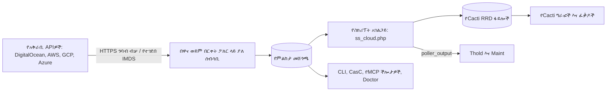

<!-- Source: README.md; SHA256: ac2074a40238686915802803c5efe773f33677f934281e0605e6e87a71a9d27d -->

<!-- translations:start -->
[English](../../../README.md) | [简体中文](../zh-CN/README.md) | [हिन्दी](../hi-IN/README.md) | [Español (España)](../es-ES/README.md) | [Español (Latinoamérica)](../es-419/README.md) | [العربية (السعودية)](../ar-SA/README.md) | [Afrikaans](../af-ZA/README.md) | [አማርኛ](README.md) | [العربية (مصر)](../ar-EG/README.md) | [العربية (المغرب)](../ar-MA/README.md) | [বাংলা](../bn-BD/README.md) | [Bosanski](../bs-BA/README.md) | [Deutsch](../de-DE/README.md) | [فارسی](../fa-IR/README.md) | [Filipino](../fil-PH/README.md) | [Français](../fr-FR/README.md) | [Français (Maroc)](../fr-MA/README.md) | [Français (Sénégal)](../fr-SN/README.md) | [Hausa](../ha-NG/README.md) | [עברית](../he-IL/README.md) | [Hrvatski](../hr-HR/README.md) | [Bahasa Indonesia](../id-ID/README.md) | [Igbo](../ig-NG/README.md) | [Italiano](../it-IT/README.md) | [日本語](../ja-JP/README.md) | [한국어](../ko-KR/README.md) | [Malagasy](../mg-MG/README.md) | [मराठी](../mr-IN/README.md) | [Bahasa Melayu](../ms-MY/README.md) | [Nederlands](../nl-NL/README.md) | [Polski](../pl-PL/README.md) | [Português (Brasil)](../pt-BR/README.md) | [Русский](../ru-RU/README.md) | [Kinyarwanda](../rw-RW/README.md) | [Soomaali](../so-SO/README.md) | [Српски](../sr-RS/README.md) | [Svenska](../sv-SE/README.md) | [Kiswahili](../sw-KE/README.md) | [தமிழ்](../ta-IN/README.md) | [తెలుగు](../te-IN/README.md) | [ไทย](../th-TH/README.md) | [Türkçe](../tr-TR/README.md) | [Українська](../uk-UA/README.md) | [اردو](../ur-PK/README.md) | [Tiếng Việt](../vi-VN/README.md) | [isiXhosa](../xh-ZA/README.md) | [Yorùbá](../yo-NG/README.md) | [繁體中文](../zh-TW/README.md) | [isiZulu](../zu-ZA/README.md)
<!-- translations:end -->

# plugin_cloud

ከሕዝብ ደመና አቅራቢዎች ሀብቶችን እና መለኪያዎችን እንደ መደበኛ መሣሪያዎች፣ የውሂብ ምንጮች እና ግራፎች ወደ Cacti የሚያመጣ የCacti 1.2 ተሰኪ ነው። የደመና የሥራ ጫናዎች ከሚያስተላልፋቸው አውታረ መረብ ጎን ለጎን በCacti ፈቃዶች ሥር ይቀመጣሉ፤ Thold እና Maint ደግሞ ማንቂያዎችን ሊያስነሱባቸው እና ሊገድቧቸው ይችላሉ። አንድ ተሰኪ DigitalOcean፣ Amazon Web Services፣ Google Cloud እና Microsoft Azureን በንጹሕ PHP፣ ለንባብ-ብቻ በሆኑ የአቅራቢ ነጂዎች ይሸፍናል።

> **ሁኔታ፦ በልማት ላይ፣ ገና የተለቀቀ የለም (`0.1.0-dev`)።** ይህ ቅርንጫፍ ለDigitalOcean፣ AWS፣ Google Cloud እና Azure ንጹሕ-PHP ነጂዎችን፣ የርቀት ውሂብ ሰብሳቢ መባዛትን እና የንባብ-ብቻ ወኪል ጤናን፣ የCasC አቅራቢን እና የኦፕሬተር CLIን፣ የMCP ችሎታዎችን እና የDoctor ፍተሻዎችን ተግባራዊ ያደርጋል። በአሁኑ ጊዜ የተካተቱት የCacti አብነቶች የDigitalOcean Droplets እና ሎድ ባላንሰሮችን (`templates/cloud_digitalocean.xml`) ይሸፍናሉ፤ ለAWS፣ Google Cloud እና Azure የCacti አብነት ጥቅሎች እንዲሁም ከDigitalOcean ባለፈ የቀጥታ መለያ ማረጋገጫ ([የአቅራቢ እውነታዎች](../../research/provider-facts.md)) ገና አልተጠናቀቁም። በምርት አካባቢ አያሂዱት።

## የሚደገፉ አቅራቢዎች

እያንዳንዱ የአቅራቢ ነጂ በ`Drivers::production()` ውስጥ የተመዘገበ ሲሆን በ`Provider::released()` ይቀርባል፣ እንዲሁም ምንም SDK ወይም የComposer የአሂድ ጊዜ ጥገኝነት ሳይኖር `ext-openssl` እና stream socketsን በመጠቀም በንጹሕ PHP ይሠራል።

| አቅራቢ | የወሰን መስኮች | የምስክር ወረቀት ምንጮች | ማረጋገጫ | የተገኙ ሀብቶች | የመለኪያ ስብሰባ |
|---|---|---|---|---|---|
| DigitalOcean (`digitalocean`) | የለም (በቶከን ወሰን) | `vault`, `file` | Bearer ቶከን | `droplet`, `load_balancer` | የፍጥነት ገደብ ድርሻ ግንዛቤ ያለው `/v2/monitoring/metrics`፤ የCacti አብነቶች እና የውሂብ መጠይቆች አብረው ይላካሉ |
| Amazon Web Services (`aws`) | `account_id` (12 አኃዞች)፣ `regions` | `vault`, `file`, `instance` | ንጹሕ-PHP AWS SigV4 (`AWS4-HMAC-SHA256`)፣ STS `GetCallerIdentity` ማረጋገጫ፣ አማራጭ STS `AssumeRole`፣ ለ`instance` መለያዎች EC2 IMDSv2 (`169.254.169.254`) | `ec2_instance`, `rds_instance`, `aws_elb` (ALB/NLB) | በቡድን የተከፈለ CloudWatch `GetMetricData` (በአንድ ጥሪ እስከ 500 መጠይቆች) |
| Google Cloud (`gcp`) | `project` | `vault`, `file`, `instance` | በ`ext-openssl` አማካኝነት በንጹሕ-PHP RS256 የአገልግሎት-መለያ JWT በ`oauth2.googleapis.com/token` ላይ የተለወጠ፣ ወይም ለ`instance` መለያዎች GCE ሜታዳታ አገልጋይ (`metadata.google.internal`) | በ`instances.aggregatedList` አማካኝነት `gce_instance` | Cloud Monitoring `timeSeries.list` |
| Microsoft Azure (`azure`) | `tenant`, `subscription`, `regions` | `vault`, `file`, `instance` | ንጹሕ-PHP Entra ID OAuth2 client-credentials ፍሰት (`client_secret` ብቻ፤ የምስክር ወረቀት ማረጋገጫዎች አይካተቱም)፣ ወይም ለARM እና Monitor ቶከኖች Azure IMDS (`169.254.169.254`) የሚተዳደር ማንነት | በARM Resource Graph አማካኝነት `azure_vm` (በ`$skipToken` የተከፋፈለ እና ተደጋጋሚነት የተወገደለት) | Azure Monitor `metrics:getBatch` (በአንድ ጥሪ እስከ 50 ሀብቶች፣ የHTTP 429 እና 529 ገደብን በማስተናገድ) |

## የተተገበሩ ችሎታዎች

### ዋና መድረክ፣ ቮልት እና ሰብሳቢ

- **ጥበቃ ያለው ጭነት እና የሕይወት ዑደት።** የመግቢያ ነጥቦች (`setup.php`, `cli/cloud.php`, `poller_cloud.php`, `ss_cloud.php` እና የገጽ ስክሪፕቶች) በPHP 8.0 ላይ ይተነተናሉ እና Cactiን ሳያበላሹ ከ8.2 በታች የሆነ PHPን ወይም የጎደለ `ext-openssl`ን ይከለክላሉ። ማሻሻያዎች በቅደም ተከተል የተደራጁ፣ idempotent (`Schema::VERSION = 3`, 9 ሠንጠረዦች) እና መቋረጥን የሚቋቋሙ ናቸው። ማራገፍ *Keep Plugin Tables on Uninstall* ካልተነሳ በስተቀር የተሰኪ ሠንጠረዦችን ያስቀምጣል።
- **መለያዎች እና የምስክር ወረቀቶች።** በ**Management > Cloud Accounts** ሥር መለያዎችን ያክሉ፣ ያርትዑ፣ ያረጋግጡ እና ይሰርዙ። የምስክር ወረቀቶች የሚመጡት በAES-256-GCM ከተመሰጠረ ቮልት (`plugin_cloud_secret`፣ በነባሪነት በ`/etc/cacti/cloud-vault.key` የሚቆለፍ)፣ በተዋቀረው *Credential File Directory* (`cloud_credential_dir`፣ ፋይሎችን ለመከልከል በነባሪነት ባዶ) ውስጥ ከተገደበ ፋይል፣ ወይም ከአቅራቢ ኢንስታንስ ማንነት ነው። የምስክር ወረቀቶች በUI ውስጥ ለጽሑፍ-ብቻ ናቸው እና ከመዝገቦች ይሰረዛሉ።
- **ጥብቅ የውጭ ግንኙነት እና የንባብ-ብቻ መቆጣጠሪያዎች።** እያንዳንዱ ነጂ ከ`GuardedTransport` እና `OutboundPolicy` ጀርባ ይሠራል፦ ለእያንዳንዱ አቅራቢ ትክክለኛ የአስተናጋጅ ስሞች HTTPS ወደብ 443፣ እንዲሁም link-local HTTP ወደብ 80 ሜታዳታ መጨረሻ ነጥቦች (`169.254.169.254`, `metadata.google.internal`) ለ`instance` መለያዎች ብቻ ይነቃሉ። በፍቃድ ዝርዝር ውስጥ ያሉ የንባብ-ብቻ ክንውኖች ብቻ ይፈቀዳሉ።
- **ሰብሳቢ እና የወጪ መቆጣጠሪያዎች።** `poller_cloud.php` ከ`poller_bottom` (በCacti የሂደት መዝገብ አማካኝነት በአንድ ፖለር አንድ ሂደት) በ`cloud_collector_budget` ውስጥ ይሠራል፣ ለእያንዳንዱ መለያ ሊዝ ይወስዳል፣ በ`discover_interval` ላይ ግኝትን ያካሂዳል፣ ለንቁ የCacti ውሂብ ምንጮች (`plugin_cloud_series`) ብቻ መለኪያዎችን ያነባል፣ `request_share` እና `monthly_ceiling`ን ያከብራል፣ እና ለ`ss_cloud.php` የቅርብ ጊዜ የውሂብ ነጥቦችን በ`plugin_cloud_observation` ውስጥ ያከማቻል።
- **የCacti ነገሮች እና የጥያቄ ግምቶች።** ለእያንዳንዱ መለያ የወሰን መሣሪያ (`plugin_cloud_device`) ይይዛል፣ በመሣሪያ ማስቀመጥ ጊዜ የወሰን መሣሪያ ዳግም ማውጫ ዘዴዎችን ይጠብቃል፣ የDigitalOcean አብነቶችን እና የስክሪፕት አገልጋይ ውሂብ መጠይቆችን (`templates/cloud_digitalocean.xml`, `cloud_do_droplet.xml`, `cloud_do_load_balancer.xml`) ያስገባል፣ እና በ**New Graphs** (`graphs_new_top_links`) እና **Cloud Health** ላይ የጥያቄ እና የዝርዝር-ዋጋ ግምቶችን ያሳያል።

### የርቀት ውሂብ ሰብሳቢዎች

- `INFO` `remote_collect:1`ን ያውጃል። መለያዎች ለማንኛውም የነቃ የCacti ፖለር (`poller_id >= 1`) ሊመደቡ ይችላሉ፣ እና `poller_cloud.php --poller=N` የዚያ ፖለር ባለቤት የሆኑ መለያዎችን ብቻ ይሰበስባል።
- **`replicate_out` መንጠቆ።** በ`replicate_out_table()` አማካኝነት ከ`plugin_cloud_account`፣ `plugin_cloud_device`፣ `plugin_cloud_series` በፖለር-ወሰን የተለዩ ረድፎችን እና ከ`plugin_cloud_secret` የተመሰጠሩ የciphertext ረድፎችን (በታላሚው ፖለር ባለቤትነት ሥር ላሉ በቮልት ለተደገፉ መለያዎች ብቻ) ያባዛል። ጥሬ የቮልት ቁልፍ ፋይሎች በውሂብ ጎታ ውስጥ በፍጹም አይቀመጡም ወይም አይባዙም፣ እና በእያንዳንዱ ፖለር ላይ በአካባቢው ይቆያሉ።
- **`remote_agent` መንጠቆ።** ኢንቲጀር `poller_id` እና `account_id` መለኪያዎችን ብቻ የሚቀበል እና ምንም የምስክር ወረቀቶች፣ የፋይል ዱካዎች ወይም ምስጢሮች የማይመልስ የንባብ-ብቻ JSON የጤና ማጠቃለያ (`action=cloud_health`) ያቀርባል።

### የስነ-ምህዳር መንጠቆዎች (CasC፣ የMCP ችሎታዎች እና Doctor)

- **የCasC አቅራቢ (`casc_register_providers`)።** በንጹሕ PHP የYAML እና XML ወደ ውጭ መላክ፣ የማኒፌስት ማረጋገጫ፣ የልዩነት እቅድ እና የተረጋገጠ ተግባራዊ ማድረግ ጋር `cloud` አቅራቢን (የስኪማ ስሪት `1`) ይመዘግባል። የቮልት ምስክር ወረቀቶች እንደ `vault:account:<name>` ማጣቀሻዎች ይላካሉ፤ ጥሬ የምስጢር መስኮች (`secret`, `secrets`, `token`, `access_token`, `refresh_token`, `password`, `private_key`, `access_key_id`, `secret_access_key`, `session_token`, `client_secret`, `credential`, `credentials`, `vault_key`) ውድቅ ይደረጋሉ። ተግባራዊ ለማድረግ ትክክለኛ SHA-256 `--confirm=<PLAN_HASH>` ያስፈልጋል።
- **MCP / Abilities API (`abilities_register`)።** በCloud View ክልል (`cloud_health.php`) እና አስተዳዳሪ ላልሆኑ ጠሪዎች በCacti መሣሪያ ወሰን ላይ የተገደቡ፣ ምንም የምስክር ወረቀቶች፣ የቮልት ቁልፎች ወይም የምስክር ወረቀት ፋይል ዱካዎች የማያወጡ ሦስት ጥብቅ የንባብ-ብቻ ችሎታዎችን ይመዘግባል፦
  - `cloud-list-accounts` (አማራጭ `provider`, `poller_id`)
  - `cloud-list-resources` (አማራጭ `account_id`, `type`, `lifecycle`)
  - `cloud-get-health` (አማራጭ `account_id`)
- **የDoctor ፍተሻዎች (`doctor_register_checks`)።** ምንም የምስጢር እሴቶችን ወይም የቁልፍ ቁሳቁሶችን የማያጋልጡ አምስት የምርመራ ፍተሻዎችን ይመዘግባል፦
  - `cloud_schema`፦ የስኪማ ስሪት ወቅታዊነት
  - `cloud_vault_key`፦ የቮልት ቁልፍ ፋይል ተነባቢነት፣ ፈቃዶች እና መጠን
  - `cloud_drivers`፦ ለሁሉም የተለቀቁ አቅራቢዎች የምርት ነጂ ምዝገባ
  - `cloud_accounts_health`፦ የወደቁ፣ የተገደቡ ወይም የቆዩ የነቁ መለያዎች
  - `cloud_poller_intervals`፦ የነቁ መለያዎች የስብሰባ ክፍተቶች ከCacti የፖለር ክፍተት ጋር መጣጣም

## CLI

በPHP 8.2 ወይም ከዚያ በኋላ ከCacti ስርወ ማውጫ ያሂዱ፦

```sh
# Operator and CasC CLI (options use --key=value form)
php plugins/cloud/cli/cloud.php export [--format=yaml|xml]
php plugins/cloud/cli/cloud.php validate --file=<path> [--format=yaml|xml]
php plugins/cloud/cli/cloud.php plan --file=<path> [--format=yaml|xml]
php plugins/cloud/cli/cloud.php apply --file=<path> --confirm=<PLAN_HASH> [--format=yaml|xml]
php plugins/cloud/cli/cloud.php health [--format=text|json] [--poller=<id>]

# Collector entry point (normally started by poller_bottom)
php plugins/cloud/poller_cloud.php [--poller=N] [--force] [--debug]
```

## የመዳረሻ ሚናዎች

| ክልል | መዳረሻ |
| --- | --- |
| Cloud View | ነባር የክትትል ገጾች። |
| Cloud Operator | ክትትል እና የOperations ገጽ እንዲሁም የግል የማጣሪያ ማረጋገጫዎች። |
| Cloud Admin | የኦፕሬተር መዳረሻ እና ነባር ውቅር እንዲሁም አስተዳደራዊ እርምጃዎች። |

የማሻሻያ ፋይሎችን ከገለበጡ በኋላ፣ ክልሎቹን ለመመዝገብ የPlugins ገጹን እንደ አስተዳዳሪ ይክፈቱ። የOperator ክልልን በ**Configuration > Users** ወይም በተጠቃሚ ቡድኖች ሥር በግልጽ ይመድቡ። ማሻሻያዎች ነባር የView እና Admin ክልል መታወቂያዎችን እና ፈቃዶችን ይጠብቃሉ። የAdmin መዳረሻ የOperator መዳረሻን ይወርሳል፣ እና የOperator መዳረሻ በእያንዳንዱ ጥያቄ ላይ የView መዳረሻን ይወርሳል፤ ይህ ለተጠቃሚዎች ወይም ለቡድኖች የተቀመጡ ፈቃዶችን አይጨምርም። የተሰኪ ቅንብሮች ከCacti Settings ፈቃድ በተጨማሪ የCloud Admin መዳረሻን ይጠይቃሉ።

የCacti መሣሪያ ፈቃዶች ለእያንዳንዱ ተጠቃሚ የሚገኙትን ረድፎች እና እርምጃዎች ይገድባሉ፤ ያልተመደቡ ነገሮች አስተዳዳሪ ያስፈልጋቸዋል። ኦፕሬተሮች የCacti መሣሪያውን መድረስ ለሚችሉበት መለያ የተቀመጠውን የምስክር ወረቀት ማረጋገጥ ይችላሉ። የምስክር ወረቀቶች፣ ውቅር፣ ምደባ፣ ስረዛ እና ሌሎች አስተዳደራዊ ለውጦች በአስተዳደራዊ ገጾች ውስጥ ይቆያሉ። ማረጋገጫዎች የሚቆዩት አሁን ባለው የተጠቃሚ ክፍለ ጊዜ ውስጥ ብቻ፣ ቢበዛ ለአንድ ሰዓት እና ተመሳሳዩ ምልከታ ትኩስ እስከሆነ ድረስ ብቻ ነው። አዲስ ወይም የተለወጡ ምልከታዎች ውድቅ ያደርጓቸዋል። የወደቀ ልኬትን እንደ ጤናማ በፍጹም አይመዘግቡም ወይም ማንቂያዎችን አይገድቡም።

## ለምን

እያንዳንዱ የደመና አቅራቢ የራሱ የክትትል መሥሪያ አለው። ከCacti ጎን ለጎን ሲሠሩ ሦስት ክፍተቶችን ይተዋሉ፦

- **የተለየ የመዳረሻ ቁጥጥር።** ለCacti ተጠቃሚ የደመና መለኪያዎችን ማሳየት ማለት የደመና መግቢያ መስጠት ማለት ነው።
- **የአውታረ መረብ አውድ አለመኖር።** የአካባቢ አገናኞች በCacti ውስጥ በግራፍ ይሳላሉ፤ ከበስተጀርባቸው ያሉት የሥራ ጫናዎች በእያንዳንዱ አቅራቢ መሥሪያ ውስጥ በግራፍ ይሳላሉ።
- **የተለየ ማንቂያ።** Thold እና Maint በCacti የውሂብ ምንጮች እና መሣሪያዎች ላይ ይሠራሉ፣ ስለዚህ የአቅራቢ ማንቂያዎች ለእያንዳንዱ አቅራቢ በተናጠል ይዋቀራሉ እና ይገደባሉ።

ተሰኪው የእያንዳንዱን አቅራቢ የክትትል API በCacti ፖለር ላይ ያነባል፣ የቅርብ ጊዜ የውሂብ ነጥቦችን ያከማቻል፣ እና ለCacti ስክሪፕት አገልጋይ ያቀርባቸዋል። የCacti ፖለር የRRD ፋይሎችን ይጽፋል፣ ስለዚህ ግራፍ መሳል፣ ፈቃዶች፣ Thold፣ Maint እና boost እንደ ማንኛውም የCacti ውሂብ ይሠራሉ።

## የንድፍ ቁርጠኝነቶች

- **ለንባብ ብቻ።** እያንዳንዱ ነጂ በፍቃድ ዝርዝሩ ላይ ያሉትን የአቅራቢ ክንውኖች ብቻ መገንባት ይችላል፤ ተሰኪው የደመና ሀብትን በፍጹም አይለውጥም። ([ADR 0002](../../decisions/0002-read-only-with-operation-allowlist.md))
- **PHP ብቻ፣ SDKs የሉም።** መፈረም እና የቶከን ልውውጥ Cacti አስቀድሞ በሚፈልጋቸው ቅጥያዎች በPHP ይተገበራሉ። ምንም የComposer የአሂድ ጊዜ ጥገኝነቶች የሉም። ([ADR 0003](../../decisions/0003-php-only-without-sdks.md))
- **ከስብሰባ በፊት ወጪ።** ተሰኪው የCacti የውሂብ ምንጭ ያላቸውን መለኪያዎች ብቻ ያነባል፣ ግራፎች ከመፈጠራቸው በፊት የሚጠበቀውን የጥያቄ ብዛት እና የዝርዝር-ዋጋ ወጪ ያሳያል፣ እና ወርሃዊ ጣሪያን ያስፈጽማል። ([ADR 0005](../../decisions/0005-collect-only-what-is-graphed.md))
- **በውሂብ ጎታ ውስጥ ግልጽ ጽሑፍ የምስክር ወረቀቶች የሉም።** የምስክር ወረቀቶች ከውሂብ ጎታ ውጭ ባለ ፋይል ከተቆለፈ የተመሰጠረ ቮልት፣ ከምስክር ወረቀት ፋይል ወይም ከአቅራቢው ኢንስታንስ ማንነት ይመጣሉ። ([ADR 0007](../../decisions/0007-credentials-outside-the-database-in-the-clear.md))

## ወሰን እና ሁኔታ

| ደረጃ | ወሰን | ምዕራፎች | ሁኔታ |
|---|---|---|---|
| 0, ምርምር | የአቅራቢ እውነታ ማረጋገጫ፣ የመለኪያ ካታሎጎች፣ የወጪ እና የፍጥነት ሞዴል፣ የፊርማ ሙከራ ቬክተሮች፣ የትራንስፖርት ሙከራ | [M1](https://github.com/somethingwithproof/plugin_cloud/milestone/1) | ተጠናቋል፣ የቀጥታ አቅራቢ መለያዎችን ከሚፈልጉ ፍተሻዎች በስተቀር |
| 1, ዋና እና DigitalOcean | መለያዎች፣ የምስክር ወረቀት ቮልት፣ ትራንስፖርት፣ ሰብሳቢ፣ የምልከታ መሸጎጫ፣ የCacti ነገሮች፣ አብነቶች፣ የጥያቄ ግምቶች፣ የጤና ገጽ፣ DigitalOcean Droplets እና ሎድ ባላንሰሮች | [M2](https://github.com/somethingwithproof/plugin_cloud/milestone/2), [M3](https://github.com/somethingwithproof/plugin_cloud/milestone/3), [M4](https://github.com/somethingwithproof/plugin_cloud/milestone/4) | ተተግብሯል፤ የM4 የሙከራ ማረጋገጫ በመጠባበቅ ላይ |
| 2, AWS | ንጹሕ-PHP SigV4፣ STS `AssumeRole`፣ IMDSv2 ኢንስታንስ ሚናዎች፣ EC2/RDS/ELB ዝርዝር፣ CloudWatch `GetMetricData` | [M5](https://github.com/somethingwithproof/plugin_cloud/milestone/5) | ነጂው ተተግብሯል፤ የCacti አብነቶች እና የቀጥታ መለያ ማረጋገጫ በመጠባበቅ ላይ |
| 3, Google Cloud | ንጹሕ-PHP RS256 የአገልግሎት-መለያ JWT፣ GCE ሜታዳታ አገልጋይ፣ Compute Engine ዝርዝር፣ Cloud Monitoring `timeSeries.list` | [M6](https://github.com/somethingwithproof/plugin_cloud/milestone/6) | ነጂው ተተግብሯል፤ የCacti አብነቶች እና የቀጥታ መለያ ማረጋገጫ በመጠባበቅ ላይ |
| 4, Azure | Entra ID የደንበኛ ምስክር ወረቀቶች፣ IMDS የሚተዳደር ማንነት፣ ARM Resource Graph VM ዝርዝር፣ Azure Monitor `metrics:getBatch` | [M7](https://github.com/somethingwithproof/plugin_cloud/milestone/7) | ነጂው ተተግብሯል፤ የCacti አብነቶች እና የቀጥታ መለያ ማረጋገጫ በመጠባበቅ ላይ |
| 5, የርቀት ሰብሳቢዎች እና ስነ-ምህዳር | የርቀት ውሂብ ሰብሳቢዎች (`replicate_out`, `remote_agent`)፣ CasC አቅራቢ እና CLI፣ MCP ችሎታዎች፣ Doctor ፍተሻዎች | [M8](https://github.com/somethingwithproof/plugin_cloud/milestone/8) | ተተግብሯል |

ከወሰን ውጭ፦ የደመና ሀብቶችን መለወጥ፣ የአቅራቢ ማንቂያዎችን መፍጠር ወይም ማንጸባረቅ፣ የሂሳብ መዝገብ ሪፖርቶች፣ መዝገቦች እና ዱካዎች፣ እንዲሁም በተሰኪ ባለቤትነት የሚተዳደር የማንቂያ ሞተር። ተጨማሪ አቅራቢዎች (Hetzner Cloud፣ Akamai Cloud፣ Oracle Cloud እና ሌሎች) የምርምር ጉዳዮች ናቸው።

## መጫን እና ማዋቀር

እነዚህ እርምጃዎች ለግምገማ የልማት ኮዱን ይጭናሉ። በPHP 8.2 ወይም ከዚያ በኋላ ላይ Cacti 1.2.31 ወይም ከዚያ በኋላ ያስፈልጋቸዋል።

1. ማከማቻውን በCacti ማውጫዎ ሥር ወደ `plugins/cloud` ይቅዱ። ማውጫው `cloud` መባል አለበት።
2. በቮልት የሚደገፉ ምስክር ወረቀቶችን በሚጠቀም እያንዳንዱ ፖለር ላይ ከድር ሥሩ ውጭ የቮልት ቁልፍን ይፍጠሩ። root እና የCacti ተጠቃሚ ብቻ መጻፍ በሚችሉበት ማውጫ ውስጥ ያስቀምጡት፣ እና ፋይሉን የድር አገልጋዩን እና ፖለሩን በሚያሄደው ተጠቃሚ ብቻ እንዲነበብ ያድርጉ። ተሰኪው ይህን ፋይል በፍጹም አይፈጥርም ወይም አይጽፍም፦

   ```sh
   sudo install -d -m 0750 -o root -g cacti /etc/cacti
   head -c 32 /dev/urandom | sudo tee /etc/cacti/cloud-vault.key > /dev/null
   sudo chown cacti:cacti /etc/cacti/cloud-vault.key
   sudo chmod 0600 /etc/cacti/cloud-vault.key
   ```

   `cacti`ን የድር አገልጋይዎን እና ፖለርዎን በሚያሄደው ተጠቃሚ ይተኩ። ፋይሉ 32 ጥሬ ባይቶችን ወይም 64 ሄክሳዴሲማል ቁምፊዎችን ይይዛል። ከውሂብ ጎታው ጋር ምትኬ ያስቀምጡለት፤ ያለ እሱ የተቀመጡ ምስክር ወረቀቶች እንደገና መግባት አለባቸው።
3. በCacti ውስጥ **Configuration > Plugins**ን ይክፈቱ፣ ከዚያ *Cloud*ን ይጫኑ እና ያንቁ።
4. በ**Configuration > Settings > Cloud** ሥር፣ ሌላ ዱካ ከተጠቀሙ *Vault Key File*ን ያዘጋጁ፣ በፋይል ላይ የተመሠረቱ ምስክር ወረቀቶችን ለመጠቀም ካቀዱ *Credential File Directory*ን ያዋቅሩ፣ እና *Collector Time Budget* (ነባሪ 240 ሰከንዶች) ከፖለሩ ክፍተት በታች እንዲሆን ያድርጉ።
5. በ**Configuration > Users** ሥር ለተጠቃሚዎች እና ቡድኖች *Cloud Admin*፣ *Cloud Operator* ወይም *Cloud View* ይስጡ። መጫን ለአስተዳዳሪው Cloud Admin እና Cloud Viewን ይሰጣል፤ Cloud Admin የOperator መዳረሻን ስለሚያካትት አስተዳዳሪው የተለየ የOperator ፈቃድ አያስፈልገውም።
6. በ**Management > Cloud Accounts** ሥር መለያዎችን ያክሉ፣ ከዚያ ለማስጠንቀቂያዎች **Management > Cloud Health**ን ያረጋግጡ።

## የተኳኋኝነት ዒላማዎች

| አካል | ዒላማ |
|---|---|
| Cacti | 1.2.31 ወይም ከዚያ በኋላ፣ ምንም የኮር መጠገኛ የለም |
| PHP | 8.2 ወይም ከዚያ በኋላ፤ የመግቢያ ነጥቦች በ8.0 ላይ መተንተን የሚችሉ ሆነው ይቆያሉ ስለዚህ የማይደገፍ አሂድ ጊዜ ከተበላሸ የCacti UI ይልቅ እምቢታ ያገኛል |
| የPHP ቅጥያዎች | `ext-openssl` (በCacti 1.2.31 የሚፈለግ)፤ ምንም `ext-curl` እና ምንም የComposer አሂድ ጊዜ ጥገኝነት የለም |
| Thold, Maint | ምንም ለውጥ አያስፈልግም |

## ንድፍ

- [docs/performance.md](../../performance.md) ከተጠቀሙባቸው ሃርድዌር እና ቅንብሮች ጋር የሰብሳቢው እና የጤና ገጹ መለኪያዎች አሉት።
- [docs/PLAN.md](../../PLAN.md) ሙሉው ዕቅድ ነው፦ አርክቴክቸር፣ የሚመረኮዝባቸው የአቅራቢ እና የCacti እውነታዎች (ከምንጮች ጋር)፣ የነጂ ውል፣ የወጪ ስሌት፣ የደህንነት ድንበሮች፣ ሙከራ እና ስጋቶች።
- [docs/decisions/](../../decisions/) ቀድሞ ለተወሰኑ ምርጫዎች የአርክቴክቸር ውሳኔ መዝገቦችን ይይዛል።
- [docs/REQUIREMENTS.md](../../REQUIREMENTS.md) እያንዳንዱን የፍላጎት መታወቂያ ከጉዳዩ ጋር ያዛምዳል።



## ሥራ እንዴት እንደሚከታተል

- **ምዕራፎች** የዕቅዱን ምዕራፎች ይከተላሉ። እያንዳንዱ ንዑስ-ጉዳዮቹን እና የመውጫ ማስረጃዎችን የሚዘረዝር ኤፒክ ጉዳይ አለው።
- **ጉዳዮች** በመለያ የተከፋፈሉ ናቸው፦ `type: requirement`, `type: research`, `type: decision`, `type: epic`። የፍላጎት ጉዳዮች የተቆጠሩ፣ ሊፈተሹ የሚችሉ ፍላጎቶችን (`REQ-AREA-NNN`) እና የመቀበያ መስፈርቶችን ይገልጻሉ።
- **መለያዎች** እንዲሁ `area:`, `provider:`, `phase:`, `priority:` እና `status:` ይይዛሉ። [CONTRIBUTING.md](../../../CONTRIBUTING.md#labels)ን ይመልከቱ።
- [የፕሮጀክት ሰሌዳ](https://github.com/users/somethingwithproof/projects/7) በሁሉም ምዕራፎች ውስጥ ያሉትን ሁሉንም ጉዳዮች ያሳያል።

## ልማት

CI ([.github/workflows/plugin-ci-workflow.yml](../../../.github/workflows/plugin-ci-workflow.yml)) የመልቀቂያ ማህደሩን እና የትርጉም ስሪቱን (`bash tests/bin/archive-check.sh`) ይፈትሻል፣ በPHP 8.0 ላይ የመግቢያ ነጥቦችን ይመረምራል፣ በPHP 8.2 እስከ 8.5 ላይ በ`CLOUD_OFFLINE=1` ከCacti `release/1.2.31` እና `1.2.x` አንጻር የPest ክፍል (`phpunit.xml`) እና የሕይወት ዑደት ውህደት (`phpunit-integration.xml`) ሙከራዎችን እንዲሁም PHPStan ደረጃ 9ን ያሂዳል፣ በPHP 8.1 ላይ እምቢታን ይፈትሻል፣ የgettext ካታሎጎችን ያረጋግጣል፣ የ1,000-ተከታታይ ስብሰባ እና የጤና ገጽ አፈጻጸምን ይለካል፣ እና የሥራ ፍሰት ማጣሪያ እና የREUSE ተገዢነትን ያካሂዳል።

ከመግፋት በፊት የአካባቢ ፍተሻዎች፦

```sh
bash tests/bin/archive-check.sh
sh tests/lint-workflows.sh
sh locales/build_gettext.sh --check
CACTI_PATH=/path/to/cacti phpstan analyse -c phpstan.neon --no-progress
```

ለክፍል እና ለምንጭ-ደንብ ሙከራዎች Pestን በ`--configuration=phpunit.xml` ያሂዱ፣ ወይም ለሕይወት ዑደት ውህደት ሙከራዎች ሊጣል በሚችል የCacti ውሂብ ጎታ ላይ በ`CACTI_PATH` እና `CLOUD_TEST_DATABASE=disposable` `--configuration=phpunit-integration.xml`ን ያሂዱ።

## አስተዋጽኦ

[CONTRIBUTING.md](../../../CONTRIBUTING.md)ን ያንብቡ። ኮሚቶች የDCO ፊርማ ያስፈልጋቸዋል። የንድፍ ውይይት በጉዳዮች ላይ ይካሄዳል፤ ክፍት ውሳኔዎች `type: decision` መለያ ይይዛሉ።

## ደህንነት

ተጋላጭነቶችን በግል ሪፖርት ያድርጉ፤ [SECURITY.md](../../../SECURITY.md)ን ይመልከቱ።

## ፈቃድ

GNU General Public License v2.0፣ ከCacti እና ከተሰኪዎቹ ጋር ተመሳሳይ ፈቃድ። [LICENSE](../../../LICENSE)ን ይመልከቱ።
