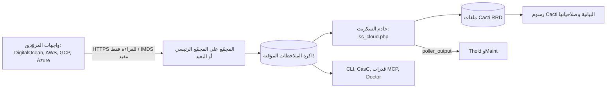

<!-- Source: README.md; SHA256: ac2074a40238686915802803c5efe773f33677f934281e0605e6e87a71a9d27d -->

<!-- translations:start -->
[English](../../../README.md) | [简体中文](../zh-CN/README.md) | [हिन्दी](../hi-IN/README.md) | [Español (España)](../es-ES/README.md) | [Español (Latinoamérica)](../es-419/README.md) | [العربية (السعودية)](../ar-SA/README.md) | [Afrikaans](../af-ZA/README.md) | [አማርኛ](../am-ET/README.md) | [العربية (مصر)](README.md) | [العربية (المغرب)](../ar-MA/README.md) | [বাংলা](../bn-BD/README.md) | [Bosanski](../bs-BA/README.md) | [Deutsch](../de-DE/README.md) | [فارسی](../fa-IR/README.md) | [Filipino](../fil-PH/README.md) | [Français](../fr-FR/README.md) | [Français (Maroc)](../fr-MA/README.md) | [Français (Sénégal)](../fr-SN/README.md) | [Hausa](../ha-NG/README.md) | [עברית](../he-IL/README.md) | [Hrvatski](../hr-HR/README.md) | [Bahasa Indonesia](../id-ID/README.md) | [Igbo](../ig-NG/README.md) | [Italiano](../it-IT/README.md) | [日本語](../ja-JP/README.md) | [한국어](../ko-KR/README.md) | [Malagasy](../mg-MG/README.md) | [मराठी](../mr-IN/README.md) | [Bahasa Melayu](../ms-MY/README.md) | [Nederlands](../nl-NL/README.md) | [Polski](../pl-PL/README.md) | [Português (Brasil)](../pt-BR/README.md) | [Русский](../ru-RU/README.md) | [Kinyarwanda](../rw-RW/README.md) | [Soomaali](../so-SO/README.md) | [Српски](../sr-RS/README.md) | [Svenska](../sv-SE/README.md) | [Kiswahili](../sw-KE/README.md) | [தமிழ்](../ta-IN/README.md) | [తెలుగు](../te-IN/README.md) | [ไทย](../th-TH/README.md) | [Türkçe](../tr-TR/README.md) | [Українська](../uk-UA/README.md) | [اردو](../ur-PK/README.md) | [Tiếng Việt](../vi-VN/README.md) | [isiXhosa](../xh-ZA/README.md) | [Yorùbá](../yo-NG/README.md) | [繁體中文](../zh-TW/README.md) | [isiZulu](../zu-ZA/README.md)
<!-- translations:end -->

# plugin_cloud

إضافة (Plugin) لـ Cacti 1.2 تجلب الموارد والمقاييس من مزوّدي السحابة العامة إلى داخل Cacti كأجهزة ومصادر بيانات ورسوم بيانية عادية. وبذلك تقف أعباء العمل السحابية بجانب الشبكة التي تنقلها، تحت صلاحيات Cacti، ويمكن لـ Thold وMaint التنبيه بشأنها وكتمها. تغطي إضافة واحدة DigitalOcean وAmazon Web Services وGoogle Cloud وMicrosoft Azure من خلال مُشغّلات (Drivers) مكتوبة بلغة PHP خالصة وللقراءة فقط.

> **الحالة: قيد التطوير، لا يوجد إصدار بعد (`0.1.0-dev`).** ينفذ هذا الفرع مُشغّلات بلغة PHP خالصة لـ DigitalOcean وAWS وGoogle Cloud وAzure، والنسخ المتماثل لمجمّعات البيانات البعيدة وصحة الوكيل للقراءة فقط، ومزوّد CasC وواجهة سطر أوامر للمشغّل، وقدرات MCP، وفحوصات Doctor. تغطي قوالب Cacti المرفقة حاليًا DigitalOcean Droplets وموازنات التحميل (`templates/cloud_digitalocean.xml`)؛ ولم تكتمل بعد حزم قوالب Cacti الخاصة بـ AWS وGoogle Cloud وAzure ولا التأهيل على حسابات فعلية خارج DigitalOcean ([حقائق المزوّدين](../../research/provider-facts.md)). لا تشغّلها في بيئة الإنتاج.

## المزوّدون المدعومون

كل مُشغّل مزوّد مسجّل في `Drivers::production()`، ويُتاح عبر `Provider::released()`، ويعمل بلغة PHP خالصة باستخدام `ext-openssl` ومقابس التدفق (stream sockets) بدون أي مكتبات SDK أو اعتماديات تشغيل من Composer.

| المزوّد | حقول النطاق | مصادر بيانات الاعتماد | المصادقة | الموارد المكتشفة | جمع المقاييس |
|---|---|---|---|---|---|
| DigitalOcean (`digitalocean`) | لا يوجد (على مستوى الرمز المميز) | `vault`, `file` | رمز Bearer | `droplet`, `load_balancer` | `/v2/monitoring/metrics` مع مراعاة حصة حد المعدل؛ يشمل قوالب Cacti واستعلامات بيانات |
| Amazon Web Services (`aws`) | `account_id` (12 رقمًا)، `regions` | `vault`, `file`, `instance` | AWS SigV4 بلغة PHP خالصة (`AWS4-HMAC-SHA256`)، والتحقق عبر STS `GetCallerIdentity`، وSTS `AssumeRole` اختياريًا، وEC2 IMDSv2 (`169.254.169.254`) لحسابات `instance` | `ec2_instance`, `rds_instance`, `aws_elb` (ALB/NLB) | CloudWatch `GetMetricData` على دفعات (حتى 500 استعلام لكل استدعاء) |
| Google Cloud (`gcp`) | `project` | `vault`, `file`, `instance` | JWT RS256 لحساب الخدمة بلغة PHP خالصة عبر `ext-openssl` يُستبدل عند `oauth2.googleapis.com/token`، أو خادم بيانات وصفية GCE (`metadata.google.internal`) لحسابات `instance` | `gce_instance` عبر `instances.aggregatedList` | Cloud Monitoring `timeSeries.list` |
| Microsoft Azure (`azure`) | `tenant`, `subscription`, `regions` | `vault`, `file`, `instance` | تدفق بيانات اعتماد العميل Entra ID OAuth2 بلغة PHP خالصة (`client_secret` فقط؛ إثباتات الشهادات مستبعدة)، أو الهوية المُدارة Azure IMDS (`169.254.169.254`) لرموز ARM وMonitor | `azure_vm` عبر ARM Resource Graph (مُقسّم لصفحات باستخدام `$skipToken` ومُزال التكرار) | Azure Monitor `metrics:getBatch` (حتى 50 موردًا لكل استدعاء، مع التعامل مع تقييد HTTP 429 و529) |

## القدرات المنفذة

### المنصة الأساسية والخزنة والمجمّع

- **تثبيت ودورة حياة محمية.** نقاط الدخول (`setup.php` و`cli/cloud.php` و`poller_cloud.php` و`ss_cloud.php` ونصوص الصفحات) قابلة للتحليل على PHP 8.0 وترفض أي إصدار PHP أقل من 8.2 أو غياب `ext-openssl` بدون تعطيل Cacti. الترقيات مرتّبة ومتكررة النتائج (`Schema::VERSION = 3`، 9 جداول) وتنجو من الانقطاع. إلغاء التثبيت يحتفظ بجداول الإضافة ما لم يتم إلغاء تحديد *Keep Plugin Tables on Uninstall*.
- **الحسابات وبيانات الاعتماد.** أضف الحسابات وعدّلها وتحقق منها واحذفها من **Management > Cloud Accounts**. تأتي بيانات الاعتماد من الخزنة المشفرة بـ AES-256-GCM (`plugin_cloud_secret`، ومفتاحها الافتراضي `/etc/cacti/cloud-vault.key`)، أو من ملف مقيد داخل *Credential File Directory* المهيأ (`cloud_credential_dir`، فارغ افتراضيًا لرفض الملفات)، أو من هوية مثيل المزوّد. بيانات الاعتماد للكتابة فقط في واجهة المستخدم وتُحجب من السجلات.
- **ضوابط صارمة للاتصال الصادر والقراءة فقط.** يعمل كل مُشغّل خلف `GuardedTransport` و`OutboundPolicy`: منفذ HTTPS 443 لأسماء المضيفين الدقيقة لكل مزوّد، مع تمكين نقاط نهاية البيانات الوصفية المحلية HTTP على المنفذ 80 (`169.254.169.254` و`metadata.google.internal`) لحسابات `instance` فقط. يُسمح فقط بعمليات القراءة فقط المدرجة في القائمة المسموحة.
- **ضوابط المجمّع والتكلفة.** يعمل `poller_cloud.php` من `poller_bottom` (عملية واحدة لكل مجمّع عبر سجل عمليات Cacti) ضمن `cloud_collector_budget`، ويحصل على عقود إيجار لكل حساب، ويشغّل الاكتشاف وفق `discover_interval`، ويقرأ المقاييس لمصادر بيانات Cacti النشطة فقط (`plugin_cloud_series`)، ويحترم `request_share` و`monthly_ceiling`، ويخزن أحدث نقاط البيانات مؤقتًا في `plugin_cloud_observation` لصالح `ss_cloud.php`.
- **كائنات Cacti وتقديرات الطلبات.** يحافظ على جهاز نطاق لكل حساب (`plugin_cloud_device`)، ويحتفظ بأساليب إعادة فهرسة جهاز النطاق عند حفظ الأجهزة، ويستورد قوالب DigitalOcean واستعلامات بيانات خادم السكربت (`templates/cloud_digitalocean.xml` و`cloud_do_droplet.xml` و`cloud_do_load_balancer.xml`)، ويعرض تقديرات الطلبات وأسعار القائمة في **New Graphs** (`graphs_new_top_links`) و**Cloud Health**.

### مجمّعات البيانات البعيدة

- يصرّح `INFO` بـ `remote_collect:1`. يمكن تعيين الحسابات لأي مجمّع Cacti مُمكّن (`poller_id >= 1`)، ولا يجمع `poller_cloud.php --poller=N` إلا الحسابات المملوكة لهذا المجمّع.
- **خطاف `replicate_out`.** ينسخ الصفوف المحددة بنطاق المجمّع من `plugin_cloud_account` و`plugin_cloud_device` و`plugin_cloud_series` وصفوف النص المشفر من `plugin_cloud_secret` (للحسابات المدعومة بالخزنة والمملوكة للمجمّع المستهدف فقط) عبر `replicate_out_table()`. لا تُخزن ملفات مفاتيح الخزنة في قاعدة البيانات ولا تُنسخ أبدًا، وتبقى محلية على كل مجمّع.
- **خطاف `remote_agent`.** يكشف ملخص حالة JSON للقراءة فقط (`action=cloud_health`) يقبل فقط معاملي `poller_id` و`account_id` الصحيحين ولا يُرجع أي بيانات اعتماد أو مسارات ملفات أو أسرار.

### خطافات المنظومة (CasC وقدرات MCP وDoctor)

- **مزوّد CasC (`casc_register_providers`).** يسجّل المزوّد `cloud` (إصدار المخطط `1`) مع تصدير حتمي بـ YAML وXML بلغة PHP خالصة، والتحقق من صحة البيان، وتخطيط الفروقات، والتطبيق المؤكد. تُصدّر بيانات اعتماد الخزنة كمراجع `vault:account:<name>`؛ وتُرفض حقول الأسرار الخام (`secret` و`secrets` و`token` و`access_token` و`refresh_token` و`password` و`private_key` و`access_key_id` و`secret_access_key` و`session_token` و`client_secret` و`credential` و`credentials` و`vault_key`). يتطلب التطبيق قيمة SHA-256 دقيقة عبر `--confirm=<PLAN_HASH>`.
- **واجهة MCP / Abilities API (`abilities_register`).** تسجّل ثلاث قدرات للقراءة فقط بشكل صارم ومقيّدة بنطاق Cloud View (`cloud_health.php`) ونطاق أجهزة Cacti للمستدعين من غير المسؤولين، ولا تصدر أي بيانات اعتماد أو مفاتيح خزنة أو مسارات ملفات اعتماد:
  - `cloud-list-accounts` (`provider` و`poller_id` اختياريان)
  - `cloud-list-resources` (`account_id` و`type` و`lifecycle` اختيارية)
  - `cloud-get-health` (`account_id` اختياري)
- **فحوصات Doctor (`doctor_register_checks`).** تسجّل خمسة فحوصات تشخيصية لا تكشف عن أي قيم سرية أو مواد مفاتيح:
  - `cloud_schema`: حداثة إصدار المخطط
  - `cloud_vault_key`: قابلية قراءة ملف مفتاح الخزنة وأذوناته وحجمه
  - `cloud_drivers`: تسجيل مُشغّلات الإنتاج لجميع المزوّدين المنشورين
  - `cloud_accounts_health`: الحسابات المُمكّنة الفاشلة أو المقيّدة بالمعدل أو القديمة
  - `cloud_poller_intervals`: مواءمة فترات جمع الحسابات المُمكّنة مع فترة مجمّع Cacti

## واجهة سطر الأوامر CLI

شغّل الأوامر من المجلد الجذري لـ Cacti باستخدام PHP 8.2 أو أحدث:

```sh
# Operator and CasC CLI (options use --key=value form)
php plugins/cloud/cli/cloud.php export [--format=yaml|xml]
php plugins/cloud/cli/cloud.php validate --file=<path> [--format=yaml|xml]
php plugins/cloud/cli/cloud.php plan --file=<path> [--format=yaml|xml]
php plugins/cloud/cli/cloud.php apply --file=<path> --confirm=<PLAN_HASH> [--format=yaml|xml]
php plugins/cloud/cli/cloud.php health [--format=text|json] [--poller=<id>]

# Collector entry point (normally started by poller_bottom)
php plugins/cloud/poller_cloud.php [--poller=N] [--force] [--debug]
```

## أدوار الوصول

| النطاق | صلاحية الوصول |
| --- | --- |
| Cloud View | صفحات المراقبة الحالية. |
| Cloud Operator | المراقبة بالإضافة إلى صفحة Operations وإقرارات الفرز الشخصية. |
| Cloud Admin | صلاحية المشغّل بالإضافة إلى الإعدادات والإجراءات الإدارية الحالية. |

بعد نسخ ملفات الترقية، افتح صفحة Plugins كمسؤول لتسجيل النطاقات. عيّن نطاق Operator صراحةً ضمن **Configuration > Users** أو مجموعات المستخدمين. تحتفظ الترقيات بمعرّفات نطاقي View وAdmin الحالية وصلاحياتهما. يرث وصول Admin وصول Operator، ويرث وصول Operator وصول View في كل طلب؛ ولا يضيف هذا صلاحيات مخزنة للمستخدمين أو المجموعات. تتطلب إعدادات الإضافة أيضًا وصول Cloud Admin بالإضافة إلى إذن Settings في Cacti.

تحد أذونات أجهزة Cacti من الصفوف والإجراءات المتاحة لكل مستخدم؛ وتتطلب الكائنات غير المعينة مسؤولًا. يمكن للمشغّلين التحقق من بيانات الاعتماد المخزنة لحساب يمكنهم الوصول إلى جهاز Cacti الخاص به. وتبقى بيانات الاعتماد والتكوين والتعيين والحذف والتغييرات الإدارية الأخرى في الصفحات الإدارية. تستمر الإقرارات في جلسة المستخدم الحالية فقط، ولمدة ساعة واحدة كحد أقصى وفقط ما دامت الملاحظة نفسها حديثة. وتُبطلها الملاحظات الجديدة أو المتغيرة. ولا تضع علامة سليم على قياس فاشل ولا تكتم التنبيهات أبدًا.

## لماذا

كل مزوّد سحابة لديه وحدة تحكم مراقبة خاصة به. وعند تشغيلها بجانب Cacti، تترك ثلاث فجوات:

- **تحكم وصول منفصل.** إظهار مقاييس السحابة لمستخدم Cacti يعني منحه تسجيل دخول للسحابة.
- **انعدام سياق الشبكة.** تُرسم الروابط المحلية بيانيًا في Cacti، بينما تُرسم أعباء العمل التي خلفها في وحدة تحكم كل مزوّد.
- **تنبيهات منفصلة.** يعمل Thold وMaint على مصادر بيانات Cacti وأجهزته، لذا تُضبط تنبيهات المزوّد وتُكتم بشكل منفصل، مرة لكل مزوّد.

تقرأ الإضافة واجهة برمجة تطبيقات المراقبة الخاصة بكل مزوّد على مجمّع Cacti، وتخزّن أحدث نقاط البيانات مؤقتًا، وتقدّمها لخادم السكربت في Cacti. يكتب مجمّع Cacti ملفات RRD، لذلك تعمل الرسوم البيانية والأذونات وThold وMaint وboost كما تعمل مع أي بيانات Cacti أخرى.

## التزامات التصميم

- **للقراءة فقط.** لا يمكن لكل مُشغّل بناء سوى عمليات المزوّد المدرجة في قائمته المسموحة؛ ولا تغيّر الإضافة أي مورد سحابي أبدًا. ([ADR 0002](../../decisions/0002-read-only-with-operation-allowlist.md))
- **PHP فقط، بدون مكتبات SDK.** يُنفّذ التوقيع وتبادل الرموز المميزة بلغة PHP باستخدام الامتدادات التي يتطلبها Cacti أصلًا. بدون اعتماديات تشغيل من Composer. ([ADR 0003](../../decisions/0003-php-only-without-sdks.md))
- **التكلفة قبل الجمع.** لا تقرأ الإضافة إلا المقاييس التي لها مصدر بيانات في Cacti، وتعرض عدد الطلبات المتوقع وتكلفة سعر القائمة قبل إنشاء الرسوم البيانية، وتفرض حدًا شهريًا. ([ADR 0005](../../decisions/0005-collect-only-what-is-graphed.md))
- **لا بيانات اعتماد بنص صريح في قاعدة البيانات.** تأتي بيانات الاعتماد من خزنة مشفرة بمفتاح في ملف خارج قاعدة البيانات، أو من ملف بيانات اعتماد، أو من هوية مثيل المزوّد. ([ADR 0007](../../decisions/0007-credentials-outside-the-database-in-the-clear.md))

## النطاق والحالة

| المرحلة | النطاق | المعالم | الحالة |
|---|---|---|---|
| 0، البحث | تأكيد حقائق المزوّدين، كتالوجات المقاييس، نموذج التكلفة والمعدل، متجهات اختبار التوقيع، تجربة النقل | [M1](https://github.com/somethingwithproof/plugin_cloud/milestone/1) | مكتمل، باستثناء الفحوصات التي تتطلب حسابات مزوّدين فعلية |
| 1، النواة وDigitalOcean | الحسابات، خزنة بيانات الاعتماد، النقل، المجمّع، ذاكرة الملاحظات المؤقتة، كائنات Cacti، القوالب، تقديرات الطلبات، صفحة الصحة، DigitalOcean Droplets وموازنات التحميل | [M2](https://github.com/somethingwithproof/plugin_cloud/milestone/2), [M3](https://github.com/somethingwithproof/plugin_cloud/milestone/3), [M4](https://github.com/somethingwithproof/plugin_cloud/milestone/4) | مُنفّذ؛ تأهيل المرحلة التجريبية لـ M4 قيد الانتظار |
| 2، AWS | SigV4 بلغة PHP خالصة، STS `AssumeRole`، أدوار مثيلات IMDSv2، جرد EC2/RDS/ELB، CloudWatch `GetMetricData` | [M5](https://github.com/somethingwithproof/plugin_cloud/milestone/5) | المُشغّل مُنفّذ؛ قوالب Cacti والتأهيل على حساب فعلي قيد الانتظار |
| 3، Google Cloud | JWT RS256 لحساب الخدمة بلغة PHP خالصة، خادم بيانات وصفية GCE، جرد Compute Engine، Cloud Monitoring `timeSeries.list` | [M6](https://github.com/somethingwithproof/plugin_cloud/milestone/6) | المُشغّل مُنفّذ؛ قوالب Cacti والتأهيل على حساب فعلي قيد الانتظار |
| 4، Azure | بيانات اعتماد العميل Entra ID، الهوية المُدارة IMDS، جرد أجهزة VM عبر ARM Resource Graph، Azure Monitor `metrics:getBatch` | [M7](https://github.com/somethingwithproof/plugin_cloud/milestone/7) | المُشغّل مُنفّذ؛ قوالب Cacti والتأهيل على حساب فعلي قيد الانتظار |
| 5، المجمّعات البعيدة والمنظومة | مجمّعات البيانات البعيدة (`replicate_out`، `remote_agent`)، مزوّد CasC وCLI، قدرات MCP، فحوصات Doctor | [M8](https://github.com/somethingwithproof/plugin_cloud/milestone/8) | مُنفّذ |

خارج النطاق: تغيير الموارد السحابية، إنشاء أو عكس تنبيهات المزوّدين، تقارير الفوترة، السجلات والتتبعات، ومحرك تنبيهات مملوك للإضافة. المزوّدون الإضافيون (Hetzner Cloud وAkamai Cloud وOracle Cloud وغيرها) هي موضوعات بحثية.

## التثبيت والتهيئة

تثبّت هذه الخطوات الكود التطويري للتقييم. وتتطلب Cacti 1.2.31 أو أحدث على PHP 8.2 أو أحدث.

1. انسخ المستودع إلى `plugins/cloud` داخل مجلد Cacti لديك. يجب أن يكون اسم المجلد `cloud`.
2. أنشئ مفتاح الخزنة خارج جذر الويب على كل مجمّع يستخدم بيانات اعتماد مدعومة بالخزنة. ضعه في مجلد لا يملك حق الكتابة فيه سوى root ومستخدم Cacti، واجعل الملف قابلًا للقراءة فقط للمستخدم الذي يشغّل خادم الويب والمجمّع. لا تنشئ الإضافة هذا الملف ولا تكتب فيه أبدًا:

   ```sh
   sudo install -d -m 0750 -o root -g cacti /etc/cacti
   head -c 32 /dev/urandom | sudo tee /etc/cacti/cloud-vault.key > /dev/null
   sudo chown cacti:cacti /etc/cacti/cloud-vault.key
   sudo chmod 0600 /etc/cacti/cloud-vault.key
   ```

   استبدل `cacti` بالمستخدم الذي يشغّل خادم الويب والمجمّع لديك. يحتوي الملف على 32 بايت خام أو 64 حرفًا ست عشريًا. خذ نسخة احتياطية منه مع قاعدة البيانات؛ فبدونه يجب إعادة إدخال بيانات الاعتماد المخزنة.
3. في Cacti، افتح **Configuration > Plugins**، ثم ثبّت *Cloud* وفعّله.
4. ضمن **Configuration > Settings > Cloud**، حدد *Vault Key File* إذا استخدمت مسارًا آخر، واضبط *Credential File Directory* إذا كنت تخطط لاستخدام بيانات اعتماد قائمة على الملفات، وأبقِ *Collector Time Budget* (الافتراضي 240 ثانية) أقل من فترة المجمّع.
5. امنح *Cloud Admin* أو *Cloud Operator* أو *Cloud View* للمستخدمين والمجموعات ضمن **Configuration > Users**. يمنح التثبيت Cloud Admin وCloud View للمسؤول؛ ويشمل Cloud Admin وصول Operator، لذا لا يحتاج المسؤول إلى منح Operator منفصل.
6. أضف الحسابات ضمن **Management > Cloud Accounts**، ثم افحص **Management > Cloud Health** بحثًا عن التحذيرات.

## أهداف التوافق

| المكوّن | الهدف |
|---|---|
| Cacti | 1.2.31 أو أحدث، بدون تعديلات على النواة |
| PHP | 8.2 أو أحدث؛ تظل نقاط الدخول قابلة للتحليل على 8.0 بحيث يتلقى وقت التشغيل غير المدعوم رفضًا بدلًا من كسر واجهة Cacti |
| إضافات PHP | `ext-openssl` (مطلوبة في Cacti 1.2.31)؛ بدون `ext-curl` وبدون اعتماديات تشغيل من Composer |
| Thold, Maint | لا يلزم أي تغييرات |

## التصميم

- يحتوي [docs/performance.md](../../performance.md) على قياسات المجمّع وصفحة الصحة، مع الأجهزة والإعدادات المستخدمة.
- [docs/PLAN.md](../../PLAN.md) هو الخطة الكاملة: البنية المعمارية، وحقائق المزوّدين وCacti التي تعتمد عليها (مع المصادر)، وعقد المُشغّل، وحسابات التكلفة، وحدود الأمان، والاختبار، والمخاطر.
- يحتفظ [docs/decisions/](../../decisions/) بسجلات القرارات المعمارية للخيارات المتخذة بالفعل.
- يربط [docs/REQUIREMENTS.md](../../REQUIREMENTS.md) كل معرّف متطلب بالمسألة الخاصة به.



## كيفية تتبّع العمل

- **المعالم** تتبع معالم الخطة. ولكل معلم مسألة ملحمية تسرد مسائله الفرعية وأدلة الخروج.
- **المسائل** مصنّفة بالتسميات: `type: requirement` و`type: research` و`type: decision` و`type: epic`. تذكر مسائل المتطلبات متطلبات مرقمة وقابلة للاختبار (`REQ-AREA-NNN`) ومعايير القبول.
- **التسميات** تحمل أيضًا `area:` و`provider:` و`phase:` و`priority:` و`status:`. راجع [CONTRIBUTING.md](../../../CONTRIBUTING.md#labels).
- تعرض [لوحة المشروع](https://github.com/users/somethingwithproof/projects/7) جميع المسائل عبر المعالم.

## التطوير

يفحص التكامل المستمر ([.github/workflows/plugin-ci-workflow.yml](../../../.github/workflows/plugin-ci-workflow.yml)) أرشيف الإصدار والترقيم الدلالي (`bash tests/bin/archive-check.sh`)، ويفحص نقاط الدخول على PHP 8.0، ويشغّل اختبارات Pest الوحدوية (`phpunit.xml`) واختبارات تكامل دورة الحياة (`phpunit-integration.xml`) وPHPStan بالمستوى 9 عبر PHP 8.2 إلى 8.5 مقابل Cacti `release/1.2.31` و`1.2.x` مع `CLOUD_OFFLINE=1`، ويتحقق من الرفض على PHP 8.1، ويتحقق من كتالوجات gettext، ويقيس أداء جمع 1,000 سلسلة وصفحة الصحة، ويشغّل فحص سير العمل والامتثال لـ REUSE.

الفحوصات المحلية قبل الدفع:

```sh
bash tests/bin/archive-check.sh
sh tests/lint-workflows.sh
sh locales/build_gettext.sh --check
CACTI_PATH=/path/to/cacti phpstan analyse -c phpstan.neon --no-progress
```

شغّل Pest مع `--configuration=phpunit.xml` للاختبارات الوحدوية واختبارات قواعد الكود المصدري، أو `--configuration=phpunit-integration.xml` مع `CACTI_PATH` و`CLOUD_TEST_DATABASE=disposable` مقابل قاعدة بيانات Cacti مؤقتة لاختبارات تكامل دورة الحياة.

## المساهمة

اقرأ [CONTRIBUTING.md](../../../CONTRIBUTING.md). تتطلب عمليات الإيداع توقيع DCO. وتجري مناقشات التصميم في المسائل؛ وتحمل القرارات المفتوحة التسمية `type: decision`.

## الأمان

أبلغ عن الثغرات الأمنية بشكل خاص؛ راجع [SECURITY.md](../../../SECURITY.md).

## الترخيص

رخصة GNU العمومية الإصدار 2.0 (GNU General Public License v2.0)، وهي الرخصة نفسها الخاصة بـ Cacti وإضافاته. راجع [LICENSE](../../../LICENSE).
