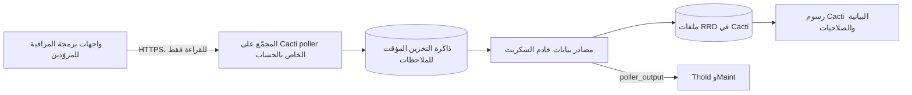

<!-- Source: README.md; SHA256: 7c621642e5f1a46bac66e4bc744f70aebb014c610d22de034088845fdc170405 -->

<!-- translations:start -->
[English](../../../README.md) | [简体中文](../zh-CN/README.md) | [हिन्दी](../hi-IN/README.md) | [Español (España)](../es-ES/README.md) | [Español (Latinoamérica)](../es-419/README.md) | [العربية (السعودية)](../ar-SA/README.md) | [Afrikaans](../af-ZA/README.md) | [አማርኛ](../am-ET/README.md) | [العربية (مصر)](README.md) | [العربية (المغرب)](../ar-MA/README.md) | [বাংলা](../bn-BD/README.md) | [Bosanski](../bs-BA/README.md) | [Deutsch](../de-DE/README.md) | [فارسی](../fa-IR/README.md) | [Filipino](../fil-PH/README.md) | [Français](../fr-FR/README.md) | [Français (Maroc)](../fr-MA/README.md) | [Français (Sénégal)](../fr-SN/README.md) | [Hausa](../ha-NG/README.md) | [עברית](../he-IL/README.md) | [Hrvatski](../hr-HR/README.md) | [Bahasa Indonesia](../id-ID/README.md) | [Igbo](../ig-NG/README.md) | [Italiano](../it-IT/README.md) | [日本語](../ja-JP/README.md) | [한국어](../ko-KR/README.md) | [Malagasy](../mg-MG/README.md) | [मराठी](../mr-IN/README.md) | [Bahasa Melayu](../ms-MY/README.md) | [Nederlands](../nl-NL/README.md) | [Polski](../pl-PL/README.md) | [Português (Brasil)](../pt-BR/README.md) | [Русский](../ru-RU/README.md) | [Kinyarwanda](../rw-RW/README.md) | [Soomaali](../so-SO/README.md) | [Српски](../sr-RS/README.md) | [Svenska](../sv-SE/README.md) | [Kiswahili](../sw-KE/README.md) | [தமிழ்](../ta-IN/README.md) | [తెలుగు](../te-IN/README.md) | [ไทย](../th-TH/README.md) | [Türkçe](../tr-TR/README.md) | [Українська](../uk-UA/README.md) | [اردو](../ur-PK/README.md) | [Tiếng Việt](../vi-VN/README.md) | [isiXhosa](../xh-ZA/README.md) | [Yorùbá](../yo-NG/README.md) | [繁體中文](../zh-TW/README.md) | [isiZulu](../zu-ZA/README.md)
<!-- translations:end -->

# plugin_cloud

إضافة (Plugin) لـ Cacti 1.2 تجلب الموارد والمقاييس من مزوّدي السحابة العامة إلى داخل Cacti كأجهزة ومصادر بيانات ورسوم بيانية عادية. وبذلك تصبح أحمال العمل السحابية بجانب الشبكة التي تنقلها، وتحت صلاحيات Cacti، ويمكن لـ Thold وMaint إرسال تنبيهات بشأنها أو كتمها. تغطي إضافة واحدة كل المزوّدين، مع مُشغِّل (driver) لكل مزوّد: DigitalOcean وAWS وGoogle Cloud وAzure أولًا.

> **الحالة: المرحلة الرئيسية 3 (DigitalOcean وكائنات Cacti)، قيد المراجعة.** تضيف هذه المرحلة مُشغِّل DigitalOcean، وقوالب Cacti، وجهاز نطاق (scope device) لكل حساب مع استعلام بيانات لكل نوع مورد، ومدخل خادم السكربت (script server)، وتقدير الطلبات في صفحة New Graphs وصفحة الحالة الصحية. الفحوصات الأولية على حساب DigitalOcean فعلي مسجلة في [حقائق المزوّدين](../../research/provider-facts.md). لا تشغّلها في بيئة الإنتاج.

## أدوار الوصول

| النطاق | صلاحية الوصول |
| --- | --- |
| Cloud View | صفحات المراقبة الحالية. |
| Cloud Operator | المراقبة بالإضافة إلى صفحة Operations وإقرارات الفرز الشخصي. |
| Cloud Admin | صلاحية Operator بالإضافة إلى الإعدادات الحالية والإجراءات الإدارية. |

بعد نسخ ملفات الترقية، افتح صفحة Plugins كمسؤول نظام لتسجيل النطاق الجديد. عيّن نطاق Operator بشكل صريح من خلال **Configuration > Users** أو مجموعات المستخدمين. تحافظ الترقيات على معرّفات ومنح نطاقي View وAdmin الحالية. ترث صلاحية Admin صلاحية Operator، وترث صلاحية Operator صلاحية View مع كل طلب؛ ولا يضيف هذا منحًا مخزنة إلى المستخدمين أو المجموعات. كما تتطلب إعدادات الإضافة صلاحية Cloud Admin بالإضافة إلى صلاحية Settings في Cacti.

تظل صلاحيات الأجهزة في Cacti تقيّد الصفوف والإجراءات المتاحة لكل مستخدم؛ وتحتاج الكائنات غير المربوطة إلى مسؤول نظام. يمكن للمشغّلين التحقق من بيانات الاعتماد المخزنة لحساب يملكون صلاحية الوصول إلى جهاز Cacti الخاص به. وتظل بيانات الاعتماد، والإعدادات، والربط، والحذف، وبقية التغييرات الإدارية في الصفحات الإدارية. تستمر الإقرارات في جلسة المستخدم الحالية فقط، ولمدة ساعة واحدة بحد أقصى وطالما ظلت الملاحظة نفسها حديثة. أي ملاحظة جديدة أو متغيرة تبطلها. وهي لا تجعل القياس الفاشل سليمًا أبدًا ولا تكتم التنبيهات.

## لماذا؟

لكل مزوّد سحابة لوحة تحكم مراقبة خاصة به. وعند تشغيلها بالتوازي مع Cacti، تترك ثلاث فجوات:

- **تحكم منفصل في الوصول.** إظهار مقاييس السحابة لمستخدم في Cacti يعني منحه حساب دخول إلى السحابة.
- **غياب سياق الشبكة.** تُرسَم روابط الشبكة المحلية بيانيًا في Cacti؛ بينما تُرسَم أحمال العمل التي خلفها في لوحة تحكم كل مزوّد.
- **تنبيهات منفصلة.** يعمل Thold وMaint على مصادر بيانات وأجهزة Cacti، لذا يتم إعداد تنبيهات المزوّد وكتمها بشكل منفصل، مرة لكل مزوّد.

تقرأ الإضافة واجهة برمجة تطبيقات المراقبة لكل مزوّد عبر Cacti poller، وتخزّن أحدث نقاط البيانات مؤقتًا، وتقدّمها لخادم السكربت في Cacti. ويتولى poller الخاص بـ Cacti كتابة ملفات RRD، بحيث تعمل الرسوم البيانية والصلاحيات وThold وMaint وboost كما تعمل مع أي بيانات أخرى في Cacti.

## الالتزامات التصميمية

- **للقراءة فقط.** لا يستطيع كل مُشغِّل بناء إلا عمليات المزوّد المدرجة في قائمة السماح الخاصة به؛ ولا تغيّر الإضافة أي مورد سحابي أبدًا. ([ADR 0002](../../decisions/0002-read-only-with-operation-allowlist.md))
- **PHP فقط، بدون حزم SDK.** تم تنفيذ التوقيع وتبادل الرموز بلغة PHP باستخدام الامتدادات التي يتطلبها Cacti بالفعل. بدون تبعيات تشغيل عبر Composer. ([ADR 0003](../../decisions/0003-php-only-without-sdks.md))
- **التكلفة قبل التجميع.** تقرأ الإضافة فقط المقاييس التي لها مصدر بيانات في Cacti، وتعرض عدد الطلبات المتوقع والتكلفة وفق قائمة الأسعار قبل إنشاء الرسوم البيانية، وتفرض حدًا أقصى شهريًا. ([ADR 0005](../../decisions/0005-collect-only-what-is-graphed.md))
- **لا توجد بيانات اعتماد بنص عادي في قاعدة البيانات.** تأتي بيانات الاعتماد من خزنة مشفرة بمفتاح في ملف خارج قاعدة البيانات، أو من ملف بيانات اعتماد، أو من هوية مثيل المزوّد. ([ADR 0007](../../decisions/0007-credentials-outside-the-database-in-the-clear.md))

## النطاق والحالة

| المرحلة | النطاق | المراحل الرئيسية | الحالة |
|---|---|---|---|
| 0، البحث | تأكيد حقائق المزوّدين، كتالوجات المقاييس، نموذج التكلفة والمعدلات، متجهات اختبار التوقيع، تجربة النقل الأولية | [M1](https://github.com/somethingwithproof/plugin_cloud/milestone/1) | مكتملة، باستثناء الفحوصات التي تحتاج إلى حساب مزوّد فعلي |
| 1، النواة وDigitalOcean | الحسابات، خزنة بيانات الاعتماد، النقل، المجمّع، ذاكرة التخزين المؤقت للملاحظات، كائنات Cacti، صفحة الحالة الصحية، خوادم Droplets وموازنات التحميل في DigitalOcean | [M2](https://github.com/somethingwithproof/plugin_cloud/milestone/2), [M3](https://github.com/somethingwithproof/plugin_cloud/milestone/3), [M4](https://github.com/somethingwithproof/plugin_cloud/milestone/4) | M2 مكتملة ([#81](https://github.com/somethingwithproof/plugin_cloud/pull/81))؛ مُشغِّل M3 والقوالب وأجهزة النطاق تم دمجها؛ تقديرات الطلبات والصلاحيات وفحوصات الأداء قيد المراجعة؛ M4 لم تبدأ |
| 2، AWS | التوقيع الإصدار 4، `AssumeRole`، أدوار المثيلات، CloudWatch `GetMetricData`، الجرد الإقليمي | [M5](https://github.com/somethingwithproof/plugin_cloud/milestone/5) | لم تبدأ |
| 3، Google Cloud | رمز JWT لحساب الخدمة، خادم البيانات الوصفية، Cloud Monitoring `timeSeries.list` | [M6](https://github.com/somethingwithproof/plugin_cloud/milestone/6) | لم تبدأ |
| 4، Azure | بيانات اعتماد عميل Entra، الهوية المُدارة، Resource Graph، `metrics:getBatch` | [M7](https://github.com/somethingwithproof/plugin_cloud/milestone/7) | لم تبدأ |
| 5، المجمّعات البعيدة | الحسابات على مجمّعات البيانات البعيدة في Cacti | [M8](https://github.com/somethingwithproof/plugin_cloud/milestone/8) | لم تبدأ |

خارج النطاق: تغيير موارد السحابة، إنشاء أو محاكاة تنبيهات المزوّد، تقارير الفوترة، السجلات والتتبعات، ومحرك تنبيهات مملوك للإضافة. المزوّدون الإضافيون (Hetzner Cloud وAkamai Cloud وOracle Cloud وغيرها) مدرجون كقضايا بحثية.

## ما تقدّمه المرحلة الرئيسية 2

- **تثبيت محمي.** على إصدار PHP أقل من 8.2، أو بدون ext-openssl، يتم رفض التثبيت والتفعيل مع رسالة توضيحية، ويستمر باقي Cacti في العمل.
- **دورة الحياة.** التثبيت والترقية وإلغاء التثبيت عبر صفحة Plugins في Cacti. الترقيات مرتبة وتصمد أمام الانقطاع. يحافظ إلغاء التثبيت على جداول الإضافة ما لم تقم بإلغاء تحديد *Keep Plugin Tables on Uninstall*.
- **نطاقات منفصلة.** يفتح *Cloud Admin* صفحة **Cloud Accounts**؛ ويفتح *Cloud Operator* صفحة **Cloud Operations**؛ ويفتح *Cloud View* صفحة **Cloud Health**. يرث Admin صلاحيات Operator، ويرث Operator صلاحيات View. وتقع الصفحات الثلاث ضمن Management.
- **الحسابات وبيانات الاعتماد.** إضافة وتعديل والتحقق من وحذف الحسابات. تكون بيانات الاعتماد إما مشفرة في قاعدة البيانات باستخدام ملف مفتاح محفوظ خارجها (AES-256-GCM)، أو مقروءة من ملف على الـ poller. بيانات الاعتماد للكتابة فقط في واجهة المستخدم ويتم حجبها من السجلات.
- **المجمّع.** يبدأ مع كل تشغيل للـ poller، بمعدل نسخة واحدة لكل poller، ضمن ميزانية زمنية محددة. يحصل على عقد إيجار لكل حساب، ويشغّل الاكتشاف وفق فترته الزمنية الخاصة، ويقرأ المقاييس فقط لمصادر البيانات النشطة الخاصة بالإضافة.
- **الحالة الصحية.** حالة التجميع والاكتشاف والموارد وحداثة البيانات لكل حساب، بالإضافة إلى تحذيرات عند وجود مفتاح خزنة غير صالح للاستخدام، أو ملفات بيانات اعتماد غير آمنة، أو فترات زمنية لا يستطيع الـ poller الالتزام بها.

## التثبيت والإعداد

تثبّت هذه الخطوات كود المرحلة الرئيسية 2 بغرض التقييم. وهي تتطلب Cacti 1.2.31 أو أحدث على PHP 8.2 أو أحدث.

1. انسخ المستودع إلى `plugins/cloud` داخل مجلد Cacti. يجب أن يكون اسم المجلد `cloud`.
2. أنشئ مفتاح الخزنة خارج مجلد الويب الجذري. ضعه في مجلد لا يملك صلاحية الكتابة فيه سوى root ومستخدم Cacti، واجعل الملف قابلاً للقراءة فقط بواسطة المستخدم الذي يشغّل خادم الويب والـ poller. لا تنشئ الإضافة هذا الملف ولا تكتب فيه أبدًا:

   ```sh
   sudo install -d -m 0750 -o root -g cacti /etc/cacti
   head -c 32 /dev/urandom | sudo tee /etc/cacti/cloud-vault.key > /dev/null
   sudo chown cacti:cacti /etc/cacti/cloud-vault.key
   sudo chmod 0600 /etc/cacti/cloud-vault.key
   ```

   استبدل `cacti` بالمستخدم الذي يشغّل خادم الويب والـ poller لديك. يحتوي الملف على 32 بايت خام أو 64 حرفًا سداسي عشري. خذ نسخة احتياطية منه مع قاعدة البيانات؛ بدونه، يجب إعادة إدخال بيانات الاعتماد المخزنة.
3. في Cacti، افتح **Configuration > Plugins**، ثم ثبّت وفعّل *Cloud*.
4. من **Configuration > Settings > Cloud**، عيّن *Vault Key File* إذا استخدمت مسارًا آخر. يجب أن تظل قيمة *Collector Time Budget* (الافتراضية 240 ثانية) أقل من الفترة الزمنية للـ poller.
5. امنح صلاحية *Cloud Admin* أو *Cloud Operator* أو *Cloud View* للمستخدمين والمجموعات من **Configuration > Users**. يمنح التثبيت صلاحيتي Cloud Admin وCloud View لمسؤول النظام؛ وتشمل Cloud Admin صلاحية Operator، لذا لا يحتاج المسؤول إلى منح منفصل لصلاحية Operator.
6. أضف الحسابات من **Management > Cloud Accounts**، ثم راجع **Management > Cloud Health** للتحقق من وجود أي تحذيرات.

## متطلبات التوافق المستهدفة

| المكوّن | المستهدف |
|---|---|
| Cacti | 1.2.31 أو أحدث، بدون تعديلات على النواة |
| PHP | 8.2 أو أحدث؛ يظل `setup.php` قابلاً للتحليل على 8.0 بحيث تحصل بيئة التشغيل غير المدعومة على رسالة رفض بدلاً من تعطل واجهة Cacti |
| امتدادات PHP | لا شيء بخلاف ما يتطلبه Cacti 1.2.31 |
| Thold, Maint | لا حاجة لأي تغييرات |

## التصميم

- يحتوي [docs/performance.md](../../performance.md) على قياسات المجمّع وصفحة الحالة الصحية، مع الأجهزة والإعدادات المستخدمة.
- يمثل [docs/PLAN.md](../../PLAN.md) الخطة الكاملة: البنية المعمارية، وحقائق المزوّدين وCacti التي تعتمد عليها (مع المصادر)، وعقد المُشغِّل، وحسابات التكلفة، وحدود الأمان، والاختبارات، والمخاطر.
- يحتوي [docs/decisions/](../../decisions) على سجلات القرارات المعمارية للخيارات التي تم اتخاذها بالفعل.
- يربط [docs/REQUIREMENTS.md](../../REQUIREMENTS.md) كل معرّف متطلب بالقضية الخاصة به.



## كيفية تتبع العمل

- **المراحل الرئيسية** تتبع المراحل الرئيسية في الخطة. ولكل مرحلة قضية ملحمية تسرد القضايا الفرعية وأدلة الإتمام.
- **القضايا** مصنفة حسب التسمية: `type: requirement` و`type: research` و`type: decision` و`type: epic`. تحدد قضايا المتطلبات متطلبات مرقمة وقابلة للاختبار (`REQ-AREA-NNN`) ومعايير القبول.
- **التسميات** تحمل أيضًا `area:` و`provider:` و`phase:` و`priority:` و`status:`. راجع [CONTRIBUTING.md](../../../CONTRIBUTING.md#labels).
- تعرض [لوحة المشروع](https://github.com/users/somethingwithproof/projects/7) جميع القضايا عبر المراحل الرئيسية.

## التطوير

يفحص نظام التكامل المستمر (CI) نقاط الدخول على PHP 8.0، ويشغّل اختبارات الوحدة والتكامل وPHPStan على المستوى 9، ويثبّت الإضافة على PHP من 8.2 إلى 8.5 مع Cacti 1.2.31 وفرع 1.2.x. كما يتحقق من رفض PHP 8.1 دون تعطيل Cacti. تستخدم الاختبارات أداة Pest من حزمة اختبار الإضافات في نواة Cacti. هذا الخيار مؤقت لحين البت في [#12](https://github.com/somethingwithproof/plugin_cloud/issues/12). يسرد ملف [.github/workflows/plugin-ci-workflow.yml](../../../.github/workflows/plugin-ci-workflow.yml) كل خطوة. شغّل `sh tests/lint-workflows.sh` و`sh locales/build_gettext.sh --check` محليًا قبل الدفع.

## المساهمة

اقرأ [CONTRIBUTING.md](../../../CONTRIBUTING.md). تتطلب الـ commits توقيع DCO sign-off. تجري مناقشات التصميم داخل القضايا؛ وتحمل القرارات المفتوحة التسمية `type: decision`.

## الأمان

أبلغ عن الثغرات الأمنية بشكل خاص؛ راجع [SECURITY.md](../../../SECURITY.md).

## الرخصة

رخصة GNU General Public License v2.0، وهي نفس رخصة Cacti وإضافاته. راجع [LICENSE](../../../LICENSE).
