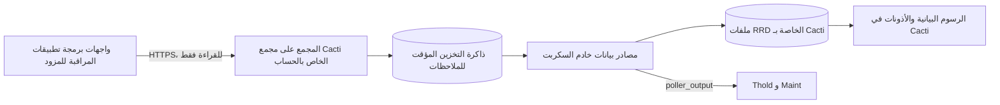

<!-- Source: README.md; SHA256: 7c621642e5f1a46bac66e4bc744f70aebb014c610d22de034088845fdc170405 -->

<!-- translations:start -->
[English](../../../README.md) | [简体中文](../zh-CN/README.md) | [हिन्दी](../hi-IN/README.md) | [Español (España)](../es-ES/README.md) | [Español (Latinoamérica)](../es-419/README.md) | [العربية (السعودية)](../ar-SA/README.md) | [Afrikaans](../af-ZA/README.md) | [አማርኛ](../am-ET/README.md) | [العربية (مصر)](../ar-EG/README.md) | [العربية (المغرب)](README.md) | [বাংলা](../bn-BD/README.md) | [Bosanski](../bs-BA/README.md) | [Deutsch](../de-DE/README.md) | [فارسی](../fa-IR/README.md) | [Filipino](../fil-PH/README.md) | [Français](../fr-FR/README.md) | [Français (Maroc)](../fr-MA/README.md) | [Français (Sénégal)](../fr-SN/README.md) | [Hausa](../ha-NG/README.md) | [עברית](../he-IL/README.md) | [Hrvatski](../hr-HR/README.md) | [Bahasa Indonesia](../id-ID/README.md) | [Igbo](../ig-NG/README.md) | [Italiano](../it-IT/README.md) | [日本語](../ja-JP/README.md) | [한국어](../ko-KR/README.md) | [Malagasy](../mg-MG/README.md) | [मराठी](../mr-IN/README.md) | [Bahasa Melayu](../ms-MY/README.md) | [Nederlands](../nl-NL/README.md) | [Polski](../pl-PL/README.md) | [Português (Brasil)](../pt-BR/README.md) | [Русский](../ru-RU/README.md) | [Kinyarwanda](../rw-RW/README.md) | [Soomaali](../so-SO/README.md) | [Српски](../sr-RS/README.md) | [Svenska](../sv-SE/README.md) | [Kiswahili](../sw-KE/README.md) | [தமிழ்](../ta-IN/README.md) | [తెలుగు](../te-IN/README.md) | [ไทย](../th-TH/README.md) | [Türkçe](../tr-TR/README.md) | [Українська](../uk-UA/README.md) | [اردو](../ur-PK/README.md) | [Tiếng Việt](../vi-VN/README.md) | [isiXhosa](../xh-ZA/README.md) | [Yorùbá](../yo-NG/README.md) | [繁體中文](../zh-TW/README.md) | [isiZulu](../zu-ZA/README.md)
<!-- translations:end -->

# plugin_cloud

إضافة (Plugin) لبرنامج Cacti 1.2 تجلب الموارد والمقاييس (Metrics) من مزودي السحابة العمومية إلى Cacti كأجهزة ومصادر بيانات ورسوم بيانية عادية. وبذلك تتواجد أعباء العمل السحابية بجانب الشبكة التي تنقلها، تحت أذونات Cacti، ويمكن لإضافتَي Thold و Maint التنبيه بشأنها وكتم التنبيهات الخاصة بها. تغطي إضافة واحدة كل مزود، مع مشغل (Driver) لكل مزود: DigitalOcean و AWS و Google Cloud و Azure أولاً.

> **الحالة: المرحلة الرئيسية 3 (DigitalOcean وكائنات Cacti)، قيد المراجعة.** تضيف هذه المرحلة مشغل DigitalOcean، وقوالب Cacti، وجهاز نطاق (Scope device) لكل حساب مع استعلام بيانات لكل نوع مورد، ومدخل خادم السكربت (Script server)، وتقدير الطلبات في صفحة الرسوم البيانية الجديدة (New Graphs) وصفحة الحالة الصحية. الفحوصات الأولية على حساب DigitalOcean حي مسجلة في [حقائق المزودين](../../research/provider-facts.md). لا تقم بتشغيلها في بيئة الإنتاج.

## أدوار الوصول

| المجال (Realm) | صلاحية الوصول |
| --- | --- |
| Cloud View | صفحات المراقبة الحالية. |
| Cloud Operator | المراقبة بالإضافة إلى صفحة العمليات (Operations) وتأكيدات الفرز الشخصية. |
| Cloud Admin | صلاحيات المشغل (Operator) بالإضافة إلى التهيئة الحالية والإجراءات الإدارية. |

بعد نسخ ملفات الترقية، افتح صفحة الإضافات (Plugins) بصفتك مديراً لتسجيل
المجال الجديد. قم بتعيين مجال المشغل (Operator) صراحةً ضمن **Configuration > Users** أو مجموعات المستخدمين.
تحتفظ الترقيات بمعرّفات مجالات View و Admin الحالية وصلاحياتها. يرث وصول Admin
وصول Operator، ويرث وصول Operator وصول View في كل طلب؛
ولا يضيف هذا صلاحيات مخزنة للمستخدمين أو المجموعات. تتطلب إعدادات الإضافة أيضاً
صلاحية Cloud Admin بالإضافة إلى إذن الإعدادات (Settings) في Cacti.

تظل أذونات الأجهزة في Cacti تقيد الصفوف والإجراءات المتاحة لكل مستخدم؛ وتتطلب الكائنات غير المعينة (Unmapped) مديراً. يمكن للمشغلين (Operators) التحقق من بيانات الاعتماد المخزنة لحساب يملكون حق الوصول إلى جهاز Cacti الخاص به.
تبقى بيانات الاعتماد والتهيئة والتعيين والحذف والتغييرات الإدارية الأخرى
في الصفحات الإدارية. تستمر التأكيدات (Acknowledgments) في جلسة المستخدم
الحالية فقط، ولمدة ساعة واحدة كحد أقصى وفقط ما دامت الملاحظة نفسها
حديثة. وتؤدي الملاحظات الجديدة أو المتغيرة إلى إبطالها. كما أنها لا تصنف أبداً قياساً
فاشلاً على أنه سليم ولا تكتم التنبيهات.

## لماذا هذه الإضافة

يمتلك كل مزود سحابة وحدة تحكم مراقبة خاصة به. وعند تشغيلها جنباً إلى جنب مع Cacti، فإنها تترك ثلاث فجوات:

- **تحكم منفصل في الوصول.** يعني عرض مقاييس السحابة لمستخدم Cacti منحه تسجيل دخول إلى السحابة.
- **غياب سياق الشبكة.** تُرسم الروابط المحلية بيانياً في Cacti؛ بينما تُرسم أعباء العمل التي تقف خلفها في وحدة تحكم كل مزود.
- **تنبيهات منفصلة.** تعمل Thold و Maint على مصادر بيانات وأجهزة Cacti، لذا يتم إعداد تنبيهات المزود وكتمها بشكل منفصل، مرة لكل مزود.

تقرأ الإضافة واجهة برمجة تطبيقات المراقبة لكل مزود عبر مجمع (Poller) Cacti، وتخزن أحدث نقاط البيانات مؤقتاً، وتقدمها إلى خادم السكربت في Cacti. يقوم مجمع Cacti بكتابة ملفات RRD، مما يجعل الرسوم البيانية والأذونات و Thold و Maint و boost تعمل كما هو الحال مع أي بيانات أخرى في Cacti.

## التزامات التصميم

- **للقراءة فقط.** لا يمكن لكل مشغل بناء سوى عمليات المزود المدرجة في قائمة السماح (Allowlist) الخاصة به؛ ولا تغير الإضافة أي مورد سحابي أبداً. ([ADR 0002](../../decisions/0002-read-only-with-operation-allowlist.md))
- **PHP فقط، بدون حزم SDK.** يتم تنفيذ التوقيع وتبادل الرموز (Tokens) بلغة PHP باستخدام الامتدادات التي يتطلبها Cacti بالفعل. لا توجد تبعيات تشغيل عبر Composer. ([ADR 0003](../../decisions/0003-php-only-without-sdks.md))
- **التكلفة قبل الجمع.** لا تقرأ الإضافة إلا المقاييس التي لها مصدر بيانات في Cacti، وتعرض عدد الطلبات المتوقع والتكلفة وفق السعر المعلن قبل إنشاء الرسوم البيانية، وتفرض سقفاً شهرياً. ([ADR 0005](../../decisions/0005-collect-only-what-is-graphed.md))
- **لا توجد بيانات اعتماد بنص واضح في قاعدة البيانات.** تأتي بيانات الاعتماد من خزنة مشفرة (Vault) بمفتاح محفوظ في ملف خارج قاعدة البيانات، أو من ملف بيانات اعتماد، أو من هوية المثيل (Instance identity) لدى المزود. ([ADR 0007](../../decisions/0007-credentials-outside-the-database-in-the-clear.md))

## النطاق والحالة

| المرحلة | النطاق | المراحل الرئيسية | الحالة |
|---|---|---|---|
| 0، البحث | تأكيد حقائق المزودين، فهارس المقاييس، نموذج التكلفة والمعدل، متجهات اختبار التوقيع، تجربة النقل الأولية | [M1](https://github.com/somethingwithproof/plugin_cloud/milestone/1) | مكتملة، باستثناء الفحوصات التي تتطلب حساب مزود حي |
| 1، النواة و DigitalOcean | الحسابات، خزنة بيانات الاعتماد، النقل، المجمع، ذاكرة التخزين المؤقت للملاحظات، كائنات Cacti، صفحة الحالة الصحية، خوادم Droplets وموازنات التحميل في DigitalOcean | [M2](https://github.com/somethingwithproof/plugin_cloud/milestone/2)، [M3](https://github.com/somethingwithproof/plugin_cloud/milestone/3)، [M4](https://github.com/somethingwithproof/plugin_cloud/milestone/4) | M2 مكتملة ([#81](https://github.com/somethingwithproof/plugin_cloud/pull/81))؛ تم دمج مشغل M3 والقوالب وأجهزة النطاق؛ تقديرات الطلبات والأذونات وفحوصات الأداء قيد المراجعة؛ M4 لم تبدأ بعد |
| 2، AWS | Signature Version 4، `AssumeRole`، أدوار المثيلات، CloudWatch `GetMetricData`، الجرد الإقليمي | [M5](https://github.com/somethingwithproof/plugin_cloud/milestone/5) | لم تبدأ بعد |
| 3، Google Cloud | JWT لحساب الخدمة، خادم البيانات الوصفية، Cloud Monitoring `timeSeries.list` | [M6](https://github.com/somethingwithproof/plugin_cloud/milestone/6) | لم تبدأ بعد |
| 4، Azure | بيانات اعتماد عميل Entra، الهوية المدارة، Resource Graph، `metrics:getBatch` | [M7](https://github.com/somethingwithproof/plugin_cloud/milestone/7) | لم تبدأ بعد |
| 5، المجمعات البعيدة | الحسابات على مجمعات البيانات البعيدة في Cacti | [M8](https://github.com/somethingwithproof/plugin_cloud/milestone/8) | لم تبدأ بعد |

خارج النطاق: تغيير الموارد السحابية، إنشاء أو محاكاة تنبيهات المزود، تقارير الفوترة، السجلات والتتبعات (Logs and traces)، ومحرك تنبيهات مملوك للإضافة. المزودون الإضافيون (Hetzner Cloud و Akamai Cloud و Oracle Cloud وغيرها) مدرجون كقضايا بحثية.

## ما تقدمه المرحلة الرئيسية 2

- **تثبيت محمي.** على إصدارات PHP الأقل من 8.2، أو بدون ext-openssl، يتم رفض التثبيت والتفعيل مع رسالة توضيحية، ويستمر باقي Cacti في العمل.
- **دورة الحياة.** التثبيت والترقية وإلغاء التثبيت عبر صفحة الإضافات في Cacti. الترقيات مرتبة وتصمد أمام الانقطاع. يحتفظ إلغاء التثبيت بجداول الإضافة ما لم تقم بإلغاء تحديد *Keep Plugin Tables on Uninstall*.
- **مجالات منفصلة.** يفتح *Cloud Admin* صفحة **Cloud Accounts**؛ ويفتح *Cloud Operator* صفحة **Cloud Operations**؛ ويفتح *Cloud View* صفحة **Cloud Health**. يرث Admin صلاحيات Operator، ويرث Operator صلاحيات View. تقع الصفحات الثلاث جميعها ضمن Management.
- **الحسابات وبيانات الاعتماد.** إضافة الحسابات وتعديلها والتحقق منها وحذفها. يتم إما تشفير بيانات الاعتماد في قاعدة البيانات باستخدام ملف مفتاح محفوظ خارجها (AES-256-GCM)، أو قراءتها من ملف على المجمع. بيانات الاعتماد للكتابة فقط في واجهة المستخدم ويتم حجبها من السجلات.
- **المجمع (Collector).** يبدأ مع كل تشغيل للمجمع، بنسخة واحدة لكل مجمع، ضمن ميزانية زمنية محددة. يحصل على مهلة قفل (Lease) لكل حساب، ويجري الاكتشاف وفق الفاصل الزمني الخاص به، ويقرأ المقاييس فقط لمصادر البيانات النشطة التابعة للإضافة نفسها.
- **الحالة الصحية.** حالة الجمع والاكتشاف والموارد وحداثة البيانات لكل حساب، بالإضافة إلى تحذيرات بشأن مفتاح خزنة غير صالح للاستخدام، وملفات بيانات اعتماد غير آمنة، وفواصل زمنية لا يستطيع المجمع الالتزام بها.

## التثبيت والتهيئة

تُثبّت هذه الخطوات شيفرة المرحلة الرئيسية 2 بغرض التقييم. وهي تتطلب Cacti 1.2.31 أو أحدث على PHP 8.2 أو أحدث.

1. انسخ المستودع إلى `plugins/cloud` ضمن مجلد Cacti الخاص بك. يجب أن يكون اسم المجلد `cloud`.
2. أنشئ مفتاح الخزنة خارج جذر الويب. ضعه في مجلد لا يمكن الكتابة فيه إلا لـ root ومستخدم Cacti، واجعل الملف قابلاً للقراءة فقط من قِبل المستخدم الذي يشغل خادم الويب والمجمع. لا تقوم الإضافة أبداً بإنشاء هذا الملف أو الكتابة فيه:

   ```sh
   sudo install -d -m 0750 -o root -g cacti /etc/cacti
   head -c 32 /dev/urandom | sudo tee /etc/cacti/cloud-vault.key > /dev/null
   sudo chown cacti:cacti /etc/cacti/cloud-vault.key
   sudo chmod 0600 /etc/cacti/cloud-vault.key
   ```

   استبدل `cacti` بالمستخدم الذي يشغل خادم الويب والمجمع لديك. يحتوي الملف على 32 بايت خام أو 64 محرفاً ست عشرياً (Hexadecimal). قم بأخذ نسخة احتياطية منه مع قاعدة البيانات؛ بدونه، يجب إعادة إدخال بيانات الاعتماد المخزنة.
3. في Cacti، افتح **Configuration > Plugins**، ثم ثبّت وفعّل *Cloud*.
4. ضمن **Configuration > Settings > Cloud**، اضبط *Vault Key File* إذا استخدمت مساراً آخر. يجب أن يظل *Collector Time Budget* (الافتراضي 240 ثانية) أقل من الفاصل الزمني للمجمع.
5. امنح *Cloud Admin* أو *Cloud Operator* أو *Cloud View* للمستخدمين والمجموعات ضمن **Configuration > Users**. يمنح التثبيت صلاحيتي Cloud Admin و Cloud View للمدير؛ ويتضمن Cloud Admin صلاحية Operator، لذا لا يحتاج المدير إلى منح منفصل لصلاحية Operator.
6. أضف الحسابات ضمن **Management > Cloud Accounts**، ثم تحقق من **Management > Cloud Health** بحثاً عن أي تحذيرات.

## أهداف التوافق

| المكون | الهدف |
|---|---|
| Cacti | 1.2.31 أو أحدث، بدون رقع للنواة (Core patches) |
| PHP | 8.2 أو أحدث؛ يظل `setup.php` قابلاً للتحليل على 8.0 بحيث تحصل بيئة التشغيل غير المدعومة على رفض بدلاً من تعطل واجهة Cacti |
| امتدادات PHP | لا شيء يتجاوز ما يتطلبه Cacti 1.2.31 |
| Thold و Maint | لا تتطلب أي تغييرات |

## التصميم

- يحتوي [docs/performance.md](../../performance.md) على قياسات المجمع وصفحة الحالة الصحية، مع العتاد والإعدادات المستخدمة.
- يمثل [docs/PLAN.md](../../PLAN.md) الخطة الكاملة: البنية المعمارية، وحقائق المزودين و Cacti التي تعتمد عليها (مع المصادر)، وعقد المشغل (Driver contract)، وحسابات التكلفة، والحدود الأمنية، والاختبارات، والمخاطر.
- يضم [docs/decisions/](../../decisions) سجلات قرارات البنية المعمارية (ADRs) للخيارات المتخذة بالفعل.
- يربط [docs/REQUIREMENTS.md](../../REQUIREMENTS.md) كل معرّف متطلب بقضيته (Issue).



## كيفية تتبع العمل

- تتبع **المراحل الرئيسية (Milestones)** مراحل الخطة. ولكل منها قضية رئيسية (Epic issue) تسرد قضاياها الفرعية وأدلة الإنجاز.
- تُصنف **القضايا (Issues)** حسب التسمية: `type: requirement`، `type: research`، `type: decision`، `type: epic`. تحدد قضايا المتطلبات متطلبات مرقمة وقابلة للاختبار (`REQ-AREA-NNN`) ومعايير القبول.
- تحمل **التسميات (Labels)** أيضاً `area:` و `provider:` و `phase:` و `priority:` و `status:`. راجع [CONTRIBUTING.md](../../../CONTRIBUTING.md#labels).
- تعرض [لوحة المشروع](https://github.com/users/somethingwithproof/projects/7) جميع القضايا عبر المراحل الرئيسية.

## التطوير

يقوم التكامل المستمر (CI) بفحص نقاط الدخول برمجياً على PHP 8.0، وتشغيل اختبارات الوحدة والتكامل و PHPStan المستوى 9، وتثبيت الإضافة على PHP 8.2 إلى 8.5 مع Cacti 1.2.31 وفرع 1.2.x. كما يتحقق من رفض PHP 8.1 دون تعطيل Cacti. تستخدم الاختبارات أداة Pest من منصة اختبارات الإضافات في نواة Cacti. يظل هذا الخيار مؤقتاً إلى أن يتم البت في [#12](https://github.com/somethingwithproof/plugin_cloud/issues/12). يسرد ملف [.github/workflows/plugin-ci-workflow.yml](../../../.github/workflows/plugin-ci-workflow.yml) كل خطوة. شغّل `sh tests/lint-workflows.sh` و `sh locales/build_gettext.sh --check` محلياً قبل الدفع (Push).

## المساهمة

اقرأ [CONTRIBUTING.md](../../../CONTRIBUTING.md). تتطلب الالتزامات (Commits) توقيع DCO sign-off. تجري مناقشات التصميم في القضايا؛ وتحمل القرارات المفتوحة تسمية `type: decision`.

## الأمان

أبلغ عن الثغرات الأمنية بشكل خاص؛ راجع [SECURITY.md](../../../SECURITY.md).

## الترخيص

رخصة GNU العمومية الإصدار 2.0 (GNU General Public License v2.0)، وهي نفس الرخصة الخاصة بـ Cacti وإضافاته. راجع [LICENSE](../../../LICENSE).
