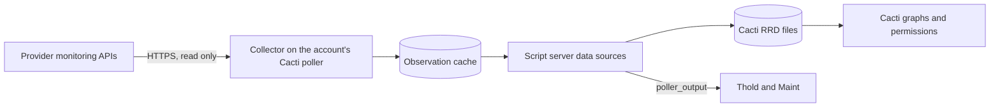

<!-- Source: README.md; SHA256: 7c621642e5f1a46bac66e4bc744f70aebb014c610d22de034088845fdc170405 -->

<!-- translations:start -->
[English](../../../README.md) | [简体中文](../zh-CN/README.md) | [हिन्दी](../hi-IN/README.md) | [Español (España)](../es-ES/README.md) | [Español (Latinoamérica)](../es-419/README.md) | [العربية](README.md)
<!-- translations:end -->

<a id="plugin_cloud"></a>
# plugin_cloud

إضافة لـ Cacti 1.2 تجلب موارد مزوّدي السحابة العامة ومقاييسهم إلى Cacti كأجهزة ومصادر بيانات ورسوم بيانية عادية. تظهر أعباء العمل السحابية بجانب الشبكة التي تنقلها، ضمن أذونات Cacti، ويمكن لـ Thold وMaint التنبيه بشأنها وكتم تنبيهاتها. تغطي إضافة واحدة جميع المزوّدين، مع برنامج تشغيل لكل مزوّد: DigitalOcean وAWS وGoogle Cloud وAzure أولًا.

> **الحالة: المعلم 3 (DigitalOcean وكائنات Cacti)، قيد المراجعة.** يضيف هذا المعلم برنامج تشغيل DigitalOcean، وقوالب Cacti، وجهاز نطاق لكل حساب مع استعلام بيانات لكل نوع مورد، ومدخل خادم البرامج النصية، وتقدير الطلبات في صفحة الرسوم الجديدة وصفحة الصحة. سُجّلت الفحوص الأولية مع حساب DigitalOcean حقيقي في [حقائق المزوّدين](../../research/provider-facts.md). لا تشغّله في بيئة الإنتاج.

<a id="access-roles"></a>
## أدوار الوصول

| نطاق الأذونات | الوصول |
| --- | --- |
| Cloud View | صفحات المراقبة الحالية. |
| Cloud Operator | المراقبة وصفحة العمليات والإقرارات الشخصية للتحقيق. |
| Cloud Admin | وصول المشغّل مع إجراءات الإعداد والإدارة الحالية. |

بعد نسخ ملفات الترقية، افتح صفحة الإضافات كمسؤول لتسجيل نطاق الأذونات الجديد. عيّن نطاق Operator صراحةً ضمن **Configuration > Users** أو مجموعات المستخدمين. تحتفظ الترقيات بمعرّفات نطاقَي View وAdmin الحاليين ومنح الوصول إليهما. يرث وصول Admin وصول Operator، ويرث Operator وصول View في كل طلب؛ ولا يضيف ذلك منحًا مخزّنة للمستخدمين أو المجموعات. تتطلب إعدادات الإضافة أيضًا وصول Cloud Admin إضافةً إلى إذن Settings في Cacti.

لا تزال أذونات أجهزة Cacti تحدّ الصفوف والإجراءات المتاحة لكل مستخدم؛ تتطلب الكائنات غير المرتبطة مسؤولًا. يمكن للمشغّلين التحقق من بيانات الاعتماد المخزّنة لحساب يحق لهم الوصول إلى جهاز Cacti الخاص به. تبقى بيانات الاعتماد والإعدادات والربط والحذف وسائر التغييرات الإدارية في صفحات الإدارة. تدوم الإقرارات في جلسة المستخدم الحالي فقط، لمدة أقصاها ساعة واحدة وفقط ما دامت الملاحظة نفسها حديثة. تُبطلها الملاحظات الجديدة أو المتغيّرة. لا تعتبر مطلقًا قياسًا فاشلًا سليمًا ولا تكتم التنبيهات.

<a id="why"></a>
## الدافع

لكل مزوّد سحابي وحدة مراقبة خاصة به. عند تشغيلها بجانب Cacti، تبقى ثلاث فجوات:

- **تحكم منفصل في الوصول.** يتطلب عرض مقاييس السحابة لمستخدم Cacti منحه حساب دخول إلى السحابة.
- **غياب سياق الشبكة.** تُرسم الوصلات المحلية في Cacti؛ وتُرسم أعباء العمل خلفها في وحدة كل مزوّد.
- **تنبيهات منفصلة.** يعمل Thold وMaint على مصادر بيانات Cacti وأجهزته، لذا تُضبط تنبيهات المزوّدين وتُكتم بشكل منفصل لكل مزوّد.

تقرأ الإضافة واجهة مراقبة كل مزوّد على مستطلع Cacti، وتخزّن أحدث نقاط البيانات مؤقتًا، وتقدّمها إلى خادم البرامج النصية في Cacti. يكتب مستطلع Cacti ملفات RRD، لذا تعمل الرسوم والأذونات وThold وMaint وboost كما تعمل مع أي بيانات في Cacti.

<a id="design-commitments"></a>
## التزامات التصميم

- **للقراءة فقط.** لا يستطيع كل برنامج تشغيل بناء إلا عمليات المزوّد الموجودة في قائمة السماح الخاصة به؛ لا تغيّر الإضافة أي مورد سحابي مطلقًا. ([ADR 0002](../../decisions/0002-read-only-with-operation-allowlist.md))
- **PHP فقط، دون SDK.** تُنفّذ عمليات التوقيع وتبادل الرموز بـ PHP باستخدام الامتدادات التي يتطلبها Cacti أصلًا. لا توجد تبعيات Composer وقت التشغيل. ([ADR 0003](../../decisions/0003-php-only-without-sdks.md))
- **التكلفة قبل الجمع.** لا تقرأ الإضافة إلا المقاييس التي لها مصدر بيانات في Cacti، وتعرض عدد الطلبات المتوقع وتكلفتها بالسعر المعلن قبل إنشاء الرسوم، وتفرض حدًا شهريًا. ([ADR 0005](../../decisions/0005-collect-only-what-is-graphed.md))
- **لا بيانات اعتماد بنص صريح في قاعدة البيانات.** تأتي بيانات الاعتماد من خزنة مشفّرة بمفتاح في ملف خارج قاعدة البيانات، أو من ملف بيانات اعتماد، أو من هوية المثيل لدى المزوّد. ([ADR 0007](../../decisions/0007-credentials-outside-the-database-in-the-clear.md))

<a id="scope-and-status"></a>
## النطاق والحالة

| المرحلة | النطاق | المعالم | الحالة |
|---|---|---|---|
| 0، البحث | تأكيد حقائق المزوّدين، كتالوجات المقاييس، نموذج التكلفة والمعدل، متجهات اختبار التوقيع، وتجربة النقل | [M1](https://github.com/somethingwithproof/plugin_cloud/milestone/1) | مكتملة باستثناء الفحوص التي تتطلب حساب مزوّد حقيقيًا |
| 1، الأساس وDigitalOcean | الحسابات، خزنة بيانات الاعتماد، النقل، الجامع، ذاكرة الملاحظات المؤقتة، كائنات Cacti، صفحة الصحة، وDroplets وموازنات الحمل في DigitalOcean | [M2](https://github.com/somethingwithproof/plugin_cloud/milestone/2), [M3](https://github.com/somethingwithproof/plugin_cloud/milestone/3), [M4](https://github.com/somethingwithproof/plugin_cloud/milestone/4) | اكتمل M2 ([#81](https://github.com/somethingwithproof/plugin_cloud/pull/81))؛ دُمج برنامج التشغيل والقوالب وأجهزة النطاق في M3؛ تقديرات الطلبات والأذونات وفحوص الأداء قيد المراجعة؛ لم يبدأ M4 |
| 2، AWS | Signature Version 4 و`AssumeRole` وأدوار المثيل وCloudWatch `GetMetricData` والجرد الإقليمي | [M5](https://github.com/somethingwithproof/plugin_cloud/milestone/5) | لم تبدأ |
| 3، Google Cloud | JWT لحساب الخدمة، خادم البيانات الوصفية، Cloud Monitoring `timeSeries.list` | [M6](https://github.com/somethingwithproof/plugin_cloud/milestone/6) | لم تبدأ |
| 4، Azure | بيانات اعتماد عميل Entra، الهوية المُدارة، Resource Graph، `metrics:getBatch` | [M7](https://github.com/somethingwithproof/plugin_cloud/milestone/7) | لم تبدأ |
| 5، أدوات الجمع البعيدة | الحسابات على جامعات البيانات البعيدة في Cacti | [M8](https://github.com/somethingwithproof/plugin_cloud/milestone/8) | لم تبدأ |

خارج النطاق: تغيير الموارد السحابية، إنشاء تنبيهات المزوّدين أو نسخها، تقارير الفوترة، السجلات والتتبعات، ومحرك تنبيهات خاص بالإضافة. المزوّدون الإضافيون (Hetzner Cloud وAkamai Cloud وOracle Cloud وغيرهم) موضوعات بحث.

<a id="what-milestone-2-ships"></a>
## ما يقدّمه المعلم 2

- **تثبيت محمي بفحوص.** عند استخدام PHP أقدم من 8.2 أو دون ext-openssl، يُرفض التثبيت والتفعيل مع رسالة، ويستمر باقي Cacti في العمل.
- **دورة الحياة.** التثبيت والترقية وإلغاء التثبيت عبر صفحة إضافات Cacti. الترقيات مرتّبة وتتحمل الانقطاع. يحتفظ إلغاء التثبيت بجداول الإضافة إلا إذا ألغيت تحديد *Keep Plugin Tables on Uninstall*.
- **نطاقات منفصلة.** يفتح *Cloud Admin* صفحة **Cloud Accounts**؛ ويفتح *Cloud Operator* صفحة **Cloud Operations**؛ ويفتح *Cloud View* صفحة **Cloud Health**. يرث Admin صلاحيات Operator، ويرث Operator صلاحيات View. الصفحات الثلاث ضمن Management.
- **الحسابات وبيانات الاعتماد.** إضافة الحسابات وتعديلها والتحقق منها وحذفها. تُشفّر بيانات الاعتماد إما في قاعدة البيانات بمفتاح في ملف خارجها (AES-256-GCM)، أو تُقرأ من ملف على المستطلع. لا تُعرض بيانات الاعتماد للقراءة في الواجهة، وتُحجب من السجلات.
- **الجامع.** يبدأ من كل تشغيل للمستطلع، بمثيل واحد لكل مستطلع، ضمن ميزانية زمنية. يحصل على حجز مؤقت لكل حساب، ويشغّل الاكتشاف بفاصله الخاص، ولا يقرأ إلا مقاييس مصادر البيانات النشطة التي تملكها الإضافة.
- **الصحة.** حالة الجمع والاكتشاف والموارد والحداثة لكل حساب، مع تحذيرات بشأن مفتاح خزنة غير صالح، وملفات اعتماد غير آمنة، وفواصل لا يستطيع المستطلع الالتزام بها.

<a id="install-and-configure"></a>
## التثبيت والإعداد

تثبّت هذه الخطوات شيفرة المعلم 2 للتقييم. تتطلب Cacti 1.2.31 أو أحدث على PHP 8.2 أو أحدث.

1. انسخ المستودع إلى `plugins/cloud` تحت دليل Cacti. يجب أن يكون اسم الدليل `cloud`.
2. أنشئ مفتاح الخزنة خارج جذر الويب. ضعه في دليل لا يكتب فيه إلا root ومستخدم Cacti، واجعل الملف مقروءًا فقط للمستخدم الذي يشغّل خادم الويب والمستطلع. لا تنشئ الإضافة هذا الملف ولا تكتب فيه مطلقًا:

   ```sh
   sudo install -d -m 0750 -o root -g cacti /etc/cacti
   head -c 32 /dev/urandom | sudo tee /etc/cacti/cloud-vault.key > /dev/null
   sudo chown cacti:cacti /etc/cacti/cloud-vault.key
   sudo chmod 0600 /etc/cacti/cloud-vault.key
   ```

   استبدل `cacti` بالمستخدم الذي يشغّل خادم الويب والمستطلع. يحتوي الملف على 32 بايت خام أو 64 محرفًا ست عشريًا. انسخه احتياطيًا مع قاعدة البيانات؛ بدونه يجب إدخال بيانات الاعتماد المخزّنة مجددًا.
3. في Cacti، افتح **Configuration > Plugins**، ثم ثبّت *Cloud* وفعّله.
4. ضمن **Configuration > Settings > Cloud**، اضبط *Vault Key File* إن استخدمت مسارًا آخر. يجب أن تبقى *Collector Time Budget* (افتراضيًا 240 ثانية) أقل من فاصل المستطلع.
5. امنح *Cloud Admin* أو *Cloud Operator* أو *Cloud View* للمستخدمين والمجموعات ضمن **Configuration > Users**. يمنح التثبيت المسؤولَ Cloud Admin وCloud View؛ ويتضمن Cloud Admin صلاحيات Operator، فلا يحتاج المسؤول إلى منح Operator بشكل منفصل.
6. أضف الحسابات ضمن **Management > Cloud Accounts**، ثم تحقق من التحذيرات في **Management > Cloud Health**.

<a id="compatibility-targets"></a>
## أهداف التوافق

| المكوّن | الهدف |
|---|---|
| Cacti | 1.2.31 أو أحدث، دون ترقيعات للنواة |
| PHP | 8.2 أو أحدث؛ يبقى `setup.php` قابلًا للتحليل على 8.0 حتى تتلقى بيئة التشغيل غير المدعومة رفضًا بدلًا من تعطّل واجهة Cacti |
| امتدادات PHP | لا شيء فوق ما يتطلبه Cacti 1.2.31 |
| Thold وMaint | لا تغييرات مطلوبة |

<a id="design"></a>
## التصميم

- يتضمن [docs/performance.md](docs/performance.md) قياسات أداة الجمع وصفحة السلامة، مع العتاد والإعدادات المستخدمة.
- [docs/PLAN.md](../../PLAN.md) هو الخطة الكاملة: البنية، وحقائق المزوّدين وCacti التي تعتمد عليها مع المصادر، وعقد برامج التشغيل، وحساب التكلفة، وحدود الأمان، والاختبارات والمخاطر.
- يحتفظ [docs/decisions/](../../decisions) بسجلات قرارات البنية للاختيارات المتخذة.
- يربط [docs/REQUIREMENTS.md](../../REQUIREMENTS.md) كل معرّف متطلب بمسألته.



<a id="how-work-is-tracked"></a>
## كيفية تتبّع العمل

- تتبع **المعالم** معالم الخطة. لكل منها مسألة رئيسية تسرد المسائل الفرعية وأدلة الاكتمال.
- تُصنّف **المسائل** بالوسوم: `type: requirement` و`type: research` و`type: decision` و`type: epic`. تحدد مسائل المتطلبات متطلبات مرقمة وقابلة للاختبار (`REQ-AREA-NNN`) ومعايير القبول.
- تشمل **الوسوم** أيضًا `area:` و`provider:` و`phase:` و`priority:` و`status:`. راجع [CONTRIBUTING.md](../../../CONTRIBUTING.md#labels).
- تعرض [لوحة المشروع](https://github.com/users/somethingwithproof/projects/7) جميع المسائل عبر المعالم.

<a id="development"></a>
## التطوير

يفحص التكامل المستمر صياغة نقاط الدخول على PHP 8.0، ويشغّل اختبارات الوحدات والتكامل وPHPStan بالمستوى 9، ويثبّت الإضافة على PHP من 8.2 إلى 8.5 مع Cacti 1.2.31 وفرع 1.2.x. ويتحقق أيضًا من رفض PHP 8.1 دون تعطيل Cacti. تستخدم الاختبارات Pest من بيئة اختبارات الإضافات في نواة Cacti. هذا الاختيار مؤقت حتى يُحسم [#12](https://github.com/somethingwithproof/plugin_cloud/issues/12). يسرد [.github/workflows/plugin-ci-workflow.yml](../../../.github/workflows/plugin-ci-workflow.yml) كل الخطوات. شغّل `sh tests/lint-workflows.sh` و`sh locales/build_gettext.sh --check` محليًا قبل الدفع.

<a id="contributing"></a>
## المساهمة

اقرأ [CONTRIBUTING.md](../../../CONTRIBUTING.md). تحتاج الإيداعات إلى توقيع DCO. تجري مناقشات التصميم في المسائل؛ تحمل القرارات المفتوحة وسم `type: decision`.

<a id="security"></a>
## الأمان

أبلغ عن الثغرات بشكل خاص؛ راجع [SECURITY.md](../../../SECURITY.md).

<a id="license"></a>
## الترخيص

رخصة GNU العامة الإصدار 2.0، وهي رخصة Cacti وإضافاته نفسها. راجع [LICENSE](../../../LICENSE).
