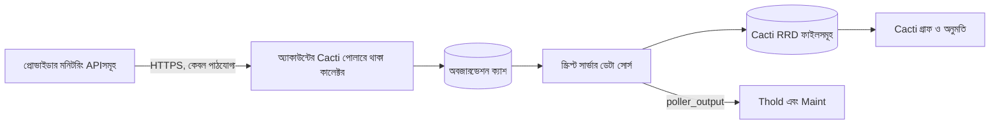

<!-- Source: README.md; SHA256: 7c621642e5f1a46bac66e4bc744f70aebb014c610d22de034088845fdc170405 -->

<!-- translations:start -->
[English](../../../README.md) | [简体中文](../zh-CN/README.md) | [हिन्दी](../hi-IN/README.md) | [Español (España)](../es-ES/README.md) | [Español (Latinoamérica)](../es-419/README.md) | [العربية (السعودية)](../ar-SA/README.md) | [Afrikaans](../af-ZA/README.md) | [አማርኛ](../am-ET/README.md) | [العربية (مصر)](../ar-EG/README.md) | [العربية (المغرب)](../ar-MA/README.md) | [বাংলা](README.md) | [Bosanski](../bs-BA/README.md) | [Deutsch](../de-DE/README.md) | [فارسی](../fa-IR/README.md) | [Filipino](../fil-PH/README.md) | [Français](../fr-FR/README.md) | [Français (Maroc)](../fr-MA/README.md) | [Français (Sénégal)](../fr-SN/README.md) | [Hausa](../ha-NG/README.md) | [עברית](../he-IL/README.md) | [Hrvatski](../hr-HR/README.md) | [Bahasa Indonesia](../id-ID/README.md) | [Igbo](../ig-NG/README.md) | [Italiano](../it-IT/README.md) | [日本語](../ja-JP/README.md) | [한국어](../ko-KR/README.md) | [Malagasy](../mg-MG/README.md) | [मराठी](../mr-IN/README.md) | [Bahasa Melayu](../ms-MY/README.md) | [Nederlands](../nl-NL/README.md) | [Polski](../pl-PL/README.md) | [Português (Brasil)](../pt-BR/README.md) | [Русский](../ru-RU/README.md) | [Kinyarwanda](../rw-RW/README.md) | [Soomaali](../so-SO/README.md) | [Српски](../sr-RS/README.md) | [Svenska](../sv-SE/README.md) | [Kiswahili](../sw-KE/README.md) | [தமிழ்](../ta-IN/README.md) | [తెలుగు](../te-IN/README.md) | [ไทย](../th-TH/README.md) | [Türkçe](../tr-TR/README.md) | [Українська](../uk-UA/README.md) | [اردو](../ur-PK/README.md) | [Tiếng Việt](../vi-VN/README.md) | [isiXhosa](../xh-ZA/README.md) | [Yorùbá](../yo-NG/README.md) | [繁體中文](../zh-TW/README.md) | [isiZulu](../zu-ZA/README.md)
<!-- translations:end -->

# plugin_cloud

একটি Cacti 1.2 প্লাগইন যা পাবলিক ক্লাউড প্রোভাইডারগুলোর রিসোর্স ও মেট্রিক্সকে সাধারণ ডিভাইস, ডেটা সোর্স এবং গ্রাফ হিসেবে Cacti-তে নিয়ে আসে। এর ফলে ক্লাউড ওয়ার্কলোডগুলো সেগুলো বহনকারী নেটওয়ার্কের পাশেই Cacti-এর অনুমতির অধীনে অবস্থান করে এবং Thold ও Maint সেগুলোর ওপর অ্যালার্ট দিতে ও তা সাপ্রেস (স্থগিত) করতে পারে। একটি প্লাগইনই সব প্রোভাইডার কভার করে, যেখানে প্রতিটি প্রোভাইডারের জন্য আলাদা ড্রাইভার রয়েছে: প্রথমে DigitalOcean, AWS, Google Cloud এবং Azure।

> **অবস্থা: মাইলস্টোন ৩ (DigitalOcean এবং Cacti অবজেক্ট), পর্যালোচনাধীন।** এই মাইলস্টোনে DigitalOcean ড্রাইভার, Cacti টেমপ্লেট, প্রতিটি রিসোর্স ধরনের জন্য একটি ডেটা কোয়েরিসহ অ্যাকাউন্টপ্রতি একটি স্কোপ ডিভাইস, স্ক্রিপ্ট সার্ভার ইনপুট এবং New Graphs ও হেলথ পেজে রিকোয়েস্টের আনুমানিক হিসাব যুক্ত করা হয়েছে। একটি লাইভ DigitalOcean অ্যাকাউন্টের বিপরীতে প্রাথমিক যাচাইয়ের ফলাফল [প্রোভাইডার তথ্যাবলি](../../research/provider-facts.md)-তে নথিভুক্ত করা হয়েছে। এটি প্রোডাকশনে চালাবেন না।

## অ্যাক্সেস রোল

| রিয়েল্ম | অ্যাক্সেস |
| --- | --- |
| Cloud View | বিদ্যমান মনিটরিং পেজসমূহ। |
| Cloud Operator | মনিটরিং, পাশাপাশি Operations পেজ এবং ব্যক্তিগত ট্রায়াজ অ্যাকনলেজমেন্ট (স্বীকৃতি)। |
| Cloud Admin | Operator অ্যাক্সেস, পাশাপাশি বিদ্যমান কনফিগারেশন ও প্রশাসনিক কার্যক্রম। |

আপগ্রেডের ফাইলগুলো কপি করার পর, নতুন রিয়েল্মটি নিবন্ধন করতে অ্যাডমিনিস্ট্রেটর হিসেবে Plugins পেজটি খুলুন। **Configuration > Users** অথবা ইউজার গ্রুপের অধীনে Operator রিয়েল্মটি সুস্পষ্টভাবে বরাদ্দ করুন। আপগ্রেডের ফলে বিদ্যমান View এবং Admin রিয়েল্ম আইডি ও অনুমতিগুলো অক্ষুণ্ণ থাকে। প্রতিটি রিকোয়েস্টে Admin অ্যাক্সেস স্বয়ংক্রিয়ভাবে Operator অ্যাক্সেস পায় এবং Operator অ্যাক্সেস স্বয়ংক্রিয়ভাবে View অ্যাক্সেস পায়; এটি ব্যবহারকারী বা গ্রুপে কোনো সংরক্ষিত অনুমতি যোগ করে না। Cacti-এর Settings অনুমতির পাশাপাশি প্লাগইন সেটিংসের জন্যও Cloud Admin অ্যাক্সেস প্রয়োজন।

Cacti ডিভাইসের অনুমতিগুলো এখনো প্রতিটি ব্যবহারকারীর জন্য প্রাপ্য সারি এবং কার্যক্রম সীমাবদ্ধ রাখে; আনম্যাপড অবজেক্টগুলোর জন্য অ্যাডমিনিস্ট্রেটর প্রয়োজন হয়। অপারেটররা এমন একটি অ্যাকাউন্টের সংরক্ষিত ক্রেডেনশিয়াল যাচাই করতে পারেন, যার Cacti ডিভাইসে তাদের অ্যাক্সেস রয়েছে। ক্রেডেনশিয়াল, কনফিগারেশন, ম্যাপিং, মুছে ফেলা এবং অন্যান্য প্রশাসনিক পরিবর্তন প্রশাসনিক পেজগুলোতেই সীমাবদ্ধ থাকে। অ্যাকনলেজমেন্ট কেবল বর্তমান ব্যবহারকারীর সেশনেই টিকে থাকে, সর্বোচ্চ এক ঘণ্টার জন্য এবং কেবল ততক্ষণই যতক্ষণ একই পর্যবেক্ষণ তাজা (ফ্রেশ) থাকে। নতুন বা পরিবর্তিত পর্যবেক্ষণ সেগুলোকে অকার্যকর করে দেয়। এগুলো কখনোই ব্যর্থ পরিমাপকে সুস্থ হিসেবে চিহ্নিত করে না বা অ্যালার্ট সাপ্রেস করে না।

## কেন এই প্লাগইন

প্রতিটি ক্লাউড প্রোভাইডারের নিজস্ব মনিটরিং কনসোল রয়েছে। Cacti-এর পাশাপাশি এগুলো চালালে তিনটি শূন্যতা থেকে যায়:

- **পৃথক অ্যাক্সেস নিয়ন্ত্রণ।** কোনো Cacti ব্যবহারকারীকে ক্লাউড মেট্রিক্স দেখাতে হলে তাকে ক্লাউডের লগইন দিতে হয়।
- **নেটওয়ার্ক প্রসঙ্গের অভাব।** অন-প্রিমিসেস লিংকগুলোর গ্রাফ Cacti-তে তৈরি হয়; আর সেগুলোর পেছনের ওয়ার্কলোডগুলোর গ্রাফ প্রতিটি প্রোভাইডারের নিজস্ব কনসোলে তৈরি হয়।
- **পৃথক অ্যালার্টিং।** Thold এবং Maint কেবল Cacti ডেটা সোর্স ও ডিভাইসের ওপর কাজ করে, তাই প্রোভাইডারের অ্যালার্মগুলো প্রতিটি প্রোভাইডারের জন্য আলাদাভাবে কনফিগার ও সাপ্রেস করতে হয়।

এই প্লাগইনটি Cacti পোলারে প্রতিটি প্রোভাইডারের মনিটরিং API পড়ে, সর্বশেষ ডেটাপয়েন্টগুলো ক্যাশ করে এবং Cacti-এর স্ক্রিপ্ট সার্ভারে পরিবেশন করে। Cacti-এর পোলার RRD ফাইলগুলো লেখে, ফলে গ্রাফিং, অনুমতি, Thold, Maint এবং boost যেকোনো সাধারণ Cacti ডেটার মতোই কাজ করে।

## ডিজাইন প্রতিশ্রুতি

- **শুধুমাত্র পাঠযোগ্য (রিড-অনলি)।** প্রতিটি ড্রাইভার কেবল তার অ্যালাউ-লিস্টে থাকা প্রোভাইডার অপারেশনগুলোই তৈরি করতে পারে; প্লাগইনটি কখনোই কোনো ক্লাউড রিসোর্স পরিবর্তন করে না। ([ADR 0002](../../decisions/0002-read-only-with-operation-allowlist.md))
- **শুধুমাত্র PHP, কোনো SDK নয়।** Cacti-এর জন্য ইতোমধ্যে প্রয়োজনীয় এক্সটেনশনগুলো ব্যবহার করেই PHP-তে সাইনিং এবং টোকেন এক্সচেঞ্জ বাস্তবায়িত হয়েছে। কোনো Composer রানটাইম ডিপেন্ডেন্সি নেই। ([ADR 0003](../../decisions/0003-php-only-without-sdks.md))
- **সংগ্রহের আগে খরচ নির্ধারণ।** প্লাগইনটি কেবল সেই মেট্রিক্সগুলোই পড়ে যেগুলোর একটি Cacti ডেটা সোর্স রয়েছে, গ্রাফ তৈরির আগেই প্রত্যাশিত রিকোয়েস্ট সংখ্যা ও তালিকাভুক্ত মূল্যের খরচ দেখায় এবং একটি মাসিক সর্বোচ্চ সীমা কার্যকর করে। ([ADR 0005](../../decisions/0005-collect-only-what-is-graphed.md))
- **ডাটাবেসে কোনো প্লেইনটেক্সট ক্রেডেনশিয়াল নয়।** ক্রেডেনশিয়াল আসে ডাটাবেসের বাইরের একটি ফাইল দ্বারা কী-কৃত এনক্রিপ্টেড ভল্ট থেকে, কোনো ক্রেডেনশিয়াল ফাইল থেকে অথবা প্রোভাইডারের ইনস্ট্যান্স আইডেন্টিটি থেকে। ([ADR 0007](../../decisions/0007-credentials-outside-the-database-in-the-clear.md))

## পরিধি ও অবস্থা

| ধাপ | পরিধি | মাইলস্টোন | অবস্থা |
|---|---|---|---|
| ০, গবেষণা | প্রোভাইডার তথ্য নিশ্চিতকরণ, মেট্রিক ক্যাটালগ, খরচ ও রেট মডেল, সাইনিং টেস্ট ভেক্টর, ট্রান্সপোর্ট স্পাইক | [M1](https://github.com/somethingwithproof/plugin_cloud/milestone/1) | সম্পন্ন, তবে যেসব যাচাইয়ের জন্য লাইভ প্রোভাইডার অ্যাকাউন্ট প্রয়োজন সেগুলো বাকি |
| ১, কোর এবং DigitalOcean | অ্যাকাউন্ট, ক্রেডেনশিয়াল ভল্ট, ট্রান্সপোর্ট, কালেক্টর, অবজারভেশন ক্যাশ, Cacti অবজেক্ট, হেলথ পেজ, DigitalOcean ড্রপলেট ও লোড ব্যালেন্সার | [M2](https://github.com/somethingwithproof/plugin_cloud/milestone/2), [M3](https://github.com/somethingwithproof/plugin_cloud/milestone/3), [M4](https://github.com/somethingwithproof/plugin_cloud/milestone/4) | M2 সম্পন্ন ([#81](https://github.com/somethingwithproof/plugin_cloud/pull/81)); M3 ড্রাইভার, টেমপ্লেট ও স্কোপ ডিভাইস মার্জ করা হয়েছে; রিকোয়েস্ট অনুমান, অনুমতি ও পারফরম্যান্স যাচাই পর্যালোচনাধীন; M4 শুরু হয়নি |
| ২, AWS | সিগনেচার ভার্সন ৪, `AssumeRole`, ইনস্ট্যান্স রোল, CloudWatch `GetMetricData`, আঞ্চলিক ইনভেন্টরি | [M5](https://github.com/somethingwithproof/plugin_cloud/milestone/5) | শুরু হয়নি |
| ৩, Google Cloud | সার্ভিস অ্যাকাউন্ট JWT, মেটাডেটা সার্ভার, Cloud Monitoring `timeSeries.list` | [M6](https://github.com/somethingwithproof/plugin_cloud/milestone/6) | শুরু হয়নি |
| ৪, Azure | Entra ক্লায়েন্ট ক্রেডেনশিয়াল, ম্যানেজড আইডেন্টিটি, Resource Graph, `metrics:getBatch` | [M7](https://github.com/somethingwithproof/plugin_cloud/milestone/7) | শুরু হয়নি |
| ৫, রিমোট কালেক্টর | Cacti রিমোট ডেটা কালেক্টরে অ্যাকাউন্টসমূহ | [M8](https://github.com/somethingwithproof/plugin_cloud/milestone/8) | শুরু হয়নি |

পরিধির বাইরে: ক্লাউড রিসোর্স পরিবর্তন করা, প্রোভাইডার অ্যালার্ম তৈরি বা মিরর করা, বিলিং রিপোর্ট, লগ ও ট্রেস এবং প্লাগইন-নিয়ন্ত্রিত কোনো অ্যালার্টিং ইঞ্জিন। অন্যান্য প্রোভাইডার (Hetzner Cloud, Akamai Cloud, Oracle Cloud এবং আরও অন্যান্য) গবেষণা ইস্যু হিসেবে রয়েছে।

## মাইলস্টোন ২-এ যা থাকছে

- **সুরক্ষিত ইনস্টলেশন।** PHP 8.2-এর নিচে অথবা ext-openssl ছাড়া ইনস্টল ও সক্রিয় করার চেষ্টা একটি বার্তাসহ প্রত্যাখ্যাত হয় এবং Cacti-এর বাকি অংশ স্বাভাবিকভাবে কাজ করতে থাকে।
- **লাইফসাইকেল।** Cacti-এর Plugins পেজের মাধ্যমে ইনস্টল, আপগ্রেড এবং আনইনস্টল। আপগ্রেডগুলো ক্রমানুসারে চলে এবং মাঝপথে বিঘ্ন ঘটলেও টিকে থাকে। আপনি *Keep Plugin Tables on Uninstall* আনচেক না করা পর্যন্ত আনইনস্টল করার সময় প্লাগইনের টেবিলগুলো সংরক্ষিত থাকে।
- **পৃথক রিয়েল্ম।** *Cloud Admin* **Cloud Accounts** খোলে; *Cloud Operator* **Cloud Operations** খোলে; *Cloud View* **Cloud Health** খোলে। Admin স্বয়ংক্রিয়ভাবে Operator পায় এবং Operator স্বয়ংক্রিয়ভাবে View পায়। তিনটি পেজই Management-এর অধীনে রয়েছে।
- **অ্যাকাউন্ট ও ক্রেডেনশিয়াল।** অ্যাকাউন্ট যোগ, সম্পাদনা, যাচাই এবং মুছে ফেলা। ক্রেডেনশিয়াল ডাটাবেসের বাইরে রাখা একটি কী ফাইল দিয়ে ডাটাবেসে এনক্রিপ্ট করা থাকে (AES-256-GCM), অথবা পোলারে থাকা কোনো ফাইল থেকে পড়া হয়। UI-তে ক্রেডেনশিয়াল কেবল লেখার যোগ্য (রাইট-অনলি) এবং লগ থেকে এগুলো মুছে ফেলা (রিড্যাক্ট) হয়।
- **কালেক্টর।** এটি প্রতিটি পোলার রান থেকে শুরু হয়, প্রতি পোলারে একটি ইনস্ট্যান্স, একটি নির্দিষ্ট সময়-বাজেটের মধ্যে। এটি অ্যাকাউন্টপ্রতি একটি লিজ নেয়, নিজস্ব বিরতিতে ডিসকভারি চালায় এবং কেবল প্লাগইনের নিজস্ব সক্রিয় ডেটা সোর্সগুলোর জন্যই মেট্রিক্স পড়ে।
- **হেলথ।** অ্যাকাউন্টপ্রতি সংগ্রহ, ডিসকভারি, রিসোর্স এবং সতেজতার (ফ্রেশনেস) অবস্থা, পাশাপাশি অব্যবহারযোগ্য ভল্ট কী, অনিরাপদ ক্রেডেনশিয়াল ফাইল এবং পোলার যেসব বিরতি মেনে চলতে পারে না সেগুলোর জন্য সতর্কবার্তা।

## ইনস্টল এবং কনফিগার

এই ধাপগুলো মূল্যায়নের জন্য মাইলস্টোন ২ কোড ইনস্টল করে। এর জন্য PHP 8.2 বা পরবর্তী সংস্করণে Cacti 1.2.31 বা পরবর্তী সংস্করণ প্রয়োজন।

1. আপনার Cacti ডিরেক্টরির অধীনে `plugins/cloud`-এ রিপোজিটরিটি কপি করুন। ডিরেক্টরিটির নাম অবশ্যই `cloud` হতে হবে।
2. ওয়েব রুটের বাইরে ভল্ট কী তৈরি করুন। এটি এমন একটি ডিরেক্টরিতে রাখুন যেখানে কেবল root এবং Cacti ব্যবহারকারী লিখতে পারে, এবং ফাইলটিকে কেবল ওয়েব সার্ভার ও পোলার পরিচালনাকারী ব্যবহারকারীর জন্য পাঠযোগ্য রাখুন। প্লাগইনটি কখনোই এই ফাইলটি তৈরি করে না বা এতে লেখে না:

   ```sh
   sudo install -d -m 0750 -o root -g cacti /etc/cacti
   head -c 32 /dev/urandom | sudo tee /etc/cacti/cloud-vault.key > /dev/null
   sudo chown cacti:cacti /etc/cacti/cloud-vault.key
   sudo chmod 0600 /etc/cacti/cloud-vault.key
   ```

   `cacti`-কে আপনার ওয়েব সার্ভার ও পোলার পরিচালনাকারী ব্যবহারকারীর নাম দিয়ে প্রতিস্থাপন করুন। ফাইলটিতে ৩২ র বাইট বা ৬৪টি হেক্সাডেসিমেল অক্ষর থাকে। ডাটাবেসের সাথে এটির ব্যাকআপ রাখুন; এটি ছাড়া সংরক্ষিত ক্রেডেনশিয়ালগুলো পুনরায় ইনপুট করতে হবে।
3. Cacti-তে **Configuration > Plugins** খুলুন, তারপর *Cloud* ইনস্টল ও সক্রিয় করুন।
4. **Configuration > Settings > Cloud**-এর অধীনে, আপনি অন্য কোনো পাথ ব্যবহার করলে *Vault Key File* সেট করুন। *Collector Time Budget* (ডিফল্ট ২৪০ সেকেন্ড) অবশ্যই পোলার ইন্টারভালের নিচে থাকতে হবে।
5. **Configuration > Users**-এর অধীনে ব্যবহারকারী ও গ্রুপগুলোকে *Cloud Admin*, *Cloud Operator* বা *Cloud View* অনুমতি দিন। ইনস্টল করলে অ্যাডমিনিস্ট্রেটর স্বয়ংক্রিয়ভাবে Cloud Admin এবং Cloud View পায়; Cloud Admin-এর মধ্যে Operator অ্যাক্সেস অন্তর্ভুক্ত থাকে, তাই অ্যাডমিনিস্ট্রেটরের জন্য আলাদা Operator অনুমতির প্রয়োজন নেই।
6. **Management > Cloud Accounts**-এর অধীনে অ্যাকাউন্ট যোগ করুন, তারপর সতর্কবার্তার জন্য **Management > Cloud Health** পরীক্ষা করুন।

## সামঞ্জস্যের লক্ষ্যমাত্রা

| উপাদান | লক্ষ্যমাত্রা |
|---|---|
| Cacti | 1.2.31 বা পরবর্তী, কোনো কোর প্যাচ ছাড়াই |
| PHP | 8.2 বা পরবর্তী; `setup.php` 8.0-তেও পার্সযোগ্য থাকে যাতে অসমর্থিত রানটাইম ভাঙা Cacti UI-এর বদলে প্রত্যাখ্যান বার্তা পায় |
| PHP এক্সটেনশন | Cacti 1.2.31-এর প্রয়োজনীয় এক্সটেনশনগুলো ছাড়া আর কোনোটি নয় |
| Thold, Maint | কোনো পরিবর্তনের প্রয়োজন নেই |

## ডিজাইন

- [docs/performance.md](../../performance.md)-এ ব্যবহৃত হার্ডওয়্যার ও সেটিংসসহ কালেক্টর এবং হেলথ পেজের পরিমাপগুলো রয়েছে।
- [docs/PLAN.md](../../PLAN.md) হলো পূর্ণাঙ্গ পরিকল্পনা: আর্কিটেকচার, এটি যেসব প্রোভাইডার ও Cacti তথ্যের ওপর নির্ভর করে (উৎসসহ), ড্রাইভার চুক্তি, খরচের হিসাব, নিরাপত্তা সীমানা, টেস্টিং এবং ঝুঁকি।
- [docs/decisions/](../../decisions)-এ ইতোমধ্যে নেওয়া সিদ্ধান্তগুলোর আর্কিটেকচার ডিসিশন রেকর্ড রাখা আছে।
- [docs/REQUIREMENTS.md](../../REQUIREMENTS.md) প্রতিটি রিকোয়ারমেন্ট আইডিকে তার ইস্যুর সাথে ম্যাপ করে।



## কাজের অগ্রগতি যেভাবে ট্র্যাক করা হয়

- **মাইলস্টোনসমূহ** পরিকল্পনার মাইলস্টোনগুলো অনুসরণ করে। প্রতিটির একটি এপিক ইস্যু আছে যেখানে তার সাব-ইস্যু এবং সমাপ্তির প্রমাণ তালিকাভুক্ত থাকে।
- **ইস্যুসমূহ** লেবেল অনুযায়ী শ্রেণিবদ্ধ করা হয়: `type: requirement`, `type: research`, `type: decision`, `type: epic`। রিকোয়ারমেন্ট ইস্যুগুলোতে নম্বরযুক্ত, পরীক্ষামূলক রিকোয়ারমেন্ট (`REQ-AREA-NNN`) এবং গ্রহণযোগ্যতার মানদণ্ড উল্লেখ থাকে।
- **লেবেলসমূহে** `area:`, `provider:`, `phase:`, `priority:` এবং `status:`-ও থাকে। দেখুন [CONTRIBUTING.md](../../../CONTRIBUTING.md#labels)।
- [প্রজেক্ট বোর্ড](https://github.com/users/somethingwithproof/projects/7)-এ সব মাইলস্টোনজুড়ে সমস্ত ইস্যু দেখা যায়।

## ডেভেলপমেন্ট

CI PHP 8.0-তে এন্ট্রি পয়েন্টগুলো লিন্ট করে, ইউনিট ও ইন্টিগ্রেশন টেস্ট এবং PHPStan লেভেল ৯ চালায়, এবং Cacti 1.2.31 ও 1.2.x ব্রাঞ্চের বিপরীতে PHP 8.2 থেকে 8.5-এ প্লাগইনটি ইনস্টল করে পরীক্ষা করে। এটি আরও যাচাই করে যে Cacti না ভেঙে PHP 8.1 প্রত্যাখ্যাত হয় কি না। টেস্টগুলোতে Cacti কোরের প্লাগইন হারনেস থেকে Pest ব্যবহার করা হয়েছে। [#12](https://github.com/somethingwithproof/plugin_cloud/issues/12)-এর সিদ্ধান্ত না হওয়া পর্যন্ত এই পছন্দটি অস্থায়ী। [.github/workflows/plugin-ci-workflow.yml](../../../.github/workflows/plugin-ci-workflow.yml)-এ প্রতিটি ধাপ তালিকাভুক্ত আছে। পুশ করার আগে স্থানীয়ভাবে `sh tests/lint-workflows.sh` এবং `sh locales/build_gettext.sh --check` চালান।

## অবদান রাখা

[CONTRIBUTING.md](../../../CONTRIBUTING.md) পড়ুন। কমিটগুলোতে DCO সাইন-অফ প্রয়োজন। ডিজাইন সংক্রান্ত আলোচনা ইস্যুগুলোতে হয়; উন্মুক্ত সিদ্ধান্তগুলোতে `type: decision` লেবেল থাকে।

## নিরাপত্তা

দুর্বলতাগুলো (ভালনারেবিলিটি) গোপনে রিপোর্ট করুন; দেখুন [SECURITY.md](../../../SECURITY.md)।

## লাইসেন্স

GNU General Public License v2.0, যা Cacti এবং এর প্লাগইনগুলোর অনুরূপ লাইসেন্স। দেখুন [LICENSE](../../../LICENSE)।
