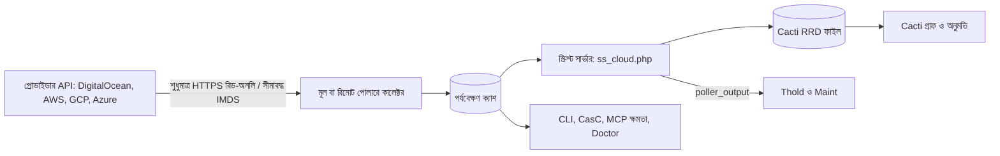

<!-- Source: README.md; SHA256: ac2074a40238686915802803c5efe773f33677f934281e0605e6e87a71a9d27d -->

<!-- translations:start -->
[English](../../../README.md) | [简体中文](../zh-CN/README.md) | [हिन्दी](../hi-IN/README.md) | [Español (España)](../es-ES/README.md) | [Español (Latinoamérica)](../es-419/README.md) | [العربية (السعودية)](../ar-SA/README.md) | [Afrikaans](../af-ZA/README.md) | [አማርኛ](../am-ET/README.md) | [العربية (مصر)](../ar-EG/README.md) | [العربية (المغرب)](../ar-MA/README.md) | [বাংলা](README.md) | [Bosanski](../bs-BA/README.md) | [Deutsch](../de-DE/README.md) | [فارسی](../fa-IR/README.md) | [Filipino](../fil-PH/README.md) | [Français](../fr-FR/README.md) | [Français (Maroc)](../fr-MA/README.md) | [Français (Sénégal)](../fr-SN/README.md) | [Hausa](../ha-NG/README.md) | [עברית](../he-IL/README.md) | [Hrvatski](../hr-HR/README.md) | [Bahasa Indonesia](../id-ID/README.md) | [Igbo](../ig-NG/README.md) | [Italiano](../it-IT/README.md) | [日本語](../ja-JP/README.md) | [한국어](../ko-KR/README.md) | [Malagasy](../mg-MG/README.md) | [मराठी](../mr-IN/README.md) | [Bahasa Melayu](../ms-MY/README.md) | [Nederlands](../nl-NL/README.md) | [Polski](../pl-PL/README.md) | [Português (Brasil)](../pt-BR/README.md) | [Русский](../ru-RU/README.md) | [Kinyarwanda](../rw-RW/README.md) | [Soomaali](../so-SO/README.md) | [Српски](../sr-RS/README.md) | [Svenska](../sv-SE/README.md) | [Kiswahili](../sw-KE/README.md) | [தமிழ்](../ta-IN/README.md) | [తెలుగు](../te-IN/README.md) | [ไทย](../th-TH/README.md) | [Türkçe](../tr-TR/README.md) | [Українська](../uk-UA/README.md) | [اردو](../ur-PK/README.md) | [Tiếng Việt](../vi-VN/README.md) | [isiXhosa](../xh-ZA/README.md) | [Yorùbá](../yo-NG/README.md) | [繁體中文](../zh-TW/README.md) | [isiZulu](../zu-ZA/README.md)
<!-- translations:end -->

# plugin_cloud

একটি Cacti 1.2 প্লাগইন যা পাবলিক ক্লাউড প্রোভাইডারগুলোর রিসোর্স ও মেট্রিক্সকে সাধারণ ডিভাইস, ডেটা সোর্স এবং গ্রাফ হিসেবে Cacti-তে নিয়ে আসে। ক্লাউড ওয়ার্কলোডগুলো সেগুলো বহনকারী নেটওয়ার্কের পাশেই, Cacti-এর অনুমতির অধীনে অবস্থান করে এবং Thold ও Maint সেগুলোর ওপর অ্যালার্ট দিতে ও তা সাপ্রেস (স্থগিত) করতে পারে। একটি প্লাগইনই বিশুদ্ধ PHP-তে লেখা রিড-অনলি প্রোভাইডার ড্রাইভারের মাধ্যমে DigitalOcean, Amazon Web Services, Google Cloud এবং Microsoft Azure-কে কভার করে।

> **অবস্থা: উন্নয়ন পর্যায়ে, এখনো কোনো রিলিজ হয়নি (`0.1.0-dev`)।** এই শাখায় DigitalOcean, AWS, Google Cloud এবং Azure-এর জন্য বিশুদ্ধ-PHP ড্রাইভার, রিমোট ডেটা কালেক্টর রেপ্লিকেশন ও রিড-অনলি এজেন্ট হেলথ, একটি CasC প্রোভাইডার ও অপারেটর CLI, MCP ক্ষমতা এবং Doctor চেক বাস্তবায়ন করা হয়েছে। বর্তমানে অন্তর্ভুক্ত Cacti টেমপ্লেটগুলো DigitalOcean Droplets এবং লোড ব্যালান্সার (`templates/cloud_digitalocean.xml`) কভার করে; AWS, Google Cloud এবং Azure-এর জন্য Cacti টেমপ্লেট প্যাকেজ এবং DigitalOcean-এর বাইরে লাইভ-অ্যাকাউন্ট যোগ্যতা যাচাই ([প্রোভাইডার তথ্যাবলি](../../research/provider-facts.md)) এখনো সম্পন্ন হয়নি। এটি প্রোডাকশনে চালাবেন না।

## সমর্থিত প্রোভাইডার

প্রতিটি প্রোভাইডার ড্রাইভার `Drivers::production()`-এ নিবন্ধিত, `Provider::released()` দ্বারা প্রদত্ত এবং কোনো SDK বা Composer রানটাইম নির্ভরতা ছাড়াই `ext-openssl` ও স্ট্রিম সকেট ব্যবহার করে বিশুদ্ধ PHP-তে চলে।

| প্রোভাইডার | স্কোপ ফিল্ড | ক্রেডেনশিয়াল উৎস | প্রমাণীকরণ | আবিষ্কৃত রিসোর্স | মেট্রিক সংগ্রহ |
|---|---|---|---|---|---|
| DigitalOcean (`digitalocean`) | কোনোটিই নয় (টোকেন-স্কোপড) | `vault`, `file` | Bearer টোকেন | `droplet`, `load_balancer` | রেট-লিমিট শেয়ার সচেতনতাসহ `/v2/monitoring/metrics`; সাথে Cacti টেমপ্লেট ও ডেটা কোয়েরি রয়েছে |
| Amazon Web Services (`aws`) | `account_id` (১২ অঙ্ক), `regions` | `vault`, `file`, `instance` | বিশুদ্ধ-PHP AWS SigV4 (`AWS4-HMAC-SHA256`), STS `GetCallerIdentity` যাচাই, ঐচ্ছিক STS `AssumeRole`, `instance` অ্যাকাউন্টের জন্য EC2 IMDSv2 (`169.254.169.254`) | `ec2_instance`, `rds_instance`, `aws_elb` (ALB/NLB) | ব্যাচকৃত CloudWatch `GetMetricData` (প্রতি কলে সর্বোচ্চ ৫০০টি কোয়েরি) |
| Google Cloud (`gcp`) | `project` | `vault`, `file`, `instance` | `oauth2.googleapis.com/token`-এ বিনিময়কৃত `ext-openssl`-এর মাধ্যমে বিশুদ্ধ-PHP RS256 সার্ভিস-অ্যাকাউন্ট JWT, অথবা `instance` অ্যাকাউন্টের জন্য GCE মেটাডেটা সার্ভার (`metadata.google.internal`) | `instances.aggregatedList`-এর মাধ্যমে `gce_instance` | Cloud Monitoring `timeSeries.list` |
| Microsoft Azure (`azure`) | `tenant`, `subscription`, `regions` | `vault`, `file`, `instance` | বিশুদ্ধ-PHP Entra ID OAuth2 ক্লায়েন্ট-ক্রেডেনশিয়াল প্রবাহ (শুধুমাত্র `client_secret`; সার্টিফিকেট অ্যাসার্শন বাদ), অথবা ARM ও Monitor টোকেনের জন্য Azure IMDS (`169.254.169.254`) ম্যানেজড আইডেন্টিটি | ARM Resource Graph-এর মাধ্যমে `azure_vm` (`$skipToken` দিয়ে পেজিনেটেড ও ডুপ্লিকেটমুক্ত) | Azure Monitor `metrics:getBatch` (প্রতি কলে সর্বোচ্চ ৫০টি রিসোর্স, HTTP 429 ও 529 থ্রটলিং সামলানোসহ) |

## বাস্তবায়িত সক্ষমতা

### মূল প্ল্যাটফর্ম, ভল্ট এবং কালেক্টর

- **সুরক্ষিত ইনস্টলেশন ও জীবনচক্র।** এন্ট্রি পয়েন্টগুলো (`setup.php`, `cli/cloud.php`, `poller_cloud.php`, `ss_cloud.php`, এবং পেজ স্ক্রিপ্ট) PHP 8.0-এ পার্স হয় এবং Cacti না ভেঙে 8.2-এর নিচের PHP বা অনুপস্থিত `ext-openssl` প্রত্যাখ্যান করে। আপগ্রেডগুলো ক্রমানুসারে, আইডেম্পোটেন্ট (`Schema::VERSION = 3`, ৯টি টেবিল) এবং ব্যাঘাত সহনশীল। আনইনস্টল করলে প্লাগইন টেবিলগুলো থেকে যায় যদি না *Keep Plugin Tables on Uninstall* আনচেক করা হয়।
- **অ্যাকাউন্ট ও ক্রেডেনশিয়াল।** **Management > Cloud Accounts**-এর অধীনে অ্যাকাউন্ট যোগ, সম্পাদনা, যাচাই এবং মুছে ফেলুন। ক্রেডেনশিয়াল আসে AES-256-GCM এনক্রিপ্টেড ভল্ট (`plugin_cloud_secret`, ডিফল্ট কী `/etc/cacti/cloud-vault.key`), কনফিগার করা *Credential File Directory* (`cloud_credential_dir`, ফাইল প্রত্যাখ্যান করতে ডিফল্টভাবে ফাঁকা)-এর মধ্যে সীমাবদ্ধ ফাইল, অথবা প্রোভাইডার ইনস্ট্যান্স আইডেন্টিটি থেকে। ক্রেডেনশিয়ালগুলো UI-তে শুধু-লেখার যোগ্য এবং লগ থেকে মুছে ফেলা হয়।
- **কঠোর আউটবাউন্ড ও রিড-অনলি নিয়ন্ত্রণ।** প্রতিটি ড্রাইভার `GuardedTransport` ও `OutboundPolicy`-এর অধীনে কাজ করে: প্রোভাইডারপ্রতি সুনির্দিষ্ট হোস্টনামে HTTPS পোর্ট 443, আর লিংক-লোকাল HTTP পোর্ট 80 মেটাডেটা এন্ডপয়েন্ট (`169.254.169.254`, `metadata.google.internal`) শুধুমাত্র `instance` অ্যাকাউন্টের জন্য সক্রিয় থাকে। কেবল অনুমোদিত তালিকার রিড-অনলি অপারেশনই অনুমোদিত।
- **কালেক্টর ও খরচ নিয়ন্ত্রণ।** `poller_cloud.php`, `poller_bottom` থেকে `cloud_collector_budget`-এর মধ্যে চলে (Cacti-এর প্রসেস রেজিস্ট্রির মাধ্যমে প্রতি পোলারে একটি প্রসেস), প্রতি-অ্যাকাউন্ট লিজ নেয়, `discover_interval`-এ ডিসকভারি চালায়, কেবল সক্রিয় Cacti ডেটা সোর্সের (`plugin_cloud_series`) জন্য মেট্রিক্স পড়ে, `request_share` ও `monthly_ceiling` মেনে চলে এবং `ss_cloud.php`-এর জন্য `plugin_cloud_observation`-এ সর্বশেষ ডেটাপয়েন্ট ক্যাশ করে।
- **Cacti অবজেক্ট ও রিকোয়েস্ট অনুমান।** প্রতি অ্যাকাউন্টের জন্য একটি স্কোপ ডিভাইস (`plugin_cloud_device`) রক্ষণাবেক্ষণ করে, ডিভাইস সেভ করার সময় স্কোপ ডিভাইসের রিইনডেক্স পদ্ধতি সংরক্ষণ করে, DigitalOcean টেমপ্লেট ও স্ক্রিপ্ট সার্ভার ডেটা কোয়েরি (`templates/cloud_digitalocean.xml`, `cloud_do_droplet.xml`, `cloud_do_load_balancer.xml`) আমদানি করে এবং **New Graphs** (`graphs_new_top_links`) ও **Cloud Health**-এ রিকোয়েস্ট এবং তালিকা-মূল্যের অনুমান প্রদর্শন করে।

### রিমোট ডেটা কালেক্টর

- `INFO`-তে `remote_collect:1` ঘোষণা করা আছে। অ্যাকাউন্টগুলো যেকোনো সক্রিয় Cacti পোলারে (`poller_id >= 1`) বরাদ্দ করা যায়, এবং `poller_cloud.php --poller=N` কেবল সেই পোলারের মালিকানাধীন অ্যাকাউন্টগুলোই সংগ্রহ করে।
- **`replicate_out` হুক।** `replicate_out_table()`-এর মাধ্যমে `plugin_cloud_account`, `plugin_cloud_device`, `plugin_cloud_series` থেকে পোলার-স্কোপড সারি এবং `plugin_cloud_secret` থেকে এনক্রিপ্টেড সাইফারটেক্সট সারি (শুধুমাত্র লক্ষ্য পোলারের মালিকানাধীন ভল্ট-সমর্থিত অ্যাকাউন্টের জন্য) রেপ্লিকেট করে। কাঁচা ভল্ট কী ফাইল কখনো ডেটাবেসে সংরক্ষণ বা রেপ্লিকেট করা হয় না এবং প্রতিটি পোলারে স্থানীয়ভাবে থাকে।
- **`remote_agent` হুক।** কেবল পূর্ণসংখ্যা `poller_id` ও `account_id` প্যারামিটার গ্রহণ করে এবং শূন্য ক্রেডেনশিয়াল, ফাইল পাথ বা সিক্রেট রিটার্ন করে একটি রিড-অনলি JSON হেলথ সারাংশ (`action=cloud_health`) উন্মুক্ত করে।

### ইকোসিস্টেম হুক (CasC, MCP ক্ষমতা এবং Doctor)

- **CasC প্রোভাইডার (`casc_register_providers`)।** নির্ধারিত বিশুদ্ধ-PHP YAML ও XML রপ্তানি, ম্যানিফেস্ট যাচাই, ডিফ পরিকল্পনা এবং নিশ্চিত প্রয়োগসহ `cloud` প্রোভাইডার (স্কিমা সংস্করণ `1`) নিবন্ধন করে। ভল্ট ক্রেডেনশিয়ালগুলো `vault:account:<name>` রেফারেন্স হিসেবে রপ্তানি হয়; কাঁচা সিক্রেট ফিল্ড (`secret`, `secrets`, `token`, `access_token`, `refresh_token`, `password`, `private_key`, `access_key_id`, `secret_access_key`, `session_token`, `client_secret`, `credential`, `credentials`, `vault_key`) প্রত্যাখ্যাত হয়। প্রয়োগ করতে সুনির্দিষ্ট SHA-256 `--confirm=<PLAN_HASH>` প্রয়োজন।
- **MCP / Abilities API (`abilities_register`)।** Cloud View রিয়েল্ম (`cloud_health.php`) এবং নন-অ্যাডমিন কলারদের জন্য Cacti ডিভাইস স্কোপ দ্বারা নিয়ন্ত্রিত তিনটি কঠোরভাবে রিড-অনলি ক্ষমতা নিবন্ধন করে, যা কোনো ক্রেডেনশিয়াল, ভল্ট কী বা ক্রেডেনশিয়াল ফাইল পাথ প্রকাশ করে না:
  - `cloud-list-accounts` (ঐচ্ছিক `provider`, `poller_id`)
  - `cloud-list-resources` (ঐচ্ছিক `account_id`, `type`, `lifecycle`)
  - `cloud-get-health` (ঐচ্ছিক `account_id`)
- **Doctor চেক (`doctor_register_checks`)।** পাঁচটি ডায়াগনস্টিক চেক নিবন্ধন করে যা কোনো সিক্রেট মান বা কী উপাদান প্রকাশ করে না:
  - `cloud_schema`: স্কিমা সংস্করণের হালনাগাদ অবস্থা
  - `cloud_vault_key`: ভল্ট কী ফাইলের পঠনযোগ্যতা, অনুমতি এবং আকার
  - `cloud_drivers`: সমস্ত প্রকাশিত প্রোভাইডারের জন্য প্রোডাকশন ড্রাইভার নিবন্ধন
  - `cloud_accounts_health`: ব্যর্থ, থ্রটলকৃত বা পুরোনো সক্রিয় অ্যাকাউন্ট
  - `cloud_poller_intervals`: Cacti-এর পোলার ব্যবধানের সাথে সক্রিয় অ্যাকাউন্ট সংগ্রহের ব্যবধানের সামঞ্জস্য

## CLI

PHP 8.2 বা তার পরবর্তী সংস্করণসহ Cacti রুট ডিরেক্টরি থেকে চালান:

```sh
# Operator and CasC CLI (options use --key=value form)
php plugins/cloud/cli/cloud.php export [--format=yaml|xml]
php plugins/cloud/cli/cloud.php validate --file=<path> [--format=yaml|xml]
php plugins/cloud/cli/cloud.php plan --file=<path> [--format=yaml|xml]
php plugins/cloud/cli/cloud.php apply --file=<path> --confirm=<PLAN_HASH> [--format=yaml|xml]
php plugins/cloud/cli/cloud.php health [--format=text|json] [--poller=<id>]

# Collector entry point (normally started by poller_bottom)
php plugins/cloud/poller_cloud.php [--poller=N] [--force] [--debug]
```

## অ্যাক্সেস রোল

| রিয়েল্ম | অ্যাক্সেস |
| --- | --- |
| Cloud View | বিদ্যমান মনিটরিং পেজসমূহ। |
| Cloud Operator | মনিটরিং, সাথে Operations পেজ এবং ব্যক্তিগত ট্রায়াজ স্বীকৃতিসমূহ। |
| Cloud Admin | অপারেটর অ্যাক্সেস, সাথে বিদ্যমান কনফিগারেশন ও প্রশাসনিক কার্যক্রম। |

আপগ্রেড ফাইল কপি করার পর রিয়েল্মগুলো নিবন্ধন করতে অ্যাডমিনিস্ট্রেটর হিসেবে Plugins পেজ খুলুন। **Configuration > Users** বা ইউজার গ্রুপের অধীনে Operator রিয়েল্ম স্পষ্টভাবে বরাদ্দ করুন। আপগ্রেডে বিদ্যমান View এবং Admin রিয়েল্ম আইডি ও অনুমোদন অক্ষুণ্ণ থাকে। প্রতিটি অনুরোধে Admin অ্যাক্সেস Operator অ্যাক্সেস উত্তরাধিকারসূত্রে পায় এবং Operator অ্যাক্সেস View অ্যাক্সেস পায়; এটি ব্যবহারকারী বা গ্রুপে সংরক্ষিত অনুমোদন যোগ করে না। প্লাগইন সেটিংসের জন্য Cacti-এর Settings অনুমতির পাশাপাশি Cloud Admin অ্যাক্সেসও প্রয়োজন।

Cacti ডিভাইস অনুমতি প্রতিটি ব্যবহারকারীর জন্য উপলব্ধ সারি ও কার্যক্রম সীমাবদ্ধ করে; ম্যাপ না করা অবজেক্টগুলোর জন্য অ্যাডমিনিস্ট্রেটর প্রয়োজন। অপারেটররা যে অ্যাকাউন্টের Cacti ডিভাইসে তাদের অ্যাক্সেস আছে, সেই অ্যাকাউন্টের সংরক্ষিত ক্রেডেনশিয়াল যাচাই করতে পারেন। ক্রেডেনশিয়াল, কনফিগারেশন, ম্যাপিং, মুছে ফেলা এবং অন্যান্য প্রশাসনিক পরিবর্তন প্রশাসনিক পেজেই থাকে। স্বীকৃতিগুলো কেবল বর্তমান ব্যবহারকারীর সেশনে, সর্বোচ্চ এক ঘণ্টার জন্য এবং একই পর্যবেক্ষণ সতেজ থাকা পর্যন্ত কার্যকর থাকে। নতুন বা পরিবর্তিত পর্যবেক্ষণ সেগুলোকে বাতিল করে দেয়। এগুলো কখনোই কোনো ব্যর্থ পরিমাপকে সুস্থ হিসেবে চিহ্নিত করে না বা অ্যালার্ট সাপ্রেস করে না।

## কেন

প্রতিটি ক্লাউড প্রোভাইডারের নিজস্ব মনিটরিং কনসোল রয়েছে। Cacti-এর পাশাপাশি চালানো হলে তিনটি ফাঁক থেকে যায়:

- **পৃথক অ্যাক্সেস নিয়ন্ত্রণ।** কোনো Cacti ব্যবহারকারীকে ক্লাউড মেট্রিক্স দেখানোর অর্থ হলো তাঁকে একটি ক্লাউড লগইন দেওয়া।
- **নেটওয়ার্ক প্রেক্ষাপটের অভাব।** অন-প্রিমিসেস লিংকগুলো Cacti-তে গ্রাফ করা হয়; সেগুলোর পেছনের ওয়ার্কলোডগুলো প্রতিটি প্রোভাইডারের নিজস্ব কনসোলে গ্রাফ করা হয়।
- **পৃথক অ্যালার্টিং।** Thold ও Maint, Cacti ডেটা সোর্স ও ডিভাইসের ওপর কাজ করে, তাই প্রোভাইডার অ্যালার্ম প্রতিটি প্রোভাইডারের জন্য আলাদাভাবে কনফিগার ও সাপ্রেস করা হয়।

প্লাগইনটি Cacti পোলারে প্রতিটি প্রোভাইডারের মনিটরিং API পড়ে, সর্বশেষ ডেটাপয়েন্ট ক্যাশ করে এবং সেগুলো Cacti-এর স্ক্রিপ্ট সার্ভারে সরবরাহ করে। Cacti-এর পোলার RRD ফাইল লেখে, তাই গ্রাফিং, অনুমতি, Thold, Maint এবং boost যেকোনো Cacti ডেটার মতোই কাজ করে।

## ডিজাইন প্রতিশ্রুতি

- **রিড-অনলি।** প্রতিটি ড্রাইভার কেবল তার অনুমোদিত তালিকায় থাকা প্রোভাইডার অপারেশনই তৈরি করতে পারে; প্লাগইনটি কখনো কোনো ক্লাউড রিসোর্স পরিবর্তন করে না। ([ADR 0002](../../decisions/0002-read-only-with-operation-allowlist.md))
- **শুধুমাত্র PHP, কোনো SDK নয়।** সাইনিং ও টোকেন বিনিময় Cacti ইতিমধ্যেই যে এক্সটেনশনগুলো দাবি করে সেগুলো ব্যবহার করে PHP-তে বাস্তবায়িত। কোনো Composer রানটাইম নির্ভরতা নেই। ([ADR 0003](../../decisions/0003-php-only-without-sdks.md))
- **সংগ্রহের আগে খরচ।** প্লাগইনটি কেবল সেই মেট্রিক্সগুলোই পড়ে যেগুলোর একটি Cacti ডেটা সোর্স রয়েছে, গ্রাফ তৈরির আগেই প্রত্যাশিত রিকোয়েস্ট সংখ্যা ও তালিকা-মূল্যের খরচ দেখায় এবং একটি মাসিক সীমা প্রয়োগ করে। ([ADR 0005](../../decisions/0005-collect-only-what-is-graphed.md))
- **ডেটাবেসে কোনো প্লেইনটেক্সট ক্রেডেনশিয়াল নয়।** ক্রেডেনশিয়াল আসে ডেটাবেসের বাইরের একটি ফাইল দ্বারা কীকৃত এনক্রিপ্টেড ভল্ট থেকে, ক্রেডেনশিয়াল ফাইল থেকে, অথবা প্রোভাইডারের ইনস্ট্যান্স আইডেন্টিটি থেকে। ([ADR 0007](../../decisions/0007-credentials-outside-the-database-in-the-clear.md))

## পরিধি ও অবস্থা

| ধাপ | পরিধি | মাইলস্টোন | অবস্থা |
|---|---|---|---|
| ০, গবেষণা | প্রোভাইডার তথ্য যাচাই, মেট্রিক ক্যাটালগ, খরচ ও রেট মডেল, সাইনিং টেস্ট ভেক্টর, ট্রান্সপোর্ট স্পাইক | [M1](https://github.com/somethingwithproof/plugin_cloud/milestone/1) | সম্পন্ন, যেসব যাচাইয়ে লাইভ প্রোভাইডার অ্যাকাউন্ট প্রয়োজন সেগুলো ছাড়া |
| ১, কোর ও DigitalOcean | অ্যাকাউন্ট, ক্রেডেনশিয়াল ভল্ট, ট্রান্সপোর্ট, কালেক্টর, পর্যবেক্ষণ ক্যাশ, Cacti অবজেক্ট, টেমপ্লেট, রিকোয়েস্ট অনুমান, হেলথ পেজ, DigitalOcean Droplets ও লোড ব্যালান্সার | [M2](https://github.com/somethingwithproof/plugin_cloud/milestone/2), [M3](https://github.com/somethingwithproof/plugin_cloud/milestone/3), [M4](https://github.com/somethingwithproof/plugin_cloud/milestone/4) | বাস্তবায়িত; M4 পাইলট যোগ্যতা যাচাই বাকি |
| ২, AWS | বিশুদ্ধ-PHP SigV4, STS `AssumeRole`, IMDSv2 ইনস্ট্যান্স রোল, EC2/RDS/ELB ইনভেন্টরি, CloudWatch `GetMetricData` | [M5](https://github.com/somethingwithproof/plugin_cloud/milestone/5) | ড্রাইভার বাস্তবায়িত; Cacti টেমপ্লেট ও লাইভ-অ্যাকাউন্ট যোগ্যতা যাচাই বাকি |
| ৩, Google Cloud | বিশুদ্ধ-PHP RS256 সার্ভিস-অ্যাকাউন্ট JWT, GCE মেটাডেটা সার্ভার, Compute Engine ইনভেন্টরি, Cloud Monitoring `timeSeries.list` | [M6](https://github.com/somethingwithproof/plugin_cloud/milestone/6) | ড্রাইভার বাস্তবায়িত; Cacti টেমপ্লেট ও লাইভ-অ্যাকাউন্ট যোগ্যতা যাচাই বাকি |
| ৪, Azure | Entra ID ক্লায়েন্ট ক্রেডেনশিয়াল, IMDS ম্যানেজড আইডেন্টিটি, ARM Resource Graph VM ইনভেন্টরি, Azure Monitor `metrics:getBatch` | [M7](https://github.com/somethingwithproof/plugin_cloud/milestone/7) | ড্রাইভার বাস্তবায়িত; Cacti টেমপ্লেট ও লাইভ-অ্যাকাউন্ট যোগ্যতা যাচাই বাকি |
| ৫, রিমোট কালেক্টর ও ইকোসিস্টেম | রিমোট ডেটা কালেক্টর (`replicate_out`, `remote_agent`), CasC প্রোভাইডার ও CLI, MCP ক্ষমতা, Doctor চেক | [M8](https://github.com/somethingwithproof/plugin_cloud/milestone/8) | বাস্তবায়িত |

পরিধির বাইরে: ক্লাউড রিসোর্স পরিবর্তন করা, প্রোভাইডার অ্যালার্ম তৈরি বা মিরর করা, বিলিং রিপোর্ট, লগ ও ট্রেস এবং প্লাগইন-নিজস্ব অ্যালার্টিং ইঞ্জিন। আরও প্রোভাইডার (Hetzner Cloud, Akamai Cloud, Oracle Cloud এবং অন্যান্য) গবেষণার বিষয় হিসেবে রয়েছে।

## ইনস্টল ও কনফিগার

এই ধাপগুলো মূল্যায়নের জন্য ডেভেলপমেন্ট কোড ইনস্টল করে। এর জন্য PHP 8.2 বা তার পরবর্তী সংস্করণে Cacti 1.2.31 বা তার পরবর্তী সংস্করণ প্রয়োজন।

1. আপনার Cacti ডিরেক্টরির অধীনে `plugins/cloud`-এ রিপোজিটরি কপি করুন। ডিরেক্টরিটির নাম অবশ্যই `cloud` হতে হবে।
2. ভল্ট-সমর্থিত ক্রেডেনশিয়াল ব্যবহারকারী প্রতিটি পোলারে ওয়েব রুটের বাইরে ভল্ট কী তৈরি করুন। এটি এমন একটি ডিরেক্টরিতে রাখুন যেখানে কেবল root এবং Cacti ব্যবহারকারী লিখতে পারে, এবং ফাইলটি কেবল ওয়েব সার্ভার ও পোলার চালানো ব্যবহারকারীর জন্য পঠনযোগ্য রাখুন। প্লাগইন কখনোই এই ফাইল তৈরি করে না বা এতে লেখে না:

   ```sh
   sudo install -d -m 0750 -o root -g cacti /etc/cacti
   head -c 32 /dev/urandom | sudo tee /etc/cacti/cloud-vault.key > /dev/null
   sudo chown cacti:cacti /etc/cacti/cloud-vault.key
   sudo chmod 0600 /etc/cacti/cloud-vault.key
   ```

   `cacti`-কে আপনার ওয়েব সার্ভার ও পোলার চালানো ব্যবহারকারী দিয়ে প্রতিস্থাপন করুন। ফাইলটিতে ৩২টি র বাইট বা ৬৪টি হেক্সাডেসিমাল অক্ষর থাকে। ডেটাবেসের সাথে এটির ব্যাকআপ রাখুন; এটি ছাড়া সংরক্ষিত ক্রেডেনশিয়াল পুনরায় প্রবেশ করাতে হবে।
3. Cacti-তে **Configuration > Plugins** খুলুন, তারপর *Cloud* ইনস্টল ও সক্রিয় করুন।
4. **Configuration > Settings > Cloud**-এর অধীনে, আপনি অন্য পাথ ব্যবহার করলে *Vault Key File* সেট করুন, ফাইল-ভিত্তিক ক্রেডেনশিয়াল ব্যবহারের পরিকল্পনা থাকলে *Credential File Directory* কনফিগার করুন এবং *Collector Time Budget* (ডিফল্ট ২৪০ সেকেন্ড) পোলার ব্যবধানের নিচে রাখুন।
5. **Configuration > Users**-এর অধীনে ব্যবহারকারী ও গ্রুপগুলোকে *Cloud Admin*, *Cloud Operator* বা *Cloud View* দিন। ইনস্টল করলে অ্যাডমিনিস্ট্রেটর Cloud Admin ও Cloud View পান; Cloud Admin-এর মধ্যে Operator অ্যাক্সেস অন্তর্ভুক্ত থাকে, তাই অ্যাডমিনিস্ট্রেটরের জন্য আলাদা Operator অনুমোদনের প্রয়োজন হয় না।
6. **Management > Cloud Accounts**-এর অধীনে অ্যাকাউন্ট যোগ করুন, তারপর সতর্কতার জন্য **Management > Cloud Health** পরীক্ষা করুন।

## সামঞ্জস্যতার লক্ষ্যমাত্রা

| উপাদান | লক্ষ্য |
|---|---|
| Cacti | 1.2.31 বা তার পরবর্তী, কোনো কোর প্যাচ নয় |
| PHP | 8.2 বা তার পরবর্তী; এন্ট্রি পয়েন্টগুলো 8.0-এ পার্সযোগ্য থাকে যাতে অসমর্থিত রানটাইম ভাঙা Cacti UI-এর বদলে প্রত্যাখ্যান পায় |
| PHP এক্সটেনশন | `ext-openssl` (Cacti 1.2.31 দ্বারা আবশ্যক); কোনো `ext-curl` নয় এবং কোনো Composer রানটাইম নির্ভরতা নয় |
| Thold, Maint | কোনো পরিবর্তনের প্রয়োজন নেই |

## ডিজাইন

- [docs/performance.md](../../performance.md)-তে ব্যবহৃত হার্ডওয়্যার ও সেটিংসসহ কালেক্টর ও হেলথ পেজের পরিমাপ রয়েছে।
- [docs/PLAN.md](../../PLAN.md) হলো সম্পূর্ণ পরিকল্পনা: স্থাপত্য, এটি যেসব প্রোভাইডার ও Cacti তথ্যের ওপর নির্ভর করে (উৎসসহ), ড্রাইভার চুক্তি, খরচের হিসাব, নিরাপত্তা সীমা, পরীক্ষা ও ঝুঁকি।
- [docs/decisions/](../../decisions/)-তে ইতিমধ্যেই গৃহীত সিদ্ধান্তগুলোর আর্কিটেকচার ডিসিশন রেকর্ড সংরক্ষিত আছে।
- [docs/REQUIREMENTS.md](../../REQUIREMENTS.md) প্রতিটি রিকোয়ারমেন্ট আইডিকে তার ইস্যুর সাথে ম্যাপ করে।



## কাজ যেভাবে ট্র্যাক করা হয়

- **মাইলস্টোন** পরিকল্পনার মাইলস্টোনগুলো অনুসরণ করে। প্রতিটির একটি এপিক ইস্যু রয়েছে যেখানে এর সাব-ইস্যু ও এক্সিট প্রমাণ তালিকাভুক্ত থাকে।
- **ইস্যু** লেবেল অনুযায়ী শ্রেণিবদ্ধ: `type: requirement`, `type: research`, `type: decision`, `type: epic`। রিকোয়ারমেন্ট ইস্যুগুলোতে নম্বরযুক্ত, পরীক্ষাযোগ্য রিকোয়ারমেন্ট (`REQ-AREA-NNN`) ও গ্রহণযোগ্যতার মানদণ্ড উল্লেখ থাকে।
- **লেবেল**-এ `area:`, `provider:`, `phase:`, `priority:` এবং `status:`-ও থাকে। [CONTRIBUTING.md](../../../CONTRIBUTING.md#labels) দেখুন।
- [প্রজেক্ট বোর্ড](https://github.com/users/somethingwithproof/projects/7) সমস্ত মাইলস্টোন জুড়ে সব ইস্যু দেখায়।

## ডেভেলপমেন্ট

CI ([.github/workflows/plugin-ci-workflow.yml](../../../.github/workflows/plugin-ci-workflow.yml)) রিলিজ আর্কাইভ ও সেমান্টিক ভার্সন (`bash tests/bin/archive-check.sh`) যাচাই করে, PHP 8.0-এ এন্ট্রি পয়েন্ট লিন্ট করে, `CLOUD_OFFLINE=1` সহ Cacti `release/1.2.31` ও `1.2.x`-এর বিপরীতে PHP 8.2 থেকে 8.5 জুড়ে Pest ইউনিট (`phpunit.xml`) ও লাইফসাইকেল ইন্টিগ্রেশন (`phpunit-integration.xml`) টেস্ট এবং PHPStan লেভেল 9 চালায়, PHP 8.1-এ প্রত্যাখ্যান পরীক্ষা করে, gettext ক্যাটালগ যাচাই করে, ১,০০০-সিরিজ সংগ্রহ ও হেলথ পেজের পারফরম্যান্স মাপে এবং ওয়ার্কফ্লো লিন্টিং ও REUSE কমপ্লায়েন্স চালায়।

পুশ করার আগে স্থানীয় যাচাই:

```sh
bash tests/bin/archive-check.sh
sh tests/lint-workflows.sh
sh locales/build_gettext.sh --check
CACTI_PATH=/path/to/cacti phpstan analyse -c phpstan.neon --no-progress
```

ইউনিট ও সোর্স-রুল পরীক্ষার জন্য `--configuration=phpunit.xml` সহ Pest চালান, অথবা লাইফসাইকেল ইন্টিগ্রেশন পরীক্ষার জন্য একটি ডিসপোজেবল Cacti ডেটাবেসের বিপরীতে `CACTI_PATH` ও `CLOUD_TEST_DATABASE=disposable` সহ `--configuration=phpunit-integration.xml` চালান।

## অবদান

[CONTRIBUTING.md](../../../CONTRIBUTING.md) পড়ুন। কমিটের জন্য DCO সাইন-অফ প্রয়োজন। ডিজাইন আলোচনা ইস্যুগুলোতে হয়; উন্মুক্ত সিদ্ধান্তগুলোতে `type: decision` লেবেল থাকে।

## নিরাপত্তা

দুর্বলতাগুলো ব্যক্তিগতভাবে রিপোর্ট করুন; [SECURITY.md](../../../SECURITY.md) দেখুন।

## লাইসেন্স

GNU General Public License v2.0, Cacti এবং এর প্লাগইনগুলোর মতোই একই লাইসেন্স। [LICENSE](../../../LICENSE) দেখুন।
