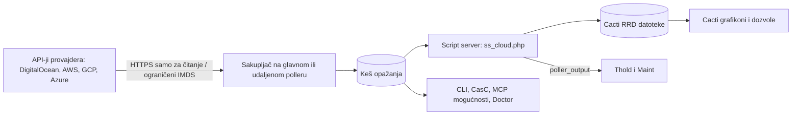

<!-- Source: README.md; SHA256: ac2074a40238686915802803c5efe773f33677f934281e0605e6e87a71a9d27d -->

<!-- translations:start -->
[English](../../../README.md) | [简体中文](../zh-CN/README.md) | [हिन्दी](../hi-IN/README.md) | [Español (España)](../es-ES/README.md) | [Español (Latinoamérica)](../es-419/README.md) | [العربية (السعودية)](../ar-SA/README.md) | [Afrikaans](../af-ZA/README.md) | [አማርኛ](../am-ET/README.md) | [العربية (مصر)](../ar-EG/README.md) | [العربية (المغرب)](../ar-MA/README.md) | [বাংলা](../bn-BD/README.md) | [Bosanski](README.md) | [Deutsch](../de-DE/README.md) | [فارسی](../fa-IR/README.md) | [Filipino](../fil-PH/README.md) | [Français](../fr-FR/README.md) | [Français (Maroc)](../fr-MA/README.md) | [Français (Sénégal)](../fr-SN/README.md) | [Hausa](../ha-NG/README.md) | [עברית](../he-IL/README.md) | [Hrvatski](../hr-HR/README.md) | [Bahasa Indonesia](../id-ID/README.md) | [Igbo](../ig-NG/README.md) | [Italiano](../it-IT/README.md) | [日本語](../ja-JP/README.md) | [한국어](../ko-KR/README.md) | [Malagasy](../mg-MG/README.md) | [मराठी](../mr-IN/README.md) | [Bahasa Melayu](../ms-MY/README.md) | [Nederlands](../nl-NL/README.md) | [Polski](../pl-PL/README.md) | [Português (Brasil)](../pt-BR/README.md) | [Русский](../ru-RU/README.md) | [Kinyarwanda](../rw-RW/README.md) | [Soomaali](../so-SO/README.md) | [Српски](../sr-RS/README.md) | [Svenska](../sv-SE/README.md) | [Kiswahili](../sw-KE/README.md) | [தமிழ்](../ta-IN/README.md) | [తెలుగు](../te-IN/README.md) | [ไทย](../th-TH/README.md) | [Türkçe](../tr-TR/README.md) | [Українська](../uk-UA/README.md) | [اردو](../ur-PK/README.md) | [Tiếng Việt](../vi-VN/README.md) | [isiXhosa](../xh-ZA/README.md) | [Yorùbá](../yo-NG/README.md) | [繁體中文](../zh-TW/README.md) | [isiZulu](../zu-ZA/README.md)
<!-- translations:end -->

# plugin_cloud

Dodatak za Cacti 1.2 koji donosi resurse i metrike javnih provajdera oblaka u Cacti kao obične uređaje, izvore podataka i grafikone. Radna opterećenja u oblaku nalaze se odmah pored mreže koja ih prenosi, pod Cacti dozvolama, a Thold i Maint mogu slati upozorenja za njih i potiskivati ih. Jedan dodatak pokriva DigitalOcean, Amazon Web Services, Google Cloud i Microsoft Azure putem drajvera za čitanje napisanih u čistom PHP-u.

> **Status: u razvoju, još nema izdanja (`0.1.0-dev`).** Ova grana implementira drajvere u čistom PHP-u za DigitalOcean, AWS, Google Cloud i Azure, replikaciju za udaljene sakupljače podataka i zdravstveno stanje agenta samo za čitanje, CasC provajder i CLI za operatera, MCP mogućnosti i Doctor provjere. Isporučeni Cacti šabloni trenutno pokrivaju DigitalOcean Droplete i balansere opterećenja (`templates/cloud_digitalocean.xml`); paketi Cacti šablona za AWS, Google Cloud i Azure te kvalifikacija na živim nalozima izvan DigitalOceana ([činjenice o provajderima](../../research/provider-facts.md)) još nisu završeni. Ne pokrećite ga u produkciji.

## Podržani provajderi

Svaki drajver provajdera registrovan je u `Drivers::production()`, nudi se preko `Provider::released()` i radi u čistom PHP-u koristeći `ext-openssl` i stream sockete bez ikakvih SDK ili Composer ovisnosti u vremenu izvođenja.

| Provajder | Polja opsega | Izvori akreditiva | Autentifikacija | Otkriveni resursi | Prikupljanje metrika |
|---|---|---|---|---|---|
| DigitalOcean (`digitalocean`) | Nema (opseg tokena) | `vault`, `file` | Bearer token | `droplet`, `load_balancer` | `/v2/monitoring/metrics` sa sviješću o udjelu ograničenja brzine; isporučuje Cacti šablone i upite podataka |
| Amazon Web Services (`aws`) | `account_id` (12 cifara), `regions` | `vault`, `file`, `instance` | Čisti PHP AWS SigV4 (`AWS4-HMAC-SHA256`), STS `GetCallerIdentity` provjera, opcioni STS `AssumeRole`, EC2 IMDSv2 (`169.254.169.254`) za `instance` naloge | `ec2_instance`, `rds_instance`, `aws_elb` (ALB/NLB) | Grupisani CloudWatch `GetMetricData` (do 500 upita po pozivu) |
| Google Cloud (`gcp`) | `project` | `vault`, `file`, `instance` | Čisti PHP RS256 JWT servisnog naloga putem `ext-openssl` razmijenjen na `oauth2.googleapis.com/token`, ili GCE server metapodataka (`metadata.google.internal`) za `instance` naloge | `gce_instance` putem `instances.aggregatedList` | Cloud Monitoring `timeSeries.list` |
| Microsoft Azure (`azure`) | `tenant`, `subscription`, `regions` | `vault`, `file`, `instance` | Čisti PHP Entra ID OAuth2 tok akreditiva klijenta (samo `client_secret`; tvrdnje certifikatom isključene), ili Azure IMDS (`169.254.169.254`) upravljani identitet za ARM i Monitor tokene | `azure_vm` putem ARM Resource Graph (paginirano sa `$skipToken` i deduplicirano) | Azure Monitor `metrics:getBatch` (do 50 resursa po pozivu, uz obradu HTTP 429 i 529 ograničenja) |

## Implementirane mogućnosti

### Osnovna platforma, trezor i sakupljač

- **Zaštićena instalacija i životni ciklus.** Ulazne tačke (`setup.php`, `cli/cloud.php`, `poller_cloud.php`, `ss_cloud.php` i skripte stranica) parsiraju se na PHP 8.0 i odbijaju PHP ispod 8.2 ili nedostatak `ext-openssl` bez rušenja Cactija. Nadogradnje su uređene, idempotentne (`Schema::VERSION = 3`, 9 tabela) i preživljavaju prekid. Deinstalacija čuva tabele dodatka osim ako se ne ukloni oznaka sa *Keep Plugin Tables on Uninstall*.
- **Nalozi i akreditivi.** Dodajte, uredite, provjerite i obrišite naloge pod **Management > Cloud Accounts**. Akreditivi dolaze iz AES-256-GCM šifriranog trezora (`plugin_cloud_secret`, podrazumijevano šifriranog ključem `/etc/cacti/cloud-vault.key`), iz datoteke ograničene unutar podešenog *Credential File Directory* (`cloud_credential_dir`, podrazumijevano praznog da bi se datoteke odbile) ili iz identiteta instance provajdera. Akreditivi su u korisničkom interfejsu samo za pisanje i cenzurišu se u zapisnicima.
- **Stroga kontrola odlaznog saobraćaja i režim samo za čitanje.** Svaki drajver radi iza `GuardedTransport` i `OutboundPolicy`: HTTPS port 443 prema tačnim nazivima hostova po provajderu, uz link-local HTTP port 80 krajnje tačke metapodataka (`169.254.169.254`, `metadata.google.internal`) omogućene samo za `instance` naloge. Dozvoljene su samo operacije za čitanje sa liste dopuštenih.
- **Kontrola sakupljača i troškova.** `poller_cloud.php` se pokreće iz `poller_bottom` (jedan proces po polleru putem Cacti registra procesa) unutar `cloud_collector_budget`, preuzima zakupe po nalogu, pokreće otkrivanje na `discover_interval`, čita metrike samo za aktivne Cacti izvore podataka (`plugin_cloud_series`), poštuje `request_share` i `monthly_ceiling`, i kešira najnovije tačke podataka u `plugin_cloud_observation` za `ss_cloud.php`.
- **Cacti objekti i procjene zahtjeva.** Održava uređaj opsega po nalogu (`plugin_cloud_device`), čuva metode reindeksiranja uređaja opsega pri spremanju uređaja, uvozi DigitalOcean šablone i upite podataka script servera (`templates/cloud_digitalocean.xml`, `cloud_do_droplet.xml`, `cloud_do_load_balancer.xml`), i prikazuje procjene zahtjeva i kataloške cijene na **New Graphs** (`graphs_new_top_links`) i **Cloud Health**.

### Udaljeni sakupljači podataka

- `INFO` deklariše `remote_collect:1`. Nalozi se mogu dodijeliti bilo kojem omogućenom Cacti polleru (`poller_id >= 1`), a `poller_cloud.php --poller=N` prikuplja samo naloge u vlasništvu tog pollera.
- **`replicate_out` hook.** Replicira redove u opsegu pollera iz `plugin_cloud_account`, `plugin_cloud_device`, `plugin_cloud_series`, te šifrirane redove iz `plugin_cloud_secret` (samo za naloge podržane trezorom koji pripadaju ciljnom polleru) putem `replicate_out_table()`. Sirove datoteke ključeva trezora nikada se ne pohranjuju u bazu podataka niti se repliciraju i ostaju lokalne na svakom polleru.
- **`remote_agent` hook.** Izlaže JSON sažetak stanja samo za čitanje (`action=cloud_health`) koji prihvata samo cjelobrojne parametre `poller_id` i `account_id` i vraća nula akreditiva, putanja datoteka ili tajni.

### Ekosistemski hookovi (CasC, MCP mogućnosti i Doctor)

- **CasC provajder (`casc_register_providers`).** Registruje `cloud` provajder (verzija šeme `1`) s determinističkim YAML i XML izvozom u čistom PHP-u, validacijom manifesta, planiranjem razlika i potvrđenom primjenom. Akreditivi trezora izvoze se kao reference `vault:account:<name>`; sirova tajna polja (`secret`, `secrets`, `token`, `access_token`, `refresh_token`, `password`, `private_key`, `access_key_id`, `secret_access_key`, `session_token`, `client_secret`, `credential`, `credentials`, `vault_key`) se odbijaju. Primjena zahtijeva tačan SHA-256 `--confirm=<PLAN_HASH>`.
- **MCP / Abilities API (`abilities_register`).** Registruje tri mogućnosti strogo samo za čitanje ograničene na područje Cloud View (`cloud_health.php`) i opseg Cacti uređaja za pozivaoce koji nisu administratori, ne emitujući nikakve akreditive, ključeve trezora niti putanje datoteka akreditiva:
  - `cloud-list-accounts` (opcioni `provider`, `poller_id`)
  - `cloud-list-resources` (opcioni `account_id`, `type`, `lifecycle`)
  - `cloud-get-health` (opcioni `account_id`)
- **Doctor provjere (`doctor_register_checks`).** Registruje pet dijagnostičkih provjera koje ne otkrivaju nikakve tajne vrijednosti niti materijal ključa:
  - `cloud_schema`: ažurnost verzije šeme
  - `cloud_vault_key`: čitljivost, dozvole i veličina datoteke ključa trezora
  - `cloud_drivers`: registracija produkcijskih drajvera za sve objavljene provajdere
  - `cloud_accounts_health`: neuspješni, ograničeni ili zastarjeli omogućeni nalozi
  - `cloud_poller_intervals`: usklađenost intervala prikupljanja omogućenih naloga s intervalom Cacti pollera

## CLI

Pokrenite iz korijenskog direktorija Cactija s PHP 8.2 ili novijim:

```sh
# Operator and CasC CLI (options use --key=value form)
php plugins/cloud/cli/cloud.php export [--format=yaml|xml]
php plugins/cloud/cli/cloud.php validate --file=<path> [--format=yaml|xml]
php plugins/cloud/cli/cloud.php plan --file=<path> [--format=yaml|xml]
php plugins/cloud/cli/cloud.php apply --file=<path> --confirm=<PLAN_HASH> [--format=yaml|xml]
php plugins/cloud/cli/cloud.php health [--format=text|json] [--poller=<id>]

# Collector entry point (normally started by poller_bottom)
php plugins/cloud/poller_cloud.php [--poller=N] [--force] [--debug]
```

## Uloge pristupa

| Područje | Pristup |
| --- | --- |
| Cloud View | Postojeće stranice za nadzor. |
| Cloud Operator | Nadzor plus stranica Operations i lične potvrde trijaže. |
| Cloud Admin | Pristup operatera plus postojeća konfiguracija i administrativne radnje. |

Nakon kopiranja datoteka nadogradnje, otvorite stranicu Plugins kao administrator da biste registrovali područja. Eksplicitno dodijelite područje Operator pod **Configuration > Users** ili korisničkim grupama. Nadogradnje zadržavaju postojeće ID-ove i dozvole za područja View i Admin. Admin pristup nasljeđuje Operator pristup, a Operator pristup nasljeđuje View pristup na svakom zahtjevu; ovo ne dodaje pohranjene dozvole korisnicima ili grupama. Postavke dodatka također zahtijevaju Cloud Admin pristup pored Cacti dozvole Settings.

Cacti dozvole za uređaje ograničavaju redove i radnje dostupne svakom korisniku; nemapirani objekti zahtijevaju administratora. Operateri mogu provjeriti pohranjeni akreditiv za nalog čijem Cacti uređaju imaju pristup. Akreditivi, konfiguracija, mapiranje, brisanje i druge administrativne izmjene ostaju na administrativnim stranicama. Potvrde traju samo u trenutnoj sesiji korisnika, najviše jedan sat i samo dok isto opažanje ostaje svježe. Nova ili izmijenjena opažanja ih poništavaju. One nikada ne označavaju neuspjelo mjerenje kao zdravo niti potiskuju upozorenja.

## Zašto

Svaki provajder oblaka ima svoju konzolu za nadzor. Pokrenute uporedo s Cactijem, one ostavljaju tri praznine:

- **Odvojena kontrola pristupa.** Prikazivanje metrika oblaka Cacti korisniku znači davanje prijave u oblak.
- **Nema mrežnog konteksta.** Lokalne veze se prikazuju na grafikonima u Cactiju; radna opterećenja iza njih prikazuju se na grafikonima u konzoli svakog provajdera.
- **Odvojeno upozoravanje.** Thold i Maint rade na Cacti izvorima podataka i uređajima, tako da se alarmi provajdera podešavaju i potiskuju odvojeno, jednom po provajderu.

Dodatak čita API za nadzor svakog provajdera na Cacti polleru, kešira najnovije tačke podataka i poslužuje ih Cacti script serveru. Cacti poller zapisuje RRD datoteke, pa grafikoni, dozvole, Thold, Maint i boost rade kao i za sve ostale Cacti podatke.

## Opredjeljenja dizajna

- **Samo za čitanje.** Svaki drajver može izgraditi samo operacije provajdera sa svoje liste dopuštenih; dodatak nikada ne mijenja resurs u oblaku. ([ADR 0002](../../decisions/0002-read-only-with-operation-allowlist.md))
- **Samo PHP, bez SDK-ova.** Potpisivanje i razmjena tokena implementirani su u PHP-u s proširenjima koja Cacti već zahtijeva. Nema Composer ovisnosti u vremenu izvođenja. ([ADR 0003](../../decisions/0003-php-only-without-sdks.md))
- **Trošak prije prikupljanja.** Dodatak čita samo metrike koje imaju Cacti izvor podataka, prikazuje očekivani broj zahtjeva i katalošku cijenu prije kreiranja grafikona te primjenjuje mjesečni limit. ([ADR 0005](../../decisions/0005-collect-only-what-is-graphed.md))
- **Nema akreditiva u otvorenom tekstu u bazi podataka.** Akreditivi dolaze iz šifriranog trezora zaključanog datotekom izvan baze podataka, iz datoteke akreditiva ili iz identiteta instance provajdera. ([ADR 0007](../../decisions/0007-credentials-outside-the-database-in-the-clear.md))

## Opseg i status

| Faza | Opseg | Prekretnice | Status |
|---|---|---|---|
| 0, istraživanje | Potvrda činjenica o provajderima, katalozi metrika, model troškova i brzine, testni vektori potpisivanja, transportni prototip | [M1](https://github.com/somethingwithproof/plugin_cloud/milestone/1) | Završeno, osim provjera koje zahtijevaju žive naloge provajdera |
| 1, jezgro i DigitalOcean | Nalozi, trezor akreditiva, transport, sakupljač, keš opažanja, Cacti objekti, šabloni, procjene zahtjeva, stranica stanja, DigitalOcean Dropleti i balanseri opterećenja | [M2](https://github.com/somethingwithproof/plugin_cloud/milestone/2), [M3](https://github.com/somethingwithproof/plugin_cloud/milestone/3), [M4](https://github.com/somethingwithproof/plugin_cloud/milestone/4) | Implementirano; pilot kvalifikacija za M4 na čekanju |
| 2, AWS | Čisti PHP SigV4, STS `AssumeRole`, IMDSv2 uloge instanci, EC2/RDS/ELB inventar, CloudWatch `GetMetricData` | [M5](https://github.com/somethingwithproof/plugin_cloud/milestone/5) | Drajver implementiran; Cacti šabloni i kvalifikacija na živom nalogu na čekanju |
| 3, Google Cloud | Čisti PHP RS256 JWT servisnog naloga, GCE server metapodataka, Compute Engine inventar, Cloud Monitoring `timeSeries.list` | [M6](https://github.com/somethingwithproof/plugin_cloud/milestone/6) | Drajver implementiran; Cacti šabloni i kvalifikacija na živom nalogu na čekanju |
| 4, Azure | Entra ID akreditivi klijenta, IMDS upravljani identitet, ARM Resource Graph VM inventar, Azure Monitor `metrics:getBatch` | [M7](https://github.com/somethingwithproof/plugin_cloud/milestone/7) | Drajver implementiran; Cacti šabloni i kvalifikacija na živom nalogu na čekanju |
| 5, udaljeni sakupljači i ekosistem | Udaljeni sakupljači podataka (`replicate_out`, `remote_agent`), CasC provajder i CLI, MCP mogućnosti, Doctor provjere | [M8](https://github.com/somethingwithproof/plugin_cloud/milestone/8) | Implementirano |

Izvan opsega: izmjena resursa u oblaku, kreiranje ili preslikavanje alarma provajdera, izvještaji o naplati, zapisnici i tragovi, te vlastiti mehanizam za upozoravanje u vlasništvu dodatka. Dodatni provajderi (Hetzner Cloud, Akamai Cloud, Oracle Cloud i drugi) su istraživački zadaci.

## Instalacija i konfiguracija

Ovi koraci instaliraju razvojni kod za evaluaciju. Zahtijevaju Cacti 1.2.31 ili noviji na PHP 8.2 ili novijem.

1. Kopirajte repozitorij u `plugins/cloud` unutar vašeg Cacti direktorija. Direktorij mora imati naziv `cloud`.
2. Kreirajte ključ trezora izvan web korijena na svakom polleru koji koristi akreditive podržane trezorom. Smjestite ga u direktorij u koji samo root i Cacti korisnik mogu pisati, i učinite datoteku čitljivom samo za korisnika koji pokreće web server i poller. Dodatak nikada ne kreira niti zapisuje ovu datoteku:

   ```sh
   sudo install -d -m 0750 -o root -g cacti /etc/cacti
   head -c 32 /dev/urandom | sudo tee /etc/cacti/cloud-vault.key > /dev/null
   sudo chown cacti:cacti /etc/cacti/cloud-vault.key
   sudo chmod 0600 /etc/cacti/cloud-vault.key
   ```

   Zamijenite `cacti` korisnikom koji pokreće vaš web server i poller. Datoteka sadrži 32 sirova bajta ili 64 heksadecimalna znaka. Napravite njenu sigurnosnu kopiju zajedno s bazom podataka; bez nje se pohranjeni akreditivi moraju ponovo unijeti.
3. U Cactiju otvorite **Configuration > Plugins**, zatim instalirajte i omogućite *Cloud*.
4. Pod **Configuration > Settings > Cloud**, postavite *Vault Key File* ako ste koristili drugu putanju, konfigurišite *Credential File Directory* ako planirate koristiti akreditive zasnovane na datotekama, i držite *Collector Time Budget* (podrazumijevano 240 sekundi) ispod intervala pollera.
5. Dodijelite *Cloud Admin*, *Cloud Operator* ili *Cloud View* korisnicima i grupama pod **Configuration > Users**. Instalacija dodjeljuje Cloud Admin i Cloud View administratoru; Cloud Admin uključuje Operator pristup, tako da administratoru nije potrebna posebna Operator dozvola.
6. Dodajte naloge pod **Management > Cloud Accounts**, zatim provjerite **Management > Cloud Health** radi upozorenja.

## Ciljevi kompatibilnosti

| Komponenta | Cilj |
|---|---|
| Cacti | 1.2.31 ili noviji, bez izmjena jezgra |
| PHP | 8.2 ili noviji; ulazne tačke ostaju parsabilne na 8.0 tako da nepodržano okruženje dobije odbijanje umjesto pokvarenog Cacti interfejsa |
| PHP proširenja | `ext-openssl` (zahtijeva Cacti 1.2.31); bez `ext-curl` i bez Composer ovisnosti u vremenu izvođenja |
| Thold, Maint | Nisu potrebne izmjene |

## Dizajn

- [docs/performance.md](../../performance.md) sadrži mjerenja sakupljača i stranice stanja, s korištenim hardverom i postavkama.
- [docs/PLAN.md](../../PLAN.md) je cjeloviti plan: arhitektura, činjenice o provajderima i Cactiju na koje se oslanja (s izvorima), ugovor drajvera, račun troškova, sigurnosne granice, testiranje i rizici.
- [docs/decisions/](../../decisions/) čuva zapise o arhitektonskim odlukama za već donesene izbore.
- [docs/REQUIREMENTS.md](../../REQUIREMENTS.md) povezuje svaki ID zahtjeva s njegovim zadatkom.



## Kako se prati rad

- **Prekretnice** prate prekretnice plana. Svaka ima epski zadatak koji navodi podzadatke i dokaze o završetku.
- **Zadaci** su označeni oznakama tipa: `type: requirement`, `type: research`, `type: decision`, `type: epic`. Zadaci zahtjeva navode numerisane, provjerljive zahtjeve (`REQ-AREA-NNN`) i kriterije prihvatanja.
- **Oznake** također nose `area:`, `provider:`, `phase:`, `priority:` i `status:`. Pogledajte [CONTRIBUTING.md](../../../CONTRIBUTING.md#labels).
- [Ploča projekta](https://github.com/users/somethingwithproof/projects/7) prikazuje sve zadatke kroz prekretnice.

## Razvoj

CI ([.github/workflows/plugin-ci-workflow.yml](../../../.github/workflows/plugin-ci-workflow.yml)) provjerava arhivu izdanja i semantičku verziju (`bash tests/bin/archive-check.sh`), lintuje ulazne tačke na PHP 8.0, pokreće Pest jedinične (`phpunit.xml`) i integracijske testove životnog ciklusa (`phpunit-integration.xml`) te PHPStan nivo 9 na PHP 8.2 do 8.5 protiv Cactija `release/1.2.31` i `1.2.x` uz `CLOUD_OFFLINE=1`, provjerava odbijanje na PHP 8.1, verifikuje gettext kataloge, mjeri performanse prikupljanja 1.000 serija i stranice stanja, te pokreće provjeru workflowa i usklađenost s REUSE-om.

Lokalne provjere prije slanja:

```sh
bash tests/bin/archive-check.sh
sh tests/lint-workflows.sh
sh locales/build_gettext.sh --check
CACTI_PATH=/path/to/cacti phpstan analyse -c phpstan.neon --no-progress
```

Pokrenite Pest sa `--configuration=phpunit.xml` za jedinične testove i testove pravila izvornog koda, ili sa `--configuration=phpunit-integration.xml` uz `CACTI_PATH` i `CLOUD_TEST_DATABASE=disposable` protiv privremene Cacti baze podataka za integracijske testove životnog ciklusa.

## Doprinos

Pročitajte [CONTRIBUTING.md](../../../CONTRIBUTING.md). Commitovi zahtijevaju DCO potpis. Rasprava o dizajnu odvija se u zadacima; otvorene odluke nose oznaku `type: decision`.

## Sigurnost

Prijavite ranjivosti privatno; pogledajte [SECURITY.md](../../../SECURITY.md).

## Licenca

GNU General Public License v2.0, ista licenca kao Cacti i njegovi dodaci. Pogledajte [LICENSE](../../../LICENSE).
