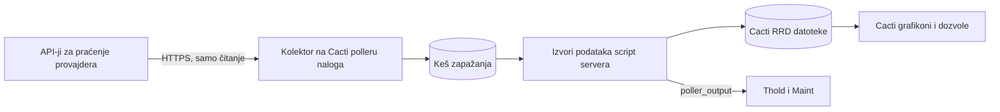

<!-- Source: README.md; SHA256: 7c621642e5f1a46bac66e4bc744f70aebb014c610d22de034088845fdc170405 -->

<!-- translations:start -->
[English](../../../README.md) | [简体中文](../zh-CN/README.md) | [हिन्दी](../hi-IN/README.md) | [Español (España)](../es-ES/README.md) | [Español (Latinoamérica)](../es-419/README.md) | [العربية (السعودية)](../ar-SA/README.md) | [Afrikaans](../af-ZA/README.md) | [አማርኛ](../am-ET/README.md) | [العربية (مصر)](../ar-EG/README.md) | [العربية (المغرب)](../ar-MA/README.md) | [বাংলা](../bn-BD/README.md) | [Bosanski](README.md) | [Deutsch](../de-DE/README.md) | [فارسی](../fa-IR/README.md) | [Filipino](../fil-PH/README.md) | [Français](../fr-FR/README.md) | [Français (Maroc)](../fr-MA/README.md) | [Français (Sénégal)](../fr-SN/README.md) | [Hausa](../ha-NG/README.md) | [עברית](../he-IL/README.md) | [Hrvatski](../hr-HR/README.md) | [Bahasa Indonesia](../id-ID/README.md) | [Igbo](../ig-NG/README.md) | [Italiano](../it-IT/README.md) | [日本語](../ja-JP/README.md) | [한국어](../ko-KR/README.md) | [Malagasy](../mg-MG/README.md) | [मराठी](../mr-IN/README.md) | [Bahasa Melayu](../ms-MY/README.md) | [Nederlands](../nl-NL/README.md) | [Polski](../pl-PL/README.md) | [Português (Brasil)](../pt-BR/README.md) | [Русский](../ru-RU/README.md) | [Kinyarwanda](../rw-RW/README.md) | [Soomaali](../so-SO/README.md) | [Српски](../sr-RS/README.md) | [Svenska](../sv-SE/README.md) | [Kiswahili](../sw-KE/README.md) | [தமிழ்](../ta-IN/README.md) | [తెలుగు](../te-IN/README.md) | [ไทย](../th-TH/README.md) | [Türkçe](../tr-TR/README.md) | [Українська](../uk-UA/README.md) | [اردو](../ur-PK/README.md) | [Tiếng Việt](../vi-VN/README.md) | [isiXhosa](../xh-ZA/README.md) | [Yorùbá](../yo-NG/README.md) | [繁體中文](../zh-TW/README.md) | [isiZulu](../zu-ZA/README.md)
<!-- translations:end -->

# plugin_cloud

Dodatak za Cacti 1.2 koji donosi resurse i metrike javnih provajdera oblaka u Cacti kao obične uređaje, izvore podataka i grafikone. Radna opterećenja u oblaku tada stoje odmah pored mreže koja ih prenosi, pod Cacti dozvolama, a Thold i Maint mogu slati upozorenja i potiskivati ih. Jedan dodatak pokriva svakog provajdera, s jednim drajverom po provajderu: prvo DigitalOcean, AWS, Google Cloud i Azure.

> **Status: prekretnica 3 (DigitalOcean i Cacti objekti), u pregledu.** Ova prekretnica dodaje drajver za DigitalOcean, Cacti šablone, uređaj opsega po nalogu s upitom podataka po tipu resursa, unos za script server i procjenu zahtjeva na stranici *New Graphs* i stranici stanja. Početne provjere prema živom DigitalOcean nalogu zabilježene su u [činjenicama o provajderima](../../research/provider-facts.md). Ne pokrećite ga u produkciji.

## Uloge pristupa

| Područje dozvola | Pristup |
| --- | --- |
| Cloud View | Postojeće stranice za praćenje. |
| Cloud Operator | Praćenje uz stranicu *Operations* i lične potvrde trijaže. |
| Cloud Admin | Pristup operatera uz postojeće konfiguracijske i administrativne radnje. |

Nakon kopiranja datoteka za nadogradnju, otvorite stranicu *Plugins* kao administrator kako biste registrovali novo područje dozvola. Dodijelite područje *Operator* izričito pod **Configuration > Users** ili korisničkim grupama. Nadogradnje zadržavaju postojeće ID-ove i dodjele za *View* i *Admin*. Pristup *Admin* nasljeđuje pristup *Operator*, a pristup *Operator* nasljeđuje pristup *View* pri svakom zahtjevu; time se korisnicima ili grupama ne dodaju pohranjene dodjele. Postavke dodatka također zahtijevaju pristup *Cloud Admin* pored Cacti dozvole *Settings*.

Cacti dozvole za uređaje i dalje ograničavaju redove i radnje dostupne svakom korisniku; nemapirani objekti zahtijevaju administratora. Operateri mogu provjeriti pohranjeni akreditiv za nalog čijem Cacti uređaju smiju pristupiti. Akreditivi, konfiguracija, mapiranje, brisanje i druge administrativne promjene ostaju na administrativnim stranicama. Potvrde traju samo u trenutnoj korisničkoj sesiji, najviše jedan sat i samo dok isto zapažanje ostaje svježe. Nova ili promijenjena zapažanja ih poništavaju. One nikad ne označavaju neuspješno mjerenje kao ispravno niti potiskuju upozorenja.

## Zašto

Svaki provajder oblaka ima vlastitu konzolu za praćenje. Kada se koriste paralelno s Cactijem, ostavljaju tri praznine:

- **Odvojena kontrola pristupa.** Prikazivanje metrika oblaka Cacti korisniku znači davanje prijave za oblak.
- **Bez mrežnog konteksta.** Lokalne veze crtaju se na grafikonima u Cactiju; radna opterećenja iza njih crtaju se u konzoli svakog provajdera.
- **Odvojeno upozoravanje.** Thold i Maint rade na Cacti izvorima podataka i uređajima, pa se alarmi provajdera konfigurišu i potiskuju odvojeno, jednom po provajderu.

Dodatak čita API za praćenje svakog provajdera na Cacti polleru, kešira najnovije tačke podataka i poslužuje ih Cacti script serveru. Cacti poller zapisuje RRD datoteke, pa grafikoni, dozvole, Thold, Maint i boost rade isto kao za bilo koje druge Cacti podatke.

## Dizajnerske obaveze

- **Samo za čitanje.** Svaki drajver može sastaviti samo operacije provajdera sa svog spiska dozvoljenih operacija; dodatak nikad ne mijenja resurs u oblaku. ([ADR 0002](../../decisions/0002-read-only-with-operation-allowlist.md))
- **Samo PHP, bez SDK-ova.** Potpisivanje i razmjena tokena implementirani su u PHP-u pomoću ekstenzija koje Cacti već zahtijeva. Nema Composer zavisnosti u vremenu izvršavanja. ([ADR 0003](../../decisions/0003-php-only-without-sdks.md))
- **Trošak prije prikupljanja.** Dodatak čita samo metrike koje imaju Cacti izvor podataka, prikazuje očekivani broj zahtjeva i trošak po kataloškim cijenama prije kreiranja grafikona te provodi mjesečni limit. ([ADR 0005](../../decisions/0005-collect-only-what-is-graphed.md))
- **Bez akreditiva u čistom tekstu u bazi podataka.** Akreditivi dolaze iz šifriranog trezora zaštićenog ključem u datoteci izvan baze podataka, iz datoteke akreditiva ili iz identiteta instance provajdera. ([ADR 0007](../../decisions/0007-credentials-outside-the-database-in-the-clear.md))

## Opseg i status

| Faza | Opseg | Prekretnice | Status |
|---|---|---|---|
| 0, istraživanje | Potvrda činjenica o provajderima, katalozi metrika, model troškova i ograničenja stope, testni vektori potpisivanja, proba transporta | [M1](https://github.com/somethingwithproof/plugin_cloud/milestone/1) | Završeno, osim provjera koje zahtijevaju živi nalog kod provajdera |
| 1, jezgro i DigitalOcean | Nalozi, trezor akreditiva, transport, kolektor, keš zapažanja, Cacti objekti, stranica stanja, DigitalOcean Droplets i balanseri opterećenja | [M2](https://github.com/somethingwithproof/plugin_cloud/milestone/2), [M3](https://github.com/somethingwithproof/plugin_cloud/milestone/3), [M4](https://github.com/somethingwithproof/plugin_cloud/milestone/4) | M2 završen ([#81](https://github.com/somethingwithproof/plugin_cloud/pull/81)); M3 drajver, šabloni i uređaji opsega spojeni; procjene zahtjeva, dozvole i provjere performansi u pregledu; M4 nije započet |
| 2, AWS | Signature Version 4, `AssumeRole`, uloge instance, CloudWatch `GetMetricData`, regionalni inventar | [M5](https://github.com/somethingwithproof/plugin_cloud/milestone/5) | Nije započeto |
| 3, Google Cloud | JWT servisnog naloga, server metapodataka, Cloud Monitoring `timeSeries.list` | [M6](https://github.com/somethingwithproof/plugin_cloud/milestone/6) | Nije započeto |
| 4, Azure | Entra akreditivi klijenta, upravljani identitet, Resource Graph, `metrics:getBatch` | [M7](https://github.com/somethingwithproof/plugin_cloud/milestone/7) | Nije započeto |
| 5, udaljeni kolektori | Nalozi na udaljenim Cacti kolektorima podataka | [M8](https://github.com/somethingwithproof/plugin_cloud/milestone/8) | Nije započeto |

Izvan opsega: mijenjanje resursa u oblaku, kreiranje ili preslikavanje alarma provajdera, izvještaji naplate, zapisnici i tragovi te vlastiti mehanizam upozoravanja u dodatku. Dalji provajderi (Hetzner Cloud, Akamai Cloud, Oracle Cloud i drugi) vode se kao istraživački zadaci.

## Šta donosi prekretnica 2

- **Zaštićena instalacija.** Na PHP-u starijem od 8.2 ili bez ext-openssl, instalacija i omogućavanje odbijaju se s porukom, dok ostatak Cactija nastavlja raditi.
- **Životni ciklus.** Instalacija, nadogradnja i deinstalacija kroz Cacti stranicu *Plugins*. Nadogradnje su uređene po redoslijedu i podnose prekide. Deinstalacija zadržava tabele dodatka osim ako poništite *Keep Plugin Tables on Uninstall*.
- **Odvojena područja dozvola.** *Cloud Admin* otvara **Cloud Accounts**; *Cloud Operator* otvara **Cloud Operations**; *Cloud View* otvara **Cloud Health**. Admin nasljeđuje Operator, a Operator nasljeđuje View. Sve tri stranice nalaze se pod *Management*.
- **Nalozi i akreditivi.** Dodavanje, uređivanje, provjera i brisanje naloga. Akreditiv se ili šifrira u bazi podataka pomoću datoteke ključa koja se čuva izvan nje (AES-256-GCM), ili se čita iz datoteke na polleru. Akreditivi su u korisničkom interfejsu samo za upis i skrivaju se u zapisnicima.
- **Kolektor.** Pokreće se pri svakom pokretanju pollera, po jedna instanca po polleru, unutar vremenskog budžeta. Preuzima zakup po nalogu, pokreće otkrivanje u vlastitom intervalu i čita metrike samo za aktivne izvore podataka samog dodatka.
- **Stanje.** Stanje prikupljanja, otkrivanja, resursa i svježine po nalogu, uz upozorenja za neupotrebljiv ključ trezora, nesigurne datoteke akreditiva i intervale koje poller ne može ispoštovati.

## Instalacija i konfiguracija

Ovi koraci instaliraju kod prekretnice 2 radi evaluacije. Zahtijevaju Cacti 1.2.31 ili noviji na PHP-u 8.2 ili novijem.

1. Kopirajte repozitorij u `plugins/cloud` unutar vašeg Cacti direktorija. Direktorij mora imati naziv `cloud`.
2. Kreirajte ključ trezora izvan korijena weba. Smjestite ga u direktorij u koji mogu pisati samo root i korisnik Cactija, i učinite datoteku čitljivom samo korisniku koji pokreće web server i poller. Dodatak nikad ne kreira niti zapisuje ovu datoteku:

   ```sh
   sudo install -d -m 0750 -o root -g cacti /etc/cacti
   head -c 32 /dev/urandom | sudo tee /etc/cacti/cloud-vault.key > /dev/null
   sudo chown cacti:cacti /etc/cacti/cloud-vault.key
   sudo chmod 0600 /etc/cacti/cloud-vault.key
   ```

   Zamijenite `cacti` korisnikom koji pokreće vaš web server i poller. Datoteka sadrži 32 sirova bajta ili 64 heksadecimalna znaka. Napravite sigurnosnu kopiju zajedno s bazom podataka; bez nje pohranjeni akreditivi moraju biti ponovo uneseni.
3. U Cactiju otvorite **Configuration > Plugins**, zatim instalirajte i omogućite *Cloud*.
4. Pod **Configuration > Settings > Cloud**, postavite *Vault Key File* ako ste koristili drugu putanju. *Collector Time Budget* (podrazumijevano 240 sekundi) mora ostati ispod intervala pollera.
5. Dodijelite *Cloud Admin*, *Cloud Operator* ili *Cloud View* korisnicima i grupama pod **Configuration > Users**. Instalacija dodjeljuje *Cloud Admin* i *Cloud View* administratoru; *Cloud Admin* uključuje pristup *Operator*, pa administratoru nije potrebna posebna dodjela za *Operator*.
6. Dodajte naloge pod **Management > Cloud Accounts**, zatim provjerite **Management > Cloud Health** radi eventualnih upozorenja.

## Ciljevi kompatibilnosti

| Komponenta | Cilj |
|---|---|
| Cacti | 1.2.31 ili noviji, bez zakrpa jezgra |
| PHP | 8.2 ili noviji; `setup.php` ostaje čitljiv za parser na 8.0 kako bi nepodržano izvršno okruženje dobilo odbijanje umjesto pokvarenog Cacti interfejsa |
| PHP ekstenzije | Nema dodatnih pored onih koje Cacti 1.2.31 zahtijeva |
| Thold, Maint | Nisu potrebne izmjene |

## Dizajn

- [docs/performance.md](../../performance.md) sadrži mjerenja kolektora i stranice stanja, s korištenim hardverom i postavkama.
- [docs/PLAN.md](../../PLAN.md) predstavlja potpuni plan: arhitekturu, činjenice o provajderima i Cactiju na koje se oslanja (s izvorima), ugovor drajvera, računicu troškova, sigurnosne granice, testiranje i rizike.
- [docs/decisions/](../../decisions) sadrži zapise o arhitekturnim odlukama (ADR) za već donesene izbore.
- [docs/REQUIREMENTS.md](../../REQUIREMENTS.md) povezuje svaki ID zahtjeva s njegovim zadatkom.



## Kako se prati rad

- **Prekretnice** prate prekretnice plana. Svaka ima krovni zadatak (epic) koji navodi podzadatke i dokaze završetka.
- **Zadaci** su označeni po tipu: `type: requirement`, `type: research`, `type: decision`, `type: epic`. Zadaci zahtjeva navode numerisane, testabilne zahtjeve (`REQ-AREA-NNN`) i kriterije prihvatanja.
- **Oznake** također nose prefikse `area:`, `provider:`, `phase:`, `priority:` i `status:`. Pogledajte [CONTRIBUTING.md](../../../CONTRIBUTING.md#labels).
- [Tabla projekta](https://github.com/users/somethingwithproof/projects/7) prikazuje sve zadatke kroz prekretnice.

## Razvoj

CI provjerava sintaksu ulaznih tačaka na PHP-u 8.0, pokreće jedinične i integracijske testove te PHPStan nivo 9 i instalira dodatak na PHP-u 8.2 do 8.5 prema Cactiju 1.2.31 i grani 1.2.x. Također provjerava da je PHP 8.1 odbijen bez kvarenja Cactija. Testovi koriste Pest iz testnog okvira jezgra Cactija. Taj izbor je privremen dok se ne odluči o [#12](https://github.com/somethingwithproof/plugin_cloud/issues/12). [.github/workflows/plugin-ci-workflow.yml](../../../.github/workflows/plugin-ci-workflow.yml) navodi svaki korak. Pokrenite `sh tests/lint-workflows.sh` i `sh locales/build_gettext.sh --check` lokalno prije slanja promjena.

## Doprinos

Pročitajte [CONTRIBUTING.md](../../../CONTRIBUTING.md). Komitovi zahtijevaju DCO potpis (sign-off). Rasprava o dizajnu odvija se na zadacima; otvorene odluke nose oznaku `type: decision`.

## Sigurnost

Ranjivosti prijavite privatno; pogledajte [SECURITY.md](../../../SECURITY.md).

## Licenca

GNU General Public License v2.0, ista licenca kao Cacti i njegovi dodaci. Pogledajte [LICENSE](../../../LICENSE).
