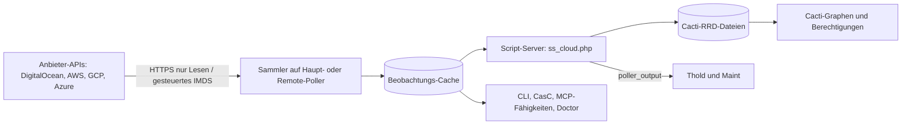

<!-- Source: README.md; SHA256: ac2074a40238686915802803c5efe773f33677f934281e0605e6e87a71a9d27d -->

<!-- translations:start -->
[English](../../../README.md) | [简体中文](../zh-CN/README.md) | [हिन्दी](../hi-IN/README.md) | [Español (España)](../es-ES/README.md) | [Español (Latinoamérica)](../es-419/README.md) | [العربية (السعودية)](../ar-SA/README.md) | [Afrikaans](../af-ZA/README.md) | [አማርኛ](../am-ET/README.md) | [العربية (مصر)](../ar-EG/README.md) | [العربية (المغرب)](../ar-MA/README.md) | [বাংলা](../bn-BD/README.md) | [Bosanski](../bs-BA/README.md) | [Deutsch](README.md) | [فارسی](../fa-IR/README.md) | [Filipino](../fil-PH/README.md) | [Français](../fr-FR/README.md) | [Français (Maroc)](../fr-MA/README.md) | [Français (Sénégal)](../fr-SN/README.md) | [Hausa](../ha-NG/README.md) | [עברית](../he-IL/README.md) | [Hrvatski](../hr-HR/README.md) | [Bahasa Indonesia](../id-ID/README.md) | [Igbo](../ig-NG/README.md) | [Italiano](../it-IT/README.md) | [日本語](../ja-JP/README.md) | [한국어](../ko-KR/README.md) | [Malagasy](../mg-MG/README.md) | [मराठी](../mr-IN/README.md) | [Bahasa Melayu](../ms-MY/README.md) | [Nederlands](../nl-NL/README.md) | [Polski](../pl-PL/README.md) | [Português (Brasil)](../pt-BR/README.md) | [Русский](../ru-RU/README.md) | [Kinyarwanda](../rw-RW/README.md) | [Soomaali](../so-SO/README.md) | [Српски](../sr-RS/README.md) | [Svenska](../sv-SE/README.md) | [Kiswahili](../sw-KE/README.md) | [தமிழ்](../ta-IN/README.md) | [తెలుగు](../te-IN/README.md) | [ไทย](../th-TH/README.md) | [Türkçe](../tr-TR/README.md) | [Українська](../uk-UA/README.md) | [اردو](../ur-PK/README.md) | [Tiếng Việt](../vi-VN/README.md) | [isiXhosa](../xh-ZA/README.md) | [Yorùbá](../yo-NG/README.md) | [繁體中文](../zh-TW/README.md) | [isiZulu](../zu-ZA/README.md)
<!-- translations:end -->

# plugin_cloud

Ein Cacti-1.2-Plugin, das Ressourcen und Metriken von Public-Cloud-Anbietern als reguläre Geräte, Datenquellen und Graphen in Cacti einbindet. Cloud-Workloads liegen direkt neben dem Netzwerk, das sie überträgt, unter der Rechteverwaltung von Cacti, und Thold sowie Maint können Alarme für sie auslösen und unterdrücken. Ein einziges Plugin deckt DigitalOcean, Amazon Web Services, Google Cloud und Microsoft Azure über reine PHP-Treiber mit reinem Lesezugriff ab.

> **Status: in Entwicklung, noch keine Veröffentlichung (`0.1.0-dev`).** Dieser Zweig implementiert reine PHP-Treiber für DigitalOcean, AWS, Google Cloud und Azure, Replikation für Remote-Datensammler und schreibgeschützte Agent-Statusabfragen, einen CasC-Provider sowie eine Operator-CLI, MCP-Fähigkeiten und Doctor-Prüfungen. Die mitgelieferten Cacti-Vorlagen decken derzeit DigitalOcean Droplets und Load Balancer ab (`templates/cloud_digitalocean.xml`); Cacti-Vorlagenpakete für AWS, Google Cloud und Azure sowie die Qualifizierung mit Produktivkonten über DigitalOcean hinaus ([Anbieterfakten](../../research/provider-facts.md)) sind noch nicht abgeschlossen. Nicht produktiv einsetzen.

## Unterstützte Anbieter

Jeder Anbietertreiber ist in `Drivers::production()` registriert, wird über `Provider::released()` bereitgestellt und läuft in reinem PHP mit `ext-openssl` und Stream-Sockets ohne SDK- oder Composer-Laufzeitabhängigkeiten.

| Anbieter | Bereichsfelder | Zugangsdatenquellen | Authentifizierung | Erkannte Ressourcen | Metrikerfassung |
|---|---|---|---|---|---|
| DigitalOcean (`digitalocean`) | Keine (Token-bezogen) | `vault`, `file` | Bearer-Token | `droplet`, `load_balancer` | `/v2/monitoring/metrics` mit Berücksichtigung des Rate-Limit-Anteils; liefert Cacti-Vorlagen und Datenabfragen mit |
| Amazon Web Services (`aws`) | `account_id` (12 Ziffern), `regions` | `vault`, `file`, `instance` | Reines PHP AWS SigV4 (`AWS4-HMAC-SHA256`), STS-`GetCallerIdentity`-Prüfung, optionales STS `AssumeRole`, EC2 IMDSv2 (`169.254.169.254`) für `instance`-Konten | `ec2_instance`, `rds_instance`, `aws_elb` (ALB/NLB) | Gebündeltes CloudWatch `GetMetricData` (bis zu 500 Abfragen pro Aufruf) |
| Google Cloud (`gcp`) | `project` | `vault`, `file`, `instance` | Reines PHP RS256-Dienstkonto-JWT über `ext-openssl`, ausgetauscht bei `oauth2.googleapis.com/token`, oder GCE-Metadatenserver (`metadata.google.internal`) für `instance`-Konten | `gce_instance` über `instances.aggregatedList` | Cloud Monitoring `timeSeries.list` |
| Microsoft Azure (`azure`) | `tenant`, `subscription`, `regions` | `vault`, `file`, `instance` | Reiner PHP-Entra-ID-OAuth2-Client-Credentials-Flow (nur `client_secret`; Zertifikats-Assertions ausgeschlossen) oder verwaltete Identität über Azure IMDS (`169.254.169.254`) für ARM- und Monitor-Tokens | `azure_vm` über ARM Resource Graph (paginiert mit `$skipToken` und dedupliziert) | Azure Monitor `metrics:getBatch` (bis zu 50 Ressourcen pro Aufruf, mit Behandlung von HTTP-429- und 529-Drosselung) |

## Implementierte Funktionen

### Kernplattform, Tresor und Sammler

- **Abgesicherte Installation und Lebenszyklus.** Einstiegspunkte (`setup.php`, `cli/cloud.php`, `poller_cloud.php`, `ss_cloud.php` und Seitenskripte) sind unter PHP 8.0 parsbar und lehnen PHP unter 8.2 oder fehlendes `ext-openssl` ab, ohne Cacti zu beschädigen. Upgrades sind geordnet, idempotent (`Schema::VERSION = 3`, 9 Tabellen) und überstehen Unterbrechungen. Bei der Deinstallation bleiben Plugin-Tabellen erhalten, sofern *Keep Plugin Tables on Uninstall* nicht deaktiviert wird.
- **Konten und Zugangsdaten.** Konten lassen sich unter **Management > Cloud Accounts** hinzufügen, bearbeiten, prüfen und löschen. Zugangsdaten stammen aus dem mit AES-256-GCM verschlüsselten Tresor (`plugin_cloud_secret`, standardmäßig mit `/etc/cacti/cloud-vault.key` verschlüsselt), aus einer Datei innerhalb des konfigurierten *Credential File Directory* (`cloud_credential_dir`, standardmäßig leer, um Dateien abzulehnen) oder aus der Instanzidentität des Anbieters. Zugangsdaten sind in der Oberfläche nur schreibbar und werden in Protokollen geschwärzt.
- **Strikte Ausgeh- und Lesezugriffskontrollen.** Jeder Treiber arbeitet hinter `GuardedTransport` und `OutboundPolicy`: HTTPS-Port 443 zu exakten anbieterspezifischen Hostnamen, während Link-Local-HTTP-Port-80-Metadaten-Endpunkte (`169.254.169.254`, `metadata.google.internal`) nur für `instance`-Konten aktiviert sind. Nur freigegebene Leseoperationen sind zulässig.
- **Sammler- und Kostenkontrollen.** `poller_cloud.php` läuft aus `poller_bottom` (ein Prozess pro Poller über das Cacti-Prozessregister) innerhalb von `cloud_collector_budget`, erwirbt Leases pro Konto, führt Erkennungen gemäß `discover_interval` aus, liest Metriken nur für aktive Cacti-Datenquellen (`plugin_cloud_series`), hält `request_share` und `monthly_ceiling` ein und speichert die neuesten Datenpunkte in `plugin_cloud_observation` für `ss_cloud.php` zwischen.
- **Cacti-Objekte und Anfrageschätzungen.** Verwaltet ein Scope-Gerät pro Konto (`plugin_cloud_device`), bewahrt die Reindex-Methoden des Scope-Geräts beim Speichern von Geräten, importiert DigitalOcean-Vorlagen und Script-Server-Datenabfragen (`templates/cloud_digitalocean.xml`, `cloud_do_droplet.xml`, `cloud_do_load_balancer.xml`) und zeigt Anfrage- sowie Listenpreisschätzungen unter **New Graphs** (`graphs_new_top_links`) und **Cloud Health** an.

### Remote-Datensammler

- `INFO` deklariert `remote_collect:1`. Konten können jedem aktivierten Cacti-Poller (`poller_id >= 1`) zugewiesen werden, und `poller_cloud.php --poller=N` erfasst nur Konten, die diesem Poller gehören.
- **`replicate_out`-Hook.** Repliziert pollerbezogene Zeilen aus `plugin_cloud_account`, `plugin_cloud_device`, `plugin_cloud_series` sowie verschlüsselte Geheimtextzeilen aus `plugin_cloud_secret` (nur für tresorgesicherte Konten des Zielpollers) über `replicate_out_table()`. Rohe Tresorschlüsseldateien werden niemals in der Datenbank gespeichert oder repliziert und verbleiben lokal auf jedem Poller.
- **`remote_agent`-Hook.** Stellt eine schreibgeschützte JSON-Statuszusammenfassung (`action=cloud_health`) bereit, die nur ganzzahlige Parameter `poller_id` und `account_id` akzeptiert und keinerlei Zugangsdaten, Dateipfade oder Geheimnisse zurückgibt.

### Ökosystem-Hooks (CasC, MCP-Fähigkeiten und Doctor)

- **CasC-Provider (`casc_register_providers`).** Registriert den `cloud`-Provider (Schemaversion `1`) mit deterministischem reinem PHP-YAML- und XML-Export, Manifestvalidierung, Diff-Planung und bestätigter Anwendung. Tresorzugangsdaten werden als `vault:account:<name>`-Referenzen exportiert; rohe Geheimnisfelder (`secret`, `secrets`, `token`, `access_token`, `refresh_token`, `password`, `private_key`, `access_key_id`, `secret_access_key`, `session_token`, `client_secret`, `credential`, `credentials`, `vault_key`) werden abgelehnt. Die Anwendung erfordert ein exaktes SHA-256 `--confirm=<PLAN_HASH>`.
- **MCP / Abilities API (`abilities_register`).** Registriert drei strikt schreibgeschützte Fähigkeiten, geschützt durch den Cloud-View-Bereich (`cloud_health.php`) und den Cacti-Gerätebereich für Nicht-Admin-Aufrufer, ohne Zugangsdaten, Tresorschlüssel oder Dateipfade von Zugangsdaten auszugeben:
  - `cloud-list-accounts` (optional `provider`, `poller_id`)
  - `cloud-list-resources` (optional `account_id`, `type`, `lifecycle`)
  - `cloud-get-health` (optional `account_id`)
- **Doctor-Prüfungen (`doctor_register_checks`).** Registriert fünf Diagnoseprüfungen, die keine Geheimwerte oder Schlüsselmaterial preisgeben:
  - `cloud_schema`: Aktualität der Schemaversion
  - `cloud_vault_key`: Lesbarkeit, Berechtigungen und Größe der Tresorschlüsseldatei
  - `cloud_drivers`: Registrierung der Produktionstreiber für alle veröffentlichten Anbieter
  - `cloud_accounts_health`: fehlgeschlagene, gedrosselte oder veraltete aktivierte Konten
  - `cloud_poller_intervals`: Abgleich der Erfassungsintervalle aktivierter Konten mit dem Cacti-Poller-Intervall

## CLI

Aus dem Cacti-Wurzelverzeichnis mit PHP 8.2 oder neuer ausführen:

```sh
# Operator and CasC CLI (options use --key=value form)
php plugins/cloud/cli/cloud.php export [--format=yaml|xml]
php plugins/cloud/cli/cloud.php validate --file=<path> [--format=yaml|xml]
php plugins/cloud/cli/cloud.php plan --file=<path> [--format=yaml|xml]
php plugins/cloud/cli/cloud.php apply --file=<path> --confirm=<PLAN_HASH> [--format=yaml|xml]
php plugins/cloud/cli/cloud.php health [--format=text|json] [--poller=<id>]

# Collector entry point (normally started by poller_bottom)
php plugins/cloud/poller_cloud.php [--poller=N] [--force] [--debug]
```

## Zugriffsrollen

| Bereich | Zugriff |
| --- | --- |
| Cloud View | Bestehende Überwachungsseiten. |
| Cloud Operator | Überwachung sowie die Seite Operations und persönliche Triage-Bestätigungen. |
| Cloud Admin | Operator-Zugriff sowie die bestehenden Konfigurations- und Verwaltungsaktionen. |

Öffnen Sie nach dem Kopieren der Upgrade-Dateien als Administrator die Seite Plugins, um die Bereiche zu registrieren. Weisen Sie den Bereich Operator explizit unter **Configuration > Users** oder Benutzergruppen zu. Upgrades behalten die bestehenden View- und Admin-Bereichs-IDs und Berechtigungen bei. Der Admin-Zugriff erbt bei jeder Anfrage den Operator-Zugriff, und der Operator-Zugriff erbt den View-Zugriff; dadurch werden keine gespeicherten Berechtigungen zu Benutzern oder Gruppen hinzugefügt. Plugin-Einstellungen erfordern zusätzlich zur Cacti-Berechtigung Settings den Cloud-Admin-Zugriff.

Cacti-Geräteberechtigungen begrenzen die für jeden Benutzer verfügbaren Zeilen und Aktionen; nicht zugeordnete Objekte erfordern einen Administrator. Operatoren können die gespeicherten Zugangsdaten für ein Konto überprüfen, auf dessen Cacti-Gerät sie zugreifen dürfen. Zugangsdaten, Konfiguration, Zuordnung, Löschung und andere administrative Änderungen verbleiben auf den Verwaltungsseiten. Bestätigungen gelten nur in der aktuellen Benutzersitzung, höchstens eine Stunde lang und nur solange dieselbe Beobachtung aktuell bleibt. Neue oder geänderte Beobachtungen machen sie ungültig. Sie markieren niemals eine fehlgeschlagene Messung als fehlerfrei und unterdrücken keine Alarme.

## Warum

Jeder Cloud-Anbieter besitzt eine eigene Überwachungskonsole. Neben Cacti betrieben hinterlassen sie drei Lücken:

- **Getrennte Zugriffskontrolle.** Einem Cacti-Benutzer Cloud-Metriken zu zeigen bedeutet, ihm ein Cloud-Login zu geben.
- **Kein Netzwerkkontext.** Lokale Verbindungen werden in Cacti gezeichnet; die Workloads dahinter werden in der Konsole des jeweiligen Anbieters gezeichnet.
- **Getrennte Alarmierung.** Thold und Maint arbeiten auf Cacti-Datenquellen und -Geräten, sodass Anbieteralarme separat und einmal pro Anbieter konfiguriert und unterdrückt werden müssen.

Das Plugin liest die Monitoring-API jedes Anbieters auf einem Cacti-Poller aus, speichert die neuesten Datenpunkte zwischen und stellt sie dem Cacti-Script-Server bereit. Der Cacti-Poller schreibt die RRD-Dateien, sodass Graphen, Berechtigungen, Thold, Maint und Boost genauso funktionieren wie bei allen anderen Cacti-Daten.

## Design-Verpflichtungen

- **Nur Lesezugriff.** Jeder Treiber kann nur die Anbieteroperationen auf seiner Zulassungsliste erstellen; das Plugin verändert niemals eine Cloud-Ressource. ([ADR 0002](../../decisions/0002-read-only-with-operation-allowlist.md))
- **Nur PHP, keine SDKs.** Signierung und Token-Austausch sind in PHP mit den Erweiterungen implementiert, die Cacti bereits voraussetzt. Keine Composer-Laufzeitabhängigkeiten. ([ADR 0003](../../decisions/0003-php-only-without-sdks.md))
- **Kosten vor der Erfassung.** Das Plugin liest nur Metriken mit einer Cacti-Datenquelle, zeigt die erwartete Anfragezahl und die Listenpreiskosten vor dem Erstellen von Graphen an und erzwingt ein monatliches Limit. ([ADR 0005](../../decisions/0005-collect-only-what-is-graphed.md))
- **Keine Klartext-Zugangsdaten in der Datenbank.** Zugangsdaten stammen aus einem verschlüsselten Tresor, der durch eine Datei außerhalb der Datenbank geschützt ist, aus einer Zugangsdatendatei oder aus der Instanzidentität des Anbieters. ([ADR 0007](../../decisions/0007-credentials-outside-the-database-in-the-clear.md))

## Umfang und Status

| Phase | Umfang | Meilensteine | Status |
|---|---|---|---|
| 0, Recherche | Bestätigung von Anbieterfakten, Metrikkataloge, Kosten- und Ratenmodell, Signatur-Testvektoren, Transport-Prototyp | [M1](https://github.com/somethingwithproof/plugin_cloud/milestone/1) | Abgeschlossen, außer Prüfungen, die Live-Anbieterkonten erfordern |
| 1, Kern und DigitalOcean | Konten, Zugangsdatentresor, Transport, Sammler, Beobachtungs-Cache, Cacti-Objekte, Vorlagen, Anfrageschätzungen, Statusseite, DigitalOcean Droplets und Load Balancer | [M2](https://github.com/somethingwithproof/plugin_cloud/milestone/2), [M3](https://github.com/somethingwithproof/plugin_cloud/milestone/3), [M4](https://github.com/somethingwithproof/plugin_cloud/milestone/4) | Implementiert; M4-Pilotqualifizierung ausstehend |
| 2, AWS | Reines PHP SigV4, STS `AssumeRole`, IMDSv2-Instanzrollen, EC2/RDS/ELB-Inventar, CloudWatch `GetMetricData` | [M5](https://github.com/somethingwithproof/plugin_cloud/milestone/5) | Treiber implementiert; Cacti-Vorlagen und Live-Konto-Qualifizierung ausstehend |
| 3, Google Cloud | Reines PHP RS256-Dienstkonto-JWT, GCE-Metadatenserver, Compute-Engine-Inventar, Cloud Monitoring `timeSeries.list` | [M6](https://github.com/somethingwithproof/plugin_cloud/milestone/6) | Treiber implementiert; Cacti-Vorlagen und Live-Konto-Qualifizierung ausstehend |
| 4, Azure | Entra-ID-Client-Zugangsdaten, verwaltete IMDS-Identität, ARM-Resource-Graph-VM-Inventar, Azure Monitor `metrics:getBatch` | [M7](https://github.com/somethingwithproof/plugin_cloud/milestone/7) | Treiber implementiert; Cacti-Vorlagen und Live-Konto-Qualifizierung ausstehend |
| 5, Remote-Sammler und Ökosystem | Remote-Datensammler (`replicate_out`, `remote_agent`), CasC-Provider und CLI, MCP-Fähigkeiten, Doctor-Prüfungen | [M8](https://github.com/somethingwithproof/plugin_cloud/milestone/8) | Implementiert |

Außerhalb des Umfangs: Ändern von Cloud-Ressourcen, Erstellen oder Spiegeln von Anbieteralarmen, Abrechnungsberichte, Protokolle und Traces sowie eine plugin-eigene Alarmierungs-Engine. Weitere Anbieter (Hetzner Cloud, Akamai Cloud, Oracle Cloud und andere) sind Recherche-Issues.

## Installation und Konfiguration

Diese Schritte installieren den Entwicklungscode zur Evaluierung. Sie erfordern Cacti 1.2.31 oder neuer unter PHP 8.2 oder neuer.

1. Kopieren Sie das Repository nach `plugins/cloud` unterhalb Ihres Cacti-Verzeichnisses. Das Verzeichnis muss `cloud` heißen.
2. Erstellen Sie den Tresorschlüssel außerhalb des Web-Roots auf jedem Poller, der tresorgestützte Zugangsdaten verwendet. Legen Sie ihn in einem Verzeichnis ab, in das nur root und der Cacti-Benutzer schreiben dürfen, und machen Sie die Datei nur für den Benutzer lesbar, der den Webserver und den Poller ausführt. Das Plugin erstellt oder beschreibt diese Datei niemals:

   ```sh
   sudo install -d -m 0750 -o root -g cacti /etc/cacti
   head -c 32 /dev/urandom | sudo tee /etc/cacti/cloud-vault.key > /dev/null
   sudo chown cacti:cacti /etc/cacti/cloud-vault.key
   sudo chmod 0600 /etc/cacti/cloud-vault.key
   ```

   Ersetzen Sie `cacti` durch den Benutzer, der Ihren Webserver und Poller ausführt. Die Datei enthält 32 rohe Bytes oder 64 hexadezimale Zeichen. Sichern Sie sie zusammen mit der Datenbank; ohne sie müssen gespeicherte Zugangsdaten erneut eingegeben werden.
3. Öffnen Sie in Cacti **Configuration > Plugins**, installieren und aktivieren Sie dann *Cloud*.
4. Legen Sie unter **Configuration > Settings > Cloud** *Vault Key File* fest, falls Sie einen anderen Pfad verwendet haben, konfigurieren Sie *Credential File Directory*, falls Sie dateibasierte Zugangsdaten verwenden möchten, und halten Sie *Collector Time Budget* (Standard: 240 Sekunden) unter dem Poller-Intervall.
5. Gewähren Sie Benutzern und Gruppen unter **Configuration > Users** *Cloud Admin*, *Cloud Operator* oder *Cloud View*. Bei der Installation erhält der Administrator Cloud Admin und Cloud View; Cloud Admin beinhaltet Operator-Zugriff, sodass der Administrator keine separate Operator-Zuweisung benötigt.
6. Fügen Sie Konten unter **Management > Cloud Accounts** hinzu und prüfen Sie anschließend **Management > Cloud Health** auf Warnungen.

## Kompatibilitätsziele

| Komponente | Ziel |
|---|---|
| Cacti | 1.2.31 oder neuer, keine Core-Patches |
| PHP | 8.2 oder neuer; Einstiegspunkte bleiben unter 8.0 parsbar, sodass eine nicht unterstützte Laufzeitumgebung eine Ablehnung statt einer beschädigten Cacti-Oberfläche erhält |
| PHP-Erweiterungen | `ext-openssl` (von Cacti 1.2.31 benötigt); kein `ext-curl` und keine Composer-Laufzeitabhängigkeiten |
| Thold, Maint | Keine Änderungen erforderlich |

## Design

- [docs/performance.md](../../performance.md) enthält die Messwerte von Sammler und Statusseite samt verwendeter Hardware und Einstellungen.
- [docs/PLAN.md](../../PLAN.md) ist der vollständige Plan: Architektur, die zugrundeliegenden Anbieter- und Cacti-Fakten (mit Quellen), Treibervertrag, Kostenrechnung, Sicherheitsgrenzen, Tests und Risiken.
- [docs/decisions/](../../decisions/) enthält Architekturentscheidungsaufzeichnungen für bereits getroffene Entscheidungen.
- [docs/REQUIREMENTS.md](../../REQUIREMENTS.md) ordnet jede Anforderungs-ID ihrem Issue zu.



## Arbeitsverfolgung

- **Meilensteine** folgen den Meilensteinen des Plans. Jeder hat ein Epic-Issue, das seine Unter-Issues und Abschlussnachweise auflistet.
- **Issues** werden per Label typisiert: `type: requirement`, `type: research`, `type: decision`, `type: epic`. Anforderungs-Issues nennen nummerierte, testbare Anforderungen (`REQ-AREA-NNN`) und Akzeptanzkriterien.
- **Labels** tragen außerdem `area:`, `provider:`, `phase:`, `priority:` und `status:`. Siehe [CONTRIBUTING.md](../../../CONTRIBUTING.md#labels).
- Das [Projekt-Board](https://github.com/users/somethingwithproof/projects/7) zeigt alle Issues über alle Meilensteine hinweg.

## Entwicklung

CI ([.github/workflows/plugin-ci-workflow.yml](../../../.github/workflows/plugin-ci-workflow.yml)) prüft das Release-Archiv und die semantische Version (`bash tests/bin/archive-check.sh`), prüft Einstiegspunkte unter PHP 8.0, führt Pest-Unit- (`phpunit.xml`) und Lebenszyklus-Integrationstests (`phpunit-integration.xml`) sowie PHPStan Level 9 unter PHP 8.2 bis 8.5 gegen Cacti `release/1.2.31` und `1.2.x` mit `CLOUD_OFFLINE=1` aus, prüft die Ablehnung unter PHP 8.1, verifiziert Gettext-Kataloge, misst die Leistung der 1.000-Serien-Erfassung und der Statusseite und führt Workflow-Linting sowie REUSE-Compliance aus.

Lokale Prüfungen vor dem Push:

```sh
bash tests/bin/archive-check.sh
sh tests/lint-workflows.sh
sh locales/build_gettext.sh --check
CACTI_PATH=/path/to/cacti phpstan analyse -c phpstan.neon --no-progress
```

Führen Sie Pest mit `--configuration=phpunit.xml` für Unit- und Quellregeltests aus oder `--configuration=phpunit-integration.xml` mit `CACTI_PATH` und `CLOUD_TEST_DATABASE=disposable` gegen eine Wegwerf-Cacti-Datenbank für Lebenszyklus-Integrationstests.

## Mitwirken

Lesen Sie [CONTRIBUTING.md](../../../CONTRIBUTING.md). Commits benötigen ein DCO-Sign-off. Designdiskussionen finden in Issues statt; offene Entscheidungen tragen das Label `type: decision`.

## Sicherheit

Melden Sie Sicherheitslücken vertraulich; siehe [SECURITY.md](../../../SECURITY.md).

## Lizenz

GNU General Public License v2.0, dieselbe Lizenz wie Cacti und seine Plugins. Siehe [LICENSE](../../../LICENSE).
