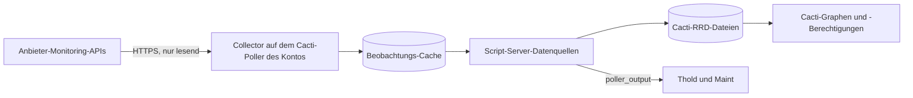

<!-- Source: README.md; SHA256: 7c621642e5f1a46bac66e4bc744f70aebb014c610d22de034088845fdc170405 -->

<!-- translations:start -->
[English](../../../README.md) | [简体中文](../zh-CN/README.md) | [हिन्दी](../hi-IN/README.md) | [Español (España)](../es-ES/README.md) | [Español (Latinoamérica)](../es-419/README.md) | [العربية (السعودية)](../ar-SA/README.md) | [Afrikaans](../af-ZA/README.md) | [አማርኛ](../am-ET/README.md) | [العربية (مصر)](../ar-EG/README.md) | [العربية (المغرب)](../ar-MA/README.md) | [বাংলা](../bn-BD/README.md) | [Deutsch](README.md) | [فارسی](../fa-IR/README.md) | [Filipino](../fil-PH/README.md) | [Français](../fr-FR/README.md) | [Français (Maroc)](../fr-MA/README.md) | [Français (Sénégal)](../fr-SN/README.md) | [Hausa](../ha-NG/README.md) | [עברית](../he-IL/README.md) | [Bahasa Indonesia](../id-ID/README.md) | [Igbo](../ig-NG/README.md) | [Italiano](../it-IT/README.md) | [日本語](../ja-JP/README.md) | [한국어](../ko-KR/README.md) | [Malagasy](../mg-MG/README.md) | [मराठी](../mr-IN/README.md) | [Bahasa Melayu](../ms-MY/README.md) | [Nederlands](../nl-NL/README.md) | [Polski](../pl-PL/README.md) | [Português (Brasil)](../pt-BR/README.md) | [Русский](../ru-RU/README.md) | [Kinyarwanda](../rw-RW/README.md) | [Soomaali](../so-SO/README.md) | [Svenska](../sv-SE/README.md) | [Kiswahili](../sw-KE/README.md) | [தமிழ்](../ta-IN/README.md) | [తెలుగు](../te-IN/README.md) | [ไทย](../th-TH/README.md) | [Türkçe](../tr-TR/README.md) | [Українська](../uk-UA/README.md) | [اردو](../ur-PK/README.md) | [Tiếng Việt](../vi-VN/README.md) | [isiXhosa](../xh-ZA/README.md) | [Yorùbá](../yo-NG/README.md) | [繁體中文](../zh-TW/README.md) | [isiZulu](../zu-ZA/README.md)
<!-- translations:end -->

# plugin_cloud

Ein Cacti-1.2-Plugin, das Ressourcen und Metriken von Public-Cloud-Anbietern als reguläre Geräte, Datenquellen und Graphen in Cacti einbindet. Cloud-Workloads befinden sich dadurch direkt neben dem Netzwerk, das sie überträgt – unter der Rechteverwaltung von Cacti –, und Thold sowie Maint können Alarme für sie auslösen und unterdrücken. Ein einziges Plugin deckt sämtliche Anbieter ab, mit jeweils einem Treiber pro Anbieter: zunächst DigitalOcean, AWS, Google Cloud und Azure.

> **Status: Meilenstein 3 (DigitalOcean- und Cacti-Objekte), im Review.** Dieser Meilenstein ergänzt den DigitalOcean-Treiber, Cacti-Vorlagen, ein Scope-Gerät pro Konto mit einer Datenabfrage pro Ressourcentyp, die Script-Server-Eingabe sowie eine Anfrageschätzung unter *New Graphs* und auf der Health-Seite. Erste Überprüfungen gegen ein Produktivkonto bei DigitalOcean sind in den [Anbieterfakten](../../research/provider-facts.md) dokumentiert. Setzen Sie das Plugin nicht produktiv ein.

## Zugriffsrollen

| Berechtigungsbereich | Zugriff |
| --- | --- |
| Cloud View | Bestehende Monitoring-Seiten. |
| Cloud Operator | Monitoring sowie die Seite *Operations* und persönliche Triage-Bestätigungen. |
| Cloud Admin | Operator-Zugriff sowie die bestehenden Konfigurations- und Verwaltungsaktionen. |

Öffnen Sie nach dem Kopieren der Upgrade-Dateien als Administrator die Seite *Plugins*, um den neuen Berechtigungsbereich zu registrieren. Weisen Sie den Operator-Berechtigungsbereich explizit unter **Configuration > Users** oder über Benutzergruppen zu. Bei Upgrades bleiben die bestehenden View- und Admin-Berechtigungs-IDs sowie -Zuweisungen erhalten. Der Admin-Zugriff erbt bei jeder Anfrage den Operator-Zugriff, und der Operator-Zugriff erbt den View-Zugriff; dadurch werden Benutzern oder Gruppen keine dauerhaft gespeicherten Berechtigungen hinzugefügt. Für die Plugin-Einstellungen ist zusätzlich zur Cacti-Berechtigung *Settings* der Zugriff als *Cloud Admin* erforderlich.

Die Geräteberechtigungen in Cacti schränken weiterhin ein, welche Zeilen und Aktionen für den jeweiligen Benutzer verfügbar sind; für nicht zugeordnete Objekte ist ein Administrator erforderlich. Operatoren können die gespeicherten Zugangsdaten für ein Konto überprüfen, auf dessen Cacti-Gerät sie zugreifen dürfen. Zugangsdaten, Konfiguration, Zuordnungen, Löschungen und sonstige administrative Änderungen verbleiben auf den Verwaltungsseiten. Bestätigungen gelten nur innerhalb der aktuellen Benutzersitzung, für höchstens eine Stunde und nur solange dieselbe Beobachtung aktuell bleibt. Neue oder geänderte Beobachtungen machen sie ungültig. Sie kennzeichnen niemals eine fehlgeschlagene Messung als fehlerfrei und unterdrücken keine Alarme.

## Motivation

Jeder Cloud-Anbieter verfügt über eine eigene Monitoring-Konsole. Parallel zu Cacti betrieben, entstehen dadurch drei Lücken:

- **Getrennte Zugriffskontrolle.** Um einem Cacti-Benutzer Cloud-Metriken anzuzeigen, muss ihm ein Cloud-Login eingerichtet werden.
- **Fehlender Netzwerkkontext.** Lokale Verbindungen werden in Cacti als Graphen dargestellt; die dahinterliegenden Workloads hingegen in der jeweiligen Anbieter-Konsole.
- **Getrennte Alarmierung.** Thold und Maint arbeiten auf Basis von Cacti-Datenquellen und -Geräten, sodass Anbieter-Alarme separat für jeden einzelnen Anbieter konfiguriert und unterdrückt werden müssen.

Das Plugin liest die Monitoring-API jedes Anbieters über einen Cacti-Poller aus, speichert die neuesten Datenpunkte im Cache und stellt sie dem Script-Server von Cacti bereit. Der Cacti-Poller schreibt die RRD-Dateien, sodass Graphen, Berechtigungen, Thold, Maint und Boost genauso funktionieren wie bei allen anderen Cacti-Daten.

## Architekturprinzipien

- **Nur lesender Zugriff.** Jeder Treiber kann ausschließlich die Anbieter-Operationen auf seiner Allowlist ausführen; das Plugin verändert niemals eine Cloud-Ressource. ([ADR 0002](../../decisions/0002-read-only-with-operation-allowlist.md))
- **Ausschließlich PHP, keine SDKs.** Signierung und Token-Austausch sind in PHP mit den Erweiterungen implementiert, die Cacti ohnehin voraussetzt. Keine Composer-Laufzeitabhängigkeiten. ([ADR 0003](../../decisions/0003-php-only-without-sdks.md))
- **Kostenkontrolle vor der Erfassung.** Das Plugin liest nur Metriken aus, für die eine Cacti-Datenquelle existiert, zeigt vor dem Erstellen von Graphen die voraussichtliche Anfrageanzahl sowie die Listenpreiskosten an und setzt eine monatliche Obergrenze durch. ([ADR 0005](../../decisions/0005-collect-only-what-is-graphed.md))
- **Keine Klartext-Zugangsdaten in der Datenbank.** Zugangsdaten stammen aus einem verschlüsselten Vault mit einer Schlüsseldatei außerhalb der Datenbank, aus einer Zugangsdatendatei oder aus der Instanzidentität des Anbieters. ([ADR 0007](../../decisions/0007-credentials-outside-the-database-in-the-clear.md))

## Funktionsumfang und Status

| Phase | Umfang | Meilensteine | Status |
|---|---|---|---|
| 0, Recherche | Bestätigung von Anbieterfakten, Metrikkataloge, Kosten- und Ratenmodell, Signatur-Testvektoren, Transport-Spike | [M1](https://github.com/somethingwithproof/plugin_cloud/milestone/1) | Abgeschlossen, bis auf die Prüfungen, die ein Produktivkonto beim Anbieter erfordern |
| 1, Kernfunktionen und DigitalOcean | Konten, Zugangsdaten-Vault, Transport, Collector, Beobachtungs-Cache, Cacti-Objekte, Health-Seite, DigitalOcean Droplets und Load Balancer | [M2](https://github.com/somethingwithproof/plugin_cloud/milestone/2), [M3](https://github.com/somethingwithproof/plugin_cloud/milestone/3), [M4](https://github.com/somethingwithproof/plugin_cloud/milestone/4) | M2 abgeschlossen ([#81](https://github.com/somethingwithproof/plugin_cloud/pull/81)); M3-Treiber, -Vorlagen und -Scope-Geräte gemergt; Anfrageschätzungen, Berechtigungen und Performance-Prüfungen im Review; M4 noch nicht begonnen |
| 2, AWS | Signature Version 4, `AssumeRole`, Instanzrollen, CloudWatch `GetMetricData`, regionales Inventar | [M5](https://github.com/somethingwithproof/plugin_cloud/milestone/5) | Noch nicht begonnen |
| 3, Google Cloud | Dienstkonto-JWT, Metadatenserver, Cloud Monitoring `timeSeries.list` | [M6](https://github.com/somethingwithproof/plugin_cloud/milestone/6) | Noch nicht begonnen |
| 4, Azure | Entra-Client-Anmeldeinformationen, verwaltete Identität, Resource Graph, `metrics:getBatch` | [M7](https://github.com/somethingwithproof/plugin_cloud/milestone/7) | Noch nicht begonnen |
| 5, Remote-Collectoren | Konten auf entfernten Cacti-Daten-Collectoren | [M8](https://github.com/somethingwithproof/plugin_cloud/milestone/8) | Noch nicht begonnen |

Nicht im Umfang enthalten: das Ändern von Cloud-Ressourcen, das Erstellen oder Spiegeln von Anbieter-Alarmen, Abrechnungsberichte, Logs und Traces sowie eine eigene Alarmierungs-Engine des Plugins. Weitere Anbieter (Hetzner Cloud, Akamai Cloud, Oracle Cloud und andere) werden als Recherche-Issues geführt.

## Lieferumfang von Meilenstein 2

- **Abgesicherte Installation.** Unter PHP kleiner als 8.2 oder ohne ext-openssl werden Installation und Aktivierung mit einer Meldung abgelehnt, während das übrige Cacti weiterhin funktioniert.
- **Lebenszyklus.** Installation, Upgrade und Deinstallation erfolgen über die Cacti-Seite *Plugins*. Upgrades werden geordnet ausgeführt und überstehen Unterbrechungen. Bei der Deinstallation bleiben die Plugin-Tabellen erhalten, sofern Sie *Keep Plugin Tables on Uninstall* nicht deaktivieren.
- **Getrennte Berechtigungsbereiche.** *Cloud Admin* öffnet **Cloud Accounts**; *Cloud Operator* öffnet **Cloud Operations**; *Cloud View* öffnet **Cloud Health**. Admin erbt Operator, und Operator erbt View. Alle drei Seiten befinden sich unter *Management*.
- **Konten und Zugangsdaten.** Konten hinzufügen, bearbeiten, überprüfen und löschen. Zugangsdaten werden entweder mit einer außerhalb der Datenbank gespeicherten Schlüsseldatei verschlüsselt in der Datenbank abgelegt (AES-256-GCM) oder aus einer Datei auf dem Poller gelesen. Zugangsdaten sind in der Benutzeroberfläche nur schreibbar und werden in Protokollen geschwärzt.
- **Der Collector.** Er startet bei jedem Poller-Lauf mit einer Instanz pro Poller innerhalb eines Zeitbudgets. Er erwirbt ein Lease pro Konto, führt die Erkennung in seinem eigenen Intervall aus und liest Metriken nur für die eigenen aktiven Datenquellen des Plugins.
- **Systemstatus (Health).** Status pro Konto für Erfassung, Erkennung, Ressourcen und Aktualität sowie Warnungen bei einem unbrauchbaren Vault-Schlüssel, unsicheren Zugangsdatendateien und Intervallen, die der Poller nicht einhalten kann.

## Installation und Konfiguration

Mit diesen Schritten installieren Sie den Code von Meilenstein 2 zur Evaluierung. Erforderlich sind Cacti 1.2.31 oder neuer unter PHP 8.2 oder neuer.

1. Kopieren Sie das Repository nach `plugins/cloud` unterhalb Ihres Cacti-Verzeichnisses. Das Verzeichnis muss `cloud` heißen.
2. Erstellen Sie den Vault-Schlüssel außerhalb des Web-Stammverzeichnisses. Legen Sie ihn in einem Verzeichnis ab, auf das nur root und der Cacti-Benutzer Schreibzugriff haben, und machen Sie die Datei ausschließlich für den Benutzer lesbar, der den Webserver und den Poller ausführt. Das Plugin erstellt oder beschreibt diese Datei niemals:

   ```sh
   sudo install -d -m 0750 -o root -g cacti /etc/cacti
   head -c 32 /dev/urandom | sudo tee /etc/cacti/cloud-vault.key > /dev/null
   sudo chown cacti:cacti /etc/cacti/cloud-vault.key
   sudo chmod 0600 /etc/cacti/cloud-vault.key
   ```

   Ersetzen Sie `cacti` durch den Benutzer, der Ihren Webserver und Poller ausführt. Die Datei enthält 32 Roh-Bytes oder 64 hexadezimale Zeichen. Sichern Sie die Datei zusammen mit der Datenbank; ohne sie müssen gespeicherte Zugangsdaten erneut eingegeben werden.
3. Öffnen Sie in Cacti **Configuration > Plugins** und installieren und aktivieren Sie *Cloud*.
4. Legen Sie unter **Configuration > Settings > Cloud** die Option *Vault Key File* fest, falls Sie einen anderen Pfad verwendet haben. *Collector Time Budget* (Standard: 240 Sekunden) muss unterhalb des Poller-Intervalls bleiben.
5. Weisen Sie Benutzern und Gruppen unter **Configuration > Users** die Berechtigung *Cloud Admin*, *Cloud Operator* oder *Cloud View* zu. Bei der Installation werden dem Administrator *Cloud Admin* und *Cloud View* zugewiesen; *Cloud Admin* schließt den Operator-Zugriff ein, sodass für den Administrator keine separate Operator-Zuweisung nötig ist.
6. Fügen Sie unter **Management > Cloud Accounts** Konten hinzu und prüfen Sie anschließend **Management > Cloud Health** auf Warnungen.

## Kompatibilitätsziele

| Komponente | Ziel |
|---|---|
| Cacti | 1.2.31 oder neuer, ohne Core-Patches |
| PHP | 8.2 oder neuer; `setup.php` bleibt unter 8.0 syntaktisch analysierbar, damit eine nicht unterstützte Laufzeitumgebung eine Ablehnung statt einer defekten Cacti-Oberfläche erhält |
| PHP-Erweiterungen | Keine über die von Cacti 1.2.31 vorausgesetzten Erweiterungen hinaus |
| Thold, Maint | Keine Änderungen erforderlich |

## Design

- [docs/performance.md](../../performance.md) enthält die Messwerte des Collectors und der Health-Seite samt verwendeter Hardware und Einstellungen.
- [docs/PLAN.md](../../PLAN.md) ist der vollständige Plan: Architektur, die zugrunde liegenden Anbieter- und Cacti-Fakten (mit Quellenangaben), der Treibervertrag, die Kostenberechnung, Sicherheitsgrenzen, Tests und Risiken.
- [docs/decisions/](../../decisions) enthält Architecture Decision Records (ADRs) zu bereits getroffenen Entscheidungen.
- [docs/REQUIREMENTS.md](../../REQUIREMENTS.md) ordnet jede Anforderungs-ID dem zugehörigen Issue zu.



## Aufgabenverfolgung

- **Meilensteine** folgen den Meilensteinen des Plans. Jeder besitzt ein Epic-Issue, das seine Unter-Issues und Abschlussnachweise aufführt.
- **Issues** werden über Labels typisiert: `type: requirement`, `type: research`, `type: decision`, `type: epic`. Anforderungs-Issues definieren nummerierte, testbare Anforderungen (`REQ-AREA-NNN`) sowie Akzeptanzkriterien.
- **Labels** tragen außerdem die Präfixe `area:`, `provider:`, `phase:`, `priority:` und `status:`. Siehe [CONTRIBUTING.md](../../../CONTRIBUTING.md#labels).
- Das [Projektboard](https://github.com/users/somethingwithproof/projects/7) zeigt alle Issues über alle Meilensteine hinweg.

## Entwicklung

Die CI führt Linting der Einstiegspunkte unter PHP 8.0 durch, startet Unit- und Integrationstests sowie PHPStan auf Level 9 und installiert das Plugin unter PHP 8.2 bis 8.5 gegen Cacti 1.2.31 und den 1.2.x-Branch. Zudem prüft sie, dass PHP 8.1 abgelehnt wird, ohne Cacti zu beeinträchtigen. Die Tests verwenden Pest aus dem Plugin-Testrahmen von Cacti Core. Diese Wahl ist vorläufig, bis über [#12](https://github.com/somethingwithproof/plugin_cloud/issues/12) entschieden ist. [.github/workflows/plugin-ci-workflow.yml](../../../.github/workflows/plugin-ci-workflow.yml) listet jeden Schritt auf. Führen Sie vor einem Push lokal `sh tests/lint-workflows.sh` und `sh locales/build_gettext.sh --check` aus.

## Mitwirken

Lesen Sie [CONTRIBUTING.md](../../../CONTRIBUTING.md). Commits erfordern ein DCO-Sign-off. Design-Diskussionen finden in den Issues statt; offene Entscheidungen sind mit dem Label `type: decision` versehen.

## Sicherheit

Melden Sie Sicherheitslücken vertraulich; siehe [SECURITY.md](../../../SECURITY.md).

## Lizenz

GNU General Public License v2.0, dieselbe Lizenz wie Cacti und seine Plugins. Siehe [LICENSE](../../../LICENSE).
