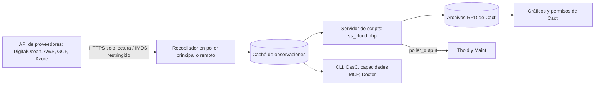

<!-- Source: README.md; SHA256: ac2074a40238686915802803c5efe773f33677f934281e0605e6e87a71a9d27d -->

<!-- translations:start -->
[English](../../../README.md) | [简体中文](../zh-CN/README.md) | [हिन्दी](../hi-IN/README.md) | [Español (España)](../es-ES/README.md) | [Español (Latinoamérica)](README.md) | [العربية (السعودية)](../ar-SA/README.md) | [Afrikaans](../af-ZA/README.md) | [አማርኛ](../am-ET/README.md) | [العربية (مصر)](../ar-EG/README.md) | [العربية (المغرب)](../ar-MA/README.md) | [বাংলা](../bn-BD/README.md) | [Bosanski](../bs-BA/README.md) | [Deutsch](../de-DE/README.md) | [فارسی](../fa-IR/README.md) | [Filipino](../fil-PH/README.md) | [Français](../fr-FR/README.md) | [Français (Maroc)](../fr-MA/README.md) | [Français (Sénégal)](../fr-SN/README.md) | [Hausa](../ha-NG/README.md) | [עברית](../he-IL/README.md) | [Hrvatski](../hr-HR/README.md) | [Bahasa Indonesia](../id-ID/README.md) | [Igbo](../ig-NG/README.md) | [Italiano](../it-IT/README.md) | [日本語](../ja-JP/README.md) | [한국어](../ko-KR/README.md) | [Malagasy](../mg-MG/README.md) | [मराठी](../mr-IN/README.md) | [Bahasa Melayu](../ms-MY/README.md) | [Nederlands](../nl-NL/README.md) | [Polski](../pl-PL/README.md) | [Português (Brasil)](../pt-BR/README.md) | [Русский](../ru-RU/README.md) | [Kinyarwanda](../rw-RW/README.md) | [Soomaali](../so-SO/README.md) | [Српски](../sr-RS/README.md) | [Svenska](../sv-SE/README.md) | [Kiswahili](../sw-KE/README.md) | [தமிழ்](../ta-IN/README.md) | [తెలుగు](../te-IN/README.md) | [ไทย](../th-TH/README.md) | [Türkçe](../tr-TR/README.md) | [Українська](../uk-UA/README.md) | [اردو](../ur-PK/README.md) | [Tiếng Việt](../vi-VN/README.md) | [isiXhosa](../xh-ZA/README.md) | [Yorùbá](../yo-NG/README.md) | [繁體中文](../zh-TW/README.md) | [isiZulu](../zu-ZA/README.md)
<!-- translations:end -->

# plugin_cloud

Un complemento de Cacti 1.2 que lleva recursos y métricas de proveedores de nube pública a Cacti como dispositivos, fuentes de datos y gráficos comunes. Las cargas de trabajo en la nube quedan junto a la red que las transporta, bajo los permisos de Cacti, y Thold y Maint alertan sobre ellas y las suprimen. Un solo complemento cubre DigitalOcean, Amazon Web Services, Google Cloud y Microsoft Azure mediante controladores de solo lectura escritos en PHP puro.

> **Estado: en desarrollo, aún sin lanzamiento (`0.1.0-dev`).** Esta rama implementa controladores en PHP puro para DigitalOcean, AWS, Google Cloud y Azure, replicación para recopiladores de datos remotos y estado de agente de solo lectura, un proveedor CasC y CLI de operador, capacidades MCP y verificaciones de Doctor. Las plantillas de Cacti incluidas actualmente cubren Droplets y balanceadores de carga de DigitalOcean (`templates/cloud_digitalocean.xml`); los paquetes de plantillas de Cacti para AWS, Google Cloud y Azure y la calificación con cuentas reales más allá de DigitalOcean ([datos de los proveedores](../../research/provider-facts.md)) todavía no están terminados. No lo ejecute en producción.

## Proveedores compatibles

Cada controlador de proveedor se registra en `Drivers::production()`, se ofrece mediante `Provider::released()` y se ejecuta en PHP puro usando `ext-openssl` y sockets de flujo, sin dependencias de ejecución de SDK ni de Composer.

| Proveedor | Campos de alcance | Orígenes de credenciales | Autenticación | Recursos descubiertos | Recolección de métricas |
|---|---|---|---|---|---|
| DigitalOcean (`digitalocean`) | Ninguno (alcance de token) | `vault`, `file` | Token Bearer | `droplet`, `load_balancer` | `/v2/monitoring/metrics` con control de cuota por límite de tasa; incluye plantillas y consultas de datos de Cacti |
| Amazon Web Services (`aws`) | `account_id` (12 dígitos), `regions` | `vault`, `file`, `instance` | AWS SigV4 en PHP puro (`AWS4-HMAC-SHA256`), verificación STS `GetCallerIdentity`, STS `AssumeRole` opcional, EC2 IMDSv2 (`169.254.169.254`) para cuentas `instance` | `ec2_instance`, `rds_instance`, `aws_elb` (ALB/NLB) | CloudWatch `GetMetricData` por lotes (hasta 500 consultas por llamada) |
| Google Cloud (`gcp`) | `project` | `vault`, `file`, `instance` | JWT RS256 de cuenta de servicio en PHP puro mediante `ext-openssl` intercambiado en `oauth2.googleapis.com/token`, o servidor de metadatos de GCE (`metadata.google.internal`) para cuentas `instance` | `gce_instance` mediante `instances.aggregatedList` | Cloud Monitoring `timeSeries.list` |
| Microsoft Azure (`azure`) | `tenant`, `subscription`, `regions` | `vault`, `file`, `instance` | Flujo OAuth2 de credenciales de cliente de Entra ID en PHP puro (solo `client_secret`; se excluyen aserciones de certificado), o identidad administrada de Azure IMDS (`169.254.169.254`) para tokens de ARM y Monitor | `azure_vm` mediante ARM Resource Graph (paginado con `$skipToken` y deduplicado) | Azure Monitor `metrics:getBatch` (hasta 50 recursos por llamada, manejando limitación HTTP 429 y 529) |

## Capacidades implementadas

### Plataforma principal, bóveda y recopilador

- **Instalación y ciclo de vida protegidos.** Los puntos de entrada (`setup.php`, `cli/cloud.php`, `poller_cloud.php`, `ss_cloud.php` y los scripts de páginas) se analizan en PHP 8.0 y rechazan versiones de PHP inferiores a 8.2 o la falta de `ext-openssl` sin dañar Cacti. Las actualizaciones son ordenadas, idempotentes (`Schema::VERSION = 3`, 9 tablas) y resisten interrupciones. La desinstalación conserva las tablas del complemento a menos que se desmarque *Keep Plugin Tables on Uninstall*.
- **Cuentas y credenciales.** Agregue, edite, verifique y elimine cuentas en **Management > Cloud Accounts**. Las credenciales provienen de la bóveda cifrada con AES-256-GCM (`plugin_cloud_secret`, con clave predeterminada en `/etc/cacti/cloud-vault.key`), de un archivo restringido dentro del *Credential File Directory* configurado (`cloud_credential_dir`, vacío por defecto para rechazar archivos) o de la identidad de instancia del proveedor. Las credenciales son de solo escritura en la interfaz y se censuran en los registros.
- **Controles estrictos de salida y solo lectura.** Cada controlador opera detrás de `GuardedTransport` y `OutboundPolicy`: puerto HTTPS 443 hacia los nombres de host exactos de cada proveedor, con los endpoints HTTP de metadatos de enlace local en el puerto 80 (`169.254.169.254`, `metadata.google.internal`) habilitados solo para cuentas `instance`. Únicamente se permiten operaciones de solo lectura incluidas en la lista permitida.
- **Recopilador y controles de costo.** `poller_cloud.php` se ejecuta desde `poller_bottom` (un proceso por recopilador mediante el registro de procesos de Cacti) dentro de `cloud_collector_budget`, adquiere concesiones por cuenta, ejecuta el descubrimiento según `discover_interval`, lee métricas únicamente para fuentes de datos activas de Cacti (`plugin_cloud_series`), respeta `request_share` y `monthly_ceiling`, y guarda en caché los últimos puntos de datos en `plugin_cloud_observation` para `ss_cloud.php`.
- **Objetos de Cacti y estimaciones de solicitudes.** Mantiene un dispositivo de alcance por cuenta (`plugin_cloud_device`), conserva los métodos de reindexación del dispositivo de alcance al guardar dispositivos, importa plantillas y consultas de datos del servidor de scripts de DigitalOcean (`templates/cloud_digitalocean.xml`, `cloud_do_droplet.xml`, `cloud_do_load_balancer.xml`), y muestra estimaciones de solicitudes y precio de lista en **New Graphs** (`graphs_new_top_links`) y **Cloud Health**.

### Recopiladores de datos remotos

- `INFO` declara `remote_collect:1`. Las cuentas pueden asignarse a cualquier recopilador de Cacti habilitado (`poller_id >= 1`), y `poller_cloud.php --poller=N` recopila únicamente las cuentas que pertenecen a ese recopilador.
- **Hook `replicate_out`.** Replica filas filtradas por recopilador desde `plugin_cloud_account`, `plugin_cloud_device`, `plugin_cloud_series` y filas cifradas de `plugin_cloud_secret` (solo para cuentas respaldadas por bóveda pertenecientes al recopilador destino) mediante `replicate_out_table()`. Los archivos de clave de la bóveda nunca se guardan en la base de datos ni se replican, y permanecen locales en cada recopilador.
- **Hook `remote_agent`.** Expone un resumen de estado JSON de solo lectura (`action=cloud_health`) que solo acepta parámetros enteros `poller_id` y `account_id` y devuelve cero credenciales, rutas de archivos o secretos.

### Hooks del ecosistema (CasC, capacidades MCP y Doctor)

- **Proveedor CasC (`casc_register_providers`).** Registra el proveedor `cloud` (versión de esquema `1`) con exportación determinista en YAML y XML en PHP puro, validación de manifiestos, planificación de diferencias y aplicación confirmada. Las credenciales de bóveda se exportan como referencias `vault:account:<name>`; se rechazan los campos de secretos sin formato (`secret`, `secrets`, `token`, `access_token`, `refresh_token`, `password`, `private_key`, `access_key_id`, `secret_access_key`, `session_token`, `client_secret`, `credential`, `credentials`, `vault_key`). Aplicar cambios requiere un SHA-256 exacto `--confirm=<PLAN_HASH>`.
- **MCP / Abilities API (`abilities_register`).** Registra tres capacidades estrictamente de solo lectura protegidas por el ámbito Cloud View (`cloud_health.php`) y el alcance de dispositivos de Cacti para usuarios no administradores, sin emitir credenciales, claves de bóveda ni rutas de archivos de credenciales:
  - `cloud-list-accounts` (`provider` y `poller_id` opcionales)
  - `cloud-list-resources` (`account_id`, `type` y `lifecycle` opcionales)
  - `cloud-get-health` (`account_id` opcional)
- **Verificaciones de Doctor (`doctor_register_checks`).** Registra cinco verificaciones de diagnóstico que no exponen valores secretos ni material de claves:
  - `cloud_schema`: vigencia de la versión del esquema
  - `cloud_vault_key`: legibilidad, permisos y tamaño del archivo de clave de la bóveda
  - `cloud_drivers`: registro del controlador de producción para todos los proveedores publicados
  - `cloud_accounts_health`: cuentas habilitadas con fallos, limitación de tasa o datos obsoletos
  - `cloud_poller_intervals`: alineación de los intervalos de recolección de cuentas habilitadas con el intervalo del recopilador de Cacti

## CLI

Ejecútelo desde el directorio raíz de Cacti con PHP 8.2 o superior:

```sh
# Operator and CasC CLI (options use --key=value form)
php plugins/cloud/cli/cloud.php export [--format=yaml|xml]
php plugins/cloud/cli/cloud.php validate --file=<path> [--format=yaml|xml]
php plugins/cloud/cli/cloud.php plan --file=<path> [--format=yaml|xml]
php plugins/cloud/cli/cloud.php apply --file=<path> --confirm=<PLAN_HASH> [--format=yaml|xml]
php plugins/cloud/cli/cloud.php health [--format=text|json] [--poller=<id>]

# Collector entry point (normally started by poller_bottom)
php plugins/cloud/poller_cloud.php [--poller=N] [--force] [--debug]
```

## Roles de acceso

| Ámbito | Acceso |
| --- | --- |
| Cloud View | Páginas de monitoreo existentes. |
| Cloud Operator | Monitoreo más la página Operations y confirmaciones personales de triaje. |
| Cloud Admin | Acceso de operador más la configuración y las acciones administrativas existentes. |

Después de copiar los archivos de actualización, abra la página Plugins como administrador para registrar los ámbitos. Asigne el ámbito Operator explícitamente en **Configuration > Users** o en grupos de usuarios. Las actualizaciones conservan los ID y permisos de los ámbitos View y Admin existentes. El acceso Admin hereda el acceso Operator, y el acceso Operator hereda el acceso View en cada solicitud; esto no agrega permisos almacenados a usuarios ni grupos. La configuración del complemento también requiere acceso Cloud Admin además del permiso Settings de Cacti.

Los permisos de dispositivos de Cacti limitan las filas y acciones disponibles para cada usuario; los objetos sin mapear requieren un administrador. Los operadores pueden verificar la credencial almacenada para una cuenta a cuyo dispositivo de Cacti puedan acceder. Las credenciales, la configuración, el mapeo, la eliminación y otros cambios administrativos permanecen en las páginas administrativas. Las confirmaciones duran únicamente en la sesión actual del usuario, como máximo una hora y solo mientras la misma observación siga vigente. Las observaciones nuevas o modificadas las invalidan. Nunca marcan una medición fallida como saludable ni suprimen alertas.

## Por qué

Cada proveedor de nube tiene su propia consola de monitoreo. Al usarlas junto con Cacti, quedan tres brechas:

- **Control de acceso separado.** Mostrar métricas de nube a un usuario de Cacti significa darle un inicio de sesión en la nube.
- **Sin contexto de red.** Los enlaces locales se grafican en Cacti; las cargas de trabajo detrás de ellos se grafican en la consola de cada proveedor.
- **Alertas separadas.** Thold y Maint funcionan sobre fuentes de datos y dispositivos de Cacti, por lo que las alarmas del proveedor se configuran y suprimen por separado, una vez por proveedor.

El complemento lee la API de monitoreo de cada proveedor desde un recopilador de Cacti, almacena en caché los últimos puntos de datos y los entrega al servidor de scripts de Cacti. El recopilador de Cacti escribe los archivos RRD, por lo que los gráficos, los permisos, Thold, Maint y boost funcionan igual que con cualquier dato de Cacti.

## Compromisos de diseño

- **Solo lectura.** Cada controlador solo puede construir las operaciones del proveedor incluidas en su lista permitida; el complemento nunca modifica un recurso en la nube. ([ADR 0002](../../decisions/0002-read-only-with-operation-allowlist.md))
- **Solo PHP, sin SDK.** La firma y el intercambio de tokens se implementan en PHP con las extensiones que Cacti ya requiere. Sin dependencias de ejecución de Composer. ([ADR 0003](../../decisions/0003-php-only-without-sdks.md))
- **Costo antes de la recolección.** El complemento lee únicamente métricas que tienen una fuente de datos de Cacti, muestra el conteo de solicitudes esperado y el costo a precio de lista antes de crear gráficos, y aplica un límite mensual. ([ADR 0005](../../decisions/0005-collect-only-what-is-graphed.md))
- **Sin credenciales en texto plano en la base de datos.** Las credenciales provienen de una bóveda cifrada con una clave en un archivo fuera de la base de datos, de un archivo de credenciales o de la identidad de instancia del proveedor. ([ADR 0007](../../decisions/0007-credentials-outside-the-database-in-the-clear.md))

## Alcance y estado

| Fase | Alcance | Hitos | Estado |
|---|---|---|---|
| 0, investigación | Confirmación de datos de proveedores, catálogos de métricas, modelo de costo y tasa, vectores de prueba de firma, prototipo de transporte | [M1](https://github.com/somethingwithproof/plugin_cloud/milestone/1) | Completado, excepto verificaciones que requieren cuentas reales de proveedores |
| 1, núcleo y DigitalOcean | Cuentas, bóveda de credenciales, transporte, recopilador, caché de observaciones, objetos de Cacti, plantillas, estimaciones de solicitudes, página de estado, Droplets y balanceadores de carga de DigitalOcean | [M2](https://github.com/somethingwithproof/plugin_cloud/milestone/2), [M3](https://github.com/somethingwithproof/plugin_cloud/milestone/3), [M4](https://github.com/somethingwithproof/plugin_cloud/milestone/4) | Implementado; calificación piloto de M4 pendiente |
| 2, AWS | SigV4 en PHP puro, STS `AssumeRole`, roles de instancia IMDSv2, inventario EC2/RDS/ELB, CloudWatch `GetMetricData` | [M5](https://github.com/somethingwithproof/plugin_cloud/milestone/5) | Controlador implementado; plantillas de Cacti y calificación con cuenta real pendientes |
| 3, Google Cloud | JWT RS256 de cuenta de servicio en PHP puro, servidor de metadatos GCE, inventario de Compute Engine, Cloud Monitoring `timeSeries.list` | [M6](https://github.com/somethingwithproof/plugin_cloud/milestone/6) | Controlador implementado; plantillas de Cacti y calificación con cuenta real pendientes |
| 4, Azure | Credenciales de cliente de Entra ID, identidad administrada IMDS, inventario de VM en ARM Resource Graph, Azure Monitor `metrics:getBatch` | [M7](https://github.com/somethingwithproof/plugin_cloud/milestone/7) | Controlador implementado; plantillas de Cacti y calificación con cuenta real pendientes |
| 5, recopiladores remotos y ecosistema | Recopiladores de datos remotos (`replicate_out`, `remote_agent`), proveedor CasC y CLI, capacidades MCP, verificaciones de Doctor | [M8](https://github.com/somethingwithproof/plugin_cloud/milestone/8) | Implementado |

Fuera de alcance: cambiar recursos en la nube, crear o replicar alarmas del proveedor, reportes de facturación, registros y trazas, y un motor de alertas propio del complemento. Otros proveedores (Hetzner Cloud, Akamai Cloud, Oracle Cloud y otros) son incidencias de investigación.

## Instalación y configuración

Estos pasos instalan el código en desarrollo para evaluación. Requieren Cacti 1.2.31 o posterior en PHP 8.2 o posterior.

1. Copie el repositorio a `plugins/cloud` dentro de su directorio de Cacti. El directorio debe llamarse `cloud`.
2. Cree la clave de la bóveda fuera de la raíz web en cada recopilador que use credenciales respaldadas por bóveda. Colóquela en un directorio donde solo root y el usuario de Cacti puedan escribir, y haga que el archivo sea legible únicamente por el usuario que ejecuta el servidor web y el recopilador. El complemento nunca crea ni escribe este archivo:

   ```sh
   sudo install -d -m 0750 -o root -g cacti /etc/cacti
   head -c 32 /dev/urandom | sudo tee /etc/cacti/cloud-vault.key > /dev/null
   sudo chown cacti:cacti /etc/cacti/cloud-vault.key
   sudo chmod 0600 /etc/cacti/cloud-vault.key
   ```

   Reemplace `cacti` por el usuario que ejecuta su servidor web y recopilador. El archivo contiene 32 bytes sin procesar o 64 caracteres hexadecimales. Respáldelo junto con la base de datos; sin él, las credenciales almacenadas deberán ingresarse nuevamente.
3. En Cacti, abra **Configuration > Plugins**, luego instale y habilite *Cloud*.
4. En **Configuration > Settings > Cloud**, configure *Vault Key File* si usó otra ruta, configure *Credential File Directory* si planea usar credenciales basadas en archivo y mantenga *Collector Time Budget* (240 segundos por defecto) por debajo del intervalo del recopilador.
5. Otorgue *Cloud Admin*, *Cloud Operator* o *Cloud View* a usuarios y grupos en **Configuration > Users**. La instalación otorga Cloud Admin y Cloud View al administrador; Cloud Admin incluye el acceso Operator, por lo que el administrador no necesita un permiso Operator separado.
6. Agregue cuentas en **Management > Cloud Accounts**, luego revise **Management > Cloud Health** para ver si hay advertencias.

## Objetivos de compatibilidad

| Componente | Objetivo |
|---|---|
| Cacti | 1.2.31 o posterior, sin parches en el núcleo |
| PHP | 8.2 o posterior; los puntos de entrada siguen siendo analizables en 8.0 para que un entorno no compatible reciba un rechazo en lugar de una interfaz de Cacti rota |
| Extensiones de PHP | `ext-openssl` (requerida por Cacti 1.2.31); sin `ext-curl` y sin dependencias de ejecución de Composer |
| Thold, Maint | No se requieren cambios |

## Diseño

- [docs/performance.md](../../performance.md) tiene las mediciones del recopilador y la página de estado, con el hardware y los ajustes utilizados.
- [docs/PLAN.md](../../PLAN.md) es el plan completo: arquitectura, los datos de proveedores y de Cacti de los que depende (con fuentes), contrato del controlador, aritmética de costos, límites de seguridad, pruebas y riesgos.
- [docs/decisions/](../../decisions/) guarda los registros de decisiones de arquitectura para las opciones ya tomadas.
- [docs/REQUIREMENTS.md](../../REQUIREMENTS.md) mapea cada ID de requisito con su incidencia.



## Cómo se da seguimiento al trabajo

- **Hitos** siguen los hitos del plan. Cada uno tiene una incidencia épica que lista sus subincidencias y evidencias de cierre.
- **Incidencias** se clasifican por etiqueta: `type: requirement`, `type: research`, `type: decision`, `type: epic`. Las incidencias de requisitos detallan requisitos numerados y verificables (`REQ-AREA-NNN`) y criterios de aceptación.
- **Etiquetas** también llevan `area:`, `provider:`, `phase:`, `priority:` y `status:`. Consulte [CONTRIBUTING.md](../../../CONTRIBUTING.md#labels).
- El [tablero del proyecto](https://github.com/users/somethingwithproof/projects/7) muestra todas las incidencias entre hitos.

## Desarrollo

CI ([.github/workflows/plugin-ci-workflow.yml](../../../.github/workflows/plugin-ci-workflow.yml)) verifica el archivo de lanzamiento y el versionado semántico (`bash tests/bin/archive-check.sh`), valida la sintaxis de los puntos de entrada en PHP 8.0, ejecuta pruebas unitarias de Pest (`phpunit.xml`), pruebas de integración de ciclo de vida (`phpunit-integration.xml`) y PHPStan nivel 9 en PHP 8.2 a 8.5 contra Cacti `release/1.2.31` y `1.2.x` con `CLOUD_OFFLINE=1`, verifica el rechazo en PHP 8.1, valida catálogos gettext, mide el rendimiento de recolección de 1,000 series y la página de estado, y ejecuta validación de flujos de trabajo y cumplimiento REUSE.

Verificaciones locales antes de hacer push:

```sh
bash tests/bin/archive-check.sh
sh tests/lint-workflows.sh
sh locales/build_gettext.sh --check
CACTI_PATH=/path/to/cacti phpstan analyse -c phpstan.neon --no-progress
```

Ejecute Pest con `--configuration=phpunit.xml` para pruebas unitarias y de reglas de código fuente, o `--configuration=phpunit-integration.xml` con `CACTI_PATH` y `CLOUD_TEST_DATABASE=disposable` contra una base de datos de Cacti desechable para pruebas de integración de ciclo de vida.

## Contribución

Lea [CONTRIBUTING.md](../../../CONTRIBUTING.md). Los commits necesitan firma DCO. La discusión de diseño ocurre en las incidencias; las decisiones abiertas llevan la etiqueta `type: decision`.

## Seguridad

Reporte vulnerabilidades en privado; consulte [SECURITY.md](../../../SECURITY.md).

## Licencia

GNU General Public License v2.0, la misma licencia que Cacti y sus complementos. Consulte [LICENSE](../../../LICENSE).
