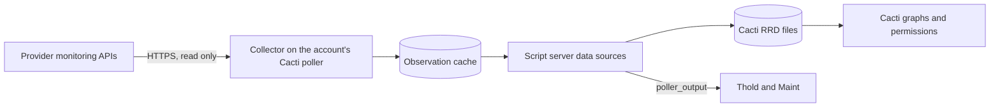

<!-- Source: README.md; SHA256: 7c621642e5f1a46bac66e4bc744f70aebb014c610d22de034088845fdc170405 -->

<!-- translations:start -->
[English](../../../README.md) | [简体中文](../zh-CN/README.md) | [हिन्दी](../hi-IN/README.md) | [Español (España)](README.md) | [Español (Latinoamérica)](../es-419/README.md) | [العربية](../ar-SA/README.md)
<!-- translations:end -->

<a id="plugin_cloud"></a>
# plugin_cloud

Un complemento de Cacti 1.2 que incorpora los recursos y las métricas de proveedores de nube pública a Cacti como dispositivos, fuentes de datos y gráficos ordinarios. Así, las cargas de trabajo en la nube aparecen junto a la red que las transporta, bajo los permisos de Cacti, y Thold y Maint pueden generar y suprimir sus alertas. Un único complemento abarca todos los proveedores, con un controlador por proveedor: primero DigitalOcean, AWS, Google Cloud y Azure.

> **Estado: hito 3 (DigitalOcean y objetos de Cacti), en revisión.** Este hito añade el controlador de DigitalOcean, plantillas de Cacti, un dispositivo de ámbito por cuenta con una consulta de datos por tipo de recurso, la entrada del servidor de scripts y una estimación de solicitudes en Nuevos gráficos y en la página de salud. Las primeras comprobaciones con una cuenta real de DigitalOcean están registradas en [datos de los proveedores](../../research/provider-facts.md). No lo ejecute en producción.

<a id="access-roles"></a>
## Roles de acceso

| Ámbito de permisos | Acceso |
| --- | --- |
| Cloud View | Páginas de supervisión existentes. |
| Cloud Operator | Supervisión, página de operaciones y acuses de recibo personales para la investigación. |
| Cloud Admin | Acceso de operador más las acciones de configuración y administración existentes. |

Tras copiar los ficheros de actualización, abra la página de complementos como administrador para registrar el nuevo ámbito. Asigne explícitamente el ámbito Operator en **Configuration > Users** o en los grupos de usuarios. Las actualizaciones conservan los identificadores y las concesiones de los ámbitos View y Admin existentes. El acceso Admin hereda el acceso Operator, y Operator hereda View en cada solicitud; esto no añade concesiones almacenadas a usuarios ni grupos. Los ajustes del complemento también requieren acceso Cloud Admin, además del permiso Settings de Cacti.

Los permisos de dispositivos de Cacti siguen limitando las filas y acciones disponibles para cada usuario; los objetos sin asignar requieren un administrador. Los operadores pueden verificar la credencial almacenada de una cuenta a cuyo dispositivo de Cacti tengan acceso. Las credenciales, la configuración, la asignación, la eliminación y los demás cambios administrativos permanecen en las páginas de administración. Los acuses de recibo duran únicamente durante la sesión del usuario actual, como máximo una hora y solo mientras la misma observación siga vigente. Las observaciones nuevas o modificadas los invalidan. Nunca convierten una medición fallida en saludable ni suprimen alertas.

<a id="why"></a>
## Motivo

Cada proveedor de nube tiene su propia consola de supervisión. Al usarlas junto a Cacti quedan tres carencias:

- **Control de acceso separado.** Mostrar métricas de nube a un usuario de Cacti exige darle acceso a la nube.
- **Sin contexto de red.** Los enlaces locales se representan en Cacti; las cargas de trabajo que hay detrás se representan en la consola de cada proveedor.
- **Alertas separadas.** Thold y Maint trabajan con fuentes de datos y dispositivos de Cacti, por lo que las alarmas de los proveedores se configuran y suprimen por separado, una vez por proveedor.

El complemento lee la API de supervisión de cada proveedor desde un sondeador de Cacti, almacena en caché los puntos de datos más recientes y los sirve al servidor de scripts de Cacti. El sondeador de Cacti escribe los ficheros RRD, de modo que los gráficos, los permisos, Thold, Maint y boost funcionan como con cualquier otro dato de Cacti.

<a id="design-commitments"></a>
## Compromisos de diseño

- **Solo lectura.** Cada controlador solo puede construir las operaciones del proveedor incluidas en su lista de permitidas; el complemento nunca modifica un recurso de nube. ([ADR 0002](../../decisions/0002-read-only-with-operation-allowlist.md))
- **Solo PHP, sin SDK.** La firma y el intercambio de tokens están implementados en PHP con las extensiones que Cacti ya requiere. No hay dependencias de Composer en tiempo de ejecución. ([ADR 0003](../../decisions/0003-php-only-without-sdks.md))
- **Coste antes de recopilar.** El complemento solo lee métricas que tengan una fuente de datos de Cacti, muestra el número esperado de solicitudes y su coste a precio de catálogo antes de crear gráficos, y aplica un límite mensual. ([ADR 0005](../../decisions/0005-collect-only-what-is-graphed.md))
- **Sin credenciales en texto claro en la base de datos.** Las credenciales proceden de una bóveda cifrada cuya clave está en un fichero externo a la base de datos, de un fichero de credenciales o de la identidad de instancia del proveedor. ([ADR 0007](../../decisions/0007-credentials-outside-the-database-in-the-clear.md))

<a id="scope-and-status"></a>
## Alcance y estado

| Fase | Alcance | Hitos | Estado |
|---|---|---|---|
| 0, investigación | Confirmación de datos de proveedores, catálogos de métricas, modelo de costes y tasas, vectores de prueba de firma y prueba de transporte | [M1](https://github.com/somethingwithproof/plugin_cloud/milestone/1) | Terminada, salvo las comprobaciones que requieren una cuenta real de proveedor |
| 1, núcleo y DigitalOcean | Cuentas, bóveda de credenciales, transporte, recopilador, caché de observaciones, objetos de Cacti, página de salud, Droplets y equilibradores de carga de DigitalOcean | [M2](https://github.com/somethingwithproof/plugin_cloud/milestone/2), [M3](https://github.com/somethingwithproof/plugin_cloud/milestone/3), [M4](https://github.com/somethingwithproof/plugin_cloud/milestone/4) | M2 terminado ([#81](https://github.com/somethingwithproof/plugin_cloud/pull/81)); controlador, plantillas y dispositivos de ámbito de M3 integrados; estimaciones de solicitudes, permisos y pruebas de rendimiento en revisión; M4 sin iniciar |
| 2, AWS | Signature Version 4, `AssumeRole`, roles de instancia, CloudWatch `GetMetricData`, inventario regional | [M5](https://github.com/somethingwithproof/plugin_cloud/milestone/5) | Sin iniciar |
| 3, Google Cloud | JWT de cuenta de servicio, servidor de metadatos, Cloud Monitoring `timeSeries.list` | [M6](https://github.com/somethingwithproof/plugin_cloud/milestone/6) | Sin iniciar |
| 4, Azure | Credenciales de cliente de Entra, identidad administrada, Resource Graph, `metrics:getBatch` | [M7](https://github.com/somethingwithproof/plugin_cloud/milestone/7) | Sin iniciar |
| 5, recopiladores remotos | Cuentas en recopiladores de datos remotos de Cacti | [M8](https://github.com/somethingwithproof/plugin_cloud/milestone/8) | Sin iniciar |

Quedan fuera del alcance: modificar recursos de nube, crear o replicar alarmas de proveedores, informes de facturación, registros y trazas, y un motor de alertas propio del complemento. Los proveedores adicionales (Hetzner Cloud, Akamai Cloud, Oracle Cloud y otros) son cuestiones de investigación.

<a id="what-milestone-2-ships"></a>
## Qué incluye el hito 2

- **Instalación protegida.** Con PHP anterior a 8.2 o sin ext-openssl, se rechazan la instalación y la activación con un mensaje, y el resto de Cacti sigue funcionando.
- **Ciclo de vida.** Instalación, actualización y desinstalación desde la página de complementos de Cacti. Las actualizaciones siguen un orden y sobreviven a interrupciones. La desinstalación conserva las tablas del complemento salvo que desmarque *Keep Plugin Tables on Uninstall*.
- **Ámbitos separados.** *Cloud Admin* abre **Cloud Accounts**; *Cloud Operator* abre **Cloud Operations**; *Cloud View* abre **Cloud Health**. Admin hereda Operator, y Operator hereda View. Las tres páginas están en Management.
- **Cuentas y credenciales.** Añadir, editar, verificar y eliminar cuentas. Las credenciales se cifran en la base de datos con un fichero de clave externo (AES-256-GCM), o se leen desde un fichero en el sondeador. En la interfaz solo pueden escribirse y se ocultan en los registros.
- **El recopilador.** Se inicia en cada ejecución del sondeador, una instancia por sondeador, dentro de un presupuesto de tiempo. Adquiere una concesión temporal por cuenta, ejecuta el descubrimiento con su propio intervalo y solo lee métricas de las fuentes de datos activas que pertenecen al complemento.
- **Salud.** Estado de recopilación, descubrimiento, recursos y vigencia por cuenta, junto con advertencias sobre claves de bóveda inutilizables, ficheros de credenciales inseguros e intervalos que el sondeador no puede cumplir.

<a id="install-and-configure"></a>
## Instalación y configuración

Estos pasos instalan el código del hito 2 para evaluarlo. Requieren Cacti 1.2.31 o posterior sobre PHP 8.2 o posterior.

1. Copie el repositorio a `plugins/cloud` dentro de su directorio de Cacti. El directorio debe llamarse `cloud`.
2. Cree la clave de la bóveda fuera de la raíz web. Colóquela en un directorio en el que solo root y el usuario de Cacti puedan escribir, y haga que el fichero solo pueda leerlo el usuario que ejecuta el servidor web y el sondeador. El complemento nunca crea ni escribe este fichero:

   ```sh
   sudo install -d -m 0750 -o root -g cacti /etc/cacti
   head -c 32 /dev/urandom | sudo tee /etc/cacti/cloud-vault.key > /dev/null
   sudo chown cacti:cacti /etc/cacti/cloud-vault.key
   sudo chmod 0600 /etc/cacti/cloud-vault.key
   ```

   Sustituya `cacti` por el usuario que ejecuta el servidor web y el sondeador. El fichero contiene 32 bytes sin procesar o 64 caracteres hexadecimales. Haga una copia de seguridad junto con la base de datos; sin él tendrá que volver a introducir las credenciales almacenadas.
3. En Cacti, abra **Configuration > Plugins** e instale y active *Cloud*.
4. En **Configuration > Settings > Cloud**, configure *Vault Key File* si ha utilizado otra ruta. *Collector Time Budget* (240 segundos de forma predeterminada) debe ser menor que el intervalo del sondeador.
5. Conceda *Cloud Admin*, *Cloud Operator* o *Cloud View* a usuarios y grupos en **Configuration > Users**. La instalación concede Cloud Admin y Cloud View al administrador; Cloud Admin incluye el acceso de Operator, así que el administrador no necesita una concesión aparte de Operator.
6. Añada cuentas en **Management > Cloud Accounts** y compruebe si hay advertencias en **Management > Cloud Health**.

<a id="compatibility-targets"></a>
## Objetivos de compatibilidad

| Componente | Objetivo |
|---|---|
| Cacti | 1.2.31 o posterior, sin parches del núcleo |
| PHP | 8.2 o posterior; `setup.php` sigue siendo analizable en 8.0 para que un entorno no compatible reciba un rechazo en vez de romper la interfaz de Cacti |
| Extensiones de PHP | Ninguna aparte de las que exige Cacti 1.2.31 |
| Thold, Maint | No requieren cambios |

<a id="design"></a>
## Diseño

- [docs/performance.md](docs/performance.md) contiene las mediciones del recolector y de la página de salud, con el hardware y los ajustes utilizados.
- [docs/PLAN.md](../../PLAN.md) contiene el plan completo: arquitectura, los datos de los proveedores y de Cacti de los que depende (con fuentes), el contrato de los controladores, los cálculos de costes, los límites de seguridad, las pruebas y los riesgos.
- [docs/decisions/](../../decisions) contiene las decisiones de arquitectura ya tomadas.
- [docs/REQUIREMENTS.md](../../REQUIREMENTS.md) relaciona cada identificador de requisito con su incidencia.



<a id="how-work-is-tracked"></a>
## Seguimiento del trabajo

- Los **hitos** siguen los hitos del plan. Cada uno tiene una incidencia épica que enumera sus subincidencias y las pruebas de finalización.
- Las **incidencias** se clasifican por etiqueta: `type: requirement`, `type: research`, `type: decision`, `type: epic`. Las incidencias de requisitos especifican requisitos numerados y verificables (`REQ-AREA-NNN`) y criterios de aceptación.
- Las **etiquetas** también incluyen `area:`, `provider:`, `phase:`, `priority:` y `status:`. Consulte [CONTRIBUTING.md](../../../CONTRIBUTING.md#labels).
- El [tablero del proyecto](https://github.com/users/somethingwithproof/projects/7) muestra todas las incidencias de los distintos hitos.

<a id="development"></a>
## Desarrollo

La integración continua comprueba la sintaxis de los puntos de entrada con PHP 8.0, ejecuta pruebas unitarias y de integración y PHPStan de nivel 9, e instala el complemento con PHP 8.2 a 8.5 sobre Cacti 1.2.31 y la rama 1.2.x. También comprueba que se rechace PHP 8.1 sin romper Cacti. Las pruebas usan Pest del entorno de pruebas de complementos del núcleo de Cacti. Esta elección es provisional hasta que se resuelva [#12](https://github.com/somethingwithproof/plugin_cloud/issues/12). [.github/workflows/plugin-ci-workflow.yml](../../../.github/workflows/plugin-ci-workflow.yml) enumera todos los pasos. Ejecute `sh tests/lint-workflows.sh` y `sh locales/build_gettext.sh --check` localmente antes de enviar cambios.

<a id="contributing"></a>
## Contribuciones

Lea [CONTRIBUTING.md](../../../CONTRIBUTING.md). Los commits necesitan una firma DCO. El diseño se debate en incidencias; las decisiones abiertas llevan la etiqueta `type: decision`.

<a id="security"></a>
## Seguridad

Comunique las vulnerabilidades de forma privada; consulte [SECURITY.md](../../../SECURITY.md).

<a id="license"></a>
## Licencia

Licencia Pública General de GNU v2.0, la misma que Cacti y sus complementos. Consulte [LICENSE](../../../LICENSE).
