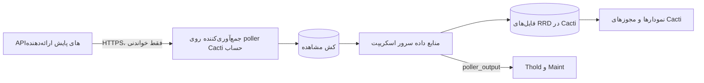

<!-- Source: README.md; SHA256: 7c621642e5f1a46bac66e4bc744f70aebb014c610d22de034088845fdc170405 -->

<!-- translations:start -->
[English](../../../README.md) | [简体中文](../zh-CN/README.md) | [हिन्दी](../hi-IN/README.md) | [Español (España)](../es-ES/README.md) | [Español (Latinoamérica)](../es-419/README.md) | [العربية (السعودية)](../ar-SA/README.md) | [Afrikaans](../af-ZA/README.md) | [አማርኛ](../am-ET/README.md) | [العربية (مصر)](../ar-EG/README.md) | [العربية (المغرب)](../ar-MA/README.md) | [বাংলা](../bn-BD/README.md) | [Deutsch](../de-DE/README.md) | [فارسی](README.md) | [Filipino](../fil-PH/README.md) | [Français](../fr-FR/README.md) | [Français (Maroc)](../fr-MA/README.md) | [Français (Sénégal)](../fr-SN/README.md) | [Hausa](../ha-NG/README.md) | [עברית](../he-IL/README.md) | [Bahasa Indonesia](../id-ID/README.md) | [Igbo](../ig-NG/README.md) | [Italiano](../it-IT/README.md) | [日本語](../ja-JP/README.md) | [한국어](../ko-KR/README.md) | [Malagasy](../mg-MG/README.md) | [मराठी](../mr-IN/README.md) | [Bahasa Melayu](../ms-MY/README.md) | [Nederlands](../nl-NL/README.md) | [Polski](../pl-PL/README.md) | [Português (Brasil)](../pt-BR/README.md) | [Русский](../ru-RU/README.md) | [Kinyarwanda](../rw-RW/README.md) | [Soomaali](../so-SO/README.md) | [Svenska](../sv-SE/README.md) | [Kiswahili](../sw-KE/README.md) | [தமிழ்](../ta-IN/README.md) | [తెలుగు](../te-IN/README.md) | [ไทย](../th-TH/README.md) | [Türkçe](../tr-TR/README.md) | [Українська](../uk-UA/README.md) | [اردو](../ur-PK/README.md) | [Tiếng Việt](../vi-VN/README.md) | [isiXhosa](../xh-ZA/README.md) | [Yorùbá](../yo-NG/README.md) | [繁體中文](../zh-TW/README.md) | [isiZulu](../zu-ZA/README.md)
<!-- translations:end -->

# plugin_cloud

یک افزونه برای Cacti 1.2 که منابع و متریک‌های ارائه‌دهندگان ابر عمومی را به‌صورت دستگاه‌ها، منابع داده و نمودارهای عادی وارد Cacti می‌کند. به این ترتیب، بارهای کاری ابری در کنار شبکه‌ای که آن‌ها را حمل می‌کند، تحت مجوزهای Cacti قرار می‌گیرند و Thold و Maint می‌توانند برای آن‌ها هشدار صادر کنند یا هشدارها را متوقف نمایند. یک افزونه تمام ارائه‌دهندگان را پوشش می‌دهد و برای هر ارائه‌دهنده یک درایور دارد: ابتدا DigitalOcean، AWS، Google Cloud و Azure.

> **وضعیت: نقطه عطف ۳ (DigitalOcean و اشیای Cacti)، در حال بررسی.** این نقطه عطف درایور DigitalOcean، الگوهای Cacti، یک دستگاه محدوده به ازای هر حساب با یک پرس‌وجوی داده به ازای هر نوع منبع، ورودی سرور اسکریپت، و برآورد درخواست در New Graphs و صفحه سلامت را اضافه می‌کند. بررسی‌های اولیه روی یک حساب زنده DigitalOcean در [مشخصات ارائه‌دهندگان](../../research/provider-facts.md) ثبت شده است. آن را در محیط عملیاتی اجرا نکنید.

## نقش‌های دسترسی

| حوزه دسترسی | دسترسی |
| --- | --- |
| Cloud View | صفحات پایش موجود. |
| Cloud Operator | پایش به همراه صفحه Operations و تاییدهای تریاژ شخصی. |
| Cloud Admin | دسترسی Operator به همراه پیکربندی و اقدامات مدیریتی موجود. |

پس از کپی کردن فایل‌های ارتقا، صفحه Plugins را به‌عنوان مدیر باز کنید تا حوزه دسترسی جدید ثبت شود. حوزه Operator را به‌صورت صریح در بخش **Configuration > Users** یا گروه‌های کاربری اختصاص دهید.
ارتقاها شناسه‌ها و مجوزهای موجود حوزه‌های View و Admin را حفظ می‌کنند. دسترسی Admin دسترسی Operator را به ارث می‌برد و دسترسی Operator در هر درخواست دسترسی View را به ارث می‌برد؛ این کار مجوزهای ذخیره‌شده‌ای به کاربران یا گروه‌ها اضافه نمی‌کند. تنظیمات افزونه نیز علاوه بر مجوز Settings در Cacti، به دسترسی Cloud Admin نیاز دارد.

مجوزهای دستگاه Cacti همچنان ردیف‌ها و اقدامات در دسترس هر کاربر را محدود می‌کنند؛ اشیای نگاشت‌نشده به مدیر نیاز دارند. اپراتورها می‌توانند اعتبارنامه ذخیره‌شده را برای حسابی که به دستگاه Cacti آن دسترسی دارند راستی‌آزمایی کنند.
اعتبارنامه‌ها، پیکربندی، نگاشت، حذف و سایر تغییرات مدیریتی
در صفحات مدیریتی باقی می‌مانند. تاییدها فقط در نشست فعلی کاربر،
حداکثر برای یک ساعت و تنها تا زمانی که همان مشاهده تازه باقی بماند معتبر هستند.
مشاهدات جدید یا تغییریافته آن‌ها را نامعتبر می‌کنند. آن‌ها هرگز یک اندازه‌گیری ناموفق را سالم علامت‌گذاری نمی‌کنند یا هشدارها را متوقف نمی‌نمایند.

## چرا

هر ارائه‌دهنده ابری کنسول پایش مخصوص به خود را دارد. اجرای آن‌ها در کنار Cacti سه شکاف ایجاد می‌کند:

- **کنترل دسترسی جداگانه.** نمایش متریک‌های ابری به یک کاربر Cacti به معنای دادن حساب ورود ابری به اوست.
- **نبود بافت شبکه.** پیوندهای درون‌سازمانی در Cacti رسم می‌شوند؛ بارهای کاری پشت آن‌ها در کنسول هر ارائه‌دهنده رسم می‌شوند.
- **هشداردهی جداگانه.** Thold و Maint روی منابع داده و دستگاه‌های Cacti کار می‌کنند، بنابراین هشدارهای ارائه‌دهنده به‌صورت جداگانه و برای هر ارائه‌دهنده یک بار پیکربندی و متوقف می‌شوند.

این افزونه API پایش هر ارائه‌دهنده را روی یک poller در Cacti می‌خواند، آخرین نقاط داده را در کش نگه می‌دارد و آن‌ها را به سرور اسکریپت Cacti تحویل می‌دهد. poller در Cacti فایل‌های RRD را می‌نویسد، بنابراین رسم نمودار، مجوزها، Thold، Maint و boost همانند هر داده دیگری در Cacti کار می‌کنند.

## تعهدات طراحی

- **فقط خواندنی.** هر درایور فقط می‌تواند عملیات ارائه‌دهنده موجود در فهرست مجاز خود را بسازد؛ افزونه هرگز یک منبع ابری را تغییر نمی‌دهد. ([ADR 0002](../../decisions/0002-read-only-with-operation-allowlist.md))
- **فقط PHP، بدون SDK.** امضاسازی و تبادل توکن در PHP و با افزونه‌هایی که Cacti از قبل نیاز دارد پیاده‌سازی شده‌اند. بدون وابستگی زمان اجرای Composer. ([ADR 0003](../../decisions/0003-php-only-without-sdks.md))
- **هزینه پیش از جمع‌آوری.** افزونه فقط متریک‌هایی را می‌خواند که منبع داده Cacti دارند، پیش از ایجاد نمودارها تعداد درخواست مورد انتظار و هزینه بر اساس نرخ فهرست‌شده را نشان می‌دهد، و یک سقف ماهانه اعمال می‌کند. ([ADR 0005](../../decisions/0005-collect-only-what-is-graphed.md))
- **نبود اعتبارنامه متن‌باز در پایگاه داده.** اعتبارنامه‌ها از یک گاوصندوق رمزنگاری‌شده با کلید ذخیره‌شده در فایلی خارج از پایگاه داده، از یک فایل اعتبارنامه، یا از هویت نمونه ارائه‌دهنده دریافت می‌شوند. ([ADR 0007](../../decisions/0007-credentials-outside-the-database-in-the-clear.md))

## محدوده و وضعیت

| فاز | محدوده | نقاط عطف | وضعیت |
|---|---|---|---|
| ۰، پژوهش | تایید مشخصات ارائه‌دهنده، فهرست متریک‌ها، مدل هزینه و نرخ، بردارهای آزمون امضا، آزمایش انتقال | [M1](https://github.com/somethingwithproof/plugin_cloud/milestone/1) | انجام شده، به جز بررسی‌هایی که به حساب زنده ارائه‌دهنده نیاز دارند |
| ۱، هسته و DigitalOcean | حساب‌ها، گاوصندوق اعتبارنامه، انتقال، جمع‌آوری‌کننده، کش مشاهده، اشیای Cacti، صفحه سلامت، Dropletها و متعادل‌کننده‌های بار DigitalOcean | [M2](https://github.com/somethingwithproof/plugin_cloud/milestone/2)، [M3](https://github.com/somethingwithproof/plugin_cloud/milestone/3)، [M4](https://github.com/somethingwithproof/plugin_cloud/milestone/4) | M2 انجام شده ([#81](https://github.com/somethingwithproof/plugin_cloud/pull/81))؛ درایور، الگوها و دستگاه‌های محدوده M3 ادغام شده‌اند؛ برآورد درخواست، مجوزها و بررسی‌های کارایی در حال بررسی؛ M4 آغاز نشده |
| ۲، AWS | Signature Version 4، `AssumeRole`، نقش‌های نمونه، CloudWatch `GetMetricData`، فهرست منطقه‌ای | [M5](https://github.com/somethingwithproof/plugin_cloud/milestone/5) | آغاز نشده |
| ۳، Google Cloud | JWT حساب سرویس، سرور متادیتا، Cloud Monitoring `timeSeries.list` | [M6](https://github.com/somethingwithproof/plugin_cloud/milestone/6) | آغاز نشده |
| ۴، Azure | اعتبارنامه‌های کلاینت Entra، هویت مدیریت‌شده، Resource Graph، `metrics:getBatch` | [M7](https://github.com/somethingwithproof/plugin_cloud/milestone/7) | آغاز نشده |
| ۵، جمع‌آوری‌کننده‌های راه‌دور | حساب‌ها روی جمع‌آوری‌کننده‌های داده راه‌دور Cacti | [M8](https://github.com/somethingwithproof/plugin_cloud/milestone/8) | آغاز نشده |

خارج از محدوده: تغییر منابع ابری، ایجاد یا آینه‌سازی هشدارهای ارائه‌دهنده، گزارش‌های صورت‌حساب، لاگ‌ها و ردیابی‌ها، و یک موتور هشداردهی متعلق به افزونه. ارائه‌دهندگان بیشتر (Hetzner Cloud، Akamai Cloud، Oracle Cloud و دیگران) به‌عنوان موضوعات پژوهشی مطرح هستند.

## آنچه نقطه عطف ۲ ارائه می‌دهد

- **نصب محافظت‌شده.** روی PHP پایین‌تر از 8.2 یا بدون ext-openssl، نصب و فعال‌سازی با یک پیام رد می‌شود و بقیه Cacti به کار خود ادامه می‌دهد.
- **چرخه عمر.** نصب، ارتقا و حذف از طریق صفحه Plugins در Cacti. ارتقاها ترتیب‌دار هستند و در صورت وقفه دوام می‌آورند. حذف افزونه جدول‌های آن را نگه می‌دارد مگر اینکه گزینه *Keep Plugin Tables on Uninstall* را پاک کنید.
- **حوزه‌های دسترسی جداگانه.** *Cloud Admin* صفحه **Cloud Accounts** را باز می‌کند؛ *Cloud Operator* صفحه **Cloud Operations** را باز می‌کند؛ *Cloud View* صفحه **Cloud Health** را باز می‌کند. Admin دسترسی Operator را و Operator دسترسی View را به ارث می‌برد. هر سه صفحه در بخش Management قرار دارند.
- **حساب‌ها و اعتبارنامه‌ها.** افزودن، ویرایش، راستی‌آزمایی و حذف حساب‌ها. اعتبارنامه یا در پایگاه داده با یک فایل کلید نگهداری‌شده در خارج از آن رمزنگاری می‌شود (AES-256-GCM)، یا از فایلی روی poller خوانده می‌شود. اعتبارنامه‌ها در رابط کاربری فقط‌نوشتنی هستند و از لاگ‌ها حذف می‌شوند.
- **جمع‌آوری‌کننده.** از هر اجرای poller شروع می‌شود، یک نمونه به ازای هر poller، در محدوده بودجه زمانی. به ازای هر حساب یک اجاره می‌گیرد، کشف را در بازه زمانی خودش اجرا می‌کند و متریک‌ها را فقط برای منابع داده فعال خود افزونه می‌خواند.
- **سلامت.** وضعیت جمع‌آوری، کشف، منابع و تازگی به ازای هر حساب، به‌همراه هشدارهایی برای کلید گاوصندوق غیرقابل استفاده، فایل‌های اعتبارنامه ناامن و بازه‌های زمانی که poller نمی‌تواند رعایت کند.

## نصب و پیکربندی

این مراحل کد نقطه عطف ۲ را برای ارزیابی نصب می‌کنند. آن‌ها به Cacti 1.2.31 یا جدیدتر روی PHP 8.2 یا جدیدتر نیاز دارند.

1. مخزن را در مسیر `plugins/cloud` زیر دایرکتوری Cacti خود کپی کنید. نام دایرکتوری باید `cloud` باشد.
2. کلید گاوصندوق را خارج از ریشه وب ایجاد کنید. آن را در دایرکتوری‌ای قرار دهید که فقط root و کاربر Cacti بتوانند در آن بنویسند و فایل را فقط برای کاربری که وب‌سرور و poller را اجرا می‌کند خواندنی کنید. افزونه هرگز این فایل را ایجاد نمی‌کند یا در آن نمی‌نویسد:

   ```sh
   sudo install -d -m 0750 -o root -g cacti /etc/cacti
   head -c 32 /dev/urandom | sudo tee /etc/cacti/cloud-vault.key > /dev/null
   sudo chown cacti:cacti /etc/cacti/cloud-vault.key
   sudo chmod 0600 /etc/cacti/cloud-vault.key
   ```

   `cacti` را با کاربری که وب‌سرور و poller شما را اجرا می‌کند جایگزین کنید. این فایل ۳۲ بایت خام یا ۶۴ نویسه شانزده‌شانزدهی نگه می‌دارد. از آن همراه با پایگاه داده نسخه پشتیبان بگیرید؛ بدون آن، اعتبارنامه‌های ذخیره‌شده باید دوباره وارد شوند.
3. در Cacti، بخش **Configuration > Plugins** را باز کنید، سپس *Cloud* را نصب و فعال کنید.
4. در بخش **Configuration > Settings > Cloud**، اگر از مسیر دیگری استفاده کرده‌اید، *Vault Key File* را تنظیم کنید. *Collector Time Budget* (پیش‌فرض ۲۴۰ ثانیه) باید کمتر از بازه poller بماند.
5. دسترسی‌های *Cloud Admin*، *Cloud Operator* یا *Cloud View* را در بخش **Configuration > Users** به کاربران و گروه‌ها بدهید. نصب افزونه دسترسی‌های Cloud Admin و Cloud View را به مدیر می‌دهد؛ Cloud Admin شامل دسترسی Operator است، بنابراین مدیر نیازی به مجوز جداگانه Operator ندارد.
6. حساب‌ها را در بخش **Management > Cloud Accounts** اضافه کنید، سپس بخش **Management > Cloud Health** را برای هشدارها بررسی کنید.

## اهداف سازگاری

| مؤلفه | هدف |
|---|---|
| Cacti | 1.2.31 یا جدیدتر، بدون وصله هسته |
| PHP | 8.2 یا جدیدتر؛ `setup.php` روی 8.0 قابل تجزیه باقی می‌ماند تا زمان اجرای پشتیبانی‌نشده به‌جای رابط کاربری خراب Cacti یک پیام رد دریافت کند |
| افزونه‌های PHP | هیچ‌کدام فراتر از مواردی که Cacti 1.2.31 نیاز دارد |
| Thold، Maint | بدون نیاز به تغییر |

## طراحی

- [docs/performance.md](../../performance.md) شامل اندازه‌گیری‌های جمع‌آوری‌کننده و صفحه سلامت به همراه سخت‌افزار و تنظیمات استفاده‌شده است.
- [docs/PLAN.md](../../PLAN.md) برنامه کامل است: معماری، مشخصات ارائه‌دهنده و Cacti که به آن‌ها وابسته است (به‌همراه منابع)، قرارداد درایور، محاسبات هزینه، مرزهای امنیتی، آزمون و ریسک‌ها.
- [docs/decisions/](../../decisions) سوابق تصمیم‌های معماری را برای انتخاب‌های انجام‌شده نگه می‌دارد.
- [docs/REQUIREMENTS.md](../../REQUIREMENTS.md) هر شناسه نیازمندی را به موضوع مربوط به آن نگاشت می‌کند.



## نحوه پیگیری کار

- **نقاط عطف** از نقاط عطف برنامه پیروی می‌کنند. هر یک دارای یک موضوع حماسی است که زیرموضوع‌ها و شواهد خروج آن را فهرست می‌کند.
- **موضوع‌ها** با برچسب دسته‌بندی می‌شوند: `type: requirement`، `type: research`، `type: decision`، `type: epic`. موضوع‌های نیازمندی، نیازمندی‌های شماره‌گذاری‌شده و آزمون‌پذیر (`REQ-AREA-NNN`) و معیارهای پذیرش را بیان می‌کنند.
- **برچسب‌ها** همچنین شامل `area:`، `provider:`، `phase:`، `priority:` و `status:` هستند. [CONTRIBUTING.md](../../../CONTRIBUTING.md#labels) را ببینید.
- [تابلوی پروژه](https://github.com/users/somethingwithproof/projects/7) همه موضوع‌ها را در نقاط عطف مختلف نشان می‌دهد.

## توسعه

CI نقاط ورود را روی PHP 8.0 لینت می‌کند، آزمون‌های واحد و یکپارچه‌سازی و PHPStan سطح ۹ را اجرا می‌کند، و افزونه را روی PHP 8.2 تا 8.5 در برابر Cacti 1.2.31 و شاخه 1.2.x نصب می‌کند. همچنین بررسی می‌کند که PHP 8.1 بدون خراب کردن Cacti رد شود. آزمون‌ها از Pest در چارچوب آزمون افزونه هسته Cacti استفاده می‌کنند. این انتخاب تا زمان تصمیم‌گیری درباره [#12](https://github.com/somethingwithproof/plugin_cloud/issues/12) موقت است. [.github/workflows/plugin-ci-workflow.yml](../../../.github/workflows/plugin-ci-workflow.yml) هر مرحله را فهرست می‌کند. پیش از push کردن، `sh tests/lint-workflows.sh` و `sh locales/build_gettext.sh --check` را به‌صورت محلی اجرا کنید.

## مشارکت

[CONTRIBUTING.md](../../../CONTRIBUTING.md) را بخوانید. کامیت‌ها به امضای DCO نیاز دارند. بحث‌های طراحی در موضوع‌ها انجام می‌شود؛ تصمیم‌های باز دارای برچسب `type: decision` هستند.

## امنیت

آسیب‌پذیری‌ها را به‌صورت خصوصی گزارش دهید؛ [SECURITY.md](../../../SECURITY.md) را ببینید.

## مجوز

GNU General Public License v2.0، همان مجوز Cacti و افزونه‌های آن. [LICENSE](../../../LICENSE) را ببینید.
