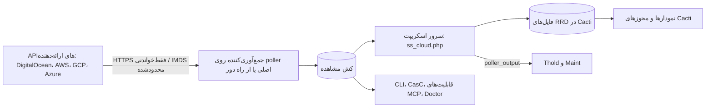

<!-- Source: README.md; SHA256: ac2074a40238686915802803c5efe773f33677f934281e0605e6e87a71a9d27d -->

<!-- translations:start -->
[English](../../../README.md) | [简体中文](../zh-CN/README.md) | [हिन्दी](../hi-IN/README.md) | [Español (España)](../es-ES/README.md) | [Español (Latinoamérica)](../es-419/README.md) | [العربية (السعودية)](../ar-SA/README.md) | [Afrikaans](../af-ZA/README.md) | [አማርኛ](../am-ET/README.md) | [العربية (مصر)](../ar-EG/README.md) | [العربية (المغرب)](../ar-MA/README.md) | [বাংলা](../bn-BD/README.md) | [Bosanski](../bs-BA/README.md) | [Deutsch](../de-DE/README.md) | [فارسی](README.md) | [Filipino](../fil-PH/README.md) | [Français](../fr-FR/README.md) | [Français (Maroc)](../fr-MA/README.md) | [Français (Sénégal)](../fr-SN/README.md) | [Hausa](../ha-NG/README.md) | [עברית](../he-IL/README.md) | [Hrvatski](../hr-HR/README.md) | [Bahasa Indonesia](../id-ID/README.md) | [Igbo](../ig-NG/README.md) | [Italiano](../it-IT/README.md) | [日本語](../ja-JP/README.md) | [한국어](../ko-KR/README.md) | [Malagasy](../mg-MG/README.md) | [मराठी](../mr-IN/README.md) | [Bahasa Melayu](../ms-MY/README.md) | [Nederlands](../nl-NL/README.md) | [Polski](../pl-PL/README.md) | [Português (Brasil)](../pt-BR/README.md) | [Русский](../ru-RU/README.md) | [Kinyarwanda](../rw-RW/README.md) | [Soomaali](../so-SO/README.md) | [Српски](../sr-RS/README.md) | [Svenska](../sv-SE/README.md) | [Kiswahili](../sw-KE/README.md) | [தமிழ்](../ta-IN/README.md) | [తెలుగు](../te-IN/README.md) | [ไทย](../th-TH/README.md) | [Türkçe](../tr-TR/README.md) | [Українська](../uk-UA/README.md) | [اردو](../ur-PK/README.md) | [Tiếng Việt](../vi-VN/README.md) | [isiXhosa](../xh-ZA/README.md) | [Yorùbá](../yo-NG/README.md) | [繁體中文](../zh-TW/README.md) | [isiZulu](../zu-ZA/README.md)
<!-- translations:end -->

# plugin_cloud

یک افزونه برای Cacti 1.2 که منابع و متریک‌های ارائه‌دهندگان ابر عمومی را به‌صورت دستگاه‌ها، منابع داده و نمودارهای عادی وارد Cacti می‌کند. بارهای کاری ابری در کنار شبکه‌ای که آن‌ها را حمل می‌کند، تحت مجوزهای Cacti قرار می‌گیرند و Thold و Maint برای آن‌ها هشدار صادر می‌کنند یا هشدارها را متوقف می‌سازند. یک افزونه واحد از طریق درایورهای فقط‌خواندنی و تمام‌PHP، ارائه‌دهندگان DigitalOcean، Amazon Web Services، Google Cloud و Microsoft Azure را پوشش می‌دهد.

> **وضعیت: در حال توسعه، هنوز نسخه‌ای منتشر نشده است (`0.1.0-dev`).** این شاخه درایورهای تمام‌PHP را برای DigitalOcean، AWS، Google Cloud و Azure، تکرار جمع‌آوری‌کننده داده از راه دور و وضعیت سلامت عامل فقط‌خواندنی، ارائه‌دهنده CasC و رابط خط فرمان اپراتور، قابلیت‌های MCP و بررسی‌های Doctor را پیاده‌سازی می‌کند. قالب‌های Cacti عرضه‌شده در حال حاضر Dropletها و متعادل‌کننده‌های بار DigitalOcean را پوشش می‌دهند (`templates/cloud_digitalocean.xml`)؛ بسته‌های قالب Cacti برای AWS، Google Cloud و Azure و ارزیابی روی حساب‌های واقعی فراتر از DigitalOcean ([حقایق ارائه‌دهندگان](../../research/provider-facts.md)) هنوز به پایان نرسیده‌اند. در محیط تولید اجرا نکنید.

## ارائه‌دهندگان پشتیبانی‌شده

هر درایور ارائه‌دهنده در `Drivers::production()` ثبت شده، توسط `Provider::released()` ارائه می‌شود و به‌صورت تمام‌PHP با استفاده از `ext-openssl` و سوکت‌های جریانی بدون هیچ وابستگی زمان اجرای SDK یا Composer اجرا می‌گردد.

| ارائه‌دهنده | فیلدهای دامنه | منابع اعتبارنامه | احراز هویت | منابع کشف‌شده | جمع‌آوری متریک |
|---|---|---|---|---|---|
| DigitalOcean (`digitalocean`) | ندارد (محدود به توکن) | `vault`، `file` | توکن Bearer | `droplet`، `load_balancer` | `/v2/monitoring/metrics` با آگاهی از سهم محدودیت نرخ؛ همراه با قالب‌ها و پرس‌وجوهای داده Cacti |
| Amazon Web Services (`aws`) | `account_id` (۱۲ رقم)، `regions` | `vault`، `file`، `instance` | امضای AWS SigV4 تمام‌PHP (`AWS4-HMAC-SHA256`)، راستی‌آزمایی STS `GetCallerIdentity`، STS `AssumeRole` اختیاری، EC2 IMDSv2 (`169.254.169.254`) برای حساب‌های `instance` | `ec2_instance`، `rds_instance`، `aws_elb` (ALB/NLB) | درخواست دسته‌ای CloudWatch `GetMetricData` (تا ۵۰۰ پرس‌وجو در هر فراخوانی) |
| Google Cloud (`gcp`) | `project` | `vault`، `file`، `instance` | JWT حساب سرویس RS256 تمام‌PHP از طریق `ext-openssl` که در `oauth2.googleapis.com/token` مبادله می‌شود، یا سرور متادیتای GCE (`metadata.google.internal`) برای حساب‌های `instance` | `gce_instance` از طریق `instances.aggregatedList` | Cloud Monitoring `timeSeries.list` |
| Microsoft Azure (`azure`) | `tenant`، `subscription`، `regions` | `vault`، `file`، `instance` | جریان client-credentials OAuth2 در Entra ID به‌صورت تمام‌PHP (فقط `client_secret`؛ گواهی‌نامه‌ها مستثنی هستند)، یا هویت مدیریت‌شده Azure IMDS (`169.254.169.254`) برای توکن‌های ARM و Monitor | `azure_vm` از طریق ARM Resource Graph (صفحه‌بندی با `$skipToken` و حذف موارد تکراری) | Azure Monitor `metrics:getBatch` (تا ۵۰ منبع در هر فراخوانی، با مدیریت محدودیت نرخ HTTP 429 و 529) |

## قابلیت‌های پیاده‌سازی‌شده

### پلتفرم هسته، گاوصندوق و جمع‌آوری‌کننده

- **نصب و چرخه حیات محافظت‌شده.** نقاط ورود (`setup.php`، `cli/cloud.php`، `poller_cloud.php`، `ss_cloud.php` و اسکریپت‌های صفحه) روی PHP 8.0 تجزیه می‌شوند و بدون از کار انداختن Cacti، نسخه‌های PHP پایین‌تر از 8.2 یا نبود `ext-openssl` را رد می‌کنند. ارتقاها مرتب، تکرارپذیر (`Schema::VERSION = 3`، ۹ جدول) و مقاوم در برابر وقفه هستند. حذف افزونه جداول آن را نگه می‌دارد، مگر اینکه گزینه *Keep Plugin Tables on Uninstall* پاک شود.
- **حساب‌ها و اعتبارنامه‌ها.** حساب‌ها را زیر بخش **Management > Cloud Accounts** اضافه، ویرایش، راستی‌آزمایی و حذف کنید. اعتبارنامه‌ها از گاوصندوق رمزنگاری‌شده با AES-256-GCM (`plugin_cloud_secret`، به‌طور پیش‌فرض با کلید `/etc/cacti/cloud-vault.key`)، از یک فایل محدودشده در *Credential File Directory* پیکربندی‌شده (`cloud_credential_dir`، به‌طور پیش‌فرض خالی برای رد کردن فایل‌ها)، یا از هویت نمونه ارائه‌دهنده تأمین می‌شوند. اعتبارنامه‌ها در رابط کاربری فقط‌نوشتنی هستند و از لاگ‌ها حذف می‌شوند.
- **کنترل‌های سخت‌گیرانه خروجی و فقط‌خواندنی.** هر درایور پشت `GuardedTransport` و `OutboundPolicy` کار می‌کند: درگاه HTTPS 443 به نام‌های میزبان دقیق هر ارائه‌دهنده، به‌همراه نقاط پایانی متادیتای HTTP محلی پیوند درگاه 80 (`169.254.169.254`، `metadata.google.internal`) که فقط برای حساب‌های `instance` فعال می‌شوند. تنها عملیات فقط‌خواندنی فهرست مجاز مجاز هستند.
- **کنترل‌های جمع‌آوری‌کننده و هزینه.** `poller_cloud.php` از `poller_bottom` (یک فرایند به ازای هر poller از طریق رجیستری فرایند Cacti) در محدوده `cloud_collector_budget` اجرا می‌شود، اجاره‌های هر حساب را می‌گیرد، کشف را در `discover_interval` اجرا می‌کند، متریک‌ها را فقط برای منابع داده فعال Cacti (`plugin_cloud_series`) می‌خواند، `request_share` و `monthly_ceiling` را رعایت می‌کند و آخرین نقاط داده را برای `ss_cloud.php` در `plugin_cloud_observation` ذخیره می‌کند.
- **اشیای Cacti و برآورد درخواست‌ها.** برای هر حساب یک دستگاه دامنه (`plugin_cloud_device`) نگه می‌دارد، روش‌های بازفهرست‌سازی دستگاه دامنه را هنگام ذخیره دستگاه حفظ می‌کند، قالب‌های DigitalOcean و پرس‌وجوهای داده سرور اسکریپت (`templates/cloud_digitalocean.xml`، `cloud_do_droplet.xml`، `cloud_do_load_balancer.xml`) را وارد می‌کند و برآورد درخواست‌ها و هزینه فهرست‌بها را در **New Graphs** (`graphs_new_top_links`) و **Cloud Health** نمایش می‌دهد.

### جمع‌آوری‌کننده‌های داده از راه دور

- `INFO` مقدار `remote_collect:1` را اعلام می‌کند. حساب‌ها می‌توانند به هر poller فعال Cacti (`poller_id >= 1`) اختصاص داده شوند و `poller_cloud.php --poller=N` فقط حساب‌های متعلق به همان poller را جمع‌آوری می‌کند.
- **قلاب `replicate_out`.** ردیف‌های محدود به poller را از `plugin_cloud_account`، `plugin_cloud_device`، `plugin_cloud_series` و ردیف‌های رمزمتن رمزنگاری‌شده را از `plugin_cloud_secret` (فقط برای حساب‌های مبتنی بر گاوصندوق متعلق به poller هدف) از طریق `replicate_out_table()` تکرار می‌کند. فایل‌های خام کلید گاوصندوق هرگز در پایگاه داده ذخیره یا تکرار نمی‌شوند و روی هر poller به‌صورت محلی باقی می‌مانند.
- **قلاب `remote_agent`.** یک خلاصه سلامت JSON فقط‌خواندنی (`action=cloud_health`) ارائه می‌دهد که فقط پارامترهای عدد صحیح `poller_id` و `account_id` را می‌پذیرد و هیچ اعتبارنامه، مسیر فایل یا رازی برنمی‌گرداند.

### قلاب‌های اکوسیستم (CasC، قابلیت‌های MCP و Doctor)

- **ارائه‌دهنده CasC (`casc_register_providers`).** ارائه‌دهنده `cloud` (نسخه طرحواره `1`) را با خروجی قطعی YAML و XML تمام‌PHP، اعتبارسنجی مانیفست، برنامه‌ریزی تفاوت و اعمال تاییدشده ثبت می‌کند. اعتبارنامه‌های گاوصندوق به‌صورت ارجاع‌های `vault:account:<name>` صادر می‌شوند؛ فیلدهای راز خام (`secret`، `secrets`، `token`، `access_token`، `refresh_token`، `password`، `private_key`، `access_key_id`، `secret_access_key`، `session_token`، `client_secret`، `credential`، `credentials`، `vault_key`) رد می‌شوند. اعمال تغییرات نیازمند هش دقیق SHA-256 در `--confirm=<PLAN_HASH>` است.
- **رابط MCP / Abilities API (`abilities_register`).** سه قابلیت اکیداً فقط‌خواندنی ثبت می‌کند که به حوزه Cloud View (`cloud_health.php`) و محدوده دستگاه Cacti برای فراخوان‌های غیرادمین مقید هستند و هیچ اعتبارنامه، کلید گاوصندوق یا مسیر فایل اعتبارنامه‌ای منتشر نمی‌کنند:
  - `cloud-list-accounts` (اختیاری `provider`، `poller_id`)
  - `cloud-list-resources` (اختیاری `account_id`، `type`، `lifecycle`)
  - `cloud-get-health` (اختیاری `account_id`)
- **بررسی‌های Doctor (`doctor_register_checks`).** پنج بررسی تشخیصی ثبت می‌کند که هیچ مقدار راز یا ماده کلیدی را افشا نمی‌کنند:
  - `cloud_schema`: به‌روز بودن نسخه طرحواره
  - `cloud_vault_key`: خوانایی، مجوزها و اندازه فایل کلید گاوصندوق
  - `cloud_drivers`: ثبت درایور تولیدی برای همه ارائه‌دهندگان منتشرشده
  - `cloud_accounts_health`: حساب‌های فعال ناموفق، محدودشده یا منقضی‌شده
  - `cloud_poller_intervals`: هم‌ترازی بازه‌های جمع‌آوری حساب‌های فعال با بازه poller در Cacti

## رابط خط فرمان (CLI)

از دایرکتوری ریشه Cacti با PHP 8.2 یا جدیدتر اجرا کنید:

```sh
# Operator and CasC CLI (options use --key=value form)
php plugins/cloud/cli/cloud.php export [--format=yaml|xml]
php plugins/cloud/cli/cloud.php validate --file=<path> [--format=yaml|xml]
php plugins/cloud/cli/cloud.php plan --file=<path> [--format=yaml|xml]
php plugins/cloud/cli/cloud.php apply --file=<path> --confirm=<PLAN_HASH> [--format=yaml|xml]
php plugins/cloud/cli/cloud.php health [--format=text|json] [--poller=<id>]

# Collector entry point (normally started by poller_bottom)
php plugins/cloud/poller_cloud.php [--poller=N] [--force] [--debug]
```

## نقش‌های دسترسی

| حوزه | دسترسی |
| --- | --- |
| Cloud View | صفحات نظارت موجود. |
| Cloud Operator | نظارت به‌علاوه صفحه Operations و تاییدهای تریاژ شخصی. |
| Cloud Admin | دسترسی Operator به‌علاوه پیکربندی موجود و عملیات مدیریتی. |

پس از کپی کردن فایل‌های ارتقا، صفحه Plugins را به‌عنوان مدیر باز کنید تا حوزه‌ها ثبت شوند. حوزه Operator را به‌صراحت در بخش **Configuration > Users** یا گروه‌های کاربری تخصیص دهید. ارتقاها شناسه‌ها و مجوزهای موجود حوزه‌های View و Admin را حفظ می‌کنند. دسترسی Admin دسترسی Operator را به ارث می‌برد و دسترسی Operator دسترسی View را در هر درخواست به ارث می‌برد؛ این کار مجوزهای ذخیره‌شده‌ای به کاربران یا گروه‌ها اضافه نمی‌کند. تنظیمات افزونه علاوه‌بر مجوز Settings در Cacti، به دسترسی Cloud Admin نیز نیاز دارند.

مجوزهای دستگاه Cacti سطرها و اقداماتی را که در دسترس هر کاربر است محدود می‌کنند؛ اشیای نگاشت‌نشده به مدیر نیاز دارند. اپراتورها می‌توانند اعتبارنامه ذخیره‌شده حسابی را که به دستگاه Cacti آن دسترسی دارند راستی‌آزمایی کنند. اعتبارنامه‌ها، پیکربندی، نگاشت، حذف و سایر تغییرات مدیریتی در صفحات مدیریتی باقی می‌مانند. تاییدها فقط در نشست فعلی کاربر، حداکثر برای یک ساعت و تنها تا زمانی که همان مشاهده تازه باقی بماند معتبر هستند. مشاهدات جدید یا تغییریافته آن‌ها را باطل می‌کنند. آن‌ها هرگز یک اندازه‌گیری ناموفق را سالم علامت‌گذاری نمی‌کنند یا هشدارها را متوقف نمی‌سازند.

## چرا

هر ارائه‌دهنده ابر کنسول نظارت خاص خود را دارد. اجرای آن‌ها در کنار Cacti سه شکاف بر جا می‌گذارد:

- **کنترل دسترسی جداگانه.** نمایش متریک‌های ابر به یک کاربر Cacti به معنای دادن حساب کاربری ابر به اوست.
- **نبود زمینه شبکه.** پیوندهای محلی در Cacti نمودار می‌شوند؛ بارهای کاری پشت آن‌ها در کنسول هر ارائه‌دهنده نمودار می‌شوند.
- **هشداردهی جداگانه.** Thold و Maint روی منابع داده و دستگاه‌های Cacti کار می‌کنند، بنابراین هشدارهای ارائه‌دهنده باید جداگانه و برای هر ارائه‌دهنده به‌صورت مستقل پیکربندی و متوقف شوند.

افزونه API نظارتی هر ارائه‌دهنده را روی یک poller در Cacti می‌خواند، آخرین نقاط داده را در کش ذخیره می‌کند و آن‌ها را به سرور اسکریپت Cacti تحویل می‌دهد. poller در Cacti فایل‌های RRD را می‌نویسد، بنابراین نمودارسازی، مجوزها، Thold، Maint و boost مانند هر داده دیگر Cacti کار می‌کنند.

## تعهدات طراحی

- **فقط‌خواندنی.** هر درایور تنها می‌تواند عملیات ارائه‌دهنده موجود در فهرست مجاز خود را بسازد؛ افزونه هرگز هیچ منبع ابری را تغییر نمی‌دهد. ([ADR 0002](../../decisions/0002-read-only-with-operation-allowlist.md))
- **تمام‌PHP، بدون SDK.** امضای درخواست‌ها و تبادل توکن در PHP با همان افزونه‌هایی پیاده‌سازی شده‌اند که Cacti از پیش نیاز دارد. بدون وابستگی زمان اجرای Composer. ([ADR 0003](../../decisions/0003-php-only-without-sdks.md))
- **هزینه پیش از جمع‌آوری.** افزونه فقط متریک‌هایی را می‌خواند که منبع داده Cacti دارند، تعداد درخواست مورد انتظار و هزینه فهرست‌بها را پیش از ایجاد نمودارها نمایش می‌دهد و سقف ماهانه را اعمال می‌کند. ([ADR 0005](../../decisions/0005-collect-only-what-is-graphed.md))
- **نبود اعتبارنامه متن‌باز در پایگاه داده.** اعتبارنامه‌ها از یک گاوصندوق رمزنگاری‌شده با کلید فایلی در خارج از پایگاه داده، از یک فایل اعتبارنامه یا از هویت نمونه ارائه‌دهنده تأمین می‌شوند. ([ADR 0007](../../decisions/0007-credentials-outside-the-database-in-the-clear.md))

## محدوده و وضعیت

| فاز | محدوده | نقاط عطف | وضعیت |
|---|---|---|---|
| 0، پژوهش | تایید حقایق ارائه‌دهندگان، کاتالوگ متریک‌ها، مدل هزینه و نرخ، بردارهای آزمون امضا، نمونه آزمایشی انتقال | [M1](https://github.com/somethingwithproof/plugin_cloud/milestone/1) | انجام‌شده، به‌جز بررسی‌هایی که به حساب‌های زنده ارائه‌دهنده نیاز دارند |
| 1، هسته و DigitalOcean | حساب‌ها، گاوصندوق اعتبارنامه، لایه انتقال، جمع‌آوری‌کننده، کش مشاهده، اشیای Cacti، قالب‌ها، برآورد درخواست‌ها، صفحه سلامت، Dropletها و متعادل‌کننده‌های بار DigitalOcean | [M2](https://github.com/somethingwithproof/plugin_cloud/milestone/2)، [M3](https://github.com/somethingwithproof/plugin_cloud/milestone/3)، [M4](https://github.com/somethingwithproof/plugin_cloud/milestone/4) | پیاده‌سازی‌شده؛ ارزیابی آزمایشی M4 در انتظار |
| 2، AWS | SigV4 تمام‌PHP، STS `AssumeRole`، نقش‌های نمونه IMDSv2، فهرست موجودی EC2/RDS/ELB، CloudWatch `GetMetricData` | [M5](https://github.com/somethingwithproof/plugin_cloud/milestone/5) | درایور پیاده‌سازی‌شده؛ قالب‌های Cacti و ارزیابی حساب زنده در انتظار |
| 3، Google Cloud | JWT حساب سرویس RS256 تمام‌PHP، سرور متادیتای GCE، فهرست موجودی Compute Engine، Cloud Monitoring `timeSeries.list` | [M6](https://github.com/somethingwithproof/plugin_cloud/milestone/6) | درایور پیاده‌سازی‌شده؛ قالب‌های Cacti و ارزیابی حساب زنده در انتظار |
| 4، Azure | اعتبارنامه‌های کلاینت Entra ID، هویت مدیریت‌شده IMDS، فهرست موجودی VM از طریق ARM Resource Graph، Azure Monitor `metrics:getBatch` | [M7](https://github.com/somethingwithproof/plugin_cloud/milestone/7) | درایور پیاده‌سازی‌شده؛ قالب‌های Cacti و ارزیابی حساب زنده در انتظار |
| 5، جمع‌آوری‌کننده‌های از راه دور و اکوسیستم | جمع‌آوری‌کننده‌های داده از راه دور (`replicate_out`، `remote_agent`)، ارائه‌دهنده CasC و CLI، قابلیت‌های MCP، بررسی‌های Doctor | [M8](https://github.com/somethingwithproof/plugin_cloud/milestone/8) | پیاده‌سازی‌شده |

خارج از محدوده: تغییر منابع ابری، ایجاد یا بازتاب آلارم‌های ارائه‌دهنده، گزارش‌های صورت‌حساب، لاگ‌ها و ردگیری‌ها، و موتور هشداردهی تحت مالکیت افزونه. ارائه‌دهندگان بیشتر (Hetzner Cloud، Akamai Cloud، Oracle Cloud و دیگران) به‌عنوان موضوعات پژوهشی ثبت شده‌اند.

## نصب و پیکربندی

این گام‌ها کد در حال توسعه را برای ارزیابی نصب می‌کنند. به Cacti 1.2.31 یا جدیدتر روی PHP 8.2 یا جدیدتر نیاز دارند.

1. مخزن را در `plugins/cloud` زیر دایرکتوری Cacti خود کپی کنید. نام دایرکتوری باید `cloud` باشد.
2. کلید گاوصندوق را خارج از ریشه وب روی هر poller که از اعتبارنامه‌های مبتنی بر گاوصندوق استفاده می‌کند بسازید. آن را در دایرکتوری‌ای قرار دهید که فقط root و کاربر Cacti بتوانند در آن بنویسند و فایل را طوری تنظیم کنید که فقط کاربری که سرور وب و poller را اجرا می‌کند بتواند آن را بخواند. افزونه هرگز این فایل را ایجاد نمی‌کند یا در آن نمی‌نویسد:

   ```sh
   sudo install -d -m 0750 -o root -g cacti /etc/cacti
   head -c 32 /dev/urandom | sudo tee /etc/cacti/cloud-vault.key > /dev/null
   sudo chown cacti:cacti /etc/cacti/cloud-vault.key
   sudo chmod 0600 /etc/cacti/cloud-vault.key
   ```

   `cacti` را با کاربری جایگزین کنید که سرور وب و poller شما را اجرا می‌کند. این فایل ۳۲ بایت خام یا ۶۴ نویسه هگزادسیمال نگه می‌دارد. از آن همراه با پایگاه داده نسخه پشتیبان بگیرید؛ بدون آن، اعتبارنامه‌های ذخیره‌شده باید دوباره وارد شوند.
3. در Cacti، بخش **Configuration > Plugins** را باز کنید، سپس *Cloud* را نصب و فعال کنید.
4. در بخش **Configuration > Settings > Cloud**، اگر از مسیر دیگری استفاده کرده‌اید *Vault Key File* را تنظیم کنید، در صورت برنامه‌ریزی برای استفاده از اعتبارنامه‌های مبتنی بر فایل *Credential File Directory* را پیکربندی کنید و *Collector Time Budget* (پیش‌فرض ۲۴۰ ثانیه) را کمتر از بازه poller نگه دارید.
5. زیر بخش **Configuration > Users** دسترسی *Cloud Admin*، *Cloud Operator* یا *Cloud View* را به کاربران و گروه‌ها بدهید. نصب افزونه دسترسی Cloud Admin و Cloud View را به مدیر اعطا می‌کند؛ Cloud Admin شامل دسترسی Operator است، بنابراین مدیر نیازی به اعطای جداگانه Operator ندارد.
6. حساب‌ها را زیر **Management > Cloud Accounts** اضافه کنید، سپس **Management > Cloud Health** را برای هشدارها بررسی نمایید.

## اهداف سازگاری

| مؤلفه | هدف |
|---|---|
| Cacti | نسخه 1.2.31 یا جدیدتر، بدون وصله هسته |
| PHP | نسخه 8.2 یا جدیدتر؛ نقاط ورود روی 8.0 قابل تجزیه می‌مانند تا یک زمان اجرای پشتیبانی‌نشده به‌جای خراب کردن رابط Cacti یک پیام رد دریافت کند |
| افزونه‌های PHP | `ext-openssl` (مورد نیاز Cacti 1.2.31)؛ بدون `ext-curl` و بدون وابستگی زمان اجرای Composer |
| Thold، Maint | بدون نیاز به تغییر |

## طراحی

- [docs/performance.md](../../performance.md) شامل اندازه‌گیری‌های جمع‌آوری‌کننده و صفحه سلامت همراه با سخت‌افزار و تنظیمات استفاده‌شده است.
- [docs/PLAN.md](../../PLAN.md) طرح کامل است: معماری، حقایق ارائه‌دهندگان و Cacti که به آن‌ها متکی است (با منابع)، قرارداد درایور، محاسبات هزینه، مرزهای امنیتی، آزمون و ریسک‌ها.
- [docs/decisions/](../../decisions/) سوابق تصمیمات معماری برای انتخاب‌های انجام‌شده را نگه می‌دارد.
- [docs/REQUIREMENTS.md](../../REQUIREMENTS.md) هر شناسه نیازمندی را به موضوع مربوط به آن نگاشت می‌کند.



## نحوه پیگیری کارها

- **نقاط عطف** از نقاط عطف طرح پیروی می‌کنند. هرکدام یک موضوع جامع (epic) دارند که موضوعات فرعی و شواهد خروج آن را فهرست می‌کند.
- **موضوعات** با برچسب دسته‌بندی می‌شوند: `type: requirement`، `type: research`، `type: decision`، `type: epic`. موضوعات نیازمندی، نیازمندی‌های شماره‌گذاری‌شده و آزمون‌پذیر (`REQ-AREA-NNN`) و معیارهای پذیرش را بیان می‌کنند.
- **برچسب‌ها** همچنین شامل `area:`، `provider:`، `phase:`، `priority:` و `status:` هستند. ببینید: [CONTRIBUTING.md](../../../CONTRIBUTING.md#labels).
- [تابلوی پروژه](https://github.com/users/somethingwithproof/projects/7) همه موضوعات را در سراسر نقاط عطف نشان می‌دهد.

## توسعه

CI ([.github/workflows/plugin-ci-workflow.yml](../../../.github/workflows/plugin-ci-workflow.yml)) بایگانی انتشار و نسخه‌گذاری معنایی را بررسی می‌کند (`bash tests/bin/archive-check.sh`)، نقاط ورود را روی PHP 8.0 بررسی نحوی (lint) می‌کند، آزمون‌های واحد Pest (`phpunit.xml`) و آزمون‌های یکپارچگی چرخه حیات (`phpunit-integration.xml`) و تحلیل PHPStan سطح 9 را روی PHP 8.2 تا 8.5 در برابر Cacti `release/1.2.31` و `1.2.x` با `CLOUD_OFFLINE=1` اجرا می‌کند، رد اجرا روی PHP 8.1 را می‌سنجد، کاتالوگ‌های gettext را راستی‌آزمایی می‌کند، کارایی جمع‌آوری ۱۰۰۰ سری و صفحه سلامت را اندازه می‌گیرد و بررسی نحوی workflow و انطباق REUSE را اجرا می‌کند.

بررسی‌های محلی پیش از push:

```sh
bash tests/bin/archive-check.sh
sh tests/lint-workflows.sh
sh locales/build_gettext.sh --check
CACTI_PATH=/path/to/cacti phpstan analyse -c phpstan.neon --no-progress
```

Pest را با `--configuration=phpunit.xml` برای آزمون‌های واحد و قوانین کد منبع، یا `--configuration=phpunit-integration.xml` همراه با `CACTI_PATH` و `CLOUD_TEST_DATABASE=disposable` در برابر یک پایگاه داده یک‌بارمصرف Cacti برای آزمون‌های یکپارچگی چرخه حیات اجرا کنید.

## مشارکت

[CONTRIBUTING.md](../../../CONTRIBUTING.md) را بخوانید. کامیت‌ها به امضای DCO نیاز دارند. بحث‌های طراحی در موضوعات انجام می‌شوند؛ تصمیمات باز برچسب `type: decision` دارند.

## امنیت

آسیب‌پذیری‌ها را به‌صورت خصوصی گزارش کنید؛ ببینید: [SECURITY.md](../../../SECURITY.md).

## مجوز

مجوز عمومی همگانی گنو نسخه 2.0 (GNU General Public License v2.0)، همان مجوز Cacti و افزونه‌های آن. ببینید: [LICENSE](../../../LICENSE).
