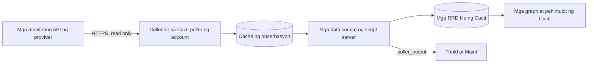

<!-- Source: README.md; SHA256: 7c621642e5f1a46bac66e4bc744f70aebb014c610d22de034088845fdc170405 -->

<!-- translations:start -->
[English](../../../README.md) | [简体中文](../zh-CN/README.md) | [हिन्दी](../hi-IN/README.md) | [Español (España)](../es-ES/README.md) | [Español (Latinoamérica)](../es-419/README.md) | [العربية (السعودية)](../ar-SA/README.md) | [Afrikaans](../af-ZA/README.md) | [አማርኛ](../am-ET/README.md) | [العربية (مصر)](../ar-EG/README.md) | [العربية (المغرب)](../ar-MA/README.md) | [বাংলা](../bn-BD/README.md) | [Bosanski](../bs-BA/README.md) | [Deutsch](../de-DE/README.md) | [فارسی](../fa-IR/README.md) | [Filipino](README.md) | [Français](../fr-FR/README.md) | [Français (Maroc)](../fr-MA/README.md) | [Français (Sénégal)](../fr-SN/README.md) | [Hausa](../ha-NG/README.md) | [עברית](../he-IL/README.md) | [Hrvatski](../hr-HR/README.md) | [Bahasa Indonesia](../id-ID/README.md) | [Igbo](../ig-NG/README.md) | [Italiano](../it-IT/README.md) | [日本語](../ja-JP/README.md) | [한국어](../ko-KR/README.md) | [Malagasy](../mg-MG/README.md) | [मराठी](../mr-IN/README.md) | [Bahasa Melayu](../ms-MY/README.md) | [Nederlands](../nl-NL/README.md) | [Polski](../pl-PL/README.md) | [Português (Brasil)](../pt-BR/README.md) | [Русский](../ru-RU/README.md) | [Kinyarwanda](../rw-RW/README.md) | [Soomaali](../so-SO/README.md) | [Српски](../sr-RS/README.md) | [Svenska](../sv-SE/README.md) | [Kiswahili](../sw-KE/README.md) | [தமிழ்](../ta-IN/README.md) | [తెలుగు](../te-IN/README.md) | [ไทย](../th-TH/README.md) | [Türkçe](../tr-TR/README.md) | [Українська](../uk-UA/README.md) | [اردو](../ur-PK/README.md) | [Tiếng Việt](../vi-VN/README.md) | [isiXhosa](../xh-ZA/README.md) | [Yorùbá](../yo-NG/README.md) | [繁體中文](../zh-TW/README.md) | [isiZulu](../zu-ZA/README.md)
<!-- translations:end -->

# plugin_cloud

Isang plugin para sa Cacti 1.2 na nagdadala ng mga resource at sukatan mula sa mga pampublikong cloud provider patungo sa Cacti bilang mga karaniwang device, data source, at graph. Dahil dito, nakalagay ang mga cloud workload katabi ng network na nagdadala sa mga ito, sa ilalim ng mga pahintulot ng Cacti, at maaaring mag-alerto at mag-suppress sa mga ito ang Thold at Maint. Saklaw ng iisang plugin ang bawat provider, na may hiwalay na driver para sa bawat provider: DigitalOcean, AWS, Google Cloud, at Azure muna.

> **Katayuan: milestone 3 (DigitalOcean at mga bagay sa Cacti), sinusuri pa.** Idinaragdag ng milestone na ito ang DigitalOcean driver, mga template ng Cacti, isang scope device bawat account na may data query bawat uri ng resource, ang input ng script server, at isang pagtatantya ng request sa New Graphs at sa pahina ng kalusugan. Nakatala ang mga paunang pagsusuri laban sa isang live na DigitalOcean account sa [mga katotohanan ng provider](../../research/provider-facts.md). Huwag itong patakbuhin sa production.

## Mga tungkulin sa pag-access

| Realm | Pag-access |
| --- | --- |
| Cloud View | Mga kasalukuyang pahina ng pagsubaybay. |
| Cloud Operator | Pagsubaybay kasama ang pahina ng Operations at mga personal na pagkilala sa triage. |
| Cloud Admin | Pag-access ng Operator kasama ang kasalukuyang pag-configure at mga administratibong aksyon. |

Pagkatapos kopyahin ang mga upgrade file, buksan ang pahina ng Plugins bilang administrator upang irehistro
ang bagong realm. Tahasang italaga ang Operator realm sa ilalim ng **Configuration > Users** o mga pangkat ng user.
Pinapanatili ng mga upgrade ang mga kasalukuyang View at Admin realm ID at grant. Minamana ng Admin access
ang Operator access, at minamana ng Operator access ang View access sa bawat request;
hindi ito nagdaragdag ng mga nakaimbak na grant sa mga user o pangkat. Nangangailangan din ng
Cloud Admin access ang mga setting ng plugin bukod pa sa pahintulot na Settings ng Cacti.

Nililimitahan pa rin ng mga pahintulot ng device sa Cacti ang mga row at aksyon na magagamit ng bawat user; nangangailangan ng administrator ang mga hindi naka-map na bagay. Maaaring beripikahin ng mga Operator ang nakaimbak na credential para sa isang account kung saan may access sila sa Cacti device nito.
Nananatili sa mga administratibong pahina ang mga credential, pag-configure, pag-map, pagtanggal, at iba pang administratibong
pagbabago. Tumatagal lamang ang mga pagkilala sa kasalukuyang
session ng user, nang hindi hihigit sa isang oras at habang nananatiling bago ang parehong obserbasyon.
Pinapawalang-bisa ang mga ito ng mga bago o nabagong obserbasyon. Hindi nila kailanman minamarkahan bilang maayos ang isang nabigong
pagsukat o pinipigilan ang mga alerto.

## Bakit

May sariling monitoring console ang bawat cloud provider. Kapag pinatakbo kasabay ng Cacti, nag-iiwan ang mga ito ng tatlong puwang:

- **Hiwalay na kontrol sa pag-access.** Ang pagpapakita ng mga cloud metric sa isang user ng Cacti ay nangangahulugang pagbibigay sa kanila ng cloud login.
- **Walang konteksto ng network.** Naka-graph sa Cacti ang mga on-premises na link; naka-graph naman sa console ng bawat provider ang mga workload sa likod ng mga ito.
- **Hiwalay na pag-alerto.** Gumagana ang Thold at Maint sa mga data source at device ng Cacti, kaya hiwalay na kino-configure at sino-suppress ang mga alarma ng provider, nang tig-iisa bawat provider.

Binabasa ng plugin ang monitoring API ng bawat provider sa isang Cacti poller, kina-cache ang mga pinakabagong datapoint, at inihahatid ang mga ito sa script server ng Cacti. Isinusulat ng poller ng Cacti ang mga RRD file, kaya gumagana ang pag-graph, mga pahintulot, Thold, Maint, at boost tulad ng paggana ng mga ito para sa anumang data ng Cacti.

## Mga paninindigan sa disenyo

- **Read-only.** Ang bawat driver ay maaari lamang bumuo ng mga operasyon ng provider na nasa allowlist nito; hindi kailanman binabago ng plugin ang isang cloud resource. ([ADR 0002](../../decisions/0002-read-only-with-operation-allowlist.md))
- **PHP lamang, walang mga SDK.** Ipinatupad sa PHP ang pagpirma at pagpapalit ng token gamit ang mga extension na hinihingi na ng Cacti. Walang mga runtime dependency ng Composer. ([ADR 0003](../../decisions/0003-php-only-without-sdks.md))
- **Gastos bago ang pangongolekta.** Binabasa lamang ng plugin ang mga sukatan na may data source sa Cacti, ipinapakita ang inaasahang bilang ng request at gastos ayon sa list-price bago gawin ang mga graph, at nagpapatupad ng buwanang limitasyon. ([ADR 0005](../../decisions/0005-collect-only-what-is-graphed.md))
- **Walang plaintext na credential sa database.** Nagmumula ang mga credential sa isang naka-encrypt na vault na may susing nakalagay sa isang file sa labas ng database, mula sa isang credential file, o mula sa instance identity ng provider. ([ADR 0007](../../decisions/0007-credentials-outside-the-database-in-the-clear.md))

## Saklaw at katayuan

| Yugto | Saklaw | Mga Milestone | Katayuan |
|---|---|---|---|
| 0, pananaliksik | Kumpirmasyon ng katotohanan ng provider, mga katalogo ng sukatan, modelo ng gastos at rate, mga signing test vector, transport spike | [M1](https://github.com/somethingwithproof/plugin_cloud/milestone/1) | Tapos na, maliban sa mga pagsusuring nangangailangan ng live na provider account |
| 1, core at DigitalOcean | Mga account, credential vault, transport, collector, observation cache, mga bagay sa Cacti, pahina ng kalusugan, mga DigitalOcean Droplet at load balancer | [M2](https://github.com/somethingwithproof/plugin_cloud/milestone/2), [M3](https://github.com/somethingwithproof/plugin_cloud/milestone/3), [M4](https://github.com/somethingwithproof/plugin_cloud/milestone/4) | Tapos na ang M2 ([#81](https://github.com/somethingwithproof/plugin_cloud/pull/81)); na-merge na ang M3 driver, mga template, at mga scope device; sinusuri pa ang mga pagtatantya ng request, mga pahintulot, at mga pagsusuri ng pagganap; hindi pa nasisimulan ang M4 |
| 2, AWS | Signature Version 4, `AssumeRole`, mga instance role, CloudWatch `GetMetricData`, panrehiyong imbentaryo | [M5](https://github.com/somethingwithproof/plugin_cloud/milestone/5) | Hindi pa nasisimulan |
| 3, Google Cloud | Service account JWT, metadata server, Cloud Monitoring `timeSeries.list` | [M6](https://github.com/somethingwithproof/plugin_cloud/milestone/6) | Hindi pa nasisimulan |
| 4, Azure | Mga credential ng client sa Entra, managed identity, Resource Graph, `metrics:getBatch` | [M7](https://github.com/somethingwithproof/plugin_cloud/milestone/7) | Hindi pa nasisimulan |
| 5, mga remote collector | Mga account sa mga remote data collector ng Cacti | [M8](https://github.com/somethingwithproof/plugin_cloud/milestone/8) | Hindi pa nasisimulan |

Hindi saklaw: pagbabago ng mga cloud resource, paggawa o pag-mirror ng mga alarma ng provider, mga ulat sa pagsingil, mga log at trace, at isang alerting engine na pagmamay-ari ng plugin. Ang iba pang mga provider (Hetzner Cloud, Akamai Cloud, Oracle Cloud, at iba pa) ay mga isyu sa pananaliksik.

## Ano ang hatid ng milestone 2

- **May bantay na pag-install.** Sa PHP na mas mababa sa 8.2, o kung walang ext-openssl, tinatanggihan ang pag-install at pag-enable na may kasamang mensahe, at patuloy na gumagana ang natitirang bahagi ng Cacti.
- **Lifecycle.** Mag-install, mag-upgrade, at mag-uninstall sa pamamagitan ng pahina ng Plugins ng Cacti. Nakasunod sa ayos ang mga upgrade at nakakayanan ang pagkaantala. Pinapanatili ng pag-uninstall ang mga talahanayan ng plugin maliban kung tatanggalan ng marka ang *Keep Plugin Tables on Uninstall*.
- **Mga hiwalay na realm.** Binubuksan ng *Cloud Admin* ang **Cloud Accounts**; binubuksan ng *Cloud Operator* ang **Cloud Operations**; binubuksan ng *Cloud View* ang **Cloud Health**. Minamana ng Admin ang Operator, at minamana ng Operator ang View. Nasa ilalim ng Management ang lahat ng tatlong pahina.
- **Mga account at credential.** Magdagdag, mag-edit, magberipika, at magtanggal ng mga account. Ang isang credential ay alinman sa naka-encrypt sa database gamit ang isang key file na nakatago sa labas nito (AES-256-GCM), o binabasa mula sa isang file sa poller. Write-only ang mga credential sa UI at tinatakpan mula sa mga log.
- **Ang collector.** Nagsisimula ito mula sa bawat pagtakbo ng poller, isang instance bawat poller, sa loob ng itinakdang oras. Kumukuha ito ng lease bawat account, nagpapatakbo ng discovery sa sarili nitong agwat, at nagbabasa lamang ng mga sukatan para sa sariling mga aktibong data source ng plugin.
- **Kalusugan.** Katayuan ng pangongolekta, discovery, resource, at pagiging bago bawat account, kasama ang mga babala para sa hindi magamit na vault key, hindi ligtas na mga credential file, at mga agwat na hindi kayang tugunan ng poller.

## Pag-install at pag-configure

Ini-install ng mga hakbang na ito ang code ng milestone 2 para sa pagsusuri. Nangangailangan ang mga ito ng Cacti 1.2.31 o mas bago sa PHP 8.2 o mas bago.

1. Kopyahin ang repositoryo sa `plugins/cloud` sa ilalim ng iyong direktoryo ng Cacti. Dapat ay `cloud` ang pangalan ng direktoryo.
2. Gawin ang vault key sa labas ng web root. Ilagay ito sa isang direktoryo na tanging root at ang user ng Cacti lamang ang maaaring magsulat, at gawing nababasa lamang ang file ng user na nagpapatakbo ng web server at ng poller. Hindi kailanman ginagawa o sinusulatan ng plugin ang file na ito:

   ```sh
   sudo install -d -m 0750 -o root -g cacti /etc/cacti
   head -c 32 /dev/urandom | sudo tee /etc/cacti/cloud-vault.key > /dev/null
   sudo chown cacti:cacti /etc/cacti/cloud-vault.key
   sudo chmod 0600 /etc/cacti/cloud-vault.key
   ```

   Palitan ang `cacti` ng user na nagpapatakbo ng iyong web server at poller. Naglalaman ang file ng 32 raw byte o 64 na hexadecimal character. I-back up ito kasama ng database; kung wala ito, kakailanganing ilagay muli ang mga nakaimbak na credential.
3. Sa Cacti, buksan ang **Configuration > Plugins**, pagkatapos ay i-install at i-enable ang *Cloud*.
4. Sa ilalim ng **Configuration > Settings > Cloud**, itakda ang *Vault Key File* kung gumamit ka ng ibang path. Dapat manatiling mas mababa kaysa sa agwat ng poller ang *Collector Time Budget* (default na 240 segundo).
5. Magbigay ng *Cloud Admin*, *Cloud Operator* o *Cloud View* sa mga user at pangkat sa ilalim ng **Configuration > Users**. Ang pag-install ay nagbibigay ng Cloud Admin at Cloud View sa administrator; kasama na sa Cloud Admin ang Operator access, kaya hindi na kailangan ng hiwalay na Operator grant ng administrator.
6. Magdagdag ng mga account sa ilalim ng **Management > Cloud Accounts**, pagkatapos ay suriin ang **Management > Cloud Health** para sa mga babala.

## Mga target sa pagiging tugma

| Bahagi | Target |
|---|---|
| Cacti | 1.2.31 o mas bago, walang mga core patch |
| PHP | 8.2 o mas bago; nananatiling ma-parse ang `setup.php` sa 8.0 upang makatanggap ng pagtanggi ang isang hindi sinusuportahang runtime sa halip na sirang Cacti UI |
| Mga extension ng PHP | Wala maliban sa mga hinihingi ng Cacti 1.2.31 |
| Thold, Maint | Walang kinakailangang pagbabago |

## Disenyo

- Ang [docs/performance.md](../../performance.md) ay naglalaman ng mga sukat ng collector at pahina ng kalusugan, kasama ang ginamit na hardware at mga setting.
- Ang [docs/PLAN.md](../../PLAN.md) ang buong plano: arkitektura, ang mga katotohanan ng provider at Cacti na pinagbabatayan nito (may mga sanggunian), ang kontrata ng driver, pagkalkula ng gastos, mga hangganan sa seguridad, pagsubok, at mga panganib.
- Ang [docs/decisions/](../../decisions) ay naglalaman ng mga talaan ng desisyon sa arkitektura para sa mga pagpiling nagawa na.
- Ipinapares ng [docs/REQUIREMENTS.md](../../REQUIREMENTS.md) ang bawat requirement ID sa isyu nito.



## Paano sinusubaybayan ang gawain

- **Mga Milestone** ay sumusunod sa mga milestone ng plano. Bawat isa ay may epic issue na naglilista ng mga sub-issue nito at ebidensya ng pagkumpleto.
- **Mga Isyu** ay inuuri ayon sa label: `type: requirement`, `type: research`, `type: decision`, `type: epic`. Nagsasaad ang mga requirement issue ng mga may bilang at nasusubok na kinakailangan (`REQ-AREA-NNN`) at mga pamantayan sa pagtanggap.
- **Mga Label** ay mayroon ding `area:`, `provider:`, `phase:`, `priority:`, at `status:`. Tingnan ang [CONTRIBUTING.md](../../../CONTRIBUTING.md#labels).
- Ipinapakita ng [project board](https://github.com/users/somethingwithproof/projects/7) ang lahat ng isyu sa mga milestone.

## Pagpapaunlad

Sinusuri ng CI ang syntax ng mga entry point sa PHP 8.0, nagpapatakbo ng mga unit at integration test at PHPStan level 9, at ini-install ang plugin sa PHP 8.2 hanggang 8.5 laban sa Cacti 1.2.31 at sa sangay na 1.2.x. Sinusuri rin nito na tinatanggihan ang PHP 8.1 nang hindi nasisira ang Cacti. Gumagamit ang mga pagsubok ng Pest mula sa plugin harness ng Cacti core. Pansamantala ang pagpiling iyon hanggang sa mapagpasyahan ang [#12](https://github.com/somethingwithproof/plugin_cloud/issues/12). Nakalista sa [.github/workflows/plugin-ci-workflow.yml](../../../.github/workflows/plugin-ci-workflow.yml) ang bawat hakbang. Patakbuhin ang `sh tests/lint-workflows.sh` at `sh locales/build_gettext.sh --check` nang lokal bago mag-push.

## Pag-aambag

Basahin ang [CONTRIBUTING.md](../../../CONTRIBUTING.md). Nangangailangan ng DCO sign-off ang mga commit. Nagaganap ang talakayan sa disenyo sa mga isyu; may label na `type: decision` ang mga bukas na desisyon.

## Seguridad

Iulat nang pribado ang mga kahinaan; tingnan ang [SECURITY.md](../../../SECURITY.md).

## Lisensya

GNU General Public License v2.0, ang parehong lisensya ng Cacti at mga plugin nito. Tingnan ang [LICENSE](../../../LICENSE).
