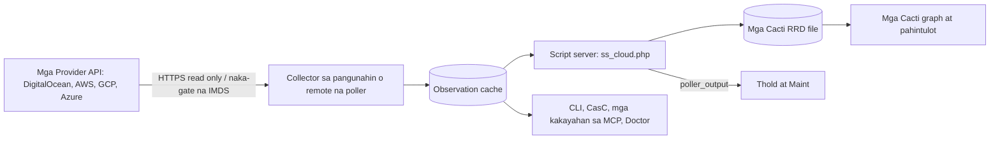

<!-- Source: README.md; SHA256: ac2074a40238686915802803c5efe773f33677f934281e0605e6e87a71a9d27d -->

<!-- translations:start -->
[English](../../../README.md) | [简体中文](../zh-CN/README.md) | [हिन्दी](../hi-IN/README.md) | [Español (España)](../es-ES/README.md) | [Español (Latinoamérica)](../es-419/README.md) | [العربية (السعودية)](../ar-SA/README.md) | [Afrikaans](../af-ZA/README.md) | [አማርኛ](../am-ET/README.md) | [العربية (مصر)](../ar-EG/README.md) | [العربية (المغرب)](../ar-MA/README.md) | [বাংলা](../bn-BD/README.md) | [Bosanski](../bs-BA/README.md) | [Deutsch](../de-DE/README.md) | [فارسی](../fa-IR/README.md) | [Filipino](README.md) | [Français](../fr-FR/README.md) | [Français (Maroc)](../fr-MA/README.md) | [Français (Sénégal)](../fr-SN/README.md) | [Hausa](../ha-NG/README.md) | [עברית](../he-IL/README.md) | [Hrvatski](../hr-HR/README.md) | [Bahasa Indonesia](../id-ID/README.md) | [Igbo](../ig-NG/README.md) | [Italiano](../it-IT/README.md) | [日本語](../ja-JP/README.md) | [한국어](../ko-KR/README.md) | [Malagasy](../mg-MG/README.md) | [मराठी](../mr-IN/README.md) | [Bahasa Melayu](../ms-MY/README.md) | [Nederlands](../nl-NL/README.md) | [Polski](../pl-PL/README.md) | [Português (Brasil)](../pt-BR/README.md) | [Русский](../ru-RU/README.md) | [Kinyarwanda](../rw-RW/README.md) | [Soomaali](../so-SO/README.md) | [Српски](../sr-RS/README.md) | [Svenska](../sv-SE/README.md) | [Kiswahili](../sw-KE/README.md) | [தமிழ்](../ta-IN/README.md) | [తెలుగు](../te-IN/README.md) | [ไทย](../th-TH/README.md) | [Türkçe](../tr-TR/README.md) | [Українська](../uk-UA/README.md) | [اردو](../ur-PK/README.md) | [Tiếng Việt](../vi-VN/README.md) | [isiXhosa](../xh-ZA/README.md) | [Yorùbá](../yo-NG/README.md) | [繁體中文](../zh-TW/README.md) | [isiZulu](../zu-ZA/README.md)
<!-- translations:end -->

# plugin_cloud

Isang plugin para sa Cacti 1.2 na nagdadala ng mga resource at sukatan mula sa mga pampublikong cloud provider patungo sa Cacti bilang mga karaniwang device, data source, at graph. Nakalagay ang mga cloud workload katabi ng network na nagdadala sa mga ito, sa ilalim ng mga pahintulot ng Cacti, at nag-aalerto at nagsusuppress sa mga ito ang Thold at Maint. Saklaw ng iisang plugin ang DigitalOcean, Amazon Web Services, Google Cloud, at Microsoft Azure sa pamamagitan ng mga pure-PHP, read-only na provider driver.

> **Katayuan: nasa pagbuo pa, wala pang release (`0.1.0-dev`).** Ipinapatupad ng branch na ito ang mga pure-PHP na driver para sa DigitalOcean, AWS, Google Cloud, at Azure, remote data collector replication at read-only agent health, isang CasC provider at operator CLI, mga kakayahan sa MCP, at mga pagsusuri ng Doctor. Kasalukuyang saklaw ng mga ipinapadalang Cacti template ang mga DigitalOcean Droplet at load balancer (`templates/cloud_digitalocean.xml`); hindi pa tapos ang mga Cacti template package para sa AWS, Google Cloud, at Azure at ang live-account qualification bukod sa DigitalOcean ([mga katotohanan tungkol sa provider](../../research/provider-facts.md)). Huwag patakbuhin sa production.

## Mga sinusuportahang provider

Naka-rehistro ang bawat provider driver sa `Drivers::production()`, iniaalok ng `Provider::released()`, at tumatakbo sa pure PHP gamit ang `ext-openssl` at mga stream socket nang walang anumang SDK o Composer runtime dependency.

| Provider | Mga field ng saklaw | Mga pinagmulan ng kredensyal | Pagpapatotoo | Mga natuklasang resource | Pagkolekta ng sukatan |
|---|---|---|---|---|---|
| DigitalOcean (`digitalocean`) | Wala (naka-saklaw sa token) | `vault`, `file` | Bearer token | `droplet`, `load_balancer` | `/v2/monitoring/metrics` na may kamalayan sa rate-limit share; may kasamang mga Cacti template at data query |
| Amazon Web Services (`aws`) | `account_id` (12 digit), `regions` | `vault`, `file`, `instance` | Pure-PHP AWS SigV4 (`AWS4-HMAC-SHA256`), pag-verify ng STS `GetCallerIdentity`, opsyonal na STS `AssumeRole`, EC2 IMDSv2 (`169.254.169.254`) para sa mga `instance` account | `ec2_instance`, `rds_instance`, `aws_elb` (ALB/NLB) | Batched CloudWatch `GetMetricData` (hanggang 500 query bawat tawag) |
| Google Cloud (`gcp`) | `project` | `vault`, `file`, `instance` | Pure-PHP RS256 service-account JWT sa pamamagitan ng `ext-openssl` na pinapalitan sa `oauth2.googleapis.com/token`, o GCE metadata server (`metadata.google.internal`) para sa mga `instance` account | `gce_instance` sa pamamagitan ng `instances.aggregatedList` | Cloud Monitoring `timeSeries.list` |
| Microsoft Azure (`azure`) | `tenant`, `subscription`, `regions` | `vault`, `file`, `instance` | Pure-PHP Entra ID OAuth2 client-credentials flow (`client_secret` lamang; hindi kasama ang mga certificate assertion), o Azure IMDS (`169.254.169.254`) managed identity para sa mga ARM at Monitor token | `azure_vm` sa pamamagitan ng ARM Resource Graph (naka-paginate gamit ang `$skipToken` at na-deduplicate) | Azure Monitor `metrics:getBatch` (hanggang 50 resource bawat tawag, pinamamahalaan ang HTTP 429 at 529 throttling) |

## Mga naipatupad na kakayahan

### Core platform, vault, at collector

- **Pinoprotektahang pag-install at lifecycle.** Ang mga entry point (`setup.php`, `cli/cloud.php`, `poller_cloud.php`, `ss_cloud.php`, at mga page script) ay nag-pa-parse sa PHP 8.0 at tinatanggihan ang PHP na mas mababa sa 8.2 o kawalan ng `ext-openssl` nang hindi sinisira ang Cacti. Ang mga upgrade ay nakaayos, idempotent (`Schema::VERSION = 3`, 9 na talahanayan), at nakakaligtas sa pagkaantala. Pinapanatili ng pag-uninstall ang mga talahanayan ng plugin maliban kung tinanggal ang tsek sa *Keep Plugin Tables on Uninstall*.
- **Mga account at kredensyal.** Magdagdag, mag-edit, mag-verify, at magtanggal ng mga account sa ilalim ng **Management > Cloud Accounts**. Nagmumula ang mga kredensyal sa AES-256-GCM encrypted vault (`plugin_cloud_secret`, na naka-key sa `/etc/cacti/cloud-vault.key` bilang default), mula sa isang file na nakakulong sa loob ng naka-configure na *Credential File Directory* (`cloud_credential_dir`, walang laman bilang default upang tanggihan ang mga file), o mula sa instance identity ng provider. Write-only ang mga kredensyal sa UI at inaalis sa mga log.
- **Mahigpit na outbound at read-only na kontrol.** Gumagana ang bawat driver sa likod ng `GuardedTransport` at `OutboundPolicy`: HTTPS port 443 patungo sa eksaktong mga hostname ng bawat provider, na may link-local HTTP port 80 metadata endpoint (`169.254.169.254`, `metadata.google.internal`) na naka-enable lamang para sa mga `instance` account. Tanging mga pinahihintulutang read-only na operasyon ang pinapayagan.
- **Mga kontrol sa collector at gastos.** Tumatakbo ang `poller_cloud.php` mula sa `poller_bottom` (isang proseso bawat poller sa pamamagitan ng process registry ng Cacti) sa loob ng `cloud_collector_budget`, kumukuha ng mga per-account lease, nagpapatakbo ng discovery sa `discover_interval`, nagbabasa ng mga sukatan para lamang sa mga aktibong Cacti data source (`plugin_cloud_series`), gumagalang sa `request_share` at `monthly_ceiling`, at nag-ca-cache ng mga pinakabagong datapoint sa `plugin_cloud_observation` para sa `ss_cloud.php`.
- **Mga Cacti object at pagtatantya ng request.** Nagpapanatili ng isang scope device bawat account (`plugin_cloud_device`), pinapanatili ang mga reindex method ng scope device sa pagitan ng mga pag-save ng device, nag-i-import ng mga DigitalOcean template at script server data query (`templates/cloud_digitalocean.xml`, `cloud_do_droplet.xml`, `cloud_do_load_balancer.xml`), at nagpapakita ng mga pagtatantya ng request at list-price sa **New Graphs** (`graphs_new_top_links`) at **Cloud Health**.

### Mga remote data collector

- Nagdedeklara ang `INFO` ng `remote_collect:1`. Maaaring italaga ang mga account sa anumang naka-enable na Cacti poller (`poller_id >= 1`), at kinokolekta lamang ng `poller_cloud.php --poller=N` ang mga account na pagmamay-ari ng poller na iyon.
- **`replicate_out` hook.** Nagre-replicate ng mga row na naka-saklaw sa poller mula sa `plugin_cloud_account`, `plugin_cloud_device`, `plugin_cloud_series`, at mga encrypted ciphertext row mula sa `plugin_cloud_secret` (para lamang sa mga vault-backed account na pagmamay-ari ng target poller) sa pamamagitan ng `replicate_out_table()`. Ang mga raw vault key file ay hindi kailanman iniimbak sa database o nire-replicate at nananatiling lokal sa bawat poller.
- **`remote_agent` hook.** Naglalantad ng read-only JSON health summary (`action=cloud_health`) na tumatanggap lamang ng mga integer na parameter na `poller_id` at `account_id` at walang ibinabalik na kredensyal, file path, o lihim.

### Mga ecosystem hook (CasC, mga kakayahan sa MCP, at Doctor)

- **CasC provider (`casc_register_providers`).** Nagrerehistro ng `cloud` provider (schema version `1`) na may deterministic pure-PHP YAML at XML export, pagpapatunay ng manifest, diff planning, at kumpirmadong apply. Ine-export ang mga vault kredensyal bilang mga sangguniang `vault:account:<name>`; tinatanggihan ang mga raw secret field (`secret`, `secrets`, `token`, `access_token`, `refresh_token`, `password`, `private_key`, `access_key_id`, `secret_access_key`, `session_token`, `client_secret`, `credential`, `credentials`, `vault_key`). Nangangailangan ang paglalapat ng eksaktong SHA-256 na `--confirm=<PLAN_HASH>`.
- **MCP / Abilities API (`abilities_register`).** Nagrerehistro ng tatlong mahigpit na read-only na kakayahan na naka-gate sa Cloud View realm (`cloud_health.php`) at saklaw ng Cacti device para sa mga hindi admin na tumatawag, na walang inilalabas na kredensyal, vault key, o path ng credential file:
  - `cloud-list-accounts` (opsyonal na `provider`, `poller_id`)
  - `cloud-list-resources` (opsyonal na `account_id`, `type`, `lifecycle`)
  - `cloud-get-health` (opsyonal na `account_id`)
- **Mga pagsusuri ng Doctor (`doctor_register_checks`).** Nagrerehistro ng limang diagnostic check na hindi naglalantad ng mga lihim na halaga o key material:
  - `cloud_schema`: pagiging napapanahon ng bersyon ng schema
  - `cloud_vault_key`: pagkabasa, mga pahintulot, at laki ng vault key file
  - `cloud_drivers`: pagpaparehistro ng production driver para sa lahat ng na-release na provider
  - `cloud_accounts_health`: mga nabigo, na-throttle, o lumang naka-enable na account
  - `cloud_poller_intervals`: pagkakahanay ng mga pagitan ng pagkolekta ng naka-enable na account sa poller interval ng Cacti

## CLI

Patakbuhin mula sa root directory ng Cacti gamit ang PHP 8.2 o mas bago:

```sh
# Operator and CasC CLI (options use --key=value form)
php plugins/cloud/cli/cloud.php export [--format=yaml|xml]
php plugins/cloud/cli/cloud.php validate --file=<path> [--format=yaml|xml]
php plugins/cloud/cli/cloud.php plan --file=<path> [--format=yaml|xml]
php plugins/cloud/cli/cloud.php apply --file=<path> --confirm=<PLAN_HASH> [--format=yaml|xml]
php plugins/cloud/cli/cloud.php health [--format=text|json] [--poller=<id>]

# Collector entry point (normally started by poller_bottom)
php plugins/cloud/poller_cloud.php [--poller=N] [--force] [--debug]
```

## Mga tungkulin sa pag-access

| Realm | Pag-access |
| --- | --- |
| Cloud View | Mga kasalukuyang pahina ng pagsubaybay. |
| Cloud Operator | Pagsubaybay kasama ang pahina ng Operations at mga personal na pagkilala sa triage. |
| Cloud Admin | Pag-access ng Operator kasama ang kasalukuyang pag-configure at mga administratibong aksyon. |

Pagkatapos kopyahin ang mga upgrade file, buksan ang pahina ng Plugins bilang administrator upang irehistro ang mga realm. Italaga nang hayagan ang Operator realm sa ilalim ng **Configuration > Users** o mga user group. Pinapanatili ng mga upgrade ang mga kasalukuyang View at Admin realm ID at grant. Minamana ng pag-access ng Admin ang pag-access ng Operator, at minamana ng pag-access ng Operator ang pag-access ng View sa bawat request; hindi ito nagdadagdag ng mga naka-imbak na grant sa mga user o grupo. Nangangailangan din ang mga setting ng plugin ng pag-access ng Cloud Admin bilang karagdagan sa pahintulot ng Settings ng Cacti.

Nililimitahan ng mga pahintulot ng Cacti device ang mga row at aksyon na magagamit ng bawat user; nangangailangan ng administrator ang mga hindi naka-map na object. Maaaring i-verify ng mga operator ang naka-imbak na kredensyal para sa isang account na maaari nilang i-access ang Cacti device. Nananatili sa mga administratibong pahina ang mga kredensyal, pag-configure, pag-map, pagtanggal, at iba pang mga administratibong pagbabago. Tumatagal lamang ang mga pagkilala sa kasalukuyang session ng user, hanggang sa isang oras lamang at hangga't nananatiling sariwa ang parehong obserbasyon. Pinapawalang-bisa ang mga ito ng mga bago o nagbagong obserbasyon. Hindi nila kailanman minamarkahan bilang malusog ang isang nabigong pagsukat o sinusuppress ang mga alerto.

## Bakit

May sariling monitoring console ang bawat cloud provider. Kapag pinatakbo katabi ng Cacti, nag-iiwan ang mga ito ng tatlong puwang:

- **Hiwalay na kontrol sa pag-access.** Ang pagpapakita ng mga cloud sukatan sa isang user ng Cacti ay nangangahulugang pagbibigay sa kanila ng cloud login.
- **Walang konteksto ng network.** Naka-graph ang mga on-premises link sa Cacti; naka-graph naman ang mga workload sa likod ng mga ito sa console ng bawat provider.
- **Hiwalay na pag-aalerto.** Gumagana ang Thold at Maint sa mga Cacti data source at device, kaya hiwalay na kino-configure at sinusuppress ang mga alarma ng provider, nang minsan bawat provider.

Binabasa ng plugin ang monitoring API ng bawat provider sa isang Cacti poller, nag-ca-cache ng mga pinakabagong datapoint, at inihahain ang mga ito sa script server ng Cacti. Isinusulat ng poller ng Cacti ang mga RRD file, kaya gumagana ang pag-graph, mga pahintulot, Thold, Maint, at boost tulad ng para sa anumang data ng Cacti.

## Mga pangako sa disenyo

- **Read-only.** Tanging ang mga operasyon ng provider na nasa allowlist nito ang maaaring buuin ng bawat driver; hindi kailanman binabago ng plugin ang isang cloud resource. ([ADR 0002](../../decisions/0002-read-only-with-operation-allowlist.md))
- **PHP lamang, walang mga SDK.** Ipinapatupad sa PHP ang pagpirma at pagpapalitan ng token gamit ang mga extension na kailangan na ng Cacti. Walang mga Composer runtime dependency. ([ADR 0003](../../decisions/0003-php-only-without-sdks.md))
- **Gastos bago ang pagkolekta.** Binabasa lamang ng plugin ang mga sukatang may Cacti data source, ipinapakita ang inaasahang bilang ng request at list-price na gastos bago gawin ang mga graph, at nagpapatupad ng buwanang limitasyon. ([ADR 0005](../../decisions/0005-collect-only-what-is-graphed.md))
- **Walang plaintext na kredensyal sa database.** Nagmumula ang mga kredensyal sa isang encrypted vault na naka-key ng isang file sa labas ng database, mula sa isang credential file, o mula sa instance identity ng provider. ([ADR 0007](../../decisions/0007-credentials-outside-the-database-in-the-clear.md))

## Saklaw at katayuan

| Yugto | Saklaw | Mga Milestone | Katayuan |
|---|---|---|---|
| 0, pananaliksik | Pagkumpirma ng mga katotohanan sa provider, mga katalogo ng sukatan, modelo ng gastos at rate, mga signing test vector, transport spike | [M1](https://github.com/somethingwithproof/plugin_cloud/milestone/1) | Tapos na, maliban sa mga pagsusuring nangangailangan ng mga live na provider account |
| 1, core at DigitalOcean | Mga account, credential vault, transport, collector, observation cache, mga Cacti object, mga template, pagtatantya ng request, pahina ng kalusugan, mga DigitalOcean Droplet at load balancer | [M2](https://github.com/somethingwithproof/plugin_cloud/milestone/2), [M3](https://github.com/somethingwithproof/plugin_cloud/milestone/3), [M4](https://github.com/somethingwithproof/plugin_cloud/milestone/4) | Naipatupad; nakabinbin ang M4 pilot qualification |
| 2, AWS | Pure-PHP SigV4, STS `AssumeRole`, mga IMDSv2 instance role, imbentaryo ng EC2/RDS/ELB, CloudWatch `GetMetricData` | [M5](https://github.com/somethingwithproof/plugin_cloud/milestone/5) | Naipatupad ang driver; nakabinbin ang mga Cacti template at live-account qualification |
| 3, Google Cloud | Pure-PHP RS256 service-account JWT, GCE metadata server, imbentaryo ng Compute Engine, Cloud Monitoring `timeSeries.list` | [M6](https://github.com/somethingwithproof/plugin_cloud/milestone/6) | Naipatupad ang driver; nakabinbin ang mga Cacti template at live-account qualification |
| 4, Azure | Mga client credential ng Entra ID, IMDS managed identity, imbentaryo ng ARM Resource Graph VM, Azure Monitor `metrics:getBatch` | [M7](https://github.com/somethingwithproof/plugin_cloud/milestone/7) | Naipatupad ang driver; nakabinbin ang mga Cacti template at live-account qualification |
| 5, mga remote collector at ecosystem | Mga remote data collector (`replicate_out`, `remote_agent`), CasC provider at CLI, mga kakayahan sa MCP, mga pagsusuri ng Doctor | [M8](https://github.com/somethingwithproof/plugin_cloud/milestone/8) | Naipatupad |

Wala sa saklaw: pagbabago ng mga cloud resource, paggawa o pag-mirror ng mga alarma ng provider, mga ulat sa pagsingil, mga log at trace, at isang alerting engine na pagmamay-ari ng plugin. Ang mga karagdagang provider (Hetzner Cloud, Akamai Cloud, Oracle Cloud, at iba pa) ay mga isyu sa pananaliksik.

## Pag-install at pag-configure

Ini-install ng mga hakbang na ito ang development code para sa pagsusuri. Nangangailangan ang mga ito ng Cacti 1.2.31 o mas bago sa PHP 8.2 o mas bago.

1. Kopyahin ang repository sa `plugins/cloud` sa ilalim ng iyong direktoryo ng Cacti. Dapat na `cloud` ang pangalan ng direktoryo.
2. Gawin ang vault key sa labas ng web root sa bawat poller na gumagamit ng mga vault-backed na kredensyal. Ilagay ito sa isang direktoryo na tanging root at ang Cacti user lamang ang maaaring magsulat, at gawing nababasa lamang ang file ng user na nagpapatakbo ng web server at ng poller. Hindi kailanman ginagawa o sinusulatan ng plugin ang file na ito:

   ```sh
   sudo install -d -m 0750 -o root -g cacti /etc/cacti
   head -c 32 /dev/urandom | sudo tee /etc/cacti/cloud-vault.key > /dev/null
   sudo chown cacti:cacti /etc/cacti/cloud-vault.key
   sudo chmod 0600 /etc/cacti/cloud-vault.key
   ```

   Palitan ang `cacti` ng user na nagpapatakbo ng iyong web server at poller. Naglalaman ang file ng 32 raw byte o 64 hexadecimal character. I-back up ito kasama ng database; kung wala ito, kailangang ilagay muli ang mga nakaimbak na kredensyal.
3. Sa Cacti, buksan ang **Configuration > Plugins**, pagkatapos ay i-install at i-enable ang *Cloud*.
4. Sa ilalim ng **Configuration > Settings > Cloud**, itakda ang *Vault Key File* kung gumamit ka ng ibang path, i-configure ang *Credential File Directory* kung balak mong gumamit ng mga kredensyal na nakabatay sa file, at panatilihing mas mababa ang *Collector Time Budget* (default na 240 segundo) sa poller interval.
5. Magbigay ng *Cloud Admin*, *Cloud Operator*, o *Cloud View* sa mga user at grupo sa ilalim ng **Configuration > Users**. Ang pag-install ay nagbibigay ng Cloud Admin at Cloud View sa administrator; kasama sa Cloud Admin ang pag-access ng Operator, kaya hindi nangangailangan ang administrator ng hiwalay na grant ng Operator.
6. Magdagdag ng mga account sa ilalim ng **Management > Cloud Accounts**, pagkatapos ay tingnan ang **Management > Cloud Health** para sa mga babala.

## Mga target ng pagkakatugma

| Bahagi | Target |
|---|---|
| Cacti | 1.2.31 o mas bago, walang mga core patch |
| PHP | 8.2 o mas bago; nananatiling parseable ang mga entry point sa 8.0 upang makatanggap ng pagtanggi ang isang hindi sinusuportahang runtime sa halip na sirang Cacti UI |
| Mga PHP extension | `ext-openssl` (kinakailangan ng Cacti 1.2.31); walang `ext-curl` at walang mga Composer runtime dependency |
| Thold, Maint | Walang kinakailangang pagbabago |

## Disenyo

- Naglalaman ang [docs/performance.md](../../performance.md) ng mga sukat ng collector at pahina ng kalusugan, kasama ang hardware at mga setting na ginamit.
- Ang [docs/PLAN.md](../../PLAN.md) ay ang kumpletong plano: arkitektura, mga katotohanan sa provider at Cacti na pinagbabatayan nito (may mga sanggunian), kontrata ng driver, aritmetika ng gastos, mga hangganan ng seguridad, pagsubok, at mga panganib.
- Nagtataglay ang [docs/decisions/](../../decisions/) ng mga architecture decision record para sa mga pagpiling nagawa na.
- Iminamapa ng [docs/REQUIREMENTS.md](../../REQUIREMENTS.md) ang bawat requirement ID sa isyu nito.



## Paano sinusubaybayan ang trabaho

- Sinusundan ng **Mga Milestone** ang mga milestone ng plano. Bawat isa ay may epic issue na naglilista ng mga sub-issue at exit evidence nito.
- Tinutukoy ang uri ng **Mga Isyu** sa pamamagitan ng label: `type: requirement`, `type: research`, `type: decision`, `type: epic`. Nakasaad sa mga requirement issue ang mga may bilang at nasusubok na kinakailangan (`REQ-AREA-NNN`) at mga pamantayan sa pagtanggap.
- Nagtataglay din ang **Mga Label** ng `area:`, `provider:`, `phase:`, `priority:`, at `status:`. Tingnan ang [CONTRIBUTING.md](../../../CONTRIBUTING.md#labels).
- Ipinapakita ng [project board](https://github.com/users/somethingwithproof/projects/7) ang lahat ng isyu sa mga milestone.

## Pag-unlad

Sinusuri ng CI ([.github/workflows/plugin-ci-workflow.yml](../../../.github/workflows/plugin-ci-workflow.yml)) ang release archive at semantic version (`bash tests/bin/archive-check.sh`), nagli-lint ng mga entry point sa PHP 8.0, nagpapatakbo ng mga Pest unit test (`phpunit.xml`) at lifecycle integration test (`phpunit-integration.xml`) at PHPStan level 9 sa PHP 8.2 hanggang 8.5 laban sa Cacti `release/1.2.31` at `1.2.x` na may `CLOUD_OFFLINE=1`, sinusuri ang pagtanggi sa PHP 8.1, nagve-verify ng mga gettext catalog, sumusukat ng performance ng pagkolekta ng 1,000-series at pahina ng kalusugan, at nagpapatakbo ng workflow linting at REUSE compliance.

Mga lokal na pagsusuri bago mag-push:

```sh
bash tests/bin/archive-check.sh
sh tests/lint-workflows.sh
sh locales/build_gettext.sh --check
CACTI_PATH=/path/to/cacti phpstan analyse -c phpstan.neon --no-progress
```

Patakbuhin ang Pest gamit ang `--configuration=phpunit.xml` para sa mga unit at source-rule test, o `--configuration=phpunit-integration.xml` kasama ang `CACTI_PATH` at `CLOUD_TEST_DATABASE=disposable` laban sa isang disposable na Cacti database para sa mga lifecycle integration test.

## Pag-aambag

Basahin ang [CONTRIBUTING.md](../../../CONTRIBUTING.md). Nangangailangan ang mga commit ng DCO sign-off. Nagaganap sa mga isyu ang talakayan sa disenyo; taglay ng mga bukas na desisyon ang label na `type: decision`.

## Seguridad

Iulat nang pribado ang mga kahinaan; tingnan ang [SECURITY.md](../../../SECURITY.md).

## Lisensya

GNU General Public License v2.0, ang parehong lisensya ng Cacti at ng mga plugin nito. Tingnan ang [LICENSE](../../../LICENSE).
