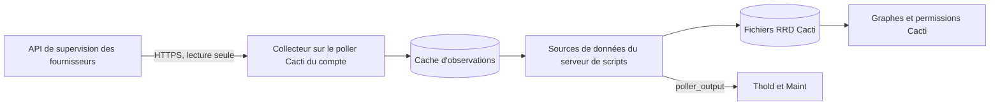

<!-- Source: README.md; SHA256: 7c621642e5f1a46bac66e4bc744f70aebb014c610d22de034088845fdc170405 -->

<!-- translations:start -->
[English](../../../README.md) | [简体中文](../zh-CN/README.md) | [हिन्दी](../hi-IN/README.md) | [Español (España)](../es-ES/README.md) | [Español (Latinoamérica)](../es-419/README.md) | [العربية (السعودية)](../ar-SA/README.md) | [Afrikaans](../af-ZA/README.md) | [አማርኛ](../am-ET/README.md) | [العربية (مصر)](../ar-EG/README.md) | [العربية (المغرب)](../ar-MA/README.md) | [বাংলা](../bn-BD/README.md) | [Bosanski](../bs-BA/README.md) | [Deutsch](../de-DE/README.md) | [فارسی](../fa-IR/README.md) | [Filipino](../fil-PH/README.md) | [Français](README.md) | [Français (Maroc)](../fr-MA/README.md) | [Français (Sénégal)](../fr-SN/README.md) | [Hausa](../ha-NG/README.md) | [עברית](../he-IL/README.md) | [Hrvatski](../hr-HR/README.md) | [Bahasa Indonesia](../id-ID/README.md) | [Igbo](../ig-NG/README.md) | [Italiano](../it-IT/README.md) | [日本語](../ja-JP/README.md) | [한국어](../ko-KR/README.md) | [Malagasy](../mg-MG/README.md) | [मराठी](../mr-IN/README.md) | [Bahasa Melayu](../ms-MY/README.md) | [Nederlands](../nl-NL/README.md) | [Polski](../pl-PL/README.md) | [Português (Brasil)](../pt-BR/README.md) | [Русский](../ru-RU/README.md) | [Kinyarwanda](../rw-RW/README.md) | [Soomaali](../so-SO/README.md) | [Српски](../sr-RS/README.md) | [Svenska](../sv-SE/README.md) | [Kiswahili](../sw-KE/README.md) | [தமிழ்](../ta-IN/README.md) | [తెలుగు](../te-IN/README.md) | [ไทย](../th-TH/README.md) | [Türkçe](../tr-TR/README.md) | [Українська](../uk-UA/README.md) | [اردو](../ur-PK/README.md) | [Tiếng Việt](../vi-VN/README.md) | [isiXhosa](../xh-ZA/README.md) | [Yorùbá](../yo-NG/README.md) | [繁體中文](../zh-TW/README.md) | [isiZulu](../zu-ZA/README.md)
<!-- translations:end -->

# plugin_cloud

Une extension Cacti 1.2 qui intègre les ressources et les métriques des fournisseurs de cloud public dans Cacti sous forme d'équipements, de sources de données et de graphes ordinaires. Les charges de travail cloud se retrouvent ainsi à côté du réseau qui les transporte, soumises aux permissions de Cacti, et Thold comme Maint peuvent déclencher ou suspendre des alertes à leur sujet. Une seule extension couvre l'ensemble des fournisseurs, avec un pilote par fournisseur : DigitalOcean, AWS, Google Cloud et Azure en premier lieu.

> **Statut : jalon 3 (DigitalOcean et objets Cacti), en cours de revue.** Ce jalon ajoute le pilote DigitalOcean, les modèles Cacti, un équipement de périmètre par compte avec une requête de données par type de ressource, l'entrée du serveur de scripts, ainsi qu'une estimation des requêtes dans New Graphs et sur la page d'état. Les premières vérifications sur un compte DigitalOcean réel sont consignées dans [faits sur les fournisseurs](../../research/provider-facts.md). Ne l'exécutez pas en production.

## Rôles d'accès

| Domaine | Accès |
| --- | --- |
| Cloud View | Pages de supervision existantes. |
| Cloud Operator | Supervision, page Operations et acquittements personnels de triage. |
| Cloud Admin | Accès Operator ainsi que les actions existantes de configuration et d'administration. |

Après avoir copié les fichiers de mise à niveau, ouvrez la page Plugins en tant qu'administrateur pour enregistrer
le nouveau domaine. Attribuez explicitement le domaine Operator sous **Configuration > Users** ou aux groupes d'utilisateurs.
Les mises à niveau conservent les identifiants et les autorisations des domaines View et Admin existants. L'accès Admin
hérite de l'accès Operator, et l'accès Operator hérite de l'accès View à chaque requête ;
cela n'ajoute pas d'autorisations enregistrées aux utilisateurs ni aux groupes. Les paramètres de l'extension nécessitent également
l'accès Cloud Admin en plus de la permission Settings de Cacti.

Les permissions d'équipements de Cacti continuent de limiter les lignes et les actions disponibles pour chaque utilisateur ; les objets non associés nécessitent un administrateur. Les opérateurs peuvent vérifier l'identifiant enregistré pour un compte dont ils sont autorisés à consulter l'équipement Cacti.
Les identifiants, la configuration, l'association, la suppression et les autres modifications administratives
restent dans les pages d'administration. Les acquittements ne durent que le temps de la session en cours de
l'utilisateur, pour une heure au maximum et uniquement tant que la même observation reste
fraîche. Toute observation nouvelle ou modifiée les invalide. Ils ne marquent jamais une mesure en échec
comme saine et ne suppriment jamais les alertes.

## Pourquoi

Chaque fournisseur de cloud dispose de sa propre console de supervision. Utilisées en parallèle de Cacti, elles laissent trois lacunes :

- **Contrôle d'accès séparé.** Montrer des métriques cloud à un utilisateur Cacti implique de lui fournir un compte d'accès chez le fournisseur cloud.
- **Absence de contexte réseau.** Les liens sur site sont tracés dans Cacti ; les charges de travail qu'ils desservent sont tracées dans la console de chaque fournisseur.
- **Alertes séparées.** Thold et Maint opèrent sur les sources de données et les équipements Cacti, de sorte que les alarmes des fournisseurs doivent être configurées et suspendues séparément, une fois par fournisseur.

L'extension interroge l'API de supervision de chaque fournisseur depuis un poller Cacti, met en cache les derniers points de données et les sert au serveur de scripts de Cacti. Le poller de Cacti écrit les fichiers RRD, ce qui permet aux graphes, aux permissions, à Thold, à Maint et à boost de fonctionner comme pour n'importe quelle donnée Cacti.

## Engagements de conception

- **Lecture seule.** Chaque pilote ne peut construire que les opérations fournisseur figurant sur sa liste blanche ; l'extension ne modifie jamais une ressource cloud. ([ADR 0002](../../decisions/0002-read-only-with-operation-allowlist.md))
- **PHP uniquement, sans SDK.** La signature et l'échange de jetons sont implémentés en PHP avec les extensions déjà requises par Cacti. Aucune dépendance d'exécution Composer. ([ADR 0003](../../decisions/0003-php-only-without-sdks.md))
- **Coût avant collecte.** L'extension lit uniquement les métriques associées à une source de données Cacti, affiche le nombre de requêtes attendu et le coût au tarif catalogue avant la création des graphes, et applique un plafond mensuel. ([ADR 0005](../../decisions/0005-collect-only-what-is-graphed.md))
- **Aucun identifiant en clair dans la base de données.** Les identifiants proviennent d'un coffre chiffré utilisant une clé stockée dans un fichier hors de la base de données, d'un fichier d'identifiants ou de l'identité d'instance du fournisseur. ([ADR 0007](../../decisions/0007-credentials-outside-the-database-in-the-clear.md))

## Périmètre et état d'avancement

| Phase | Périmètre | Jalons | Statut |
|---|---|---|---|
| 0, recherche | Confirmation des faits fournisseurs, catalogues de métriques, modèle de coûts et de quotas, vecteurs de test de signature, prototype de transport | [M1](https://github.com/somethingwithproof/plugin_cloud/milestone/1) | Terminé, à l'exception des vérifications nécessitant un compte fournisseur réel |
| 1, cœur et DigitalOcean | Comptes, coffre d'identifiants, transport, collecteur, cache d'observations, objets Cacti, page d'état, Droplets et répartiteurs de charge DigitalOcean | [M2](https://github.com/somethingwithproof/plugin_cloud/milestone/2), [M3](https://github.com/somethingwithproof/plugin_cloud/milestone/3), [M4](https://github.com/somethingwithproof/plugin_cloud/milestone/4) | M2 terminé ([#81](https://github.com/somethingwithproof/plugin_cloud/pull/81)) ; pilote, modèles et équipements de périmètre M3 fusionnés ; estimations de requêtes, permissions et vérifications de performance en cours de revue ; M4 non démarré |
| 2, AWS | Signature Version 4, `AssumeRole`, rôles d'instance, CloudWatch `GetMetricData`, inventaire régional | [M5](https://github.com/somethingwithproof/plugin_cloud/milestone/5) | Non démarré |
| 3, Google Cloud | JWT de compte de service, serveur de métadonnées, Cloud Monitoring `timeSeries.list` | [M6](https://github.com/somethingwithproof/plugin_cloud/milestone/6) | Non démarré |
| 4, Azure | Identifiants client Entra, identité managée, Resource Graph, `metrics:getBatch` | [M7](https://github.com/somethingwithproof/plugin_cloud/milestone/7) | Non démarré |
| 5, collecteurs distants | Comptes sur les collecteurs de données distants de Cacti | [M8](https://github.com/somethingwithproof/plugin_cloud/milestone/8) | Non démarré |

Hors périmètre : modification de ressources cloud, création ou réplication d'alarmes fournisseur, rapports de facturation, journaux et traces, ainsi qu'un moteur d'alerte propre à l'extension. D'autres fournisseurs (Hetzner Cloud, Akamai Cloud, Oracle Cloud, entre autres) font l'objet de tickets de recherche.

## Contenu du jalon 2

- **Installation sécurisée.** Sur PHP inférieur à 8.2 ou sans ext-openssl, l'installation et l'activation sont refusées avec un message, et le reste de Cacti continue de fonctionner.
- **Cycle de vie.** Installation, mise à niveau et désinstallation via la page Plugins de Cacti. Les mises à niveau sont ordonnées et résistent aux interruptions. La désinstallation conserve les tables de l'extension, sauf si vous décochez *Keep Plugin Tables on Uninstall*.
- **Domaines distincts.** *Cloud Admin* ouvre **Cloud Accounts** ; *Cloud Operator* ouvre **Cloud Operations** ; *Cloud View* ouvre **Cloud Health**. Admin hérite d'Operator, et Operator hérite de View. Ces trois pages se trouvent sous Management.
- **Comptes et identifiants.** Ajout, modification, vérification et suppression de comptes. Un identifiant est soit chiffré en base de données à l'aide d'un fichier clé conservé à l'extérieur (AES-256-GCM), soit lu depuis un fichier sur le poller. Les identifiants sont en écriture seule dans l'interface et sont masqués dans les journaux.
- **Le collecteur.** Il démarre à chaque exécution du poller, à raison d'une instance par poller, dans la limite d'un budget temps. Il prend un bail par compte, exécute la découverte selon son propre intervalle et ne lit les métriques que pour les sources de données actives appartenant à l'extension.
- **État de santé.** État par compte de la collecte, de la découverte, des ressources et de la fraîcheur des données, accompagné d'avertissements en cas de clé de coffre inutilisable, de fichiers d'identifiants non sécurisés ou d'intervalles que le poller ne peut pas respecter.

## Installation et configuration

Ces étapes installent le code du jalon 2 pour évaluation. Elles nécessitent Cacti 1.2.31 ou ultérieur sur PHP 8.2 ou ultérieur.

1. Copiez le dépôt dans `plugins/cloud` sous votre répertoire Cacti. Le répertoire doit impérativement se nommer `cloud`.
2. Créez la clé du coffre en dehors de la racine web. Placez-la dans un répertoire où seuls root et l'utilisateur Cacti peuvent écrire, et rendez le fichier lisible uniquement par l'utilisateur qui exécute le serveur web et le poller. L'extension ne crée ni n'écrit jamais ce fichier :

   ```sh
   sudo install -d -m 0750 -o root -g cacti /etc/cacti
   head -c 32 /dev/urandom | sudo tee /etc/cacti/cloud-vault.key > /dev/null
   sudo chown cacti:cacti /etc/cacti/cloud-vault.key
   sudo chmod 0600 /etc/cacti/cloud-vault.key
   ```

   Remplacez `cacti` par l'utilisateur qui exécute votre serveur web et votre poller. Le fichier contient 32 octets bruts ou 64 caractères hexadécimaux. Sauvegardez-le avec la base de données ; sans lui, les identifiants enregistrés devront être saisis à nouveau.
3. Dans Cacti, ouvrez **Configuration > Plugins**, puis installez et activez *Cloud*.
4. Sous **Configuration > Settings > Cloud**, définissez *Vault Key File* si vous avez utilisé un autre chemin. *Collector Time Budget* (240 secondes par défaut) doit rester inférieur à l'intervalle du poller.
5. Accordez *Cloud Admin*, *Cloud Operator* ou *Cloud View* aux utilisateurs et groupes sous **Configuration > Users**. L'installation accorde Cloud Admin et Cloud View à l'administrateur ; Cloud Admin inclut l'accès Operator, l'administrateur n'a donc pas besoin d'une autorisation Operator distincte.
6. Ajoutez des comptes sous **Management > Cloud Accounts**, puis vérifiez l'absence d'avertissements sous **Management > Cloud Health**.

## Cibles de compatibilité

| Composant | Cible |
|---|---|
| Cacti | 1.2.31 ou ultérieur, sans correctifs sur le cœur |
| PHP | 8.2 ou ultérieur ; `setup.php` reste analysable sous 8.0 afin qu'un environnement non pris en charge reçoive un refus plutôt que de casser l'interface de Cacti |
| Extensions PHP | Aucune au-delà de celles requises par Cacti 1.2.31 |
| Thold, Maint | Aucune modification requise |

## Conception

- [docs/performance.md](../../performance.md) présente les mesures du collecteur et de la page d'état, avec le matériel et les paramètres utilisés.
- [docs/PLAN.md](../../PLAN.md) constitue le plan complet : architecture, faits fournisseurs et Cacti sur lesquels elle repose (avec sources), contrat des pilotes, calcul des coûts, frontières de sécurité, tests et risques.
- [docs/decisions/](../../decisions) rassemble les comptes rendus de décisions d'architecture pour les choix déjà arrêtés.
- [docs/REQUIREMENTS.md](../../REQUIREMENTS.md) associe chaque identifiant d'exigence à son ticket.



## Suivi du travail

- **Les jalons** suivent ceux du plan. Chacun dispose d'un ticket épique listant ses sous-tickets et ses preuves de validation.
- **Les tickets** sont typés par étiquette : `type: requirement`, `type: research`, `type: decision`, `type: epic`. Les tickets d'exigence énoncent des exigences numérotées et testables (`REQ-AREA-NNN`) ainsi que leurs critères d'acceptation.
- **Les étiquettes** indiquent également `area:`, `provider:`, `phase:`, `priority:` et `status:`. Voir [CONTRIBUTING.md](../../../CONTRIBUTING.md#labels).
- Le [tableau du projet](https://github.com/users/somethingwithproof/projects/7) présente l'ensemble des tickets à travers les jalons.

## Développement

L'intégration continue analyse la syntaxe des points d'entrée sous PHP 8.0, exécute les tests unitaires et d'intégration ainsi que PHPStan au niveau 9, et installe l'extension sur PHP 8.2 à 8.5 avec Cacti 1.2.31 et la branche 1.2.x. Elle vérifie également que PHP 8.1 est refusé sans casser Cacti. Les tests utilisent Pest issu du harnais d'extensions du cœur de Cacti. Ce choix est provisoire en attendant la décision sur [#12](https://github.com/somethingwithproof/plugin_cloud/issues/12). [.github/workflows/plugin-ci-workflow.yml](../../../.github/workflows/plugin-ci-workflow.yml) répertorie chaque étape. Exécutez `sh tests/lint-workflows.sh` et `sh locales/build_gettext.sh --check` localement avant de pousser.

## Contribution

Consultez [CONTRIBUTING.md](../../../CONTRIBUTING.md). Les commits nécessitent une signature DCO (sign-off). Les discussions de conception ont lieu dans les tickets ; les décisions ouvertes portent l'étiquette `type: decision`.

## Sécurité

Signalez les vulnérabilités en privé ; voir [SECURITY.md](../../../SECURITY.md).

## Licence

GNU General Public License v2.0, la même licence que Cacti et ses extensions. Voir [LICENSE](../../../LICENSE).
