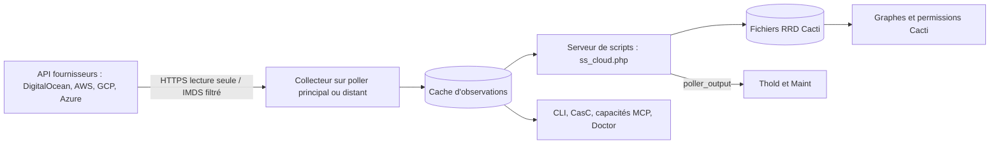

<!-- Source: README.md; SHA256: ac2074a40238686915802803c5efe773f33677f934281e0605e6e87a71a9d27d -->

<!-- translations:start -->
[English](../../../README.md) | [简体中文](../zh-CN/README.md) | [हिन्दी](../hi-IN/README.md) | [Español (España)](../es-ES/README.md) | [Español (Latinoamérica)](../es-419/README.md) | [العربية (السعودية)](../ar-SA/README.md) | [Afrikaans](../af-ZA/README.md) | [አማርኛ](../am-ET/README.md) | [العربية (مصر)](../ar-EG/README.md) | [العربية (المغرب)](../ar-MA/README.md) | [বাংলা](../bn-BD/README.md) | [Bosanski](../bs-BA/README.md) | [Deutsch](../de-DE/README.md) | [فارسی](../fa-IR/README.md) | [Filipino](../fil-PH/README.md) | [Français](README.md) | [Français (Maroc)](../fr-MA/README.md) | [Français (Sénégal)](../fr-SN/README.md) | [Hausa](../ha-NG/README.md) | [עברית](../he-IL/README.md) | [Hrvatski](../hr-HR/README.md) | [Bahasa Indonesia](../id-ID/README.md) | [Igbo](../ig-NG/README.md) | [Italiano](../it-IT/README.md) | [日本語](../ja-JP/README.md) | [한국어](../ko-KR/README.md) | [Malagasy](../mg-MG/README.md) | [मराठी](../mr-IN/README.md) | [Bahasa Melayu](../ms-MY/README.md) | [Nederlands](../nl-NL/README.md) | [Polski](../pl-PL/README.md) | [Português (Brasil)](../pt-BR/README.md) | [Русский](../ru-RU/README.md) | [Kinyarwanda](../rw-RW/README.md) | [Soomaali](../so-SO/README.md) | [Српски](../sr-RS/README.md) | [Svenska](../sv-SE/README.md) | [Kiswahili](../sw-KE/README.md) | [தமிழ்](../ta-IN/README.md) | [తెలుగు](../te-IN/README.md) | [ไทย](../th-TH/README.md) | [Türkçe](../tr-TR/README.md) | [Українська](../uk-UA/README.md) | [اردو](../ur-PK/README.md) | [Tiếng Việt](../vi-VN/README.md) | [isiXhosa](../xh-ZA/README.md) | [Yorùbá](../yo-NG/README.md) | [繁體中文](../zh-TW/README.md) | [isiZulu](../zu-ZA/README.md)
<!-- translations:end -->

# plugin_cloud

Une extension Cacti 1.2 qui intègre les ressources et les métriques des fournisseurs de cloud public dans Cacti sous forme d'équipements, de sources de données et de graphes ordinaires. Les charges de travail cloud se retrouvent ainsi à côté du réseau qui les transporte, soumises aux permissions de Cacti, et Thold comme Maint peuvent déclencher ou suspendre des alertes à leur sujet. Une seule extension couvre DigitalOcean, Amazon Web Services, Google Cloud et Microsoft Azure grâce à des pilotes en PHP pur en lecture seule.

> **Statut : en développement, aucune version publiée pour l'instant (`0.1.0-dev`).** Cette branche implémente des pilotes en PHP pur pour DigitalOcean, AWS, Google Cloud et Azure, la réplication des collecteurs de données distants et l'état de santé en lecture seule de l'agent, un fournisseur CasC et une CLI opérateur, des capacités MCP ainsi que des contrôles Doctor. Les modèles Cacti fournis couvrent actuellement les Droplets et les répartiteurs de charge DigitalOcean (`templates/cloud_digitalocean.xml`) ; les paquets de modèles Cacti pour AWS, Google Cloud et Azure ainsi que la qualification sur comptes réels au-delà de DigitalOcean ([informations sur les fournisseurs](../../research/provider-facts.md)) ne sont pas encore terminés. Ne pas exécuter en production.

## Fournisseurs pris en charge

Chaque pilote de fournisseur est enregistré dans `Drivers::production()`, proposé par `Provider::released()`, et fonctionne en PHP pur à l'aide de `ext-openssl` et de sockets de flux sans aucune dépendance d'exécution SDK ou Composer.

| Fournisseur | Champs de portée | Sources d'identifiants | Authentification | Ressources découvertes | Collecte de métriques |
|---|---|---|---|---|---|
| DigitalOcean (`digitalocean`) | Aucun (portée liée au jeton) | `vault`, `file` | Jeton Bearer | `droplet`, `load_balancer` | `/v2/monitoring/metrics` avec prise en compte de la part de limite de débit ; inclut les modèles et requêtes de données Cacti |
| Amazon Web Services (`aws`) | `account_id` (12 chiffres), `regions` | `vault`, `file`, `instance` | AWS SigV4 en PHP pur (`AWS4-HMAC-SHA256`), vérification STS `GetCallerIdentity`, STS `AssumeRole` facultatif, EC2 IMDSv2 (`169.254.169.254`) pour les comptes `instance` | `ec2_instance`, `rds_instance`, `aws_elb` (ALB/NLB) | CloudWatch `GetMetricData` par lots (jusqu'à 500 requêtes par appel) |
| Google Cloud (`gcp`) | `project` | `vault`, `file`, `instance` | JWT de compte de service RS256 en PHP pur via `ext-openssl` échangé auprès de `oauth2.googleapis.com/token`, ou serveur de métadonnées GCE (`metadata.google.internal`) pour les comptes `instance` | `gce_instance` via `instances.aggregatedList` | Cloud Monitoring `timeSeries.list` |
| Microsoft Azure (`azure`) | `tenant`, `subscription`, `regions` | `vault`, `file`, `instance` | Flux OAuth2 client-credentials Entra ID en PHP pur (`client_secret` uniquement ; assertions de certificat exclues), ou identité managée Azure IMDS (`169.254.169.254`) pour les jetons ARM et Monitor | `azure_vm` via ARM Resource Graph (paginé avec `$skipToken` et dédupliqué) | Azure Monitor `metrics:getBatch` (jusqu'à 50 ressources par appel, gestion de la limitation HTTP 429 et 529) |

## Fonctionnalités implémentées

### Plateforme centrale, coffre-fort et collecteur

- **Installation et cycle de vie protégés.** Les points d'entrée (`setup.php`, `cli/cloud.php`, `poller_cloud.php`, `ss_cloud.php` et scripts de page) sont analysables sous PHP 8.0 et refusent PHP inférieur à 8.2 ou l'absence de `ext-openssl` sans casser Cacti. Les mises à niveau sont ordonnées, idempotentes (`Schema::VERSION = 3`, 9 tables) et résistent aux interruptions. La désinstallation conserve les tables de l'extension sauf si *Keep Plugin Tables on Uninstall* est décoché.
- **Comptes et identifiants.** Ajoutez, modifiez, vérifiez et supprimez des comptes sous **Management > Cloud Accounts**. Les identifiants proviennent du coffre-fort chiffré AES-256-GCM (`plugin_cloud_secret`, chiffré par `/etc/cacti/cloud-vault.key` par défaut), d'un fichier restreint à l'intérieur du *Credential File Directory* configuré (`cloud_credential_dir`, vide par défaut pour refuser les fichiers), ou de l'identité d'instance du fournisseur. Les identifiants sont en écriture seule dans l'interface et masqués dans les journaux.
- **Contrôles stricts de sortie et de lecture seule.** Chaque pilote s'exécute derrière `GuardedTransport` et `OutboundPolicy` : port HTTPS 443 vers les noms d'hôte exacts par fournisseur, avec les points de terminaison de métadonnées HTTP link-local sur le port 80 (`169.254.169.254`, `metadata.google.internal`) activés uniquement pour les comptes `instance`. Seules les opérations en lecture seule figurant sur liste blanche sont autorisées.
- **Contrôles du collecteur et des coûts.** `poller_cloud.php` s'exécute depuis `poller_bottom` (un processus par poller via le registre de processus de Cacti) dans la limite `cloud_collector_budget`, acquiert des baux par compte, lance la découverte selon `discover_interval`, ne lit les métriques que pour les sources de données Cacti actives (`plugin_cloud_series`), respecte `request_share` et `monthly_ceiling`, et met en cache les derniers points de données dans `plugin_cloud_observation` pour `ss_cloud.php`.
- **Objets Cacti et estimations de requêtes.** Maintient un équipement de portée par compte (`plugin_cloud_device`), préserve les méthodes de réindexation de l'équipement de portée lors des enregistrements d'équipement, importe les modèles DigitalOcean et les requêtes de données du serveur de scripts (`templates/cloud_digitalocean.xml`, `cloud_do_droplet.xml`, `cloud_do_load_balancer.xml`), et affiche les estimations de requêtes et de prix catalogue sur **New Graphs** (`graphs_new_top_links`) et **Cloud Health**.

### Collecteurs de données distants

- `INFO` déclare `remote_collect:1`. Les comptes peuvent être affectés à n'importe quel poller Cacti activé (`poller_id >= 1`), et `poller_cloud.php --poller=N` ne collecte que les comptes appartenant à ce poller.
- **Hook `replicate_out`.** Réplique les lignes liées au poller depuis `plugin_cloud_account`, `plugin_cloud_device`, `plugin_cloud_series`, ainsi que les lignes chiffrées depuis `plugin_cloud_secret` (uniquement pour les comptes adossés au coffre-fort appartenant au poller cible) via `replicate_out_table()`. Les fichiers de clé bruts du coffre-fort ne sont jamais stockés en base de données ni répliqués et restent locaux sur chaque poller.
- **Hook `remote_agent`.** Expose un résumé de santé JSON en lecture seule (`action=cloud_health`) acceptant uniquement des paramètres entiers `poller_id` et `account_id` et ne renvoyant aucun identifiant, chemin de fichier ou secret.

### Hooks d'écosystème (CasC, capacités MCP et Doctor)

- **Fournisseur CasC (`casc_register_providers`).** Enregistre le fournisseur `cloud` (version de schéma `1`) avec export YAML et XML déterministe en PHP pur, validation de manifeste, planification de différences et application confirmée. Les identifiants du coffre-fort sont exportés sous forme de références `vault:account:<name>` ; les champs de secrets bruts (`secret`, `secrets`, `token`, `access_token`, `refresh_token`, `password`, `private_key`, `access_key_id`, `secret_access_key`, `session_token`, `client_secret`, `credential`, `credentials`, `vault_key`) sont rejetés. L'application exige un condensat SHA-256 exact `--confirm=<PLAN_HASH>`.
- **API MCP / Abilities (`abilities_register`).** Enregistre trois capacités strictement en lecture seule soumises au domaine Cloud View (`cloud_health.php`) et à la portée des équipements Cacti pour les appelants non administrateurs, sans jamais exposer d'identifiant, de clé de coffre-fort ou de chemin de fichier d'identifiants :
  - `cloud-list-accounts` (`provider`, `poller_id` facultatifs)
  - `cloud-list-resources` (`account_id`, `type`, `lifecycle` facultatifs)
  - `cloud-get-health` (`account_id` facultatif)
- **Contrôles Doctor (`doctor_register_checks`).** Enregistre cinq contrôles de diagnostic qui n'exposent aucune valeur secrète ni aucun matériau de clé :
  - `cloud_schema` : actualité de la version du schéma
  - `cloud_vault_key` : lisibilité, permissions et taille du fichier de clé du coffre-fort
  - `cloud_drivers` : enregistrement des pilotes de production pour tous les fournisseurs publiés
  - `cloud_accounts_health` : comptes activés en échec, limités ou obsolètes
  - `cloud_poller_intervals` : alignement des intervalles de collecte des comptes activés avec l'intervalle du poller de Cacti

## CLI

Exécuter depuis le répertoire racine de Cacti avec PHP 8.2 ou ultérieur :

```sh
# Operator and CasC CLI (options use --key=value form)
php plugins/cloud/cli/cloud.php export [--format=yaml|xml]
php plugins/cloud/cli/cloud.php validate --file=<path> [--format=yaml|xml]
php plugins/cloud/cli/cloud.php plan --file=<path> [--format=yaml|xml]
php plugins/cloud/cli/cloud.php apply --file=<path> --confirm=<PLAN_HASH> [--format=yaml|xml]
php plugins/cloud/cli/cloud.php health [--format=text|json] [--poller=<id>]

# Collector entry point (normally started by poller_bottom)
php plugins/cloud/poller_cloud.php [--poller=N] [--force] [--debug]
```

## Rôles d'accès

| Domaine | Accès |
| --- | --- |
| Cloud View | Pages de supervision existantes. |
| Cloud Operator | Supervision plus la page Operations et les acquittements personnels de triage. |
| Cloud Admin | Accès Operator plus les actions existantes de configuration et d'administration. |

Après avoir copié les fichiers de mise à niveau, ouvrez la page Plugins en tant qu'administrateur pour enregistrer les domaines. Attribuez explicitement le domaine Operator sous **Configuration > Users** ou dans les groupes d'utilisateurs. Les mises à niveau conservent les identifiants et droits existants des domaines View et Admin. L'accès Admin hérite de l'accès Operator, et l'accès Operator hérite de l'accès View à chaque requête ; cela n'ajoute pas de droits stockés aux utilisateurs ou aux groupes. Les paramètres de l'extension nécessitent également l'accès Cloud Admin en plus de la permission Settings de Cacti.

Les permissions d'équipement Cacti limitent les lignes et les actions disponibles pour chaque utilisateur ; les objets non mappés nécessitent un administrateur. Les opérateurs peuvent vérifier l'identifiant stocké pour un compte dont ils peuvent accéder à l'équipement Cacti. Les identifiants, la configuration, le mappage, la suppression et les autres modifications administratives restent dans les pages d'administration. Les acquittements ne durent que pendant la session actuelle de l'utilisateur, pendant au plus une heure et uniquement tant que la même observation reste fraîche. Des observations nouvelles ou modifiées les invalident. Ils ne marquent jamais une mesure en échec comme saine et ne suspendent jamais les alertes.

## Pourquoi

Chaque fournisseur de cloud dispose de sa propre console de supervision. Utilisées en parallèle avec Cacti, elles laissent trois lacunes :

- **Contrôle d'accès séparé.** Montrer des métriques cloud à un utilisateur Cacti impose de lui donner un accès au cloud.
- **Absence de contexte réseau.** Les liens sur site sont tracés dans Cacti ; les charges de travail derrière eux sont tracées dans la console de chaque fournisseur.
- **Alertes séparées.** Thold et Maint opèrent sur les sources de données et les équipements Cacti ; les alarmes des fournisseurs sont donc configurées et suspendues séparément, une fois par fournisseur.

L'extension lit l'API de supervision de chaque fournisseur sur un poller Cacti, met en cache les derniers points de données et les fournit au serveur de scripts de Cacti. Le poller de Cacti écrit les fichiers RRD, de sorte que les graphes, les permissions, Thold, Maint et boost fonctionnent comme pour n'importe quelle donnée Cacti.

## Engagements de conception

- **Lecture seule.** Chaque pilote ne peut construire que les opérations fournisseur figurant sur sa liste blanche ; l'extension ne modifie jamais une ressource cloud. ([ADR 0002](../../decisions/0002-read-only-with-operation-allowlist.md))
- **PHP uniquement, sans SDK.** La signature et l'échange de jetons sont implémentés en PHP avec les extensions que Cacti requiert déjà. Aucune dépendance d'exécution Composer. ([ADR 0003](../../decisions/0003-php-only-without-sdks.md))
- **Coût avant la collecte.** L'extension ne lit que les métriques associées à une source de données Cacti, affiche le nombre de requêtes attendu et le coût au tarif catalogue avant la création des graphes, et applique un plafond mensuel. ([ADR 0005](../../decisions/0005-collect-only-what-is-graphed.md))
- **Aucun identifiant en clair dans la base de données.** Les identifiants proviennent d'un coffre-fort chiffré par un fichier externe à la base de données, d'un fichier d'identifiants ou de l'identité d'instance du fournisseur. ([ADR 0007](../../decisions/0007-credentials-outside-the-database-in-the-clear.md))

## Portée et statut

| Phase | Portée | Jalons | Statut |
|---|---|---|---|
| 0, recherche | Confirmation des faits fournisseur, catalogues de métriques, modèle de coût et de débit, vecteurs de test de signature, prototype de transport | [M1](https://github.com/somethingwithproof/plugin_cloud/milestone/1) | Terminé, sauf les vérifications nécessitant des comptes fournisseur en ligne |
| 1, cœur et DigitalOcean | Comptes, coffre-fort d'identifiants, transport, collecteur, cache d'observations, objets Cacti, modèles, estimations de requêtes, page de santé, Droplets et répartiteurs de charge DigitalOcean | [M2](https://github.com/somethingwithproof/plugin_cloud/milestone/2), [M3](https://github.com/somethingwithproof/plugin_cloud/milestone/3), [M4](https://github.com/somethingwithproof/plugin_cloud/milestone/4) | Implémenté ; qualification pilote M4 en attente |
| 2, AWS | SigV4 en PHP pur, STS `AssumeRole`, rôles d'instance IMDSv2, inventaire EC2/RDS/ELB, CloudWatch `GetMetricData` | [M5](https://github.com/somethingwithproof/plugin_cloud/milestone/5) | Pilote implémenté ; modèles Cacti et qualification sur compte réel en attente |
| 3, Google Cloud | JWT de compte de service RS256 en PHP pur, serveur de métadonnées GCE, inventaire Compute Engine, Cloud Monitoring `timeSeries.list` | [M6](https://github.com/somethingwithproof/plugin_cloud/milestone/6) | Pilote implémenté ; modèles Cacti et qualification sur compte réel en attente |
| 4, Azure | Identifiants client Entra ID, identité managée IMDS, inventaire de VM ARM Resource Graph, Azure Monitor `metrics:getBatch` | [M7](https://github.com/somethingwithproof/plugin_cloud/milestone/7) | Pilote implémenté ; modèles Cacti et qualification sur compte réel en attente |
| 5, collecteurs distants et écosystème | Collecteurs de données distants (`replicate_out`, `remote_agent`), fournisseur CasC et CLI, capacités MCP, contrôles Doctor | [M8](https://github.com/somethingwithproof/plugin_cloud/milestone/8) | Implémenté |

Hors périmètre : modification des ressources cloud, création ou réplication d'alarmes fournisseur, rapports de facturation, journaux et traces, et moteur d'alerte propre à l'extension. D'autres fournisseurs (Hetzner Cloud, Akamai Cloud, Oracle Cloud et autres) font l'objet de tickets de recherche.

## Installation et configuration

Ces étapes installent le code de développement pour évaluation. Elles requièrent Cacti 1.2.31 ou ultérieur sur PHP 8.2 ou ultérieur.

1. Copiez le dépôt dans `plugins/cloud` sous votre répertoire Cacti. Le répertoire doit s'appeler `cloud`.
2. Créez la clé du coffre-fort hors de la racine web sur chaque poller qui utilise des identifiants stockés dans le coffre-fort. Placez-la dans un répertoire où seuls root et l'utilisateur Cacti peuvent écrire, et rendez le fichier lisible uniquement par l'utilisateur qui exécute le serveur web et le poller. L'extension ne crée ni n'écrit jamais ce fichier :

   ```sh
   sudo install -d -m 0750 -o root -g cacti /etc/cacti
   head -c 32 /dev/urandom | sudo tee /etc/cacti/cloud-vault.key > /dev/null
   sudo chown cacti:cacti /etc/cacti/cloud-vault.key
   sudo chmod 0600 /etc/cacti/cloud-vault.key
   ```

   Remplacez `cacti` par l'utilisateur qui exécute votre serveur web et votre poller. Le fichier contient 32 octets bruts ou 64 caractères hexadécimaux. Sauvegardez-le avec la base de données ; sans lui, les identifiants enregistrés devront être saisis de nouveau.
3. Dans Cacti, ouvrez **Configuration > Plugins**, puis installez et activez *Cloud*.
4. Sous **Configuration > Settings > Cloud**, définissez *Vault Key File* si vous avez utilisé un autre chemin, configurez *Credential File Directory* si vous prévoyez d'utiliser des identifiants basés sur des fichiers, et maintenez *Collector Time Budget* (240 secondes par défaut) inférieur à l'intervalle du poller.
5. Accordez *Cloud Admin*, *Cloud Operator* ou *Cloud View* aux utilisateurs et groupes sous **Configuration > Users**. L'installation accorde Cloud Admin et Cloud View à l'administrateur ; Cloud Admin inclut l'accès Operator, donc l'administrateur n'a besoin d'aucune attribution Operator distincte.
6. Ajoutez des comptes sous **Management > Cloud Accounts**, puis vérifiez **Management > Cloud Health** pour d'éventuels avertissements.

## Cibles de compatibilité

| Composant | Cible |
|---|---|
| Cacti | 1.2.31 ou ultérieur, aucun correctif du cœur |
| PHP | 8.2 ou ultérieur ; les points d'entrée restent analysables sous 8.0 afin qu'un moteur non pris en charge reçoive un refus plutôt qu'une interface Cacti cassée |
| Extensions PHP | `ext-openssl` (requise par Cacti 1.2.31) ; pas de `ext-curl` et aucune dépendance d'exécution Composer |
| Thold, Maint | Aucune modification requise |

## Conception

- [docs/performance.md](../../performance.md) contient les mesures du collecteur et de la page de santé, avec le matériel et les réglages utilisés.
- [docs/PLAN.md](../../PLAN.md) constitue le plan complet : architecture, faits fournisseur et Cacti sur lesquels il repose (avec sources), contrat de pilote, arithmétique des coûts, frontières de sécurité, tests et risques.
- [docs/decisions/](../../decisions/) rassemble les dossiers de décision d'architecture pour les choix déjà arrêtés.
- [docs/REQUIREMENTS.md](../../REQUIREMENTS.md) associe chaque identifiant d'exigence à son ticket.



## Suivi des travaux

- **Jalons** : ils suivent les jalons du plan. Chacun dispose d'un ticket épique listant ses sous-tickets et ses preuves de sortie.
- **Tickets** : ils sont typés par étiquette : `type: requirement`, `type: research`, `type: decision`, `type: epic`. Les tickets d'exigence énoncent des exigences numérotées et testables (`REQ-AREA-NNN`) ainsi que les critères d'acceptation.
- **Étiquettes** : elles portent aussi `area:`, `provider:`, `phase:`, `priority:` et `status:`. Voir [CONTRIBUTING.md](../../../CONTRIBUTING.md#labels).
- Le [tableau de projet](https://github.com/users/somethingwithproof/projects/7) présente tous les tickets à travers les jalons.

## Développement

La CI ([.github/workflows/plugin-ci-workflow.yml](../../../.github/workflows/plugin-ci-workflow.yml)) vérifie l'archive de publication et la version sémantique (`bash tests/bin/archive-check.sh`), contrôle la syntaxe des points d'entrée sous PHP 8.0, exécute les tests unitaires Pest (`phpunit.xml`) et les tests d'intégration du cycle de vie (`phpunit-integration.xml`) ainsi que PHPStan niveau 9 de PHP 8.2 à 8.5 contre Cacti `release/1.2.31` et `1.2.x` avec `CLOUD_OFFLINE=1`, vérifie le refus sous PHP 8.1, contrôle les catalogues gettext, mesure les performances de collecte de 1 000 séries et de la page de santé, et exécute le contrôle des workflows ainsi que la conformité REUSE.

Vérifications locales avant de pousser :

```sh
bash tests/bin/archive-check.sh
sh tests/lint-workflows.sh
sh locales/build_gettext.sh --check
CACTI_PATH=/path/to/cacti phpstan analyse -c phpstan.neon --no-progress
```

Exécutez Pest avec `--configuration=phpunit.xml` pour les tests unitaires et les règles sur les sources, ou `--configuration=phpunit-integration.xml` avec `CACTI_PATH` et `CLOUD_TEST_DATABASE=disposable` contre une base Cacti jetable pour les tests d'intégration du cycle de vie.

## Contribution

Lisez [CONTRIBUTING.md](../../../CONTRIBUTING.md). Les commits doivent comporter une signature DCO. Les discussions de conception ont lieu sur les tickets ; les décisions ouvertes portent l'étiquette `type: decision`.

## Sécurité

Signalez les vulnérabilités de manière privée ; voir [SECURITY.md](../../../SECURITY.md).

## Licence

GNU General Public License v2.0, la même licence que Cacti et ses extensions. Voir [LICENSE](../../../LICENSE).
