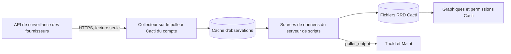

<!-- Source: README.md; SHA256: 7c621642e5f1a46bac66e4bc744f70aebb014c610d22de034088845fdc170405 -->

<!-- translations:start -->
[English](../../../README.md) | [简体中文](../zh-CN/README.md) | [हिन्दी](../hi-IN/README.md) | [Español (España)](../es-ES/README.md) | [Español (Latinoamérica)](../es-419/README.md) | [العربية (السعودية)](../ar-SA/README.md) | [Afrikaans](../af-ZA/README.md) | [አማርኛ](../am-ET/README.md) | [العربية (مصر)](../ar-EG/README.md) | [العربية (المغرب)](../ar-MA/README.md) | [বাংলা](../bn-BD/README.md) | [Deutsch](../de-DE/README.md) | [فارسی](../fa-IR/README.md) | [Filipino](../fil-PH/README.md) | [Français](../fr-FR/README.md) | [Français (Maroc)](README.md) | [Français (Sénégal)](../fr-SN/README.md) | [Hausa](../ha-NG/README.md) | [עברית](../he-IL/README.md) | [Bahasa Indonesia](../id-ID/README.md) | [Igbo](../ig-NG/README.md) | [Italiano](../it-IT/README.md) | [日本語](../ja-JP/README.md) | [한국어](../ko-KR/README.md) | [Malagasy](../mg-MG/README.md) | [मराठी](../mr-IN/README.md) | [Bahasa Melayu](../ms-MY/README.md) | [Nederlands](../nl-NL/README.md) | [Polski](../pl-PL/README.md) | [Português (Brasil)](../pt-BR/README.md) | [Русский](../ru-RU/README.md) | [Kinyarwanda](../rw-RW/README.md) | [Soomaali](../so-SO/README.md) | [Svenska](../sv-SE/README.md) | [Kiswahili](../sw-KE/README.md) | [தமிழ்](../ta-IN/README.md) | [తెలుగు](../te-IN/README.md) | [ไทย](../th-TH/README.md) | [Türkçe](../tr-TR/README.md) | [Українська](../uk-UA/README.md) | [اردو](../ur-PK/README.md) | [Tiếng Việt](../vi-VN/README.md) | [isiXhosa](../xh-ZA/README.md) | [Yorùbá](../yo-NG/README.md) | [繁體中文](../zh-TW/README.md) | [isiZulu](../zu-ZA/README.md)
<!-- translations:end -->

# plugin_cloud

Un plugin Cacti 1.2 qui intègre les ressources et les métriques des fournisseurs de cloud public dans Cacti sous forme d'équipements, de sources de données et de graphiques ordinaires. Les charges de travail cloud côtoient ainsi le réseau qui les transporte, sous le contrôle des permissions de Cacti, et Thold et Maint peuvent générer des alertes sur celles-ci et les suspendre. Un seul plugin couvre chaque fournisseur, avec un pilote par fournisseur : DigitalOcean, AWS, Google Cloud et Azure en premier lieu.

> **Statut : jalon 3 (DigitalOcean et objets Cacti), en cours de révision.** Ce jalon ajoute le pilote DigitalOcean, les modèles Cacti, un équipement de portée par compte avec une requête de données par type de ressource, l'entrée du serveur de scripts, ainsi qu'une estimation des requêtes sur la page Nouveaux graphiques et la page d'état de santé. Les vérifications initiales sur un compte DigitalOcean réel sont consignées dans les [données de référence des fournisseurs](../../research/provider-facts.md). Ne l'exécutez pas en production.

## Rôles d'accès

| Domaine | Accès |
| --- | --- |
| Cloud View | Pages de surveillance existantes. |
| Cloud Operator | Surveillance plus la page Opérations et les acquittements de triage personnels. |
| Cloud Admin | Accès Opérateur plus la configuration et les actions d'administration existantes. |

Après avoir copié les fichiers de mise à niveau, ouvrez la page Plugins en tant qu'administrateur afin d'enregistrer le nouveau domaine. Attribuez explicitement le domaine Operator sous **Configuration > Users** ou aux groupes d'utilisateurs. Les mises à niveau conservent les identifiants et les autorisations existants des domaines View et Admin. L'accès Admin hérite de l'accès Operator, et l'accès Operator hérite de l'accès View à chaque requête ; cela n'ajoute pas d'autorisations enregistrées aux utilisateurs ou aux groupes. Les paramètres du plugin requièrent également l'accès Cloud Admin en plus de la permission Settings de Cacti.

Les permissions d'équipement Cacti continuent de limiter les lignes et les actions disponibles pour chaque utilisateur ; les objets non mappés requièrent un administrateur. Les opérateurs peuvent vérifier les identifiants enregistrés pour un compte dont ils sont autorisés à consulter l'équipement Cacti. Les identifiants, la configuration, le mappage, la suppression et les autres modifications administratives restent dans les pages d'administration. Les acquittements ne durent que le temps de la session en cours de l'utilisateur, pendant au plus une heure et uniquement tant que la même observation reste fraîche. Les observations nouvelles ou modifiées les invalident. Ils ne marquent jamais une mesure en échec comme saine et ne suppriment jamais les alertes.

## Pourquoi

Chaque fournisseur cloud dispose de sa propre console de surveillance. Utilisées en parallèle avec Cacti, ces consoles laissent trois lacunes :

- **Contrôle d'accès séparé.** Donner à un utilisateur Cacti l'accès aux métriques cloud implique de lui fournir un identifiant cloud.
- **Absence de contexte réseau.** Les liaisons sur site sont représentées graphiquement dans Cacti ; les charges de travail qui se trouvent derrière sont représentées dans la console de chaque fournisseur.
- **Alertes séparées.** Thold et Maint opèrent sur les sources de données et les équipements Cacti ; les alarmes des fournisseurs doivent donc être configurées et suspendues séparément, une fois par fournisseur.

Le plugin interroge l'API de surveillance de chaque fournisseur depuis un polleur Cacti, met en cache les derniers points de données et les fournit au serveur de scripts de Cacti. Le polleur de Cacti écrit les fichiers RRD, de sorte que la génération de graphiques, les permissions, Thold, Maint et boost fonctionnent comme pour n'importe quelle donnée Cacti.

## Engagements de conception

- **Lecture seule.** Chaque pilote ne peut construire que les opérations fournisseur figurant sur sa liste d'autorisation ; le plugin ne modifie jamais une ressource cloud. ([ADR 0002](../../decisions/0002-read-only-with-operation-allowlist.md))
- **PHP uniquement, sans SDK.** La signature et l'échange de jetons sont implémentés en PHP avec les extensions déjà requises par Cacti. Aucune dépendance d'exécution Composer. ([ADR 0003](../../decisions/0003-php-only-without-sdks.md))
- **Maîtrise des coûts avant la collecte.** Le plugin lit uniquement les métriques associées à une source de données Cacti, affiche le nombre de requêtes attendu et le coût au tarif catalogue avant la création des graphiques, et applique un plafond mensuel. ([ADR 0005](../../decisions/0005-collect-only-what-is-graphed.md))
- **Aucun identifiant en clair dans la base de données.** Les identifiants proviennent d'un coffre-fort chiffré dont la clé se trouve dans un fichier hors de la base de données, d'un fichier d'identifiants ou de l'identité d'instance du fournisseur. ([ADR 0007](../../decisions/0007-credentials-outside-the-database-in-the-clear.md))

## Périmètre et statut

| Phase | Périmètre | Jalons | Statut |
|---|---|---|---|
| 0, recherche | Confirmation des données de référence des fournisseurs, catalogues de métriques, modèle de coût et de débit, vecteurs de test de signature, prototype de transport | [M1](https://github.com/somethingwithproof/plugin_cloud/milestone/1) | Terminé, à l'exception des vérifications nécessitant un compte fournisseur réel |
| 1, cœur et DigitalOcean | Comptes, coffre-fort d'identifiants, transport, collecteur, cache d'observations, objets Cacti, page d'état de santé, Droplets et équilibreurs de charge DigitalOcean | [M2](https://github.com/somethingwithproof/plugin_cloud/milestone/2), [M3](https://github.com/somethingwithproof/plugin_cloud/milestone/3), [M4](https://github.com/somethingwithproof/plugin_cloud/milestone/4) | M2 terminé ([#81](https://github.com/somethingwithproof/plugin_cloud/pull/81)) ; pilote, modèles et équipements de portée M3 fusionnés ; estimations de requêtes, permissions et vérifications de performance en cours de révision ; M4 non commencé |
| 2, AWS | Signature Version 4, `AssumeRole`, rôles d'instance, CloudWatch `GetMetricData`, inventaire régional | [M5](https://github.com/somethingwithproof/plugin_cloud/milestone/5) | Non commencé |
| 3, Google Cloud | JWT de compte de service, serveur de métadonnées, Cloud Monitoring `timeSeries.list` | [M6](https://github.com/somethingwithproof/plugin_cloud/milestone/6) | Non commencé |
| 4, Azure | Identifiants client Entra, identité managée, Resource Graph, `metrics:getBatch` | [M7](https://github.com/somethingwithproof/plugin_cloud/milestone/7) | Non commencé |
| 5, collecteurs distants | Comptes sur les collecteurs de données distants Cacti | [M8](https://github.com/somethingwithproof/plugin_cloud/milestone/8) | Non commencé |

Hors périmètre : la modification des ressources cloud, la création ou la réplication d'alarmes fournisseur, les rapports de facturation, les journaux et les traces, ainsi qu'un moteur d'alertes propre au plugin. Les autres fournisseurs (Hetzner Cloud, Akamai Cloud, Oracle Cloud, etc.) font l'objet de tickets de recherche.

## Ce que livre le jalon 2

- **Une installation sécurisée.** Sous PHP inférieur à 8.2, ou sans ext-openssl, l'installation et l'activation sont refusées avec un message, et le reste de Cacti continue de fonctionner.
- **Cycle de vie.** Installation, mise à niveau et désinstallation via la page Plugins de Cacti. Les mises à niveau sont ordonnées et résistent aux interruptions. La désinstallation conserve les tables du plugin, sauf si vous décochez *Keep Plugin Tables on Uninstall*.
- **Domaines distincts.** *Cloud Admin* ouvre **Cloud Accounts** ; *Cloud Operator* ouvre **Cloud Operations** ; *Cloud View* ouvre **Cloud Health**. Admin hérite d'Operator, et Operator hérite de View. Ces trois pages se trouvent sous Management.
- **Comptes et identifiants.** Ajout, modification, vérification et suppression de comptes. Un identifiant est soit chiffré dans la base de données à l'aide d'un fichier clé conservé à l'extérieur (AES-256-GCM), soit lu depuis un fichier sur le polleur. Les identifiants sont en écriture seule dans l'interface et sont masqués dans les journaux.
- **Le collecteur.** Il démarre à chaque exécution du polleur, à raison d'une instance par polleur, dans la limite d'un budget temps. Il acquiert un bail par compte, exécute la découverte selon son propre intervalle et lit les métriques uniquement pour les sources de données actives propres au plugin.
- **État de santé.** État par compte de la collecte, de la découverte, des ressources et de la fraîcheur, ainsi que des avertissements pour une clé de coffre-fort inutilisable, des fichiers d'identifiants non sécurisés et des intervalles que le polleur ne peut pas respecter.

## Installation et configuration

Ces étapes permettent d'installer le code du jalon 2 pour évaluation. Elles requièrent Cacti 1.2.31 ou version ultérieure sur PHP 8.2 ou version ultérieure.

1. Copiez le dépôt vers `plugins/cloud` dans votre répertoire Cacti. Le répertoire doit être nommé `cloud`.
2. Créez la clé du coffre-fort en dehors de la racine web. Placez-la dans un répertoire accessible en écriture uniquement à root et à l'utilisateur Cacti, et rendez le fichier lisible uniquement par l'utilisateur qui exécute le serveur web et le polleur. Le plugin ne crée ni n'écrit jamais ce fichier :

   ```sh
   sudo install -d -m 0750 -o root -g cacti /etc/cacti
   head -c 32 /dev/urandom | sudo tee /etc/cacti/cloud-vault.key > /dev/null
   sudo chown cacti:cacti /etc/cacti/cloud-vault.key
   sudo chmod 0600 /etc/cacti/cloud-vault.key
   ```

   Remplacez `cacti` par l'utilisateur qui exécute votre serveur web et votre polleur. Le fichier contient 32 octets bruts ou 64 caractères hexadécimaux. Sauvegardez-le avec la base de données ; sans lui, les identifiants enregistrés devront être saisis à nouveau.
3. Dans Cacti, ouvrez **Configuration > Plugins**, puis installez et activez *Cloud*.
4. Sous **Configuration > Settings > Cloud**, définissez *Vault Key File* si vous avez utilisé un autre chemin. *Collector Time Budget* (240 secondes par défaut) doit rester inférieur à l'intervalle du polleur.
5. Accordez *Cloud Admin*, *Cloud Operator* ou *Cloud View* aux utilisateurs et groupes sous **Configuration > Users**. L'installation accorde Cloud Admin et Cloud View à l'administrateur ; Cloud Admin inclut l'accès Operator, l'administrateur n'a donc pas besoin d'une autorisation Operator distincte.
6. Ajoutez des comptes sous **Management > Cloud Accounts**, puis vérifiez l'absence d'avertissements sous **Management > Cloud Health**.

## Cibles de compatibilité

| Composant | Cible |
|---|---|
| Cacti | 1.2.31 ou version ultérieure, sans correctif du cœur |
| PHP | 8.2 ou version ultérieure ; `setup.php` reste analysable sous 8.0 afin qu'un environnement d'exécution non pris en charge reçoive un refus plutôt qu'une interface Cacti défaillante |
| Extensions PHP | Aucune au-delà de celles requises par Cacti 1.2.31 |
| Thold, Maint | Aucune modification requise |

## Conception

- [docs/performance.md](../../performance.md) contient les mesures du collecteur et de la page d'état de santé, avec le matériel et les paramètres utilisés.
- [docs/PLAN.md](../../PLAN.md) constitue le plan complet : architecture, données de référence des fournisseurs et de Cacti sur lesquelles il repose (avec sources), contrat du pilote, calcul des coûts, limites de sécurité, tests et risques.
- [docs/decisions/](../../decisions) rassemble les dossiers de décision d'architecture pour les choix déjà arrêtés.
- [docs/REQUIREMENTS.md](../../REQUIREMENTS.md) associe chaque identifiant d'exigence à son ticket.



## Suivi du travail

- **Les jalons** suivent les jalons du plan. Chacun dispose d'un ticket épique listant ses sous-tickets et les éléments de preuve de sortie.
- **Les tickets** sont typés par étiquette : `type: requirement`, `type: research`, `type: decision`, `type: epic`. Les tickets d'exigence énoncent des exigences numérotées et testables (`REQ-AREA-NNN`) ainsi que des critères d'acceptation.
- **Les étiquettes** portent également `area:`, `provider:`, `phase:`, `priority:` et `status:`. Consultez [CONTRIBUTING.md](../../../CONTRIBUTING.md#labels).
- Le [tableau du projet](https://github.com/users/somethingwithproof/projects/7) affiche l'ensemble des tickets sur tous les jalons.

## Développement

L'intégration continue (CI) analyse les points d'entrée sous PHP 8.0, exécute les tests unitaires et d'intégration ainsi que PHPStan au niveau 9, et installe le plugin sous PHP 8.2 à 8.5 avec Cacti 1.2.31 et la branche 1.2.x. Elle vérifie également que PHP 8.1 est refusé sans compromettre le fonctionnement de Cacti. Les tests utilisent Pest depuis le banc de test de plugins du cœur de Cacti. Ce choix est provisoire en attendant la décision sur [#12](https://github.com/somethingwithproof/plugin_cloud/issues/12). Le fichier [.github/workflows/plugin-ci-workflow.yml](../../../.github/workflows/plugin-ci-workflow.yml) énumère chaque étape. Exécutez `sh tests/lint-workflows.sh` et `sh locales/build_gettext.sh --check` localement avant tout envoi.

## Contribution

Lisez [CONTRIBUTING.md](../../../CONTRIBUTING.md). Les commits nécessitent une approbation DCO (sign-off). Les discussions de conception ont lieu dans les tickets ; les décisions ouvertes portent l'étiquette `type: decision`.

## Sécurité

Signalez les vulnérabilités en privé ; consultez [SECURITY.md](../../../SECURITY.md).

## Licence

Licence publique générale GNU v2.0 (GNU General Public License v2.0), la même licence que Cacti et ses plugins. Consultez [LICENSE](../../../LICENSE).
