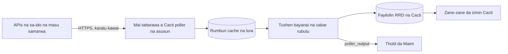

<!-- Source: README.md; SHA256: 7c621642e5f1a46bac66e4bc744f70aebb014c610d22de034088845fdc170405 -->

<!-- translations:start -->
[English](../../../README.md) | [简体中文](../zh-CN/README.md) | [हिन्दी](../hi-IN/README.md) | [Español (España)](../es-ES/README.md) | [Español (Latinoamérica)](../es-419/README.md) | [العربية (السعودية)](../ar-SA/README.md) | [Afrikaans](../af-ZA/README.md) | [አማርኛ](../am-ET/README.md) | [العربية (مصر)](../ar-EG/README.md) | [العربية (المغرب)](../ar-MA/README.md) | [বাংলা](../bn-BD/README.md) | [Deutsch](../de-DE/README.md) | [فارسی](../fa-IR/README.md) | [Filipino](../fil-PH/README.md) | [Français](../fr-FR/README.md) | [Français (Maroc)](../fr-MA/README.md) | [Français (Sénégal)](../fr-SN/README.md) | [Hausa](README.md) | [עברית](../he-IL/README.md) | [Bahasa Indonesia](../id-ID/README.md) | [Igbo](../ig-NG/README.md) | [Italiano](../it-IT/README.md) | [日本語](../ja-JP/README.md) | [한국어](../ko-KR/README.md) | [Malagasy](../mg-MG/README.md) | [मराठी](../mr-IN/README.md) | [Bahasa Melayu](../ms-MY/README.md) | [Nederlands](../nl-NL/README.md) | [Polski](../pl-PL/README.md) | [Português (Brasil)](../pt-BR/README.md) | [Русский](../ru-RU/README.md) | [Kinyarwanda](../rw-RW/README.md) | [Soomaali](../so-SO/README.md) | [Svenska](../sv-SE/README.md) | [Kiswahili](../sw-KE/README.md) | [தமிழ்](../ta-IN/README.md) | [తెలుగు](../te-IN/README.md) | [ไทย](../th-TH/README.md) | [Türkçe](../tr-TR/README.md) | [Українська](../uk-UA/README.md) | [اردو](../ur-PK/README.md) | [Tiếng Việt](../vi-VN/README.md) | [isiXhosa](../xh-ZA/README.md) | [Yorùbá](../yo-NG/README.md) | [繁體中文](../zh-TW/README.md) | [isiZulu](../zu-ZA/README.md)
<!-- translations:end -->

# plugin_cloud

Ƙarin manhaja (plugin) na Cacti 1.2 wanda ke kawo albarkatu da ma'aunai daga masu samar da girgije (cloud) na jama'a zuwa cikin Cacti a matsayin na'urori na yau da kullun, tushen bayanai, da zane-zane (graphs). Ayyukan girgije sukan zauna kusa da hanyar sadarwar da ke ɗauke da su, ƙarƙashin izinin Cacti, kuma Thold da Maint na iya bayar da faɗakarwa da dakatar da su. Ƙarin manhaja guda ɗaya yana rufe kowane mai samar da sabis, tare da direba ga kowane mai samarwa: DigitalOcean, AWS, Google Cloud, da Azure da farko.

> **Matsayi: mataki na 3 (abubuwan DigitalOcean da Cacti), ana nazari.** Wannan matakin yana ƙara direban DigitalOcean, samfuran Cacti, na'urar iyaka ga kowane asusu tare da tambayar bayanai ga kowane nau'in albarkatu, shigarwar sabar rubutu (script server), da ƙiyasin buƙatu akan Sabbin Zane-zane (New Graphs) da shafin lafiya. An rubuta binciken farko akan asusun DigitalOcean na gaske a cikin [gaskiyar masu samar da sabis](../../research/provider-facts.md). Kada a gudanar da shi a muhallin aiki na gaske (production).

## Matsayin shiga

| Fanni | Dama |
| --- | --- |
| Cloud View | Shafukan sa-ido na yanzu. |
| Cloud Operator | Sa-ido haɗe da shafin Ayyuka da tabbatarwar tantancewa ta kai tsaye. |
| Cloud Admin | Damar Operator haɗe da saitunan da ke akwai da ayyukan gudanarwa. |

Bayan kwafin fayilolin haɓakawa, buɗe shafin Plugins a matsayin mai gudanarwa (administrator) don yin rijistar sabon fannin (realm). Sanya fannin Operator a fili ƙarƙashin **Configuration > Users** ko rukunin masu amfani.
Haɓakawa yana riƙe IDs na fannin View da Admin da kuma izini na yanzu. Damar Admin
tana gadar damar Operator, kuma damar Operator tana gadar damar View a kan kowace buƙata;
wannan ba ya ƙara izini da aka ajiye ga masu amfani ko rukunoni. Saitunan ƙarin manhaja kuma suna buƙatar
damar Cloud Admin ƙari ga izinin Settings na Cacti.

Izinin na'urar Cacti har yanzu suna iyakance layuka da ayyukan da ke akwai ga kowane mai amfani; abubuwan da ba a taswira ba suna buƙatar mai gudanarwa. Operators za su iya tabbatar da shaidar shiga (credential) da aka ajiye don asusun da suke da damar shiga na'urar Cacti ɗinsa.
Shaidun shiga, saiti, taswira, gogewa da sauran sauye-sauyen gudanarwa
suna ci gaba da kasancewa a cikin shafukan gudanarwa. Tabbatarwa (acknowledgments) suna ɗorewa ne kawai a zaman mai amfani na yanzu,
na tsawon da bai fi sa'a guda ba kuma kawai yayin da wannan lura ta kasance
sabuwa. Sabbin abubuwan lura ko waɗanda suka canza suna soke su. Ba sa taɓa nuna ma'aunin da ya gaza
a matsayin lafiyayye ko hana faɗakarwa.

## Dalili

Kowane mai samar da girgije yana da nasa na'urar sarrafa sa-ido. Idan ana gudanarwa tare da Cacti, suna barin giɓi guda uku:

- **Keɓantaccen ikon shiga.** Nuna wa mai amfani na Cacti ma'aunai na girgije yana nufin ba su shaidar shiga ta girgije.
- **Babu mahallin hanyar sadarwa.** Ana zana hanyoyin sadarwa na gida (on-premises) a cikin Cacti; ayyukan da ke bayansu ana zana su a cikin na'urar sarrafawa ta kowane mai samar da sabis.
- **Keɓantaccen faɗakarwa.** Thold da Maint suna aiki akan tushen bayanai da na'urorin Cacti, don haka ana saita ƙararrawar mai samarwa da dakatar da su daban, sau ɗaya ga kowane mai samarwa.

Ƙarin manhajar yana karanta API na sa-ido na kowane mai samarwa akan poller na Cacti, yana ajiye sabbin maki na bayanai a cache, kuma yana miƙa su ga sabar rubutu (script server) ta Cacti. Poller na Cacti yana rubuta fayilolin RRD, don haka zane-zane, izini, Thold, Maint, da boost suna aiki kamar yadda suke yi ga kowane bayanan Cacti.

## Alƙawuran ƙira

- **Karatu kawai.** Kowane direba zai iya gina ayyukan mai samarwa ne kawai waɗanda ke cikin jerin abubuwan da aka amince da su (allowlist); ƙarin manhajar ba ya taɓa canza albarkatun girgije. ([ADR 0002](../../decisions/0002-read-only-with-operation-allowlist.md))
- **PHP kawai, babu SDKs.** Ana aiwatar da sa hannu da musayar alamar tsaro (token) a cikin PHP tare da ƙarin ayyukan (extensions) da Cacti ya riga ya buƙata. Babu abubuwan dogaro na Composer a lokacin gudu. ([ADR 0003](../../decisions/0003-php-only-without-sdks.md))
- **Kuɗi kafin tarawa.** Ƙarin manhajar yana karanta ma'aunai ne kawai waɗanda ke da tushen bayanai na Cacti, yana nuna adadin buƙatun da ake tsammani da farashin jeri kafin a ƙirƙiri zane-zane, kuma yana tilasta rufin kashe kuɗi na wata-wata. ([ADR 0005](../../decisions/0005-collect-only-what-is-graphed.md))
- **Babu shaidun shiga a bayyane (plaintext) a cikin rumbun bayanai.** Shaidun shiga suna fitowa ne daga ɓoyayyen ma'aji (vault) wanda aka kulle da fayil a wajen rumbun bayanai, daga fayil ɗin shaidar shiga, ko daga shaidar na'ura ta mai samar da sabis. ([ADR 0007](../../decisions/0007-credentials-outside-the-database-in-the-clear.md))

## Iyaka da matsayi

| Mataki | Iyaka | Matakai | Matsayi |
|---|---|---|---|
| 0, bincike | Tabbatar da gaskiyar mai samarwa, kundin ma'aunai, samfurin farashi da ƙima, gwajin sa hannu, gwajin sufuri | [M1](https://github.com/somethingwithproof/plugin_cloud/milestone/1) | An kammala, banda gwaje-gwajen da ke buƙatar asusun mai samarwa na gaske |
| 1, tushe da DigitalOcean | Asusu, ma'ajin shaidar shiga, sufuri, mai tattarawa, rumbun cache na lura, abubuwan Cacti, shafin lafiya, DigitalOcean Droplets da load balancers | [M2](https://github.com/somethingwithproof/plugin_cloud/milestone/2), [M3](https://github.com/somethingwithproof/plugin_cloud/milestone/3), [M4](https://github.com/somethingwithproof/plugin_cloud/milestone/4) | An kammala M2 ([#81](https://github.com/somethingwithproof/plugin_cloud/pull/81)); direban M3, samfura, da na'urorin iyaka an haɗe su; ƙiyasin buƙatu, izini, da gwaje-gwajen aiki suna cikin nazari; M4 bai fara ba |
| 2, AWS | Signature Version 4, `AssumeRole`, matsayin na'ura (instance roles), CloudWatch `GetMetricData`, lissafin yankuna | [M5](https://github.com/somethingwithproof/plugin_cloud/milestone/5) | Bai fara ba |
| 3, Google Cloud | JWT na asusun sabis, sabar metadata, Cloud Monitoring `timeSeries.list` | [M6](https://github.com/somethingwithproof/plugin_cloud/milestone/6) | Bai fara ba |
| 4, Azure | Shaidun abokin ciniki na Entra, shaidar da ake sarrafawa (managed identity), Resource Graph, `metrics:getBatch` | [M7](https://github.com/somethingwithproof/plugin_cloud/milestone/7) | Bai fara ba |
| 5, masu tattarawa na nesa | Asusu akan masu tattara bayanai na nesa na Cacti | [M8](https://github.com/somethingwithproof/plugin_cloud/milestone/8) | Bai fara ba |

Abubuwan da ba su cikin iyaka: canza albarkatun girgije, ƙirƙira ko kwaikwayon ƙararrawar mai samarwa, rahotannin lissafin kuɗi, rajistan ayyuka (logs) da bibiya (traces), da injin faɗakarwa mallakar ƙarin manhajar. Sauran masu samar da sabis (Hetzner Cloud, Akamai Cloud, Oracle Cloud, da sauransu) batutuwan bincike ne.

## Abin da mataki na 2 ke kawowa

- **Shigarwa mai kariya.** A kan PHP ƙasa da 8.2, ko ba tare da ext-openssl ba, ana ƙin shigarwa da kunnawa tare da saƙo, kuma sauran Cacti yana ci gaba da aiki.
- **Zagayen rayuwa.** Shigarwa, haɓakawa, da cirewa ta hanyar shafin Plugins na Cacti. Haɓakawa suna da tsari kuma suna jure katsewa. Cirewa yana riƙe teburan ƙarin manhajar sai dai idan ka share *Keep Plugin Tables on Uninstall*.
- **Keɓantattun fannoni.** *Cloud Admin* yana buɗe **Cloud Accounts**; *Cloud Operator* yana buɗe **Cloud Operations**; *Cloud View* yana buɗe **Cloud Health**. Admin yana gadar Operator, kuma Operator yana gadar View. Dukkan shafukan uku suna ƙarƙashin Management.
- **Asusu da shaidun shiga.** Ƙara, gyara, tabbatarwa, da goge asusu. Shaidar shiga ko dai an ɓoye ta a cikin rumbun bayanai tare da fayil ɗin maɓalli da aka ajiye a wajensa (AES-256-GCM), ko kuma an karanta ta daga fayil akan poller. Shaidun shiga na rubutu ne kawai a cikin UI kuma ana cire su daga rajistan ayyuka (logs).
- **Mai tattarawa (Collector).** Yana farawa daga kowane gudun poller, samfuri guda ɗaya a kowane poller, a cikin ƙayyadadden lokaci. Yana ɗaukar hayar lokaci (lease) ga kowane asusu, yana gudanar da binciken gano albarkatu a nasa tazarar, kuma yana karanta ma'aunai ne kawai don tushen bayanai masu aiki na ƙarin manhajar da kansa.
- **Lafiya.** Yanayin tarawa, gano albarkatu, albarkatu, da sabunta bayanai na kowane asusu, haɗe da gargaɗi don maɓallin ma'aji da ba ya aiki, fayilolin shaidar shiga marasa aminci, da tazarar da poller ba zai iya cika su ba.

## Shigarwa da saiti

Waɗannan matakan suna shigar da lambar mataki na 2 don kimantawa. Suna buƙatar Cacti 1.2.31 ko mafi girma akan PHP 8.2 ko mafi girma.

1. Kwafi ma'ajin lambar zuwa `plugins/cloud` ƙarƙashin kundin adireshin Cacti ɗinka. Dole ne a sanya wa kundin adireshin suna `cloud`.
2. Ƙirƙiri maɓallin ma'aji a wajen tushen yanar gizo (web root). Sanya shi a cikin kundin adireshin da root da mai amfani na Cacti ne kawai za su iya rubutawa, kuma sanya fayil ɗin ya zama mai karantawa kawai ga mai amfanin da ke gudanar da sabar yanar gizo da poller. Ƙarin manhajar ba ya taɓa ƙirƙira ko rubuta wannan fayil ɗin:

   ```sh
   sudo install -d -m 0750 -o root -g cacti /etc/cacti
   head -c 32 /dev/urandom | sudo tee /etc/cacti/cloud-vault.key > /dev/null
   sudo chown cacti:cacti /etc/cacti/cloud-vault.key
   sudo chmod 0600 /etc/cacti/cloud-vault.key
   ```

   Sauya `cacti` da mai amfanin da ke gudanar da sabar yanar gizo da poller ɗinka. Fayil ɗin yana ɗaukar ɗanyen bytes 32 ko haruffan hexadecimal 64. Yi ajiyar sa (backup) tare da rumbun bayanai; ba tare da shi ba, dole ne a sake shigar da shaidun shiga da aka ajiye.
3. A cikin Cacti, buɗe **Configuration > Plugins**, sannan ka shigar kuma ka kunna *Cloud*.
4. Ƙarƙashin **Configuration > Settings > Cloud**, saita *Vault Key File* idan ka yi amfani da wata hanya ta daban. *Collector Time Budget* (na asali sakan 240) dole ne ya kasance ƙasa da tazarar poller.
5. Ba da *Cloud Admin*, *Cloud Operator* ko *Cloud View* ga masu amfani da rukunoni ƙarƙashin **Configuration > Users**. Shigarwa yana ba da Cloud Admin da Cloud View ga mai gudanarwa; Cloud Admin ya haɗa da damar Operator, don haka mai gudanarwa ba ya buƙatar keɓantaccen izinin Operator.
6. Ƙara asusu ƙarƙashin **Management > Cloud Accounts**, sannan ka duba **Management > Cloud Health** don gargaɗi.

## Maƙasudan dacewa

| Bangare | Maƙasudi |
|---|---|
| Cacti | 1.2.31 ko mafi girma, babu gyare-gyaren tushe (core patches) |
| PHP | 8.2 ko mafi girma; `setup.php` yana ci gaba da karantuwa a kan 8.0 don haka yanayin da ba a goyan baya ya sami ƙin yarda maimakon lalata UI na Cacti |
| Ƙarin ayyukan PHP | Babu banda waɗanda Cacti 1.2.31 ke buƙata |
| Thold, Maint | Babu sauye-sauyen da ake buƙata |

## Tsari

- [docs/performance.md](../../performance.md) yana da ma'aunai na mai tattarawa da shafin lafiya, tare da na'urori da saitunan da aka yi amfani da su.
- [docs/PLAN.md](../../PLAN.md) shi ne cikakken tsari: gine-gine, gaskiyar mai samarwa da Cacti da ya dogara da su (tare da tushe), kwangilar direba, lissafin kuɗi, iyakokin tsaro, gwaji, da haɗarurruka.
- [docs/decisions/](../../decisions) yana riƙe da bayanan shawarwarin gine-gine don zaɓuɓɓukan da aka riga aka yanke.
- [docs/REQUIREMENTS.md](../../REQUIREMENTS.md) yana taswira kowane ID na buƙata zuwa batunsa.



## Yadda ake bin diddigin aiki

- **Matakai** suna bin matakan tsarin. Kowane yana da babban batu (epic issue) da ke jera ƙananan batutuwa da shaidar kammalawa.
- **Batutuwa** an rarraba su ta alama (label): `type: requirement`, `type: research`, `type: decision`, `type: epic`. Batutuwan buƙata suna bayyana buƙatu masu lamba da za a iya gwadawa (`REQ-AREA-NNN`) da ƙa'idodin karɓa.
- **Alamomi** kuma suna ɗauke da `area:`, `provider:`, `phase:`, `priority:`, da `status:`. Duba [CONTRIBUTING.md](../../../CONTRIBUTING.md#labels).
- [Allon aiki](https://github.com/users/somethingwithproof/projects/7) yana nuna duk batutuwa a duk matakai.

## Haɓakawa

CI yana duba tsarin (lints) wuraren shiga akan PHP 8.0, yana gudanar da gwaje-gwajen naúrar da haɗin kai da PHPStan mataki na 9, kuma yana shigar da ƙarin manhajar akan PHP 8.2 zuwa 8.5 akan Cacti 1.2.31 da reshen 1.2.x. Hakanan yana duba cewa an ƙi PHP 8.1 ba tare da karya Cacti ba. Gwaje-gwajen suna amfani da Pest daga tsarin gwajin ƙarin manhaja na tushen Cacti. Wannan zaɓin na wucin gadi ne har sai an yanke shawara akan [#12](https://github.com/somethingwithproof/plugin_cloud/issues/12). [.github/workflows/plugin-ci-workflow.yml](../../../.github/workflows/plugin-ci-workflow.yml) yana jera kowane mataki. Gudanar da `sh tests/lint-workflows.sh` da `sh locales/build_gettext.sh --check` a gida kafin turawa (pushing).

## Ba da gudummawa

Karanta [CONTRIBUTING.md](../../../CONTRIBUTING.md). Ayyukan ajiye lamba (commits) suna buƙatar sa hannun DCO. Tattaunawar ƙira tana faruwa akan batutuwa; buɗaɗɗun shawarwari suna ɗauke da alamar `type: decision`.

## Tsaro

Bayar da rahoton raunin tsaro a asirce; duba [SECURITY.md](../../../SECURITY.md).

## Lasisi

GNU General Public License v2.0, lasisi ɗaya da Cacti da ƙarin manhajojinsa. Duba [LICENSE](../../../LICENSE).
