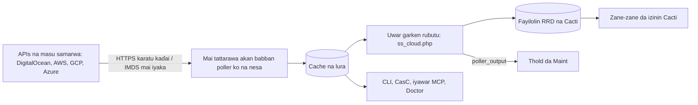

<!-- Source: README.md; SHA256: ac2074a40238686915802803c5efe773f33677f934281e0605e6e87a71a9d27d -->

<!-- translations:start -->
[English](../../../README.md) | [简体中文](../zh-CN/README.md) | [हिन्दी](../hi-IN/README.md) | [Español (España)](../es-ES/README.md) | [Español (Latinoamérica)](../es-419/README.md) | [العربية (السعودية)](../ar-SA/README.md) | [Afrikaans](../af-ZA/README.md) | [አማርኛ](../am-ET/README.md) | [العربية (مصر)](../ar-EG/README.md) | [العربية (المغرب)](../ar-MA/README.md) | [বাংলা](../bn-BD/README.md) | [Bosanski](../bs-BA/README.md) | [Deutsch](../de-DE/README.md) | [فارسی](../fa-IR/README.md) | [Filipino](../fil-PH/README.md) | [Français](../fr-FR/README.md) | [Français (Maroc)](../fr-MA/README.md) | [Français (Sénégal)](../fr-SN/README.md) | [Hausa](README.md) | [עברית](../he-IL/README.md) | [Hrvatski](../hr-HR/README.md) | [Bahasa Indonesia](../id-ID/README.md) | [Igbo](../ig-NG/README.md) | [Italiano](../it-IT/README.md) | [日本語](../ja-JP/README.md) | [한국어](../ko-KR/README.md) | [Malagasy](../mg-MG/README.md) | [मराठी](../mr-IN/README.md) | [Bahasa Melayu](../ms-MY/README.md) | [Nederlands](../nl-NL/README.md) | [Polski](../pl-PL/README.md) | [Português (Brasil)](../pt-BR/README.md) | [Русский](../ru-RU/README.md) | [Kinyarwanda](../rw-RW/README.md) | [Soomaali](../so-SO/README.md) | [Српски](../sr-RS/README.md) | [Svenska](../sv-SE/README.md) | [Kiswahili](../sw-KE/README.md) | [தமிழ்](../ta-IN/README.md) | [తెలుగు](../te-IN/README.md) | [ไทย](../th-TH/README.md) | [Türkçe](../tr-TR/README.md) | [Українська](../uk-UA/README.md) | [اردو](../ur-PK/README.md) | [Tiếng Việt](../vi-VN/README.md) | [isiXhosa](../xh-ZA/README.md) | [Yorùbá](../yo-NG/README.md) | [繁體中文](../zh-TW/README.md) | [isiZulu](../zu-ZA/README.md)
<!-- translations:end -->

# plugin_cloud

Ƙarin manhaja na Cacti 1.2 wanda ke kawo albarkatu da ma'aunai daga masu samar da girgije na jama'a zuwa cikin Cacti a matsayin na'urori na yau da kullun, tushen bayanai, da zane-zane. Ayyukan girgije suna zama kusa da hanyar sadarwar da ke ɗauke da su, ƙarƙashin izinin Cacti, kuma Thold da Maint suna ba da faɗakarwa da dakatar da su. Ƙarin manhaja guda ɗaya yana rufe DigitalOcean, Amazon Web Services, Google Cloud, da Microsoft Azure ta hanyar direbobin masu samarwa na PHP zalla masu karatu kaɗai.

> **Matsayi: ana ci gaba da ginawa, babu fitowar saki tukuna (`0.1.0-dev`).** Wannan reshe yana aiwatar da direbobin PHP zalla don DigitalOcean, AWS, Google Cloud, da Azure, kwaikwayon mai tattara bayanai na nesa da lafiyar wakili mai karatu kaɗai, mai samar da CasC da CLI na mai aiki, iyawar MCP, da binciken Doctor. Samfuran Cacti da aka kawo a halin yanzu sun rufe DigitalOcean Droplets da load balancers (`templates/cloud_digitalocean.xml`); fakitin samfuran Cacti na AWS, Google Cloud, da Azure da tabbatarwa akan asusun rayuwa fiye da DigitalOcean ([bayanai game da masu samarwa](../../research/provider-facts.md)) ba su kammala ba tukuna. Kada a yi amfani a wurin samarwa na gaske.

## Masu samarwa da ake tallafawa

Kowane direban mai samarwa yana rajista a cikin `Drivers::production()`, `Provider::released()` ne ke bayar da shi, kuma yana aiki da PHP zalla ta amfani da `ext-openssl` da stream sockets ba tare da wata dogaro da SDK ko Composer a lokacin aiki ba.

| Mai samarwa | Filayen iyaka | Tushen shaidun shiga | Tabbatar da ainihi | Albarkatun da aka gano | Tattara ma'aunai |
|---|---|---|---|---|---|
| DigitalOcean (`digitalocean`) | Babu (iyakar token) | `vault`, `file` | Bearer token | `droplet`, `load_balancer` | `/v2/monitoring/metrics` tare da sanin rabon iyakar buƙatu; ya ƙunshi samfuran Cacti da tambayoyin bayanai |
| Amazon Web Services (`aws`) | `account_id` (lambobi 12), `regions` | `vault`, `file`, `instance` | PHP zalla AWS SigV4 (`AWS4-HMAC-SHA256`), tabbatarwa STS `GetCallerIdentity`, STS `AssumeRole` na zaɓi, EC2 IMDSv2 (`169.254.169.254`) don asusun `instance` | `ec2_instance`, `rds_instance`, `aws_elb` (ALB/NLB) | CloudWatch `GetMetricData` a rukuni (har zuwa tambayoyi 500 a kowane kira) |
| Google Cloud (`gcp`) | `project` | `vault`, `file`, `instance` | PHP zalla RS256 service-account JWT ta hanyar `ext-openssl` da aka musanya a `oauth2.googleapis.com/token`, ko uwar garken metadata na GCE (`metadata.google.internal`) don asusun `instance` | `gce_instance` ta hanyar `instances.aggregatedList` | Cloud Monitoring `timeSeries.list` |
| Microsoft Azure (`azure`) | `tenant`, `subscription`, `regions` | `vault`, `file`, `instance` | PHP zalla Entra ID OAuth2 client-credentials flow (`client_secret` kaɗai; ba a haɗa shaidun takaddun shaida ba), ko Azure IMDS (`169.254.169.254`) managed identity don alamun ARM da Monitor | `azure_vm` ta hanyar ARM Resource Graph (mai raba shafi da `$skipToken` da cire maimaita) | Azure Monitor `metrics:getBatch` (har zuwa albarkatu 50 a kowane kira, yana sarrafa jinkirin HTTP 429 da 529) |

## Abubuwan da aka aiwatar

### Tushen dandali, ma'ajiya, da mai tattarawa

- **Shigarwa mai kariya da zagayowar rayuwa.** Wuraren shiga (`setup.php`, `cli/cloud.php`, `poller_cloud.php`, `ss_cloud.php`, da rubutun shafuka) suna karanta akan PHP 8.0 kuma suna ƙin PHP ƙasa da 8.2 ko rashin `ext-openssl` ba tare da karya Cacti ba. Ɗaukakawa suna da tsari, suna maimaituwa lafiya (`Schema::VERSION = 3`, teburori 9), kuma suna jure katsewa. Cirewa yana riƙe teburorin ƙarin manhaja sai dai idan an cire alamar *Keep Plugin Tables on Uninstall*.
- **Asusu da shaidun shiga.** Ƙara, gyara, tabbatar, kuma cire asusu a ƙarƙashin **Management > Cloud Accounts**. Shaidun shiga suna fitowa daga ma'ajiyar da aka ɓoye da AES-256-GCM (`plugin_cloud_secret`, mai maɓallin `/etc/cacti/cloud-vault.key` ta tsohuwa), daga fayil da aka iyakance a cikin *Credential File Directory* da aka saita (`cloud_credential_dir`, fanko ta tsohuwa don ƙin fayiloli), ko daga asalin misalin mai samarwa. Shaidun shiga suna rubutu kaɗai a cikin shafin kuma ana goge su daga rajistan ayyuka.
- **Tsauraran iko na fitarwa da karatu kaɗai.** Kowane direba yana aiki a bayan `GuardedTransport` da `OutboundPolicy`: tashar HTTPS 443 zuwa takamaiman sunayen uwar garken kowane mai samarwa, tare da wuraren ƙarshen metadata na link-local HTTP tasha 80 (`169.254.169.254`, `metadata.google.internal`) waɗanda aka kunna don asusun `instance` kaɗai. Ayyukan karatu kaɗai da ke cikin jerin yarda ne kawai ake bari.
- **Ikon mai tattarawa da kuɗi.** `poller_cloud.php` yana gudana daga `poller_bottom` (tsari guda ɗaya a kowane poller ta hanyar rajistar tsarin Cacti) a cikin `cloud_collector_budget`, yana karɓar hayar kowane asusu, yana gudanar da bincike akan `discover_interval`, yana karanta ma'aunai don tushen bayanai na Cacti masu aiki kaɗai (`plugin_cloud_series`), yana kiyaye `request_share` da `monthly_ceiling`, kuma yana adana bayanai na baya-bayan nan a cikin `plugin_cloud_observation` don `ss_cloud.php`.
- **Abubuwan Cacti da ƙididdigar buƙatu.** Yana kula da na'urar iyaka guda ɗaya a kowane asusu (`plugin_cloud_device`), yana kiyaye hanyoyin sake jera na'urar iyaka yayin adana na'urori, yana shigo da samfuran DigitalOcean da tambayoyin bayanai na uwar garken rubutu (`templates/cloud_digitalocean.xml`, `cloud_do_droplet.xml`, `cloud_do_load_balancer.xml`), kuma yana nuna ƙididdigar buƙatu da farashin jeri akan **New Graphs** (`graphs_new_top_links`) da **Cloud Health**.

### Masu tattara bayanai na nesa

- `INFO` yana bayyana `remote_collect:1`. Ana iya sanya asusu zuwa kowane poller na Cacti da aka kunna (`poller_id >= 1`), kuma `poller_cloud.php --poller=N` yana tattara asusun da ke ƙarƙashin wannan poller ɗin kaɗai.
- **Ƙugiya `replicate_out`.** Yana kwaikwayon layukan da ke da iyaka ga poller daga `plugin_cloud_account`, `plugin_cloud_device`, `plugin_cloud_series`, da layukan rubutun sirri na ɓoye daga `plugin_cloud_secret` (don asusun da ke amfani da ma'ajiya na poller da aka nufa kaɗai) ta hanyar `replicate_out_table()`. Ba a taɓa adana fayilolin maɓallin ma'ajiya na asali a cikin rumbun adana bayanai ko kwaikwayon su kuma suna zama a gida akan kowane poller.
- **Ƙugiya `remote_agent`.** Yana bayyana taƙaitaccen lafiya na JSON mai karatu kaɗai (`action=cloud_health`) wanda ke karɓar sigogin lamba `poller_id` da `account_id` kaɗai kuma ba ya dawo da wata shaidar shiga, hanyar fayil, ko sirri.

### Ƙugiyoyin muhalli (CasC, iyawar MCP, da Doctor)

- **Mai samar da CasC (`casc_register_providers`).** Yana rajistar mai samar da `cloud` (sigar tsari `1`) tare da fitar da YAML da XML na PHP zalla mai tabbas, tabbatar da manifest, tsara bambance-bambance, da aiwatarwa da aka tabbatar. Ana fitar da shaidun ma'ajiya a matsayin nassoshi `vault:account:<name>`; ana ƙin filayen sirri na asali (`secret`, `secrets`, `token`, `access_token`, `refresh_token`, `password`, `private_key`, `access_key_id`, `secret_access_key`, `session_token`, `client_secret`, `credential`, `credentials`, `vault_key`). Aiwatarwa yana buƙatar takamaiman SHA-256 `--confirm=<PLAN_HASH>`.
- **MCP / Abilities API (`abilities_register`).** Yana rajistar iyawa uku masu karatu kaɗai da aka kulle a yankin Cloud View (`cloud_health.php`) da iyakar na'urar Cacti don masu kira waɗanda ba admin ba, ba tare da fitar da shaidun shiga, maɓallan ma'ajiya, ko hanyoyin fayil ɗin shaidar shiga ba:
  - `cloud-list-accounts` (na zaɓi `provider`, `poller_id`)
  - `cloud-list-resources` (na zaɓi `account_id`, `type`, `lifecycle`)
  - `cloud-get-health` (na zaɓi `account_id`)
- **Binciken Doctor (`doctor_register_checks`).** Yana rajistar binciken gano matsala guda biyar waɗanda ba sa bayyana ƙimar sirri ko kayan maɓalli:
  - `cloud_schema`: sabuntawar sigar tsari
  - `cloud_vault_key`: karantawa, izini, da girman fayil ɗin maɓallin ma'ajiya
  - `cloud_drivers`: rajistar direban samarwa ga dukkan masu samarwa da aka saki
  - `cloud_accounts_health`: asusun da aka kunna waɗanda suka gaza, aka rage musu gudu, ko suka tsufa
  - `cloud_poller_intervals`: daidaitawar tazarar tattara bayanai na asusun da aka kunna da tazarar poller na Cacti

## CLI

Gudanar daga babban kundin adireshi na Cacti tare da PHP 8.2 ko mafi girma:

```sh
# Operator and CasC CLI (options use --key=value form)
php plugins/cloud/cli/cloud.php export [--format=yaml|xml]
php plugins/cloud/cli/cloud.php validate --file=<path> [--format=yaml|xml]
php plugins/cloud/cli/cloud.php plan --file=<path> [--format=yaml|xml]
php plugins/cloud/cli/cloud.php apply --file=<path> --confirm=<PLAN_HASH> [--format=yaml|xml]
php plugins/cloud/cli/cloud.php health [--format=text|json] [--poller=<id>]

# Collector entry point (normally started by poller_bottom)
php plugins/cloud/poller_cloud.php [--poller=N] [--force] [--debug]
```

## Matsayin samun dama

| Yanki | Samun dama |
| --- | --- |
| Cloud View | Shafukan sa ido da ke akwai. |
| Cloud Operator | Sa ido haɗe da shafin Operations da amincewar rarrabe matsaloli na sirri. |
| Cloud Admin | Samun damar Operator haɗe da saitin da ke akwai da ayyukan gudanarwa. |

Bayan kwafar fayilolin ɗaukakawa, buɗe shafin Plugins a matsayin mai gudanarwa don yin rajistar yankunan. Sanya yankin Operator a fili a ƙarƙashin **Configuration > Users** ko ƙungiyoyin masu amfani. Ɗaukakawa suna kiyaye lambobin shaida da izinin View da Admin da ke akwai. Samun damar Admin yana gadon samun damar Operator, kuma samun damar Operator yana gadon samun damar View a kowane buƙata; wannan ba ya ƙara izini da aka adana ga masu amfani ko ƙungiyoyi. Saitunan ƙarin manhaja su ma suna buƙatar samun damar Cloud Admin ƙari ga izinin Settings na Cacti.

Izinin na'urar Cacti yana iyakance layuka da ayyukan da ke akwai ga kowane mai amfani; abubuwan da ba a taswira ba suna buƙatar mai gudanarwa. Masu aiki za su iya tabbatar da shaidar shiga da aka adana don asusun da za su iya shiga na'urar Cacti ɗinsa. Shaidun shiga, saiti, taswira, gogewa, da sauran sauye-sauyen gudanarwa suna zama a shafukan gudanarwa. Amincewa suna wanzuwa ne kawai a zaman mai amfani na yanzu, na tsawon awa ɗaya a mafi yawa kuma muddin lura iri ɗaya ta kasance sabuwa. Sabbin lura ko waɗanda suka canza suna soke su. Ba sa taɓa yi wa auna da ya gaza alamar lafiya ko dakatar da faɗakarwa.

## Dalili

Kowane mai samar da girgije yana da na'urar sa ido ta kansa. Idan aka gudanar da su tare da Cacti, suna barin giɓi uku:

- **Ikon samun dama daban.** Nuna ma'aunan girgije ga mai amfani da Cacti yana nufin ba shi shaidar shiga girgije.
- **Rashin mahallin hanyar sadarwa.** Ana zana hanyoyin gida a Cacti; ana zana ayyukan da ke bayansu a cikin na'urar kowane mai samarwa.
- **Faɗakarwa daban.** Thold da Maint suna aiki akan tushen bayanai da na'urorin Cacti, don haka ana saita faɗakarwar masu samarwa da dakatar da su daban, sau ɗaya ga kowane mai samarwa.

Ƙarin manhajar tana karanta API na sa ido na kowane mai samarwa akan poller na Cacti, tana adana bayanai na baya-bayan nan a cache, kuma tana ba da su ga uwar garken rubutu na Cacti. Poller na Cacti yana rubuta fayilolin RRD, don haka zane, izini, Thold, Maint, da boost suna aiki kamar yadda suke yi ga kowane bayanan Cacti.

## Alƙawuran ƙira

- **Karatu kaɗai.** Kowane direba zai iya gina ayyukan mai samarwa da ke cikin jerin yarda kaɗai; ƙarin manhaja ba ta taɓa canza wata albarkatar girgije ba. ([ADR 0002](../../decisions/0002-read-only-with-operation-allowlist.md))
- **PHP kaɗai, babu SDKs.** Ana aiwatar da sanya hannu da musayar alama a cikin PHP tare da ƙarin abubuwan da Cacti ke buƙata tuni. Babu dogaron Composer a lokacin aiki. ([ADR 0003](../../decisions/0003-php-only-without-sdks.md))
- **Kuɗi kafin tattarawa.** Ƙarin manhaja tana karanta ma'aunan da ke da tushen bayanai na Cacti kaɗai, tana nuna adadin buƙatu da ake tsammani da farashin jeri kafin a ƙirƙiri zane-zane, kuma tana tilasta iyaka ta wata-wata. ([ADR 0005](../../decisions/0005-collect-only-what-is-graphed.md))
- **Babu shaidun shiga a bayyane a cikin rumbun adana bayanai.** Shaidun shiga suna fitowa daga ma'ajiya mai ɓoye da maɓallin fayil a wajen rumbun adana bayanai, daga fayil ɗin shaidar shiga, ko daga asalin misalin mai samarwa. ([ADR 0007](../../decisions/0007-credentials-outside-the-database-in-the-clear.md))

## Iyaka da matsayi

| Mataki | Iyaka | Manyan matakai | Matsayi |
|---|---|---|---|
| 0, bincike | Tabbatar da gaskiyar mai samarwa, kundin ma'aunai, tsarin kuɗi da ƙima, vector ɗin gwajin sa hannu, gwajin jigilar bayanai | [M1](https://github.com/somethingwithproof/plugin_cloud/milestone/1) | An gama, banda binciken da ke buƙatar asusun mai samarwa masu rai |
| 1, tushe da DigitalOcean | Asusu, ma'ajiyar shaidun shiga, jigilar bayanai, mai tattarawa, cache na lura, abubuwan Cacti, samfura, ƙididdigar buƙatu, shafin lafiya, DigitalOcean Droplets da load balancers | [M2](https://github.com/somethingwithproof/plugin_cloud/milestone/2), [M3](https://github.com/somethingwithproof/plugin_cloud/milestone/3), [M4](https://github.com/somethingwithproof/plugin_cloud/milestone/4) | An aiwatar; tantancewar gwaji ta M4 tana jira |
| 2, AWS | PHP zalla SigV4, STS `AssumeRole`, matsayin misali na IMDSv2, lissafin EC2/RDS/ELB, CloudWatch `GetMetricData` | [M5](https://github.com/somethingwithproof/plugin_cloud/milestone/5) | An aiwatar da direba; samfuran Cacti da tantancewar asusun rai suna jira |
| 3, Google Cloud | PHP zalla RS256 service-account JWT, uwar garken metadata na GCE, lissafin Compute Engine, Cloud Monitoring `timeSeries.list` | [M6](https://github.com/somethingwithproof/plugin_cloud/milestone/6) | An aiwatar da direba; samfuran Cacti da tantancewar asusun rai suna jira |
| 4, Azure | Shaidun abokin ciniki na Entra ID, IMDS managed identity, lissafin VM na ARM Resource Graph, Azure Monitor `metrics:getBatch` | [M7](https://github.com/somethingwithproof/plugin_cloud/milestone/7) | An aiwatar da direba; samfuran Cacti da tantancewar asusun rai suna jira |
| 5, masu tattarawa na nesa da muhalli | Masu tattara bayanai na nesa (`replicate_out`, `remote_agent`), mai samar da CasC da CLI, iyawar MCP, binciken Doctor | [M8](https://github.com/somethingwithproof/plugin_cloud/milestone/8) | An aiwatar |

A wajen iyaka: canza albarkatun girgije, ƙirƙira ko kwaikwayon faɗakarwar masu samarwa, rahotannin lissafin kuɗi, rajistan ayyuka da bin diddigi, da injin faɗakarwa mallakar ƙarin manhaja. Ƙarin masu samarwa (Hetzner Cloud, Akamai Cloud, Oracle Cloud, da sauran su) batutuwan bincike ne.

## Shigarwa da saiti

Waɗannan matakan suna shigar da lambar haɓakawa don kimantawa. Suna buƙatar Cacti 1.2.31 ko mafi sabunta akan PHP 8.2 ko mafi sabunta.

1. Kwafi ma'ajiyar zuwa `plugins/cloud` a ƙarƙashin kundin adireshin Cacti naka. Dole ne a kira kundin `cloud`.
2. Ƙirƙiri maɓallin ma'ajiya a wajen tushen yanar gizo akan kowane poller da ke amfani da shaidun shiga na ma'ajiya. Sanya shi a cikin kundin da root da mai amfani da Cacti kaɗai za su iya rubutawa, kuma sanya fayil ɗin ya zama abin karantawa ne kawai ga mai amfanin da ke gudanar da uwar garken yanar gizo da poller. Ƙarin manhaja ba ta taɓa ƙirƙira ko rubutawa cikin wannan fayil ɗin ba:

   ```sh
   sudo install -d -m 0750 -o root -g cacti /etc/cacti
   head -c 32 /dev/urandom | sudo tee /etc/cacti/cloud-vault.key > /dev/null
   sudo chown cacti:cacti /etc/cacti/cloud-vault.key
   sudo chmod 0600 /etc/cacti/cloud-vault.key
   ```

   Sauya `cacti` da mai amfanin da ke gudanar da uwar garken yanar gizo da poller naka. Fayil ɗin yana ɗaukar bytes 32 na asali ko haruffan hexadecimal 64. Yi ajiyar wuri tare da rumbun adana bayanai; ba tare da shi ba, dole ne a sake shigar da shaidun shiga da aka adana.
3. A cikin Cacti, buɗe **Configuration > Plugins**, sannan shigar kuma kunna *Cloud*.
4. A ƙarƙashin **Configuration > Settings > Cloud**, saita *Vault Key File* idan ka yi amfani da wata hanya ta daban, saita *Credential File Directory* idan kana shirin amfani da shaidun shiga na fayil, kuma kiyaye *Collector Time Budget* (daƙiƙa 240 ta tsohuwa) ƙasa da tazarar poller.
5. Ba da *Cloud Admin*, *Cloud Operator*, ko *Cloud View* ga masu amfani da ƙungiyoyi a ƙarƙashin **Configuration > Users**. Shigarwa yana ba da Cloud Admin da Cloud View ga mai gudanarwa; Cloud Admin ya haɗa da samun damar Operator, don haka mai gudanarwa ba ya buƙatar izinin Operator daban.
6. Ƙara asusu a ƙarƙashin **Management > Cloud Accounts**, sannan duba **Management > Cloud Health** don gargaɗi.

## Manufofin dacewa

| Sashe | Manufa |
|---|---|
| Cacti | 1.2.31 ko mafi sabunta, babu gyaran tushe |
| PHP | 8.2 ko mafi sabunta; wuraren shiga suna ci gaba da zama abin karantawa akan 8.0 domin yanayin aiki da ba a tallafawa ya sami ƙi maimakon lalata shafin Cacti |
| Ƙarin PHP | `ext-openssl` (wanda Cacti 1.2.31 ke buƙata); babu `ext-curl` kuma babu dogaron Composer a lokacin aiki |
| Thold, Maint | Babu buƙatar sauyi |

## Tsari

- [docs/performance.md](../../performance.md) yana da ma'aunai na mai tattarawa da shafin lafiya, tare da kayan aiki da saitin da aka yi amfani da su.
- [docs/PLAN.md](../../PLAN.md) shi ne cikakken shiri: tsarin gine-gine, gaskiyar mai samarwa da Cacti da ya dogara da su (tare da tushe), kwangilar direba, lissafin kuɗi, iyakokin tsaro, gwaji, da haɗari.
- [docs/decisions/](../../decisions/) yana riƙe da bayanan shawarar tsari don zaɓuɓɓukan da aka riga aka yanke.
- [docs/REQUIREMENTS.md](../../REQUIREMENTS.md) yana taswira kowace lambar buƙata zuwa batunta.



## Yadda ake bin diddigin aiki

- **Manyan matakai** suna bin manyan matakan shirin. Kowane yana da batun epic wanda ke jera ƙananan batutuwa da shaidar kammalawa.
- **Batutuwa** ana rarraba su da lakabi: `type: requirement`, `type: research`, `type: decision`, `type: epic`. Batutuwan buƙatu suna bayyana buƙatu masu lamba da za a iya gwadawa (`REQ-AREA-NNN`) da ƙa'idodin karɓa.
- **Lakabi** su ma suna ɗauke da `area:`, `provider:`, `phase:`, `priority:`, da `status:`. Duba [CONTRIBUTING.md](../../../CONTRIBUTING.md#labels).
- [Allon aikin](https://github.com/users/somethingwithproof/projects/7) yana nuna dukkan batutuwa a cikin manyan matakai.

## Haɓakawa

CI ([.github/workflows/plugin-ci-workflow.yml](../../../.github/workflows/plugin-ci-workflow.yml)) yana duba rumbun saki da sigar ma'ana (`bash tests/bin/archive-check.sh`), yana duba rubutun wuraren shiga akan PHP 8.0, yana gudanar da gwajin rukunin Pest (`phpunit.xml`) da gwajin haɗin zagayowar rayuwa (`phpunit-integration.xml`) da PHPStan mataki 9 akan PHP 8.2 zuwa 8.5 akan Cacti `release/1.2.31` da `1.2.x` tare da `CLOUD_OFFLINE=1`, yana duba ƙin akan PHP 8.1, yana tabbatar da kundin gettext, yana auna aikin tattara jerin 1,000 da shafin lafiya, kuma yana gudanar da duba workflow da bin ƙa'idar REUSE.

Binciken gida kafin turawa:

```sh
bash tests/bin/archive-check.sh
sh tests/lint-workflows.sh
sh locales/build_gettext.sh --check
CACTI_PATH=/path/to/cacti phpstan analyse -c phpstan.neon --no-progress
```

Gudanar da Pest tare da `--configuration=phpunit.xml` don gwajin rukuni da dokokin tushe, ko `--configuration=phpunit-integration.xml` tare da `CACTI_PATH` da `CLOUD_TEST_DATABASE=disposable` akan rumbun adana bayanai na Cacti da za a iya zubarwa don gwajin haɗin zagayowar rayuwa.

## Gudummawa

Karanta [CONTRIBUTING.md](../../../CONTRIBUTING.md). Commits suna buƙatar sa hannun DCO. Tattaunawar ƙira tana faruwa akan batutuwa; shawarwari da ke buɗe suna ɗauke da lakabin `type: decision`.

## Tsaro

Ka ba da rahoton raunin tsaro a sirri; duba [SECURITY.md](../../../SECURITY.md).

## Lasisi

GNU General Public License v2.0, lasisi iri ɗaya da Cacti da ƙarin manhajojinsa. Duba [LICENSE](../../../LICENSE).
