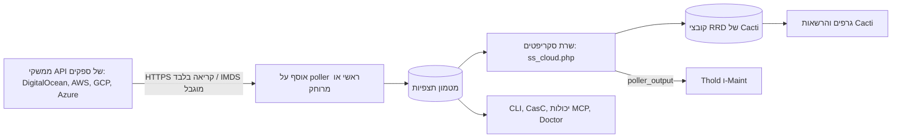

<!-- Source: README.md; SHA256: ac2074a40238686915802803c5efe773f33677f934281e0605e6e87a71a9d27d -->

<!-- translations:start -->
[English](../../../README.md) | [简体中文](../zh-CN/README.md) | [हिन्दी](../hi-IN/README.md) | [Español (España)](../es-ES/README.md) | [Español (Latinoamérica)](../es-419/README.md) | [العربية (السعودية)](../ar-SA/README.md) | [Afrikaans](../af-ZA/README.md) | [አማርኛ](../am-ET/README.md) | [العربية (مصر)](../ar-EG/README.md) | [العربية (المغرب)](../ar-MA/README.md) | [বাংলা](../bn-BD/README.md) | [Bosanski](../bs-BA/README.md) | [Deutsch](../de-DE/README.md) | [فارسی](../fa-IR/README.md) | [Filipino](../fil-PH/README.md) | [Français](../fr-FR/README.md) | [Français (Maroc)](../fr-MA/README.md) | [Français (Sénégal)](../fr-SN/README.md) | [Hausa](../ha-NG/README.md) | [עברית](README.md) | [Hrvatski](../hr-HR/README.md) | [Bahasa Indonesia](../id-ID/README.md) | [Igbo](../ig-NG/README.md) | [Italiano](../it-IT/README.md) | [日本語](../ja-JP/README.md) | [한국어](../ko-KR/README.md) | [Malagasy](../mg-MG/README.md) | [मराठी](../mr-IN/README.md) | [Bahasa Melayu](../ms-MY/README.md) | [Nederlands](../nl-NL/README.md) | [Polski](../pl-PL/README.md) | [Português (Brasil)](../pt-BR/README.md) | [Русский](../ru-RU/README.md) | [Kinyarwanda](../rw-RW/README.md) | [Soomaali](../so-SO/README.md) | [Српски](../sr-RS/README.md) | [Svenska](../sv-SE/README.md) | [Kiswahili](../sw-KE/README.md) | [தமிழ்](../ta-IN/README.md) | [తెలుగు](../te-IN/README.md) | [ไทย](../th-TH/README.md) | [Türkçe](../tr-TR/README.md) | [Українська](../uk-UA/README.md) | [اردو](../ur-PK/README.md) | [Tiếng Việt](../vi-VN/README.md) | [isiXhosa](../xh-ZA/README.md) | [Yorùbá](../yo-NG/README.md) | [繁體中文](../zh-TW/README.md) | [isiZulu](../zu-ZA/README.md)
<!-- translations:end -->

# plugin_cloud

תוסף עבור Cacti 1.2 המביא משאבים ומדדים מספקי ענן ציבורי אל תוך Cacti כהתקנים, מקורות נתונים וגרפים רגילים. עומסי עבודה בענן יושבים לצד הרשת הנושאת אותם, תחת ההרשאות של Cacti, ו-Thold ו-Maint מתריעים עליהם ומשתיקים אותם. תוסף אחד מכסה את DigitalOcean, Amazon Web Services, Google Cloud ו-Microsoft Azure באמצעות מנהלי התקנים לקריאה בלבד ב-PHP טהור.

> **מצב: בפיתוח, עדיין אין מהדורה (`0.1.0-dev`).** ענף זה מממש מנהלי התקנים ב-PHP טהור עבור DigitalOcean, AWS, Google Cloud ו-Azure, שכפול אוסף נתונים מרוחק ובריאות סוכן לקריאה בלבד, ספק CasC וממשק שורת פקודה למפעיל, יכולות MCP ובדיקות Doctor. תבניות Cacti המסופקות מכסות כעת Droplets ומאזני עומסים של DigitalOcean (`templates/cloud_digitalocean.xml`); חבילות תבניות Cacti עבור AWS, Google Cloud ו-Azure והסמכה מול חשבונות חיים מעבר ל-DigitalOcean ([עובדות על ספקים](../../research/provider-facts.md)) טרם הושלמו. אין להריץ בסביבת ייצור.

## ספקים נתמכים

כל מנהל התקן של ספק רשום ב-`Drivers::production()`, מוצע על ידי `Provider::released()`, ורץ ב-PHP טהור באמצעות `ext-openssl` ושקעי זרם ללא כל תלות בזמן ריצה של SDK או Composer.

| ספק | שדות טווח | מקורות פרטי גישה | אימות | משאבים שהתגלו | איסוף מדדים |
|---|---|---|---|---|---|
| DigitalOcean (`digitalocean`) | אין (מוגבל לטוקן) | `vault`, `file` | Bearer token | `droplet`, `load_balancer` | `/v2/monitoring/metrics` עם מודעות לחלק יחסי במגבלת הקצב; כולל תבניות ושאילתות נתונים של Cacti |
| Amazon Web Services (`aws`) | `account_id` (12 ספרות), `regions` | `vault`, `file`, `instance` | חתימת AWS SigV4 ב-PHP טהור (`AWS4-HMAC-SHA256`), אימות STS `GetCallerIdentity`, STS `AssumeRole` אופציונלי, EC2 IMDSv2 (`169.254.169.254`) עבור חשבונות `instance` | `ec2_instance`, `rds_instance`, `aws_elb` (ALB/NLB) | CloudWatch `GetMetricData` באצווה (עד 500 שאילתות לקריאה) |
| Google Cloud (`gcp`) | `project` | `vault`, `file`, `instance` | JWT של חשבון שירות RS256 ב-PHP טהור דרך `ext-openssl` המוחלף ב-`oauth2.googleapis.com/token`, או שרת מטא-נתונים של GCE (`metadata.google.internal`) עבור חשבונות `instance` | `gce_instance` דרך `instances.aggregatedList` | Cloud Monitoring `timeSeries.list` |
| Microsoft Azure (`azure`) | `tenant`, `subscription`, `regions` | `vault`, `file`, `instance` | תהליך Entra ID OAuth2 client-credentials ב-PHP טהור (`client_secret` בלבד; קביעות תעודה אינן כלולות), או זהות מנוהלת Azure IMDS (`169.254.169.254`) עבור טוקנים של ARM ו-Monitor | `azure_vm` דרך ARM Resource Graph (מדופדף עם `$skipToken` וללא כפילויות) | Azure Monitor `metrics:getBatch` (עד 50 משאבים לקריאה, תוך טיפול בהאטת קצב HTTP 429 ו-529) |

## יכולות שמומשו

### פלטפורמת ליבה, כספת ואוסף נתונים

- **התקנה ומחזור חיים מוגנים.** נקודות הכניסה (`setup.php`, `cli/cloud.php`, `poller_cloud.php`, `ss_cloud.php` וסקריפטים של דפים) מתפרשות ב-PHP 8.0 ומסרבות לפעול על PHP מתחת ל-8.2 או ללא `ext-openssl` מבלי לשבור את Cacti. השדרוגים סדורים, אידמפוטנטיים (`Schema::VERSION = 3`, 9 טבלאות) ועמידים בפני הפרעות. הסרה שומרת על טבלאות התוסף אלא אם הסימון *Keep Plugin Tables on Uninstall* הוסר.
- **חשבונות ופרטי גישה.** הוסיפו, ערכו, אמתו ומחקו חשבונות תחת **Management > Cloud Accounts**. פרטי הגישה מגיעים מהכספת המוצפנת ב-AES-256-GCM (`plugin_cloud_secret`, המוצפנת כברירת מחדל באמצעות `/etc/cacti/cloud-vault.key`), מקובץ המוגבל לתוך *Credential File Directory* המוגדר (`cloud_credential_dir`, ריק כברירת מחדל כדי לדחות קבצים), או מזהות המכונה של הספק. פרטי הגישה הם לכתיבה בלבד בממשק המשתמש ומושחרים מהיומנים.
- **בקרות יציאה וקריאה בלבד מחמירות.** כל מנהל התקן פועל מאחורי `GuardedTransport` ו-`OutboundPolicy`: פורט HTTPS 443 לשמות המארחים המדויקים של כל ספק, כאשר נקודות קצה מקומיות של מטא-נתונים ב-HTTP פורט 80 (`169.254.169.254`, `metadata.google.internal`) מופעלות רק עבור חשבונות `instance`. רק פעולות קריאה בלבד המופיעות ברשימת ההיתרים מותרות.
- **בקרות אוסף ועלות.** `poller_cloud.php` רץ מתוך `poller_bottom` (תהליך אחד לכל poller דרך רישום התהליכים של Cacti) במסגרת `cloud_collector_budget`, רוכש חכירות לכל חשבון, מריץ גילוי ב-`discover_interval`, קורא מדדים רק עבור מקורות נתונים פעילים של Cacti (`plugin_cloud_series`), מכבד את `request_share` ואת `monthly_ceiling`, ושומר במטמון את נקודות הנתונים העדכניות ביותר ב-`plugin_cloud_observation` עבור `ss_cloud.php`.
- **אובייקטים של Cacti והערכות בקשות.** מתחזק התקן טווח לכל חשבון (`plugin_cloud_device`), משמר שיטות אינדוקס מחדש של התקן הטווח בעת שמירת התקנים, מייבא תבניות DigitalOcean ושאילתות נתונים של שרת הסקריפטים (`templates/cloud_digitalocean.xml`, `cloud_do_droplet.xml`, `cloud_do_load_balancer.xml`), ומציג הערכות בקשות ומחירון ב-**New Graphs** (`graphs_new_top_links`) וב-**Cloud Health**.

### אוספי נתונים מרוחקים

- `INFO` מצהיר על `remote_collect:1`. ניתן לשייך חשבונות לכל poller פעיל של Cacti (`poller_id >= 1`), ו-`poller_cloud.php --poller=N` אוסף רק חשבונות השייכים לאותו poller.
- **נקודת החיבור `replicate_out`.** משכפלת שורות המשויכות ל-poller מתוך `plugin_cloud_account`, `plugin_cloud_device`, `plugin_cloud_series`, ושורות מוצפנות מתוך `plugin_cloud_secret` (רק עבור חשבונות מבוססי כספת השייכים ל-poller היעד) באמצעות `replicate_out_table()`. קובצי מפתח גולמיים של הכספת לעולם אינם נשמרים במסד הנתונים או משוכפלים ונשארים מקומיים בכל poller.
- **נקודת החיבור `remote_agent`.** חושפת סיכום בריאות JSON לקריאה בלבד (`action=cloud_health`) המקבל רק פרמטרים שלמים `poller_id` ו-`account_id` ואינו מחזיר פרטי גישה, נתיבי קבצים או סודות.

### נקודות חיבור לאקוסיסטם (CasC, יכולות MCP ו-Doctor)

- **ספק CasC (`casc_register_providers`).** רושם את הספק `cloud` (גרסת סכמה `1`) עם ייצוא YAML ו-XML דטרמיניסטי ב-PHP טהור, אימות מניפסט, תכנון הבדלים והחלה מאושרת. פרטי גישה מהכספת מיוצאים כהפניות `vault:account:<name>`; שדות סוד גולמיים (`secret`, `secrets`, `token`, `access_token`, `refresh_token`, `password`, `private_key`, `access_key_id`, `secret_access_key`, `session_token`, `client_secret`, `credential`, `credentials`, `vault_key`) נדחים. החלה מחייבת ערך SHA-256 מדויק ב-`--confirm=<PLAN_HASH>`.
- **ממשק MCP / Abilities API (`abilities_register`).** רושם שלוש יכולות לקריאה בלבד המוגבלות לתחום Cloud View (`cloud_health.php`) ולטווח התקני Cacti עבור קריאות שאינן של מנהל, ואינן פולטות פרטי גישה, מפתחות כספת או נתיבי קובצי פרטי גישה:
  - `cloud-list-accounts` (אופציונלי `provider`, `poller_id`)
  - `cloud-list-resources` (אופציונלי `account_id`, `type`, `lifecycle`)
  - `cloud-get-health` (אופציונלי `account_id`)
- **בדיקות Doctor (`doctor_register_checks`).** רושם חמש בדיקות אבחון שאינן חושפות ערכי סוד או חומר מפתח:
  - `cloud_schema`: עדכניות גרסת הסכמה
  - `cloud_vault_key`: קריאות, הרשאות וגודל של קובץ מפתח הכספת
  - `cloud_drivers`: רישום מנהלי התקן לייצור עבור כל הספקים המשוחררים
  - `cloud_accounts_health`: חשבונות מופעלים שנכשלו, הואטו או שהתיישנו
  - `cloud_poller_intervals`: התאמה של מרווחי האיסוף של חשבונות מופעלים למרווח ה-poller של Cacti

## ממשק שורת הפקודה (CLI)

הריצו מתיקיית השורש של Cacti עם PHP 8.2 ומעלה:

```sh
# Operator and CasC CLI (options use --key=value form)
php plugins/cloud/cli/cloud.php export [--format=yaml|xml]
php plugins/cloud/cli/cloud.php validate --file=<path> [--format=yaml|xml]
php plugins/cloud/cli/cloud.php plan --file=<path> [--format=yaml|xml]
php plugins/cloud/cli/cloud.php apply --file=<path> --confirm=<PLAN_HASH> [--format=yaml|xml]
php plugins/cloud/cli/cloud.php health [--format=text|json] [--poller=<id>]

# Collector entry point (normally started by poller_bottom)
php plugins/cloud/poller_cloud.php [--poller=N] [--force] [--debug]
```

## תפקידי גישה

| תחום | גישה |
| --- | --- |
| Cloud View | דפי הניטור הקיימים. |
| Cloud Operator | ניטור בתוספת דף Operations ואישורי מיון אישיים. |
| Cloud Admin | גישת Operator בתוספת פעולות ההגדרה והניהול הקיימות. |

לאחר העתקת קובצי השדרוג, פתחו את דף Plugins כמנהלים כדי לרשום את התחומים. הקצו את תחום Operator במפורש תחת **Configuration > Users** או קבוצות משתמשים. שדרוגים משמרים את מזהי התחומים וההענקות הקיימים של View ו-Admin. גישת Admin יורשת את גישת Operator, וגישת Operator יורשת את גישת View בכל בקשה; פעולה זו אינה מוסיפה הענקות שמורות למשתמשים או לקבוצות. הגדרות התוסף דורשות גם גישת Cloud Admin בנוסף להרשאת Settings של Cacti.

הרשאות ההתקנים של Cacti מגבילות את השורות והפעולות הזמינות לכל משתמש; אובייקטים לא ממופים דורשים מנהל. מפעילים יכולים לאמת את פרט הגישה השמור של חשבון שלמשתמש יש גישה להתקן ה-Cacti שלו. פרטי גישה, הגדרות, מיפוי, מחיקה ושינויים מנהלתיים אחרים נותרים בדפי הניהול. אישורים תקפים רק בסשן הנוכחי של המשתמש, למשך שעה אחת לכל היותר ורק כל עוד אותה תצפית נשארת טרייה. תצפיות חדשות או שהשתנו מבטלות אותם. הם לעולם אינם מסמנים מדידה שנכשלה כתקינה ואינם משתיקים התראות.

## מדוע

לכל ספק ענן יש מסוף ניטור משלו. בהרצה לצד Cacti נותרים שלושה פערים:

- **בקרת גישה נפרדת.** הצגת מדדי ענן למשתמש Cacti מחייבת להעניק לו כניסה לענן.
- **חוסר הקשר רשתי.** קישורים מקומיים מיוצגים בגרפים ב-Cacti; עומסי העבודה שמאחוריהם מיוצגים בגרפים במסוף של כל ספק.
- **התראות נפרדות.** Thold ו-Maint פועלים על מקורות נתונים והתקנים של Cacti, כך שאזעקות ספק מוגדרות ומושתקות בנפרד, פעם אחת לכל ספק.

התוסף קורא את ממשק הניטור של כל ספק ב-poller של Cacti, שומר במטמון את נקודות הנתונים העדכניות ומגיש אותן לשרת הסקריפטים של Cacti. ה-poller של Cacti כותב את קובצי ה-RRD, כך שגרפים, הרשאות, Thold, Maint ו-boost פועלים בדיוק כמו עבור כל נתון אחר ב-Cacti.

## התחייבויות תכנון

- **קריאה בלבד.** כל מנהל התקן יכול לבנות רק את פעולות הספק שברשימת ההיתרים שלו; התוסף לעולם אינו משנה משאב ענן. ([ADR 0002](../../decisions/0002-read-only-with-operation-allowlist.md))
- **PHP בלבד, ללא SDKs.** החתימה והחלפת הטוקנים ממומשות ב-PHP עם ההרחבות ש-Cacti כבר דורש. ללא תלויות זמן ריצה של Composer. ([ADR 0003](../../decisions/0003-php-only-without-sdks.md))
- **עלות לפני איסוף.** התוסף קורא רק מדדים שיש להם מקור נתונים ב-Cacti, מציג את מספר הבקשות הצפוי ואת העלות לפי מחירון לפני יצירת גרפים, ואוכף תקרה חודשית. ([ADR 0005](../../decisions/0005-collect-only-what-is-graphed.md))
- **אין פרטי גישה בטקסט גלוי במסד הנתונים.** פרטי הגישה מגיעים מכספת מוצפנת עם מפתח בקובץ שמחוץ למסד הנתונים, מקובץ פרטי גישה או מזהות המכונה של הספק. ([ADR 0007](../../decisions/0007-credentials-outside-the-database-in-the-clear.md))

## טווח ומצב

| שלב | טווח | אבני דרך | מצב |
|---|---|---|---|
| 0, מחקר | אימות עובדות ספקים, קטלוגי מדדים, מודל עלות וקצב, וקטורי בדיקה לחתימה, אבטיפוס תעבורה | [M1](https://github.com/somethingwithproof/plugin_cloud/milestone/1) | הושלם, פרט לבדיקות הדורשות חשבונות ספקים חיים |
| 1, ליבה ו-DigitalOcean | חשבונות, כספת פרטי גישה, תעבורה, אוסף, מטמון תצפיות, אובייקטי Cacti, תבניות, הערכות בקשות, דף בריאות, DigitalOcean Droplets ומאזני עומסים | [M2](https://github.com/somethingwithproof/plugin_cloud/milestone/2), [M3](https://github.com/somethingwithproof/plugin_cloud/milestone/3), [M4](https://github.com/somethingwithproof/plugin_cloud/milestone/4) | מומש; הסמכת פיילוט M4 ממתינה |
| 2, AWS | SigV4 ב-PHP טהור, STS `AssumeRole`, תפקידי מכונה IMDSv2, מלאי EC2/RDS/ELB, CloudWatch `GetMetricData` | [M5](https://github.com/somethingwithproof/plugin_cloud/milestone/5) | מנהל ההתקן מומש; תבניות Cacti והסמכה על חשבון חי ממתינות |
| 3, Google Cloud | JWT של חשבון שירות RS256 ב-PHP טהור, שרת מטא-נתונים של GCE, מלאי Compute Engine, Cloud Monitoring `timeSeries.list` | [M6](https://github.com/somethingwithproof/plugin_cloud/milestone/6) | מנהל ההתקן מומש; תבניות Cacti והסמכה על חשבון חי ממתינות |
| 4, Azure | פרטי לקוח Entra ID, זהות מנוהלת IMDS, מלאי VM של ARM Resource Graph, Azure Monitor `metrics:getBatch` | [M7](https://github.com/somethingwithproof/plugin_cloud/milestone/7) | מנהל ההתקן מומש; תבניות Cacti והסמכה על חשבון חי ממתינות |
| 5, אוספים מרוחקים ואקוסיסטם | אוספי נתונים מרוחקים (`replicate_out`, `remote_agent`), ספק CasC ו-CLI, יכולות MCP, בדיקות Doctor | [M8](https://github.com/somethingwithproof/plugin_cloud/milestone/8) | מומש |

מחוץ לטווח: שינוי משאבי ענן, יצירה או שיקוף של אזעקות ספק, דוחות חיוב, יומנים ומעקבים, ומנוע התראות בבעלות התוסף. ספקים נוספים (Hetzner Cloud, Akamai Cloud, Oracle Cloud ואחרים) הם נושאי מחקר.

## התקנה והגדרה

שלבים אלה מתקינים את קוד הפיתוח להערכה. הם דורשים Cacti 1.2.31 ואילך על PHP 8.2 ואילך.

1. העתיקו את המאגר אל `plugins/cloud` תחת תיקיית ה-Cacti שלכם. שם התיקייה חייב להיות `cloud`.
2. צרו את מפתח הכספת מחוץ לשורש האתר בכל poller המשתמש בפרטי גישה מבוססי כספת. מקמו אותו בתיקייה שרק root ומשתמש Cacti יכולים לכתוב אליה, והפכו את הקובץ לקריא רק עבור המשתמש המריץ את שרת האינטרנט ואת ה-poller. התוסף לעולם אינו יוצר או כותב לקובץ זה:

   ```sh
   sudo install -d -m 0750 -o root -g cacti /etc/cacti
   head -c 32 /dev/urandom | sudo tee /etc/cacti/cloud-vault.key > /dev/null
   sudo chown cacti:cacti /etc/cacti/cloud-vault.key
   sudo chmod 0600 /etc/cacti/cloud-vault.key
   ```

   החליפו את `cacti` במשתמש המריץ את שרת האינטרנט וה-poller שלכם. הקובץ מכיל 32 בתים גולמיים או 64 תווים הקסדצימליים. גבו אותו יחד עם מסד הנתונים; בלעדיו, יהיה צורך להזין מחדש את פרטי הגישה השמורים.
3. ב-Cacti, פתחו את **Configuration > Plugins**, ולאחר מכן התקינו והפעילו את *Cloud*.
4. תחת **Configuration > Settings > Cloud**, הגדירו את *Vault Key File* אם השתמשתם בנתיב אחר, הגדירו את *Credential File Directory* אם אתם מתכננים להשתמש בפרטי גישה מבוססי קובץ, ושמרו על *Collector Time Budget* (ברירת מחדל 240 שניות) נמוך ממרווח ה-poller.
5. העניקו *Cloud Admin*, *Cloud Operator* או *Cloud View* למשתמשים ולקבוצות תחת **Configuration > Users**. ההתקנה מעניקה Cloud Admin ו-Cloud View למנהל; Cloud Admin כולל גישת Operator, כך שהמנהל אינו זקוק להענקת Operator נפרדת.
6. הוסיפו חשבונות תחת **Management > Cloud Accounts**, ולאחר מכן בדקו אזהרות תחת **Management > Cloud Health**.

## יעדי תאימות

| רכיב | יעד |
|---|---|
| Cacti | 1.2.31 ואילך, ללא טלאי ליבה |
| PHP | 8.2 ואילך; נקודות הכניסה נשארות ניתנות לפענוח ב-8.0 כדי שסביבת ריצה לא נתמכת תקבל סירוב במקום ממשק Cacti שבור |
| הרחבות PHP | `ext-openssl` (נדרש על ידי Cacti 1.2.31); ללא `ext-curl` וללא תלויות זמן ריצה של Composer |
| Thold, Maint | אין צורך בשינויים |

## תכנון

- [docs/performance.md](../../performance.md) מכיל את מדידות האוסף ודף הבריאות, יחד עם החומרה וההגדרות שבהן נעשה שימוש.
- [docs/PLAN.md](../../PLAN.md) הוא התוכנית המלאה: ארכיטקטורה, עובדות ספק ו-Cacti שעליהן היא נשענת (עם מקורות), חוזה מנהל ההתקן, אריתמטיקת עלויות, גבולות אבטחה, בדיקות וסיכונים.
- [docs/decisions/](../../decisions/) שומר רשומות של החלטות ארכיטקטורה עבור בחירות שכבר התקבלו.
- [docs/REQUIREMENTS.md](../../REQUIREMENTS.md) ממפה כל מזהה דרישה לנושא שלו.



## מעקב אחר העבודה

- **אבני דרך** עוקבות אחר אבני הדרך של התוכנית. לכל אחת יש נושא אפיק המפרט את תתי-הנושאים והוכחות היציאה שלו.
- **נושאים** מסווגים לפי תווית: `type: requirement`, `type: research`, `type: decision`, `type: epic`. נושאי דרישות מפרטים דרישות ממוספרות ובדיקות (`REQ-AREA-NNN`) וקריטריוני קבלה.
- **תוויות** נושאות גם `area:`, `provider:`, `phase:`, `priority:` ו-`status:`. ראו [CONTRIBUTING.md](../../../CONTRIBUTING.md#labels).
- [לוח הפרויקט](https://github.com/users/somethingwithproof/projects/7) מציג את כל הנושאים על פני אבני הדרך.

## פיתוח

ה-CI ([.github/workflows/plugin-ci-workflow.yml](../../../.github/workflows/plugin-ci-workflow.yml)) בודק את ארכיון השחרור והגרסה הסמנטית (`bash tests/bin/archive-check.sh`), מבצע בדיקת תחביר לנקודות כניסה ב-PHP 8.0, מריץ בדיקות יחידה של Pest (`phpunit.xml`) ובדיקות אינטגרציה למחזור חיים (`phpunit-integration.xml`) ו-PHPStan רמה 9 על פני PHP 8.2 עד 8.5 מול Cacti `release/1.2.31` ו-`1.2.x` עם `CLOUD_OFFLINE=1`, בודק סירוב ב-PHP 8.1, מאמת קטלוגים של gettext, מודד ביצועים של איסוף 1,000 סדרות ודף הבריאות, ומריץ בדיקת זרימות עבודה ותאימות REUSE.

בדיקות מקומיות לפני דחיפה:

```sh
bash tests/bin/archive-check.sh
sh tests/lint-workflows.sh
sh locales/build_gettext.sh --check
CACTI_PATH=/path/to/cacti phpstan analyse -c phpstan.neon --no-progress
```

הריצו את Pest עם `--configuration=phpunit.xml` לבדיקות יחידה וכללי קוד מקור, או `--configuration=phpunit-integration.xml` עם `CACTI_PATH` ו-`CLOUD_TEST_DATABASE=disposable` מול מסד נתונים חד-פעמי של Cacti לבדיקות אינטגרציה של מחזור החיים.

## תרומה

קראו את [CONTRIBUTING.md](../../../CONTRIBUTING.md). קומיטים דורשים חתימת DCO. דיוני תכנון מתקיימים בנושאים; החלטות פתוחות נושאות את התווית `type: decision`.

## אבטחה

דווחו על פגיעויות באופן פרטי; ראו [SECURITY.md](../../../SECURITY.md).

## רישיון

GNU General Public License v2.0, אותו רישיון כמו Cacti והתוספים שלו. ראו [LICENSE](../../../LICENSE).
