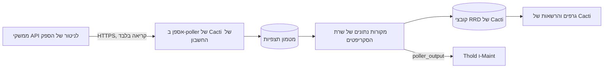

<!-- Source: README.md; SHA256: 7c621642e5f1a46bac66e4bc744f70aebb014c610d22de034088845fdc170405 -->

<!-- translations:start -->
[English](../../../README.md) | [简体中文](../zh-CN/README.md) | [हिन्दी](../hi-IN/README.md) | [Español (España)](../es-ES/README.md) | [Español (Latinoamérica)](../es-419/README.md) | [العربية (السعودية)](../ar-SA/README.md) | [Afrikaans](../af-ZA/README.md) | [አማርኛ](../am-ET/README.md) | [العربية (مصر)](../ar-EG/README.md) | [العربية (المغرب)](../ar-MA/README.md) | [বাংলা](../bn-BD/README.md) | [Bosanski](../bs-BA/README.md) | [Deutsch](../de-DE/README.md) | [فارسی](../fa-IR/README.md) | [Filipino](../fil-PH/README.md) | [Français](../fr-FR/README.md) | [Français (Maroc)](../fr-MA/README.md) | [Français (Sénégal)](../fr-SN/README.md) | [Hausa](../ha-NG/README.md) | [עברית](README.md) | [Hrvatski](../hr-HR/README.md) | [Bahasa Indonesia](../id-ID/README.md) | [Igbo](../ig-NG/README.md) | [Italiano](../it-IT/README.md) | [日本語](../ja-JP/README.md) | [한국어](../ko-KR/README.md) | [Malagasy](../mg-MG/README.md) | [मराठी](../mr-IN/README.md) | [Bahasa Melayu](../ms-MY/README.md) | [Nederlands](../nl-NL/README.md) | [Polski](../pl-PL/README.md) | [Português (Brasil)](../pt-BR/README.md) | [Русский](../ru-RU/README.md) | [Kinyarwanda](../rw-RW/README.md) | [Soomaali](../so-SO/README.md) | [Српски](../sr-RS/README.md) | [Svenska](../sv-SE/README.md) | [Kiswahili](../sw-KE/README.md) | [தமிழ்](../ta-IN/README.md) | [తెలుగు](../te-IN/README.md) | [ไทย](../th-TH/README.md) | [Türkçe](../tr-TR/README.md) | [Українська](../uk-UA/README.md) | [اردو](../ur-PK/README.md) | [Tiếng Việt](../vi-VN/README.md) | [isiXhosa](../xh-ZA/README.md) | [Yorùbá](../yo-NG/README.md) | [繁體中文](../zh-TW/README.md) | [isiZulu](../zu-ZA/README.md)
<!-- translations:end -->

# plugin_cloud

תוסף עבור Cacti 1.2 המביא משאבים ומדדים מספקי ענן ציבורי אל תוך Cacti כהתקנים, מקורות נתונים וגרפים רגילים. עומסי עבודה בענן יושבים אז לצד הרשת הנושאת אותם, תחת ההרשאות של Cacti, ו-Thold ו-Maint יכולים להתריע עליהם ולהשתיק אותם. תוסף אחד מכסה כל ספק, עם מנהל התקן (driver) לכל ספק: DigitalOcean, AWS, Google Cloud ו-Azure תחילה.

> **סטטוס: אבן דרך 3 (אובייקטים של DigitalOcean ו-Cacti), בבדיקה.** אבן הדרך מוסיפה את מנהל ההתקן של DigitalOcean, תבניות Cacti, התקן היקף (scope device) לכל חשבון עם שאילתת נתונים לכל סוג משאב, קלט לשרת הסקריפטים, והערכת בקשות במסך New Graphs ובדף התקינות. בדיקות ראשוניות מול חשבון DigitalOcean פעיל מתועדות במסמך [עובדות הספקים](../../research/provider-facts.md). אין להריץ בסביבת ייצור.

## תפקידי גישה

| תחום הרשאה (Realm) | גישה |
| --- | --- |
| Cloud View | דפי הניטור הקיימים. |
| Cloud Operator | ניטור ובנוסף דף התפעול (Operations) ואישורי קבלה אישיים למיון תקלות (triage). |
| Cloud Admin | גישת Operator ובנוסף התצורה הקיימת ופעולות הניהול. |

לאחר העתקת קובצי השדרוג, פתחו את דף ה-Plugins כמנהלי מערכת כדי לרשום את תחום ההרשאה החדש. הקצו את תחום ה-Operator במפורש תחת **Configuration > Users** או קבוצות משתמשים. שדרוגים שומרים על מזהי תחומי ההרשאה וההקצאות הקיימים של View ו-Admin. גישת Admin יורשת את גישת Operator, וגישת Operator יורשת את גישת View בכל בקשה; פעולה זו אינה מוסיפה הרשאות שמורות למשתמשים או לקבוצות. הגדרות התוסף דורשות גם גישת Cloud Admin בנוסף להרשאת Settings של Cacti.

הרשאות ההתקנים של Cacti עדיין מגבילות את השורות והפעולות הזמינות לכל משתמש; אובייקטים לא ממופים דורשים מנהל מערכת. מפעילים (Operators) יכולים לאמת את פרטי האימות השמורים עבור חשבון שלהתקן ה-Cacti שלו יש להם גישה. פרטי אימות, תצורה, מיפוי, מחיקה ושינויים ניהוליים אחרים נותרים בדפי הניהול. אישורי קבלה (Acknowledgments) נשמרים רק בהפעלה הנוכחית של המשתמש, למשך שעה אחת לכל היותר ורק כל עוד אותה תצפית נותרת עדכנית. תצפיות חדשות או שהשתנו מבטלות אותם. הם לעולם אינם מסמנים מדידה שנכשלה כתקינה ואינם משתיקים התראות.

## למה

לכל ספק ענן יש מסוף ניטור משלו. בהרצה לצד Cacti, נוצרים שלושה פערים:

- **בקרת גישה נפרדת.** הצגת מדדי ענן למשתמש Cacti פירושה מתן פרטי התחברות לענן.
- **ללא הקשר רשתי.** קישורים מקומיים (on-premises) מוצגים בגרפים ב-Cacti; עומסי העבודה שמאחוריהם מוצגים בגרפים במסוף של כל ספק.
- **התראות נפרדות.** Thold ו-Maint פועלים על מקורות נתונים והתקנים של Cacti, כך שהתרעות הספקים מוגדרות ומושקטות בנפרד, פעם אחת לכל ספק.

התוסף קורא את ממשק ה-API לניטור של כל ספק באמצעות תהליך ה-poller של Cacti, שומר במטמון את נקודות הנתונים האחרונות ומגיש אותן לשרת הסקריפטים של Cacti. ה-poller של Cacti כותב את קובצי ה-RRD, כך שהגרפים, ההרשאות, Thold, Maint ו-boost פועלים כפי שהם פועלים עבור כל נתון אחר ב-Cacti.

## התחייבויות תכנוניות

- **קריאה בלבד.** כל מנהל התקן יכול לבנות רק את פעולות הספק הנמצאות ברשימת ההיתרים שלו; התוסף לעולם אינו משנה משאב ענן. ([ADR 0002](../../decisions/0002-read-only-with-operation-allowlist.md))
- **PHP בלבד, ללא ערכות SDK.** חתימה והחלפת אסימונים מיושמות ב-PHP עם ההרחבות ש-Cacti כבר דורש. ללא תלויות זמן ריצה של Composer. ([ADR 0003](../../decisions/0003-php-only-without-sdks.md))
- **עלות לפני איסוף.** התוסף קורא רק מדדים שיש להם מקור נתונים ב-Cacti, מציג את מספר הבקשות הצפוי ואת העלות לפי מחירון לפני יצירת הגרפים, ואוכף תקרה חודשית. ([ADR 0005](../../decisions/0005-collect-only-what-is-graphed.md))
- **ללא פרטי אימות בטקסט גלוי במסד הנתונים.** פרטי האימות מגיעים מכספת מוצפנת שמפתחה שמור בקובץ מחוץ למסד הנתונים, מקובץ פרטי אימות, או מזהות המופע (instance identity) אצל הספק. ([ADR 0007](../../decisions/0007-credentials-outside-the-database-in-the-clear.md))

## היקף וסטטוס

| שלב | היקף | אבני דרך | סטטוס |
|---|---|---|---|
| 0, מחקר | אימות עובדות ספקים, קטלוגי מדדים, מודל עלות וקצב, וקטורי בדיקה לחתימה, בדיקת תעבורה ראשונית (transport spike) | [M1](https://github.com/somethingwithproof/plugin_cloud/milestone/1) | הושלם, פרט לבדיקות הדורשות חשבון ספק פעיל |
| 1, ליבה ו-DigitalOcean | חשבונות, כספת פרטי אימות, שכבת תעבורה, אספן (collector), מטמון תצפיות, אובייקטי Cacti, דף תקינות, DigitalOcean Droplets ומאזני עומסים | [M2](https://github.com/somethingwithproof/plugin_cloud/milestone/2), [M3](https://github.com/somethingwithproof/plugin_cloud/milestone/3), [M4](https://github.com/somethingwithproof/plugin_cloud/milestone/4) | M2 הושלם ([#81](https://github.com/somethingwithproof/plugin_cloud/pull/81)); מנהל ההתקן, התבניות והתקני ההיקף של M3 מוזגו; הערכות בקשות, הרשאות ובדיקות ביצועים בבדיקה; M4 טרם החל |
| 2, AWS | Signature Version 4, `AssumeRole`, תפקידי מופע (instance roles), CloudWatch `GetMetricData`, מלאי אזורי | [M5](https://github.com/somethingwithproof/plugin_cloud/milestone/5) | טרם החל |
| 3, Google Cloud | JWT של חשבון שירות, שרת מטא-נתונים, Cloud Monitoring `timeSeries.list` | [M6](https://github.com/somethingwithproof/plugin_cloud/milestone/6) | טרם החל |
| 4, Azure | פרטי אימות לקוח של Entra, זהות מנוהלת (managed identity), Resource Graph, `metrics:getBatch` | [M7](https://github.com/somethingwithproof/plugin_cloud/milestone/7) | טרם החל |
| 5, אספנים מרוחקים | חשבונות על אספני נתונים מרוחקים של Cacti | [M8](https://github.com/somethingwithproof/plugin_cloud/milestone/8) | טרם החל |

מחוץ להיקף: שינוי משאבי ענן, יצירה או שיקוף של התראות ספקים, דוחות חיוב, יומנים ועקבות (logs and traces), ומנוע התראות בבעלות התוסף. ספקים נוספים (Hetzner Cloud, Akamai Cloud, Oracle Cloud ואחרים) נמצאים כסוגיות מחקר.

## מה כוללת אבן דרך 2

- **התקנה מוגנת.** בגרסת PHP הנמוכה מ-8.2, או ללא ext-openssl, ההתקנה וההפעלה נדחות עם הודעה, ושאר Cacti ממשיך לעבוד.
- **מחזור חיים.** התקנה, שדרוג והסרה דרך דף ה-Plugins של Cacti. שדרוגים מבוצעים לפי סדר ושורדים הפרעה באמצע. הסרה שומרת על טבלאות התוסף אלא אם תנקו את הסימון מ-*Keep Plugin Tables on Uninstall*.
- **תחומי הרשאה נפרדים.** *Cloud Admin* פותח את **Cloud Accounts**; *Cloud Operator* פותח את **Cloud Operations**; *Cloud View* פותח את **Cloud Health**. Admin יורש מ-Operator, ו-Operator יורש מ-View. כל שלושת הדפים נמצאים תחת Management.
- **חשבונות ופרטי אימות.** הוספה, עריכה, אימות ומחיקה של חשבונות. פרטי אימות מוצפנים במסד הנתונים באמצעות קובץ מפתח השמור מחוץ לו (AES-256-GCM), או נקראים מקובץ בשרת ה-poller. פרטי האימות הם לכתיבה בלבד בממשק המשתמש ומושחרים מיומני הרישום.
- **האספן (collector).** מופעל מכל ריצת poller, מופע אחד לכל poller, במסגרת תקציב זמן. הוא לוקח חכירה (lease) לכל חשבון, מריץ גילוי משאבים במרווח הזמן שלו, וקורא מדדים רק עבור מקורות הנתונים הפעילים של התוסף עצמו.
- **תקינות.** מצב איסוף, גילוי, משאבים ועדכניות לכל חשבון, בתוספת אזהרות על מפתח כספת לא שמיש, קובצי פרטי אימות לא מאובטחים ומרווחי זמן שה-poller אינו יכול לעמוד בהם.

## התקנה והגדרה

שלבים אלה מתקינים את קוד אבן דרך 2 לצורך הערכה. הם דורשים Cacti 1.2.31 ואילך על PHP 8.2 ואילך.

1. העתיקו את המאגר אל `plugins/cloud` תחת תיקיית ה-Cacti שלכם. שם התיקייה חייב להיות `cloud`.
2. צרו את מפתח הכספת מחוץ לשורש הרשת (web root). הניחו אותו בתיקייה שרק root ומשתמש ה-Cacti יכולים לכתוב אליה, והגדירו את הקובץ לקריאה בלבד עבור המשתמש המריץ את שרת הרשת ואת ה-poller. התוסף לעולם אינו יוצר או כותב קובץ זה:

   ```sh
   sudo install -d -m 0750 -o root -g cacti /etc/cacti
   head -c 32 /dev/urandom | sudo tee /etc/cacti/cloud-vault.key > /dev/null
   sudo chown cacti:cacti /etc/cacti/cloud-vault.key
   sudo chmod 0600 /etc/cacti/cloud-vault.key
   ```

   החליפו את `cacti` במשתמש המריץ את שרת הרשת וה-poller שלכם. הקובץ מכיל 32 בתים גולמיים או 64 תווים הקסדצימליים. גבו אותו יחד עם מסד הנתונים; בלעדיו, יהיה צורך להזין מחדש את פרטי האימות השמורים.
3. ב-Cacti, פתחו את **Configuration > Plugins**, ולאחר מכן התקינו והפעילו את *Cloud*.
4. תחת **Configuration > Settings > Cloud**, הגדירו את *Vault Key File* אם השתמשתם בנתיב אחר. הערך של *Collector Time Budget* (ברירת מחדל 240 שניות) חייב להישאר נמוך ממרווח הריצה של ה-poller.
5. העניקו את *Cloud Admin*, *Cloud Operator* או *Cloud View* למשתמשים ולקבוצות תחת **Configuration > Users**. ההתקנה מעניקה Cloud Admin ו-Cloud View למנהל המערכת; Cloud Admin כולל גישת Operator, כך שמנהל המערכת אינו זקוק להקצאת Operator נפרדת.
6. הוסיפו חשבונות תחת **Management > Cloud Accounts**, ולאחר מכן בדקו ב-**Management > Cloud Health** אם ישנן אזהרות.

## יעדי תאימות

| רכיב | יעד |
|---|---|
| Cacti | 1.2.31 ואילך, ללא תיקוני ליבה |
| PHP | 8.2 ואילך; `setup.php` נשאר ניתן לפענוח ב-8.0 כך שסביבת ריצה לא נתמכת תקבל סירוב במקום ממשק Cacti שבור |
| הרחבות PHP | ללא תוספת מעבר לאלו ש-Cacti 1.2.31 דורש |
| Thold, Maint | אין צורך בשינויים |

## תכנון

- [docs/performance.md](../../performance.md) מכיל את מדידות האספן ודף התקינות, יחד עם החומרה וההגדרות ששימשו להן.
- [docs/PLAN.md](../../PLAN.md) היא התוכנית המלאה: ארכיטקטורה, עובדות הספקים ו-Cacti שעליהן היא מסתמכת (כולל מקורות), חוזה מנהל ההתקן, חישוב עלויות, גבולות אבטחה, בדיקות וסיכונים.
- [docs/decisions/](../../decisions) מחזיקה רשומות החלטות ארכיטקטורה (ADR) עבור בחירות שכבר התקבלו.
- [docs/REQUIREMENTS.md](../../REQUIREMENTS.md) ממפה כל מזהה דרישה לסוגיה שלו.



## כיצד העבודה מנוהלת

- **אבני דרך (Milestones)** עוקבות אחר אבני הדרך של התוכנית. לכל אחת יש סוגיית אפיק המפרטת את תתי-הסוגיות שלה ואת ראיות הסיום.
- **סוגיות (Issues)** מסווגות לפי תוויות: `type: requirement`, `type: research`, `type: decision`, `type: epic`. סוגיות דרישה מציינות דרישות ממוספרות ובדיקות (`REQ-AREA-NNN`) וקריטריוני קבלה.
- **תוויות (Labels)** נושאות גם `area:`, `provider:`, `phase:`, `priority:` ו-`status:`. ראו [CONTRIBUTING.md](../../../CONTRIBUTING.md#labels).
- [לוח הפרויקט](https://github.com/users/somethingwithproof/projects/7) מציג את כל הסוגיות בכל אבני הדרך.

## פיתוח

מערכת ה-CI מבצעת בדיקת תחביר (lint) לנקודות הכניסה ב-PHP 8.0, מריצה בדיקות יחידה ושילוב וכן PHPStan ברמה 9, ומתקינה את התוסף על PHP 8.2 עד 8.5 מול Cacti 1.2.31 והענף 1.2.x. היא גם בודקת ש-PHP 8.1 נדחה מבלי לשבור את Cacti. הבדיקות משתמשות ב-Pest מתוך רתמת התוספים של ליבת Cacti. בחירה זו היא זמנית עד ש-[#12](https://github.com/somethingwithproof/plugin_cloud/issues/12) יוכרע. [.github/workflows/plugin-ci-workflow.yml](../../../.github/workflows/plugin-ci-workflow.yml) מפרט כל שלב. הריצו `sh tests/lint-workflows.sh` ו-`sh locales/build_gettext.sh --check` מקומית לפני דחיפה.

## תרומה לפרויקט

קראו את [CONTRIBUTING.md](../../../CONTRIBUTING.md). קומיטים דורשים חתימת DCO (sign-off). דיוני תכנון מתקיימים בסוגיות; החלטות פתוחות נושאות את התווית `type: decision`.

## אבטחה

דווחו על פגיעויות באופן פרטי; ראו [SECURITY.md](../../../SECURITY.md).

## רישיון

GNU General Public License v2.0, אותו רישיון כמו Cacti והתוספים שלה. ראו [LICENSE](../../../LICENSE).
