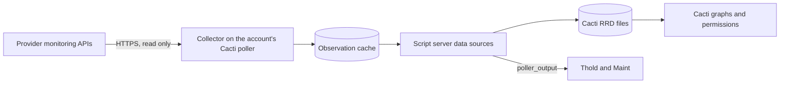

<!-- Source: README.md; SHA256: 7c621642e5f1a46bac66e4bc744f70aebb014c610d22de034088845fdc170405 -->

<!-- translations:start -->
[English](../../../README.md) | [简体中文](../zh-CN/README.md) | [हिन्दी](README.md) | [Español (España)](../es-ES/README.md) | [Español (Latinoamérica)](../es-419/README.md) | [العربية](../ar-SA/README.md)
<!-- translations:end -->

<a id="plugin_cloud"></a>
# plugin_cloud

यह Cacti 1.2 प्लगइन सार्वजनिक क्लाउड प्रदाताओं के संसाधनों और मेट्रिक को सामान्य डिवाइस, डेटा स्रोत और ग्राफ़ के रूप में Cacti में लाता है। इससे क्लाउड कार्यभार उन्हें वहन करने वाले नेटवर्क के साथ, Cacti की अनुमतियों के अंतर्गत दिखाई देते हैं, और Thold तथा Maint उन पर अलर्ट दे सकते हैं या दबा सकते हैं। हर प्रदाता के लिए अलग ड्राइवर के साथ एक प्लगइन सभी प्रदाताओं को समेटता है: पहले DigitalOcean, AWS, Google Cloud और Azure।

> **स्थिति: माइलस्टोन 3 (DigitalOcean और Cacti ऑब्जेक्ट), समीक्षा में।** यह माइलस्टोन DigitalOcean ड्राइवर, Cacti टेम्पलेट, प्रत्येक खाते के लिए एक स्कोप डिवाइस और प्रत्येक संसाधन प्रकार के लिए डेटा क्वेरी, स्क्रिप्ट सर्वर इनपुट तथा New Graphs और स्वास्थ्य पृष्ठ पर अनुरोध अनुमान जोड़ता है। वास्तविक DigitalOcean खाते पर शुरुआती जाँचें [प्रदाता संबंधी तथ्यों](../../research/provider-facts.md) में दर्ज हैं। इसे उत्पादन में न चलाएँ।

<a id="access-roles"></a>
## पहुँच भूमिकाएँ

| अनुमति क्षेत्र | पहुँच |
| --- | --- |
| Cloud View | मौजूदा निगरानी पृष्ठ। |
| Cloud Operator | निगरानी, Operations पृष्ठ और जाँच के लिए व्यक्तिगत पावती। |
| Cloud Admin | ऑपरेटर पहुँच तथा मौजूदा कॉन्फ़िगरेशन और प्रशासनिक कार्रवाइयाँ। |

अपग्रेड फ़ाइलें कॉपी करने के बाद नया अनुमति क्षेत्र पंजीकृत करने के लिए प्रशासक के रूप में Plugins पृष्ठ खोलें। **Configuration > Users** या उपयोगकर्ता समूहों में Operator क्षेत्र स्पष्ट रूप से दें। अपग्रेड मौजूदा View और Admin क्षेत्र के ID और अनुमतियाँ बनाए रखते हैं। हर अनुरोध में Admin पहुँच को Operator पहुँच और Operator को View पहुँच विरासत में मिलती है; इससे उपयोगकर्ताओं या समूहों की संग्रहीत अनुमतियाँ नहीं जुड़तीं। प्लगइन सेटिंग्स के लिए Cacti की Settings अनुमति के साथ Cloud Admin पहुँच भी आवश्यक है।

Cacti डिवाइस अनुमतियाँ अब भी प्रत्येक उपयोगकर्ता की उपलब्ध पंक्तियों और कार्रवाइयों को सीमित करती हैं; बिना मैप किए ऑब्जेक्ट के लिए प्रशासक चाहिए। ऑपरेटर उस खाते का संग्रहीत क्रेडेंशियल सत्यापित कर सकते हैं जिसके Cacti डिवाइस तक उनकी पहुँच है। क्रेडेंशियल, कॉन्फ़िगरेशन, मैपिंग, हटाना और अन्य प्रशासनिक बदलाव प्रशासनिक पृष्ठों पर ही रहते हैं। पावती केवल वर्तमान उपयोगकर्ता के सत्र में, अधिकतम एक घंटे तक और केवल जब तक वही अवलोकन ताज़ा है, बनी रहती है। नए या बदले अवलोकन उसे अमान्य करते हैं। यह कभी विफल मापन को स्वस्थ नहीं बनाती या अलर्ट नहीं दबाती।

<a id="why"></a>
## उद्देश्य

हर क्लाउड प्रदाता की अपनी निगरानी कंसोल है। Cacti के साथ चलाने पर उनमें तीन कमियाँ रहती हैं:

- **अलग पहुँच नियंत्रण।** Cacti उपयोगकर्ता को क्लाउड मेट्रिक दिखाने के लिए उसे क्लाउड लॉगिन देना पड़ता है।
- **नेटवर्क संदर्भ नहीं।** स्थानीय लिंक Cacti में ग्राफ़ होते हैं; उनके पीछे के कार्यभार हर प्रदाता की कंसोल में ग्राफ़ होते हैं।
- **अलग अलर्ट व्यवस्था।** Thold और Maint Cacti डेटा स्रोतों और डिवाइसों पर काम करते हैं, इसलिए प्रदाता अलार्म हर प्रदाता के लिए अलग कॉन्फ़िगर और दबाए जाते हैं।

प्लगइन Cacti पोलर पर हर प्रदाता की निगरानी API पढ़ता है, नवीनतम डेटा बिंदु कैश करता है और उन्हें Cacti स्क्रिप्ट सर्वर को देता है। Cacti पोलर RRD फ़ाइलें लिखता है, इसलिए ग्राफ़, अनुमतियाँ, Thold, Maint और boost किसी भी Cacti डेटा की तरह काम करते हैं।

<a id="design-commitments"></a>
## डिज़ाइन की प्रतिबद्धताएँ

- **केवल-पठन।** हर ड्राइवर केवल अपनी अनुमति-सूची में दिए प्रदाता ऑपरेशन बना सकता है; प्लगइन कभी क्लाउड संसाधन नहीं बदलता। ([ADR 0002](../../decisions/0002-read-only-with-operation-allowlist.md))
- **केवल PHP, कोई SDK नहीं।** हस्ताक्षर और टोकन विनिमय PHP में उन एक्सटेंशन से लागू हैं जो Cacti पहले से माँगता है। कोई Composer रनटाइम निर्भरता नहीं है। ([ADR 0003](../../decisions/0003-php-only-without-sdks.md))
- **संग्रह से पहले लागत।** प्लगइन केवल उन मेट्रिक को पढ़ता है जिनका Cacti डेटा स्रोत है, ग्राफ़ बनाने से पहले अपेक्षित अनुरोध संख्या और सूची-मूल्य लागत दिखाता है तथा मासिक सीमा लागू करता है। ([ADR 0005](../../decisions/0005-collect-only-what-is-graphed.md))
- **डेटाबेस में सादे पाठ के क्रेडेंशियल नहीं।** क्रेडेंशियल एन्क्रिप्टेड वॉल्ट से आते हैं जिसकी कुंजी डेटाबेस के बाहर फ़ाइल में है, या क्रेडेंशियल फ़ाइल से, या प्रदाता की इंस्टेंस पहचान से। ([ADR 0007](../../decisions/0007-credentials-outside-the-database-in-the-clear.md))

<a id="scope-and-status"></a>
## दायरा और स्थिति

| चरण | दायरा | माइलस्टोन | स्थिति |
|---|---|---|---|
| 0, शोध | प्रदाता तथ्य पुष्टि, मेट्रिक कैटलॉग, लागत और दर मॉडल, हस्ताक्षर परीक्षण वेक्टर, परिवहन प्रोटोटाइप | [M1](https://github.com/somethingwithproof/plugin_cloud/milestone/1) | वास्तविक प्रदाता खाता माँगने वाली जाँचों को छोड़कर पूरा |
| 1, कोर और DigitalOcean | खाते, क्रेडेंशियल वॉल्ट, परिवहन, संग्राहक, अवलोकन कैश, Cacti ऑब्जेक्ट, स्वास्थ्य पृष्ठ, DigitalOcean Droplet और लोड बैलेंसर | [M2](https://github.com/somethingwithproof/plugin_cloud/milestone/2), [M3](https://github.com/somethingwithproof/plugin_cloud/milestone/3), [M4](https://github.com/somethingwithproof/plugin_cloud/milestone/4) | M2 पूरा ([#81](https://github.com/somethingwithproof/plugin_cloud/pull/81)); M3 ड्राइवर, टेम्पलेट और स्कोप डिवाइस मर्ज; अनुरोध अनुमान, अनुमतियाँ और प्रदर्शन जाँच समीक्षा में; M4 शुरू नहीं |
| 2, AWS | Signature Version 4, `AssumeRole`, इंस्टेंस भूमिकाएँ, CloudWatch `GetMetricData`, क्षेत्रीय इन्वेंट्री | [M5](https://github.com/somethingwithproof/plugin_cloud/milestone/5) | शुरू नहीं |
| 3, Google Cloud | सेवा खाता JWT, मेटाडेटा सर्वर, Cloud Monitoring `timeSeries.list` | [M6](https://github.com/somethingwithproof/plugin_cloud/milestone/6) | शुरू नहीं |
| 4, Azure | Entra क्लाइंट क्रेडेंशियल, प्रबंधित पहचान, Resource Graph, `metrics:getBatch` | [M7](https://github.com/somethingwithproof/plugin_cloud/milestone/7) | शुरू नहीं |
| 5, रिमोट संग्राहक | Cacti रिमोट डेटा संग्राहकों पर खाते | [M8](https://github.com/somethingwithproof/plugin_cloud/milestone/8) | शुरू नहीं |

दायरे से बाहर: क्लाउड संसाधन बदलना, प्रदाता अलार्म बनाना या प्रतिबिंबित करना, बिलिंग रिपोर्ट, लॉग और ट्रेस तथा प्लगइन का अपना अलर्ट इंजन। अतिरिक्त प्रदाता (Hetzner Cloud, Akamai Cloud, Oracle Cloud और अन्य) शोध के विषय हैं।

<a id="what-milestone-2-ships"></a>
## माइलस्टोन 2 में क्या मिलता है

- **सुरक्षित स्थापना जाँच।** PHP 8.2 से नीचे या ext-openssl के बिना स्थापना और सक्षम करना संदेश के साथ अस्वीकार होता है, और बाकी Cacti काम करता रहता है।
- **जीवनचक्र।** Cacti के Plugins पृष्ठ से इंस्टॉल, अपग्रेड और अनइंस्टॉल करें। अपग्रेड क्रमबद्ध हैं और रुकावट सहते हैं। *Keep Plugin Tables on Uninstall* को अचयनित न करने तक अनइंस्टॉल प्लगइन तालिकाएँ रखता है।
- **अलग अनुमति क्षेत्र।** *Cloud Admin* से **Cloud Accounts**, *Cloud Operator* से **Cloud Operations**, और *Cloud View* से **Cloud Health** खुलता है। Admin को Operator की, और Operator को View की पहुँच विरासत में मिलती है। तीनों पृष्ठ Management में हैं।
- **खाते और क्रेडेंशियल।** खाते जोड़ें, संपादित करें, सत्यापित करें और हटाएँ। क्रेडेंशियल या तो बाहर रखी कुंजी फ़ाइल से डेटाबेस में एन्क्रिप्ट होता है (AES-256-GCM), या पोलर की फ़ाइल से पढ़ा जाता है। UI में क्रेडेंशियल केवल लिखे जा सकते हैं और लॉग में छिपाए जाते हैं।
- **संग्राहक।** यह हर पोलर निष्पादन पर, प्रति पोलर एक इंस्टेंस के रूप में और समय बजट में शुरू होता है। यह प्रति खाते लीज़ लेता है, अपने अंतराल पर खोज चलाता है और केवल प्लगइन के अपने सक्रिय डेटा स्रोतों के मेट्रिक पढ़ता है।
- **स्वास्थ्य।** प्रति-खाता संग्रह, खोज, संसाधन और ताज़गी की स्थिति, साथ में अनुपयोगी वॉल्ट कुंजी, असुरक्षित क्रेडेंशियल फ़ाइल और पोलर के पूरा न कर सकने वाले अंतराल की चेतावनियाँ।

<a id="install-and-configure"></a>
## इंस्टॉल और कॉन्फ़िगर करना

ये चरण मूल्यांकन के लिए माइलस्टोन 2 कोड इंस्टॉल करते हैं। इन्हें PHP 8.2 या नए पर Cacti 1.2.31 या नया चाहिए।

1. रिपॉज़िटरी को Cacti डायरेक्टरी के अंतर्गत `plugins/cloud` में कॉपी करें। डायरेक्टरी का नाम `cloud` होना चाहिए।
2. वॉल्ट कुंजी वेब रूट के बाहर बनाएँ। इसे ऐसी डायरेक्टरी में रखें जहाँ केवल root और Cacti उपयोगकर्ता लिख सकें, और फ़ाइल केवल वेब सर्वर तथा पोलर चलाने वाले उपयोगकर्ता के पढ़ने योग्य बनाएँ। प्लगइन यह फ़ाइल कभी बनाता या लिखता नहीं है:

   ```sh
   sudo install -d -m 0750 -o root -g cacti /etc/cacti
   head -c 32 /dev/urandom | sudo tee /etc/cacti/cloud-vault.key > /dev/null
   sudo chown cacti:cacti /etc/cacti/cloud-vault.key
   sudo chmod 0600 /etc/cacti/cloud-vault.key
   ```

   `cacti` को वेब सर्वर और पोलर चलाने वाले उपयोगकर्ता से बदलें। फ़ाइल में 32 मूल बाइट या 64 हेक्साडेसिमल वर्ण होते हैं। डेटाबेस के साथ बैकअप लें; इसके बिना संग्रहीत क्रेडेंशियल दोबारा दर्ज करने होंगे।
3. Cacti में **Configuration > Plugins** खोलें, फिर *Cloud* इंस्टॉल और सक्षम करें।
4. **Configuration > Settings > Cloud** में, अलग पथ उपयोग किया हो तो *Vault Key File* सेट करें। *Collector Time Budget* (डिफ़ॉल्ट 240 सेकंड) पोलर अंतराल से कम होना चाहिए।
5. **Configuration > Users** में उपयोगकर्ताओं और समूहों को *Cloud Admin*, *Cloud Operator* या *Cloud View* दें। इंस्टॉल करने पर प्रशासक को Cloud Admin और Cloud View मिलते हैं; Cloud Admin में Operator पहुँच शामिल है, इसलिए प्रशासक को अलग से Operator देने की ज़रूरत नहीं है।
6. **Management > Cloud Accounts** में खाते जोड़ें, फिर **Management > Cloud Health** पर चेतावनियाँ जाँचें।

<a id="compatibility-targets"></a>
## संगतता लक्ष्य

| घटक | लक्ष्य |
|---|---|
| Cacti | 1.2.31 या नया, कोर पैच के बिना |
| PHP | 8.2 या नया; `setup.php` 8.0 पर पार्स हो सकता है, ताकि असमर्थित रनटाइम पर Cacti UI टूटने के बजाय अस्वीकृति मिले |
| PHP एक्सटेंशन | Cacti 1.2.31 की आवश्यकताओं के अतिरिक्त कोई नहीं |
| Thold, Maint | बदलाव आवश्यक नहीं |

<a id="design"></a>
## डिज़ाइन

- [docs/performance.md](docs/performance.md) में उपयोग किए हार्डवेयर और सेटिंग के साथ संग्राहक और स्वास्थ्य पृष्ठ के मापन हैं।
- [docs/PLAN.md](../../PLAN.md) पूरा प्लान है: आर्किटेक्चर, उस पर निर्भर प्रदाता और Cacti तथ्य (स्रोतों सहित), ड्राइवर अनुबंध, लागत गणना, सुरक्षा सीमाएँ, परीक्षण और जोखिम।
- [docs/decisions/](../../decisions) में पहले लिए गए विकल्पों के आर्किटेक्चर निर्णय रिकॉर्ड हैं।
- [docs/REQUIREMENTS.md](../../REQUIREMENTS.md) प्रत्येक आवश्यकता ID को उसके मुद्दे से जोड़ता है।



<a id="how-work-is-tracked"></a>
## काम कैसे ट्रैक होता है

- **माइलस्टोन** प्लान के माइलस्टोन का अनुसरण करते हैं। प्रत्येक में उप-मुद्दे और पूर्णता प्रमाण सूचीबद्ध करने वाला एक एपिक मुद्दा है।
- **मुद्दों** के प्रकार लेबल से तय होते हैं: `type: requirement`, `type: research`, `type: decision`, `type: epic`। आवश्यकता मुद्दे क्रमांकित, परीक्षण योग्य आवश्यकताएँ (`REQ-AREA-NNN`) और स्वीकृति मानदंड बताते हैं।
- **लेबल** में `area:`, `provider:`, `phase:`, `priority:` और `status:` भी होते हैं। [CONTRIBUTING.md](../../../CONTRIBUTING.md#labels) देखें।
- [प्रोजेक्ट बोर्ड](https://github.com/users/somethingwithproof/projects/7) सभी माइलस्टोन के मुद्दे दिखाता है।

<a id="development"></a>
## विकास

CI PHP 8.0 पर प्रवेश बिंदुओं की लिंट जाँच करता है, यूनिट तथा एकीकरण परीक्षण और PHPStan स्तर 9 चलाता है, तथा Cacti 1.2.31 और 1.2.x शाखा के विरुद्ध PHP 8.2 से 8.5 पर प्लगइन इंस्टॉल करता है। यह यह भी जाँचता है कि PHP 8.1 अस्वीकार हो और Cacti न टूटे। परीक्षण Cacti कोर के प्लगइन परीक्षण हार्नेस का Pest उपयोग करते हैं। [#12](https://github.com/somethingwithproof/plugin_cloud/issues/12) का निर्णय होने तक यह चयन अस्थायी है। [.github/workflows/plugin-ci-workflow.yml](../../../.github/workflows/plugin-ci-workflow.yml) हर चरण सूचीबद्ध करता है। पुश से पहले स्थानीय रूप से `sh tests/lint-workflows.sh` और `sh locales/build_gettext.sh --check` चलाएँ।

<a id="contributing"></a>
## योगदान

[CONTRIBUTING.md](../../../CONTRIBUTING.md) पढ़ें। कमिट में DCO साइन-ऑफ़ चाहिए। डिज़ाइन चर्चा मुद्दों में होती है; खुले निर्णयों पर `type: decision` लेबल है।

<a id="security"></a>
## सुरक्षा

कमज़ोरियाँ निजी रूप से रिपोर्ट करें; [SECURITY.md](../../../SECURITY.md) देखें।

<a id="license"></a>
## लाइसेंस

GNU General Public License v2.0, वही लाइसेंस जो Cacti और उसके प्लगइन उपयोग करते हैं। [LICENSE](../../../LICENSE) देखें।
