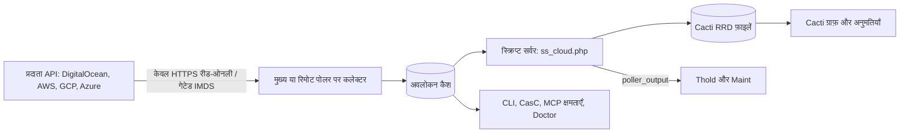

<!-- Source: README.md; SHA256: ac2074a40238686915802803c5efe773f33677f934281e0605e6e87a71a9d27d -->

<!-- translations:start -->
[English](../../../README.md) | [简体中文](../zh-CN/README.md) | [हिन्दी](README.md) | [Español (España)](../es-ES/README.md) | [Español (Latinoamérica)](../es-419/README.md) | [العربية (السعودية)](../ar-SA/README.md) | [Afrikaans](../af-ZA/README.md) | [አማርኛ](../am-ET/README.md) | [العربية (مصر)](../ar-EG/README.md) | [العربية (المغرب)](../ar-MA/README.md) | [বাংলা](../bn-BD/README.md) | [Bosanski](../bs-BA/README.md) | [Deutsch](../de-DE/README.md) | [فارسی](../fa-IR/README.md) | [Filipino](../fil-PH/README.md) | [Français](../fr-FR/README.md) | [Français (Maroc)](../fr-MA/README.md) | [Français (Sénégal)](../fr-SN/README.md) | [Hausa](../ha-NG/README.md) | [עברית](../he-IL/README.md) | [Hrvatski](../hr-HR/README.md) | [Bahasa Indonesia](../id-ID/README.md) | [Igbo](../ig-NG/README.md) | [Italiano](../it-IT/README.md) | [日本語](../ja-JP/README.md) | [한국어](../ko-KR/README.md) | [Malagasy](../mg-MG/README.md) | [मराठी](../mr-IN/README.md) | [Bahasa Melayu](../ms-MY/README.md) | [Nederlands](../nl-NL/README.md) | [Polski](../pl-PL/README.md) | [Português (Brasil)](../pt-BR/README.md) | [Русский](../ru-RU/README.md) | [Kinyarwanda](../rw-RW/README.md) | [Soomaali](../so-SO/README.md) | [Српски](../sr-RS/README.md) | [Svenska](../sv-SE/README.md) | [Kiswahili](../sw-KE/README.md) | [தமிழ்](../ta-IN/README.md) | [తెలుగు](../te-IN/README.md) | [ไทย](../th-TH/README.md) | [Türkçe](../tr-TR/README.md) | [Українська](../uk-UA/README.md) | [اردو](../ur-PK/README.md) | [Tiếng Việt](../vi-VN/README.md) | [isiXhosa](../xh-ZA/README.md) | [Yorùbá](../yo-NG/README.md) | [繁體中文](../zh-TW/README.md) | [isiZulu](../zu-ZA/README.md)
<!-- translations:end -->

# plugin_cloud

यह Cacti 1.2 प्लगइन सार्वजनिक क्लाउड प्रदाताओं के संसाधनों और मेट्रिक्स को सामान्य डिवाइस, डेटा स्रोत और ग्राफ़ के रूप में Cacti में लाता है। क्लाउड कार्यभार उन्हें वहन करने वाले नेटवर्क के साथ, Cacti की अनुमतियों के अंतर्गत रहते हैं, और Thold तथा Maint उन पर अलर्ट दे सकते हैं और उन्हें दबा सकते हैं। एक ही प्लगइन शुद्ध PHP, रीड-ओनली प्रदाता ड्राइवरों के माध्यम से DigitalOcean, Amazon Web Services, Google Cloud और Microsoft Azure को कवर करता है।

> **स्थिति: विकास में, अभी कोई रिलीज़ नहीं (`0.1.0-dev`)।** यह शाखा DigitalOcean, AWS, Google Cloud और Azure के लिए शुद्ध-PHP ड्राइवर, रिमोट डेटा कलेक्टर प्रतिकृति और रीड-ओनली एजेंट स्वास्थ्य, एक CasC प्रदाता और ऑपरेटर CLI, MCP क्षमताएँ और Doctor जाँच लागू करती है। वर्तमान में भेजे गए Cacti टेम्पलेट DigitalOcean Droplets और लोड बैलेंसर (`templates/cloud_digitalocean.xml`) को कवर करते हैं; AWS, Google Cloud और Azure के लिए Cacti टेम्पलेट पैकेज और DigitalOcean से परे लाइव-खाता योग्यता ([प्रदाता तथ्य](../../research/provider-facts.md)) अभी पूर्ण नहीं हुई हैं। इसे उत्पादन में न चलाएँ।

## समर्थित प्रदाता

प्रत्येक प्रदाता ड्राइवर `Drivers::production()` में पंजीकृत है, `Provider::released()` द्वारा प्रस्तुत किया जाता है, और शून्य SDK या Composer रनटाइम निर्भरताओं के साथ `ext-openssl` और स्ट्रीम सॉकेट्स का उपयोग करके शुद्ध PHP में चलता है।

| प्रदाता | स्कोप फ़ील्ड | क्रेडेंशियल स्रोत | प्रमाणीकरण | खोजे गए संसाधन | मेट्रिक संग्रहण |
|---|---|---|---|---|---|
| DigitalOcean (`digitalocean`) | कोई नहीं (टोकन-स्कोप्ड) | `vault`, `file` | Bearer टोकन | `droplet`, `load_balancer` | दर-सीमा शेयर जागरूकता के साथ `/v2/monitoring/metrics`; Cacti टेम्पलेट और डेटा क्वेरी साथ आते हैं |
| Amazon Web Services (`aws`) | `account_id` (12 अंक), `regions` | `vault`, `file`, `instance` | शुद्ध-PHP AWS SigV4 (`AWS4-HMAC-SHA256`), STS `GetCallerIdentity` सत्यापन, वैकल्पिक STS `AssumeRole`, `instance` खातों के लिए EC2 IMDSv2 (`169.254.169.254`) | `ec2_instance`, `rds_instance`, `aws_elb` (ALB/NLB) | बैच किया गया CloudWatch `GetMetricData` (प्रति कॉल अधिकतम 500 क्वेरी) |
| Google Cloud (`gcp`) | `project` | `vault`, `file`, `instance` | `oauth2.googleapis.com/token` पर एक्सचेंज किया गया `ext-openssl` के माध्यम से शुद्ध-PHP RS256 सेवा-खाता JWT, या `instance` खातों के लिए GCE मेटाडेटा सर्वर (`metadata.google.internal`) | `instances.aggregatedList` के माध्यम से `gce_instance` | Cloud Monitoring `timeSeries.list` |
| Microsoft Azure (`azure`) | `tenant`, `subscription`, `regions` | `vault`, `file`, `instance` | शुद्ध-PHP Entra ID OAuth2 क्लाइंट-क्रेडेंशियल प्रवाह (केवल `client_secret`; प्रमाणपत्र अभिकथन बहिष्कृत), या ARM और Monitor टोकन के लिए Azure IMDS (`169.254.169.254`) प्रबंधित पहचान | ARM Resource Graph के माध्यम से `azure_vm` (`$skipToken` के साथ पृष्ठांकित और डुप्लिकेट-रहित) | Azure Monitor `metrics:getBatch` (प्रति कॉल अधिकतम 50 संसाधन, HTTP 429 और 529 थ्रॉटलिंग को संभालते हुए) |

## कार्यान्वित क्षमताएँ

### मुख्य प्लेटफ़ॉर्म, वॉल्ट और कलेक्टर

- **सुरक्षित इंस्टॉलेशन और जीवनचक्र।** प्रवेश बिंदु (`setup.php`, `cli/cloud.php`, `poller_cloud.php`, `ss_cloud.php` और पेज स्क्रिप्ट) PHP 8.0 पर पार्स होते हैं और Cacti को तोड़े बिना 8.2 से नीचे के PHP या अनुपस्थित `ext-openssl` को अस्वीकार करते हैं। अपग्रेड क्रमबद्ध, आइडम्पोटेंट (`Schema::VERSION = 3`, 9 तालिकाएँ) हैं और व्यवधान से बच जाते हैं। अनइंस्टॉल करने पर प्लगइन तालिकाएँ सुरक्षित रहती हैं जब तक *Keep Plugin Tables on Uninstall* को साफ़ न किया जाए।
- **खाते और क्रेडेंशियल।** **Management > Cloud Accounts** के अंतर्गत खाते जोड़ें, संपादित करें, सत्यापित करें और हटाएँ। क्रेडेंशियल AES-256-GCM एन्क्रिप्टेड वॉल्ट (`plugin_cloud_secret`, डिफ़ॉल्ट रूप से `/etc/cacti/cloud-vault.key` द्वारा कुंजीबद्ध), कॉन्फ़िगर की गई *Credential File Directory* (`cloud_credential_dir`, फ़ाइलों को अस्वीकार करने के लिए डिफ़ॉल्ट रूप से खाली) के भीतर प्रतिबंधित फ़ाइल, या प्रदाता इंस्टेंस पहचान से आते हैं। क्रेडेंशियल UI में केवल-लिखने योग्य हैं और लॉग से हटाए जाते हैं।
- **सख्त आउटबाउंड और रीड-ओनली नियंत्रण।** प्रत्येक ड्राइवर `GuardedTransport` और `OutboundPolicy` के पीछे काम करता है: प्रति-प्रदाता सटीक होस्टनाम पर HTTPS पोर्ट 443, तथा लिंक-लोकल HTTP पोर्ट 80 मेटाडेटा एंडपॉइंट (`169.254.169.254`, `metadata.google.internal`) केवल `instance` खातों के लिए सक्षम हैं। केवल अनुमति-सूचीबद्ध रीड-ओनली संचालन की अनुमति है।
- **कलेक्टर और लागत नियंत्रण।** `poller_cloud.php`, `poller_bottom` से `cloud_collector_budget` के भीतर चलता है (Cacti की प्रक्रिया रजिस्ट्री के माध्यम से प्रति पोलर एक प्रक्रिया), प्रति-खाता लीज़ प्राप्त करता है, `discover_interval` पर खोज चलाता है, केवल सक्रिय Cacti डेटा स्रोतों (`plugin_cloud_series`) के लिए मेट्रिक्स पढ़ता है, `request_share` और `monthly_ceiling` का सम्मान करता है, और `ss_cloud.php` के लिए `plugin_cloud_observation` में नवीनतम डेटापॉइंट कैश करता है।
- **Cacti ऑब्जेक्ट और अनुरोध अनुमान।** प्रति खाता एक स्कोप डिवाइस (`plugin_cloud_device`) बनाए रखता है, डिवाइस सहेजने पर स्कोप डिवाइस की रीइंडेक्स विधियों को सुरक्षित रखता है, DigitalOcean टेम्पलेट और स्क्रिप्ट सर्वर डेटा क्वेरी (`templates/cloud_digitalocean.xml`, `cloud_do_droplet.xml`, `cloud_do_load_balancer.xml`) आयात करता है, और **New Graphs** (`graphs_new_top_links`) तथा **Cloud Health** पर अनुरोध और सूची-मूल्य अनुमान प्रदर्शित करता है।

### रिमोट डेटा कलेक्टर

- `INFO` में `remote_collect:1` घोषित है। खातों को किसी भी सक्षम Cacti पोलर (`poller_id >= 1`) को सौंपा जा सकता है, और `poller_cloud.php --poller=N` केवल उस पोलर के स्वामित्व वाले खातों को एकत्र करता है।
- **`replicate_out` हुक।** `replicate_out_table()` के माध्यम से `plugin_cloud_account`, `plugin_cloud_device`, `plugin_cloud_series` से पोलर-स्कोप्ड पंक्तियों और `plugin_cloud_secret` से एन्क्रिप्टेड सिफरटेक्स्ट पंक्तियों (केवल लक्षित पोलर के स्वामित्व वाले वॉल्ट-समर्थित खातों के लिए) की प्रतिकृति बनाता है। कच्ची वॉल्ट कुंजी फ़ाइलें कभी डेटाबेस में संग्रहीत या प्रतिकृत नहीं की जातीं और प्रत्येक पोलर पर स्थानीय रहती हैं।
- **`remote_agent` हुक।** केवल पूर्णांक `poller_id` और `account_id` पैरामीटर स्वीकार करते हुए और शून्य क्रेडेंशियल, फ़ाइल पथ या रहस्य लौटाते हुए एक रीड-ओनली JSON स्वास्थ्य सारांश (`action=cloud_health`) उजागर करता है।

### इकोसिस्टम हुक (CasC, MCP क्षमताएँ और Doctor)

- **CasC प्रदाता (`casc_register_providers`)।** नियतात्मक शुद्ध-PHP YAML और XML निर्यात, मेनिफेस्ट सत्यापन, डिफ़ योजना और पुष्टिकृत लागू करने के साथ `cloud` प्रदाता (स्कीमा संस्करण `1`) को पंजीकृत करता है। वॉल्ट क्रेडेंशियल `vault:account:<name>` संदर्भ के रूप में निर्यात किए जाते हैं; कच्चे गुप्त फ़ील्ड (`secret`, `secrets`, `token`, `access_token`, `refresh_token`, `password`, `private_key`, `access_key_id`, `secret_access_key`, `session_token`, `client_secret`, `credential`, `credentials`, `vault_key`) अस्वीकार किए जाते हैं। लागू करने के लिए सटीक SHA-256 `--confirm=<PLAN_HASH>` की आवश्यकता होती है।
- **MCP / Abilities API (`abilities_register`)।** Cloud View क्षेत्र (`cloud_health.php`) और गैर-व्यवस्थापक कॉलरों के लिए Cacti डिवाइस स्कोप पर गेटेड तीन सख्त रीड-ओनली क्षमताएँ पंजीकृत करता है, जो शून्य क्रेडेंशियल, वॉल्ट कुंजियाँ या क्रेडेंशियल फ़ाइल पथ उत्सर्जित करती हैं:
  - `cloud-list-accounts` (वैकल्पिक `provider`, `poller_id`)
  - `cloud-list-resources` (वैकल्पिक `account_id`, `type`, `lifecycle`)
  - `cloud-get-health` (वैकल्पिक `account_id`)
- **Doctor जाँच (`doctor_register_checks`)।** पाँच निदान जाँच पंजीकृत करता है जो कोई गुप्त मान या कुंजी सामग्री उजागर नहीं करतीं:
  - `cloud_schema`: स्कीमा संस्करण की अद्यतन स्थिति
  - `cloud_vault_key`: वॉल्ट कुंजी फ़ाइल की पठनीयता, अनुमतियाँ और आकार
  - `cloud_drivers`: सभी रिलीज़ किए गए प्रदाताओं के लिए उत्पादन ड्राइवर पंजीकरण
  - `cloud_accounts_health`: विफल, थ्रॉटल किए गए या पुराने सक्षम खाते
  - `cloud_poller_intervals`: Cacti के पोलर अंतराल के साथ सक्षम खाता संग्रह अंतराल का संरेखण

## CLI

PHP 8.2 या बाद के संस्करण के साथ Cacti रूट निर्देशिका से चलाएँ:

```sh
# Operator and CasC CLI (options use --key=value form)
php plugins/cloud/cli/cloud.php export [--format=yaml|xml]
php plugins/cloud/cli/cloud.php validate --file=<path> [--format=yaml|xml]
php plugins/cloud/cli/cloud.php plan --file=<path> [--format=yaml|xml]
php plugins/cloud/cli/cloud.php apply --file=<path> --confirm=<PLAN_HASH> [--format=yaml|xml]
php plugins/cloud/cli/cloud.php health [--format=text|json] [--poller=<id>]

# Collector entry point (normally started by poller_bottom)
php plugins/cloud/poller_cloud.php [--poller=N] [--force] [--debug]
```

## पहुँच भूमिकाएँ

| क्षेत्र | पहुँच |
| --- | --- |
| Cloud View | मौजूदा निगरानी पृष्ठ। |
| Cloud Operator | निगरानी, साथ ही Operations पृष्ठ और व्यक्तिगत ट्रायज स्वीकृतियाँ। |
| Cloud Admin | ऑपरेटर पहुँच, साथ ही मौजूदा कॉन्फ़िगरेशन और प्रशासनिक कार्रवाइयाँ। |

अपग्रेड फ़ाइलें कॉपी करने के बाद, क्षेत्रों को पंजीकृत करने के लिए व्यवस्थापक के रूप में Plugins पृष्ठ खोलें। **Configuration > Users** या उपयोगकर्ता समूहों के अंतर्गत Operator क्षेत्र स्पष्ट रूप से सौंपें। अपग्रेड मौजूदा View और Admin क्षेत्र ID और अनुदानों को बनाए रखते हैं। प्रत्येक अनुरोध पर Admin पहुँच को Operator पहुँच विरासत में मिलती है, और Operator पहुँच को View पहुँच विरासत में मिलती है; इससे उपयोगकर्ताओं या समूहों में संग्रहीत अनुदान नहीं जुड़ते हैं। प्लगइन सेटिंग्स के लिए Cacti की Settings अनुमति के अतिरिक्त Cloud Admin पहुँच की भी आवश्यकता होती है।

Cacti डिवाइस अनुमतियाँ प्रत्येक उपयोगकर्ता के लिए उपलब्ध पंक्तियों और कार्रवाइयों को सीमित करती हैं; अनमैप किए गए ऑब्जेक्ट के लिए व्यवस्थापक की आवश्यकता होती है। ऑपरेटर उस खाते के संग्रहीत क्रेडेंशियल को सत्यापित कर सकते हैं जिसके Cacti डिवाइस तक उनकी पहुँच है। क्रेडेंशियल, कॉन्फ़िगरेशन, मैपिंग, विलोपन और अन्य प्रशासनिक परिवर्तन प्रशासनिक पृष्ठों में ही रहते हैं। स्वीकृतियाँ केवल वर्तमान उपयोगकर्ता के सत्र में, अधिकतम एक घंटे के लिए और केवल तब तक रहती हैं जब तक वही अवलोकन ताज़ा रहता है। नए या बदले हुए अवलोकन उन्हें अमान्य कर देते हैं। वे कभी किसी विफल मापन को स्वस्थ चिह्नित नहीं करतीं और न ही अलर्ट दबाती हैं।

## क्यों

प्रत्येक क्लाउड प्रदाता का अपना निगरानी कंसोल होता है। Cacti के साथ चलने पर, वे तीन अंतराल छोड़ते हैं:

- **अलग पहुँच नियंत्रण।** किसी Cacti उपयोगकर्ता को क्लाउड मेट्रिक्स दिखाने का अर्थ उन्हें क्लाउड लॉगिन देना है।
- **कोई नेटवर्क संदर्भ नहीं।** ऑन-प्रिमाइसेस लिंक Cacti में ग्राफ़ किए जाते हैं; उनके पीछे के कार्यभार प्रत्येक प्रदाता के कंसोल में ग्राफ़ किए जाते हैं।
- **अलग अलर्टिंग।** Thold और Maint, Cacti डेटा स्रोतों और डिवाइस पर काम करते हैं, इसलिए प्रदाता अलार्म प्रत्येक प्रदाता के लिए अलग-अलग कॉन्फ़िगर और दबाए जाते हैं।

प्लगइन Cacti पोलर पर प्रत्येक प्रदाता के निगरानी API को पढ़ता है, नवीनतम डेटापॉइंट कैश करता है, और उन्हें Cacti के स्क्रिप्ट सर्वर को प्रदान करता है। Cacti का पोलर RRD फ़ाइलें लिखता है, इसलिए ग्राफ़िंग, अनुमतियाँ, Thold, Maint और boost किसी भी Cacti डेटा की तरह ही काम करते हैं।

## डिज़ाइन प्रतिबद्धताएँ

- **रीड-ओनली।** प्रत्येक ड्राइवर केवल अपनी अनुमति-सूची में मौजूद प्रदाता संचालन ही बना सकता है; प्लगइन कभी किसी क्लाउड संसाधन को नहीं बदलता। ([ADR 0002](../../decisions/0002-read-only-with-operation-allowlist.md))
- **केवल PHP, कोई SDK नहीं।** साइनिंग और टोकन एक्सचेंज उन एक्सटेंशन के साथ PHP में कार्यान्वित हैं जिनकी Cacti को पहले से आवश्यकता है। कोई Composer रनटाइम निर्भरता नहीं। ([ADR 0003](../../decisions/0003-php-only-without-sdks.md))
- **संग्रह से पहले लागत।** प्लगइन केवल उन्हीं मेट्रिक्स को पढ़ता है जिनका Cacti डेटा स्रोत है, ग्राफ़ बनाने से पहले अपेक्षित अनुरोध संख्या और सूची-मूल्य लागत दिखाता है, और मासिक सीमा लागू करता है। ([ADR 0005](../../decisions/0005-collect-only-what-is-graphed.md))
- **डेटाबेस में कोई सादा-पाठ क्रेडेंशियल नहीं।** क्रेडेंशियल डेटाबेस के बाहर की फ़ाइल द्वारा कुंजीबद्ध एन्क्रिप्टेड वॉल्ट से, क्रेडेंशियल फ़ाइल से, या प्रदाता की इंस्टेंस पहचान से आते हैं। ([ADR 0007](../../decisions/0007-credentials-outside-the-database-in-the-clear.md))

## दायरा और स्थिति

| चरण | दायरा | माइलस्टोन | स्थिति |
|---|---|---|---|
| 0, शोध | प्रदाता तथ्य पुष्टि, मेट्रिक कैटलॉग, लागत और दर मॉडल, साइनिंग परीक्षण वेक्टर, ट्रांसपोर्ट स्पाइक | [M1](https://github.com/somethingwithproof/plugin_cloud/milestone/1) | पूर्ण, उन जाँचों को छोड़कर जिनके लिए लाइव प्रदाता खातों की आवश्यकता है |
| 1, कोर और DigitalOcean | खाते, क्रेडेंशियल वॉल्ट, ट्रांसपोर्ट, कलेक्टर, अवलोकन कैश, Cacti ऑब्जेक्ट, टेम्पलेट, अनुरोध अनुमान, स्वास्थ्य पृष्ठ, DigitalOcean Droplets और लोड बैलेंसर | [M2](https://github.com/somethingwithproof/plugin_cloud/milestone/2), [M3](https://github.com/somethingwithproof/plugin_cloud/milestone/3), [M4](https://github.com/somethingwithproof/plugin_cloud/milestone/4) | कार्यान्वित; M4 पायलट योग्यता लंबित |
| 2, AWS | शुद्ध-PHP SigV4, STS `AssumeRole`, IMDSv2 इंस्टेंस भूमिकाएँ, EC2/RDS/ELB इन्वेंट्री, CloudWatch `GetMetricData` | [M5](https://github.com/somethingwithproof/plugin_cloud/milestone/5) | ड्राइवर कार्यान्वित; Cacti टेम्पलेट और लाइव-खाता योग्यता लंबित |
| 3, Google Cloud | शुद्ध-PHP RS256 सेवा-खाता JWT, GCE मेटाडेटा सर्वर, Compute Engine इन्वेंट्री, Cloud Monitoring `timeSeries.list` | [M6](https://github.com/somethingwithproof/plugin_cloud/milestone/6) | ड्राइवर कार्यान्वित; Cacti टेम्पलेट और लाइव-खाता योग्यता लंबित |
| 4, Azure | Entra ID क्लाइंट क्रेडेंशियल, IMDS प्रबंधित पहचान, ARM Resource Graph VM इन्वेंट्री, Azure Monitor `metrics:getBatch` | [M7](https://github.com/somethingwithproof/plugin_cloud/milestone/7) | ड्राइवर कार्यान्वित; Cacti टेम्पलेट और लाइव-खाता योग्यता लंबित |
| 5, रिमोट कलेक्टर और इकोसिस्टम | रिमोट डेटा कलेक्टर (`replicate_out`, `remote_agent`), CasC प्रदाता और CLI, MCP क्षमताएँ, Doctor जाँच | [M8](https://github.com/somethingwithproof/plugin_cloud/milestone/8) | कार्यान्वित |

दायरे से बाहर: क्लाउड संसाधनों को बदलना, प्रदाता अलार्म बनाना या मिरर करना, बिलिंग रिपोर्ट, लॉग और ट्रेस, तथा प्लगइन-स्वामित्व वाला अलर्टिंग इंजन। अन्य प्रदाता (Hetzner Cloud, Akamai Cloud, Oracle Cloud और अन्य) शोध मुद्दे हैं।

## इंस्टॉल और कॉन्फ़िगर करें

ये चरण मूल्यांकन के लिए विकास कोड इंस्टॉल करते हैं। इनके लिए PHP 8.2 या बाद के संस्करण पर Cacti 1.2.31 या बाद का संस्करण आवश्यक है।

1. रिपॉजिटरी को अपनी Cacti निर्देशिका के अंतर्गत `plugins/cloud` में कॉपी करें। निर्देशिका का नाम `cloud` होना अनिवार्य है।
2. वॉल्ट-समर्थित क्रेडेंशियल का उपयोग करने वाले प्रत्येक पोलर पर वेब रूट के बाहर वॉल्ट कुंजी बनाएँ। इसे ऐसी निर्देशिका में रखें जहाँ केवल root और Cacti उपयोगकर्ता लिख सकें, और फ़ाइल को केवल वेब सर्वर और पोलर चलाने वाले उपयोगकर्ता के लिए पठनीय बनाएँ। प्लगइन कभी यह फ़ाइल बनाता या लिखता नहीं है:

   ```sh
   sudo install -d -m 0750 -o root -g cacti /etc/cacti
   head -c 32 /dev/urandom | sudo tee /etc/cacti/cloud-vault.key > /dev/null
   sudo chown cacti:cacti /etc/cacti/cloud-vault.key
   sudo chmod 0600 /etc/cacti/cloud-vault.key
   ```

   `cacti` को उस उपयोगकर्ता से बदलें जो आपका वेब सर्वर और पोलर चलाता है। फ़ाइल में 32 रॉ बाइट या 64 हेक्साडेसिमल वर्ण होते हैं। डेटाबेस के साथ इसका बैकअप लें; इसके बिना, संग्रहीत क्रेडेंशियल फिर से दर्ज करने होंगे।
3. Cacti में **Configuration > Plugins** खोलें, फिर *Cloud* को इंस्टॉल और सक्षम करें।
4. **Configuration > Settings > Cloud** के अंतर्गत, यदि आपने कोई अन्य पथ उपयोग किया है तो *Vault Key File* सेट करें, यदि आप फ़ाइल-आधारित क्रेडेंशियल उपयोग करने की योजना बना रहे हैं तो *Credential File Directory* कॉन्फ़िगर करें, और *Collector Time Budget* (डिफ़ॉल्ट 240 सेकंड) को पोलर अंतराल से कम रखें।
5. **Configuration > Users** के अंतर्गत उपयोगकर्ताओं और समूहों को *Cloud Admin*, *Cloud Operator* या *Cloud View* प्रदान करें। इंस्टॉल करने पर व्यवस्थापक को Cloud Admin और Cloud View मिल जाते हैं; Cloud Admin में Operator पहुँच शामिल होती है, इसलिए व्यवस्थापक को अलग Operator अनुदान की आवश्यकता नहीं होती।
6. **Management > Cloud Accounts** के अंतर्गत खाते जोड़ें, फिर चेतावनियों के लिए **Management > Cloud Health** जाँचें।

## संगतता लक्ष्य

| घटक | लक्ष्य |
|---|---|
| Cacti | 1.2.31 या बाद का संस्करण, कोई कोर पैच नहीं |
| PHP | 8.2 या बाद का संस्करण; प्रवेश बिंदु 8.0 पर पार्स करने योग्य रहते हैं ताकि असमर्थित रनटाइम को टूटे हुए Cacti UI के बजाय स्पष्ट अस्वीकृति मिले |
| PHP एक्सटेंशन | `ext-openssl` (Cacti 1.2.31 द्वारा आवश्यक); कोई `ext-curl` नहीं और कोई Composer रनटाइम निर्भरता नहीं |
| Thold, Maint | किसी बदलाव की आवश्यकता नहीं |

## डिज़ाइन

- [docs/performance.md](../../performance.md) में उपयोग किए गए हार्डवेयर और सेटिंग्स के साथ कलेक्टर और स्वास्थ्य पृष्ठ के माप हैं।
- [docs/PLAN.md](../../PLAN.md) पूर्ण योजना है: वास्तुकला, वे प्रदाता और Cacti तथ्य जिन पर यह निर्भर है (स्रोतों सहित), ड्राइवर अनुबंध, लागत अंकगणित, सुरक्षा सीमाएँ, परीक्षण और जोखिम।
- [docs/decisions/](../../decisions/) पहले लिए जा चुके निर्णयों के आर्किटेक्चर निर्णय रिकॉर्ड रखता है।
- [docs/REQUIREMENTS.md](../../REQUIREMENTS.md) प्रत्येक आवश्यकता ID को उसके मुद्दे से मैप करता है।



## कार्य को कैसे ट्रैक किया जाता है

- **माइलस्टोन** योजना के माइलस्टोन का पालन करते हैं। प्रत्येक में एक एपिक मुद्दा होता है जो उसके उप-मुद्दों और निकास साक्ष्य को सूचीबद्ध करता है।
- **मुद्दे** लेबल द्वारा वर्गीकृत हैं: `type: requirement`, `type: research`, `type: decision`, `type: epic`। आवश्यकता मुद्दों में क्रमांकित, परीक्षण योग्य आवश्यकताएँ (`REQ-AREA-NNN`) और स्वीकृति मानदंड बताए जाते हैं।
- **लेबल** में `area:`, `provider:`, `phase:`, `priority:` और `status:` भी होते हैं। [CONTRIBUTING.md](../../../CONTRIBUTING.md#labels) देखें।
- [प्रोजेक्ट बोर्ड](https://github.com/users/somethingwithproof/projects/7) सभी माइलस्टोन के सभी मुद्दे दिखाता है।

## विकास

CI ([.github/workflows/plugin-ci-workflow.yml](../../../.github/workflows/plugin-ci-workflow.yml)) रिलीज़ संग्रह और सिमेंटिक वर्ज़न (`bash tests/bin/archive-check.sh`) की जाँच करता है, PHP 8.0 पर प्रवेश बिंदुओं की लिंटिंग करता है, `CLOUD_OFFLINE=1` के साथ Cacti `release/1.2.31` और `1.2.x` के विरुद्ध PHP 8.2 से 8.5 तक Pest यूनिट (`phpunit.xml`) और जीवनचक्र एकीकरण (`phpunit-integration.xml`) परीक्षण तथा PHPStan स्तर 9 चलाता है, PHP 8.1 पर अस्वीकृति की जाँच करता है, gettext कैटलॉग सत्यापित करता है, 1,000-श्रृंखला संग्रह और स्वास्थ्य पृष्ठ प्रदर्शन मापता है, और वर्कफ़्लो लिंटिंग तथा REUSE अनुपालन चलाता है।

पुश करने से पहले स्थानीय जाँच:

```sh
bash tests/bin/archive-check.sh
sh tests/lint-workflows.sh
sh locales/build_gettext.sh --check
CACTI_PATH=/path/to/cacti phpstan analyse -c phpstan.neon --no-progress
```

यूनिट और स्रोत-नियम परीक्षणों के लिए `--configuration=phpunit.xml` के साथ Pest चलाएँ, या जीवनचक्र एकीकरण परीक्षणों के लिए डिस्पोज़ेबल Cacti डेटाबेस के विरुद्ध `CACTI_PATH` और `CLOUD_TEST_DATABASE=disposable` के साथ `--configuration=phpunit-integration.xml` चलाएँ।

## योगदान

[CONTRIBUTING.md](../../../CONTRIBUTING.md) पढ़ें। कमिट के लिए DCO साइन-ऑफ़ आवश्यक है। डिज़ाइन चर्चा मुद्दों पर होती है; खुले निर्णयों पर `type: decision` लेबल लगा होता है।

## सुरक्षा

कमज़ोरियों की रिपोर्ट निजी तौर पर करें; [SECURITY.md](../../../SECURITY.md) देखें।

## लाइसेंस

GNU General Public License v2.0, वही लाइसेंस जो Cacti और उसके प्लगइन्स का है। [LICENSE](../../../LICENSE) देखें।
