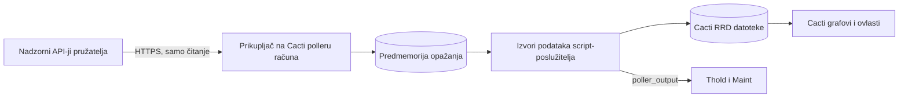

<!-- Source: README.md; SHA256: 7c621642e5f1a46bac66e4bc744f70aebb014c610d22de034088845fdc170405 -->

<!-- translations:start -->
[English](../../../README.md) | [简体中文](../zh-CN/README.md) | [हिन्दी](../hi-IN/README.md) | [Español (España)](../es-ES/README.md) | [Español (Latinoamérica)](../es-419/README.md) | [العربية (السعودية)](../ar-SA/README.md) | [Afrikaans](../af-ZA/README.md) | [አማርኛ](../am-ET/README.md) | [العربية (مصر)](../ar-EG/README.md) | [العربية (المغرب)](../ar-MA/README.md) | [বাংলা](../bn-BD/README.md) | [Bosanski](../bs-BA/README.md) | [Deutsch](../de-DE/README.md) | [فارسی](../fa-IR/README.md) | [Filipino](../fil-PH/README.md) | [Français](../fr-FR/README.md) | [Français (Maroc)](../fr-MA/README.md) | [Français (Sénégal)](../fr-SN/README.md) | [Hausa](../ha-NG/README.md) | [עברית](../he-IL/README.md) | [Hrvatski](README.md) | [Bahasa Indonesia](../id-ID/README.md) | [Igbo](../ig-NG/README.md) | [Italiano](../it-IT/README.md) | [日本語](../ja-JP/README.md) | [한국어](../ko-KR/README.md) | [Malagasy](../mg-MG/README.md) | [मराठी](../mr-IN/README.md) | [Bahasa Melayu](../ms-MY/README.md) | [Nederlands](../nl-NL/README.md) | [Polski](../pl-PL/README.md) | [Português (Brasil)](../pt-BR/README.md) | [Русский](../ru-RU/README.md) | [Kinyarwanda](../rw-RW/README.md) | [Soomaali](../so-SO/README.md) | [Српски](../sr-RS/README.md) | [Svenska](../sv-SE/README.md) | [Kiswahili](../sw-KE/README.md) | [தமிழ்](../ta-IN/README.md) | [తెలుగు](../te-IN/README.md) | [ไทย](../th-TH/README.md) | [Türkçe](../tr-TR/README.md) | [Українська](../uk-UA/README.md) | [اردو](../ur-PK/README.md) | [Tiếng Việt](../vi-VN/README.md) | [isiXhosa](../xh-ZA/README.md) | [Yorùbá](../yo-NG/README.md) | [繁體中文](../zh-TW/README.md) | [isiZulu](../zu-ZA/README.md)
<!-- translations:end -->

# plugin_cloud

Dodatak za Cacti 1.2 koji uvodi resurse i metrike javnih pružatelja usluga u oblaku u Cacti kao uobičajene uređaje, izvore podataka i grafove. Radna opterećenja u oblaku tako se nalaze uz mrežu koja ih prenosi, pod Cacti ovlastima, a Thold i Maint mogu za njih slati uzbune i potiskivati ih. Jedan dodatak obuhvaća svakog pružatelja, s jednim upravljačkim programom po pružatelju: najprije DigitalOcean, AWS, Google Cloud i Azure.

> **Status: etapa 3 (DigitalOcean i Cacti objekti), u pregledu.** Ova etapa dodaje upravljački program za DigitalOcean, Cacti predloške, uređaj opsega po računu s upitom podataka po vrsti resursa, unos za script-poslužitelj i procjenu zahtjeva na stranici *New Graphs* i stranici ispravnosti. Početne provjere na živom računu DigitalOcean zabilježene su u [činjenicama o pružateljima](../../research/provider-facts.md). Nemojte ga pokretati u produkciji.

## Uloge pristupa

| Područje ovlasti | Pristup |
| --- | --- |
| Cloud View | Postojeće stranice za nadzor. |
| Cloud Operator | Nadzor uz stranicu *Operations* i osobne potvrde trijaže. |
| Cloud Admin | Pristup operatera uz postojeće konfiguracijske i administrativne radnje. |

Nakon kopiranja datoteka za nadogradnju otvorite stranicu *Plugins* kao administrator kako biste registrirali novo područje ovlasti. Izričito dodijelite područje *Operator* pod **Configuration > Users** ili korisničkim skupinama. Nadogradnje zadržavaju postojeće ID-ove i dodjele za *View* i *Admin*. Pristup *Admin* nasljeđuje pristup *Operator*, a pristup *Operator* nasljeđuje pristup *View* pri svakom zahtjevu; time se korisnicima ili skupinama ne dodaju pohranjene dodjele. Postavke dodatka također zahtijevaju pristup *Cloud Admin* uz Cacti ovlast *Settings*.

Cacti ovlasti za uređaje i dalje ograničavaju retke i radnje dostupne svakom korisniku; nepreslikani objekti zahtijevaju administratora. Operateri mogu provjeriti pohranjenu vjerodajnicu za račun čijem Cacti uređaju smiju pristupiti. Vjerodajnice, konfiguracija, preslikavanje, brisanje i ostale administrativne izmjene ostaju na administrativnim stranicama. Potvrde traju samo u trenutačnoj korisničkoj sesiji, najviše jedan sat i samo dok isto opažanje ostaje ažurno. Nova ili izmijenjena opažanja poništavaju ih. One nikada ne označavaju neuspjelo mjerenje ispravnim niti potiskuju uzbune.

## Zašto

Svaki pružatelj usluga u oblaku ima vlastitu nadzornu konzolu. Kada se upotrebljavaju uz Cacti, ostavljaju tri praznine:

- **Odvojena kontrola pristupa.** Prikazivanje metrika iz oblaka Cacti korisniku podrazumijeva davanje prijave za oblak.
- **Bez mrežnog konteksta.** Lokalne veze prikazuju se grafovima u Cactiju; radna opterećenja iza njih prikazuju se u konzoli pojedinog pružatelja.
- **Odvojeno uzbunjivanje.** Thold i Maint rade na Cacti izvorima podataka i uređajima pa se alarmi pružatelja konfiguriraju i potiskuju odvojeno, posebno za svakog pružatelja.

Dodatak čita nadzorni API svakog pružatelja na Cacti polleru, sprema najnovije podatkovne točke u predmemoriju i poslužuje ih Cacti script-poslužitelju. Cacti poller zapisuje RRD datoteke pa grafovi, ovlasti, Thold, Maint i boost rade jednako kao za bilo koje druge Cacti podatke.

## Oblikovna načela

- **Samo za čitanje.** Svaki upravljački program smije sastavljati samo operacije pružatelja sa svog popisa dopuštenih operacija; dodatak nikada ne mijenja resurs u oblaku. ([ADR 0002](../../decisions/0002-read-only-with-operation-allowlist.md))
- **Samo PHP, bez SDK-ova.** Potpisivanje i razmjena tokena ostvareni su u PHP-u pomoću proširenja koja Cacti već zahtijeva. Nema Composer ovisnosti u vremenu izvođenja. ([ADR 0003](../../decisions/0003-php-only-without-sdks.md))
- **Trošak prije prikupljanja.** Dodatak čita samo metrike koje imaju Cacti izvor podataka, prikazuje očekivani broj zahtjeva i trošak prema kataloškim cijenama prije stvaranja grafova te provodi mjesečnu gornju granicu. ([ADR 0005](../../decisions/0005-collect-only-what-is-graphed.md))
- **Bez vjerodajnica u čistom tekstu u bazi podataka.** Vjerodajnice dolaze iz šifriranog sefa zaštićenog ključem u datoteci izvan baze podataka, iz datoteke vjerodajnice ili iz identiteta instance pružatelja. ([ADR 0007](../../decisions/0007-credentials-outside-the-database-in-the-clear.md))

## Opseg i status

| Faza | Opseg | Etape | Status |
|---|---|---|---|
| 0, istraživanje | Potvrda činjenica o pružateljima, katalozi metrika, model troškova i ograničenja stope, ispitni vektori potpisivanja, provjera prijenosa | [M1](https://github.com/somethingwithproof/plugin_cloud/milestone/1) | Dovršeno, osim provjera koje zahtijevaju živi račun kod pružatelja |
| 1, jezgra i DigitalOcean | Računi, sef vjerodajnica, prijenos, prikupljač, predmemorija opažanja, Cacti objekti, stranica ispravnosti, DigitalOcean Droplets i uravnoteživači opterećenja | [M2](https://github.com/somethingwithproof/plugin_cloud/milestone/2), [M3](https://github.com/somethingwithproof/plugin_cloud/milestone/3), [M4](https://github.com/somethingwithproof/plugin_cloud/milestone/4) | M2 dovršen ([#81](https://github.com/somethingwithproof/plugin_cloud/pull/81)); M3 upravljački program, predlošci i uređaji opsega spojeni; procjene zahtjeva, ovlasti i provjere performansi u pregledu; M4 nije započet |
| 2, AWS | Signature Version 4, `AssumeRole`, uloge instance, CloudWatch `GetMetricData`, regionalni inventar | [M5](https://github.com/somethingwithproof/plugin_cloud/milestone/5) | Nije započeto |
| 3, Google Cloud | JWT servisnog računa, poslužitelj metapodataka, Cloud Monitoring `timeSeries.list` | [M6](https://github.com/somethingwithproof/plugin_cloud/milestone/6) | Nije započeto |
| 4, Azure | Entra vjerodajnice klijenta, upravljani identitet, Resource Graph, `metrics:getBatch` | [M7](https://github.com/somethingwithproof/plugin_cloud/milestone/7) | Nije započeto |
| 5, udaljeni prikupljači | Računi na udaljenim Cacti prikupljačima podataka | [M8](https://github.com/somethingwithproof/plugin_cloud/milestone/8) | Nije započeto |

Izvan opsega: mijenjanje resursa u oblaku, stvaranje ili preslikavanje alarma pružatelja, izvješća o naplati, dnevnici i tragovi te vlastiti sustav uzbunjivanja u dodatku. Dodatni pružatelji (Hetzner Cloud, Akamai Cloud, Oracle Cloud i drugi) vode se kao istraživački predmeti.

## Što donosi etapa 2

- **Zaštićena instalacija.** Na PHP-u starijem od 8.2 ili bez ext-openssl, instalacija i uključivanje odbijaju se uz poruku, a ostatak Cactija nastavlja raditi.
- **Životni ciklus.** Instalacija, nadogradnja i deinstalacija putem Cacti stranice *Plugins*. Nadogradnje su poredane i otporne na prekide. Deinstalacija zadržava tablice dodatka osim ako odznačite *Keep Plugin Tables on Uninstall*.
- **Odvojena područja ovlasti.** *Cloud Admin* otvara **Cloud Accounts**; *Cloud Operator* otvara **Cloud Operations**; *Cloud View* otvara **Cloud Health**. Admin nasljeđuje Operator, a Operator nasljeđuje View. Sve tri stranice nalaze se pod *Management*.
- **Računi i vjerodajnice.** Dodavanje, uređivanje, provjera i brisanje računa. Vjerodajnica se šifrira u bazi podataka pomoću datoteke ključa pohranjene izvan nje (AES-256-GCM) ili se čita iz datoteke na polleru. Vjerodajnice su u korisničkom sučelju samo za upis i skrivaju se u dnevnicima.
- **Prikupljač.** Pokreće se pri svakom izvođenju pollera, jedna instanca po polleru, unutar vremenskog okvira. Preuzima zakup po računu, pokreće otkrivanje u vlastitom razdoblju i čita metrike samo za aktivne izvore podataka samog dodatka.
- **Ispravnost.** Stanje prikupljanja, otkrivanja, resursa i ažurnosti po računu te upozorenja za neupotrebljiv ključ sefa, nesigurne datoteke vjerodajnica i razdoblja koja poller ne može ispuniti.

## Instalacija i konfiguracija

Ovi koraci instaliraju kôd etape 2 za evaluaciju. Zahtijevaju Cacti 1.2.31 ili noviji na PHP-u 8.2 ili novijem.

1. Kopirajte repozitorij u `plugins/cloud` unutar svog Cacti direktorija. Direktorij mora imati naziv `cloud`.
2. Stvorite ključ sefa izvan korijenskog web-direktorija. Smjestite ga u direktorij u koji mogu pisati samo root i korisnik Cactija te učinite datoteku čitljivom samo korisniku koji izvodi web-poslužitelj i poller. Dodatak nikada ne stvara ni ne zapisuje ovu datoteku:

   ```sh
   sudo install -d -m 0750 -o root -g cacti /etc/cacti
   head -c 32 /dev/urandom | sudo tee /etc/cacti/cloud-vault.key > /dev/null
   sudo chown cacti:cacti /etc/cacti/cloud-vault.key
   sudo chmod 0600 /etc/cacti/cloud-vault.key
   ```

   Zamijenite `cacti` korisnikom koji izvodi vaš web-poslužitelj i poller. Datoteka sadrži 32 sirova bajta ili 64 heksadecimalna znaka. Izradite sigurnosnu kopiju zajedno s bazom podataka; bez nje pohranjene vjerodajnice moraju se ponovno unijeti.
3. U Cactiju otvorite **Configuration > Plugins**, zatim instalirajte i uključite *Cloud*.
4. Pod **Configuration > Settings > Cloud** postavite *Vault Key File* ako ste upotrijebili drugu putanju. *Collector Time Budget* (zadano 240 sekundi) mora ostati ispod razdoblja pollera.
5. Dodijelite *Cloud Admin*, *Cloud Operator* ili *Cloud View* korisnicima i skupinama pod **Configuration > Users**. Instalacija dodjeljuje *Cloud Admin* i *Cloud View* administratoru; *Cloud Admin* uključuje pristup *Operator* pa administratoru nije potrebna posebna dodjela za *Operator*.
6. Dodajte račune pod **Management > Cloud Accounts**, zatim provjerite **Management > Cloud Health** zbog mogućih upozorenja.

## Ciljevi kompatibilnosti

| Komponenta | Cilj |
|---|---|
| Cacti | 1.2.31 ili noviji, bez zakrpa jezgre |
| PHP | 8.2 ili noviji; `setup.php` ostaje sintaksno čitljiv na 8.0 kako bi nepodržano izvodno okruženje dobilo odbijanje umjesto neispravnog Cacti sučelja |
| PHP proširenja | Nema dodatnih povrh onih koja Cacti 1.2.31 zahtijeva |
| Thold, Maint | Nisu potrebne izmjene |

## Dizajn

- [docs/performance.md](../../performance.md) sadrži mjerenja prikupljača i stranice ispravnosti, s upotrijebljenim hardverom i postavkama.
- [docs/PLAN.md](../../PLAN.md) cjelovit je plan: arhitektura, činjenice o pružateljima i Cactiju na koje se oslanja (s izvorima), ugovor upravljačkog programa, računica troškova, sigurnosne granice, ispitivanje i rizici.
- [docs/decisions/](../../decisions) sadrži zapise o arhitekturnim odlukama (ADR) za već donesene izbore.
- [docs/REQUIREMENTS.md](../../REQUIREMENTS.md) povezuje svaki ID zahtjeva s njegovim predmetom.



## Kako se prati rad

- **Etape** slijede etape plana. Svaka ima krovni predmet (epic) s popisom podpredmeta i dokaza dovršetka.
- **Predmeti** su označeni po vrsti: `type: requirement`, `type: research`, `type: decision`, `type: epic`. Predmeti zahtjeva definiraju numerirane, ispitive zahtjeve (`REQ-AREA-NNN`) i kriterije prihvaćanja.
- **Oznake** također nose prefikse `area:`, `provider:`, `phase:`, `priority:` i `status:`. Pogledajte [CONTRIBUTING.md](../../../CONTRIBUTING.md#labels).
- [Ploča projekta](https://github.com/users/somethingwithproof/projects/7) prikazuje sve predmete kroz etape.

## Razvoj

CI provjerava sintaksu ulaznih točaka na PHP-u 8.0, pokreće jedinične i integracijske testove te PHPStan razinu 9 i instalira dodatak na PHP-u 8.2 do 8.5 prema Cactiju 1.2.31 i grani 1.2.x. Također provjerava da je PHP 8.1 odbijen bez narušavanja Cactija. Testovi upotrebljavaju Pest iz ispitnog okvira jezgre Cactija. Taj je odabir privremen dok se ne odluči o [#12](https://github.com/somethingwithproof/plugin_cloud/issues/12). [.github/workflows/plugin-ci-workflow.yml](../../../.github/workflows/plugin-ci-workflow.yml) navodi svaki korak. Prije slanja promjena lokalno pokrenite `sh tests/lint-workflows.sh` i `sh locales/build_gettext.sh --check`.

## Doprinos

Pročitajte [CONTRIBUTING.md](../../../CONTRIBUTING.md). Komitovi zahtijevaju DCO potpis (sign-off). Rasprava o dizajnu vodi se u predmetima; otvorene odluke nose oznaku `type: decision`.

## Sigurnost

Ranjivosti prijavite privatno; pogledajte [SECURITY.md](../../../SECURITY.md).

## Licenca

GNU General Public License v2.0, ista licenca kao Cacti i njegovi dodaci. Pogledajte [LICENSE](../../../LICENSE).
