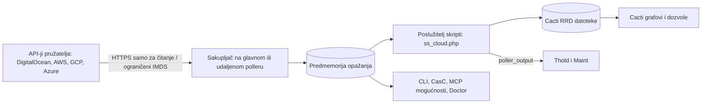

<!-- Source: README.md; SHA256: ac2074a40238686915802803c5efe773f33677f934281e0605e6e87a71a9d27d -->

<!-- translations:start -->
[English](../../../README.md) | [简体中文](../zh-CN/README.md) | [हिन्दी](../hi-IN/README.md) | [Español (España)](../es-ES/README.md) | [Español (Latinoamérica)](../es-419/README.md) | [العربية (السعودية)](../ar-SA/README.md) | [Afrikaans](../af-ZA/README.md) | [አማርኛ](../am-ET/README.md) | [العربية (مصر)](../ar-EG/README.md) | [العربية (المغرب)](../ar-MA/README.md) | [বাংলা](../bn-BD/README.md) | [Bosanski](../bs-BA/README.md) | [Deutsch](../de-DE/README.md) | [فارسی](../fa-IR/README.md) | [Filipino](../fil-PH/README.md) | [Français](../fr-FR/README.md) | [Français (Maroc)](../fr-MA/README.md) | [Français (Sénégal)](../fr-SN/README.md) | [Hausa](../ha-NG/README.md) | [עברית](../he-IL/README.md) | [Hrvatski](README.md) | [Bahasa Indonesia](../id-ID/README.md) | [Igbo](../ig-NG/README.md) | [Italiano](../it-IT/README.md) | [日本語](../ja-JP/README.md) | [한국어](../ko-KR/README.md) | [Malagasy](../mg-MG/README.md) | [मराठी](../mr-IN/README.md) | [Bahasa Melayu](../ms-MY/README.md) | [Nederlands](../nl-NL/README.md) | [Polski](../pl-PL/README.md) | [Português (Brasil)](../pt-BR/README.md) | [Русский](../ru-RU/README.md) | [Kinyarwanda](../rw-RW/README.md) | [Soomaali](../so-SO/README.md) | [Српски](../sr-RS/README.md) | [Svenska](../sv-SE/README.md) | [Kiswahili](../sw-KE/README.md) | [தமிழ்](../ta-IN/README.md) | [తెలుగు](../te-IN/README.md) | [ไทย](../th-TH/README.md) | [Türkçe](../tr-TR/README.md) | [Українська](../uk-UA/README.md) | [اردو](../ur-PK/README.md) | [Tiếng Việt](../vi-VN/README.md) | [isiXhosa](../xh-ZA/README.md) | [Yorùbá](../yo-NG/README.md) | [繁體中文](../zh-TW/README.md) | [isiZulu](../zu-ZA/README.md)
<!-- translations:end -->

# plugin_cloud

Dodatak za Cacti 1.2 koji donosi resurse i metrike javnih pružatelja usluga u oblaku u Cacti kao uobičajene uređaje, izvore podataka i grafove. Radna opterećenja u oblaku nalaze se uz mrežu koja ih prenosi, pod Cacti ovlastima, a Thold i Maint za njih šalju uzbune i potiskuju ih. Jedan dodatak obuhvaća DigitalOcean, Amazon Web Services, Google Cloud i Microsoft Azure putem upravljačkih programa u čistom PHP-u koji rade samo za čitanje.

> **Status: u razvoju, još nema izdanja (`0.1.0-dev`).** Ova grana implementira upravljačke programe u čistom PHP-u za DigitalOcean, AWS, Google Cloud i Azure, replikaciju udaljenih sakupljača podataka i provjeru zdravlja agenta samo za čitanje, pružatelja CasC i CLI za operatore, MCP mogućnosti te Doctor provjere. Isporučeni Cacti predlošci trenutačno pokrivaju DigitalOcean Droplete i balansere opterećenja (`templates/cloud_digitalocean.xml`); paketi Cacti predložaka za AWS, Google Cloud i Azure te kvalifikacija na aktivnim računima izvan DigitalOceana ([činjenice o pružateljima](../../research/provider-facts.md)) još nisu dovršeni. Ne pokrećite u produkciji.

## Podržani pružatelji

Svaki upravljački program pružatelja registriran je u `Drivers::production()`, nudi ga `Provider::released()` i izvodi se u čistom PHP-u koristeći `ext-openssl` i stream utičnice bez ikakvih SDK ili Composer ovisnosti u vremenu izvođenja.

| Pružatelj | Polja opsega | Izvori vjerodajnica | Autentifikacija | Otkriveni resursi | Prikupljanje metrika |
|---|---|---|---|---|---|
| DigitalOcean (`digitalocean`) | Nema (ograničeno na token) | `vault`, `file` | Bearer token | `droplet`, `load_balancer` | `/v2/monitoring/metrics` uz svijest o udjelu ograničenja brzine; uključuje Cacti predloške i upite podataka |
| Amazon Web Services (`aws`) | `account_id` (12 znamenki), `regions` | `vault`, `file`, `instance` | AWS SigV4 u čistom PHP-u (`AWS4-HMAC-SHA256`), provjera STS `GetCallerIdentity`, opcionalni STS `AssumeRole`, EC2 IMDSv2 (`169.254.169.254`) za `instance` račune | `ec2_instance`, `rds_instance`, `aws_elb` (ALB/NLB) | Skupni CloudWatch `GetMetricData` (do 500 upita po pozivu) |
| Google Cloud (`gcp`) | `project` | `vault`, `file`, `instance` | RS256 JWT servisnog računa u čistom PHP-u putem `ext-openssl` razmijenjen na `oauth2.googleapis.com/token`, ili GCE poslužitelj metapodataka (`metadata.google.internal`) za `instance` račune | `gce_instance` putem `instances.aggregatedList` | Cloud Monitoring `timeSeries.list` |
| Microsoft Azure (`azure`) | `tenant`, `subscription`, `regions` | `vault`, `file`, `instance` | Entra ID OAuth2 client-credentials tok u čistom PHP-u (samo `client_secret`; tvrdnje certifikatom su isključene), ili upravljani identitet Azure IMDS (`169.254.169.254`) za ARM i Monitor tokene | `azure_vm` putem ARM Resource Grapha (straničeno pomoću `$skipToken` i deduplicirano) | Azure Monitor `metrics:getBatch` (do 50 resursa po pozivu, uz rukovanje HTTP 429 i 529 ograničenjima) |

## Implementirane mogućnosti

### Osnovna platforma, trezor i sakupljač

- **Zaštićena instalacija i životni ciklus.** Ulazne točke (`setup.php`, `cli/cloud.php`, `poller_cloud.php`, `ss_cloud.php` i skripte stranica) parsiraju se na PHP 8.0 i odbijaju PHP stariji od 8.2 ili nedostatak `ext-openssl` bez rušenja Cactija. Nadogradnje su poredane, idempotentne (`Schema::VERSION = 3`, 9 tablica) i preživljavaju prekid. Deinstalacija zadržava tablice dodatka osim ako nije poništena opcija *Keep Plugin Tables on Uninstall*.
- **Računi i vjerodajnice.** Dodajte, uređujte, provjeravajte i brišite račune pod **Management > Cloud Accounts**. Vjerodajnice dolaze iz trezora šifriranog algoritmom AES-256-GCM (`plugin_cloud_secret`, zadano s ključem `/etc/cacti/cloud-vault.key`), iz datoteke ograničene unutar konfiguriranog *Credential File Directory* (`cloud_credential_dir`, zadano prazno kako bi se datoteke odbijale), ili iz identiteta instance pružatelja. Vjerodajnice su u korisničkom sučelju samo za pisanje i redigiraju se u zapisima.
- **Stroge kontrole odlaznog prometa i pristupa samo za čitanje.** Svaki upravljački program radi iza `GuardedTransport` i `OutboundPolicy`: HTTPS priključak 443 prema točnim imenima poslužitelja za pojedinog pružatelja, s link-local HTTP priključak 80 krajnjim točkama metapodataka (`169.254.169.254`, `metadata.google.internal`) omogućenim samo za `instance` račune. Dopuštene su samo operacije s popisa dopuštenih koje služe isključivo za čitanje.
- **Kontrole sakupljača i troškova.** `poller_cloud.php` pokreće se iz `poller_bottom` (jedan proces po polleru putem registra procesa u Cactiju) unutar `cloud_collector_budget`, preuzima zakupe po računu, pokreće otkrivanje prema `discover_interval`, čita metrike samo za aktivne Cacti izvore podataka (`plugin_cloud_series`), poštuje `request_share` i `monthly_ceiling` te sprema najnovije podatkovne točke u `plugin_cloud_observation` za `ss_cloud.php`.
- **Cacti objekti i procjene zahtjeva.** Održava po jedan uređaj opsega za svaki račun (`plugin_cloud_device`), čuva metode ponovnog indeksiranja uređaja opsega pri spremanju uređaja, uvozi DigitalOcean predloške i upite podataka poslužitelja skripti (`templates/cloud_digitalocean.xml`, `cloud_do_droplet.xml`, `cloud_do_load_balancer.xml`) te prikazuje procjene zahtjeva i kataloške cijene na stranicama **New Graphs** (`graphs_new_top_links`) i **Cloud Health**.

### Udaljeni sakupljači podataka

- `INFO` deklarira `remote_collect:1`. Računi se mogu dodijeliti bilo kojem omogućenom Cacti polleru (`poller_id >= 1`), a `poller_cloud.php --poller=N` prikuplja samo račune u vlasništvu tog pollera.
- **Kuka `replicate_out`.** Replicira retke ograničene na poller iz `plugin_cloud_account`, `plugin_cloud_device`, `plugin_cloud_series` te šifrirane retke iz `plugin_cloud_secret` (samo za račune podržane trezorom koji pripadaju ciljnom polleru) putem `replicate_out_table()`. Sirove datoteke ključa trezora nikada se ne spremaju u bazu podataka niti repliciraju i ostaju lokalne na svakom polleru.
- **Kuka `remote_agent`.** Izlaže JSON sažetak zdravlja samo za čitanje (`action=cloud_health`) koji prihvaća isključivo cjelobrojne parametre `poller_id` i `account_id` i ne vraća nikakve vjerodajnice, putanje datoteka ni tajne.

### Kuke ekosustava (CasC, MCP mogućnosti i Doctor)

- **CasC pružatelj (`casc_register_providers`).** Registrira pružatelja `cloud` (inačica sheme `1`) s determinističkim izvozom u YAML i XML u čistom PHP-u, provjerom manifesta, planiranjem razlika i potvrđenom primjenom. Vjerodajnice iz trezora izvoze se kao reference `vault:account:<name>`; sirova polja tajni (`secret`, `secrets`, `token`, `access_token`, `refresh_token`, `password`, `private_key`, `access_key_id`, `secret_access_key`, `session_token`, `client_secret`, `credential`, `credentials`, `vault_key`) se odbijaju. Primjena zahtijeva točan SHA-256 `--confirm=<PLAN_HASH>`.
- **MCP / Abilities API (`abilities_register`).** Registrira tri mogućnosti isključivo za čitanje ograničene na područje Cloud View (`cloud_health.php`) i opseg Cacti uređaja za pozivatelje bez administratorskih ovlasti, ne ispisujući nikakve vjerodajnice, ključeve trezora ili putanje datoteka vjerodajnica:
  - `cloud-list-accounts` (opcionalno `provider`, `poller_id`)
  - `cloud-list-resources` (opcionalno `account_id`, `type`, `lifecycle`)
  - `cloud-get-health` (opcionalno `account_id`)
- **Doctor provjere (`doctor_register_checks`).** Registrira pet dijagnostičkih provjera koje ne otkrivaju vrijednosti tajni ni materijal ključeva:
  - `cloud_schema`: ažurnost inačice sheme
  - `cloud_vault_key`: čitljivost, dozvole i veličina datoteke ključa trezora
  - `cloud_drivers`: registracija produkcijskih upravljačkih programa za sve objavljene pružatelje
  - `cloud_accounts_health`: neuspjeli, ograničeni ili zastarjeli omogućeni računi
  - `cloud_poller_intervals`: usklađenost intervala prikupljanja omogućenih računa s Cacti poller intervalom

## CLI

Pokrenite iz korijenskog direktorija Cactija s PHP-om 8.2 ili novijim:

```sh
# Operator and CasC CLI (options use --key=value form)
php plugins/cloud/cli/cloud.php export [--format=yaml|xml]
php plugins/cloud/cli/cloud.php validate --file=<path> [--format=yaml|xml]
php plugins/cloud/cli/cloud.php plan --file=<path> [--format=yaml|xml]
php plugins/cloud/cli/cloud.php apply --file=<path> --confirm=<PLAN_HASH> [--format=yaml|xml]
php plugins/cloud/cli/cloud.php health [--format=text|json] [--poller=<id>]

# Collector entry point (normally started by poller_bottom)
php plugins/cloud/poller_cloud.php [--poller=N] [--force] [--debug]
```

## Uloge pristupa

| Područje | Pristup |
| --- | --- |
| Cloud View | Postojeće stranice za nadzor. |
| Cloud Operator | Nadzor plus stranica Operations i osobne potvrde trijaže. |
| Cloud Admin | Pristup Operatora plus postojeća konfiguracija i administrativne radnje. |

Nakon kopiranja datoteka za nadogradnju, otvorite stranicu Plugins kao administrator da biste registrirali područja. Izričito dodijelite područje Operator pod **Configuration > Users** ili korisničkim grupama. Nadogradnje zadržavaju postojeće ID-ove i dodjele područja View i Admin. Pristup Admin nasljeđuje pristup Operator, a pristup Operator nasljeđuje pristup View pri svakom zahtjevu; to ne dodaje pohranjene dodjele korisnicima ili grupama. Postavke dodatka također zahtijevaju pristup Cloud Admin uz Cactijevu dozvolu Settings.

Dozvole za Cacti uređaje ograničavaju retke i radnje dostupne svakom korisniku; nemapirani objekti zahtijevaju administratora. Operatori mogu provjeriti pohranjenu vjerodajnicu za račun čijem Cacti uređaju imaju pristup. Vjerodajnice, konfiguracija, mapiranje, brisanje i ostale administrativne promjene ostaju na administrativnim stranicama. Potvrde traju samo u trenutačnoj korisničkoj sesiji, najviše jedan sat i samo dok isto opažanje ostaje svježe. Nova ili promijenjena opažanja ih poništavaju. Nikada ne označavaju neuspjelo mjerenje kao zdravo niti potiskuju uzbune.

## Zašto

Svaki pružatelj usluga u oblaku ima vlastitu konzolu za nadzor. Korištene uz Cacti, one ostavljaju tri praznine:

- **Odvojena kontrola pristupa.** Prikazivanje metrika oblaka korisniku Cactija znači davanje prijave u oblak tom korisniku.
- **Nema mrežnog konteksta.** Lokalne veze crtaju se u Cactiju; radna opterećenja iza njih crtaju se u konzoli svakog pružatelja.
- **Odvojeno uzbunjivanje.** Thold i Maint rade na Cacti izvorima podataka i uređajima, pa se alarmi pružatelja konfiguriraju i potiskuju odvojeno, po jednom za svakog pružatelja.

Dodatak čita API za nadzor svakog pružatelja na Cacti polleru, sprema najnovije podatkovne točke u predmemoriju i poslužuje ih Cactijevom poslužitelju skripti. Cacti poller zapisuje RRD datoteke, tako da crtanje grafova, dozvole, Thold, Maint i boost rade kao i za sve druge Cacti podatke.

## Obveze dizajna

- **Samo za čitanje.** Svaki upravljački program može izraditi samo operacije pružatelja na svom popisu dopuštenih; dodatak nikada ne mijenja resurs u oblaku. ([ADR 0002](../../decisions/0002-read-only-with-operation-allowlist.md))
- **Samo PHP, bez SDK-ova.** Potpisivanje i razmjena tokena implementirani su u PHP-u s proširenjima koja Cacti već zahtijeva. Nema Composer ovisnosti u vremenu izvođenja. ([ADR 0003](../../decisions/0003-php-only-without-sdks.md))
- **Trošak prije prikupljanja.** Dodatak čita samo metrike koje imaju Cacti izvor podataka, prikazuje očekivani broj zahtjeva i katalošku cijenu prije stvaranja grafova te provodi mjesečni limit. ([ADR 0005](../../decisions/0005-collect-only-what-is-graphed.md))
- **Bez vjerodajnica u otvorenom tekstu u bazi podataka.** Vjerodajnice dolaze iz šifriranog trezora s ključem u datoteci izvan baze podataka, iz datoteke vjerodajnica ili iz identiteta instance pružatelja. ([ADR 0007](../../decisions/0007-credentials-outside-the-database-in-the-clear.md))

## Opseg i status

| Faza | Opseg | Prekretnice | Status |
|---|---|---|---|
| 0, istraživanje | Potvrda činjenica o pružateljima, katalozi metrika, model troškova i ograničenja, ispitni vektori potpisivanja, prototip prijenosa | [M1](https://github.com/somethingwithproof/plugin_cloud/milestone/1) | Dovršeno, osim provjera koje zahtijevaju aktivne račune pružatelja |
| 1, jezgra i DigitalOcean | Računi, trezor vjerodajnica, prijenos, sakupljač, predmemorija opažanja, Cacti objekti, predlošci, procjene zahtjeva, stranica zdravlja, DigitalOcean Dropleti i balanseri opterećenja | [M2](https://github.com/somethingwithproof/plugin_cloud/milestone/2), [M3](https://github.com/somethingwithproof/plugin_cloud/milestone/3), [M4](https://github.com/somethingwithproof/plugin_cloud/milestone/4) | Implementirano; M4 pilot kvalifikacija na čekanju |
| 2, AWS | SigV4 u čistom PHP-u, STS `AssumeRole`, uloge instance IMDSv2, inventar EC2/RDS/ELB, CloudWatch `GetMetricData` | [M5](https://github.com/somethingwithproof/plugin_cloud/milestone/5) | Upravljački program implementiran; Cacti predlošci i kvalifikacija na aktivnom računu na čekanju |
| 3, Google Cloud | RS256 JWT servisnog računa u čistom PHP-u, GCE poslužitelj metapodataka, inventar Compute Enginea, Cloud Monitoring `timeSeries.list` | [M6](https://github.com/somethingwithproof/plugin_cloud/milestone/6) | Upravljački program implementiran; Cacti predlošci i kvalifikacija na aktivnom računu na čekanju |
| 4, Azure | Entra ID vjerodajnice klijenta, upravljani identitet IMDS, inventar VM-ova putem ARM Resource Grapha, Azure Monitor `metrics:getBatch` | [M7](https://github.com/somethingwithproof/plugin_cloud/milestone/7) | Upravljački program implementiran; Cacti predlošci i kvalifikacija na aktivnom računu na čekanju |
| 5, udaljeni sakupljači i ekosustav | Udaljeni sakupljači podataka (`replicate_out`, `remote_agent`), CasC pružatelj i CLI, MCP mogućnosti, Doctor provjere | [M8](https://github.com/somethingwithproof/plugin_cloud/milestone/8) | Implementirano |

Izvan opsega: mijenjanje resursa u oblaku, stvaranje ili zrcaljenje alarma pružatelja, izvješća o naplati, zapisi i tragovi te mehanizam uzbunjivanja u vlasništvu dodatka. Daljnji pružatelji (Hetzner Cloud, Akamai Cloud, Oracle Cloud i drugi) istraživački su zadaci.

## Instalacija i konfiguracija

Ovi koraci instaliraju razvojni kod za evaluaciju. Zahtijevaju Cacti 1.2.31 ili noviji na PHP-u 8.2 ili novijem.

1. Kopirajte repozitorij u `plugins/cloud` unutar svojeg Cacti direktorija. Direktorij se mora zvati `cloud`.
2. Stvorite ključ trezora izvan web korijena na svakom polleru koji koristi vjerodajnice pohranjene u trezoru. Smjestite ga u direktorij u koji mogu pisati samo root i korisnik Cacti te učinite datoteku čitljivom samo korisniku koji pokreće web poslužitelj i poller. Dodatak nikada ne stvara niti zapisuje ovu datoteku:

   ```sh
   sudo install -d -m 0750 -o root -g cacti /etc/cacti
   head -c 32 /dev/urandom | sudo tee /etc/cacti/cloud-vault.key > /dev/null
   sudo chown cacti:cacti /etc/cacti/cloud-vault.key
   sudo chmod 0600 /etc/cacti/cloud-vault.key
   ```

   Zamijenite `cacti` korisnikom koji pokreće vaš web poslužitelj i poller. Datoteka sadrži 32 sirova bajta ili 64 heksadecimalna znaka. Sigurnosno je kopirajte zajedno s bazom podataka; bez nje se pohranjene vjerodajnice moraju ponovno unijeti.
3. U Cactiju otvorite **Configuration > Plugins**, zatim instalirajte i omogućite *Cloud*.
4. Pod **Configuration > Settings > Cloud** postavite *Vault Key File* ako ste koristili drugu putanju, konfigurirajte *Credential File Directory* ako planirate koristiti vjerodajnice iz datoteka i držite *Collector Time Budget* (zadano 240 sekundi) manjim od intervala pollera.
5. Dodijelite *Cloud Admin*, *Cloud Operator* ili *Cloud View* korisnicima i grupama pod **Configuration > Users**. Instalacija dodjeljuje Cloud Admin i Cloud View administratoru; Cloud Admin uključuje pristup Operatora, pa administratoru nije potrebna zasebna dodjela za Operatora.
6. Dodajte račune pod **Management > Cloud Accounts**, zatim provjerite upozorenja pod **Management > Cloud Health**.

## Ciljevi kompatibilnosti

| Komponenta | Cilj |
|---|---|
| Cacti | 1.2.31 ili noviji, bez zakrpa jezgre |
| PHP | 8.2 ili noviji; ulazne točke ostaju parsabilne na 8.0 kako bi nepodržano okruženje dobilo odbijanje umjesto pokvarenog Cacti sučelja |
| PHP proširenja | `ext-openssl` (zahtijeva Cacti 1.2.31); bez `ext-curl` i bez Composer ovisnosti u vremenu izvođenja |
| Thold, Maint | Nisu potrebne izmjene |

## Dizajn

- [docs/performance.md](../../performance.md) sadrži mjerenja sakupljača i stranice zdravlja, s korištenim hardverom i postavkama.
- [docs/PLAN.md](../../PLAN.md) je cjeloviti plan: arhitektura, činjenice o pružateljima i Cactiju na koje se oslanja (s izvorima), ugovor upravljačkog programa, aritmetika troškova, sigurnosne granice, testiranje i rizici.
- [docs/decisions/](../../decisions/) čuva zapise arhitektonskih odluka za već donesene izbore.
- [docs/REQUIREMENTS.md](../../REQUIREMENTS.md) povezuje svaki ID zahtjeva s njegovim zadatkom.



## Kako se prati rad

- **Prekretnice** prate prekretnice plana. Svaka ima epik zadatak koji navodi njegove podzadatke i izlazne dokaze.
- **Zadaci** su označeni oznakama vrste: `type: requirement`, `type: research`, `type: decision`, `type: epic`. Zadaci zahtjeva navode numerirane, provjerljive zahtjeve (`REQ-AREA-NNN`) i kriterije prihvaćanja.
- **Oznake** također sadrže `area:`, `provider:`, `phase:`, `priority:` i `status:`. Pogledajte [CONTRIBUTING.md](../../../CONTRIBUTING.md#labels).
- [Ploča projekta](https://github.com/users/somethingwithproof/projects/7) prikazuje sve zadatke kroz prekretnice.

## Razvoj

CI ([.github/workflows/plugin-ci-workflow.yml](../../../.github/workflows/plugin-ci-workflow.yml)) provjerava arhivu izdanja i semantičku verziju (`bash tests/bin/archive-check.sh`), provjerava sintaksu ulaznih točaka na PHP 8.0, izvodi Pest jedinične testove (`phpunit.xml`) i integracijske testove životnog ciklusa (`phpunit-integration.xml`) te PHPStan razinu 9 na PHP-u od 8.2 do 8.5 u odnosu na Cacti `release/1.2.31` i `1.2.x` uz `CLOUD_OFFLINE=1`, provjerava odbijanje na PHP 8.1, potvrđuje gettext kataloge, mjeri performanse prikupljanja 1000 serija i stranice zdravlja te pokreće provjeru tijekova rada i usklađenost s REUSE-om.

Lokalne provjere prije slanja:

```sh
bash tests/bin/archive-check.sh
sh tests/lint-workflows.sh
sh locales/build_gettext.sh --check
CACTI_PATH=/path/to/cacti phpstan analyse -c phpstan.neon --no-progress
```

Pokrenite Pest s `--configuration=phpunit.xml` za jedinične testove i testove pravila izvornog koda, ili `--configuration=phpunit-integration.xml` s `CACTI_PATH` i `CLOUD_TEST_DATABASE=disposable` na jednokratnoj Cacti bazi podataka za integracijske testove životnog ciklusa.

## Doprinos

Pročitajte [CONTRIBUTING.md](../../../CONTRIBUTING.md). Commitovi zahtijevaju DCO potpis. Rasprave o dizajnu odvijaju se na zadacima; otvorene odluke nose oznaku `type: decision`.

## Sigurnost

Prijavite ranjivosti privatno; pogledajte [SECURITY.md](../../../SECURITY.md).

## Licenca

GNU General Public License v2.0, ista licenca kao Cacti i njegovi dodaci. Pogledajte [LICENSE](../../../LICENSE).
