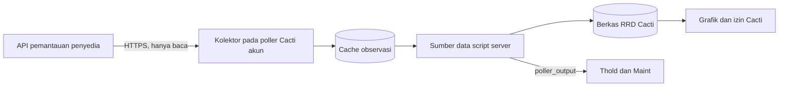

<!-- Source: README.md; SHA256: 7c621642e5f1a46bac66e4bc744f70aebb014c610d22de034088845fdc170405 -->

<!-- translations:start -->
[English](../../../README.md) | [简体中文](../zh-CN/README.md) | [हिन्दी](../hi-IN/README.md) | [Español (España)](../es-ES/README.md) | [Español (Latinoamérica)](../es-419/README.md) | [العربية (السعودية)](../ar-SA/README.md) | [Afrikaans](../af-ZA/README.md) | [አማርኛ](../am-ET/README.md) | [العربية (مصر)](../ar-EG/README.md) | [العربية (المغرب)](../ar-MA/README.md) | [বাংলা](../bn-BD/README.md) | [Bosanski](../bs-BA/README.md) | [Deutsch](../de-DE/README.md) | [فارسی](../fa-IR/README.md) | [Filipino](../fil-PH/README.md) | [Français](../fr-FR/README.md) | [Français (Maroc)](../fr-MA/README.md) | [Français (Sénégal)](../fr-SN/README.md) | [Hausa](../ha-NG/README.md) | [עברית](../he-IL/README.md) | [Hrvatski](../hr-HR/README.md) | [Bahasa Indonesia](README.md) | [Igbo](../ig-NG/README.md) | [Italiano](../it-IT/README.md) | [日本語](../ja-JP/README.md) | [한국어](../ko-KR/README.md) | [Malagasy](../mg-MG/README.md) | [मराठी](../mr-IN/README.md) | [Bahasa Melayu](../ms-MY/README.md) | [Nederlands](../nl-NL/README.md) | [Polski](../pl-PL/README.md) | [Português (Brasil)](../pt-BR/README.md) | [Русский](../ru-RU/README.md) | [Kinyarwanda](../rw-RW/README.md) | [Soomaali](../so-SO/README.md) | [Српски](../sr-RS/README.md) | [Svenska](../sv-SE/README.md) | [Kiswahili](../sw-KE/README.md) | [தமிழ்](../ta-IN/README.md) | [తెలుగు](../te-IN/README.md) | [ไทย](../th-TH/README.md) | [Türkçe](../tr-TR/README.md) | [Українська](../uk-UA/README.md) | [اردو](../ur-PK/README.md) | [Tiếng Việt](../vi-VN/README.md) | [isiXhosa](../xh-ZA/README.md) | [Yorùbá](../yo-NG/README.md) | [繁體中文](../zh-TW/README.md) | [isiZulu](../zu-ZA/README.md)
<!-- translations:end -->

# plugin_cloud

Plugin Cacti 1.2 yang menghadirkan sumber daya dan metrik dari penyedia cloud publik ke dalam Cacti sebagai perangkat, sumber data, dan grafik biasa. Beban kerja cloud kemudian berada berdampingan dengan jaringan yang membawanya, di bawah izin Cacti, serta dapat diberi peringatan dan diredam oleh Thold dan Maint. Satu plugin mencakup setiap penyedia, dengan satu driver per penyedia: DigitalOcean, AWS, Google Cloud, dan Azure terlebih dahulu.

> **Status: tonggak pencapaian 3 (DigitalOcean dan objek Cacti), sedang ditinjau.** Tonggak pencapaian ini menambahkan driver DigitalOcean, templat Cacti, perangkat cakupan per akun dengan kueri data per jenis sumber daya, input script server, serta estimasi permintaan pada New Graphs dan halaman kesehatan. Pemeriksaan awal terhadap akun DigitalOcean aktif dicatat dalam [fakta penyedia](../../research/provider-facts.md). Jangan jalankan di lingkungan produksi.

## Peran akses

| Realm | Akses |
| --- | --- |
| Cloud View | Halaman pemantauan yang sudah ada. |
| Cloud Operator | Pemantauan ditambah halaman Operations dan pengakuan triase pribadi. |
| Cloud Admin | Akses Operator ditambah konfigurasi yang sudah ada dan tindakan administratif. |

Setelah menyalin berkas pemutakhiran, buka halaman Plugins sebagai administrator untuk mendaftarkan
realm baru. Tetapkan realm Operator secara eksplisit di bawah **Configuration > Users** atau grup pengguna.
Pemutakhiran mempertahankan ID realm View dan Admin serta hak akses yang sudah ada. Akses Admin
mewarisi akses Operator, dan akses Operator mewarisi akses View pada setiap permintaan;
hal ini tidak menambahkan hak akses tersimpan ke pengguna atau grup. Pengaturan plugin juga memerlukan
akses Cloud Admin selain izin Settings milik Cacti.

Izin perangkat Cacti tetap membatasi baris dan tindakan yang tersedia bagi setiap pengguna; objek yang belum dipetakan memerlukan administrator. Operator dapat memverifikasi kredensial tersimpan untuk akun yang perangkat Cacti-nya boleh mereka akses.
Kredensial, konfigurasi, pemetaan, penghapusan, dan perubahan administratif lainnya
tetap berada di halaman administratif. Pengakuan hanya berlaku dalam sesi
pengguna saat ini, paling lama satu jam dan hanya selama observasi yang sama tetap
baru. Observasi yang baru atau berubah membatalkannya. Pengakuan tidak pernah menandai pengukuran
yang gagal sebagai sehat atau meredam peringatan.

## Mengapa

Setiap penyedia cloud memiliki konsol pemantauannya sendiri. Jika dijalankan berdampingan dengan Cacti, hal tersebut menyisakan tiga celah:

- **Kontrol akses terpisah.** Menampilkan metrik cloud kepada pengguna Cacti berarti harus memberi mereka akun login cloud.
- **Tidak ada konteks jaringan.** Tautan lokal dibuat grafiknya di Cacti; beban kerja di belakangnya dibuat grafiknya di konsol masing-masing penyedia.
- **Peringatan terpisah.** Thold dan Maint bekerja pada sumber data dan perangkat Cacti, sehingga alarm penyedia dikonfigurasi dan diredam secara terpisah, satu kali per penyedia.

Plugin ini membaca API pemantauan setiap penyedia pada poller Cacti, menyimpan sementara titik data terbaru di cache, dan menyajikannya ke script server Cacti. Poller Cacti menulis berkas RRD, sehingga pembuatan grafik, izin, Thold, Maint, dan boost bekerja sebagaimana mestinya untuk data Cacti mana pun.

## Komitmen desain

- **Hanya baca.** Setiap driver hanya dapat membangun operasi penyedia yang ada dalam daftar izinnya; plugin tidak pernah mengubah sumber daya cloud. ([ADR 0002](../../decisions/0002-read-only-with-operation-allowlist.md))
- **Hanya PHP, tanpa SDK.** Penandatanganan dan pertukaran token diimplementasikan dalam PHP menggunakan ekstensi yang sudah dibutuhkan Cacti. Tidak ada dependensi runtime Composer. ([ADR 0003](../../decisions/0003-php-only-without-sdks.md))
- **Biaya sebelum pengumpulan.** Plugin hanya membaca metrik yang memiliki sumber data Cacti, menampilkan perkiraan jumlah permintaan dan biaya harga daftar sebelum grafik dibuat, serta menegakkan batas bulanan. ([ADR 0005](../../decisions/0005-collect-only-what-is-graphed.md))
- **Tidak ada kredensial teks biasa di basis data.** Kredensial berasal dari brankas terenkripsi yang dikunci oleh berkas di luar basis data, dari berkas kredensial, atau dari identitas instans penyedia. ([ADR 0007](../../decisions/0007-credentials-outside-the-database-in-the-clear.md))

## Cakupan dan status

| Fase | Cakupan | Tonggak pencapaian | Status |
|---|---|---|---|
| 0, riset | Konfirmasi fakta penyedia, katalog metrik, model biaya dan tarif, vektor uji penandatanganan, uji coba transpor | [M1](https://github.com/somethingwithproof/plugin_cloud/milestone/1) | Selesai, kecuali pemeriksaan yang memerlukan akun penyedia aktif |
| 1, inti dan DigitalOcean | Akun, brankas kredensial, transpor, kolektor, cache observasi, objek Cacti, halaman kesehatan, Droplets dan load balancer DigitalOcean | [M2](https://github.com/somethingwithproof/plugin_cloud/milestone/2), [M3](https://github.com/somethingwithproof/plugin_cloud/milestone/3), [M4](https://github.com/somethingwithproof/plugin_cloud/milestone/4) | M2 selesai ([#81](https://github.com/somethingwithproof/plugin_cloud/pull/81)); driver M3, templat, dan perangkat cakupan sudah digabungkan; estimasi permintaan, izin, dan pemeriksaan performa sedang ditinjau; M4 belum dimulai |
| 2, AWS | Signature Version 4, `AssumeRole`, peran instans, CloudWatch `GetMetricData`, inventaris regional | [M5](https://github.com/somethingwithproof/plugin_cloud/milestone/5) | Belum dimulai |
| 3, Google Cloud | JWT akun layanan, server metadata, Cloud Monitoring `timeSeries.list` | [M6](https://github.com/somethingwithproof/plugin_cloud/milestone/6) | Belum dimulai |
| 4, Azure | Kredensial klien Entra, identitas terkelola, Resource Graph, `metrics:getBatch` | [M7](https://github.com/somethingwithproof/plugin_cloud/milestone/7) | Belum dimulai |
| 5, kolektor jarak jauh | Akun pada kolektor data jarak jauh Cacti | [M8](https://github.com/somethingwithproof/plugin_cloud/milestone/8) | Belum dimulai |

Di luar cakupan: mengubah sumber daya cloud, membuat atau mencerminkan alarm penyedia, laporan penagihan, log dan jejak, serta mesin peringatan milik plugin sendiri. Penyedia lainnya (Hetzner Cloud, Akamai Cloud, Oracle Cloud, dan lainnya) merupakan isu riset.

## Yang dihadirkan pada tonggak pencapaian 2

- **Pemasangan terjaga.** Pada PHP di bawah 8.2, atau tanpa ext-openssl, pemasangan dan pengaktifan ditolak dengan sebuah pesan, dan bagian Cacti lainnya tetap berjalan.
- **Siklus hidup.** Pasang, mutakhirkan, dan copot pemasangan melalui halaman Plugins Cacti. Pemutakhiran dilakukan secara berurutan dan tahan terhadap interupsi. Pencopotan pemasangan mempertahankan tabel plugin kecuali Anda menghapus centang *Keep Plugin Tables on Uninstall*.
- **Realm terpisah.** *Cloud Admin* membuka **Cloud Accounts**; *Cloud Operator* membuka **Cloud Operations**; *Cloud View* membuka **Cloud Health**. Admin mewarisi Operator, dan Operator mewarisi View. Ketiga halaman tersebut berada di bawah Management.
- **Akun dan kredensial.** Tambah, sunting, verifikasi, dan hapus akun. Kredensial dienkripsi di dalam basis data dengan berkas kunci yang disimpan di luarnya (AES-256-GCM), atau dibaca dari berkas pada poller. Kredensial bersifat hanya tulis di UI dan disamarkan dari log.
- **Kolektor.** Berjalan dari setiap eksekusi poller, satu instans per poller, dalam batas waktu tertentu. Kolektor mengambil sewa per akun, menjalankan penemuan sesuai intervalnya sendiri, dan hanya membaca metrik untuk sumber data aktif milik plugin sendiri.
- **Kesehatan.** Status pengumpulan, penemuan, sumber daya, dan kebaruan per akun, ditambah peringatan untuk kunci brankas yang tidak dapat digunakan, berkas kredensial yang tidak aman, serta interval yang tidak dapat dipenuhi oleh poller.

## Pemasangan dan konfigurasi

Langkah-langkah berikut memasang kode tonggak pencapaian 2 untuk evaluasi. Langkah ini memerlukan Cacti 1.2.31 atau yang lebih baru pada PHP 8.2 atau yang lebih baru.

1. Salin repositori ke `plugins/cloud` di bawah direktori Cacti Anda. Direktori tersebut harus bernama `cloud`.
2. Buat kunci brankas di luar web root. Letakkan di direktori yang hanya dapat ditulisi oleh root dan pengguna Cacti, serta buat berkas tersebut hanya dapat dibaca oleh pengguna yang menjalankan server web dan poller. Plugin tidak pernah membuat atau menulis berkas ini:

   ```sh
   sudo install -d -m 0750 -o root -g cacti /etc/cacti
   head -c 32 /dev/urandom | sudo tee /etc/cacti/cloud-vault.key > /dev/null
   sudo chown cacti:cacti /etc/cacti/cloud-vault.key
   sudo chmod 0600 /etc/cacti/cloud-vault.key
   ```

   Ganti `cacti` dengan pengguna yang menjalankan server web dan poller Anda. Berkas ini berisi 32 byte mentah atau 64 karakter heksadesimal. Cadangkan berkas ini bersama basis data; tanpanya, kredensial yang tersimpan harus dimasukkan ulang.
3. Di Cacti, buka **Configuration > Plugins**, lalu pasang dan aktifkan *Cloud*.
4. Di bawah **Configuration > Settings > Cloud**, atur *Vault Key File* jika Anda menggunakan jalur lain. *Collector Time Budget* (bawaan 240 detik) harus tetap di bawah interval poller.
5. Berikan *Cloud Admin*, *Cloud Operator*, atau *Cloud View* kepada pengguna dan grup di bawah **Configuration > Users**. Pemasangan memberikan Cloud Admin dan Cloud View kepada administrator; Cloud Admin mencakup akses Operator, sehingga administrator tidak memerlukan pemberian Operator secara terpisah.
6. Tambahkan akun di bawah **Management > Cloud Accounts**, lalu periksa **Management > Cloud Health** untuk melihat peringatan.

## Target kompatibilitas

| Komponen | Target |
|---|---|
| Cacti | 1.2.31 atau yang lebih baru, tanpa tambalan inti |
| PHP | 8.2 atau yang lebih baru; `setup.php` tetap dapat diurai pada 8.0 sehingga runtime yang tidak didukung mendapatkan penolakan alih-alih merusak UI Cacti |
| Ekstensi PHP | Tidak ada selain yang dibutuhkan Cacti 1.2.31 |
| Thold, Maint | Tidak memerlukan perubahan |

## Desain

- [docs/performance.md](../../performance.md) berisi pengukuran kolektor dan halaman kesehatan, beserta perangkat keras dan pengaturan yang digunakan.
- [docs/PLAN.md](../../PLAN.md) adalah rencana lengkap: arsitektur, fakta penyedia dan Cacti yang menjadi tumpuannya (beserta sumbernya), kontrak driver, aritmetika biaya, batas keamanan, pengujian, dan risiko.
- [docs/decisions/](../../decisions) menyimpan catatan keputusan arsitektur untuk pilihan yang telah dibuat.
- [docs/REQUIREMENTS.md](../../REQUIREMENTS.md) memetakan setiap ID persyaratan ke isunya.



## Pelacakan pekerjaan

- **Tonggak pencapaian** mengikuti tonggak pencapaian pada rencana. Masing-masing memiliki isu epik yang mencantumkan sub-isu dan bukti keluarannya.
- **Isu** dikelompokkan berdasarkan label: `type: requirement`, `type: research`, `type: decision`, `type: epic`. Isu persyaratan menyatakan persyaratan bernomor yang dapat diuji (`REQ-AREA-NNN`) beserta kriteria penerimaannya.
- **Label** juga memuat `area:`, `provider:`, `phase:`, `priority:`, dan `status:`. Lihat [CONTRIBUTING.md](../../../CONTRIBUTING.md#labels).
- [Papan proyek](https://github.com/users/somethingwithproof/projects/7) menampilkan seluruh isu di semua tonggak pencapaian.

## Pengembangan

CI melakukan lint pada titik masuk di PHP 8.0, menjalankan pengujian unit dan integrasi serta PHPStan level 9, dan memasang plugin pada PHP 8.2 hingga 8.5 terhadap Cacti 1.2.31 dan cabang 1.2.x. CI juga memeriksa bahwa PHP 8.1 ditolak tanpa merusak Cacti. Pengujian menggunakan Pest dari perangkat uji plugin inti Cacti. Pilihan tersebut bersifat sementara hingga [#12](https://github.com/somethingwithproof/plugin_cloud/issues/12) diputuskan. [.github/workflows/plugin-ci-workflow.yml](../../../.github/workflows/plugin-ci-workflow.yml) mencantumkan setiap langkah. Jalankan `sh tests/lint-workflows.sh` dan `sh locales/build_gettext.sh --check` secara lokal sebelum melakukan push.

## Berkontribusi

Baca [CONTRIBUTING.md](../../../CONTRIBUTING.md). Komit memerlukan DCO sign-off. Diskusi desain berlangsung pada isu; keputusan yang masih terbuka diberi label `type: decision`.

## Keamanan

Laporkan kerentanan secara privat; lihat [SECURITY.md](../../../SECURITY.md).

## Lisensi

GNU General Public License v2.0, lisensi yang sama dengan Cacti dan plugin-pluginnya. Lihat [LICENSE](../../../LICENSE).
