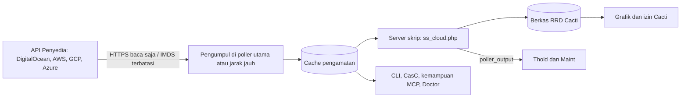

<!-- Source: README.md; SHA256: ac2074a40238686915802803c5efe773f33677f934281e0605e6e87a71a9d27d -->

<!-- translations:start -->
[English](../../../README.md) | [简体中文](../zh-CN/README.md) | [हिन्दी](../hi-IN/README.md) | [Español (España)](../es-ES/README.md) | [Español (Latinoamérica)](../es-419/README.md) | [العربية (السعودية)](../ar-SA/README.md) | [Afrikaans](../af-ZA/README.md) | [አማርኛ](../am-ET/README.md) | [العربية (مصر)](../ar-EG/README.md) | [العربية (المغرب)](../ar-MA/README.md) | [বাংলা](../bn-BD/README.md) | [Bosanski](../bs-BA/README.md) | [Deutsch](../de-DE/README.md) | [فارسی](../fa-IR/README.md) | [Filipino](../fil-PH/README.md) | [Français](../fr-FR/README.md) | [Français (Maroc)](../fr-MA/README.md) | [Français (Sénégal)](../fr-SN/README.md) | [Hausa](../ha-NG/README.md) | [עברית](../he-IL/README.md) | [Hrvatski](../hr-HR/README.md) | [Bahasa Indonesia](README.md) | [Igbo](../ig-NG/README.md) | [Italiano](../it-IT/README.md) | [日本語](../ja-JP/README.md) | [한국어](../ko-KR/README.md) | [Malagasy](../mg-MG/README.md) | [मराठी](../mr-IN/README.md) | [Bahasa Melayu](../ms-MY/README.md) | [Nederlands](../nl-NL/README.md) | [Polski](../pl-PL/README.md) | [Português (Brasil)](../pt-BR/README.md) | [Русский](../ru-RU/README.md) | [Kinyarwanda](../rw-RW/README.md) | [Soomaali](../so-SO/README.md) | [Српски](../sr-RS/README.md) | [Svenska](../sv-SE/README.md) | [Kiswahili](../sw-KE/README.md) | [தமிழ்](../ta-IN/README.md) | [తెలుగు](../te-IN/README.md) | [ไทย](../th-TH/README.md) | [Türkçe](../tr-TR/README.md) | [Українська](../uk-UA/README.md) | [اردو](../ur-PK/README.md) | [Tiếng Việt](../vi-VN/README.md) | [isiXhosa](../xh-ZA/README.md) | [Yorùbá](../yo-NG/README.md) | [繁體中文](../zh-TW/README.md) | [isiZulu](../zu-ZA/README.md)
<!-- translations:end -->

# plugin_cloud

Plugin Cacti 1.2 yang menghadirkan sumber daya dan metrik dari penyedia cloud publik ke dalam Cacti sebagai perangkat, sumber data, dan grafik biasa. Beban kerja cloud berada berdampingan dengan jaringan yang membawanya, di bawah izin Cacti, serta diberi peringatan dan diredam oleh Thold dan Maint. Satu plugin mencakup DigitalOcean, Amazon Web Services, Google Cloud, dan Microsoft Azure melalui driver penyedia pure-PHP yang bersifat baca-saja.

> **Status: dalam pengembangan, belum ada rilis (`0.1.0-dev`).** Branch ini mengimplementasikan driver pure-PHP untuk DigitalOcean, AWS, Google Cloud, dan Azure, replikasi pengumpul data jarak jauh dan kesehatan agen baca-saja, penyedia CasC serta CLI operator, kemampuan MCP, dan pemeriksaan Doctor. Templat Cacti yang disertakan saat ini mencakup DigitalOcean Droplet dan load balancer (`templates/cloud_digitalocean.xml`); paket templat Cacti untuk AWS, Google Cloud, dan Azure serta kualifikasi akun langsung di luar DigitalOcean ([fakta penyedia](../../research/provider-facts.md)) belum selesai. Jangan jalankan di lingkungan produksi.

## Penyedia yang didukung

Setiap driver penyedia terdaftar di `Drivers::production()`, ditawarkan oleh `Provider::released()`, dan berjalan dalam PHP murni menggunakan `ext-openssl` serta stream socket tanpa ketergantungan runtime SDK atau Composer.

| Penyedia | Kolom cakupan | Sumber kredensial | Autentikasi | Sumber daya yang ditemukan | Pengumpulan metrik |
|---|---|---|---|---|---|
| DigitalOcean (`digitalocean`) | Tidak ada (berdasarkan cakupan token) | `vault`, `file` | Bearer token | `droplet`, `load_balancer` | `/v2/monitoring/metrics` dengan kesadaran kuota batas laju; menyertakan templat dan kueri data Cacti |
| Amazon Web Services (`aws`) | `account_id` (12 digit), `regions` | `vault`, `file`, `instance` | AWS SigV4 pure-PHP (`AWS4-HMAC-SHA256`), verifikasi STS `GetCallerIdentity`, STS `AssumeRole` opsional, EC2 IMDSv2 (`169.254.169.254`) untuk akun `instance` | `ec2_instance`, `rds_instance`, `aws_elb` (ALB/NLB) | CloudWatch `GetMetricData` secara batch (hingga 500 kueri per panggilan) |
| Google Cloud (`gcp`) | `project` | `vault`, `file`, `instance` | JWT akun layanan RS256 pure-PHP melalui `ext-openssl` yang ditukar di `oauth2.googleapis.com/token`, atau server metadata GCE (`metadata.google.internal`) untuk akun `instance` | `gce_instance` melalui `instances.aggregatedList` | Cloud Monitoring `timeSeries.list` |
| Microsoft Azure (`azure`) | `tenant`, `subscription`, `regions` | `vault`, `file`, `instance` | Alur client-credentials OAuth2 Entra ID pure-PHP (hanya `client_secret`; asersi sertifikat dikecualikan), atau identitas terkelola Azure IMDS (`169.254.169.254`) untuk token ARM dan Monitor | `azure_vm` melalui ARM Resource Graph (dipaginasi dengan `$skipToken` dan dideduplikasi) | Azure Monitor `metrics:getBatch` (hingga 50 sumber daya per panggilan, menangani pembatasan HTTP 429 dan 529) |

## Kemampuan yang diimplementasikan

### Platform inti, vault, dan pengumpul

- **Instalasi dan siklus hidup terlindungi.** Titik masuk (`setup.php`, `cli/cloud.php`, `poller_cloud.php`, `ss_cloud.php`, dan skrip halaman) dapat diurai pada PHP 8.0 dan menolak PHP di bawah 8.2 atau ketiadaan `ext-openssl` tanpa merusak Cacti. Pembaruan berjalan berurutan, idempoten (`Schema::VERSION = 3`, 9 tabel), dan tahan terhadap gangguan. Penghapusan instalasi mempertahankan tabel plugin kecuali *Keep Plugin Tables on Uninstall* tidak dicentang.
- **Akun dan kredensial.** Tambah, ubah, verifikasi, dan hapus akun di bawah **Management > Cloud Accounts**. Kredensial berasal dari vault terenkripsi AES-256-GCM (`plugin_cloud_secret`, dengan kunci bawaan `/etc/cacti/cloud-vault.key`), dari berkas yang dibatasi di dalam *Credential File Directory* yang dikonfigurasi (`cloud_credential_dir`, kosong secara bawaan untuk menolak berkas), atau dari identitas instans penyedia. Kredensial bersifat tulis-saja di UI dan disamarkan dari log.
- **Kontrol keluar dan baca-saja yang ketat.** Setiap driver beroperasi di balik `GuardedTransport` dan `OutboundPolicy`: port HTTPS 443 ke nama host persis per penyedia, dengan titik akhir metadata HTTP link-local pada port 80 (`169.254.169.254`, `metadata.google.internal`) hanya diaktifkan untuk akun `instance`. Hanya operasi baca-saja dalam daftar izin yang diperbolehkan.
- **Kontrol pengumpul dan biaya.** `poller_cloud.php` berjalan dari `poller_bottom` (satu proses per poller melalui registri proses Cacti) dalam batas `cloud_collector_budget`, memperoleh sewa per akun, menjalankan penemuan sesuai `discover_interval`, membaca metrik hanya untuk sumber data Cacti yang aktif (`plugin_cloud_series`), mematuhi `request_share` serta `monthly_ceiling`, dan menyimpan titik data terbaru ke cache di `plugin_cloud_observation` untuk `ss_cloud.php`.
- **Objek Cacti dan estimasi permintaan.** Memelihara satu perangkat cakupan per akun (`plugin_cloud_device`), menjaga metode pengindeksan ulang perangkat cakupan saat perangkat disimpan, mengimpor templat DigitalOcean serta kueri data server skrip (`templates/cloud_digitalocean.xml`, `cloud_do_droplet.xml`, `cloud_do_load_balancer.xml`), dan menampilkan estimasi permintaan serta harga daftar pada **New Graphs** (`graphs_new_top_links`) dan **Cloud Health**.

### Pengumpul data jarak jauh

- `INFO` mendeklarasikan `remote_collect:1`. Akun dapat ditetapkan ke poller Cacti mana pun yang aktif (`poller_id >= 1`), dan `poller_cloud.php --poller=N` hanya mengumpulkan akun yang dimiliki oleh poller tersebut.
- **Hook `replicate_out`.** Mereplikasi baris bercakupan poller dari `plugin_cloud_account`, `plugin_cloud_device`, `plugin_cloud_series`, serta baris ciphertext terenkripsi dari `plugin_cloud_secret` (hanya untuk akun berbasis vault yang dimiliki oleh poller target) melalui `replicate_out_table()`. Berkas kunci vault mentah tidak pernah disimpan di basis data maupun direplikasi dan tetap berada secara lokal pada setiap poller.
- **Hook `remote_agent`.** Mengekspos ringkasan kesehatan JSON baca-saja (`action=cloud_health`) yang hanya menerima parameter bilangan bulat `poller_id` dan `account_id` serta tidak mengembalikan kredensial, jalur berkas, maupun rahasia apa pun.

### Hook ekosistem (CasC, kemampuan MCP, dan Doctor)

- **Penyedia CasC (`casc_register_providers`).** Mendaftarkan penyedia `cloud` (versi skema `1`) dengan ekspor YAML dan XML pure-PHP yang deterministik, validasi manifes, perencanaan selisih, dan penerapan yang dikonfirmasi. Kredensial vault diekspor sebagai referensi `vault:account:<name>`; kolom rahasia mentah (`secret`, `secrets`, `token`, `access_token`, `refresh_token`, `password`, `private_key`, `access_key_id`, `secret_access_key`, `session_token`, `client_secret`, `credential`, `credentials`, `vault_key`) ditolak. Penerapan memerlukan hash SHA-256 persis `--confirm=<PLAN_HASH>`.
- **MCP / Abilities API (`abilities_register`).** Mendaftarkan tiga kemampuan baca-saja secara ketat yang dibatasi oleh ranah Cloud View (`cloud_health.php`) dan cakupan perangkat Cacti bagi pemanggil non-admin, tanpa mengeluarkan kredensial, kunci vault, atau jalur berkas kredensial:
  - `cloud-list-accounts` (`provider`, `poller_id` opsional)
  - `cloud-list-resources` (`account_id`, `type`, `lifecycle` opsional)
  - `cloud-get-health` (`account_id` opsional)
- **Pemeriksaan Doctor (`doctor_register_checks`).** Mendaftarkan lima pemeriksaan diagnostik yang tidak mengungkap nilai rahasia maupun materi kunci:
  - `cloud_schema`: keterkinian versi skema
  - `cloud_vault_key`: keterbacaan, izin, dan ukuran berkas kunci vault
  - `cloud_drivers`: pendaftaran driver produksi untuk semua penyedia yang telah dirilis
  - `cloud_accounts_health`: akun aktif yang gagal, dibatasi kecepatannya, atau kedaluwarsa
  - `cloud_poller_intervals`: keselarasan interval pengumpulan akun aktif dengan interval poller Cacti

## CLI

Jalankan dari direktori akar Cacti dengan PHP 8.2 atau lebih baru:

```sh
# Operator and CasC CLI (options use --key=value form)
php plugins/cloud/cli/cloud.php export [--format=yaml|xml]
php plugins/cloud/cli/cloud.php validate --file=<path> [--format=yaml|xml]
php plugins/cloud/cli/cloud.php plan --file=<path> [--format=yaml|xml]
php plugins/cloud/cli/cloud.php apply --file=<path> --confirm=<PLAN_HASH> [--format=yaml|xml]
php plugins/cloud/cli/cloud.php health [--format=text|json] [--poller=<id>]

# Collector entry point (normally started by poller_bottom)
php plugins/cloud/poller_cloud.php [--poller=N] [--force] [--debug]
```

## Peran akses

| Ranah | Akses |
| --- | --- |
| Cloud View | Halaman pemantauan yang ada. |
| Cloud Operator | Pemantauan ditambah halaman Operations dan pengakuan triase pribadi. |
| Cloud Admin | Akses Operator ditambah tindakan konfigurasi dan administratif yang ada. |

Setelah menyalin berkas pembaruan, buka halaman Plugins sebagai administrator untuk mendaftarkan ranah tersebut. Tetapkan ranah Operator secara eksplisit di bawah **Configuration > Users** atau grup pengguna. Pembaruan mempertahankan ID dan hak akses ranah View dan Admin yang sudah ada. Akses Admin mewarisi akses Operator, dan akses Operator mewarisi akses View pada setiap permintaan; hal ini tidak menambahkan hak akses tersimpan ke pengguna atau grup. Pengaturan plugin juga memerlukan akses Cloud Admin selain izin Settings Cacti.

Izin perangkat Cacti membatasi baris dan tindakan yang tersedia bagi setiap pengguna; objek yang belum dipetakan memerlukan administrator. Operator dapat memverifikasi kredensial tersimpan untuk akun yang perangkat Cactinya dapat mereka akses. Kredensial, konfigurasi, pemetaan, penghapusan, dan perubahan administratif lainnya tetap berada di halaman administratif. Pengakuan hanya berlaku pada sesi pengguna saat ini, paling lama satu jam dan hanya selama pengamatan yang sama tetap segar. Pengamatan baru atau yang berubah membatalkannya. Pengakuan tidak pernah menandai pengukuran yang gagal sebagai sehat atau meredam peringatan.

## Mengapa

Setiap penyedia cloud memiliki konsol pemantauan sendiri. Saat dijalankan berdampingan dengan Cacti, keduanya menyisakan tiga celah:

- **Kontrol akses terpisah.** Menampilkan metrik cloud kepada pengguna Cacti berarti memberi mereka akun masuk cloud.
- **Tidak ada konteks jaringan.** Tautan lokal digrafikkan di Cacti; beban kerja di belakangnya digrafikkan di konsol masing-masing penyedia.
- **Peringatan terpisah.** Thold dan Maint bekerja pada sumber data dan perangkat Cacti, sehingga alarm penyedia dikonfigurasi dan diredam secara terpisah, satu kali per penyedia.

Plugin ini membaca API pemantauan masing-masing penyedia pada poller Cacti, menyimpan titik data terbaru di cache, dan menyajikannya ke server skrip Cacti. Poller Cacti menulis berkas RRD, sehingga pembuatan grafik, izin, Thold, Maint, dan boost bekerja seperti data Cacti lainnya.

## Komitmen desain

- **Baca-saja.** Setiap driver hanya dapat membuat operasi penyedia yang ada di daftar izinnya; plugin tidak pernah mengubah sumber daya cloud. ([ADR 0002](../../decisions/0002-read-only-with-operation-allowlist.md))
- **Hanya PHP, tanpa SDK.** Penandatanganan dan pertukaran token diimplementasikan dalam PHP dengan ekstensi yang sudah diwajibkan oleh Cacti. Tanpa ketergantungan runtime Composer. ([ADR 0003](../../decisions/0003-php-only-without-sdks.md))
- **Biaya sebelum pengumpulan.** Plugin hanya membaca metrik yang memiliki sumber data Cacti, menampilkan perkiraan jumlah permintaan serta biaya harga daftar sebelum grafik dibuat, dan memberlakukan batas bulanan. ([ADR 0005](../../decisions/0005-collect-only-what-is-graphed.md))
- **Tidak ada kredensial teks biasa di basis data.** Kredensial berasal dari vault terenkripsi yang dikunci oleh berkas di luar basis data, dari berkas kredensial, atau dari identitas instans penyedia. ([ADR 0007](../../decisions/0007-credentials-outside-the-database-in-the-clear.md))

## Cakupan dan status

| Fase | Cakupan | Tonggak | Status |
|---|---|---|---|
| 0, riset | Konfirmasi fakta penyedia, katalog metrik, model biaya dan laju, vektor uji penandatanganan, purwarupa transport | [M1](https://github.com/somethingwithproof/plugin_cloud/milestone/1) | Selesai, kecuali pemeriksaan yang memerlukan akun penyedia langsung |
| 1, inti dan DigitalOcean | Akun, vault kredensial, transport, pengumpul, cache pengamatan, objek Cacti, templat, estimasi permintaan, halaman kesehatan, DigitalOcean Droplet dan load balancer | [M2](https://github.com/somethingwithproof/plugin_cloud/milestone/2), [M3](https://github.com/somethingwithproof/plugin_cloud/milestone/3), [M4](https://github.com/somethingwithproof/plugin_cloud/milestone/4) | Diimplementasikan; kualifikasi uji coba M4 tertunda |
| 2, AWS | SigV4 pure-PHP, STS `AssumeRole`, peran instans IMDSv2, inventaris EC2/RDS/ELB, CloudWatch `GetMetricData` | [M5](https://github.com/somethingwithproof/plugin_cloud/milestone/5) | Driver diimplementasikan; templat Cacti dan kualifikasi akun langsung tertunda |
| 3, Google Cloud | JWT akun layanan RS256 pure-PHP, server metadata GCE, inventaris Compute Engine, Cloud Monitoring `timeSeries.list` | [M6](https://github.com/somethingwithproof/plugin_cloud/milestone/6) | Driver diimplementasikan; templat Cacti dan kualifikasi akun langsung tertunda |
| 4, Azure | Kredensial klien Entra ID, identitas terkelola IMDS, inventaris VM ARM Resource Graph, Azure Monitor `metrics:getBatch` | [M7](https://github.com/somethingwithproof/plugin_cloud/milestone/7) | Driver diimplementasikan; templat Cacti dan kualifikasi akun langsung tertunda |
| 5, pengumpul jarak jauh dan ekosistem | Pengumpul data jarak jauh (`replicate_out`, `remote_agent`), penyedia CasC dan CLI, kemampuan MCP, pemeriksaan Doctor | [M8](https://github.com/somethingwithproof/plugin_cloud/milestone/8) | Diimplementasikan |

Di luar cakupan: mengubah sumber daya cloud, membuat atau mencerminkan alarm penyedia, laporan penagihan, log dan jejak, serta mesin peringatan milik plugin. Penyedia lainnya (Hetzner Cloud, Akamai Cloud, Oracle Cloud, dan lainnya) merupakan isu riset.

## Instalasi dan konfigurasi

Langkah-langkah ini menginstal kode pengembangan untuk evaluasi. Langkah ini memerlukan Cacti 1.2.31 atau lebih baru pada PHP 8.2 atau lebih baru.

1. Salin repositori ke `plugins/cloud` di bawah direktori Cacti Anda. Direktori tersebut harus bernama `cloud`.
2. Buat kunci vault di luar web root pada setiap poller yang menggunakan kredensial berbasis vault. Letakkan di direktori yang hanya dapat ditulisi oleh root dan pengguna Cacti, serta buat berkas tersebut hanya dapat dibaca oleh pengguna yang menjalankan server web dan poller. Plugin tidak pernah membuat atau menulis berkas ini:

   ```sh
   sudo install -d -m 0750 -o root -g cacti /etc/cacti
   head -c 32 /dev/urandom | sudo tee /etc/cacti/cloud-vault.key > /dev/null
   sudo chown cacti:cacti /etc/cacti/cloud-vault.key
   sudo chmod 0600 /etc/cacti/cloud-vault.key
   ```

   Ganti `cacti` dengan pengguna yang menjalankan server web dan poller Anda. Berkas ini menyimpan 32 byte mentah atau 64 karakter heksadesimal. Cadangkan berkas ini bersama basis data; tanpanya, kredensial yang tersimpan harus dimasukkan ulang.
3. Di Cacti, buka **Configuration > Plugins**, lalu instal dan aktifkan *Cloud*.
4. Di bawah **Configuration > Settings > Cloud**, atur *Vault Key File* jika Anda menggunakan jalur lain, konfigurasikan *Credential File Directory* jika Anda berencana menggunakan kredensial berbasis berkas, dan jaga agar *Collector Time Budget* (bawaan 240 detik) tetap di bawah interval poller.
5. Berikan *Cloud Admin*, *Cloud Operator*, atau *Cloud View* kepada pengguna dan grup di bawah **Configuration > Users**. Instalasi memberikan Cloud Admin dan Cloud View kepada administrator; Cloud Admin sudah mencakup akses Operator, sehingga administrator tidak memerlukan pemberian hak Operator secara terpisah.
6. Tambahkan akun di bawah **Management > Cloud Accounts**, lalu periksa **Management > Cloud Health** untuk melihat peringatan.

## Target kompatibilitas

| Komponen | Target |
|---|---|
| Cacti | 1.2.31 atau lebih baru, tanpa patch inti |
| PHP | 8.2 atau lebih baru; titik masuk tetap dapat diurai pada 8.0 sehingga runtime yang tidak didukung menerima penolakan alih-alih merusak UI Cacti |
| Ekstensi PHP | `ext-openssl` (diwajibkan oleh Cacti 1.2.31); tanpa `ext-curl` dan tanpa ketergantungan runtime Composer |
| Thold, Maint | Tidak ada perubahan yang diperlukan |

## Desain

- [docs/performance.md](../../performance.md) berisi hasil pengukuran pengumpul dan halaman kesehatan, beserta perangkat keras dan pengaturan yang digunakan.
- [docs/PLAN.md](../../PLAN.md) adalah rencana lengkapnya: arsitektur, fakta penyedia dan Cacti yang menjadi landasannya (beserta sumber), kontrak driver, aritmetika biaya, batas keamanan, pengujian, dan risiko.
- [docs/decisions/](../../decisions/) menyimpan catatan keputusan arsitektur untuk pilihan yang telah dibuat.
- [docs/REQUIREMENTS.md](../../REQUIREMENTS.md) memetakan setiap ID persyaratan ke isunya.



## Cara kerja dilacak

- **Tonggak** mengikuti tonggak pada rencana. Masing-masing memiliki isu epik yang mencantumkan sub-isu dan bukti keluarannya.
- **Isu** dikelompokkan berdasarkan label: `type: requirement`, `type: research`, `type: decision`, `type: epic`. Isu persyaratan menyatakan persyaratan bernomor dan dapat diuji (`REQ-AREA-NNN`) serta kriteria penerimaan.
- **Label** juga memuat `area:`, `provider:`, `phase:`, `priority:`, dan `status:`. Lihat [CONTRIBUTING.md](../../../CONTRIBUTING.md#labels).
- [Papan proyek](https://github.com/users/somethingwithproof/projects/7) menampilkan seluruh isu di semua tonggak.

## Pengembangan

CI ([.github/workflows/plugin-ci-workflow.yml](../../../.github/workflows/plugin-ci-workflow.yml)) memeriksa arsip rilis dan versi semantik (`bash tests/bin/archive-check.sh`), memeriksa sintaksis titik masuk pada PHP 8.0, menjalankan uji unit Pest (`phpunit.xml`) serta uji integrasi siklus hidup (`phpunit-integration.xml`) dan PHPStan level 9 pada PHP 8.2 hingga 8.5 terhadap Cacti `release/1.2.31` dan `1.2.x` dengan `CLOUD_OFFLINE=1`, memeriksa penolakan pada PHP 8.1, memverifikasi katalog gettext, mengukur kinerja pengumpulan 1.000 seri dan halaman kesehatan, serta menjalankan pemeriksaan workflow dan kepatuhan REUSE.

Pemeriksaan lokal sebelum push:

```sh
bash tests/bin/archive-check.sh
sh tests/lint-workflows.sh
sh locales/build_gettext.sh --check
CACTI_PATH=/path/to/cacti phpstan analyse -c phpstan.neon --no-progress
```

Jalankan Pest dengan `--configuration=phpunit.xml` untuk uji unit dan aturan sumber, atau `--configuration=phpunit-integration.xml` dengan `CACTI_PATH` dan `CLOUD_TEST_DATABASE=disposable` terhadap basis data Cacti sekali pakai untuk uji integrasi siklus hidup.

## Berkontribusi

Baca [CONTRIBUTING.md](../../../CONTRIBUTING.md). Commit memerlukan tanda tangan DCO. Diskusi desain berlangsung di isu; keputusan terbuka memakai label `type: decision`.

## Keamanan

Laporkan kerentanan secara pribadi; lihat [SECURITY.md](../../../SECURITY.md).

## Lisensi

GNU General Public License v2.0, lisensi yang sama dengan Cacti dan pluginnya. Lihat [LICENSE](../../../LICENSE).
