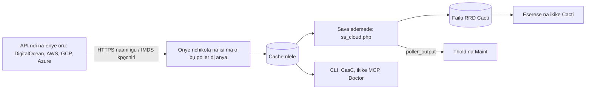

<!-- Source: README.md; SHA256: ac2074a40238686915802803c5efe773f33677f934281e0605e6e87a71a9d27d -->

<!-- translations:start -->
[English](../../../README.md) | [简体中文](../zh-CN/README.md) | [हिन्दी](../hi-IN/README.md) | [Español (España)](../es-ES/README.md) | [Español (Latinoamérica)](../es-419/README.md) | [العربية (السعودية)](../ar-SA/README.md) | [Afrikaans](../af-ZA/README.md) | [አማርኛ](../am-ET/README.md) | [العربية (مصر)](../ar-EG/README.md) | [العربية (المغرب)](../ar-MA/README.md) | [বাংলা](../bn-BD/README.md) | [Bosanski](../bs-BA/README.md) | [Deutsch](../de-DE/README.md) | [فارسی](../fa-IR/README.md) | [Filipino](../fil-PH/README.md) | [Français](../fr-FR/README.md) | [Français (Maroc)](../fr-MA/README.md) | [Français (Sénégal)](../fr-SN/README.md) | [Hausa](../ha-NG/README.md) | [עברית](../he-IL/README.md) | [Hrvatski](../hr-HR/README.md) | [Bahasa Indonesia](../id-ID/README.md) | [Igbo](README.md) | [Italiano](../it-IT/README.md) | [日本語](../ja-JP/README.md) | [한국어](../ko-KR/README.md) | [Malagasy](../mg-MG/README.md) | [मराठी](../mr-IN/README.md) | [Bahasa Melayu](../ms-MY/README.md) | [Nederlands](../nl-NL/README.md) | [Polski](../pl-PL/README.md) | [Português (Brasil)](../pt-BR/README.md) | [Русский](../ru-RU/README.md) | [Kinyarwanda](../rw-RW/README.md) | [Soomaali](../so-SO/README.md) | [Српски](../sr-RS/README.md) | [Svenska](../sv-SE/README.md) | [Kiswahili](../sw-KE/README.md) | [தமிழ்](../ta-IN/README.md) | [తెలుగు](../te-IN/README.md) | [ไทย](../th-TH/README.md) | [Türkçe](../tr-TR/README.md) | [Українська](../uk-UA/README.md) | [اردو](../ur-PK/README.md) | [Tiếng Việt](../vi-VN/README.md) | [isiXhosa](../xh-ZA/README.md) | [Yorùbá](../yo-NG/README.md) | [繁體中文](../zh-TW/README.md) | [isiZulu](../zu-ZA/README.md)
<!-- translations:end -->

# plugin_cloud

Ngwa mgbakwunye Cacti 1.2 nke na-eweta akụrụngwa na nha si n'aka ndị na-enye ọrụ igwe ojii ọha banye na Cacti dị ka ngwaọrụ nkịtị, isi iyi data, na eserese. Ọrụ igwe ojii na-anọ n'akụkụ netwọk nke na-ebu ha, n'okpuru ikike Cacti, ma Thold na Maint na-ezipu mkpu maka ha ma kwụsịtụ ha. Otu ngwa mgbakwunye na-ekpuchi DigitalOcean, Amazon Web Services, Google Cloud, na Microsoft Azure site na draịva ndị na-enye ọrụ na PHP dị ọcha nke na-agụ naanị.

> **Ọnọdụ: n'ọrụ mmepe, enweghị ntọhapụ ka ọ dị ugbu a (`0.1.0-dev`).** Alaka a na-etinye draịva PHP dị ọcha maka DigitalOcean, AWS, Google Cloud, na Azure, nṅomi onye nchịkọta data dị anya na ahụike agent na-agụ naanị, onye na-enye CasC na CLI nke onye ọrụ, ikike MCP, na nyocha Doctor. Ụkpụrụ Cacti e zipụrụ ugbu a na-ekpuchi DigitalOcean Droplets na load balancers (`templates/cloud_digitalocean.xml`); ngwugwu ụkpụrụ Cacti maka AWS, Google Cloud, na Azure yana ntozu akaụntụ dị ndụ karịa DigitalOcean ([eziokwu banyere ndị na-enye ọrụ](../../research/provider-facts.md)) emechabeghị. Ejila ya na mmepụta.

## Ndị na-enye ọrụ a na-akwado

Onye na-enye ọrụ ọ bụla debanyere aha draịva ya na `Drivers::production()`, `Provider::released()` na-enye ya, ma na-agba ọsọ na PHP dị ọcha site na iji `ext-openssl` na stream sockets na-enweghị ndabere SDK ma ọ bụ Composer n'oge mmezu.

| Onye na-enye ọrụ | Ogige oke | Isi iyi nzere | Nkwenye | Akụrụngwa a chọpụtara | Nchịkọta nha |
|---|---|---|---|---|---|
| DigitalOcean (`digitalocean`) | Enweghị (nke token kpuchiri) | `vault`, `file` | Bearer token | `droplet`, `load_balancer` | `/v2/monitoring/metrics` na mmata oke ọnụego; gụnyere ụkpụrụ Cacti na ajụjụ data |
| Amazon Web Services (`aws`) | `account_id` (ọnụọgụ 12), `regions` | `vault`, `file`, `instance` | PHP dị ọcha AWS SigV4 (`AWS4-HMAC-SHA256`), nkwenye STS `GetCallerIdentity`, STS `AssumeRole` nhọrọ, EC2 IMDSv2 (`169.254.169.254`) maka akaụntụ `instance` | `ec2_instance`, `rds_instance`, `aws_elb` (ALB/NLB) | CloudWatch `GetMetricData` n'ìgwè (ruo ajụjụ 500 maka oku ọ bụla) |
| Google Cloud (`gcp`) | `project` | `vault`, `file`, `instance` | PHP dị ọcha RS256 service-account JWT site na `ext-openssl` gbanwere na `oauth2.googleapis.com/token`, ma ọ bụ sava metadata GCE (`metadata.google.internal`) maka akaụntụ `instance` | `gce_instance` site na `instances.aggregatedList` | Cloud Monitoring `timeSeries.list` |
| Microsoft Azure (`azure`) | `tenant`, `subscription`, `regions` | `vault`, `file`, `instance` | PHP dị ọcha Entra ID OAuth2 client-credentials flow (`client_secret` naanị; ewepụrụ nkwupụta asambodo), ma ọ bụ Azure IMDS (`169.254.169.254`) managed identity maka akara ARM na Monitor | `azure_vm` site na ARM Resource Graph (ekere n'ihu akwụkwọ na `$skipToken` ma wepụ nkwughachi) | Azure Monitor `metrics:getBatch` (ruo akụrụngwa 50 maka oku ọ bụla, na-ejikwa mgbochi HTTP 429 na 529) |

## Ikike ndị etinyere n'ọrụ

### Ikpo okwu isi, ụlọ nchekwa, na onye nchịkọta

- **Ntinye echekwara na okirikiri ndụ.** Ebe mbata (`setup.php`, `cli/cloud.php`, `poller_cloud.php`, `ss_cloud.php`, na edemede ibe) na-agụ na PHP 8.0 ma jụ PHP n'okpuru 8.2 ma ọ bụ enweghị `ext-openssl` n'emebighị Cacti. Nkwalite dị n'usoro, na-eme otu ihe ugboro ugboro n'enweghị nsogbu (`Schema::VERSION = 3`, tebụl 9), ma na-adị ndụ mgbe nkwụsịtụ gasịrị. Iwepụ na-edebe tebụl ngwa mgbakwunye belụsọ ma ewepụrụ akara *Keep Plugin Tables on Uninstall*.
- **Akaụntụ na nzere.** Tinye, dezie, nyochaa, ma hichapụ akaụntụ n'okpuru **Management > Cloud Accounts**. Nzere si n'ụlọ nchekwa e ji AES-256-GCM zoo (`plugin_cloud_secret`, nke igodo ya bụ `/etc/cacti/cloud-vault.key` na ndabara), site na faịlụ e gbochiri n'ime *Credential File Directory* ahaziri (`cloud_credential_dir`, nke tọgbọ chakoo na ndabara iji jụ faịlụ), ma ọ bụ site na njirimara instance nke onye na-enye ọrụ. Nzere bụ naanị ide ihe na UI ma na-ehichapụ ha na ndekọ.
- **Njikwa siri ike nke mpụga na naanị ịgụ.** Draịva ọ bụla na-arụ ọrụ n'azụ `GuardedTransport` na `OutboundPolicy`: ọdụ ụgbọ HTTPS 443 gaa na aha ndị nwe ụlọ ziri ezi maka onye na-enye ọrụ ọ bụla, ebe a na-akwado ebe njedebe metadata link-local HTTP port 80 (`169.254.169.254`, `metadata.google.internal`) naanị maka akaụntụ `instance`. Naanị ọrụ ịgụ ihe dị na ndepụta e kwere ka a na-ekwe.
- **Njikwa onye nchịkọta na ọnụ ahịa.** `poller_cloud.php` na-agba ọsọ site na `poller_bottom` (otu usoro maka poller ọ bụla site na ndekọ usoro Cacti) n'ime `cloud_collector_budget`, na-enweta mgbazinye maka akaụntụ ọ bụla, na-agba nchọpụta na `discover_interval`, na-agụ nha naanị maka isi iyi data Cacti na-arụ ọrụ (`plugin_cloud_series`), na-asọpụrụ `request_share` na `monthly_ceiling`, ma na-echekwa data kachasị ọhụrụ na `plugin_cloud_observation` maka `ss_cloud.php`.
- **Ihe Cacti na atụmatụ arịrịọ.** Na-edobe otu ngwaọrụ oke maka akaụntụ ọ bụla (`plugin_cloud_device`), na-echekwa ụzọ ntinye aha ọhụrụ nke ngwaọrụ oke n'ofe nchekwa ngwaọrụ, na-ebubata ụkpụrụ DigitalOcean na ajụjụ data sava edemede (`templates/cloud_digitalocean.xml`, `cloud_do_droplet.xml`, `cloud_do_load_balancer.xml`), ma na-egosipụta atụmatụ arịrịọ na ọnụ ahịa ndepụta na **New Graphs** (`graphs_new_top_links`) na **Cloud Health**.

### Ndị nchịkọta data dị anya

- `INFO` na-ekwupụta `remote_collect:1`. Enwere ike ikenye akaụntụ na poller Cacti ọ bụla agbanyere (`poller_id >= 1`), ma `poller_cloud.php --poller=N` na-achịkọta naanị akaụntụ nke poller ahụ nwere.
- **Njikọ `replicate_out`.** Na-eṅomi ahịrị ndị nwere oke poller site na `plugin_cloud_account`, `plugin_cloud_device`, `plugin_cloud_series`, na ahịrị ciphertext ezoro ezo site na `plugin_cloud_secret` (naanị maka akaụntụ ụlọ nchekwa nke poller ebumnuche nwere) site na `replicate_out_table()`. A naghị echekwa faịlụ igodo ụlọ nchekwa dị ọcha na nchekwa data ma ọ bụ eṅomi ha ma ha na-anọ n'ógbè na poller ọ bụla.
- **Njikọ `remote_agent`.** Na-ewepụta nchịkọta ahụike JSON na-agụ naanị (`action=cloud_health`) nke na-anabata naanị paramita integer `poller_id` na `account_id` ma na-eweghachighị nzere, ụzọ faịlụ, ma ọ bụ ihe nzuzo ọ bụla.

### Njikọ gburugburu ebe obibi (CasC, ikike MCP, na Doctor)

- **Onye na-enye CasC (`casc_register_providers`).** Na-edebanye aha onye na-enye `cloud` (ụdị atụmatụ `1`) ya na mbupụ YAML na XML nke PHP dị ọcha doro anya, nkwado manifest, atụmatụ ọdịiche, na ntinye akwadoro. A na-ebupụ nzere ụlọ nchekwa dị ka ntụaka `vault:account:<name>`; a na-ajụ ogige nzuzo dị ọcha (`secret`, `secrets`, `token`, `access_token`, `refresh_token`, `password`, `private_key`, `access_key_id`, `secret_access_key`, `session_token`, `client_secret`, `credential`, `credentials`, `vault_key`). Itinye chọrọ SHA-256 ziri ezi `--confirm=<PLAN_HASH>`.
- **MCP / Abilities API (`abilities_register`).** Na-edebanye aha ikike atọ na-agụ naanị nke emechiri na mpaghara Cloud View (`cloud_health.php`) na oke ngwaọrụ Cacti maka ndị na-akpọ na-abụghị ndị nchịkwa, na-ewepụtaghị nzere, igodo ụlọ nchekwa, ma ọ bụ ụzọ faịlụ nzere ọ bụla:
  - `cloud-list-accounts` (nhọrọ `provider`, `poller_id`)
  - `cloud-list-resources` (nhọrọ `account_id`, `type`, `lifecycle`)
  - `cloud-get-health` (nhọrọ `account_id`)
- **Nyocha Doctor (`doctor_register_checks`).** Na-edebanye aha nyocha nchọpụta ise nke na-adịghị ekpughe uru nzuzo ma ọ bụ ihe igodo:
  - `cloud_schema`: ịdị ọhụrụ nke ụdị atụmatụ
  - `cloud_vault_key`: ike ịgụ, ikike, na nha faịlụ igodo ụlọ nchekwa
  - `cloud_drivers`: ndebanye aha draịva mmepụta maka ndị na-enye ọrụ niile ewepụtara
  - `cloud_accounts_health`: akaụntụ agbanyere dara ada, belatara ọsọ, ma ọ bụ meworo agadi
  - `cloud_poller_intervals`: nhazi oge nchịkọta nke akaụntụ agbanyere na oge poller nke Cacti

## CLI

Gbaa ọsọ site na ndekọ mgbọrọgwụ Cacti na PHP 8.2 ma ọ bụ karịa:

```sh
# Operator and CasC CLI (options use --key=value form)
php plugins/cloud/cli/cloud.php export [--format=yaml|xml]
php plugins/cloud/cli/cloud.php validate --file=<path> [--format=yaml|xml]
php plugins/cloud/cli/cloud.php plan --file=<path> [--format=yaml|xml]
php plugins/cloud/cli/cloud.php apply --file=<path> --confirm=<PLAN_HASH> [--format=yaml|xml]
php plugins/cloud/cli/cloud.php health [--format=text|json] [--poller=<id>]

# Collector entry point (normally started by poller_bottom)
php plugins/cloud/poller_cloud.php [--poller=N] [--force] [--debug]
```

## Ọrụ nnweta

| Mpaghara | Nnweta |
| --- | --- |
| Cloud View | Ibe nlekọta ndị dị adị. |
| Cloud Operator | Nlekọta gbakwunyere ibe Operations na nkwenye nhazi nkeonwe. |
| Cloud Admin | Nnweta Operator gbakwunyere nhazi dị adị na omume nchịkwa. |

Mgbe i detụchara faịlụ nkwalite, mepee ibe Plugins dị ka onye nchịkwa iji debanye aha mpaghara ndị ahụ. Kenye mpaghara Operator n'ụzọ doro anya n'okpuru **Configuration > Users** ma ọ bụ otu ndị ọrụ. Nkwalite na-ejigide ID mpaghara View na Admin dị adị na ikike ha. Nnweta Admin na-eketa nnweta Operator, ma nnweta Operator na-eketa nnweta View na arịrịọ ọ bụla; nke a anaghị etinye ikike echekwara nye ndị ọrụ ma ọ bụ otu. Ntọala ngwa mgbakwunye chọkwara nnweta Cloud Admin na mgbakwunye na ikike Settings nke Cacti.

Ikike ngwaọrụ Cacti na-egbochi ahịrị na omume dị maka onye ọrụ ọ bụla; ihe ndị a na-etinyebeghị na map chọrọ onye nchịkwa. Ndị ọrụ nwere ike ịnwale nzere echekwara maka akaụntụ nke ha nwere ike ịbanye na ngwaọrụ Cacti ya. Nzere, nhazi, map, ihichapụ, na mgbanwe nchịkwa ndị ọzọ na-anọ na ibe nchịkwa. Nkwenye na-adịgide naanị na nnọkọ onye ọrụ ugbu a, maka otu awa kachasị ma naanị mgbe otu nlele ahụ ka dị ọhụrụ. Nlele ọhụrụ ma ọ bụ nke gbanwere na-eme ka ha ghara ịdị irè. Ha anaghị akara nha dara ada dị ka ahụike ma ọ bụ kwụsịtụ mkpu.

## Ihe kpatara ya

Onye na-enye igwe ojii ọ bụla nwere njikwa nlekọta nke ya. Mgbe ha na-agba ọsọ n'akụkụ Cacti, ha na-ahapụ oghere atọ:

- **Njikwa nnweta dị iche.** Igosi onye ọrụ Cacti nha igwe ojii pụtara inye ha nbanye igwe ojii.
- **Enweghị ọnọdụ netwọk.** A na-ese njikọ dị n'ụlọ na Cacti; a na-ese ọrụ ndị dị n'azụ ha na njikwa nke onye na-enye ọrụ ọ bụla.
- **Mkpu dị iche.** Thold na Maint na-arụ ọrụ na isi iyi data na ngwaọrụ Cacti, ya mere a na-ahazi ma kwụsịtụ mkpu ndị na-enye ọrụ iche iche, otu ugboro maka onye na-enye ọrụ ọ bụla.

Ngwa mgbakwunye na-agụ API nlekọta nke onye na-enye ọrụ ọ bụla na poller Cacti, na-echekwa data kachasị ọhụrụ na cache, ma na-enye ha sava edemede Cacti. Poller Cacti na-ede faịlụ RRD, ya mere eserese, ikike, Thold, Maint, na boost na-arụ ọrụ dị ka ha na-eme maka data Cacti ọ bụla.

## Nkwa nhazi

- **Naanị ịgụ.** Draịva ọ bụla nwere ike ịrụ naanị ọrụ ndị na-enye ọrụ dị na ndepụta e kwere ya; ngwa mgbakwunye anaghị agbanwe akụrụngwa igwe ojii ọ bụla. ([ADR 0002](../../decisions/0002-read-only-with-operation-allowlist.md))
- **PHP naanị, enweghị SDKs.** A na-emejuputa mbinye aka na mgbanwe akara na PHP yana mgbakwunye ndị Cacti chọrọ ugbua. Enweghị ndabere Composer n'oge mmezu. ([ADR 0003](../../decisions/0003-php-only-without-sdks.md))
- **Ọnụ ahịa tupu nchịkọta.** Ngwa mgbakwunye na-agụ naanị nha ndị nwere isi iyi data Cacti, na-egosi ọnụọgụ arịrịọ a tụrụ anya ya na ọnụ ahịa ndepụta tupu e mepụta eserese, ma na-etinye oke kwa ọnwa. ([ADR 0005](../../decisions/0005-collect-only-what-is-graphed.md))
- **Enweghị nzere doro anya na nchekwa data.** Nzere si n'ụlọ nchekwa ezoro ezo nke faịlụ dị na mpụga nchekwa data kpọchiri, site na faịlụ nzere, ma ọ bụ site na njirimara instance nke onye na-enye ọrụ. ([ADR 0007](../../decisions/0007-credentials-outside-the-database-in-the-clear.md))

## Oke na ọnọdụ

| Nzọụkwụ | Oke | Akara mgba | Ọnọdụ |
|---|---|---|---|
| 0, nyocha | Nkwenye eziokwu onye na-enye ọrụ, katalọgụ nha, ụdị ọnụ ahịa na ọnụego, vector ule mbinye aka, ule mbufe | [M1](https://github.com/somethingwithproof/plugin_cloud/milestone/1) | Emechara, belụsọ nyocha ndị chọrọ akaụntụ onye na-enye ọrụ dị ndụ |
| 1, isi na DigitalOcean | Akaụntụ, ụlọ nchekwa nzere, mbufe, onye nchịkọta, cache nlele, ihe Cacti, ụkpụrụ, atụmatụ arịrịọ, ibe ahụike, DigitalOcean Droplets na load balancers | [M2](https://github.com/somethingwithproof/plugin_cloud/milestone/2), [M3](https://github.com/somethingwithproof/plugin_cloud/milestone/3), [M4](https://github.com/somethingwithproof/plugin_cloud/milestone/4) | Etinyere n'ọrụ; ntozu nnwale M4 na-echere |
| 2, AWS | PHP dị ọcha SigV4, STS `AssumeRole`, ọrụ instance IMDSv2, ndepụta EC2/RDS/ELB, CloudWatch `GetMetricData` | [M5](https://github.com/somethingwithproof/plugin_cloud/milestone/5) | Etinyere draịva; ụkpụrụ Cacti na ntozu akaụntụ dị ndụ na-echere |
| 3, Google Cloud | PHP dị ọcha RS256 service-account JWT, sava metadata GCE, ndepụta Compute Engine, Cloud Monitoring `timeSeries.list` | [M6](https://github.com/somethingwithproof/plugin_cloud/milestone/6) | Etinyere draịva; ụkpụrụ Cacti na ntozu akaụntụ dị ndụ na-echere |
| 4, Azure | Nzere onye ahịa Entra ID, IMDS managed identity, ndepụta VM ARM Resource Graph, Azure Monitor `metrics:getBatch` | [M7](https://github.com/somethingwithproof/plugin_cloud/milestone/7) | Etinyere draịva; ụkpụrụ Cacti na ntozu akaụntụ dị ndụ na-echere |
| 5, ndị nchịkọta dị anya na gburugburu | Ndị nchịkọta data dị anya (`replicate_out`, `remote_agent`), onye na-enye CasC na CLI, ikike MCP, nyocha Doctor | [M8](https://github.com/somethingwithproof/plugin_cloud/milestone/8) | Etinyere n'ọrụ |

Na mpụga oke: ịgbanwe akụrụngwa igwe ojii, ịmepụta ma ọ bụ iṅomi mkpu onye na-enye ọrụ, akụkọ ịkwụ ụgwọ, ndekọ na nsuso, na injin mkpu nke ngwa mgbakwunye nwere. Ndị na-enye ọrụ ndị ọzọ (Hetzner Cloud, Akamai Cloud, Oracle Cloud, na ndị ọzọ) bụ okwu nyocha.

## Ntinye na nhazi

Nzọụkwụ ndị a na-etinye koodu mmepe maka ntule. Ha chọrọ Cacti 1.2.31 ma ọ bụ karịa na PHP 8.2 ma ọ bụ karịa.

1. Detuo ebe nchekwa ahụ gaa na `plugins/cloud` n'okpuru ndekọ Cacti gị. Aha ndekọ ahụ ga-abụ `cloud`.
2. Mepụta igodo ụlọ nchekwa na mpụga mgbọrọgwụ weebụ na poller ọ bụla nke na-eji nzere ụlọ nchekwa akwadoro. Tinye ya na ndekọ nke naanị root na onye ọrụ Cacti nwere ike ide na ya, ma mee ka faịlụ ahụ bụrụ nke naanị onye ọrụ na-agba sava weebụ na poller nwere ike ịgụ. Ngwa mgbakwunye anaghị emepụta ma ọ bụ dee faịlụ a ma ọlị:

   ```sh
   sudo install -d -m 0750 -o root -g cacti /etc/cacti
   head -c 32 /dev/urandom | sudo tee /etc/cacti/cloud-vault.key > /dev/null
   sudo chown cacti:cacti /etc/cacti/cloud-vault.key
   sudo chmod 0600 /etc/cacti/cloud-vault.key
   ```

   Dochie `cacti` na onye ọrụ na-agba sava weebụ na poller gị. Faịlụ ahụ nwere bytes 32 dị ọcha ma ọ bụ mkpụrụedemede hexadecimal 64. Chekwaa nkwado ya yana nchekwa data; na-enweghị ya, a ga-etinyerịrị nzere echekwara ọzọ.
3. Na Cacti, mepee **Configuration > Plugins**, wee tinye ma gbanye *Cloud*.
4. N'okpuru **Configuration > Settings > Cloud**, tọọ *Vault Key File* ma ọ bụrụ na i jiri ụzọ ọzọ, hazie *Credential File Directory* ma ọ bụrụ na ị na-eme atụmatụ iji nzere faịlụ, ma debe *Collector Time Budget* (sekọnd 240 na ndabara) n'okpuru oge poller.
5. Nye ndị ọrụ na otu *Cloud Admin*, *Cloud Operator*, ma ọ bụ *Cloud View* n'okpuru **Configuration > Users**. Ntinye na-enye onye nchịkwa Cloud Admin na Cloud View; Cloud Admin gụnyere nnweta Operator, ya mere onye nchịkwa achọghị onyinye Operator dị iche.
6. Tinye akaụntụ n'okpuru **Management > Cloud Accounts**, wee lelee **Management > Cloud Health** maka ịdọ aka ná ntị.

## Ebumnuche ndakọrịta

| Akụkụ | Ebumnuche |
|---|---|
| Cacti | 1.2.31 ma ọ bụ karịa, enweghị mgbanwe isi |
| PHP | 8.2 ma ọ bụ karịa; ebe mbata na-anọgide na-agụ na 8.0 ka oge mmezu a na-akwadoghị wee nata njụ kama imebi UI Cacti |
| Mgbakwunye PHP | `ext-openssl` (nke Cacti 1.2.31 chọrọ); enweghị `ext-curl` na enweghị ndabere Composer n'oge mmezu |
| Thold, Maint | Enweghị mgbanwe achọrọ |

## Nhazi

- [docs/performance.md](../../performance.md) nwere nha onye nchịkọta na ibe ahụike, yana ngwaike na ntọala e jiri mee ihe.
- [docs/PLAN.md](../../PLAN.md) bụ atụmatụ zuru oke: nhazi ụkpụrụ, eziokwu onye na-enye ọrụ na Cacti ọ dabere na ha (ya na isi iyi), nkwekọrịta draịva, mgbakọ ọnụ ahịa, oke nchekwa, nnwale, na ihe egwu.
- [docs/decisions/](../../decisions/) na-echekwa ndekọ mkpebi nhazi maka nhọrọ ndị emeburu.
- [docs/REQUIREMENTS.md](../../REQUIREMENTS.md) na-etinye ID chọrọ ọ bụla na okwu ya.



## Otu esi eso ọrụ

- **Akara mgba** na-agbaso akara mgba nke atụmatụ ahụ. Nke ọ bụla nwere okwu epic nke na-edepụta okwu nta ya na ihe akaebe ọpụpụ.
- **Okwu** ka e ji akara keekwa: `type: requirement`, `type: research`, `type: decision`, `type: epic`. Okwu chọrọ na-ekwupụta ihe achọrọ nwere nọmba na nke a pụrụ ịnwale (`REQ-AREA-NNN`) yana ụkpụrụ nnabata.
- **Akara** na-ebukwa `area:`, `provider:`, `phase:`, `priority:`, na `status:`. Lee [CONTRIBUTING.md](../../../CONTRIBUTING.md#labels).
- [Bọọdụ ọrụ](https://github.com/users/somethingwithproof/projects/7) na-egosi okwu niile n'ofe akara mgba.

## Mmepe

CI ([.github/workflows/plugin-ci-workflow.yml](../../../.github/workflows/plugin-ci-workflow.yml)) na-elele ebe nchekwa ntọhapụ na ụdị semantic (`bash tests/bin/archive-check.sh`), na-enyocha ebe mbata na PHP 8.0, na-agba ule otu Pest (`phpunit.xml`) na ule njikọ okirikiri ndụ (`phpunit-integration.xml`) na PHPStan ọkwa 9 n'ofe PHP 8.2 ruo 8.5 megide Cacti `release/1.2.31` na `1.2.x` na `CLOUD_OFFLINE=1`, na-enyocha njụ na PHP 8.1, na-akwado katalọgụ gettext, na-atụ arụmọrụ nchịkọta usoro 1,000 na ibe ahụike, ma na-agba nyocha usoro ọrụ na nnabata REUSE.

Nyocha mpaghara tupu ịkwanye:

```sh
bash tests/bin/archive-check.sh
sh tests/lint-workflows.sh
sh locales/build_gettext.sh --check
CACTI_PATH=/path/to/cacti phpstan analyse -c phpstan.neon --no-progress
```

Gbaa Pest na `--configuration=phpunit.xml` maka ule otu na iwu isi iyi, ma ọ bụ `--configuration=phpunit-integration.xml` na `CACTI_PATH` na `CLOUD_TEST_DATABASE=disposable` megide nchekwa data Cacti nke a pụrụ ịtụfu maka ule njikọ okirikiri ndụ.

## Itinye aka

Gụọ [CONTRIBUTING.md](../../../CONTRIBUTING.md). Commits chọrọ mbinye aka DCO. Mkparịta ụka nhazi na-eme na okwu; mkpebi mepere emepe na-ebu akara `type: decision`.

## Nchekwa

Kọọ adịghị ike na nzuzo; lee [SECURITY.md](../../../SECURITY.md).

## Ikikere

GNU General Public License v2.0, otu ikikere ahụ dị ka Cacti na ngwa mgbakwunye ya. Lee [LICENSE](../../../LICENSE).
