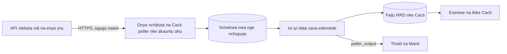

<!-- Source: README.md; SHA256: 7c621642e5f1a46bac66e4bc744f70aebb014c610d22de034088845fdc170405 -->

<!-- translations:start -->
[English](../../../README.md) | [简体中文](../zh-CN/README.md) | [हिन्दी](../hi-IN/README.md) | [Español (España)](../es-ES/README.md) | [Español (Latinoamérica)](../es-419/README.md) | [العربية (السعودية)](../ar-SA/README.md) | [Afrikaans](../af-ZA/README.md) | [አማርኛ](../am-ET/README.md) | [العربية (مصر)](../ar-EG/README.md) | [العربية (المغرب)](../ar-MA/README.md) | [বাংলা](../bn-BD/README.md) | [Bosanski](../bs-BA/README.md) | [Deutsch](../de-DE/README.md) | [فارسی](../fa-IR/README.md) | [Filipino](../fil-PH/README.md) | [Français](../fr-FR/README.md) | [Français (Maroc)](../fr-MA/README.md) | [Français (Sénégal)](../fr-SN/README.md) | [Hausa](../ha-NG/README.md) | [עברית](../he-IL/README.md) | [Hrvatski](../hr-HR/README.md) | [Bahasa Indonesia](../id-ID/README.md) | [Igbo](README.md) | [Italiano](../it-IT/README.md) | [日本語](../ja-JP/README.md) | [한국어](../ko-KR/README.md) | [Malagasy](../mg-MG/README.md) | [मराठी](../mr-IN/README.md) | [Bahasa Melayu](../ms-MY/README.md) | [Nederlands](../nl-NL/README.md) | [Polski](../pl-PL/README.md) | [Português (Brasil)](../pt-BR/README.md) | [Русский](../ru-RU/README.md) | [Kinyarwanda](../rw-RW/README.md) | [Soomaali](../so-SO/README.md) | [Српски](../sr-RS/README.md) | [Svenska](../sv-SE/README.md) | [Kiswahili](../sw-KE/README.md) | [தமிழ்](../ta-IN/README.md) | [తెలుగు](../te-IN/README.md) | [ไทย](../th-TH/README.md) | [Türkçe](../tr-TR/README.md) | [Українська](../uk-UA/README.md) | [اردو](../ur-PK/README.md) | [Tiếng Việt](../vi-VN/README.md) | [isiXhosa](../xh-ZA/README.md) | [Yorùbá](../yo-NG/README.md) | [繁體中文](../zh-TW/README.md) | [isiZulu](../zu-ZA/README.md)
<!-- translations:end -->

# plugin_cloud

Ngwa mgbakwunye Cacti 1.2 nke na-eweta akụrụngwa na nha si n'aka ndị na-enye ọrụ igwe ojii ọha banye na Cacti dị ka ngwaọrụ nkịtị, isi iyi data, na eserese. Ọrụ igwe ojii na-anọzi n'akụkụ netwọk nke na-ebu ha, n'okpuru ikike Cacti, ma Thold na Maint nwere ike izipu mkpu maka ha ma kwụsịtụ ha. Otu ngwa mgbakwunye na-ekpuchi onye na-enye ọrụ ọ bụla, ya na draịva maka onye na-enye ọrụ nke ọ bụla: DigitalOcean, AWS, Google Cloud, na Azure na mbụ.

> **Ọnọdụ: nzọụkwụ 3 (ihe DigitalOcean na nke Cacti), na nyocha.** Nzọụkwụ a na-agbakwunye draịva DigitalOcean, ndebiri Cacti, ngwaọrụ oke maka akaụntụ ọ bụla nwere ajụjụ data maka ụdị akụrụngwa ọ bụla, ntinye sava edemede, na atụmatụ arịrịọ na Eserese Ọhụrụ na ibe ahụike. E dekọrọ nlele mbụ e mere na akaụntụ DigitalOcean dị ndụ na [eziokwu ndị na-enye ọrụ](../../research/provider-facts.md). Ejila ya rụọ ọrụ n'ọrụ mmepụta.

## Ọrụ nnweta

| Mpaghara | Nnweta |
| --- | --- |
| Cloud View | Ibe nlekọta ndị dị adị. |
| Cloud Operator | Nlekọta gbakwunyere ibe Ọrụ na nkwenye nhazi nke onwe. |
| Cloud Admin | Nnweta Operator gbakwunyere nhazi dị adị na omume nchịkwa. |

Mgbe ị detuchara faịlụ nkwalite, mepee ibe Ngwa mgbakwunye dị ka onye nchịkwa iji debanye aha
mpaghara ọhụrụ ahụ. Nye mpaghara Operator n'ụzọ doro anya n'okpuru **Configuration > Users** ma ọ bụ otu ndị ọrụ.
Nkwalite na-edobe ID na ikike mpaghara View na Admin ndị dị adị. Nnweta Admin
na-eketa nnweta Operator, ma nnweta Operator na-eketa nnweta View na arịrịọ ọ bụla;
nke a anaghị agbakwunye ikike echekwara na ndị ọrụ ma ọ bụ otu. Ntọala ngwa mgbakwunye chọkwara
nnweta Cloud Admin na mgbakwunye na ikike Ntọala nke Cacti.

Ikike ngwaọrụ Cacti ka na-egbochi ahịrị na omume ndị dịịrị onye ọrụ ọ bụla; ihe ndị a na-ekepụtabeghị njikọ ha chọrọ onye nchịkwa. Ndị Operator nwere ike inyocha nzere echekwara maka akaụntụ nke ha nwere ike inweta ngwaọrụ Cacti ya.
Nzere, nhazi, njikọ, nhichapụ na mgbanwe nchịkwa ndị ọzọ
na-anọgide na ibe nchịkwa. Nkwenye na-adịgide naanị n'oge nnọkọ
onye ọrụ dị ugbu a, maka otu awa kachasị na naanị mgbe otu nchọpụta ahụ ka dị
ọhụrụ. Nchọpụta ọhụrụ ma ọ bụ nke gbanwere na-eme ka ha ghara ịdị irè. Ha anaghị egosi nha
dara ada dị ka nke dị mma ma ọ bụ kwụsịtụ mkpu.

## Ihe kpatara ya

Onye na-enye ọrụ igwe ojii ọ bụla nwere njikwa nlekọta nke ya. Mgbe e jiri ha na Cacti na-arụkọ ọrụ, ha na-ahapụ oghere atọ:

- **Njikwa nnweta dị iche.** Igosi onye ọrụ Cacti nha igwe ojii pụtara inye ha nbanye igwe ojii.
- **Enweghị ọnọdụ netwọk.** A na-ese njikọ dị n'ụlọ ọrụ na Cacti; a na-ese ọrụ ndị dị n'azụ ha na njikwa nke onye na-enye ọrụ ọ bụla.
- **Izipu mkpu dị iche.** Thold na Maint na-arụ ọrụ na isi iyi data na ngwaọrụ Cacti, yabụ a na-ahazi ma na-egbochi mkpu onye na-enye ọrụ iche iche, otu ugboro maka onye na-enye ọrụ ọ bụla.

Ngwa mgbakwunye ahụ na-agụ API nlekọta nke onye na-enye ọrụ ọ bụla na Cacti poller, chekwaa data kachasị ọhụrụ na nchekwa nwa oge, ma nye ha sava edemede Cacti. Cacti poller na-ede faịlụ RRD, yabụ ise eserese, ikike, Thold, Maint, na boost na-arụ ọrụ dị ka ha si arụ maka data Cacti ọ bụla.

## Nkwa nhazi

- **Ọgụgụ naanị.** Draịva ọ bụla nwere ike wuo naanị ọrụ onye na-enye ọrụ dị na ndepụta ikike ya; ngwa mgbakwunye anaghị agbanwe akụrụngwa igwe ojii ọ bụla. ([ADR 0002](../../decisions/0002-read-only-with-operation-allowlist.md))
- **PHP naanị, enweghị SDK.** A na-eme mbinye aka na mgbanwe token na PHP site na mgbakwunye ndị Cacti chọrọlarị. Enweghị ndabere oge ịgba ọsọ Composer. ([ADR 0003](../../decisions/0003-php-only-without-sdks.md))
- **Ụgwọ tupu nchịkọta.** Ngwa mgbakwunye na-agụ naanị nha ndị nwere isi iyi data Cacti, na-egosi ọnụọgụ arịrịọ a tụrụ anya na ọnụahịa ndepụta tupu e mepụta eserese, ma na-amanye oke kwa ọnwa. ([ADR 0005](../../decisions/0005-collect-only-what-is-graphed.md))
- **Enweghị nzere ederede nkịtị na nchekwa data.** Nzere na-esi na nchekwa ezoro ezo nke faịlụ dị n'èzí nchekwa data na-enye igodo ya, site na faịlụ nzere, ma ọ bụ site na njirimara nke onye na-enye ọrụ. ([ADR 0007](../../decisions/0007-credentials-outside-the-database-in-the-clear.md))

## Oke na ọnọdụ

| Agba | Oke | Nzọụkwụ | Ọnọdụ |
|---|---|---|---|
| 0, nyocha | Nkwenye eziokwu onye na-enye ọrụ, katalọgụ nha, ụdị ọnụahịa na ọnụego, vekta ule mbinye aka, nyocha mbufe | [M1](https://github.com/somethingwithproof/plugin_cloud/milestone/1) | Emeela ya, belụsọ nlele ndị chọrọ akaụntụ onye na-enye ọrụ dị ndụ |
| 1, isi na DigitalOcean | Akaụntụ, nchekwa nzere, mbufe, onye nchịkọta, nchekwa nwa oge nchọpụta, ihe Cacti, ibe ahụike, DigitalOcean Droplets na ndị nhazi ibu | [M2](https://github.com/somethingwithproof/plugin_cloud/milestone/2), [M3](https://github.com/somethingwithproof/plugin_cloud/milestone/3), [M4](https://github.com/somethingwithproof/plugin_cloud/milestone/4) | Emeela M2 ([#81](https://github.com/somethingwithproof/plugin_cloud/pull/81)); ejikọtala draịva M3, ndebiri, na ngwaọrụ oke; atụmatụ arịrịọ, ikike, na nlele arụmọrụ nọ na nyocha; ebidoebeghị M4 |
| 2, AWS | Signature Version 4, `AssumeRole`, ọrụ instance, CloudWatch `GetMetricData`, ndepụta mpaghara | [M5](https://github.com/somethingwithproof/plugin_cloud/milestone/5) | Ebidoebeghị |
| 3, Google Cloud | JWT akaụntụ ọrụ, sava metadata, Cloud Monitoring `timeSeries.list` | [M6](https://github.com/somethingwithproof/plugin_cloud/milestone/6) | Ebidoebeghị |
| 4, Azure | Nzere onye ahịa Entra, njirimara a na-achịkwa, Resource Graph, `metrics:getBatch` | [M7](https://github.com/somethingwithproof/plugin_cloud/milestone/7) | Ebidoebeghị |
| 5, ndị nchịkọta dịpụrụ adịpụ | Akaụntụ na ndị nchịkọta data dịpụrụ adịpụ nke Cacti | [M8](https://github.com/somethingwithproof/plugin_cloud/milestone/8) | Ebidoebeghị |

Ihe na-adịghị n'oke: ịgbanwe akụrụngwa igwe ojii, imepụta ma ọ bụ ịṅomi mkpu onye na-enye ọrụ, akụkọ ịkwụ ụgwọ, ndekọ na nzọụkwụ nchọpụta, na injin mkpu nke ngwa mgbakwunye nwere. Ndị na-enye ọrụ ndị ọzọ (Hetzner Cloud, Akamai Cloud, Oracle Cloud, na ndị ọzọ) bụ okwu nyocha.

## Ihe nzọụkwụ 2 na-eweta

- **Nwụnye echekwara.** Na PHP dị n'okpuru 8.2, ma ọ bụ na-enweghị ext-openssl, a na-ajụ nwụnye na nkwado ya na ozi, ma akụkụ Cacti ndị ọzọ na-aga n'ihu na-arụ ọrụ.
- **Usoro ndụ.** Wụnye, kwalite, ma wepụ site na ibe Ngwa mgbakwunye nke Cacti. Nkwalite nwere usoro ma na-adịgide ọ bụrụgodị na e kwụsịtụrụ ya. Nwepụ na-edobe tebụl ngwa mgbakwunye ahụ belụsọ ma ị kpochapụrụ *Keep Plugin Tables on Uninstall*.
- **Mpaghara dị iche iche.** *Cloud Admin* na-emepe **Cloud Accounts**; *Cloud Operator* na-emepe **Cloud Operations**; *Cloud View* na-emepe **Cloud Health**. Admin na-eketa Operator, ma Operator na-eketa View. Ibe atọ ahụ niile dị n'okpuru Management.
- **Akaụntụ na nzere.** Tinye, dezie, nyochaa, ma hichapụ akaụntụ. A na-ezochi nzere na nchekwa data site na faịlụ igodo e debere n'èzí ya (AES-256-GCM), ma ọ bụ gụọ ya site na faịlụ dị na poller. Nzere bụ naanị nke a na-ede na UI ma na-ehichapụ ha na ndekọ.
- **Onye nchịkọta.** Ọ na-amalite site na ọsọ poller ọ bụla, otu ihe nlereanya kwa poller, n'ime oke oge. Ọ na-ewe ikike nwa oge kwa akaụntụ, na-agba nchọpụta n'oge nke ya, ma na-agụ nha naanị maka isi iyi data nke ngwa mgbakwunye ahụ na-arụ ọrụ.
- **Ahụike.** Ọnọdụ nchịkọta, nchọpụta, akụrụngwa, na ịdị ọhụrụ kwa akaụntụ, gbakwunyere ịdọ aka ná ntị maka igodo nchekwa na-adịghị arụ ọrụ, faịlụ nzere na-adịghị mma, na oge ndị poller na-enweghị ike irube isi na ha.

## Wụnye ma hazie

Nzọụkwụ ndị a na-awụnye koodu nzọụkwụ 2 maka nlele. Ha chọrọ Cacti 1.2.31 ma ọ bụ karịa na PHP 8.2 ma ọ bụ karịa.

1. Detuo ebe nchekwa ahụ gaa na `plugins/cloud` n'okpuru ndekọ Cacti gị. A ga-akpọ ndekọ ahụ `cloud`.
2. Mepụta igodo nchekwa n'èzí mgbọrọgwụ weebụ. Tinye ya na ndekọ nke naanị root na onye ọrụ Cacti nwere ike ide ihe na ya, ma mee ka faịlụ ahụ bụrụ nke naanị onye ọrụ na-agba sava weebụ na poller nwere ike ịgụ. Ngwa mgbakwunye anaghị emepụta ma ọ bụ dee faịlụ a:

   ```sh
   sudo install -d -m 0750 -o root -g cacti /etc/cacti
   head -c 32 /dev/urandom | sudo tee /etc/cacti/cloud-vault.key > /dev/null
   sudo chown cacti:cacti /etc/cacti/cloud-vault.key
   sudo chmod 0600 /etc/cacti/cloud-vault.key
   ```

   Jiri onye ọrụ na-agba sava weebụ na poller gị dochie `cacti`. Faịlụ ahụ nwere bytes 32 nkịtị ma ọ bụ mkpụrụedemede hexadecimal 64. Chekwaa ndabere ya na nchekwa data; na-enweghị ya, a ga-etinyerịrị nzere echekwara ọzọ.
3. Na Cacti, mepee **Configuration > Plugins**, wee wụnye ma mee ka *Cloud* rụọ ọrụ.
4. N'okpuru **Configuration > Settings > Cloud**, tọọ *Vault Key File* ma ọ bụrụ na i jiri ụzọ ọzọ. *Collector Time Budget* (ndabere sekọnd 240) ga-anọrịrị n'okpuru oge poller.
5. Nye ndị ọrụ na otu *Cloud Admin*, *Cloud Operator* ma ọ bụ *Cloud View* n'okpuru **Configuration > Users**. Nwụnye na-enye onye nchịkwa Cloud Admin na Cloud View; Cloud Admin gụnyere nnweta Operator, yabụ onye nchịkwa achọghị ikike Operator dị iche.
6. Tinye akaụntụ n'okpuru **Management > Cloud Accounts**, wee lelee **Management > Cloud Health** maka ịdọ aka ná ntị.

## Ebumnuche ndakọrịta

| Akụkụ | Ebumnuche |
|---|---|
| Cacti | 1.2.31 ma ọ bụ karịa, enweghị mgbanwe isi |
| PHP | 8.2 ma ọ bụ karịa; `setup.php` na-anọgide na-abụ nke a pụrụ ịgụ na 8.0 ka oge ịgba ọsọ a na-akwadoghị wee nweta njụ kama ịbụ Cacti UI mebiri emebi |
| Mgbakwunye PHP | Enweghị nke ọ bụla karịrị ndị Cacti 1.2.31 chọrọ |
| Thold, Maint | Enweghị mgbanwe achọrọ |

## Nhazi

- [docs/performance.md](../../performance.md) nwere nha onye nchịkọta na ibe ahụike, yana ngwaike na ntọala e jiri mee ihe.
- [docs/PLAN.md](../../PLAN.md) bụ atụmatụ zuru ezu: nhazi ụkpụrụ, eziokwu onye na-enye ọrụ na nke Cacti ọ dabere na ya (yana isi mmalite), nkwekọrịta draịva, mgbakọ na mwepụ ọnụahịa, oke nchekwa, nnwale, na ihe ize ndụ.
- [docs/decisions/](../../decisions) nwere ndekọ mkpebi nhazi ụkpụrụ maka nhọrọ ndị e meelarị.
- [docs/REQUIREMENTS.md](../../REQUIREMENTS.md) na-ejikọta ID ihe achọrọ ọ bụla na okwu ya.



## Otu e si esochi ọrụ

- **Nzọụkwụ** na-agbaso nzọụkwụ atụmatụ ahụ. Nke ọ bụla nwere okwu ukwu nke depụtara obere okwu ya na ihe akaebe ọpụpụ.
- **Okwu** nwere ụdị site na akara: `type: requirement`, `type: research`, `type: decision`, `type: epic`. Okwu ihe achọrọ na-ekwu ihe achọrọ ndị nwere nọmba na nke a pụrụ ịnwale (`REQ-AREA-NNN`) na ụkpụrụ nnabata.
- **Akara** na-ebukwa `area:`, `provider:`, `phase:`, `priority:`, na `status:`. Lee [CONTRIBUTING.md](../../../CONTRIBUTING.md#labels).
- [Bọọdụ ọrụ](https://github.com/users/somethingwithproof/projects/7) ahụ na-egosi okwu niile n'ofe nzọụkwụ.

## Mmepe

CI na-enyocha ebe nbanye na PHP 8.0, na-agba ule nkeji na njikọta na PHPStan ọkwa 9, ma na-awụnye ngwa mgbakwunye ahụ na PHP 8.2 ruo 8.5 megide Cacti 1.2.31 na alaka 1.2.x. Ọ na-elekwa na a jụrụ PHP 8.1 n'emebighị Cacti. Ule ndị ahụ na-eji Pest sitere na ngwa ngwa mgbakwunye nke isi Cacti. Nhọrọ ahụ bụ nwa oge ruo mgbe e kpebiri [#12](https://github.com/somethingwithproof/plugin_cloud/issues/12). [.github/workflows/plugin-ci-workflow.yml](../../../.github/workflows/plugin-ci-workflow.yml) depụtara nzọụkwụ ọ bụla. Gbaa `sh tests/lint-workflows.sh` na `sh locales/build_gettext.sh --check` n'ime obodo tupu ị ziga.

## Ntinye aka

Gụọ [CONTRIBUTING.md](../../../CONTRIBUTING.md). Ntinye koodu chọrọ mbinye aka DCO. Mkparịta ụka nhazi na-eme na okwu; mkpebi mepere emepe na-ebu akara `type: decision`.

## Nchekwa

Kpesa adịghị ike na nzuzo; lee [SECURITY.md](../../../SECURITY.md).

## Ikikere

GNU General Public License v2.0, otu ikikere ahụ dị ka Cacti na ngwa mgbakwunye ya. Lee [LICENSE](../../../LICENSE).
