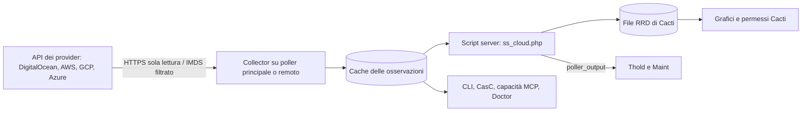

<!-- Source: README.md; SHA256: ac2074a40238686915802803c5efe773f33677f934281e0605e6e87a71a9d27d -->

<!-- translations:start -->
[English](../../../README.md) | [简体中文](../zh-CN/README.md) | [हिन्दी](../hi-IN/README.md) | [Español (España)](../es-ES/README.md) | [Español (Latinoamérica)](../es-419/README.md) | [العربية (السعودية)](../ar-SA/README.md) | [Afrikaans](../af-ZA/README.md) | [አማርኛ](../am-ET/README.md) | [العربية (مصر)](../ar-EG/README.md) | [العربية (المغرب)](../ar-MA/README.md) | [বাংলা](../bn-BD/README.md) | [Bosanski](../bs-BA/README.md) | [Deutsch](../de-DE/README.md) | [فارسی](../fa-IR/README.md) | [Filipino](../fil-PH/README.md) | [Français](../fr-FR/README.md) | [Français (Maroc)](../fr-MA/README.md) | [Français (Sénégal)](../fr-SN/README.md) | [Hausa](../ha-NG/README.md) | [עברית](../he-IL/README.md) | [Hrvatski](../hr-HR/README.md) | [Bahasa Indonesia](../id-ID/README.md) | [Igbo](../ig-NG/README.md) | [Italiano](README.md) | [日本語](../ja-JP/README.md) | [한국어](../ko-KR/README.md) | [Malagasy](../mg-MG/README.md) | [मराठी](../mr-IN/README.md) | [Bahasa Melayu](../ms-MY/README.md) | [Nederlands](../nl-NL/README.md) | [Polski](../pl-PL/README.md) | [Português (Brasil)](../pt-BR/README.md) | [Русский](../ru-RU/README.md) | [Kinyarwanda](../rw-RW/README.md) | [Soomaali](../so-SO/README.md) | [Српски](../sr-RS/README.md) | [Svenska](../sv-SE/README.md) | [Kiswahili](../sw-KE/README.md) | [தமிழ்](../ta-IN/README.md) | [తెలుగు](../te-IN/README.md) | [ไทย](../th-TH/README.md) | [Türkçe](../tr-TR/README.md) | [Українська](../uk-UA/README.md) | [اردو](../ur-PK/README.md) | [Tiếng Việt](../vi-VN/README.md) | [isiXhosa](../xh-ZA/README.md) | [Yorùbá](../yo-NG/README.md) | [繁體中文](../zh-TW/README.md) | [isiZulu](../zu-ZA/README.md)
<!-- translations:end -->

# plugin_cloud

Un plugin per Cacti 1.2 che integra risorse e metriche provenienti dai provider di cloud pubblico in Cacti come normali dispositivi, origini dati e grafici. I carichi di lavoro cloud vengono così affiancati alla rete che li trasporta, sotto i permessi di Cacti, e Thold e Maint generano avvisi su di essi e li silenziano. Un unico plugin copre DigitalOcean, Amazon Web Services, Google Cloud e Microsoft Azure tramite driver di provider di sola lettura scritti in PHP puro.

> **Stato: in fase di sviluppo, nessun rilascio ancora (`0.1.0-dev`).** Questo branch implementa driver in PHP puro per DigitalOcean, AWS, Google Cloud e Azure, la replica dei collector remoti e lo stato di salute dell'agent in sola lettura, un provider CasC e una CLI per l'operatore, capacità MCP e controlli Doctor. I template Cacti distribuiti coprono attualmente i Droplet e i load balancer di DigitalOcean (`templates/cloud_digitalocean.xml`); i pacchetti di template Cacti per AWS, Google Cloud e Azure e la qualificazione su account reali oltre a DigitalOcean ([fatti sui provider](../../research/provider-facts.md)) non sono ancora completati. Non eseguire in produzione.

## Provider supportati

Ogni driver di provider è registrato in `Drivers::production()`, esposto da `Provider::released()` ed eseguito in PHP puro utilizzando `ext-openssl` e stream socket senza alcuna dipendenza di runtime da SDK o Composer.

| Provider | Campi di ambito | Origini delle credenziali | Autenticazione | Risorse rilevate | Raccolta delle metriche |
|---|---|---|---|---|---|
| DigitalOcean (`digitalocean`) | Nessuno (ambito legato al token) | `vault`, `file` | Token Bearer | `droplet`, `load_balancer` | `/v2/monitoring/metrics` con gestione della quota di rate-limit; include template e data query di Cacti |
| Amazon Web Services (`aws`) | `account_id` (12 cifre), `regions` | `vault`, `file`, `instance` | AWS SigV4 in PHP puro (`AWS4-HMAC-SHA256`), verifica STS `GetCallerIdentity`, STS `AssumeRole` opzionale, EC2 IMDSv2 (`169.254.169.254`) per account `instance` | `ec2_instance`, `rds_instance`, `aws_elb` (ALB/NLB) | CloudWatch `GetMetricData` in batch (fino a 500 query per chiamata) |
| Google Cloud (`gcp`) | `project` | `vault`, `file`, `instance` | JWT di service account RS256 in PHP puro tramite `ext-openssl` scambiato su `oauth2.googleapis.com/token`, oppure server di metadati GCE (`metadata.google.internal`) per account `instance` | `gce_instance` tramite `instances.aggregatedList` | Cloud Monitoring `timeSeries.list` |
| Microsoft Azure (`azure`) | `tenant`, `subscription`, `regions` | `vault`, `file`, `instance` | Flusso OAuth2 client-credentials Entra ID in PHP puro (solo `client_secret`; asserzioni di certificato escluse), oppure identità gestita Azure IMDS (`169.254.169.254`) per i token ARM e Monitor | `azure_vm` tramite ARM Resource Graph (paginato con `$skipToken` e deduplicato) | Azure Monitor `metrics:getBatch` (fino a 50 risorse per chiamata, con gestione del throttling HTTP 429 e 529) |

## Funzionalità implementate

### Piattaforma centrale, vault e collector

- **Installazione e ciclo di vita protetti.** I punti di ingresso (`setup.php`, `cli/cloud.php`, `poller_cloud.php`, `ss_cloud.php` e gli script delle pagine) sono analizzabili su PHP 8.0 e rifiutano versioni di PHP inferiori alla 8.2 o l'assenza di `ext-openssl` senza compromettere Cacti. Gli aggiornamenti sono ordinati, idempotenti (`Schema::VERSION = 3`, 9 tabelle) e resistono alle interruzioni. La disinstallazione mantiene le tabelle del plugin a meno che non venga deselezionata l'opzione *Keep Plugin Tables on Uninstall*.
- **Account e credenziali.** Aggiungi, modifica, verifica ed elimina gli account in **Management > Cloud Accounts**. Le credenziali provengono dal vault cifrato con AES-256-GCM (`plugin_cloud_secret`, cifrato per impostazione predefinita tramite `/etc/cacti/cloud-vault.key`), da un file limitato all'interno della *Credential File Directory* configurata (`cloud_credential_dir`, vuota per impostazione predefinita per rifiutare i file), oppure dall'identità dell'istanza del provider. Le credenziali sono in sola scrittura nell'interfaccia utente e oscurate nei log.
- **Controlli rigorosi sul traffico in uscita e di sola lettura.** Ogni driver opera dietro `GuardedTransport` e `OutboundPolicy`: porta HTTPS 443 verso i nomi host esatti per ciascun provider, con gli endpoint di metadati HTTP link-local sulla porta 80 (`169.254.169.254`, `metadata.google.internal`) abilitati solo per gli account `instance`. Sono consentite esclusivamente le operazioni in sola lettura incluse nella allowlist.
- **Controlli del collector e dei costi.** `poller_cloud.php` viene eseguito da `poller_bottom` (un processo per poller tramite il registro dei processi di Cacti) entro `cloud_collector_budget`, acquisisce lease per singolo account, esegue il rilevamento secondo `discover_interval`, legge le metriche solo per le origini dati Cacti attive (`plugin_cloud_series`), rispetta `request_share` e `monthly_ceiling` e memorizza nella cache i datapoint più recenti in `plugin_cloud_observation` per `ss_cloud.php`.
- **Oggetti Cacti e stime delle richieste.** Mantiene un dispositivo di ambito per account (`plugin_cloud_device`), preserva i metodi di reindicizzazione del dispositivo di ambito al salvataggio dei dispositivi, importa i template DigitalOcean e le data query dello script server (`templates/cloud_digitalocean.xml`, `cloud_do_droplet.xml`, `cloud_do_load_balancer.xml`) e mostra le stime delle richieste e dei prezzi di listino in **New Graphs** (`graphs_new_top_links`) e **Cloud Health**.

### Collector di dati remoti

- `INFO` dichiara `remote_collect:1`. Gli account possono essere assegnati a qualsiasi poller Cacti abilitato (`poller_id >= 1`), e `poller_cloud.php --poller=N` raccoglie solo gli account appartenenti a quel poller.
- **Hook `replicate_out`.** Replica le righe relative al poller da `plugin_cloud_account`, `plugin_cloud_device`, `plugin_cloud_series` e le righe cifrate da `plugin_cloud_secret` (solo per gli account basati su vault appartenenti al poller di destinazione) tramite `replicate_out_table()`. I file chiave grezzi del vault non vengono mai archiviati nel database né replicati e rimangono locali su ciascun poller.
- **Hook `remote_agent`.** Espone un riepilogo dello stato JSON in sola lettura (`action=cloud_health`) che accetta solo parametri interi `poller_id` e `account_id` e non restituisce alcuna credenziale, percorso di file o segreto.

### Hook dell'ecosistema (CasC, capacità MCP e Doctor)

- **Provider CasC (`casc_register_providers`).** Registra il provider `cloud` (versione dello schema `1`) con esportazione deterministica in YAML e XML in PHP puro, convalida del manifest, pianificazione delle differenze e applicazione confermata. Le credenziali del vault vengono esportate come riferimenti `vault:account:<name>`; i campi con segreti in chiaro (`secret`, `secrets`, `token`, `access_token`, `refresh_token`, `password`, `private_key`, `access_key_id`, `secret_access_key`, `session_token`, `client_secret`, `credential`, `credentials`, `vault_key`) vengono rifiutati. L'applicazione richiede un hash SHA-256 esatto `--confirm=<PLAN_HASH>`.
- **API MCP / Abilities (`abilities_register`).** Registra tre capacità rigorosamente in sola lettura vincolate al realm Cloud View (`cloud_health.php`) e all'ambito dei dispositivi Cacti per i chiamanti non amministratori, senza esporre credenziali, chiavi del vault o percorsi di file delle credenziali:
  - `cloud-list-accounts` (`provider`, `poller_id` opzionali)
  - `cloud-list-resources` (`account_id`, `type`, `lifecycle` opzionali)
  - `cloud-get-health` (`account_id` opzionale)
- **Controlli Doctor (`doctor_register_checks`).** Registra cinque controlli diagnostici che non espongono valori segreti né materiale delle chiavi:
  - `cloud_schema`: aggiornamento della versione dello schema
  - `cloud_vault_key`: leggibilità, permessi e dimensione del file chiave del vault
  - `cloud_drivers`: registrazione dei driver di produzione per tutti i provider rilasciati
  - `cloud_accounts_health`: account abilitati in errore, limitati o obsoleti
  - `cloud_poller_intervals`: allineamento degli intervalli di raccolta degli account abilitati con l'intervallo del poller di Cacti

## CLI

Esegui dalla directory principale di Cacti con PHP 8.2 o successivo:

```sh
# Operator and CasC CLI (options use --key=value form)
php plugins/cloud/cli/cloud.php export [--format=yaml|xml]
php plugins/cloud/cli/cloud.php validate --file=<path> [--format=yaml|xml]
php plugins/cloud/cli/cloud.php plan --file=<path> [--format=yaml|xml]
php plugins/cloud/cli/cloud.php apply --file=<path> --confirm=<PLAN_HASH> [--format=yaml|xml]
php plugins/cloud/cli/cloud.php health [--format=text|json] [--poller=<id>]

# Collector entry point (normally started by poller_bottom)
php plugins/cloud/poller_cloud.php [--poller=N] [--force] [--debug]
```

## Ruoli di accesso

| Realm | Accesso |
| --- | --- |
| Cloud View | Pagine di monitoraggio esistenti. |
| Cloud Operator | Monitoraggio più la pagina Operations e le conferme personali di triage. |
| Cloud Admin | Accesso Operator più le azioni di configurazione e amministrazione esistenti. |

Dopo aver copiato i file di aggiornamento, apri la pagina Plugins come amministratore per registrare i realm. Assegna esplicitamente il realm Operator in **Configuration > Users** o ai gruppi di utenti. Gli aggiornamenti mantengono gli ID e le concessioni esistenti dei realm View e Admin. L'accesso Admin eredita l'accesso Operator e l'accesso Operator eredita l'accesso View a ogni richiesta; ciò non aggiunge concessioni memorizzate agli utenti o ai gruppi. Le impostazioni del plugin richiedono inoltre l'accesso Cloud Admin in aggiunta al permesso Settings di Cacti.

I permessi sui dispositivi Cacti limitano le righe e le azioni disponibili per ciascun utente; gli oggetti non mappati richiedono un amministratore. Gli operatori possono verificare le credenziali memorizzate per un account al cui dispositivo Cacti possono accedere. Credenziali, configurazione, mappatura, eliminazione e altre modifiche amministrative restano nelle pagine amministrative. Le conferme durano solo nella sessione corrente dell'utente, per al massimo un'ora e solo finché la stessa osservazione rimane aggiornata. Osservazioni nuove o modificate le invalidano. Non contrassegnano mai come sana una misurazione fallita né sopprimono gli avvisi.

## Perché

Ogni provider cloud dispone della propria console di monitoraggio. Eseguite accanto a Cacti, lasciano tre lacune:

- **Controllo degli accessi separato.** Mostrare a un utente Cacti le metriche cloud comporta fornirgli un accesso cloud.
- **Nessun contesto di rete.** I collegamenti on-premises vengono rappresentati nei grafici in Cacti; i carichi di lavoro dietro di essi vengono rappresentati nei grafici nella console di ciascun provider.
- **Avvisi separati.** Thold e Maint operano su origini dati e dispositivi Cacti, quindi gli allarmi dei provider vengono configurati e silenziati separatamente, una volta per provider.

Il plugin legge l'API di monitoraggio di ciascun provider su un poller Cacti, memorizza nella cache i datapoint più recenti e li fornisce allo script server di Cacti. Il poller di Cacti scrive i file RRD, quindi grafici, permessi, Thold, Maint e boost funzionano come per qualsiasi altro dato Cacti.

## Impegni di progettazione

- **Sola lettura.** Ogni driver può costruire solo le operazioni del provider presenti nella sua allowlist; il plugin non modifica mai una risorsa cloud. ([ADR 0002](../../decisions/0002-read-only-with-operation-allowlist.md))
- **Solo PHP, nessun SDK.** La firma e lo scambio dei token sono implementati in PHP con le estensioni che Cacti richiede già. Nessuna dipendenza di runtime da Composer. ([ADR 0003](../../decisions/0003-php-only-without-sdks.md))
- **Costi prima della raccolta.** Il plugin legge solo le metriche che hanno un'origine dati Cacti, mostra il numero di richieste previsto e il costo a prezzo di listino prima della creazione dei grafici e applica un tetto mensile. ([ADR 0005](../../decisions/0005-collect-only-what-is-graphed.md))
- **Nessuna credenziale in chiaro nel database.** Le credenziali provengono da un vault cifrato con chiave in un file esterno al database, da un file di credenziali o dall'identità dell'istanza del provider. ([ADR 0007](../../decisions/0007-credentials-outside-the-database-in-the-clear.md))

## Ambito e stato

| Fase | Ambito | Milestone | Stato |
|---|---|---|---|
| 0, ricerca | Conferma dei fatti sui provider, cataloghi metriche, modello di costi e limiti di frequenza, vettori di test per la firma, prototipo di trasporto | [M1](https://github.com/somethingwithproof/plugin_cloud/milestone/1) | Completata, tranne le verifiche che richiedono account provider attivi |
| 1, nucleo e DigitalOcean | Account, vault delle credenziali, trasporto, collector, cache delle osservazioni, oggetti Cacti, template, stime delle richieste, pagina di stato, Droplet e load balancer DigitalOcean | [M2](https://github.com/somethingwithproof/plugin_cloud/milestone/2), [M3](https://github.com/somethingwithproof/plugin_cloud/milestone/3), [M4](https://github.com/somethingwithproof/plugin_cloud/milestone/4) | Implementata; qualificazione pilota M4 in sospeso |
| 2, AWS | SigV4 in PHP puro, STS `AssumeRole`, ruoli di istanza IMDSv2, inventario EC2/RDS/ELB, CloudWatch `GetMetricData` | [M5](https://github.com/somethingwithproof/plugin_cloud/milestone/5) | Driver implementato; template Cacti e qualificazione su account reale in sospeso |
| 3, Google Cloud | JWT di service account RS256 in PHP puro, server di metadati GCE, inventario Compute Engine, Cloud Monitoring `timeSeries.list` | [M6](https://github.com/somethingwithproof/plugin_cloud/milestone/6) | Driver implementato; template Cacti e qualificazione su account reale in sospeso |
| 4, Azure | Credenziali client Entra ID, identità gestita IMDS, inventario VM ARM Resource Graph, Azure Monitor `metrics:getBatch` | [M7](https://github.com/somethingwithproof/plugin_cloud/milestone/7) | Driver implementato; template Cacti e qualificazione su account reale in sospeso |
| 5, collector remoti ed ecosistema | Collector di dati remoti (`replicate_out`, `remote_agent`), provider CasC e CLI, capacità MCP, controlli Doctor | [M8](https://github.com/somethingwithproof/plugin_cloud/milestone/8) | Implementata |

Fuori ambito: modifica delle risorse cloud, creazione o replica degli allarmi dei provider, report di fatturazione, log e tracce e un motore di avvisi gestito dal plugin. Altri provider (Hetzner Cloud, Akamai Cloud, Oracle Cloud e altri) sono oggetto di issue di ricerca.

## Installazione e configurazione

Questi passaggi installano il codice di sviluppo per la valutazione. Richiedono Cacti 1.2.31 o successivo su PHP 8.2 o successivo.

1. Copia il repository in `plugins/cloud` nella directory di Cacti. La directory deve chiamarsi `cloud`.
2. Crea la chiave del vault al di fuori della web root su ogni poller che utilizza credenziali protette dal vault. Collocala in una directory scrivibile solo da root e dall'utente Cacti, e rendi il file leggibile solo dall'utente che esegue il server web e il poller. Il plugin non crea né scrive mai questo file:

   ```sh
   sudo install -d -m 0750 -o root -g cacti /etc/cacti
   head -c 32 /dev/urandom | sudo tee /etc/cacti/cloud-vault.key > /dev/null
   sudo chown cacti:cacti /etc/cacti/cloud-vault.key
   sudo chmod 0600 /etc/cacti/cloud-vault.key
   ```

   Sostituisci `cacti` con l'utente che esegue il server web e il poller. Il file contiene 32 byte grezzi o 64 caratteri esadecimali. Eseguine il backup insieme al database; senza di esso, le credenziali memorizzate dovranno essere inserite nuovamente.
3. In Cacti, apri **Configuration > Plugins**, quindi installa e abilita *Cloud*.
4. In **Configuration > Settings > Cloud**, imposta *Vault Key File* se hai utilizzato un altro percorso, configura *Credential File Directory* se intendi usare credenziali basate su file e mantieni *Collector Time Budget* (predefinito 240 secondi) inferiore all'intervallo del poller.
5. Concedi *Cloud Admin*, *Cloud Operator* o *Cloud View* agli utenti e ai gruppi in **Configuration > Users**. L'installazione concede Cloud Admin e Cloud View all'amministratore; Cloud Admin include l'accesso Operator, quindi l'amministratore non necessita di una concessione Operator separata.
6. Aggiungi gli account in **Management > Cloud Accounts**, quindi controlla **Management > Cloud Health** per eventuali avvisi.

## Obiettivi di compatibilità

| Componente | Obiettivo |
|---|---|
| Cacti | 1.2.31 o successivo, nessuna patch al core |
| PHP | 8.2 o successivo; i punti di ingresso restano analizzabili su 8.0 affinché un runtime non supportato riceva un rifiuto anziché un'interfaccia Cacti danneggiata |
| Estensioni PHP | `ext-openssl` (richiesta da Cacti 1.2.31); nessuna `ext-curl` e nessuna dipendenza di runtime da Composer |
| Thold, Maint | Nessuna modifica richiesta |

## Progettazione

- [docs/performance.md](../../performance.md) riporta le misurazioni del collector e della pagina di stato, con l'hardware e le impostazioni utilizzate.
- [docs/PLAN.md](../../PLAN.md) è il piano completo: architettura, fatti sui provider e su Cacti su cui si basa (con fonti), contratto dei driver, aritmetica dei costi, confini di sicurezza, test e rischi.
- [docs/decisions/](../../decisions/) raccoglie i record delle decisioni architetturali per le scelte già prese.
- [docs/REQUIREMENTS.md](../../REQUIREMENTS.md) associa ciascun ID di requisito alla relativa issue.



## Come viene monitorato il lavoro

- Le **Milestone** seguono le milestone del piano. Ciascuna ha una issue epic che elenca le relative sotto-issue e le prove di completamento.
- Le **Issue** sono classificate tramite etichetta: `type: requirement`, `type: research`, `type: decision`, `type: epic`. Le issue di requisito definiscono requisiti numerati e verificabili (`REQ-AREA-NNN`) e criteri di accettazione.
- Le **Etichette** indicano anche `area:`, `provider:`, `phase:`, `priority:` e `status:`. Vedi [CONTRIBUTING.md](../../../CONTRIBUTING.md#labels).
- La [bacheca del progetto](https://github.com/users/somethingwithproof/projects/7) mostra tutte le issue attraverso le milestone.

## Sviluppo

La CI ([.github/workflows/plugin-ci-workflow.yml](../../../.github/workflows/plugin-ci-workflow.yml)) verifica l'archivio di rilascio e il versionamento semantico (`bash tests/bin/archive-check.sh`), controlla la sintassi dei punti di ingresso su PHP 8.0, esegue i test unitari Pest (`phpunit.xml`), i test di integrazione del ciclo di vita (`phpunit-integration.xml`) e PHPStan livello 9 su PHP da 8.2 a 8.5 contro Cacti `release/1.2.31` e `1.2.x` con `CLOUD_OFFLINE=1`, verifica il rifiuto su PHP 8.1, controlla i cataloghi gettext, misura le prestazioni di raccolta di 1.000 serie e della pagina di stato, ed esegue il linting dei workflow e la conformità REUSE.

Controlli locali prima del push:

```sh
bash tests/bin/archive-check.sh
sh tests/lint-workflows.sh
sh locales/build_gettext.sh --check
CACTI_PATH=/path/to/cacti phpstan analyse -c phpstan.neon --no-progress
```

Esegui Pest con `--configuration=phpunit.xml` per i test unitari e le regole sui sorgenti, oppure `--configuration=phpunit-integration.xml` con `CACTI_PATH` e `CLOUD_TEST_DATABASE=disposable` su un database Cacti usa e getta per i test di integrazione del ciclo di vita.

## Contribuire

Leggi [CONTRIBUTING.md](../../../CONTRIBUTING.md). I commit richiedono la firma DCO. Le discussioni di progettazione avvengono nelle issue; le decisioni aperte riportano l'etichetta `type: decision`.

## Sicurezza

Segnala le vulnerabilità in privato; vedi [SECURITY.md](../../../SECURITY.md).

## Licenza

GNU General Public License v2.0, la stessa licenza di Cacti e dei suoi plugin. Vedi [LICENSE](../../../LICENSE).
