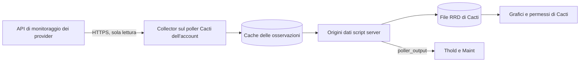

<!-- Source: README.md; SHA256: 7c621642e5f1a46bac66e4bc744f70aebb014c610d22de034088845fdc170405 -->

<!-- translations:start -->
[English](../../../README.md) | [简体中文](../zh-CN/README.md) | [हिन्दी](../hi-IN/README.md) | [Español (España)](../es-ES/README.md) | [Español (Latinoamérica)](../es-419/README.md) | [العربية (السعودية)](../ar-SA/README.md) | [Afrikaans](../af-ZA/README.md) | [አማርኛ](../am-ET/README.md) | [العربية (مصر)](../ar-EG/README.md) | [العربية (المغرب)](../ar-MA/README.md) | [বাংলা](../bn-BD/README.md) | [Bosanski](../bs-BA/README.md) | [Deutsch](../de-DE/README.md) | [فارسی](../fa-IR/README.md) | [Filipino](../fil-PH/README.md) | [Français](../fr-FR/README.md) | [Français (Maroc)](../fr-MA/README.md) | [Français (Sénégal)](../fr-SN/README.md) | [Hausa](../ha-NG/README.md) | [עברית](../he-IL/README.md) | [Hrvatski](../hr-HR/README.md) | [Bahasa Indonesia](../id-ID/README.md) | [Igbo](../ig-NG/README.md) | [Italiano](README.md) | [日本語](../ja-JP/README.md) | [한국어](../ko-KR/README.md) | [Malagasy](../mg-MG/README.md) | [मराठी](../mr-IN/README.md) | [Bahasa Melayu](../ms-MY/README.md) | [Nederlands](../nl-NL/README.md) | [Polski](../pl-PL/README.md) | [Português (Brasil)](../pt-BR/README.md) | [Русский](../ru-RU/README.md) | [Kinyarwanda](../rw-RW/README.md) | [Soomaali](../so-SO/README.md) | [Српски](../sr-RS/README.md) | [Svenska](../sv-SE/README.md) | [Kiswahili](../sw-KE/README.md) | [தமிழ்](../ta-IN/README.md) | [తెలుగు](../te-IN/README.md) | [ไทย](../th-TH/README.md) | [Türkçe](../tr-TR/README.md) | [Українська](../uk-UA/README.md) | [اردو](../ur-PK/README.md) | [Tiếng Việt](../vi-VN/README.md) | [isiXhosa](../xh-ZA/README.md) | [Yorùbá](../yo-NG/README.md) | [繁體中文](../zh-TW/README.md) | [isiZulu](../zu-ZA/README.md)
<!-- translations:end -->

# plugin_cloud

Un plugin per Cacti 1.2 che integra risorse e metriche provenienti dai provider di cloud pubblico in Cacti come normali dispositivi, origini dati e grafici. I carichi di lavoro cloud vengono così affiancati alla rete che li trasporta, sotto i permessi di Cacti, e possono essere monitorati tramite avvisi con Thold e silenziati con Maint. Un unico plugin copre tutti i provider, con un driver dedicato per ciascuno: inizialmente DigitalOcean, AWS, Google Cloud e Azure.

> **Stato: milestone 3 (DigitalOcean e oggetti Cacti), in revisione.** Questa milestone aggiunge il driver DigitalOcean, i template Cacti, un dispositivo di ambito per account con una data query per tipo di risorsa, l'input dello script server e una stima delle richieste in New Graphs e nella pagina di stato. Le verifiche iniziali su un account DigitalOcean attivo sono documentate in [informazioni sui provider](../../research/provider-facts.md). Non eseguire in ambiente di produzione.

## Ruoli di accesso

| Realm | Accesso |
| --- | --- |
| Cloud View | Pagine di monitoraggio esistenti. |
| Cloud Operator | Monitoraggio, pagina Operations e conferme personali di triage. |
| Cloud Admin | Accesso Operator più la configurazione esistente e le azioni amministrative. |

Dopo aver copiato i file di aggiornamento, aprire la pagina Plugins come amministratore per registrare
il nuovo realm. Assegnare esplicitamente il realm Operator in **Configuration > Users** o nei gruppi di utenti.
Gli aggiornamenti mantengono gli ID e i permessi dei realm View e Admin esistenti. L'accesso Admin
eredita l'accesso Operator e l'accesso Operator eredita l'accesso View a ogni richiesta;
questo non aggiunge permessi salvati agli utenti o ai gruppi. Le impostazioni del plugin richiedono inoltre
l'accesso Cloud Admin in aggiunta al permesso Settings di Cacti.

I permessi sui dispositivi di Cacti continuano a limitare le righe e le azioni disponibili per ciascun utente; gli oggetti non mappati richiedono un amministratore. Gli operatori possono verificare le credenziali salvate per un account al cui dispositivo Cacti hanno accesso.
Credenziali, configurazione, mappatura, eliminazione e altre modifiche amministrative
restano nelle pagine di amministrazione. Le conferme di presa in carico durano solo nella sessione corrente
dell'utente, per al massimo un'ora e solo finché la stessa osservazione rimane
valida. Osservazioni nuove o modificate le invalidano. Non contrassegnano mai come integra una misurazione
fallita né silenziano gli avvisi.

## Motivazioni

Ogni provider cloud dispone della propria console di monitoraggio. Usate parallelamente a Cacti, lasciano tre lacune:

- **Controllo degli accessi separato.** Mostrare le metriche cloud a un utente di Cacti significa fornirgli un accesso al cloud.
- **Nessun contesto di rete.** I collegamenti on-premise sono rappresentati nei grafici di Cacti; i carichi di lavoro dietro di essi sono rappresentati nella console di ciascun provider.
- **Avvisi separati.** Thold e Maint operano su origini dati e dispositivi di Cacti, quindi gli allarmi dei provider vengono configurati e silenziati separatamente, una volta per ciascun provider.

Il plugin interroga l'API di monitoraggio di ciascun provider tramite un poller di Cacti, memorizza nella cache i datapoint più recenti e li fornisce allo script server di Cacti. Il poller di Cacti scrive i file RRD, quindi i grafici, i permessi, Thold, Maint e Boost funzionano esattamente come per qualsiasi altro dato di Cacti.

## Principi di progettazione

- **Sola lettura.** Ciascun driver può costruire esclusivamente le operazioni del provider presenti nella propria allowlist; il plugin non modifica mai alcuna risorsa cloud. ([ADR 0002](../../decisions/0002-read-only-with-operation-allowlist.md))
- **Solo PHP, nessun SDK.** La firma delle richieste e lo scambio dei token sono implementati in PHP utilizzando le estensioni già richieste da Cacti. Nessuna dipendenza runtime di Composer. ([ADR 0003](../../decisions/0003-php-only-without-sdks.md))
- **Stima dei costi prima della raccolta.** Il plugin legge solo le metriche associate a un'origine dati di Cacti, mostra il numero previsto di richieste e il costo di listino prima della creazione dei grafici e applica un limite massimo mensile. ([ADR 0005](../../decisions/0005-collect-only-what-is-graphed.md))
- **Nessuna credenziale in chiaro nel database.** Le credenziali provengono da un vault cifrato la cui chiave è conservata in un file esterno al database, da un file di credenziali oppure dall'identità dell'istanza fornita dal provider. ([ADR 0007](../../decisions/0007-credentials-outside-the-database-in-the-clear.md))

## Ambito e stato

| Fase | Ambito | Milestone | Stato |
|---|---|---|---|
| 0, ricerca | Conferma dei dati dei provider, cataloghi delle metriche, modello di costi e tariffe, vettori di test per la firma, prototipo del trasporto | [M1](https://github.com/somethingwithproof/plugin_cloud/milestone/1) | Completata, tranne le verifiche che richiedono un account attivo del provider |
| 1, core e DigitalOcean | Account, vault delle credenziali, trasporto, collector, cache delle osservazioni, oggetti Cacti, pagina di stato, Droplet e bilanciatori di carico DigitalOcean | [M2](https://github.com/somethingwithproof/plugin_cloud/milestone/2), [M3](https://github.com/somethingwithproof/plugin_cloud/milestone/3), [M4](https://github.com/somethingwithproof/plugin_cloud/milestone/4) | M2 completata ([#81](https://github.com/somethingwithproof/plugin_cloud/pull/81)); driver, template e dispositivi di ambito di M3 integrati; stime delle richieste, permessi e verifiche delle prestazioni in revisione; M4 non avviata |
| 2, AWS | Signature Version 4, `AssumeRole`, ruoli di istanza, CloudWatch `GetMetricData`, inventario regionale | [M5](https://github.com/somethingwithproof/plugin_cloud/milestone/5) | Non avviata |
| 3, Google Cloud | JWT per service account, server dei metadati, Cloud Monitoring `timeSeries.list` | [M6](https://github.com/somethingwithproof/plugin_cloud/milestone/6) | Non avviata |
| 4, Azure | Credenziali client Entra, identità gestita, Resource Graph, `metrics:getBatch` | [M7](https://github.com/somethingwithproof/plugin_cloud/milestone/7) | Non avviata |
| 5, collector remoti | Account sui collector di dati remoti di Cacti | [M8](https://github.com/somethingwithproof/plugin_cloud/milestone/8) | Non avviata |

Fuori ambito: modifica delle risorse cloud, creazione o duplicazione degli allarmi dei provider, report di fatturazione, log e tracce e un motore di alerting proprietario del plugin. Ulteriori provider (Hetzner Cloud, Akamai Cloud, Oracle Cloud e altri) sono trattati come issue di ricerca.

## Funzionalità incluse nella milestone 2

- **Installazione protetta.** Su versioni di PHP precedenti alla 8.2, o in assenza di ext-openssl, l'installazione e l'abilitazione vengono rifiutate con un messaggio esplicativo, mentre il resto di Cacti continua a funzionare.
- **Ciclo di vita.** Installazione, aggiornamento e disinstallazione tramite la pagina Plugins di Cacti. Gli aggiornamenti sono ordinati e tollerano eventuali interruzioni. La disinstallazione conserva le tabelle del plugin a meno che non venga deselezionata l'opzione *Keep Plugin Tables on Uninstall*.
- **Realm separati.** *Cloud Admin* consente l'accesso a **Cloud Accounts**; *Cloud Operator* a **Cloud Operations**; *Cloud View* a **Cloud Health**. Admin eredita Operator e Operator eredita View. Tutte e tre le pagine si trovano sotto Management.
- **Account e credenziali.** Aggiunta, modifica, verifica ed eliminazione degli account. Ogni credenziale viene cifrata nel database tramite un file chiave conservato all'esterno di esso (AES-256-GCM), oppure letta da un file presente sul poller. Le credenziali sono di sola scrittura nell'interfaccia utente e vengono oscurate nei log.
- **Il collector.** Si avvia a ogni esecuzione del poller, con una singola istanza per poller, entro un limite di tempo configurato. Acquisisce un lease per account, esegue il discovery al proprio intervallo e legge le metriche solo per le origini dati attive del plugin.
- **Stato di salute.** Stato per singolo account relativo a raccolta, discovery, risorse e aggiornamento dei dati, oltre ad avvisi per chiavi del vault inutilizzabili, file di credenziali non sicuri e intervalli che il poller non riesce a rispettare.

## Installazione e configurazione

Questi passaggi installano il codice della milestone 2 a scopo di valutazione. Richiedono Cacti 1.2.31 o successivo su PHP 8.2 o successivo.

1. Copiare il repository in `plugins/cloud` all'interno della directory di Cacti. La directory deve chiamarsi `cloud`.
2. Creare la chiave del vault al di fuori della web root. Collocarla in una directory scrivibile solo da root e dall'utente Cacti, e rendere il file leggibile esclusivamente dall'utente che esegue il server web e il poller. Il plugin non crea né scrive mai questo file:

   ```sh
   sudo install -d -m 0750 -o root -g cacti /etc/cacti
   head -c 32 /dev/urandom | sudo tee /etc/cacti/cloud-vault.key > /dev/null
   sudo chown cacti:cacti /etc/cacti/cloud-vault.key
   sudo chmod 0600 /etc/cacti/cloud-vault.key
   ```

   Sostituire `cacti` con l'utente che esegue il server web e il poller. Il file contiene 32 byte raw oppure 64 caratteri esadecimali. Eseguire il backup insieme al database; senza di esso, le credenziali memorizzate dovranno essere inserite nuovamente.
3. In Cacti, aprire **Configuration > Plugins**, quindi installare e abilitare *Cloud*.
4. In **Configuration > Settings > Cloud**, impostare *Vault Key File* se è stato utilizzato un percorso diverso. *Collector Time Budget* (predefinito 240 secondi) deve rimanere inferiore all'intervallo del poller.
5. Assegnare *Cloud Admin*, *Cloud Operator* o *Cloud View* agli utenti e ai gruppi in **Configuration > Users**. L'installazione assegna Cloud Admin e Cloud View all'amministratore; poiché Cloud Admin include l'accesso Operator, l'amministratore non necessita di un'assegnazione separata per Operator.
6. Aggiungere gli account in **Management > Cloud Accounts**, quindi controllare **Management > Cloud Health** per eventuali avvisi.

## Requisiti di compatibilità

| Componente | Requisito |
|---|---|
| Cacti | 1.2.31 o successivo, nessuna patch al core |
| PHP | 8.2 o successivo; `setup.php` rimane analizzabile su PHP 8.0 affinché un runtime non supportato riceva un rifiuto invece di compromettere l'interfaccia di Cacti |
| Estensioni PHP | Nessuna oltre a quelle già richieste da Cacti 1.2.31 |
| Thold, Maint | Nessuna modifica richiesta |

## Progettazione

- [docs/performance.md](../../performance.md) contiene le misurazioni del collector e della pagina di stato, con l'hardware e le impostazioni utilizzate.
- [docs/PLAN.md](../../PLAN.md) è il piano completo: architettura, dettagli dei provider e di Cacti su cui si basa (con relative fonti), contratto dei driver, calcolo dei costi, confini di sicurezza, test e rischi.
- [docs/decisions/](../../decisions) raccoglie gli architecture decision record relativi alle scelte già adottate.
- [docs/REQUIREMENTS.md](../../REQUIREMENTS.md) associa ciascun ID di requisito alla corrispondente issue.



## Tracciamento del lavoro

- **Milestone**: seguono le milestone del piano. Ciascuna dispone di una issue epica che elenca le relative sotto-issue e le evidenze di chiusura.
- **Issue**: sono classificate per etichetta: `type: requirement`, `type: research`, `type: decision`, `type: epic`. Le issue di tipo requisito definiscono requisiti numerati e verificabili (`REQ-AREA-NNN`) e i relativi criteri di accettazione.
- **Etichette**: includono anche `area:`, `provider:`, `phase:`, `priority:` e `status:`. Vedere [CONTRIBUTING.md](../../../CONTRIBUTING.md#labels).
- La [bacheca del progetto](https://github.com/users/somethingwithproof/projects/7) mostra tutte le issue suddivise tra le varie milestone.

## Sviluppo

La CI esegue il lint dei punti di ingresso su PHP 8.0, avvia i test unitari e di integrazione e PHPStan al livello 9, e installa il plugin su PHP da 8.2 a 8.5 con Cacti 1.2.31 e il branch 1.2.x. Verifica inoltre che PHP 8.1 venga rifiutato senza compromettere Cacti. I test utilizzano Pest dall'harness per plugin del core di Cacti. Questa scelta è provvisoria fino alla risoluzione di [#12](https://github.com/somethingwithproof/plugin_cloud/issues/12). [.github/workflows/plugin-ci-workflow.yml](../../../.github/workflows/plugin-ci-workflow.yml) elenca tutti i passaggi. Eseguire `sh tests/lint-workflows.sh` e `sh locales/build_gettext.sh --check` in locale prima di effettuare il push.

## Contributi

Leggere [CONTRIBUTING.md](../../../CONTRIBUTING.md). I commit richiedono un sign-off DCO. Le discussioni sulla progettazione avvengono nelle issue; le decisioni aperte riportano l'etichetta `type: decision`.

## Sicurezza

Segnalare le vulnerabilità in forma privata; consultare [SECURITY.md](../../../SECURITY.md).

## Licenza

GNU General Public License v2.0, la stessa licenza di Cacti e dei suoi plugin. Vedere [LICENSE](../../../LICENSE).
