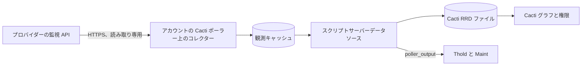

<!-- Source: README.md; SHA256: 7c621642e5f1a46bac66e4bc744f70aebb014c610d22de034088845fdc170405 -->

<!-- translations:start -->
[English](../../../README.md) | [简体中文](../zh-CN/README.md) | [हिन्दी](../hi-IN/README.md) | [Español (España)](../es-ES/README.md) | [Español (Latinoamérica)](../es-419/README.md) | [العربية (السعودية)](../ar-SA/README.md) | [Afrikaans](../af-ZA/README.md) | [አማርኛ](../am-ET/README.md) | [العربية (مصر)](../ar-EG/README.md) | [العربية (المغرب)](../ar-MA/README.md) | [বাংলা](../bn-BD/README.md) | [Deutsch](../de-DE/README.md) | [فارسی](../fa-IR/README.md) | [Filipino](../fil-PH/README.md) | [Français](../fr-FR/README.md) | [Français (Maroc)](../fr-MA/README.md) | [Français (Sénégal)](../fr-SN/README.md) | [Hausa](../ha-NG/README.md) | [עברית](../he-IL/README.md) | [Bahasa Indonesia](../id-ID/README.md) | [Igbo](../ig-NG/README.md) | [Italiano](../it-IT/README.md) | [日本語](README.md) | [한국어](../ko-KR/README.md) | [Malagasy](../mg-MG/README.md) | [मराठी](../mr-IN/README.md) | [Bahasa Melayu](../ms-MY/README.md) | [Nederlands](../nl-NL/README.md) | [Polski](../pl-PL/README.md) | [Português (Brasil)](../pt-BR/README.md) | [Русский](../ru-RU/README.md) | [Kinyarwanda](../rw-RW/README.md) | [Soomaali](../so-SO/README.md) | [Svenska](../sv-SE/README.md) | [Kiswahili](../sw-KE/README.md) | [தமிழ்](../ta-IN/README.md) | [తెలుగు](../te-IN/README.md) | [ไทย](../th-TH/README.md) | [Türkçe](../tr-TR/README.md) | [Українська](../uk-UA/README.md) | [اردو](../ur-PK/README.md) | [Tiếng Việt](../vi-VN/README.md) | [isiXhosa](../xh-ZA/README.md) | [Yorùbá](../yo-NG/README.md) | [繁體中文](../zh-TW/README.md) | [isiZulu](../zu-ZA/README.md)
<!-- translations:end -->

# plugin_cloud

パブリッククラウドプロバイダーのリソースとメトリクスを、通常のデバイス、データソース、グラフとして Cacti に取り込む Cacti 1.2 プラグインです。これにより、クラウドワークロードがその通信を担うネットワークの隣に Cacti の権限管理下で配置され、Thold や Maint によるアラート発報および抑制の対象にできるようになります。1 つのプラグインで各プロバイダーに対応し、プロバイダーごとにドライバーを備えています。最初は DigitalOcean、AWS、Google Cloud、Azure から対応します。

> **ステータス: マイルストーン 3（DigitalOcean と Cacti オブジェクト）、レビュー中。** このマイルストーンでは、DigitalOcean ドライバー、Cacti テンプレート、リソース種別ごとのデータクエリを備えたアカウント単位のスコープデバイス、スクリプトサーバー入力、および New Graphs とヘルスページ上のリクエスト見積もりを追加します。実際の DigitalOcean アカウントに対する初期確認結果は[プロバイダー事実情報](../../research/provider-facts.md)に記録されています。本番環境では実行しないでください。

## アクセスロール

| レルム | アクセス権限 |
| --- | --- |
| Cloud View | 既存の監視ページ。 |
| Cloud Operator | 監視ページに加え、Operations ページおよび個人単位のトリアージ確認応答（acknowledgment）。 |
| Cloud Admin | Operator のアクセス権限に加え、既存の設定変更および管理操作。 |

アップグレード用ファイルをコピーした後、管理者として Plugins ページを開き、新しいレルムを登録してください。Operator レルムは **Configuration > Users** またはユーザーグループで明示的に割り当てます。アップグレード時は、既存の View および Admin のレルム ID と付与済み権限が保持されます。リクエストごとに Admin アクセスは Operator アクセスを継承し、Operator アクセスは View アクセスを継承します。これによりユーザーやグループに保存済みの付与権限が追加されることはありません。プラグイン設定の変更には、Cacti の Settings 権限に加えて Cloud Admin アクセスも必要です。

各ユーザーが閲覧できる行や実行できる操作は、引き続き Cacti のデバイス権限によって制限されます。未マッピングのオブジェクトには管理者権限が必要です。Operator は、アクセス可能な Cacti デバイスに紐づくアカウントについて保存済み認証情報を検証できます。認証情報、設定、マッピング、削除などの管理変更は、引き続き管理ページで行います。確認応答は現在のユーザーセッション内でのみ有効で、最大 1 時間、かつ同じ観測データが最新（fresh）である間だけ維持されます。新しい観測データや変化した観測データが到着すると無効になります。確認応答によって計測失敗が正常とみなされたり、アラートが抑制されたりすることはありません。

## 背景と目的

各クラウドプロバイダーには独自の監視コンソールがあります。これらを Cacti と併用すると、次の 3 つのギャップが生じます。

- **アクセス制御の分離。** Cacti ユーザーにクラウドメトリクスを見せるために、クラウド側のログインアカウントを付与する必要が生じます。
- **ネットワークコンテキストの欠如。** オンプレミス回線は Cacti でグラフ化される一方、その背後にあるワークロードは各プロバイダーのコンソールでグラフ化されます。
- **アラートの分離。** Thold と Maint は Cacti のデータソースおよびデバイスに対して動作するため、プロバイダー側のアラームはプロバイダーごとに個別に設定および抑制する必要があります。

このプラグインは、Cacti ポーラー上で各プロバイダーの監視 API を読み取り、最新のデータポイントをキャッシュして、Cacti のスクリプトサーバーに提供します。RRD ファイルの書き込みは Cacti のポーラーが行うため、グラフ描画、権限管理、Thold、Maint、boost は他の一般的な Cacti データとまったく同様に機能します。

## 設計方針

- **読み取り専用。** 各ドライバーは許可リスト（allowlist）に含まれるプロバイダー操作のみを構築でき、プラグインがクラウドリソースを変更することはありません。（[ADR 0002](../../decisions/0002-read-only-with-operation-allowlist.md)）
- **PHP のみ・SDK 不使用。** 署名処理とトークン交換は、Cacti がすでに必要としている拡張機能を用いて PHP のみで実装されています。Composer のランタイム依存関係はありません。（[ADR 0003](../../decisions/0003-php-only-without-sdks.md)）
- **収集前のコスト把握。** プラグインは Cacti データソースが存在するメトリクスのみを読み取り、グラフ作成前に予想リクエスト数と定価ベースのコストを表示し、月間上限を強制します。（[ADR 0005](../../decisions/0005-collect-only-what-is-graphed.md)）
- **データベース内に平文の認証情報を保存しない。** 認証情報は、データベース外に保管した鍵ファイルを用いて暗号化ボールトから取得するか、認証情報ファイルまたはプロバイダーのインスタンス ID から取得します。（[ADR 0007](../../decisions/0007-credentials-outside-the-database-in-the-clear.md)）

## スコープとステータス

| フェーズ | スコープ | マイルストーン | ステータス |
|---|---|---|---|
| 0、調査 | プロバイダー仕様の確認、メトリクスカタログ、コスト・レートモデル、署名テストベクター、トランスポート検証（スパイク） | [M1](https://github.com/somethingwithproof/plugin_cloud/milestone/1) | 実プロバイダーアカウントが必要な確認を除き完了 |
| 1、コアおよび DigitalOcean | アカウント、認証情報ボールト、トランスポート、コレクター、観測キャッシュ、Cacti オブジェクト、ヘルスページ、DigitalOcean Droplets およびロードバランサー | [M2](https://github.com/somethingwithproof/plugin_cloud/milestone/2), [M3](https://github.com/somethingwithproof/plugin_cloud/milestone/3), [M4](https://github.com/somethingwithproof/plugin_cloud/milestone/4) | M2 完了（[#81](https://github.com/somethingwithproof/plugin_cloud/pull/81)）。M3 ドライバー、テンプレート、スコープデバイスはマージ済み。リクエスト見積もり、権限、パフォーマンス確認はレビュー中。M4 未着手 |
| 2、AWS | Signature Version 4、`AssumeRole`、インスタンスロール、CloudWatch `GetMetricData`、リージョン別インベントリ | [M5](https://github.com/somethingwithproof/plugin_cloud/milestone/5) | 未着手 |
| 3、Google Cloud | サービスアカウント JWT、メタデータサーバー、Cloud Monitoring `timeSeries.list` | [M6](https://github.com/somethingwithproof/plugin_cloud/milestone/6) | 未着手 |
| 4、Azure | Entra クライアントシークレット、マネージド ID、Resource Graph、`metrics:getBatch` | [M7](https://github.com/somethingwithproof/plugin_cloud/milestone/7) | 未着手 |
| 5、リモートコレクター | Cacti リモートデータコレクター上のアカウント | [M8](https://github.com/somethingwithproof/plugin_cloud/milestone/8) | 未着手 |

スコープ外: クラウドリソースの変更、プロバイダーアラームの作成またはミラーリング、請求レポート、ログおよびトレース、プラグイン独自のアラートエンジン。その他のプロバイダー（Hetzner Cloud、Akamai Cloud、Oracle Cloud など）は調査用 Issue として扱います。

## マイルストーン 2 で提供される機能

- **保護されたインストール。** PHP 8.2 未満、または ext-openssl がない環境では、インストールおよび有効化がメッセージ付きで拒否され、Cacti 本体の動作には影響を与えません。
- **ライフサイクル管理。** Cacti の Plugins ページからインストール、アップグレード、アンインストールできます。アップグレードは順序通りに実行され、中断されても再開可能です。*Keep Plugin Tables on Uninstall* のチェックを外さない限り、アンインストール後もプラグインのテーブルは保持されます。
- **分離されたレルム。** *Cloud Admin* は **Cloud Accounts** を、*Cloud Operator* は **Cloud Operations** を、*Cloud View* は **Cloud Health** を開きます。Admin は Operator を継承し、Operator は View を継承します。3 つのページはいずれも Management 配下にあります。
- **アカウントと認証情報。** アカウントの追加、編集、検証、削除ができます。認証情報はデータベース外に保管した鍵ファイルを用いてデータベース内で暗号化（AES-256-GCM）するか、ポーラー上のファイルから読み取ります。UI 上で認証情報は書き込み専用であり、ログからはマスク（redacted）されます。
- **コレクター。** 各ポーラー実行時にポーラーごとに 1 インスタンスが起動し、時間予算（time budget）内で動作します。アカウントごとにリースを取得し、独自の間隔でディスカバリーを実行し、このプラグイン自身の有効なデータソースに対するメトリクスのみを読み取ります。
- **ヘルス状態。** アカウントごとの収集、ディスカバリー、リソース、鮮度（freshness）の状態に加え、使用できないボールト鍵、安全でない認証情報ファイル、ポーラーが維持できない間隔に対する警告を表示します。

## インストールと設定

以下の手順では、評価用にマイルストーン 2 のコードをインストールします。PHP 8.2 以降で動作する Cacti 1.2.31 以降が必要です。

1. リポジトリを Cacti ディレクトリ配下の `plugins/cloud` にコピーします。ディレクトリ名は必ず `cloud` にしてください。
2. Web ルートの外にボールト鍵を作成します。root と Cacti ユーザーのみが書き込み可能なディレクトリに配置し、Web サーバーおよびポーラーを実行するユーザーのみが読み取れる権限を設定してください。プラグインがこのファイルを作成したり書き込んだりすることはありません:

   ```sh
   sudo install -d -m 0750 -o root -g cacti /etc/cacti
   head -c 32 /dev/urandom | sudo tee /etc/cacti/cloud-vault.key > /dev/null
   sudo chown cacti:cacti /etc/cacti/cloud-vault.key
   sudo chmod 0600 /etc/cacti/cloud-vault.key
   ```

   `cacti` の部分は、Web サーバーおよびポーラーを実行するユーザー名に置き換えてください。このファイルには 32 バイトの生バイナリまたは 64 文字の 16 進数文字列を格納します。データベースとあわせてバックアップしてください。このファイルが失われると、保存済みの認証情報を再入力する必要があります。
3. Cacti で **Configuration > Plugins** を開き、*Cloud* をインストールして有効化します。
4. 別のパスを使用した場合は、**Configuration > Settings > Cloud** で *Vault Key File* を設定します。*Collector Time Budget*（デフォルト 240 秒）はポーラー間隔より短い値にする必要があります。
5. **Configuration > Users** で、ユーザーおよびグループに *Cloud Admin*、*Cloud Operator*、または *Cloud View* を付与します。インストール時に管理者へ Cloud Admin と Cloud View が付与されます。Cloud Admin には Operator アクセスが含まれるため、管理者に別途 Operator を付与する必要はありません。
6. **Management > Cloud Accounts** でアカウントを追加し、**Management > Cloud Health** で警告が出ていないか確認します。

## 互換性ターゲット

| コンポーネント | ターゲット |
|---|---|
| Cacti | 1.2.31 以降、コアへのパッチ不要 |
| PHP | 8.2 以降。非対応ランタイムでも Cacti UI を壊さず拒否メッセージを表示できるよう、`setup.php` は 8.0 でもパース可能に保たれています |
| PHP 拡張モジュール | Cacti 1.2.31 が必要とするもの以外は不要 |
| Thold, Maint | 変更不要 |

## 設計

- [docs/performance.md](../../performance.md) には、使用したハードウェアや設定とともに、コレクターおよびヘルスページの計測結果が記載されています。
- [docs/PLAN.md](../../PLAN.md) は全体計画です。アーキテクチャ、前提となるプロバイダーおよび Cacti の仕様（出典付き）、ドライバー規約、コスト計算、セキュリティ境界、テスト、リスクをまとめています。
- [docs/decisions/](../../decisions) には、決定済みの選択に関するアーキテクチャ決定記録（ADR）が格納されています。
- [docs/REQUIREMENTS.md](../../REQUIREMENTS.md) では、すべての要件 ID と対応する Issue を紐付けています。



## 作業の追跡方法

- **マイルストーン** は計画のマイルストーンに従います。各マイルストーンには、サブ Issue と完了証跡を一覧化したエピック Issue があります。
- **Issue** はラベル（`type: requirement`、`type: research`、`type: decision`、`type: epic`）で種別分けされます。要件 Issue には番号付きでテスト可能な要件（`REQ-AREA-NNN`）と受け入れ基準が記載されています。
- **ラベル** には `area:`、`provider:`、`phase:`、`priority:`、`status:` も付与されます。詳細は [CONTRIBUTING.md](../../../CONTRIBUTING.md#labels) を参照してください。
- [プロジェクトボード](https://github.com/users/somethingwithproof/projects/7) で、マイルストーンを横断したすべての Issue を確認できます。

## 開発

CI では PHP 8.0 上でエントリーポイントのリントを行い、単体テスト・結合テストおよび PHPStan レベル 9 を実行し、Cacti 1.2.31 および 1.2.x ブランチに対して PHP 8.2〜8.5 でプラグインをインストールします。また、Cacti を壊すことなく PHP 8.1 が拒否されることも確認します。テストには Cacti コアのプラグインハーネスに含まれる Pest を使用しています（この選定は [#12](https://github.com/somethingwithproof/plugin_cloud/issues/12) が決定するまでの暫定措置です）。すべてのステップは [.github/workflows/plugin-ci-workflow.yml](../../../.github/workflows/plugin-ci-workflow.yml) に記載されています。プッシュ前にローカルで `sh tests/lint-workflows.sh` と `sh locales/build_gettext.sh --check` を実行してください。

## コントリビューション

[CONTRIBUTING.md](../../../CONTRIBUTING.md) をお読みください。コミットには DCO サインオフが必要です。設計の議論は Issue 上で行われ、未決定事項には `type: decision` ラベルが付与されます。

## セキュリティ

脆弱性は非公開で報告してください。詳細は [SECURITY.md](../../../SECURITY.md) を参照してください。

## ライセンス

Cacti およびそのプラグインと同じく GNU General Public License v2.0 です。詳細は [LICENSE](../../../LICENSE) を参照してください。
