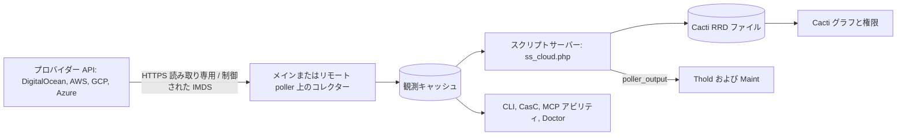

<!-- Source: README.md; SHA256: ac2074a40238686915802803c5efe773f33677f934281e0605e6e87a71a9d27d -->

<!-- translations:start -->
[English](../../../README.md) | [简体中文](../zh-CN/README.md) | [हिन्दी](../hi-IN/README.md) | [Español (España)](../es-ES/README.md) | [Español (Latinoamérica)](../es-419/README.md) | [العربية (السعودية)](../ar-SA/README.md) | [Afrikaans](../af-ZA/README.md) | [አማርኛ](../am-ET/README.md) | [العربية (مصر)](../ar-EG/README.md) | [العربية (المغرب)](../ar-MA/README.md) | [বাংলা](../bn-BD/README.md) | [Bosanski](../bs-BA/README.md) | [Deutsch](../de-DE/README.md) | [فارسی](../fa-IR/README.md) | [Filipino](../fil-PH/README.md) | [Français](../fr-FR/README.md) | [Français (Maroc)](../fr-MA/README.md) | [Français (Sénégal)](../fr-SN/README.md) | [Hausa](../ha-NG/README.md) | [עברית](../he-IL/README.md) | [Hrvatski](../hr-HR/README.md) | [Bahasa Indonesia](../id-ID/README.md) | [Igbo](../ig-NG/README.md) | [Italiano](../it-IT/README.md) | [日本語](README.md) | [한국어](../ko-KR/README.md) | [Malagasy](../mg-MG/README.md) | [मराठी](../mr-IN/README.md) | [Bahasa Melayu](../ms-MY/README.md) | [Nederlands](../nl-NL/README.md) | [Polski](../pl-PL/README.md) | [Português (Brasil)](../pt-BR/README.md) | [Русский](../ru-RU/README.md) | [Kinyarwanda](../rw-RW/README.md) | [Soomaali](../so-SO/README.md) | [Српски](../sr-RS/README.md) | [Svenska](../sv-SE/README.md) | [Kiswahili](../sw-KE/README.md) | [தமிழ்](../ta-IN/README.md) | [తెలుగు](../te-IN/README.md) | [ไทย](../th-TH/README.md) | [Türkçe](../tr-TR/README.md) | [Українська](../uk-UA/README.md) | [اردو](../ur-PK/README.md) | [Tiếng Việt](../vi-VN/README.md) | [isiXhosa](../xh-ZA/README.md) | [Yorùbá](../yo-NG/README.md) | [繁體中文](../zh-TW/README.md) | [isiZulu](../zu-ZA/README.md)
<!-- translations:end -->

# plugin_cloud

パブリッククラウドプロバイダーのリソースとメトリクスを、通常のデバイス、データソース、グラフとして Cacti に取り込む Cacti 1.2 プラグインです。クラウドワークロードがその通信を担うネットワークの隣に Cacti の権限管理下で配置され、Thold や Maint がアラート発報および抑制を行います。1 つのプラグインで、純粋な PHP 製の読み取り専用プロバイダードライバーを通じて DigitalOcean、Amazon Web Services、Google Cloud、Microsoft Azure に対応します。

> **ステータス: 開発中、リリース未定 (`0.1.0-dev`)。** このブランチでは、DigitalOcean、AWS、Google Cloud、Azure 向けの純粋な PHP 製ドライバー、リモートデータコレクターのレプリケーションおよび読み取り専用エージェントヘルス、CasC プロバイダーとオペレーター CLI、MCP アビリティ、Doctor チェックを実装しています。同梱の Cacti テンプレートは現在 DigitalOcean の Droplet とロードバランサーを対象としています (`templates/cloud_digitalocean.xml`)。AWS、Google Cloud、Azure 向けの Cacti テンプレートパッケージ、および DigitalOcean 以外のライブアカウントでの検証 ([プロバイダーの事実情報](../../research/provider-facts.md)) はまだ完了していません。本番環境では実行しないでください。

## 対応プロバイダー

各プロバイダードライバーは `Drivers::production()` に登録され、`Provider::released()` によって提供され、SDK や Composer のランタイム依存関係なしで `ext-openssl` とストリームソケットを使用して純粋な PHP で動作します。

| プロバイダー | スコープフィールド | 認証情報ソース | 認証方式 | 検出されるリソース | メトリクス収集 |
|---|---|---|---|---|---|
| DigitalOcean (`digitalocean`) | なし (トークンスコープ) | `vault`、`file` | Bearer トークン | `droplet`、`load_balancer` | レート制限シェアを考慮した `/v2/monitoring/metrics`、Cacti テンプレートとデータクエリを同梱 |
| Amazon Web Services (`aws`) | `account_id` (12 桁)、`regions` | `vault`、`file`、`instance` | 純粋な PHP による AWS SigV4 (`AWS4-HMAC-SHA256`)、STS `GetCallerIdentity` 検証、任意の STS `AssumeRole`、`instance` アカウント向け EC2 IMDSv2 (`169.254.169.254`) | `ec2_instance`、`rds_instance`、`aws_elb` (ALB/NLB) | バッチ化された CloudWatch `GetMetricData` (1 回の呼び出しあたり最大 500 クエリ) |
| Google Cloud (`gcp`) | `project` | `vault`、`file`、`instance` | `ext-openssl` 経由で `oauth2.googleapis.com/token` と交換する純粋な PHP 製 RS256 サービスアカウント JWT、または `instance` アカウント向け GCE メタデータサーバー (`metadata.google.internal`) | `instances.aggregatedList` による `gce_instance` | Cloud Monitoring `timeSeries.list` |
| Microsoft Azure (`azure`) | `tenant`、`subscription`、`regions` | `vault`、`file`、`instance` | 純粋な PHP による Entra ID OAuth2 クライアント資格情報フロー (`client_secret` のみ、証明書アサーションは除外)、または ARM および Monitor トークン向けの Azure IMDS (`169.254.169.254`) マネージド ID | ARM Resource Graph による `azure_vm` (`$skipToken` でページネーションおよび重複排除) | Azure Monitor `metrics:getBatch` (1 回の呼び出しあたり最大 50 リソース、HTTP 429 および 529 スロットリングを処理) |

## 実装済み機能

### コアプラットフォーム、Vault、コレクター

- **保護されたインストールとライフサイクル。** エントリーポイント (`setup.php`、`cli/cloud.php`、`poller_cloud.php`、`ss_cloud.php`、およびページスクリプト) は PHP 8.0 で構文解析可能であり、Cacti を壊すことなく PHP 8.2 未満または `ext-openssl` 不足を拒否します。アップグレードは順序付けられ、べき等であり (`Schema::VERSION = 3`、9 テーブル)、中断に耐えます。アンインストール時は *Keep Plugin Tables on Uninstall* のチェックを外さない限りプラグインテーブルを保持します。
- **アカウントと認証情報。** **Management > Cloud Accounts** からアカウントの追加、編集、検証、削除を行います。認証情報は AES-256-GCM 暗号化 Vault (`plugin_cloud_secret`、デフォルトでは `/etc/cacti/cloud-vault.key` を鍵として使用)、設定された *Credential File Directory* (`cloud_credential_dir`、デフォルトは空でファイルを拒否) 内に制限されたファイル、またはプロバイダーのインスタンス ID から取得します。認証情報は UI 上では書き込み専用であり、ログからは秘匿されます。
- **厳格な送信制御および読み取り専用制御。** 各ドライバーは `GuardedTransport` と `OutboundPolicy` の配下で動作します。プロバイダーごとの正確なホスト名への HTTPS ポート 443 のみを許可し、リンクローカル HTTP ポート 80 メタデータエンドポイント (`169.254.169.254`、`metadata.google.internal`) は `instance` アカウントに対してのみ有効になります。許可リストにある読み取り専用操作のみが許可されます。
- **コレクターとコスト制御。** `poller_cloud.php` は `poller_bottom` から (Cacti のプロセスレジストリ経由で poller ごとに 1 プロセス) `cloud_collector_budget` の範囲内で実行され、アカウントごとのリースを取得し、`discover_interval` で検出を実行し、有効な Cacti データソース (`plugin_cloud_series`) に対してのみメトリクスを読み取り、`request_share` と `monthly_ceiling` を遵守し、`ss_cloud.php` 用に最新データポイントを `plugin_cloud_observation` にキャッシュします。
- **Cacti オブジェクトとリクエスト見積もり。** アカウントごとにスコープデバイス (`plugin_cloud_device`) を維持し、デバイス保存を跨いでスコープデバイスの再インデックス方法を保持し、DigitalOcean テンプレートおよびスクリプトサーバーデータクエリ (`templates/cloud_digitalocean.xml`、`cloud_do_droplet.xml`、`cloud_do_load_balancer.xml`) をインポートし、**New Graphs** (`graphs_new_top_links`) および **Cloud Health** にリクエスト数と定価見積もりを表示します。

### リモートデータコレクター

- `INFO` は `remote_collect:1` を宣言します。アカウントは有効化された任意の Cacti poller (`poller_id >= 1`) に割り当てることができ、`poller_cloud.php --poller=N` はその poller が所有するアカウントのみを収集します。
- **`replicate_out` フック。** `replicate_out_table()` を介して `plugin_cloud_account`、`plugin_cloud_device`、`plugin_cloud_series` から poller スコープの行を、また `plugin_cloud_secret` から暗号化済み暗号文行 (対象 poller が所有する Vault バックエンドアカウントのみ) を複製します。生の Vault キーファイルがデータベースに保存されたり複製されたりすることはなく、各 poller のローカルに留まります。
- **`remote_agent` フック。** 整数の `poller_id` および `account_id` パラメーターのみを受け付け、認証情報、ファイルパス、シークレットを一切返さない読み取り専用 JSON ヘルスサマリー (`action=cloud_health`) を公開します。

### エコシステムフック (CasC、MCP アビリティ、Doctor)

- **CasC プロバイダー (`casc_register_providers`)。** 純粋な PHP による決定論的な YAML および XML エクスポート、マニフェスト検証、差分プランニング、確認済み適用を備えた `cloud` プロバイダー (スキーマバージョン `1`) を登録します。Vault 認証情報は `vault:account:<name>` 参照としてエクスポートされ、生のシークレットフィールド (`secret`、`secrets`、`token`、`access_token`、`refresh_token`、`password`、`private_key`、`access_key_id`、`secret_access_key`、`session_token`、`client_secret`、`credential`、`credentials`、`vault_key`) は拒否されます。適用には正確な SHA-256 `--confirm=<PLAN_HASH>` が必要です。
- **MCP / Abilities API (`abilities_register`)。** 管理者以外の呼び出し元に対して Cloud View レルム (`cloud_health.php`) と Cacti デバイススコープで制限された 3 つの厳格な読み取り専用アビリティを登録し、認証情報、Vault キー、認証情報ファイルパスを一切出力しません:
  - `cloud-list-accounts` (任意の `provider`、`poller_id`)
  - `cloud-list-resources` (任意の `account_id`、`type`、`lifecycle`)
  - `cloud-get-health` (任意の `account_id`)
- **Doctor チェック (`doctor_register_checks`)。** シークレット値や鍵マテリアルを一切露出しない 5 つの診断チェックを登録します:
  - `cloud_schema`: スキーマバージョンの最新性
  - `cloud_vault_key`: Vault キーファイルの読み取り可否、権限、およびサイズ
  - `cloud_drivers`: リリース済み全プロバイダーに対する本番ドライバー登録
  - `cloud_accounts_health`: 失敗、スロットリング、または古くなった有効アカウント
  - `cloud_poller_intervals`: 有効アカウントの収集間隔と Cacti の poller 間隔との整合性

## CLI

Cacti ルートディレクトリから PHP 8.2 以降で実行します:

```sh
# Operator and CasC CLI (options use --key=value form)
php plugins/cloud/cli/cloud.php export [--format=yaml|xml]
php plugins/cloud/cli/cloud.php validate --file=<path> [--format=yaml|xml]
php plugins/cloud/cli/cloud.php plan --file=<path> [--format=yaml|xml]
php plugins/cloud/cli/cloud.php apply --file=<path> --confirm=<PLAN_HASH> [--format=yaml|xml]
php plugins/cloud/cli/cloud.php health [--format=text|json] [--poller=<id>]

# Collector entry point (normally started by poller_bottom)
php plugins/cloud/poller_cloud.php [--poller=N] [--force] [--debug]
```

## アクセスロール

| レルム | アクセス権 |
| --- | --- |
| Cloud View | 既存の監視ページ。 |
| Cloud Operator | 監視に加えて Operations ページおよび個人用のトリアージ確認応答。 |
| Cloud Admin | Operator アクセス権に加えて既存の設定および管理操作。 |

アップグレードファイルをコピーした後、管理者として Plugins ページを開いてレルムを登録します。**Configuration > Users** またはユーザーグループで Operator レルムを明示的に割り当ててください。アップグレードでは既存の View および Admin レルム ID と付与権限が保持されます。Admin アクセス権は Operator アクセス権を継承し、Operator アクセス権は各リクエストで View アクセス権を継承します。これによりユーザーやグループに保存済みの権限が追加されることはありません。プラグイン設定には Cacti の Settings 権限に加えて Cloud Admin アクセス権も必要です。

Cacti のデバイス権限により、各ユーザーが利用できる行と操作が制限されます。未マッピングのオブジェクトには管理者権限が必要です。オペレーターは、自身がアクセス権を持つ Cacti デバイスに対応するアカウントの保存済み認証情報を検証できます。認証情報、設定、マッピング、削除、およびその他の管理変更は管理ページに残ります。確認応答は現在のユーザーセッション内でのみ、最長 1 時間、かつ同じ観測値が新鮮である間のみ有効です。新規または変更された観測値があると無効になります。失敗した計測を正常としてマークしたり、アラートを抑制したりすることは決してありません。

## 背景

各クラウドプロバイダーには独自の監視コンソールがあります。Cacti と併用すると、次の 3 つのギャップが生じます:

- **アクセス制御の分離。** Cacti ユーザーにクラウドメトリクスを見せるには、クラウドのログイン権限を付与する必要があります。
- **ネットワークコンテキストの欠如。** オンプレミス回線は Cacti でグラフ化され、その背後にあるワークロードは各プロバイダーのコンソールでグラフ化されます。
- **アラートの分離。** Thold と Maint は Cacti のデータソースとデバイス上で動作するため、プロバイダーのアラームはプロバイダーごとに個別に設定および抑制する必要があります。

このプラグインは Cacti の poller 上で各プロバイダーの監視 API を読み取り、最新データポイントをキャッシュし、Cacti のスクリプトサーバーに提供します。Cacti の poller が RRD ファイルを書き込むため、グラフ化、権限、Thold、Maint、boost が他の Cacti データと同様に動作します。

## 設計上の約束事

- **読み取り専用。** 各ドライバーは許可リスト上のプロバイダー操作のみを構築でき、プラグインがクラウドリソースを変更することはありません。([ADR 0002](../../decisions/0002-read-only-with-operation-allowlist.md))
- **PHP のみ、SDK 不使用。** 署名とトークン交換は Cacti がすでに必要とする拡張機能を用いて PHP で実装されています。Composer のランタイム依存関係はありません。([ADR 0003](../../decisions/0003-php-only-without-sdks.md))
- **収集前のコスト把握。** プラグインは Cacti データソースを持つメトリクスのみを読み取り、グラフ作成前に予想リクエスト数と定価コストを表示し、月間上限を適用します。([ADR 0005](../../decisions/0005-collect-only-what-is-graphed.md))
- **データベース内に平文の認証情報を置かない。** 認証情報はデータベース外のファイルで鍵管理された暗号化 Vault、認証情報ファイル、またはプロバイダーのインスタンス ID から取得します。([ADR 0007](../../decisions/0007-credentials-outside-the-database-in-the-clear.md))

## スコープとステータス

| フェーズ | スコープ | マイルストーン | ステータス |
|---|---|---|---|
| 0、調査 | プロバイダー事実確認、メトリクスカタログ、コストおよびレートモデル、署名テストベクター、トランスポート検証 | [M1](https://github.com/somethingwithproof/plugin_cloud/milestone/1) | ライブプロバイダーアカウントが必要な確認を除き完了 |
| 1、コアおよび DigitalOcean | アカウント、認証情報 Vault、トランスポート、コレクター、観測キャッシュ、Cacti オブジェクト、テンプレート、リクエスト見積もり、ヘルスページ、DigitalOcean Droplet およびロードバランサー | [M2](https://github.com/somethingwithproof/plugin_cloud/milestone/2)、[M3](https://github.com/somethingwithproof/plugin_cloud/milestone/3)、[M4](https://github.com/somethingwithproof/plugin_cloud/milestone/4) | 実装済み、M4 パイロット検証待ち |
| 2、AWS | 純粋な PHP による SigV4、STS `AssumeRole`、IMDSv2 インスタンスロール、EC2/RDS/ELB インベントリ、CloudWatch `GetMetricData` | [M5](https://github.com/somethingwithproof/plugin_cloud/milestone/5) | ドライバー実装済み、Cacti テンプレートとライブアカウント検証待ち |
| 3、Google Cloud | 純粋な PHP による RS256 サービスアカウント JWT、GCE メタデータサーバー、Compute Engine インベントリ、Cloud Monitoring `timeSeries.list` | [M6](https://github.com/somethingwithproof/plugin_cloud/milestone/6) | ドライバー実装済み、Cacti テンプレートとライブアカウント検証待ち |
| 4、Azure | Entra ID クライアント資格情報、IMDS マネージド ID、ARM Resource Graph VM インベントリ、Azure Monitor `metrics:getBatch` | [M7](https://github.com/somethingwithproof/plugin_cloud/milestone/7) | ドライバー実装済み、Cacti テンプレートとライブアカウント検証待ち |
| 5、リモートコレクターおよびエコシステム | リモートデータコレクター (`replicate_out`、`remote_agent`)、CasC プロバイダーおよび CLI、MCP アビリティ、Doctor チェック | [M8](https://github.com/somethingwithproof/plugin_cloud/milestone/8) | 実装済み |

スコープ外: クラウドリソースの変更、プロバイダーアラームの作成またはミラーリング、請求レポート、ログおよびトレース、プラグイン独自のアラートエンジン。追加のプロバイダー (Hetzner Cloud、Akamai Cloud、Oracle Cloud など) は調査イシューとして扱われています。

## インストールと設定

以下の手順では評価用に開発コードをインストールします。PHP 8.2 以降の Cacti 1.2.31 以降が必要です。

1. Cacti ディレクトリ配下の `plugins/cloud` にリポジトリをコピーします。ディレクトリ名は `cloud` である必要があります。
2. Vault バックエンドの認証情報を使用する各 poller 上で、Web ルートの外に Vault キーを作成します。root と Cacti ユーザーのみが書き込み可能なディレクトリに配置し、Web サーバーと poller を実行するユーザーのみがファイルを読み取れるようにしてください。プラグインがこのファイルを作成または書き込むことはありません:

   ```sh
   sudo install -d -m 0750 -o root -g cacti /etc/cacti
   head -c 32 /dev/urandom | sudo tee /etc/cacti/cloud-vault.key > /dev/null
   sudo chown cacti:cacti /etc/cacti/cloud-vault.key
   sudo chmod 0600 /etc/cacti/cloud-vault.key
   ```

   `cacti` は Web サーバーと poller を実行するユーザーに置き換えてください。このファイルには 32 バイトの生データまたは 64 文字の 16 進文字列を格納します。データベースと一緒にバックアップしてください。これがない場合、保存済みの認証情報を再入力する必要があります。
3. Cacti で **Configuration > Plugins** を開き、*Cloud* をインストールして有効化します。
4. **Configuration > Settings > Cloud** で、別のパスを使用した場合は *Vault Key File* を設定し、ファイルベースの認証情報を使用する場合は *Credential File Directory* を設定し、*Collector Time Budget* (デフォルト 240 秒) を poller 間隔より短く保ちます。
5. **Configuration > Users** でユーザーおよびグループに *Cloud Admin*、*Cloud Operator*、または *Cloud View* を付与します。インストール時に管理者へ Cloud Admin と Cloud View が付与されます。Cloud Admin には Operator アクセス権が含まれるため、管理者に別途 Operator 権限を付与する必要はありません。
6. **Management > Cloud Accounts** でアカウントを追加し、**Management > Cloud Health** で警告を確認します。

## 互換性ターゲット

| コンポーネント | ターゲット |
|---|---|
| Cacti | 1.2.31 以降、コアパッチ不要 |
| PHP | 8.2 以降。非対応ランタイムでも Cacti UI を壊さず拒否を返せるよう、エントリーポイントは 8.0 で構文解析可能を維持 |
| PHP 拡張機能 | `ext-openssl` (Cacti 1.2.31 で必須)。`ext-curl` 不要、Composer ランタイム依存関係なし |
| Thold、Maint | 変更不要 |

## 設計

- [docs/performance.md](../../performance.md) には使用したハードウェアと設定とともにコレクターおよびヘルスページの計測結果が記載されています。
- [docs/PLAN.md](../../PLAN.md) が全体計画です。アーキテクチャ、前提となるプロバイダーおよび Cacti の事実情報 (出典付き)、ドライバー契約、コスト計算、セキュリティ境界、テスト、リスクを網羅しています。
- [docs/decisions/](../../decisions/) には決定済みの選択に関するアーキテクチャ決定記録が保管されています。
- [docs/REQUIREMENTS.md](../../REQUIREMENTS.md) は各要件 ID を対応するイシューにマッピングしています。



## 作業の追跡方法

- **マイルストーン**は計画のマイルストーンに従います。各マイルストーンにはサブイシューと完了証跡を一覧するエピックイシューがあります。
- **イシュー**はラベルで分類されます: `type: requirement`、`type: research`、`type: decision`、`type: epic`。要件イシューでは番号付きの検証可能な要件 (`REQ-AREA-NNN`) と受け入れ基準を定義します。
- **ラベル**には `area:`、`provider:`、`phase:`、`priority:`、`status:` も付きます。[CONTRIBUTING.md](../../../CONTRIBUTING.md#labels) を参照してください。
- [プロジェクトボード](https://github.com/users/somethingwithproof/projects/7)では全マイルストーンのすべてのイシューを確認できます。

## 開発

CI ([.github/workflows/plugin-ci-workflow.yml](../../../.github/workflows/plugin-ci-workflow.yml)) はリリースアーカイブとセマンティックバージョニングの確認 (`bash tests/bin/archive-check.sh`)、PHP 8.0 でのエントリーポイントのリント、PHP 8.2 から 8.5 における Cacti `release/1.2.31` および `1.2.x` に対する `CLOUD_OFFLINE=1` での Pest 単体テスト (`phpunit.xml`)・ライフサイクル統合テスト (`phpunit-integration.xml`)・PHPStan レベル 9 の実行、PHP 8.1 での拒否確認、gettext カタログの検証、1,000 シリーズ収集とヘルスページのパフォーマンス計測、ワークフローリントおよび REUSE 準拠チェックを行います。

プッシュ前のローカル確認:

```sh
bash tests/bin/archive-check.sh
sh tests/lint-workflows.sh
sh locales/build_gettext.sh --check
CACTI_PATH=/path/to/cacti phpstan analyse -c phpstan.neon --no-progress
```

単体テストおよびソースルールテストには `--configuration=phpunit.xml` を指定して Pest を実行し、ライフサイクル統合テストには使い捨ての Cacti データベースに対して `CACTI_PATH` と `CLOUD_TEST_DATABASE=disposable` を指定して `--configuration=phpunit-integration.xml` で実行してください。

## コントリビュート

[CONTRIBUTING.md](../../../CONTRIBUTING.md) をお読みください。コミットには DCO サインオフが必要です。設計の議論はイシュー上で行われ、未決定事項には `type: decision` ラベルが付与されます。

## セキュリティ

脆弱性は非公開で報告してください。[SECURITY.md](../../../SECURITY.md) を参照してください。

## ライセンス

GNU General Public License v2.0、Cacti およびそのプラグインと同じライセンスです。[LICENSE](../../../LICENSE) を参照してください。
