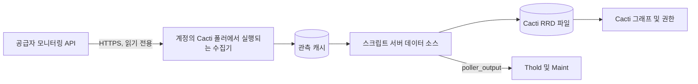

<!-- Source: README.md; SHA256: 7c621642e5f1a46bac66e4bc744f70aebb014c610d22de034088845fdc170405 -->

<!-- translations:start -->
[English](../../../README.md) | [简体中文](../zh-CN/README.md) | [हिन्दी](../hi-IN/README.md) | [Español (España)](../es-ES/README.md) | [Español (Latinoamérica)](../es-419/README.md) | [العربية (السعودية)](../ar-SA/README.md) | [Afrikaans](../af-ZA/README.md) | [አማርኛ](../am-ET/README.md) | [العربية (مصر)](../ar-EG/README.md) | [العربية (المغرب)](../ar-MA/README.md) | [বাংলা](../bn-BD/README.md) | [Deutsch](../de-DE/README.md) | [فارسی](../fa-IR/README.md) | [Filipino](../fil-PH/README.md) | [Français](../fr-FR/README.md) | [Français (Maroc)](../fr-MA/README.md) | [Français (Sénégal)](../fr-SN/README.md) | [Hausa](../ha-NG/README.md) | [עברית](../he-IL/README.md) | [Bahasa Indonesia](../id-ID/README.md) | [Igbo](../ig-NG/README.md) | [Italiano](../it-IT/README.md) | [日本語](../ja-JP/README.md) | [한국어](README.md) | [Malagasy](../mg-MG/README.md) | [मराठी](../mr-IN/README.md) | [Bahasa Melayu](../ms-MY/README.md) | [Nederlands](../nl-NL/README.md) | [Polski](../pl-PL/README.md) | [Português (Brasil)](../pt-BR/README.md) | [Русский](../ru-RU/README.md) | [Kinyarwanda](../rw-RW/README.md) | [Soomaali](../so-SO/README.md) | [Svenska](../sv-SE/README.md) | [Kiswahili](../sw-KE/README.md) | [தமிழ்](../ta-IN/README.md) | [తెలుగు](../te-IN/README.md) | [ไทย](../th-TH/README.md) | [Türkçe](../tr-TR/README.md) | [Українська](../uk-UA/README.md) | [اردو](../ur-PK/README.md) | [Tiếng Việt](../vi-VN/README.md) | [isiXhosa](../xh-ZA/README.md) | [Yorùbá](../yo-NG/README.md) | [繁體中文](../zh-TW/README.md) | [isiZulu](../zu-ZA/README.md)
<!-- translations:end -->

# plugin_cloud

퍼블릭 클라우드 공급자의 리소스와 메트릭을 일반 장치, 데이터 소스 및 그래프로 Cacti에 가져오는 Cacti 1.2 플러그인입니다. 이를 통해 클라우드 워크로드를 이를 전달하는 네트워크 옆에 두고 Cacti의 권한 체계 아래에서 관리할 수 있으며, Thold 및 Maint로 알림을 보내고 알림을 억제할 수 있습니다. 하나의 플러그인이 모든 공급자를 지원하며 공급자별 드라이버를 제공합니다. 먼저 DigitalOcean, AWS, Google Cloud 및 Azure를 지원합니다.

> **상태: 마일스톤 3(DigitalOcean 및 Cacti 개체), 검토 중.** 이 마일스톤에서는 DigitalOcean 드라이버, Cacti 템플릿, 리소스 유형별 데이터 쿼리가 포함된 계정당 범위(scope) 장치, 스크립트 서버 입력, 그리고 New Graphs 및 상태(health) 페이지에서의 요청 수 추정 기능을 추가합니다. 실제 DigitalOcean 계정에 대한 초기 확인 결과는 [공급자 확인 사항](../../research/provider-facts.md)에 기록되어 있습니다. 프로덕션 환경에서는 실행하지 마세요.

## 접근 역할

| 영역(Realm) | 접근 권한 |
| --- | --- |
| Cloud View | 기존 모니터링 페이지입니다. |
| Cloud Operator | 모니터링 페이지와 Operations 페이지 및 개인별 트리아지 확인(acknowledgment) 기능입니다. |
| Cloud Admin | Operator 접근 권한과 기존 구성 및 관리 작업입니다. |

업그레이드 파일을 복사한 후 관리자로 Plugins 페이지를 열어 새 영역(realm)을 등록하세요. **Configuration > Users** 또는 사용자 그룹에서 Operator 영역을 명시적으로 할당하세요.
업그레이드 시 기존 View 및 Admin 영역 ID와 부여된 권한은 유지됩니다. Admin 접근 권한은 매 요청 시 Operator 접근 권한을 상속하고, Operator 접근 권한은 View 접근 권한을 상속합니다. 이는 사용자나 그룹에 저장된 권한을 추가하지는 않습니다. 플러그인 설정을 사용하려면 Cacti의 Settings 권한 외에 Cloud Admin 접근 권한도 필요합니다.

Cacti 장치 권한은 여전히 각 사용자가 볼 수 있는 행과 수행할 수 있는 작업을 제한하며, 매핑되지 않은 개체에는 관리자가 필요합니다. Operator는 자신이 접근할 수 있는 Cacti 장치에 해당하는 계정의 저장된 자격 증명을 확인할 수 있습니다.
자격 증명, 구성, 매핑, 삭제 및 기타 관리 변경 작업은 관리 페이지에 그대로 유지됩니다. 확인(acknowledgment)은 현재 사용자 세션에서만 최대 1시간 동안, 그리고 동일한 관측치가 최신(fresh) 상태로 유지되는 동안에만 유효합니다. 새 관측치나 변경된 관측치가 들어오면 무효화됩니다. 확인 상태가 실패한 측정을 정상으로 표시하거나 알림을 억제하지는 않습니다.

## 도입 배경

각 클라우드 공급자는 자체 모니터링 콘솔을 제공합니다. 이를 Cacti와 함께 운영하면 세 가지 공백이 발생합니다:

- **분리된 접근 제어.** Cacti 사용자에게 클라우드 메트릭을 보여주려면 클라우드 로그인 계정을 제공해야 합니다.
- **네트워크 컨텍스트 부재.** 온프레미스 링크는 Cacti에서 그래프로 그려지고, 그 뒤의 워크로드는 각 공급자의 콘솔에서 그래프로 그려집니다.
- **분리된 알림.** Thold와 Maint는 Cacti 데이터 소스와 장치에서 동작하므로 공급자별 알람을 공급자마다 따로 구성하고 억제해야 합니다.

이 플러그인은 Cacti 폴러에서 각 공급자의 모니터링 API를 읽고 최신 데이터 포인트를 캐시한 뒤 Cacti의 스크립트 서버에 제공합니다. Cacti의 폴러가 RRD 파일을 기록하므로 그래프 생성, 권한, Thold, Maint 및 boost가 다른 모든 Cacti 데이터와 동일하게 동작합니다.

## 설계 원칙

- **읽기 전용.** 각 드라이버는 허용 목록(allowlist)에 있는 공급자 작업만 구성할 수 있으며, 플러그인은 클라우드 리소스를 절대 변경하지 않습니다. ([ADR 0002](../../decisions/0002-read-only-with-operation-allowlist.md))
- **SDK 없이 PHP만 사용.** 서명 및 토큰 교환은 Cacti가 이미 요구하는 확장 모듈을 사용하여 PHP로 구현됩니다. Composer 런타임 종속성이 없습니다. ([ADR 0003](../../decisions/0003-php-only-without-sdks.md))
- **수집 전 비용 확인.** 플러그인은 Cacti 데이터 소스가 있는 메트릭만 읽고, 그래프를 생성하기 전에 예상 요청 수와 정가 기준 비용을 표시하며, 월간 상한선을 적용합니다. ([ADR 0005](../../decisions/0005-collect-only-what-is-graphed.md))
- **데이터베이스에 평문 자격 증명 저장 금지.** 자격 증명은 데이터베이스 외부의 파일로 키가 관리되는 암호화된 볼트, 자격 증명 파일 또는 공급자의 인스턴스 ID에서 가져옵니다. ([ADR 0007](../../decisions/0007-credentials-outside-the-database-in-the-clear.md))

## 범위 및 상태

| 단계 | 범위 | 마일스톤 | 상태 |
|---|---|---|---|
| 0, 조사 | 공급자 사실 확인, 메트릭 카탈로그, 비용 및 속도 모델, 서명 테스트 벡터, 전송 스파이크 | [M1](https://github.com/somethingwithproof/plugin_cloud/milestone/1) | 실제 공급자 계정이 필요한 확인 항목을 제외하고 완료 |
| 1, 코어 및 DigitalOcean | 계정, 자격 증명 볼트, 전송, 수집기, 관측 캐시, Cacti 개체, 상태 페이지, DigitalOcean Droplet 및 로드 밸런서 | [M2](https://github.com/somethingwithproof/plugin_cloud/milestone/2), [M3](https://github.com/somethingwithproof/plugin_cloud/milestone/3), [M4](https://github.com/somethingwithproof/plugin_cloud/milestone/4) | M2 완료 ([#81](https://github.com/somethingwithproof/plugin_cloud/pull/81)); M3 드라이버, 템플릿 및 범위 장치 병합됨; 요청 수 추정, 권한 및 성능 확인 검토 중; M4 시작 전 |
| 2, AWS | Signature Version 4, `AssumeRole`, 인스턴스 역할, CloudWatch `GetMetricData`, 리전별 인벤토리 | [M5](https://github.com/somethingwithproof/plugin_cloud/milestone/5) | 시작 전 |
| 3, Google Cloud | 서비스 계정 JWT, 메타데이터 서버, Cloud Monitoring `timeSeries.list` | [M6](https://github.com/somethingwithproof/plugin_cloud/milestone/6) | 시작 전 |
| 4, Azure | Entra 클라이언트 자격 증명, 관리 ID, Resource Graph, `metrics:getBatch` | [M7](https://github.com/somethingwithproof/plugin_cloud/milestone/7) | 시작 전 |
| 5, 원격 수집기 | Cacti 원격 데이터 수집기의 계정 지원 | [M8](https://github.com/somethingwithproof/plugin_cloud/milestone/8) | 시작 전 |

범위 제외 항목: 클라우드 리소스 변경, 공급자 알람 생성 또는 미러링, 청구 보고서, 로그 및 트레이스, 플러그인 자체 알림 엔진. 추가 공급자(Hetzner Cloud, Akamai Cloud, Oracle Cloud 등)는 조사 이슈로 관리됩니다.

## 마일스톤 2에 포함된 기능

- **안전한 설치 검사.** PHP 8.2 미만이거나 ext-openssl이 없는 경우 메시지와 함께 설치 및 활성화가 거부되며, 나머지 Cacti 기능은 정상적으로 계속 동작합니다.
- **수명 주기.** Cacti의 Plugins 페이지를 통해 설치, 업그레이드 및 제거합니다. 업그레이드는 순서대로 실행되며 중단되어도 복구됩니다. *Keep Plugin Tables on Uninstall* 선택을 해제하지 않는 한 제거 시 플러그인 테이블이 유지됩니다.
- **분리된 영역.** *Cloud Admin*은 **Cloud Accounts**를 열고, *Cloud Operator*는 **Cloud Operations**를 열며, *Cloud View*는 **Cloud Health**를 엽니다. Admin은 Operator를 상속하고 Operator는 View를 상속합니다. 세 페이지 모두 Management 아래에 있습니다.
- **계정 및 자격 증명.** 계정을 추가, 편집, 확인 및 삭제합니다. 자격 증명은 데이터베이스 외부에 보관된 키 파일로 암호화하여 데이터베이스에 저장(AES-256-GCM)하거나 폴러의 파일에서 읽습니다. 자격 증명은 UI에서 쓰기 전용이며 로그에서는 가려집니다.
- **수집기.** 각 폴러 실행마다 폴러당 하나의 인스턴스로 시간 예산 내에서 시작됩니다. 계정별 임대(lease)를 획득하고, 자체 간격에 따라 검색(discovery)을 실행하며, 플러그인 자체의 활성 데이터 소스에 대해서만 메트릭을 읽습니다.
- **상태.** 계정별 수집, 검색, 리소스 및 최신성 상태와 함께 사용할 수 없는 볼트 키, 안전하지 않은 자격 증명 파일 및 폴러가 준수할 수 없는 간격에 대한 경고를 제공합니다.

## 설치 및 구성

이 단계는 평가용으로 마일스톤 2 코드를 설치하는 방법입니다. PHP 8.2 이상의 환경에서 Cacti 1.2.31 이상이 필요합니다.

1. 저장소를 Cacti 디렉터리 아래의 `plugins/cloud`로 복사합니다. 디렉터리 이름은 반드시 `cloud`여야 합니다.
2. 웹 루트 외부에 볼트 키를 생성합니다. root와 Cacti 사용자만 쓸 수 있는 디렉터리에 두고, 웹 서버와 폴러를 실행하는 사용자만 읽을 수 있도록 설정하세요. 플러그인은 이 파일을 직접 생성하거나 쓰지 않습니다:

   ```sh
   sudo install -d -m 0750 -o root -g cacti /etc/cacti
   head -c 32 /dev/urandom | sudo tee /etc/cacti/cloud-vault.key > /dev/null
   sudo chown cacti:cacti /etc/cacti/cloud-vault.key
   sudo chmod 0600 /etc/cacti/cloud-vault.key
   ```

   `cacti`는 웹 서버와 폴러를 실행하는 사용자로 바꾸세요. 이 파일에는 32개의 원시 바이트 또는 64자의 16진수 문자가 저장됩니다. 데이터베이스와 함께 백업하세요. 이 파일이 없으면 저장된 자격 증명을 다시 입력해야 합니다.
3. Cacti에서 **Configuration > Plugins**를 연 다음 *Cloud*를 설치하고 활성화합니다.
4. **Configuration > Settings > Cloud**에서 다른 경로를 사용한 경우 *Vault Key File*을 설정합니다. *Collector Time Budget*(기본값 240초)은 폴러 간격보다 작게 유지해야 합니다.
5. **Configuration > Users**에서 사용자와 그룹에 *Cloud Admin*, *Cloud Operator* 또는 *Cloud View* 권한을 부여합니다. 설치 시 관리자에게 Cloud Admin 및 Cloud View 권한이 부여됩니다. Cloud Admin에는 Operator 접근 권한이 포함되므로 관리자에게 별도로 Operator 권한을 부여할 필요는 없습니다.
6. **Management > Cloud Accounts**에서 계정을 추가한 다음 **Management > Cloud Health**에서 경고가 있는지 확인합니다.

## 호환성 대상

| 구성 요소 | 대상 |
|---|---|
| Cacti | 1.2.31 이상, 코어 패치 불필요 |
| PHP | 8.2 이상; 지원되지 않는 런타임에서 Cacti UI가 손상되는 대신 거부 메시지를 표시하도록 `setup.php`는 8.0에서도 구문 분석 가능하게 유지 |
| PHP 확장 모듈 | Cacti 1.2.31이 요구하는 것 외에는 없음 |
| Thold, Maint | 변경 불필요 |

## 설계

- [docs/performance.md](../../performance.md)에는 사용된 하드웨어 및 설정과 함께 수집기 및 상태 페이지 측정 결과가 정리되어 있습니다.
- [docs/PLAN.md](../../PLAN.md)는 전체 계획 문서로, 아키텍처, 의존하는 공급자 및 Cacti 사실(출처 포함), 드라이버 계약, 비용 산정 방식, 보안 경계, 테스트 및 위험 요소를 다룹니다.
- [docs/decisions/](../../decisions)에는 이미 내린 결정에 대한 아키텍처 결정 기록(ADR)이 있습니다.
- [docs/REQUIREMENTS.md](../../REQUIREMENTS.md)는 모든 요구 사항 ID를 해당 이슈에 매핑합니다.



## 작업 추적 방식

- **마일스톤**은 계획의 마일스톤을 따릅니다. 각 마일스톤에는 하위 이슈와 종료 증빙 자료를 나열하는 에픽 이슈가 있습니다.
- **이슈**는 레이블(`type: requirement`, `type: research`, `type: decision`, `type: epic`)로 유형이 구분됩니다. 요구 사항 이슈에는 번호가 매겨진 테스트 가능한 요구 사항(`REQ-AREA-NNN`)과 수락 기준이 명시됩니다.
- **레이블**에는 `area:`, `provider:`, `phase:`, `priority:` 및 `status:`도 포함됩니다. [CONTRIBUTING.md](../../../CONTRIBUTING.md#labels)를 참조하세요.
- [프로젝트 보드](https://github.com/users/somethingwithproof/projects/7)에서 모든 마일스톤의 이슈를 확인할 수 있습니다.

## 개발

CI는 PHP 8.0에서 진입점을 린트(lint)하고, 단위 및 통합 테스트와 PHPStan level 9를 실행하며, Cacti 1.2.31 및 1.2.x 브랜치에 대해 PHP 8.2~8.5에서 플러그인을 설치합니다. 또한 Cacti를 손상시키지 않고 PHP 8.1이 거부되는지도 확인합니다. 테스트는 Cacti 코어의 플러그인 하네스에 포함된 Pest를 사용합니다. 이 선택은 [#12](https://github.com/somethingwithproof/plugin_cloud/issues/12)가 결정될 때까지 임시로 유지됩니다. [.github/workflows/plugin-ci-workflow.yml](../../../.github/workflows/plugin-ci-workflow.yml)에 모든 단계가 나열되어 있습니다. 푸시하기 전에 로컬에서 `sh tests/lint-workflows.sh` 및 `sh locales/build_gettext.sh --check`를 실행하세요.

## 기여

[CONTRIBUTING.md](../../../CONTRIBUTING.md)를 읽어주세요. 커밋에는 DCO sign-off가 필요합니다. 설계 논의는 이슈에서 진행되며, 미결 결정 사항에는 `type: decision` 레이블이 붙습니다.

## 보안

취약점은 비공개로 보고해 주세요. [SECURITY.md](../../../SECURITY.md)를 참조하세요.

## 라이선스

Cacti 및 해당 플러그인과 동일한 라이선스인 GNU General Public License v2.0입니다. [LICENSE](../../../LICENSE)를 참조하세요.
