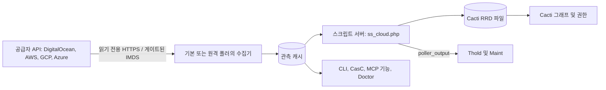

<!-- Source: README.md; SHA256: ac2074a40238686915802803c5efe773f33677f934281e0605e6e87a71a9d27d -->

<!-- translations:start -->
[English](../../../README.md) | [简体中文](../zh-CN/README.md) | [हिन्दी](../hi-IN/README.md) | [Español (España)](../es-ES/README.md) | [Español (Latinoamérica)](../es-419/README.md) | [العربية (السعودية)](../ar-SA/README.md) | [Afrikaans](../af-ZA/README.md) | [አማርኛ](../am-ET/README.md) | [العربية (مصر)](../ar-EG/README.md) | [العربية (المغرب)](../ar-MA/README.md) | [বাংলা](../bn-BD/README.md) | [Bosanski](../bs-BA/README.md) | [Deutsch](../de-DE/README.md) | [فارسی](../fa-IR/README.md) | [Filipino](../fil-PH/README.md) | [Français](../fr-FR/README.md) | [Français (Maroc)](../fr-MA/README.md) | [Français (Sénégal)](../fr-SN/README.md) | [Hausa](../ha-NG/README.md) | [עברית](../he-IL/README.md) | [Hrvatski](../hr-HR/README.md) | [Bahasa Indonesia](../id-ID/README.md) | [Igbo](../ig-NG/README.md) | [Italiano](../it-IT/README.md) | [日本語](../ja-JP/README.md) | [한국어](README.md) | [Malagasy](../mg-MG/README.md) | [मराठी](../mr-IN/README.md) | [Bahasa Melayu](../ms-MY/README.md) | [Nederlands](../nl-NL/README.md) | [Polski](../pl-PL/README.md) | [Português (Brasil)](../pt-BR/README.md) | [Русский](../ru-RU/README.md) | [Kinyarwanda](../rw-RW/README.md) | [Soomaali](../so-SO/README.md) | [Српски](../sr-RS/README.md) | [Svenska](../sv-SE/README.md) | [Kiswahili](../sw-KE/README.md) | [தமிழ்](../ta-IN/README.md) | [తెలుగు](../te-IN/README.md) | [ไทย](../th-TH/README.md) | [Türkçe](../tr-TR/README.md) | [Українська](../uk-UA/README.md) | [اردو](../ur-PK/README.md) | [Tiếng Việt](../vi-VN/README.md) | [isiXhosa](../xh-ZA/README.md) | [Yorùbá](../yo-NG/README.md) | [繁體中文](../zh-TW/README.md) | [isiZulu](../zu-ZA/README.md)
<!-- translations:end -->

# plugin_cloud

퍼블릭 클라우드 공급자의 리소스와 메트릭을 일반 장치, 데이터 소스 및 그래프로 Cacti에 가져오는 Cacti 1.2 플러그인입니다. 클라우드 워크로드가 이를 전달하는 네트워크 옆에 배치되어 Cacti의 권한 체계 아래에서 관리되며, Thold와 Maint로 알림을 보내고 억제할 수 있습니다. 하나의 플러그인이 순수 PHP 기반의 읽기 전용 공급자 드라이버를 통해 DigitalOcean, Amazon Web Services, Google Cloud 및 Microsoft Azure를 모두 지원합니다.

> **상태: 개발 중, 아직 릴리스 없음(`0.1.0-dev`).** 이 브랜치는 DigitalOcean, AWS, Google Cloud 및 Azure용 순수 PHP 드라이버, 원격 데이터 수집기 복제 및 읽기 전용 에이전트 상태 확인, CasC 공급자 및 운영자 CLI, MCP 기능, Doctor 점검을 구현합니다. 현재 제공되는 Cacti 템플릿은 DigitalOcean Droplet 및 로드 밸런서(`templates/cloud_digitalocean.xml`)를 다루며, AWS, Google Cloud 및 Azure용 Cacti 템플릿 패키지와 DigitalOcean 외의 실제 계정 검증([공급자 확인 사항](../../research/provider-facts.md))은 아직 완료되지 않았습니다. 프로덕션 환경에서는 실행하지 마세요.

## 지원 공급자

모든 공급자 드라이버는 `Drivers::production()`에 등록되고 `Provider::released()`에서 제공되며, `ext-openssl`과 스트림 소켓을 사용하여 SDK나 Composer 런타임 종속성 없이 순수 PHP로 실행됩니다.

| 공급자 | 범위 필드 | 자격 증명 소스 | 인증 | 검색된 리소스 | 메트릭 수집 |
|---|---|---|---|---|---|
| DigitalOcean (`digitalocean`) | 없음(토큰 범위) | `vault`, `file` | Bearer 토큰 | `droplet`, `load_balancer` | 속도 제한 점유율 인식을 포함한 `/v2/monitoring/metrics`; Cacti 템플릿 및 데이터 쿼리 제공 |
| Amazon Web Services (`aws`) | `account_id` (12자리), `regions` | `vault`, `file`, `instance` | 순수 PHP AWS SigV4 (`AWS4-HMAC-SHA256`), STS `GetCallerIdentity` 검증, 선택적 STS `AssumeRole`, `instance` 계정용 EC2 IMDSv2 (`169.254.169.254`) | `ec2_instance`, `rds_instance`, `aws_elb` (ALB/NLB) | 일괄 처리된 CloudWatch `GetMetricData` (호출당 최대 500개 쿼리) |
| Google Cloud (`gcp`) | `project` | `vault`, `file`, `instance` | `oauth2.googleapis.com/token`에서 교환되는 `ext-openssl` 기반 순수 PHP RS256 서비스 계정 JWT, 또는 `instance` 계정용 GCE 메타데이터 서버(`metadata.google.internal`) | `instances.aggregatedList`를 통한 `gce_instance` | Cloud Monitoring `timeSeries.list` |
| Microsoft Azure (`azure`) | `tenant`, `subscription`, `regions` | `vault`, `file`, `instance` | 순수 PHP Entra ID OAuth2 클라이언트 자격 증명 흐름(`client_secret`만 지원; 인증서 어설션 제외), 또는 ARM 및 Monitor 토큰용 Azure IMDS (`169.254.169.254`) 관리 ID | ARM Resource Graph를 통한 `azure_vm` (`$skipToken`으로 페이지네이션 및 중복 제거) | Azure Monitor `metrics:getBatch` (호출당 최대 50개 리소스, HTTP 429 및 529 스로틀링 처리) |

## 구현된 기능

### 코어 플랫폼, 볼트 및 수집기

- **보호된 설치 및 수명 주기.** 진입점(`setup.php`, `cli/cloud.php`, `poller_cloud.php`, `ss_cloud.php` 및 페이지 스크립트)은 PHP 8.0에서 구문 분석되며, Cacti를 손상시키지 않으면서 PHP 8.2 미만이나 `ext-openssl` 누락 시 실행을 거부합니다. 업그레이드는 순서가 지정되어 있고 멱등성을 가지며(`Schema::VERSION = 3`, 테이블 9개), 중단되어도 복구됩니다. 제거 시 *Keep Plugin Tables on Uninstall* 옵션이 해제되어 있지 않으면 플러그인 테이블을 유지합니다.
- **계정 및 자격 증명.** **Management > Cloud Accounts**에서 계정을 추가, 편집, 검증 및 삭제합니다. 자격 증명은 AES-256-GCM 암호화 볼트(`plugin_cloud_secret`, 기본 키 파일 `/etc/cacti/cloud-vault.key`), 설정된 *Credential File Directory*(`cloud_credential_dir`, 파일을 거부하도록 기본값은 비어 있음) 내로 제한된 파일, 또는 공급자 인스턴스 ID에서 가져옵니다. 자격 증명은 UI에서 쓰기 전용이며 로그에서 마스킹됩니다.
- **엄격한 아웃바운드 및 읽기 전용 제어.** 모든 드라이버는 `GuardedTransport` 및 `OutboundPolicy` 뒤에서 동작합니다. 공급자별 정확한 호스트 이름의 HTTPS 포트 443만 허용되며, 링크-로컬 HTTP 포트 80 메타데이터 엔드포인트(`169.254.169.254`, `metadata.google.internal`)는 `instance` 계정에 대해서만 활성화됩니다. 허용 목록에 있는 읽기 전용 작업만 허용됩니다.
- **수집기 및 비용 제어.** `poller_cloud.php`는 `poller_bottom`에서 실행되며(Cacti 프로세스 레지스트리를 통해 폴러당 하나의 프로세스), `cloud_collector_budget` 내에서 계정별 임대를 획득하고, `discover_interval` 주기로 검색을 실행하며, 활성 Cacti 데이터 소스(`plugin_cloud_series`)에 대한 메트릭만 읽고, `request_share` 및 `monthly_ceiling`을 준수하며, `ss_cloud.php`를 위해 최신 데이터 포인트를 `plugin_cloud_observation`에 캐시합니다.
- **Cacti 개체 및 요청 수 추정.** 계정당 하나의 범위 장치(`plugin_cloud_device`)를 유지하고, 장치 저장 시 범위 장치 재색인(reindex) 방법을 보존하며, DigitalOcean 템플릿 및 스크립트 서버 데이터 쿼리(`templates/cloud_digitalocean.xml`, `cloud_do_droplet.xml`, `cloud_do_load_balancer.xml`)를 가져오고, **New Graphs** (`graphs_new_top_links`)와 **Cloud Health**에 요청 수 및 정가 비용 추정치를 표시합니다.

### 원격 데이터 수집기

- `INFO`는 `remote_collect:1`을 선언합니다. 활성화된 모든 Cacti 폴러(`poller_id >= 1`)에 계정을 할당할 수 있으며, `poller_cloud.php --poller=N`은 해당 폴러가 소유한 계정만 수집합니다.
- **`replicate_out` 훅.** `replicate_out_table()`을 통해 `plugin_cloud_account`, `plugin_cloud_device`, `plugin_cloud_series`에서 폴러 범위의 행을 복제하고, `plugin_cloud_secret`에서는 대상 폴러가 소유한 볼트 기반 계정의 암호문 행만 복제합니다. 원시 볼트 키 파일은 데이터베이스에 저장되거나 복제되지 않으며 각 폴러의 로컬에만 유지됩니다.
- **`remote_agent` 훅.** 정수형 `poller_id` 및 `account_id` 매개변수만 허용하고 자격 증명, 파일 경로 또는 비밀을 전혀 반환하지 않는 읽기 전용 JSON 상태 요약(`action=cloud_health`)을 노출합니다.

### 에코시스템 훅(CasC, MCP 기능 및 Doctor)

- **CasC 공급자 (`casc_register_providers`).** 결정론적 순수 PHP YAML 및 XML 내보내기, 매니페스트 검증, diff 계획 및 확인된 적용을 지원하는 `cloud` 공급자(스키마 버전 `1`)를 등록합니다. 볼트 자격 증명은 `vault:account:<name>` 참조로 내보내지며, 원시 비밀 필드(`secret`, `secrets`, `token`, `access_token`, `refresh_token`, `password`, `private_key`, `access_key_id`, `secret_access_key`, `session_token`, `client_secret`, `credential`, `credentials`, `vault_key`)는 거부됩니다. 적용 시 정확한 SHA-256 `--confirm=<PLAN_HASH>`가 필요합니다.
- **MCP / Abilities API (`abilities_register`).** 비관리자 호출자에 대해 Cloud View 영역(`cloud_health.php`)과 Cacti 장치 범위로 게이트된 세 가지 엄격한 읽기 전용 기능을 등록하며, 자격 증명, 볼트 키 또는 자격 증명 파일 경로를 전혀 출력하지 않습니다:
  - `cloud-list-accounts` (선택적 `provider`, `poller_id`)
  - `cloud-list-resources` (선택적 `account_id`, `type`, `lifecycle`)
  - `cloud-get-health` (선택적 `account_id`)
- **Doctor 점검 (`doctor_register_checks`).** 비밀 값이나 키 자료를 노출하지 않는 다섯 가지 진단 점검을 등록합니다:
  - `cloud_schema`: 스키마 버전 최신 여부
  - `cloud_vault_key`: 볼트 키 파일 가독성, 권한 및 크기
  - `cloud_drivers`: 출시된 모든 공급자에 대한 프로덕션 드라이버 등록
  - `cloud_accounts_health`: 실패, 스로틀링 또는 오래된 활성 계정
  - `cloud_poller_intervals`: 활성 계정의 수집 간격과 Cacti 폴러 간격의 정렬 여부

## CLI

PHP 8.2 이상에서 Cacti 루트 디렉터리로부터 실행합니다:

```sh
# Operator and CasC CLI (options use --key=value form)
php plugins/cloud/cli/cloud.php export [--format=yaml|xml]
php plugins/cloud/cli/cloud.php validate --file=<path> [--format=yaml|xml]
php plugins/cloud/cli/cloud.php plan --file=<path> [--format=yaml|xml]
php plugins/cloud/cli/cloud.php apply --file=<path> --confirm=<PLAN_HASH> [--format=yaml|xml]
php plugins/cloud/cli/cloud.php health [--format=text|json] [--poller=<id>]

# Collector entry point (normally started by poller_bottom)
php plugins/cloud/poller_cloud.php [--poller=N] [--force] [--debug]
```

## 접근 역할

| 영역(Realm) | 접근 권한 |
| --- | --- |
| Cloud View | 기존 모니터링 페이지. |
| Cloud Operator | 모니터링 및 운영 페이지와 개인 선별(triage) 확인 응답(acknowledgment). |
| Cloud Admin | Operator 접근 권한과 기존 구성 및 관리 작업. |

업그레이드 파일을 복사한 후 관리자로 Plugins 페이지를 열어 영역을 등록하세요. **Configuration > Users** 또는 사용자 그룹에서 Operator 영역을 명시적으로 할당하세요. 업그레이드는 기존 View 및 Admin 영역 ID와 부여된 권한을 유지합니다. Admin 접근 권한은 요청마다 Operator 접근 권한을 상속하고, Operator 접근 권한은 View 접근 권한을 상속하며, 이 동작은 사용자나 그룹에 저장된 권한 부여를 추가하지 않습니다. 플러그인 설정에는 Cacti의 Settings 권한 외에 Cloud Admin 접근 권한도 필요합니다.

Cacti 장치 권한은 각 사용자가 사용할 수 있는 행과 작업을 제한하며, 매핑되지 않은 개체에는 관리자가 필요합니다. Operator는 자신이 접근할 수 있는 Cacti 장치에 연결된 계정에 대해 저장된 자격 증명을 검증할 수 있습니다. 자격 증명, 구성, 매핑, 삭제 및 기타 관리 변경 사항은 관리 페이지에 유지됩니다. 확인 응답은 현재 사용자 세션에서만 최대 1시간 동안, 그리고 동일한 관측 데이터가 최신 상태인 동안에만 유지됩니다. 새 관측 데이터나 변경된 관측 데이터가 들어오면 무효화됩니다. 확인 응답은 실패한 측정을 정상으로 표시하거나 알림을 억제하지 않습니다.

## 도입 배경

각 클라우드 공급자에는 자체 모니터링 콘솔이 있습니다. 이를 Cacti와 함께 운영하면 세 가지 공백이 발생합니다:

- **분리된 접근 제어.** Cacti 사용자에게 클라우드 메트릭을 보여주려면 클라우드 로그인 계정을 따로 부여해야 합니다.
- **네트워크 컨텍스트 부재.** 온프레미스 링크는 Cacti에서 그래프로 그려지고, 그 뒤의 워크로드는 각 공급자의 콘솔에서 그래프로 그려집니다.
- **분리된 알림.** Thold와 Maint는 Cacti 데이터 소스와 장치에서 작동하므로, 공급자 알람은 공급자마다 별도로 구성하고 억제해야 합니다.

이 플러그인은 Cacti 폴러에서 각 공급자의 모니터링 API를 읽고 최신 데이터 포인트를 캐시한 뒤 Cacti의 스크립트 서버에 제공합니다. Cacti 폴러가 RRD 파일을 기록하므로 그래프 생성, 권한, Thold, Maint 및 boost가 다른 모든 Cacti 데이터와 동일하게 작동합니다.

## 설계 원칙

- **읽기 전용.** 각 드라이버는 허용 목록에 있는 공급자 작업만 구성할 수 있으며, 플러그인은 클라우드 리소스를 절대 변경하지 않습니다. ([ADR 0002](../../decisions/0002-read-only-with-operation-allowlist.md))
- **SDK 없는 순수 PHP.** 서명 및 토큰 교환은 Cacti가 이미 요구하는 확장 모듈을 사용하여 PHP로 구현됩니다. Composer 런타임 종속성이 없습니다. ([ADR 0003](../../decisions/0003-php-only-without-sdks.md))
- **수집 전 비용 확인.** 플러그인은 Cacti 데이터 소스가 있는 메트릭만 읽고, 그래프 생성 전에 예상 요청 수와 정가 비용을 표시하며, 월간 상한을 적용합니다. ([ADR 0005](../../decisions/0005-collect-only-what-is-graphed.md))
- **데이터베이스 내 평문 자격 증명 금지.** 자격 증명은 데이터베이스 외부의 키 파일로 암호화된 볼트, 자격 증명 파일 또는 공급자의 인스턴스 ID에서 가져옵니다. ([ADR 0007](../../decisions/0007-credentials-outside-the-database-in-the-clear.md))

## 범위 및 상태

| 단계 | 범위 | 마일스톤 | 상태 |
|---|---|---|---|
| 0, 조사 | 공급자 사실 확인, 메트릭 카탈로그, 비용 및 속도 모델, 서명 테스트 벡터, 전송 프로토타입 | [M1](https://github.com/somethingwithproof/plugin_cloud/milestone/1) | 실제 공급자 계정이 필요한 확인을 제외하고 완료 |
| 1, 코어 및 DigitalOcean | 계정, 자격 증명 볼트, 전송, 수집기, 관측 캐시, Cacti 개체, 템플릿, 요청 수 추정, 상태 페이지, DigitalOcean Droplet 및 로드 밸런서 | [M2](https://github.com/somethingwithproof/plugin_cloud/milestone/2), [M3](https://github.com/somethingwithproof/plugin_cloud/milestone/3), [M4](https://github.com/somethingwithproof/plugin_cloud/milestone/4) | 구현됨; M4 파일럿 검증 대기 중 |
| 2, AWS | 순수 PHP SigV4, STS `AssumeRole`, IMDSv2 인스턴스 역할, EC2/RDS/ELB 인벤토리, CloudWatch `GetMetricData` | [M5](https://github.com/somethingwithproof/plugin_cloud/milestone/5) | 드라이버 구현됨; Cacti 템플릿 및 실제 계정 검증 대기 중 |
| 3, Google Cloud | 순수 PHP RS256 서비스 계정 JWT, GCE 메타데이터 서버, Compute Engine 인벤토리, Cloud Monitoring `timeSeries.list` | [M6](https://github.com/somethingwithproof/plugin_cloud/milestone/6) | 드라이버 구현됨; Cacti 템플릿 및 실제 계정 검증 대기 중 |
| 4, Azure | Entra ID 클라이언트 자격 증명, IMDS 관리 ID, ARM Resource Graph VM 인벤토리, Azure Monitor `metrics:getBatch` | [M7](https://github.com/somethingwithproof/plugin_cloud/milestone/7) | 드라이버 구현됨; Cacti 템플릿 및 실제 계정 검증 대기 중 |
| 5, 원격 수집기 및 에코시스템 | 원격 데이터 수집기(`replicate_out`, `remote_agent`), CasC 공급자 및 CLI, MCP 기능, Doctor 점검 | [M8](https://github.com/somethingwithproof/plugin_cloud/milestone/8) | 구현됨 |

범위 제외 항목: 클라우드 리소스 변경, 공급자 알람 생성 또는 미러링, 청구 보고서, 로그 및 추적, 플러그인 자체 알림 엔진. 추가 공급자(Hetzner Cloud, Akamai Cloud, Oracle Cloud 등)는 조사 이슈로 관리됩니다.

## 설치 및 구성

다음 단계는 평가를 위해 개발 코드를 설치하는 절차입니다. PHP 8.2 이상에서 실행되는 Cacti 1.2.31 이상이 필요합니다.

1. 저장소를 Cacti 디렉터리 아래의 `plugins/cloud`로 복사합니다. 디렉터리 이름은 반드시 `cloud`여야 합니다.
2. 볼트 기반 자격 증명을 사용하는 각 폴러의 웹 루트 외부에 볼트 키를 생성합니다. root와 Cacti 사용자만 쓸 수 있는 디렉터리에 두고, 웹 서버와 폴러를 실행하는 사용자만 읽을 수 있도록 권한을 설정하세요. 플러그인은 이 파일을 생성하거나 쓰지 않습니다:

   ```sh
   sudo install -d -m 0750 -o root -g cacti /etc/cacti
   head -c 32 /dev/urandom | sudo tee /etc/cacti/cloud-vault.key > /dev/null
   sudo chown cacti:cacti /etc/cacti/cloud-vault.key
   sudo chmod 0600 /etc/cacti/cloud-vault.key
   ```

   `cacti`를 웹 서버와 폴러를 실행하는 사용자로 바꾸세요. 이 파일은 32바이트 원시 데이터 또는 64자리 16진수 문자를 저장합니다. 데이터베이스와 함께 백업하세요. 이 파일이 없으면 저장된 자격 증명을 다시 입력해야 합니다.
3. Cacti에서 **Configuration > Plugins**를 연 다음 *Cloud*를 설치하고 활성화합니다.
4. **Configuration > Settings > Cloud**에서 다른 경로를 사용한 경우 *Vault Key File*을 설정하고, 파일 기반 자격 증명을 사용할 계획이라면 *Credential File Directory*를 구성하며, *Collector Time Budget*(기본값 240초)을 폴러 간격보다 작게 유지합니다.
5. **Configuration > Users**에서 사용자 및 그룹에 *Cloud Admin*, *Cloud Operator* 또는 *Cloud View* 권한을 부여합니다. 설치 시 관리자에게 Cloud Admin과 Cloud View가 부여되며, Cloud Admin에는 Operator 접근 권한이 포함되므로 관리자에게 별도의 Operator 권한을 부여할 필요가 없습니다.
6. **Management > Cloud Accounts**에서 계정을 추가한 다음 **Management > Cloud Health**에서 경고를 확인합니다.

## 호환성 대상

| 구성 요소 | 대상 |
|---|---|
| Cacti | 1.2.31 이상, 코어 패치 불필요 |
| PHP | 8.2 이상; 지원되지 않는 런타임에서 Cacti UI가 깨지는 대신 거부 메시지를 표시할 수 있도록 진입점은 8.0에서도 구문 분석 가능 |
| PHP 확장 | `ext-openssl` (Cacti 1.2.31에서 필수); `ext-curl` 불필요 및 Composer 런타임 종속성 없음 |
| Thold, Maint | 변경 불필요 |

## 설계

- [docs/performance.md](../../performance.md)에는 사용된 하드웨어 및 설정과 함께 수집기 및 상태 페이지 측정 결과가 있습니다.
- [docs/PLAN.md](../../PLAN.md)는 아키텍처, 의존하는 공급자 및 Cacti 사실(출처 포함), 드라이버 계약, 비용 산정, 보안 경계, 테스트 및 위험을 담은 전체 계획입니다.
- [docs/decisions/](../../decisions/)에는 이미 내린 선택에 대한 아키텍처 결정 기록(ADR)이 있습니다.
- [docs/REQUIREMENTS.md](../../REQUIREMENTS.md)는 모든 요구 사항 ID를 해당 이슈에 매핑합니다.



## 작업 추적 방식

- **마일스톤**은 계획의 마일스톤을 따릅니다. 각 마일스톤에는 하위 이슈와 종료 증빙을 나열하는 에픽 이슈가 있습니다.
- **이슈**는 라벨(`type: requirement`, `type: research`, `type: decision`, `type: epic`)로 구분됩니다. 요구 사항 이슈에는 번호가 매겨진 테스트 가능한 요구 사항(`REQ-AREA-NNN`)과 수락 기준이 명시됩니다.
- **라벨**에는 `area:`, `provider:`, `phase:`, `priority:` 및 `status:`도 포함됩니다. [CONTRIBUTING.md](../../../CONTRIBUTING.md#labels)를 참조하세요.
- [프로젝트 보드](https://github.com/users/somethingwithproof/projects/7)는 모든 마일스톤의 전체 이슈를 보여줍니다.

## 개발

CI ([.github/workflows/plugin-ci-workflow.yml](../../../.github/workflows/plugin-ci-workflow.yml))는 릴리스 아카이브 및 시맨틱 버전을 확인하고(`bash tests/bin/archive-check.sh`), PHP 8.0에서 진입점 린트를 실행하며, `CLOUD_OFFLINE=1` 환경에서 Cacti `release/1.2.31` 및 `1.2.x`를 대상으로 PHP 8.2~8.5에서 Pest 단위 테스트(`phpunit.xml`), 수명 주기 통합 테스트(`phpunit-integration.xml`) 및 PHPStan 레벨 9를 실행하고, PHP 8.1에서의 거부 동작 확인, gettext 카탈로그 검증, 1,000개 시리즈 수집 및 상태 페이지 성능 측정, 워크플로 린팅 및 REUSE 준수 여부를 검사합니다.

푸시 전 로컬 점검:

```sh
bash tests/bin/archive-check.sh
sh tests/lint-workflows.sh
sh locales/build_gettext.sh --check
CACTI_PATH=/path/to/cacti phpstan analyse -c phpstan.neon --no-progress
```

단위 및 소스 규칙 테스트에는 `--configuration=phpunit.xml`로 Pest를 실행하고, 수명 주기 통합 테스트에는 일회용 Cacti 데이터베이스를 대상으로 `CACTI_PATH` 및 `CLOUD_TEST_DATABASE=disposable`과 함께 `--configuration=phpunit-integration.xml`로 실행하세요.

## 기여

[CONTRIBUTING.md](../../../CONTRIBUTING.md)를 읽어보세요. 커밋에는 DCO sign-off가 필요합니다. 설계 논의는 이슈에서 진행되며, 미결 결정에는 `type: decision` 라벨이 붙습니다.

## 보안

취약점은 비공개로 제보해 주세요. [SECURITY.md](../../../SECURITY.md)를 참조하세요.

## 라이선스

Cacti 및 그 플러그인과 동일한 GNU General Public License v2.0입니다. [LICENSE](../../../LICENSE)를 참조하세요.
