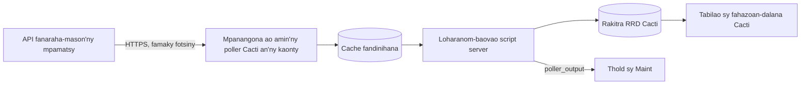

<!-- Source: README.md; SHA256: 7c621642e5f1a46bac66e4bc744f70aebb014c610d22de034088845fdc170405 -->

<!-- translations:start -->
[English](../../../README.md) | [简体中文](../zh-CN/README.md) | [हिन्दी](../hi-IN/README.md) | [Español (España)](../es-ES/README.md) | [Español (Latinoamérica)](../es-419/README.md) | [العربية (السعودية)](../ar-SA/README.md) | [Afrikaans](../af-ZA/README.md) | [አማርኛ](../am-ET/README.md) | [العربية (مصر)](../ar-EG/README.md) | [العربية (المغرب)](../ar-MA/README.md) | [বাংলা](../bn-BD/README.md) | [Bosanski](../bs-BA/README.md) | [Deutsch](../de-DE/README.md) | [فارسی](../fa-IR/README.md) | [Filipino](../fil-PH/README.md) | [Français](../fr-FR/README.md) | [Français (Maroc)](../fr-MA/README.md) | [Français (Sénégal)](../fr-SN/README.md) | [Hausa](../ha-NG/README.md) | [עברית](../he-IL/README.md) | [Hrvatski](../hr-HR/README.md) | [Bahasa Indonesia](../id-ID/README.md) | [Igbo](../ig-NG/README.md) | [Italiano](../it-IT/README.md) | [日本語](../ja-JP/README.md) | [한국어](../ko-KR/README.md) | [Malagasy](README.md) | [मराठी](../mr-IN/README.md) | [Bahasa Melayu](../ms-MY/README.md) | [Nederlands](../nl-NL/README.md) | [Polski](../pl-PL/README.md) | [Português (Brasil)](../pt-BR/README.md) | [Русский](../ru-RU/README.md) | [Kinyarwanda](../rw-RW/README.md) | [Soomaali](../so-SO/README.md) | [Српски](../sr-RS/README.md) | [Svenska](../sv-SE/README.md) | [Kiswahili](../sw-KE/README.md) | [தமிழ்](../ta-IN/README.md) | [తెలుగు](../te-IN/README.md) | [ไทย](../th-TH/README.md) | [Türkçe](../tr-TR/README.md) | [Українська](../uk-UA/README.md) | [اردو](../ur-PK/README.md) | [Tiếng Việt](../vi-VN/README.md) | [isiXhosa](../xh-ZA/README.md) | [Yorùbá](../yo-NG/README.md) | [繁體中文](../zh-TW/README.md) | [isiZulu](../zu-ZA/README.md)
<!-- translations:end -->

# plugin_cloud

Plugin Cacti 1.2 izay mitondra ny loharano sy ny metrika avy amin'ireo mpamatsy cloud ho an'ny daholobe ho ao amin'ny Cacti toy ny fitaovana, loharanom-baovao ary tabilao mahazatra. Ny enta-mavesatra ao amin'ny cloud dia mipetraka eo akaikin'ny tambajotra mitondra azy ireo, eo ambany fahazoan-dalan'ny Cacti, ary afaka mandefa fampitandremana sy manakana azy ireo ny Thold sy ny Maint. Plugin iray ihany no mandrakotra ny mpamatsy rehetra, miaraka amin'ny mpanamory iray isaky ny mpamatsy: DigitalOcean, AWS, Google Cloud, ary Azure aloha.

> **Sata: dingana faha-3 (DigitalOcean sy zavatra Cacti), eo am-pandinihana.** Ity dingana ity dia manampy ny mpanamory DigitalOcean, ny môdely Cacti, fitaovana famaritana sehatra iray isaky ny kaonty miaraka amin'ny fanontaniana angona isaky ny karazana loharano, ny fampidirana script server, ary ny tombantombana fangatahana ao amin'ny New Graphs sy ny pejin'ny fahasalamana. Ny fanamarinana voalohany natao tamin'ny kaonty DigitalOcean tena izy dia voarakitra ao amin'ny [zava-misy momba ny mpamatsy](../../research/provider-facts.md). Aza ampiasaina amin'ny tontolo famokarana.

## Andraikitra fidirana

| Sehatra | Fidirana |
| --- | --- |
| Cloud View | Ireo pejy fanaraha-maso efa misy. |
| Cloud Operator | Fanaraha-maso miampy ny pejy Operations sy ny fankatoavana fanasokajiana manokana. |
| Cloud Admin | Fidirana Operator miampy ny fikikirana sy ny hetsika fitantanana efa misy. |

Rehefa avy nandika ny rakitra fanavaozana, sokafy ny pejy Plugins amin'ny maha-mpitantana anao mba hisoratra anarana ny sehatra vaovao. Omeo mazava ny sehatra Operator eo ambanin'ny **Configuration > Users** na ireo vondron'ny mpampiasa. Ny fanavaozana dia mitahiry ny ID-n'ny sehatra View sy Admin efa misy ary ny fanomezan-dalana. Ny fidirana Admin dia mandova ny fidirana Operator, ary ny fidirana Operator dia mandova ny fidirana View isaky ny fangatahana; tsy manampy fanomezan-dalana voatahiry ho an'ny mpampiasa na vondrona izany. Ny fikirakirana ny plugin koa dia mitaky fidirana Cloud Admin ho fanampin'ny fahazoan-dalana Settings an'ny Cacti.

Mbola mametra ireo andalana sy hetsika azon'ny mpampiasa tsirairay atao ny fahazoan-dalana amin'ny fitaovana Cacti; ny zavatra tsy mbola voatondro dia mitaky mpitantana. Afaka manamarina ny fanamarinam-pananana voatahiry ho an'ny kaonty izay azony idirana ny fitaovana Cacti-ny ny Operator. Ny fanamarinam-pananana, ny fikikirana, ny fampifandraisana, ny famafana ary ny fanovana fitantanana hafa dia mijanona ao amin'ny pejy fitantanana. Ny fankatoavana dia tsy maharitra afa-tsy mandritra ny fotoam-pivoriana ankehitriny an'ny mpampiasa, mandritra ny adiny iray raha be indrindra ary raha mbola vaovao hatrany ilay fandinihana mitovy. Ny fandinihana vaovao na niova dia manafoana azy ireo. Tsy manamarika fandrefesana tsy nahomby ho salama na manakana fampitandremana na oviana na oviana izy ireo.

## Nahoana

Samy manana ny console fanaraha-masony avy ny mpamatsy cloud tsirairay. Rehefa ampiasaina miaraka amin'ny Cacti izy ireo dia mamela banga telo:

- **Fanaraha-maso fidirana misaraka.** Ny fampisehoana metrika cloud amin'ny mpampiasa Cacti iray dia midika hoe fanomezana azy fidirana cloud.
- **Tsy misy tontolon-tambajotra.** Ny rohy an-toerana dia atao tabilao ao amin'ny Cacti; ny enta-mavesatra ao ambadik'izany kosa dia atao tabilao ao amin'ny console-n'ny mpamatsy tsirairay.
- **Fampitandremana misaraka.** Ny Thold sy ny Maint dia miasa amin'ny loharanom-baovao sy fitaovana Cacti, koa ny fanairana avy amin'ny mpamatsy dia amboarina sy sakanana mitokana, indray mandeha isaky ny mpamatsy.

Ny plugin dia mamaky ny API fanaraha-mason'ny mpamatsy tsirairay amin'ny poller Cacti iray, mitahiry vonjimaika ny teboka angona farany indrindra, ary manolotra izany amin'ny script server an'ny Cacti. Ny poller an'ny Cacti no manoratra ireo rakitra RRD, koa ny fanaovana tabilao, ny fahazoan-dalana, ny Thold, ny Maint ary ny boost dia miasa toy ny mahazatra amin'ny angona Cacti rehetra.

## Fanomezan-toky ara-drafitra

- **Famaky fotsiny.** Ny mpanamory tsirairay dia tsy afaka manamboatra afa-tsy ireo asa avy amin'ny mpamatsy ao amin'ny lisitra ekeny; tsy manova loharano cloud na oviana na oviana ny plugin. ([ADR 0002](../../decisions/0002-read-only-with-operation-allowlist.md))
- **PHP ihany, tsy misy SDK.** Ny fanaovana sonia sy ny fifanakalozana token dia tanterahina amin'ny PHP miaraka amin'ireo fanitarana efa takian'ny Cacti. Tsy misy fiankinan-doha Composer amin'ny fotoana fampandehanana. ([ADR 0003](../../decisions/0003-php-only-without-sdks.md))
- **Sanda alohan'ny fanangonana.** Ny plugin dia tsy mamaky afa-tsy ireo metrika manana loharanom-baovao Cacti, mampiseho ny isan'ny fangatahana andrasana sy ny vidiny ara-taratasy alohan'ny hamoronana tabilao, ary mampihatra fetra isam-bolana. ([ADR 0005](../../decisions/0005-collect-only-what-is-graphed.md))
- **Tsy misy fanamarinam-pananana miharihary ao amin'ny tahiry angona.** Ny fanamarinam-pananana dia avy amin'ny fitehirizana miafina misy fanalahidy ao amin'ny rakitra ivelan'ny tahiry angona, avy amin'ny rakitra fanamarinam-pananana, na avy amin'ny mari-panondroana instance an'ny mpamatsy. ([ADR 0007](../../decisions/0007-credentials-outside-the-database-in-the-clear.md))

## Sehatra sy sata

| Dingana | Sehatra | Tanjona | Sata |
|---|---|---|---|
| 0, fikarohana | Fanamafisana ny zava-misy momba ny mpamatsy, katalaogy metrika, môdely sanda sy tahan'ny fangatahana, vector fitsapana sonia, andrana fitaterana | [M1](https://github.com/somethingwithproof/plugin_cloud/milestone/1) | Vita, afa-tsy ireo fanamarinana mila kaonty mpamatsy tena izy |
| 1, fototra sy DigitalOcean | Kaonty, fitehirizana miafina fanamarinam-pananana, fitaterana, mpanangona, cache fandinihana, zavatra Cacti, pejin'ny fahasalamana, DigitalOcean Droplets sy load balancers | [M2](https://github.com/somethingwithproof/plugin_cloud/milestone/2), [M3](https://github.com/somethingwithproof/plugin_cloud/milestone/3), [M4](https://github.com/somethingwithproof/plugin_cloud/milestone/4) | M2 vita ([#81](https://github.com/somethingwithproof/plugin_cloud/pull/81)); M3 mpanamory, môdely ary fitaovana famaritana sehatra natambatra; tombantombana fangatahana, fahazoan-dalana ary fanamarinana fahombiazana eo am-pandinihana; M4 tsy mbola natomboka |
| 2, AWS | Signature Version 4, `AssumeRole`, anjara asa instance, CloudWatch `GetMetricData`, fanisana isam-paritra | [M5](https://github.com/somethingwithproof/plugin_cloud/milestone/5) | Tsy mbola natomboka |
| 3, Google Cloud | JWT kaonty serivisy, mpizara metadata, Cloud Monitoring `timeSeries.list` | [M6](https://github.com/somethingwithproof/plugin_cloud/milestone/6) | Tsy mbola natomboka |
| 4, Azure | Fanamarinam-pananana mpanjifa Entra, mari-panondroana voatantana, Resource Graph, `metrics:getBatch` | [M7](https://github.com/somethingwithproof/plugin_cloud/milestone/7) | Tsy mbola natomboka |
| 5, mpanangona lavitra | Kaonty amin'ny mpanangona angona lavitra an'ny Cacti | [M8](https://github.com/somethingwithproof/plugin_cloud/milestone/8) | Tsy mbola natomboka |

Ivelan'ny sehatra: fanovana loharano cloud, famoronana na fitaratra fanairana avy amin'ny mpamatsy, tatitra momba ny faktiora, diarin'asa sy dian'asa, ary motera fampitandremana an'ny plugin manokana. Ny mpamatsy fanampiny (Hetzner Cloud, Akamai Cloud, Oracle Cloud, ary ny hafa) dia olana fikarohana.

## Ny atolotry ny dingana faha-2

- **Fametrahana voaaro.** Amin'ny PHP ambanin'ny 8.2, na raha tsy misy ext-openssl, dia lavina miaraka amin'ny hafatra ny fametrahana sy ny fampavitrihana, ary mitohy miasa ny ambiny amin'ny Cacti.
- **Tsingerin-piainana.** Fametrahana, fanavaozana ary fanesorana amin'ny alalan'ny pejy Plugins an'ny Cacti. Milamina ara-dalàna ny fanavaozana ary mahatanty fahatapahana. Ny fanesorana dia mitahiry ireo tabilao an'ny plugin raha tsy hoe esorinao ny marika amin'ny *Keep Plugin Tables on Uninstall*.
- **Sehatra misaraka.** Ny *Cloud Admin* dia manokatra ny **Cloud Accounts**; ny *Cloud Operator* dia manokatra ny **Cloud Operations**; ny *Cloud View* dia manokatra ny **Cloud Health**. Ny Admin dia mandova ny Operator, ary ny Operator dia mandova ny View. Eo ambanin'ny Management avokoa ireo pejy telo ireo.
- **Kaonty sy fanamarinam-pananana.** Fanampiana, fanovana, fanamarinana ary famafana kaonty. Ny fanamarinam-pananana dia na afenina ao amin'ny tahiry angona miaraka amin'ny rakitra fanalahidy voatahiry ivelany (AES-256-GCM), na vakiana avy amin'ny rakitra ao amin'ny poller. Tsy azo vakiana fa soratana ihany ny fanamarinam-pananana ao amin'ny UI ary fafana tsy hiseho ao amin'ny diarin'asa.
- **Ny mpanangona.** Manomboka amin'ny fihodinana poller tsirairay izy, instance iray isaky ny poller, ao anatin'ny fetram-potoana voafaritra. Maka fahazoan-dalana vonjimaika isaky ny kaonty izy, manao fitiliana amin'ny elanelam-potoany manokana, ary tsy mamaky metrika afa-tsy ho an'ireo loharanom-baovao mavitrika an'ny plugin ihany.
- **Fahasalamana.** Sata isaky ny kaonty momba ny fanangonana, ny fitiliana, ny loharano ary ny fahavaozana, miampy fampitandremana ho an'ny fanalahidin'ny fitehirizana miafina tsy azo ampiasaina, ny rakitra fanamarinam-pananana tsy azo antoka, ary ny elanelam-potoana tsy vitan'ny poller arahina.

## Fametrahana sy fikikirana

Ireo dingana ireo dia mametraka ny kaodin'ny dingana faha-2 ho amin'ny fanombanana. Mitaky Cacti 1.2.31 na vaovao kokoa amin'ny PHP 8.2 na vaovao kokoa izy ireo.

1. Adikao ao amin'ny `plugins/cloud` eo ambanin'ny lahatahiry Cacti-nao ny tahiry. Tsy maintsy atao hoe `cloud` ny anaran'ny lahatahiry.
2. Mamorona ny fanalahidin'ny fitehirizana miafina ivelan'ny fototry ny tranonkala. Apetraho ao amin'ny lahatahiry izay ny root sy ny mpampiasa Cacti ihany no afaka manoratra ao anatiny, ary ataovy izay tsy ahafahan'iza na iza mamaky ilay rakitra afa-tsy ny mpampiasa mampandeha ny mpizara tranonkala sy ny poller. Tsy mamorona na manoratra ity rakitra ity na oviana na oviana ny plugin:

   ```sh
   sudo install -d -m 0750 -o root -g cacti /etc/cacti
   head -c 32 /dev/urandom | sudo tee /etc/cacti/cloud-vault.key > /dev/null
   sudo chown cacti:cacti /etc/cacti/cloud-vault.key
   sudo chmod 0600 /etc/cacti/cloud-vault.key
   ```

   Soloy amin'ny mpampiasa mampandeha ny mpizara tranonkalanao sy ny poller-nao ny `cacti`. Mitahiry 32 bytes manta na tarehintsoratra hexadecimal 64 ilay rakitra. Ataovy dika mitovy miaraka amin'ny tahiry angona izy; raha tsy eo izy dia tsy maintsy ampidirina indray ireo fanamarinam-pananana voatahiry.
3. Ao amin'ny Cacti, sokafy ny **Configuration > Plugins**, avy eo apetraho ary alefaso ny *Cloud*.
4. Eo ambanin'ny **Configuration > Settings > Cloud**, amboary ny *Vault Key File* raha nampiasa lalana hafa ianao. Ny *Collector Time Budget* (240 segondra araka ny mahazatra) dia tsy maintsy mijanona ho latsaky ny elanelam-potoanan'ny poller.
5. Omeo *Cloud Admin*, *Cloud Operator* na *Cloud View* ny mpampiasa sy ny vondrona eo ambanin'ny **Configuration > Users**. Ny fametrahana dia manome Cloud Admin sy Cloud View ho an'ny mpitantana; ny Cloud Admin dia ahitana ny fidirana Operator, koa tsy mila fanomezana Operator misaraka ny mpitantana.
6. Manampia kaonty eo ambanin'ny **Management > Cloud Accounts**, avy eo jereo ny **Management > Cloud Health** raha misy fampitandremana.

## Tanjona mifanentana

| Singa | Tanjona |
|---|---|
| Cacti | 1.2.31 na vaovao kokoa, tsy misy fanitsiana fototra |
| PHP | 8.2 na vaovao kokoa; mijanona ho azo vakiana amin'ny 8.0 ny `setup.php` mba hahazoan'ny tontolo tsy tohana fandavana fa tsy fahapotehan'ny UI Cacti |
| Fanitarana PHP | Tsy misy mihoatra noho izay takian'ny Cacti 1.2.31 |
| Thold, Maint | Tsy misy fanovana ilaina |

## Rafitra

- [docs/performance.md](../../performance.md) dia mirakitra ny fandrefesana ny mpanangona sy ny pejin'ny fahasalamana, miaraka amin'ny fitaovana sy ny fikirakirana nampiasaina.
- [docs/PLAN.md](../../PLAN.md) no drafitra feno: rafitra, ny zava-misy momba ny mpamatsy sy ny Cacti iankinany (miaraka amin'ny loharano), ny fifanarahan'ny mpanamory, ny kajy ara-bola, ny fetran'ny fiarovana, ny fitsapana ary ny loza mety hitranga.
- [docs/decisions/](../../decisions) dia mitahiry ireo firaketana fanapahan-kevitra ara-drafitra ho an'ny safidy efa vita.
- [docs/REQUIREMENTS.md](../../REQUIREMENTS.md) dia mampifandray ny ID fepetra takiana tsirairay amin'ny olana mifanaraka aminy.



## Fomba fanarahana ny asa

- **Dingana** dia manaraka ny dingan'ny drafitra. Ny tsirairay dia manana olana epic mitanisa ny zana-olana sy ny porofo fivoahana.
- **Olana** dia sokajiana amin'ny marika: `type: requirement`, `type: research`, `type: decision`, `type: epic`. Ny olana fepetra takiana dia mamaritra fepetra takiana misy laharana sy azo tsapaina (`REQ-AREA-NNN`) ary fepetra fanekena.
- **Marika** dia mitondra koa ny `area:`, `provider:`, `phase:`, `priority:`, ary `status:`. Jereo ny [CONTRIBUTING.md](../../../CONTRIBUTING.md#labels).
- Ny [tabilaon'ny tetikasa](https://github.com/users/somethingwithproof/projects/7) dia mampiseho ny olana rehetra manerana ireo dingana.

## Fampivoarana

Ny CI dia manao lint ny teboka fidirana amin'ny PHP 8.0, mandefa fitsapana singa sy fampidirana ary PHPStan ambaratonga 9, ary mametraka ny plugin amin'ny PHP 8.2 hatramin'ny 8.5 miaraka amin'ny Cacti 1.2.31 sy ny sampana 1.2.x. Manamarina ihany koa izy fa lavina ny PHP 8.1 nefa tsy manimba ny Cacti. Ny fitsapana dia mampiasa Pest avy amin'ny fitaovana fitiliana plugin an'ny Cacti fototra. Vonjimaika ihany izany safidy izany mandra-panapahan-kevitra ny [#12](https://github.com/somethingwithproof/plugin_cloud/issues/12). Ny [.github/workflows/plugin-ci-workflow.yml](../../../.github/workflows/plugin-ci-workflow.yml) dia mitanisa ny dingana rehetra. Alefaso an-toerana ny `sh tests/lint-workflows.sh` sy `sh locales/build_gettext.sh --check` alohan'ny handefasana.

## Fandraisana anjara

Vakio ny [CONTRIBUTING.md](../../../CONTRIBUTING.md). Ny commit dia mila sonia fanamarinana DCO. Ao amin'ny olana no atao ny adihevitra momba ny rafitra; ny fanapahan-kevitra misokatra dia mitondra ny marika `type: decision`.

## Fiarovana

Ampahafantaro mitokana ireo lesoka ara-piarovana; jereo ny [SECURITY.md](../../../SECURITY.md).

## Fahazoan-dalana

GNU General Public License v2.0, mitovy amin'ny fahazoan-dalan'ny Cacti sy ireo plugin-ny. Jereo ny [LICENSE](../../../LICENSE).
