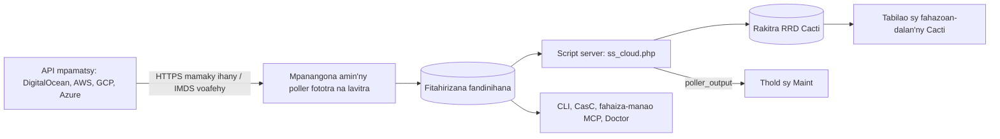

<!-- Source: README.md; SHA256: ac2074a40238686915802803c5efe773f33677f934281e0605e6e87a71a9d27d -->

<!-- translations:start -->
[English](../../../README.md) | [简体中文](../zh-CN/README.md) | [हिन्दी](../hi-IN/README.md) | [Español (España)](../es-ES/README.md) | [Español (Latinoamérica)](../es-419/README.md) | [العربية (السعودية)](../ar-SA/README.md) | [Afrikaans](../af-ZA/README.md) | [አማርኛ](../am-ET/README.md) | [العربية (مصر)](../ar-EG/README.md) | [العربية (المغرب)](../ar-MA/README.md) | [বাংলা](../bn-BD/README.md) | [Bosanski](../bs-BA/README.md) | [Deutsch](../de-DE/README.md) | [فارسی](../fa-IR/README.md) | [Filipino](../fil-PH/README.md) | [Français](../fr-FR/README.md) | [Français (Maroc)](../fr-MA/README.md) | [Français (Sénégal)](../fr-SN/README.md) | [Hausa](../ha-NG/README.md) | [עברית](../he-IL/README.md) | [Hrvatski](../hr-HR/README.md) | [Bahasa Indonesia](../id-ID/README.md) | [Igbo](../ig-NG/README.md) | [Italiano](../it-IT/README.md) | [日本語](../ja-JP/README.md) | [한국어](../ko-KR/README.md) | [Malagasy](README.md) | [मराठी](../mr-IN/README.md) | [Bahasa Melayu](../ms-MY/README.md) | [Nederlands](../nl-NL/README.md) | [Polski](../pl-PL/README.md) | [Português (Brasil)](../pt-BR/README.md) | [Русский](../ru-RU/README.md) | [Kinyarwanda](../rw-RW/README.md) | [Soomaali](../so-SO/README.md) | [Српски](../sr-RS/README.md) | [Svenska](../sv-SE/README.md) | [Kiswahili](../sw-KE/README.md) | [தமிழ்](../ta-IN/README.md) | [తెలుగు](../te-IN/README.md) | [ไทย](../th-TH/README.md) | [Türkçe](../tr-TR/README.md) | [Українська](../uk-UA/README.md) | [اردو](../ur-PK/README.md) | [Tiếng Việt](../vi-VN/README.md) | [isiXhosa](../xh-ZA/README.md) | [Yorùbá](../yo-NG/README.md) | [繁體中文](../zh-TW/README.md) | [isiZulu](../zu-ZA/README.md)
<!-- translations:end -->

# plugin_cloud

Plugin Cacti 1.2 izay mitondra ny loharano sy ny metrika avy amin'ireo mpamatsy cloud ho an'ny daholobe ho ao amin'ny Cacti toy ny fitaovana, loharanom-baovao ary tabilao mahazatra. Ny enta-mavesatra ao amin'ny cloud dia mipetraka eo akaikin'ny tambajotra mitondra azy ireo, eo ambany fahazoan-dalan'ny Cacti, ary mandefa fampitandremana sy manakana azy ireo ny Thold sy ny Maint. Plugin iray ihany no mandrakotra ny DigitalOcean, Amazon Web Services, Google Cloud ary Microsoft Azure amin'ny alalan'ny mpanamory PHP madio sy mamaky ihany.

> **Sata: eo an-dalam-pandrosoana, tsy mbola misy famoahana (`0.1.0-dev`).** Ity sampana ity dia manatanteraka mpanamory PHP madio ho an'ny DigitalOcean, AWS, Google Cloud ary Azure, famerenana mpanangona angona lavitra sy fahasalaman'ny mpandraharaha mamaky ihany, mpamatsy CasC sy CLI ho an'ny mpandraharaha, fahaiza-manao MCP, ary fizahana Doctor. Ny môdely Cacti alefa amin'izao fotoana izao dia mandrakotra ny DigitalOcean Droplets sy ny load balancers (`templates/cloud_digitalocean.xml`); mbola tsy vita ny fonosana môdely Cacti ho an'ny AWS, Google Cloud ary Azure ary ny fanamarinana amin'ny kaonty tena izy ankoatra ny DigitalOcean ([zava-misy momba ny mpamatsy](../../research/provider-facts.md)). Aza ampiasaina amin'ny tontolo famokarana.

## Mpamatsy tohanana

Ny mpanamory mpamatsy rehetra dia voasoratra ao amin'ny `Drivers::production()`, atolotry ny `Provider::released()`, ary mandeha amin'ny PHP madio mampiasa `ext-openssl` sy stream sockets tsy misy SDK na fiankinan-doha Composer mandritra ny fandehanana.

| Mpamatsy | Sahan'ny faritra | Loharanom-pahazoan-dalana | Fanamarinana | Loharano hita | Fanangonana metrika |
|---|---|---|---|---|---|
| DigitalOcean (`digitalocean`) | Tsy misy (voafetra amin'ny token) | `vault`, `file` | Bearer token | `droplet`, `load_balancer` | `/v2/monitoring/metrics` miaraka amin'ny fahatsiarovan-tena momba ny anjaran'ny fetran'ny tahan'ny fangatahana; mandefa môdely Cacti sy fanontaniana angona |
| Amazon Web Services (`aws`) | `account_id` (tarehimarika 12), `regions` | `vault`, `file`, `instance` | AWS SigV4 PHP madio (`AWS4-HMAC-SHA256`), fanamarinana STS `GetCallerIdentity`, STS `AssumeRole` tsy voatery, EC2 IMDSv2 (`169.254.169.254`) ho an'ny kaonty `instance` | `ec2_instance`, `rds_instance`, `aws_elb` (ALB/NLB) | CloudWatch `GetMetricData` natambatra (hatramin'ny fanontaniana 500 isaky ny antso) |
| Google Cloud (`gcp`) | `project` | `vault`, `file`, `instance` | JWT kaonty serivisy RS256 PHP madio amin'ny alalan'ny `ext-openssl` atakalo ao amin'ny `oauth2.googleapis.com/token`, na mpizara metadata GCE (`metadata.google.internal`) ho an'ny kaonty `instance` | `gce_instance` amin'ny alalan'ny `instances.aggregatedList` | Cloud Monitoring `timeSeries.list` |
| Microsoft Azure (`azure`) | `tenant`, `subscription`, `regions` | `vault`, `file`, `instance` | Fizotry ny fahazoan-dalan'ny mpanjifa Entra ID OAuth2 PHP madio (`client_secret` ihany; tsy tafiditra ny fanamarinana taratasy fanamarinana), na maha-izy azy voafehy Azure IMDS (`169.254.169.254`) ho an'ny token ARM sy Monitor | `azure_vm` amin'ny alalan'ny ARM Resource Graph (voazara pejy miaraka amin'ny `$skipToken` ary esorina ny mitovy) | Azure Monitor `metrics:getBatch` (hatramin'ny loharano 50 isaky ny antso, mitantana ny famerana HTTP 429 sy 529) |

## Fahaiza-manao voatahiry

### Rafitra fototra, tahiry miafina ary mpanangona

- **Fametrahana sy tsingerim-piainana voaaro.** Ny fidirana (`setup.php`, `cli/cloud.php`, `poller_cloud.php`, `ss_cloud.php`, ary ny pejy script) dia voadinika ao amin'ny PHP 8.0 ary mandà ny PHP latsaky ny 8.2 na tsy misy `ext-openssl` tsy manimba ny Cacti. Ny fanavaozana dia milamina, tsy miova rehefa averina (`Schema::VERSION = 3`, tabilao 9), ary mahatanty fahatapahana. Ny fanesorana dia mitazona ny tabilaon'ny plugin raha tsy esorina ny marika *Keep Plugin Tables on Uninstall*.
- **Kaonty sy fahazoan-dalana.** Manampy, manova, manamarina ary mamafa kaonty ao amin'ny **Management > Cloud Accounts**. Ny fahazoan-dalana dia avy amin'ny tahiry miafina voaaro amin'ny AES-256-GCM (`plugin_cloud_secret`, manana fanalahidy ao amin'ny `/etc/cacti/cloud-vault.key` amin'ny alàlan'ny fomba mahazatra), avy amin'ny rakitra voafetra ao anatin'ny *Credential File Directory* voafaritra (`cloud_credential_dir`, foana amin'ny alàlan'ny fomba mahazatra mba handavana rakitra), na avy amin'ny maha-izy azy ny instance an'ny mpamatsy. Ny fahazoan-dalana dia soratana ihany ao amin'ny UI ary afenina ao amin'ny rakitra fitantarana.
- **Fanaraha-maso henjana mivoaka sy mamaky ihany.** Ny mpanamory rehetra dia miasa ao ambadiky ny `GuardedTransport` sy `OutboundPolicy`: HTTPS seranana 443 mankany amin'ny anaran'ny mpampiantrano marina isaky ny mpamatsy, miaraka amin'ny teboka fiafarana metadata HTTP seranana 80 eo an-toerana (`169.254.169.254`, `metadata.google.internal`) alefa ihany ho an'ny kaonty `instance`. Ny asa mamaky ihany voasoratra ao amin'ny lisitra ekena ihany no azo atao.
- **Mpanangona sy fanaraha-maso ny vidiny.** `poller_cloud.php` dia mandeha avy amin'ny `poller_bottom` (dingana iray isaky ny poller amin'ny alalan'ny rejisitry ny dingana ao amin'ny Cacti) ao anatin'ny `cloud_collector_budget`, mahazo fahazoan-dalana isaky ny kaonty, manao fikarohana amin'ny `discover_interval`, mamaky metrika ho an'ny loharanom-baovao Cacti mavitrika ihany (`plugin_cloud_series`), manaja ny `request_share` sy `monthly_ceiling`, ary mitahiry ny teboka angona farany ao amin'ny `plugin_cloud_observation` ho an'ny `ss_cloud.php`.
- **Zavatra Cacti sy tombantomban'ny fangatahana.** Mitazona fitaovana faritra iray isaky ny kaonty (`plugin_cloud_device`), mitahiry ny fomba famerenana manondro an'ny fitaovana faritra mandritra ny fitahirizana fitaovana, mampiditra môdely DigitalOcean sy fanontaniana angona script server (`templates/cloud_digitalocean.xml`, `cloud_do_droplet.xml`, `cloud_do_load_balancer.xml`), ary mampiseho tombantomban'ny fangatahana sy ny vidiny eo amin'ny **New Graphs** (`graphs_new_top_links`) sy **Cloud Health**.

### Mpanangona angona lavitra

- Ny `INFO` dia manambara `remote_collect:1`. Azo omena izay poller Cacti alefa ny kaonty (`poller_id >= 1`), ary ny `poller_cloud.php --poller=N` dia tsy manangona afa-tsy ny kaonty an'io poller io.
- **Fihantonana `replicate_out`.** Mamerina ny laharana voafetra amin'ny poller avy amin'ny `plugin_cloud_account`, `plugin_cloud_device`, `plugin_cloud_series`, ary ny laharana voasoratra miafina avy amin'ny `plugin_cloud_secret` (ho an'ny kaonty tahiry miafina an'ny poller kendrena ihany) amin'ny alalan'ny `replicate_out_table()`. Ny rakitra fanalahidin'ny tahiry miafina manta dia tsy tahirizina na oviana na oviana ao amin'ny tahiry angona na averina, fa mijanona eo an-toerana ao amin'ny poller tsirairay.
- **Fihantonana `remote_agent`.** Mamoaka famintinana fahasalamana JSON mamaky ihany (`action=cloud_health`) izay tsy mandray afa-tsy masontsitra isa feno `poller_id` sy `account_id` ary tsy mamerina fahazoan-dalana, lalan-drakitra na tsiambaratelo.

### Fihantonana tontolo iainana (CasC, fahaiza-manao MCP ary Doctor)

- **Mpamatsy CasC (`casc_register_providers`).** Manoratra ny mpamatsy `cloud` (kinova schema `1`) miaraka amin'ny fanondranana YAML sy XML PHP madio tsy miovaova, fanamarinana manifest, fandrindrana fahasamihafana ary fampiharana voamarina. Ny fahazoan-dalana tahiry miafina dia aondrana toy ny fanondroana `vault:account:<name>`; lavina ny sahan'ny tsiambaratelo manta (`secret`, `secrets`, `token`, `access_token`, `refresh_token`, `password`, `private_key`, `access_key_id`, `secret_access_key`, `session_token`, `client_secret`, `credential`, `credentials`, `vault_key`). Ny fampiharana dia mitaky SHA-256 marina `--confirm=<PLAN_HASH>`.
- **MCP / Abilities API (`abilities_register`).** Manoratra fahaiza-manao telo mamaky ihany voafetra amin'ny sehatra Cloud View (`cloud_health.php`) sy ny faritry ny fitaovana Cacti ho an'ny mpitsidika tsy mpitantana, tsy mamoaka fahazoan-dalana, fanalahidin'ny tahiry miafina, na lalan'ny rakitra fahazoan-dalana:
  - `cloud-list-accounts` (`provider`, `poller_id` tsy voatery)
  - `cloud-list-resources` (`account_id`, `type`, `lifecycle` tsy voatery)
  - `cloud-get-health` (`account_id` tsy voatery)
- **Fizahana Doctor (`doctor_register_checks`).** Manoratra fizahana dimy tsy mamoaka sanda miafina na fitaovana fanalahidy:
  - `cloud_schema`: fahamaroan'ny kinova schema
  - `cloud_vault_key`: fahazoana mamaky, fahazoan-dalana ary haben'ny rakitra fanalahidin'ny tahiry miafina
  - `cloud_drivers`: fisoratana anaran'ny mpanamory famokarana ho an'ny mpamatsy navoaka rehetra
  - `cloud_accounts_health`: kaonty alefa tsy nahomby, voafetra na lany andro
  - `cloud_poller_intervals`: fampifanarahana ny elanelam-panangonan'ny kaonty alefa amin'ny elanelan'ny poller Cacti

## CLI

Alefaso avy ao amin'ny lahatahiry fototry ny Cacti miaraka amin'ny PHP 8.2 na ambony:

```sh
# Operator and CasC CLI (options use --key=value form)
php plugins/cloud/cli/cloud.php export [--format=yaml|xml]
php plugins/cloud/cli/cloud.php validate --file=<path> [--format=yaml|xml]
php plugins/cloud/cli/cloud.php plan --file=<path> [--format=yaml|xml]
php plugins/cloud/cli/cloud.php apply --file=<path> --confirm=<PLAN_HASH> [--format=yaml|xml]
php plugins/cloud/cli/cloud.php health [--format=text|json] [--poller=<id>]

# Collector entry point (normally started by poller_bottom)
php plugins/cloud/poller_cloud.php [--poller=N] [--force] [--debug]
```

## Andraikitra fidirana

| Sehatra | Fidirana |
| --- | --- |
| Cloud View | Pejy fanaraha-maso efa misy. |
| Cloud Operator | Fanaraha-maso miampy ny pejy Operations sy fanekena manokana momba ny fanasokajiana. |
| Cloud Admin | Fidirana Operator miampy ny fanamboarana efa misy sy ny asa fitantanana. |

Rehefa avy mandika ny rakitra fanavaozana dia sokafy amin'ny maha-mpitantana ny pejy Plugins mba hanoratana ireo sehatra. Omeo mazava ny sehatra Operator ao amin'ny **Configuration > Users** na vondrona mpampiasa. Ny fanavaozana dia mitazona ny ID sy ny fanomezan-dalana View sy Admin efa misy. Ny fidirana Admin dia mandova ny fidirana Operator, ary ny fidirana Operator dia mandova ny fidirana View amin'ny fangatahana tsirairay; tsy manampy fanomezan-dalana voatahiry ho an'ny mpampiasa na vondrona izany. Ny fanamboarana ny plugin koa dia mitaky fidirana Cloud Admin ankoatra ny fahazoan-dalan'ny Settings ao amin'ny Cacti.

Ny fahazoan-dalan'ny fitaovana Cacti dia mametra ny laharana sy ny asa azon'ny mpampiasa tsirairay atao; ny zavatra tsy voatendry dia mitaky mpitantana. Ny Operator dia afaka manamarina ny fahazoan-dalana voatahiry ho an'ny kaonty izay manana fidirana amin'ny fitaovana Cacti. Ny fahazoan-dalana, ny fanamboarana, ny fampifandraisana, ny famafana ary ny fanovana fitantanana hafa dia mijanona ao amin'ny pejin'ny fitantanana. Ny fanekena dia maharitra ao amin'ny fivoriana an'ny mpampiasa ankehitriny ihany, mandritra ny adiny iray raha be indrindra ary raha mbola vaovao ny fandinihana mitovy. Ny fandinihana vaovao na niova dia manafoana azy ireo. Tsy manamarika na oviana na oviana ny fandrefesana tsy nahomby ho salama izy ireo ary tsy manakana fampitandremana.

## Nahoana

Ny mpamatsy cloud tsirairay dia manana ny kaonsôly fanaraha-masony manokana. Rehefa miaraka amin'ny Cacti izy ireo dia mamela banga telo:

- **Fanaraha-maso fidirana misaraka.** Ny fampisehoana metrika cloud amin'ny mpampiasa Cacti dia midika fanomezana fidirana cloud ho azy ireo.
- **Tsy misy tontolon'ny tambajotra.** Ny rohy eo an-toerana dia atao tabilao ao amin'ny Cacti; ny enta-mavesatra ao ambadik'izy ireo dia atao tabilao ao amin'ny kaonsôlin'ny mpamatsy tsirairay.
- **Fampitandremana misaraka.** Ny Thold sy ny Maint dia miasa amin'ny loharanom-baovao sy fitaovana Cacti, ka ny fanairana avy amin'ny mpamatsy dia amboarina sy sakanana misaraka, indray mandeha isaky ny mpamatsy.

Ny plugin dia mamaky ny API fanaraha-masoan'ny mpamatsy tsirairay ao amin'ny poller Cacti, mitahiry ny teboka angona farany, ary manolotra azy ireo ho an'ny script server an'ny Cacti. Ny poller Cacti no manoratra ny rakitra RRD, ka ny fanaovana tabilao, ny fahazoan-dalana, ny Thold, ny Maint ary ny boost dia miasa tahaka ny ho an'ny angona Cacti rehetra.

## Fanapahan-kevitra famolavolana

- **Mamaky ihany.** Ny mpanamory tsirairay dia tsy afaka manamboatra afa-tsy ny asan'ny mpamatsy ao amin'ny lisitra ekena; tsy manova loharano cloud na oviana na oviana ny plugin. ([ADR 0002](../../decisions/0002-read-only-with-operation-allowlist.md))
- **PHP ihany, tsy misy SDK.** Ny fanaovana sonia sy ny fifanakalozana token dia tanterahina amin'ny PHP miaraka amin'ny fanitarana efa takian'ny Cacti. Tsy misy fiankinan-doha Composer mandritra ny fandehanana. ([ADR 0003](../../decisions/0003-php-only-without-sdks.md))
- **Vidiny mialoha ny fanangonana.** Tsy mamaky afa-tsy ny metrika manana loharanom-baovao Cacti ny plugin, mampiseho ny isan'ny fangatahana andrasana sy ny vidiny alohan'ny hamoronana tabilao, ary mampihatra fetra isam-bolana. ([ADR 0005](../../decisions/0005-collect-only-what-is-graphed.md))
- **Tsy misy fahazoan-dalana mazava ao amin'ny tahiry angona.** Ny fahazoan-dalana dia avy amin'ny tahiry miafina voaaro amin'ny alalan'ny rakitra fanalahidy ivelan'ny tahiry angona, avy amin'ny rakitra fahazoan-dalana, na avy amin'ny maha-izy azy ny instance an'ny mpamatsy. ([ADR 0007](../../decisions/0007-credentials-outside-the-database-in-the-clear.md))

## Faritra sy sata

| Dingana | Faritra | Dingana lehibe | Sata |
|---|---|---|---|
| 0, fikarohana | Fanamarinana ny zava-misy momba ny mpamatsy, katalaogy metrika, modely vidiny sy tahan'ny fangatahana, teboka fitsapana fanaovana sonia, fitsapana fitaterana | [M1](https://github.com/somethingwithproof/plugin_cloud/milestone/1) | Vita, afa-tsy ny fizahana mila kaonty mpamatsy tena izy |
| 1, fototra sy DigitalOcean | Kaonty, tahiry miafina fahazoan-dalana, fitaterana, mpanangona, fitahirizana fandinihana, zavatra Cacti, môdely, tombantomban'ny fangatahana, pejin'ny fahasalamana, DigitalOcean Droplets sy load balancers | [M2](https://github.com/somethingwithproof/plugin_cloud/milestone/2), [M3](https://github.com/somethingwithproof/plugin_cloud/milestone/3), [M4](https://github.com/somethingwithproof/plugin_cloud/milestone/4) | Voatahiry; miandry fanamarinana mpanamory M4 |
| 2, AWS | SigV4 PHP madio, STS `AssumeRole`, andraikitra instance IMDSv2, lisitra EC2/RDS/ELB, CloudWatch `GetMetricData` | [M5](https://github.com/somethingwithproof/plugin_cloud/milestone/5) | Mpanamory voatahiry; miandry môdely Cacti sy fanamarinana amin'ny kaonty tena izy |
| 3, Google Cloud | JWT kaonty serivisy RS256 PHP madio, mpizara metadata GCE, lisitra Compute Engine, Cloud Monitoring `timeSeries.list` | [M6](https://github.com/somethingwithproof/plugin_cloud/milestone/6) | Mpanamory voatahiry; miandry môdely Cacti sy fanamarinana amin'ny kaonty tena izy |
| 4, Azure | Fahazoan-dalan'ny mpanjifa Entra ID, maha-izy azy voafehy IMDS, lisitra VM ARM Resource Graph, Azure Monitor `metrics:getBatch` | [M7](https://github.com/somethingwithproof/plugin_cloud/milestone/7) | Mpanamory voatahiry; miandry môdely Cacti sy fanamarinana amin'ny kaonty tena izy |
| 5, mpanangona lavitra sy tontolo iainana | Mpanangona angona lavitra (`replicate_out`, `remote_agent`), mpamatsy CasC sy CLI, fahaiza-manao MCP, fizahana Doctor | [M8](https://github.com/somethingwithproof/plugin_cloud/milestone/8) | Voatahiry |

Tsy tafiditra: fanovana loharano cloud, famoronana na famerenana fanairana mpamatsy, tatitra fandoavam-bola, rakitra fitantarana sy fanarahan-dia, ary motera fampitandremana an'ny plugin. Mpamatsy fanampiny (Hetzner Cloud, Akamai Cloud, Oracle Cloud, ary ny hafa) dia olana fikarohana.

## Fametrahana sy fanamboarana

Ireo dingana ireo dia mametraka ny kaody fampandrosoana ho an'ny fanombanana. Mitaky Cacti 1.2.31 na ambony amin'ny PHP 8.2 na ambony izy ireo.

1. Adikao ao amin'ny `plugins/cloud` eo ambanin'ny lahatahiry Cacti ny tahiry. Tsy maintsy mitondra ny anarana `cloud` ny lahatahiry.
2. Mamorona fanalahidin'ny tahiry miafina ivelan'ny web root eo amin'ny poller tsirairay mampiasa fahazoan-dalana voatahiry ao amin'ny tahiry miafina. Apetraho ao amin'ny lahatahiry izay tsy afaka manoratra afa-tsy ny root sy ny mpampiasa Cacti, ary ataovy izay tsy hahafahan'ny olon-kafa mamaky afa-tsy ny mpampiasa mandefa ny mpizara web sy ny poller. Tsy mamorona na manoratra ity rakitra ity na oviana na oviana ny plugin:

   ```sh
   sudo install -d -m 0750 -o root -g cacti /etc/cacti
   head -c 32 /dev/urandom | sudo tee /etc/cacti/cloud-vault.key > /dev/null
   sudo chown cacti:cacti /etc/cacti/cloud-vault.key
   sudo chmod 0600 /etc/cacti/cloud-vault.key
   ```

   Soloy amin'ny mpampiasa mandefa ny mpizara web sy ny poller ny `cacti`. Mitahiry 32 bytes manta na tarehin-tsoratra hexadecimal 64 ny rakitra. Manaova dika mitovy miaraka amin'ny tahiry angona; raha tsy misy izy dia tsy maintsy ampidirina indray ny fahazoan-dalana voatahiry.
3. Ao amin'ny Cacti, sokafy ny **Configuration > Plugins**, dia apetraho ary alefaso ny *Cloud*.
4. Ao amin'ny **Configuration > Settings > Cloud**, amboary ny *Vault Key File* raha nampiasa lalana hafa ianao, amboary ny *Credential File Directory* raha mikasa ny hampiasa fahazoan-dalana miorina amin'ny rakitra ianao, ary tazony ho latsaky ny elanelan'ny poller ny *Collector Time Budget* (240 segondra amin'ny alàlan'ny fomba mahazatra).
5. Omeo *Cloud Admin*, *Cloud Operator* na *Cloud View* ireo mpampiasa sy vondrona ao amin'ny **Configuration > Users**. Ny fametrahana dia manome Cloud Admin sy Cloud View ho an'ny mpitantana; ny Cloud Admin dia ahitana fidirana Operator, ka tsy mila fanomezan-dalana Operator misaraka ny mpitantana.
6. Manampia kaonty ao amin'ny **Management > Cloud Accounts**, dia jereo ao amin'ny **Management > Cloud Health** raha misy fampitandremana.

## Tanjona mifanentana

| Singa | Tanjona |
|---|---|
| Cacti | 1.2.31 na ambony, tsy misy fanamboarana fototra |
| PHP | 8.2 na ambony; ny fidirana dia mijanona ho voadinika amin'ny 8.0 mba hahazoan'ny tontolo tsy tohanana fandavana fa tsy UI Cacti simba |
| Fanitarana PHP | `ext-openssl` (takian'ny Cacti 1.2.31); tsy misy `ext-curl` ary tsy misy fiankinan-doha Composer mandritra ny fandehanana |
| Thold, Maint | Tsy mila fanovana |

## Famolavolana

- Ny [docs/performance.md](../../performance.md) dia mirakitra ny fandrefesana ny mpanangona sy ny pejin'ny fahasalamana, miaraka amin'ny fitaovana sy ny fanamboarana nampiasaina.
- Ny [docs/PLAN.md](../../PLAN.md) no drafitra feno: ny rafitra, ny zava-misy momba ny mpamatsy sy ny Cacti iankinany (miaraka amin'ny loharano), ny fifanarahana mpanamory, ny kajy vidiny, ny fetran'ny fiarovana, ny fitsapana ary ny loza.
- Ny [docs/decisions/](../../decisions/) dia mirakitra ny firaketana fanapahan-kevitra ara-drafitra ho an'ny safidy efa natao.
- Ny [docs/REQUIREMENTS.md](../../REQUIREMENTS.md) dia mampifandray ny ID fepetra tsirairay amin'ny olany.



## Fomba fanaraha-maso ny asa

- **Dingana lehibe** dia manaraka ny dingana lehibe ao amin'ny drafitra. Ny tsirairay dia manana olana epic mitanisa ny olana madinika sy ny porofo fivoahana.
- **Olana** dia sokajiana amin'ny marika: `type: requirement`, `type: research`, `type: decision`, `type: epic`. Ny olana fepetra dia milaza fepetra misy laharana azo tsapaina (`REQ-AREA-NNN`) sy fepetra fanekena.
- **Marika** dia mitondra `area:`, `provider:`, `phase:`, `priority:`, ary `status:` ihany koa. Jereo ny [CONTRIBUTING.md](../../../CONTRIBUTING.md#labels).
- Ny [tabilaon'ny tetikasa](https://github.com/users/somethingwithproof/projects/7) dia mampiseho ny olana rehetra manerana ny dingana lehibe.

## Fampandrosoana

Ny CI ([.github/workflows/plugin-ci-workflow.yml](../../../.github/workflows/plugin-ci-workflow.yml)) dia manamarina ny tahiry famoahana sy ny kinova semantika (`bash tests/bin/archive-check.sh`), manamarina ny fidirana amin'ny PHP 8.0, mandefa fitsapana singa Pest (`phpunit.xml`) sy fampidirana tsingerim-piainana (`phpunit-integration.xml`) ary PHPStan ambaratonga 9 amin'ny PHP 8.2 hatramin'ny 8.5 manohitra ny Cacti `release/1.2.31` sy `1.2.x` miaraka amin'ny `CLOUD_OFFLINE=1`, manamarina ny fandavana amin'ny PHP 8.1, manamarina ny katalaogy gettext, mandrefy ny fanangonana andian-dahatsoratra 1,000 sy ny fahombiazan'ny pejin'ny fahasalamana, ary manao fizahana workflow sy fanarahan-dalàna REUSE.

Fizahana eo an-toerana alohan'ny fandefasana:

```sh
bash tests/bin/archive-check.sh
sh tests/lint-workflows.sh
sh locales/build_gettext.sh --check
CACTI_PATH=/path/to/cacti phpstan analyse -c phpstan.neon --no-progress
```

Alefaso ny Pest miaraka amin'ny `--configuration=phpunit.xml` ho an'ny fitsapana singa sy fitsipika loharano, na `--configuration=phpunit-integration.xml` miaraka amin'ny `CACTI_PATH` sy `CLOUD_TEST_DATABASE=disposable` manohitra tahiry angona Cacti azo ariana ho an'ny fitsapana fampidirana tsingerim-piainana.

## Fandraisana anjara

Vakio ny [CONTRIBUTING.md](../../../CONTRIBUTING.md). Mila sonia DCO ny commit. Ny fifanakalozan-kevitra momba ny famolavolana dia atao ao amin'ny olana; ny fanapahan-kevitra misokatra dia mitondra ny marika `type: decision`.

## Fiarovana

Tatitrao an-tsokosoko ny lesoka; jereo ny [SECURITY.md](../../../SECURITY.md).

## Fahazoan-dalana

GNU General Public License v2.0, mitovy amin'ny fahazoan-dalan'ny Cacti sy ny plugin-ny. Jereo ny [LICENSE](../../../LICENSE).
