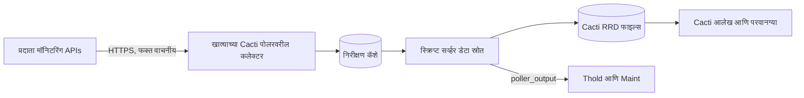

<!-- Source: README.md; SHA256: 7c621642e5f1a46bac66e4bc744f70aebb014c610d22de034088845fdc170405 -->

<!-- translations:start -->
[English](../../../README.md) | [简体中文](../zh-CN/README.md) | [हिन्दी](../hi-IN/README.md) | [Español (España)](../es-ES/README.md) | [Español (Latinoamérica)](../es-419/README.md) | [العربية (السعودية)](../ar-SA/README.md) | [Afrikaans](../af-ZA/README.md) | [አማርኛ](../am-ET/README.md) | [العربية (مصر)](../ar-EG/README.md) | [العربية (المغرب)](../ar-MA/README.md) | [বাংলা](../bn-BD/README.md) | [Bosanski](../bs-BA/README.md) | [Deutsch](../de-DE/README.md) | [فارسی](../fa-IR/README.md) | [Filipino](../fil-PH/README.md) | [Français](../fr-FR/README.md) | [Français (Maroc)](../fr-MA/README.md) | [Français (Sénégal)](../fr-SN/README.md) | [Hausa](../ha-NG/README.md) | [עברית](../he-IL/README.md) | [Hrvatski](../hr-HR/README.md) | [Bahasa Indonesia](../id-ID/README.md) | [Igbo](../ig-NG/README.md) | [Italiano](../it-IT/README.md) | [日本語](../ja-JP/README.md) | [한국어](../ko-KR/README.md) | [Malagasy](../mg-MG/README.md) | [मराठी](README.md) | [Bahasa Melayu](../ms-MY/README.md) | [Nederlands](../nl-NL/README.md) | [Polski](../pl-PL/README.md) | [Português (Brasil)](../pt-BR/README.md) | [Русский](../ru-RU/README.md) | [Kinyarwanda](../rw-RW/README.md) | [Soomaali](../so-SO/README.md) | [Српски](../sr-RS/README.md) | [Svenska](../sv-SE/README.md) | [Kiswahili](../sw-KE/README.md) | [தமிழ்](../ta-IN/README.md) | [తెలుగు](../te-IN/README.md) | [ไทย](../th-TH/README.md) | [Türkçe](../tr-TR/README.md) | [Українська](../uk-UA/README.md) | [اردو](../ur-PK/README.md) | [Tiếng Việt](../vi-VN/README.md) | [isiXhosa](../xh-ZA/README.md) | [Yorùbá](../yo-NG/README.md) | [繁體中文](../zh-TW/README.md) | [isiZulu](../zu-ZA/README.md)
<!-- translations:end -->

# plugin_cloud

Cacti 1.2 साठी एक प्लगइन जे सार्वजनिक क्लाउड प्रदात्यांकडील संसाधने आणि मेट्रिक्स सामान्य डिव्हाइसेस, डेटा स्रोत आणि आलेख म्हणून Cacti मध्ये आणते. यामुळे क्लाउड वर्कलोड्स त्यांना वाहून नेणाऱ्या नेटवर्कच्या शेजारी, Cacti च्या परवानग्यांखाली येतात, आणि Thold तसेच Maint त्यावर अलर्ट देऊ शकतात व ते तात्पुरते बंद करू शकतात. एकच प्लगइन प्रत्येक प्रदात्याला कव्हर करते, ज्यात प्रत्येक प्रदात्यासाठी स्वतंत्र ड्रायव्हर आहे: सुरुवातीला DigitalOcean, AWS, Google Cloud आणि Azure.

> **स्थिती: माइलस्टोन ३ (DigitalOcean आणि Cacti ऑब्जेक्ट्स), पुनरावलोकनाधीन.** या माइलस्टोनमध्ये DigitalOcean ड्रायव्हर, Cacti टेम्पलेट्स, प्रत्येक संसाधन प्रकारासाठी डेटा क्वेरीसह प्रति खाते एक स्कोप डिव्हाइस, स्क्रिप्ट सर्व्हर इनपुट, आणि न्यू ग्राफ्स तसेच आरोग्य पृष्ठावर विनंतीचा अंदाज यांचा समावेश आहे. थेट DigitalOcean खात्यावर केलेल्या प्रारंभिक तपासण्या [प्रदाता तथ्ये](../../research/provider-facts.md) मध्ये नोंदवल्या आहेत. हे प्रोडक्शनमध्ये चालवू नका.

## प्रवेश भूमिका

| अधिकार क्षेत्र | प्रवेश |
| --- | --- |
| Cloud View | विद्यमान मॉनिटरिंग पृष्ठे. |
| Cloud Operator | मॉनिटरिंग तसेच ऑपरेशन्स पृष्ठ आणि वैयक्तिक ट्रायएज पोचपावत्या. |
| Cloud Admin | ऑपरेटर प्रवेश तसेच विद्यमान कॉन्फिगरेशन आणि प्रशासकीय कृती. |

अपग्रेड फाइल्स कॉपी केल्यानंतर, नवीन अधिकार क्षेत्र नोंदवण्यासाठी प्रशासक म्हणून Plugins पृष्ठ उघडा. **Configuration > Users** किंवा वापरकर्ता गटांखाली Operator अधिकार क्षेत्र स्पष्टपणे नेमून द्या.
अपग्रेड दरम्यान विद्यमान View आणि Admin अधिकार क्षेत्राचे ID आणि परवानग्या कायम राहतात. प्रत्येक विनंतीवर Admin प्रवेशाला Operator प्रवेश आपोआप मिळतो आणि Operator प्रवेशाला View प्रवेश मिळतो; यामुळे वापरकर्ते किंवा गटांमध्ये संचयित परवानग्या जोडल्या जात नाहीत. प्लगइन सेटिंग्जसाठी Cacti च्या Settings परवानगीव्यतिरिक्त Cloud Admin प्रवेश देखील आवश्यक आहे.

प्रत्येक वापरकर्त्यासाठी उपलब्ध ओळी आणि कृती अजूनही Cacti डिव्हाइस परवानग्यांद्वारे मर्यादित राहतात; मॅप न केलेल्या ऑब्जेक्ट्ससाठी प्रशासकाची आवश्यकता असते. ज्या खात्याच्या Cacti डिव्हाइसवर ऑपरेटरला प्रवेश आहे, त्या खात्यासाठी संचयित क्रेडेन्शियलची पडताळणी ऑपरेटर करू शकतात.
क्रेडेन्शियल्स, कॉन्फिगरेशन, मॅपिंग, हटवणे आणि इतर प्रशासकीय बदल प्रशासकीय पृष्ठांवरच राहतात. पोचपावत्या फक्त सध्याच्या वापरकर्त्याच्या सत्रात, जास्तीत जास्त एक तासासाठी आणि तेच निरीक्षण ताजे असेपर्यंतच टिकतात. नवीन किंवा बदललेल्या निरीक्षणांमुळे त्या अवैध ठरतात. त्या कधीही अयशस्वी मोजमापाला निरोगी म्हणून चिन्हांकित करत नाहीत किंवा अलर्ट्स बंद करत नाहीत.

## आवश्यकता का

प्रत्येक क्लाउड प्रदात्याचे स्वतःचे मॉनिटरिंग कन्सोल असते. Cacti सोबत चालवताना त्यात तीन उणिवा राहतात:

- **स्वतंत्र प्रवेश नियंत्रण.** Cacti वापरकर्त्याला क्लाउड मेट्रिक्स दाखवणे म्हणजे त्यांना क्लाउड लॉगिन देणे.
- **नेटवर्क संदर्भाचा अभाव.** ऑन-प्रिमाइसेस लिंक्सचे आलेख Cacti मध्ये काढले जातात; त्यामागील वर्कलोड्सचे आलेख प्रत्येक प्रदात्याच्या कन्सोलमध्ये काढले जातात.
- **स्वतंत्र अलर्टिंग.** Thold आणि Maint हे Cacti डेटा स्रोत आणि डिव्हाइसेसवर काम करतात, त्यामुळे प्रदात्याचे अलार्म प्रत्येक प्रदात्यासाठी स्वतंत्रपणे कॉन्फिगर आणि बंद करावे लागतात.

हे प्लगइन Cacti पोलरवर प्रत्येक प्रदात्याचे मॉनिटरिंग API वाचते, नवीनतम डेटापॉइंट्स कॅशे करते आणि ते Cacti च्या स्क्रिप्ट सर्व्हरला पुरवते. Cacti चा पोलर RRD फाइल्स लिहितो, त्यामुळे आलेख काढणे, परवानग्या, Thold, Maint आणि boost हे सर्व इतर कोणत्याही Cacti डेटाप्रमाणेच काम करतात.

## डिझाइनची बांधिलकी

- **फक्त वाचनीय.** प्रत्येक ड्रायव्हर फक्त त्याच्या अनुमती यादीतील प्रदाता ऑपरेशन्स तयार करू शकतो; प्लगइन कधीही क्लाउड संसाधनात बदल करत नाही. ([ADR 0002](../../decisions/0002-read-only-with-operation-allowlist.md))
- **फक्त PHP, SDK नाहीत.** सायनिंग आणि टोकन एक्सचेंज हे Cacti ला आधीपासून आवश्यक असलेल्या एक्स्टेंशन्ससह PHP मध्येच कार्यान्वित केलेले आहेत. कोणत्याही Composer रनटाइम अवलंबित्वांची गरज नाही. ([ADR 0003](../../decisions/0003-php-only-without-sdks.md))
- **संकलनापूर्वी खर्च मोजणी.** प्लगइन फक्त ज्या मेट्रिक्सचा Cacti डेटा स्रोत आहे तेच वाचते, आलेख तयार करण्यापूर्वी अपेक्षित विनंती संख्या आणि सूची-किंमत खर्च दाखवते आणि मासिक मर्यादा लागू करते. ([ADR 0005](../../decisions/0005-collect-only-what-is-graphed.md))
- **डेटाबेसमध्ये साध्या मजकुरातील क्रेडेन्शियल्स नाहीत.** क्रेडेन्शियल्स डेटाबेसबाहेरील की फाइलद्वारे एन्क्रिप्ट केलेल्या व्हॉल्टमधून, क्रेडेन्शियल फाइलमधून किंवा प्रदात्याच्या इन्स्टन्स आयडेंटिटीमधून येतात. ([ADR 0007](../../decisions/0007-credentials-outside-the-database-in-the-clear.md))

## व्याप्ती आणि स्थिती

| टप्पा | व्याप्ती | माइलस्टोन्स | स्थिती |
|---|---|---|---|
| ०, संशोधन | प्रदाता तथ्यांची पुष्टी, मेट्रिक कॅटलॉग, खर्च आणि दर मॉडेल, सायनिंग चाचणी व्हेक्टर्स, ट्रान्सपोर्ट चाचणी | [M1](https://github.com/somethingwithproof/plugin_cloud/milestone/1) | थेट प्रदाता खात्याची आवश्यकता असलेल्या तपासण्या वगळता पूर्ण |
| १, कोअर आणि DigitalOcean | खाती, क्रेडेन्शियल व्हॉल्ट, ट्रान्सपोर्ट, कलेक्टर, निरीक्षण कॅशे, Cacti ऑब्जेक्ट्स, आरोग्य पृष्ठ, DigitalOcean Droplets आणि लोड बॅलन्सर्स | [M2](https://github.com/somethingwithproof/plugin_cloud/milestone/2), [M3](https://github.com/somethingwithproof/plugin_cloud/milestone/3), [M4](https://github.com/somethingwithproof/plugin_cloud/milestone/4) | M2 पूर्ण ([#81](https://github.com/somethingwithproof/plugin_cloud/pull/81)); M3 ड्रायव्हर, टेम्पलेट्स आणि स्कोप डिव्हाइसेस विलीन; विनंती अंदाज, परवानग्या आणि कार्यप्रदर्शन तपासण्या पुनरावलोकनाधीन; M4 सुरू झालेला नाही |
| २, AWS | Signature Version 4, `AssumeRole`, इन्स्टन्स रोल्स, CloudWatch `GetMetricData`, प्रादेशिक इन्व्हेंटरी | [M5](https://github.com/somethingwithproof/plugin_cloud/milestone/5) | सुरू झालेला नाही |
| ३, Google Cloud | सर्व्हिस अकाउंट JWT, मेटाडेटा सर्व्हर, Cloud Monitoring `timeSeries.list` | [M6](https://github.com/somethingwithproof/plugin_cloud/milestone/6) | सुरू झालेला नाही |
| ४, Azure | Entra क्लायंट क्रेडेन्शियल्स, मॅनेज्ड आयडेंटिटी, Resource Graph, `metrics:getBatch` | [M7](https://github.com/somethingwithproof/plugin_cloud/milestone/7) | सुरू झालेला नाही |
| ५, रिमोट कलेक्टर्स | Cacti रिमोट डेटा कलेक्टर्सवरील खाती | [M8](https://github.com/somethingwithproof/plugin_cloud/milestone/8) | सुरू झालेला नाही |

व्याप्तीबाहेर: क्लाउड संसाधनांमध्ये बदल करणे, प्रदात्याचे अलार्म तयार करणे किंवा मिरर करणे, बिलिंग अहवाल, लॉग्स आणि ट्रेसेस, तसेच प्लगइन-मालकीचे अलर्टिंग इंजिन. पुढील प्रदाते (Hetzner Cloud, Akamai Cloud, Oracle Cloud आणि इतर) हे संशोधन विषयांमध्ये आहेत.

## माइलस्टोन २ मध्ये काय समाविष्ट आहे

- **संरक्षित इंस्टॉलेशन.** PHP 8.2 पेक्षा कमी आवृत्तीवर किंवा ext-openssl शिवाय, इंस्टॉल आणि सक्षम करणे एका संदेशासह नाकारले जाते आणि उर्वरित Cacti कार्यरत राहते.
- **जीवनचक्र.** Cacti च्या Plugins पृष्ठाद्वारे इंस्टॉल, अपग्रेड आणि अनइंस्टॉल करा. अपग्रेड्स क्रमबद्ध असतात आणि व्यत्यय आल्यासही टिकून राहतात. तुम्ही *Keep Plugin Tables on Uninstall* पर्याय रिकामा न केल्यास, अनइंस्टॉल करताना प्लगइनचे टेबल्स जतन केले जातात.
- **स्वतंत्र अधिकार क्षेत्रे.** *Cloud Admin* मुळे **Cloud Accounts** उघडते; *Cloud Operator* मुळे **Cloud Operations** उघडते; *Cloud View* मुळे **Cloud Health** उघडते. Admin ला Operator चे आणि Operator ला View चे अधिकार आपोआप मिळतात. ही तिन्ही पृष्ठे Management अंतर्गत आहेत.
- **खाती आणि क्रेडेन्शियल्स.** खाती जोडा, संपादित करा, पडताळा आणि हटवा. क्रेडेन्शियल एकतर डेटाबेसबाहेर ठेवलेल्या की फाइलसह डेटाबेसमध्ये एन्क्रिप्ट केले जाते (AES-256-GCM), किंवा पोलरवरील फाइलमधून वाचले जाते. UI मध्ये क्रेडेन्शियल्स फक्त लिहिण्यायोग्य असतात आणि लॉग्जमधून ती काढून टाकली जातात.
- **कलेक्टर.** हा प्रत्येक पोलर रनवरून, प्रति पोलर एक इन्स्टन्स, ठराविक वेळेच्या मर्यादेत सुरू होतो. हा प्रति खाते एक लीज घेतो, स्वतःच्या अंतराने शोध चालवतो आणि फक्त प्लगइनच्या स्वतःच्या सक्रिय डेटा स्रोतांसाठीच मेट्रिक्स वाचतो.
- **आरोग्य स्थिती.** प्रति-खाते संकलन, शोध, संसाधन आणि ताजेपणाची स्थिती, तसेच न वापरता येण्याजोगी व्हॉल्ट की, असुरक्षित क्रेडेन्शियल फाइल्स आणि पोलर पूर्ण करू शकत नसलेल्या अंतरांसाठी चेतावण्या.

## इंस्टॉल आणि कॉन्फिगर करा

या पायऱ्या मूल्यांकनासाठी माइलस्टोन २ चा कोड इंस्टॉल करतात. त्यासाठी PHP 8.2 किंवा नंतरच्या आवृत्तीवर Cacti 1.2.31 किंवा नंतरची आवृत्ती आवश्यक आहे.

1. तुमच्या Cacti डिरेक्टरीअंतर्गत `plugins/cloud` मध्ये रिपॉझिटरी कॉपी करा. डिरेक्टरीचे नाव `cloud` असणे आवश्यक आहे.
2. वेब रूटबाहेर व्हॉल्ट की तयार करा. ती अशा डिरेक्टरीमध्ये ठेवा जिथे फक्त root आणि Cacti वापरकर्ताच लिहू शकतील, आणि फाइल फक्त वेब सर्व्हर व पोलर चालवणाऱ्या वापरकर्त्यालाच वाचता येईल अशी करा. प्लगइन ही फाइल कधीही तयार करत नाही किंवा तिच्यात लिहित नाही:

   ```sh
   sudo install -d -m 0750 -o root -g cacti /etc/cacti
   head -c 32 /dev/urandom | sudo tee /etc/cacti/cloud-vault.key > /dev/null
   sudo chown cacti:cacti /etc/cacti/cloud-vault.key
   sudo chmod 0600 /etc/cacti/cloud-vault.key
   ```

   `cacti` ऐवजी तुमचा वेब सर्व्हर आणि पोलर चालवणाऱ्या वापरकर्त्याचे नाव वापरा. फाइलमध्ये ३२ रॉ बाइट्स किंवा ६४ हेक्झाडेसिमल वर्ण असतात. डेटाबेससोबत तिचाही बॅकअप घ्या; तिच्याशिवाय संचयित क्रेडेन्शियल्स पुन्हा प्रविष्ट करावी लागतील.
3. Cacti मध्ये **Configuration > Plugins** उघडा, नंतर *Cloud* इंस्टॉल आणि सक्षम करा.
4. तुम्ही दुसरा मार्ग वापरला असल्यास, **Configuration > Settings > Cloud** अंतर्गत *Vault Key File* सेट करा. *Collector Time Budget* (डीफॉल्ट २४० सेकंद) पोलर अंतरापेक्षा कमी राहिला पाहिजे.
5. **Configuration > Users** अंतर्गत वापरकर्ते आणि गटांना *Cloud Admin*, *Cloud Operator* किंवा *Cloud View* परवानग्या द्या. इंस्टॉल केल्यावर प्रशासकाला Cloud Admin आणि Cloud View मिळतात; Cloud Admin मध्ये Operator प्रवेश समाविष्ट असल्याने, प्रशासकाला स्वतंत्र Operator परवानगीची आवश्यकता नाही.
6. **Management > Cloud Accounts** अंतर्गत खाती जोडा, नंतर चेतावण्यांसाठी **Management > Cloud Health** तपासा.

## सुसंगतता लक्ष्ये

| घटक | लक्ष्य |
|---|---|
| Cacti | 1.2.31 किंवा नंतरची आवृत्ती, कोणतेही कोअर पॅचेस नाहीत |
| PHP | 8.2 किंवा नंतरची आवृत्ती; `setup.php` हे 8.0 वर पार्स करण्यायोग्य राहते जेणेकरून असमर्थित रनटाइमवर Cacti UI तुटण्याऐवजी नकार संदेश मिळेल |
| PHP एक्स्टेंशन्स | Cacti 1.2.31 ला आवश्यक असलेल्या एक्स्टेंशन्सव्यतिरिक्त काहीही नाही |
| Thold, Maint | कोणत्याही बदलांची आवश्यकता नाही |

## डिझाइन

- [docs/performance.md](../../performance.md) मध्ये वापरलेले हार्डवेअर आणि सेटिंग्जसह कलेक्टर आणि आरोग्य पृष्ठाचे मोजमाप आहेत.
- [docs/PLAN.md](../../PLAN.md) ही संपूर्ण योजना आहे: आर्किटेक्चर, ती ज्या प्रदाता आणि Cacti तथ्यांवर अवलंबून आहे ती (स्रोतांसह), ड्रायव्हर करार, खर्च गणित, सुरक्षा मर्यादा, चाचणी आणि जोखीम.
- [docs/decisions/](../../decisions) मध्ये आधीच घेतलेल्या निर्णयांसाठी आर्किटेक्चर निर्णय नोंदी आहेत.
- [docs/REQUIREMENTS.md](../../REQUIREMENTS.md) प्रत्येक आवश्यकता ID ला त्याच्या इश्यूशी जोडते.



## कामाचा मागोवा कसा घेतला जातो

- **माइलस्टोन्स** योजनेतील माइलस्टोन्सचे अनुसरण करतात. प्रत्येकाकडे त्याच्या उप-इश्यूंची आणि पूर्णत्वाच्या पुराव्यांची यादी असलेला एक एपिक इश्यू असतो.
- **इश्यू** लेबलनुसार वर्गीकृत केले जातात: `type: requirement`, `type: research`, `type: decision`, `type: epic`. आवश्यकता इश्यूमध्ये क्रमांकित, तपासण्यायोग्य आवश्यकता (`REQ-AREA-NNN`) आणि स्वीकृती निकष नमूद केलेले असतात.
- **लेबल्समध्ये** `area:`, `provider:`, `phase:`, `priority:`, आणि `status:` देखील असतात. पहा [CONTRIBUTING.md](../../../CONTRIBUTING.md#labels).
- [प्रोजेक्ट बोर्ड](https://github.com/users/somethingwithproof/projects/7) सर्व माइलस्टोन्समधील इश्यू दाखवतो.

## विकास

CI हे PHP 8.0 वर एंट्री पॉइंट्सची लिंट तपासणी करते, युनिट आणि इंटिग्रेशन चाचण्या तसेच PHPStan लेव्हल 9 चालवते, आणि Cacti 1.2.31 आणि 1.2.x शाखेविरुद्ध PHP 8.2 ते 8.5 वर प्लगइन इंस्टॉल करते. ते हे देखील तपासते की Cacti न तुटता PHP 8.1 नाकारले जाते. चाचण्यांसाठी Cacti कोअरच्या प्लगइन हार्नेसमधून Pest वापरले जाते. [#12](https://github.com/somethingwithproof/plugin_cloud/issues/12) वर निर्णय होईपर्यंत हा पर्याय तात्पुरता आहे. [.github/workflows/plugin-ci-workflow.yml](../../../.github/workflows/plugin-ci-workflow.yml) मध्ये प्रत्येक पायरीची यादी आहे. पुश करण्यापूर्वी स्थानिक पातळीवर `sh tests/lint-workflows.sh` आणि `sh locales/build_gettext.sh --check` चालवा.

## योगदान

[CONTRIBUTING.md](../../../CONTRIBUTING.md) वाचा. कमिट्ससाठी DCO साइन-ऑफ आवश्यक आहे. डिझाइन चर्चा इश्यूंवर होते; प्रलंबित निर्णयांवर `type: decision` लेबल असते.

## सुरक्षा

सुरक्षा त्रुटी खाजगीरीत्या कळवा; पहा [SECURITY.md](../../../SECURITY.md).

## परवाना

GNU General Public License v2.0, Cacti आणि त्याच्या प्लगइन्ससारखाच परवाना. पहा [LICENSE](../../../LICENSE).
