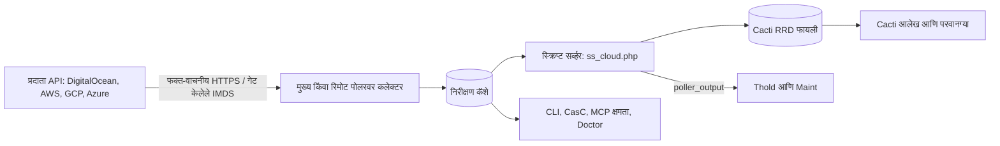

<!-- Source: README.md; SHA256: ac2074a40238686915802803c5efe773f33677f934281e0605e6e87a71a9d27d -->

<!-- translations:start -->
[English](../../../README.md) | [简体中文](../zh-CN/README.md) | [हिन्दी](../hi-IN/README.md) | [Español (España)](../es-ES/README.md) | [Español (Latinoamérica)](../es-419/README.md) | [العربية (السعودية)](../ar-SA/README.md) | [Afrikaans](../af-ZA/README.md) | [አማርኛ](../am-ET/README.md) | [العربية (مصر)](../ar-EG/README.md) | [العربية (المغرب)](../ar-MA/README.md) | [বাংলা](../bn-BD/README.md) | [Bosanski](../bs-BA/README.md) | [Deutsch](../de-DE/README.md) | [فارسی](../fa-IR/README.md) | [Filipino](../fil-PH/README.md) | [Français](../fr-FR/README.md) | [Français (Maroc)](../fr-MA/README.md) | [Français (Sénégal)](../fr-SN/README.md) | [Hausa](../ha-NG/README.md) | [עברית](../he-IL/README.md) | [Hrvatski](../hr-HR/README.md) | [Bahasa Indonesia](../id-ID/README.md) | [Igbo](../ig-NG/README.md) | [Italiano](../it-IT/README.md) | [日本語](../ja-JP/README.md) | [한국어](../ko-KR/README.md) | [Malagasy](../mg-MG/README.md) | [मराठी](README.md) | [Bahasa Melayu](../ms-MY/README.md) | [Nederlands](../nl-NL/README.md) | [Polski](../pl-PL/README.md) | [Português (Brasil)](../pt-BR/README.md) | [Русский](../ru-RU/README.md) | [Kinyarwanda](../rw-RW/README.md) | [Soomaali](../so-SO/README.md) | [Српски](../sr-RS/README.md) | [Svenska](../sv-SE/README.md) | [Kiswahili](../sw-KE/README.md) | [தமிழ்](../ta-IN/README.md) | [తెలుగు](../te-IN/README.md) | [ไทย](../th-TH/README.md) | [Türkçe](../tr-TR/README.md) | [Українська](../uk-UA/README.md) | [اردو](../ur-PK/README.md) | [Tiếng Việt](../vi-VN/README.md) | [isiXhosa](../xh-ZA/README.md) | [Yorùbá](../yo-NG/README.md) | [繁體中文](../zh-TW/README.md) | [isiZulu](../zu-ZA/README.md)
<!-- translations:end -->

# plugin_cloud

Cacti 1.2 साठी एक प्लगइन जे सार्वजनिक क्लाउड प्रदात्यांकडील संसाधने आणि मेट्रिक्स सामान्य डिव्हाइसेस, डेटा स्रोत आणि आलेख म्हणून Cacti मध्ये आणते. यामुळे क्लाउड वर्कलोड्स त्यांना वाहून नेणाऱ्या नेटवर्कच्या शेजारी, Cacti च्या परवानग्यांखाली येतात, आणि Thold तसेच Maint त्यावर अलर्ट देऊ शकतात व ते दडपून ठेवू शकतात. एकच प्लगइन शुद्ध-PHP, फक्त-वाचनीय प्रदाता ड्रायव्हर्सद्वारे DigitalOcean, Amazon Web Services, Google Cloud आणि Microsoft Azure यांना कव्हर करते.

> **स्थिती: विकासाधीन, अद्याप कोणतीही आवृत्ती प्रकाशित नाही (`0.1.0-dev`).** ही शाखा DigitalOcean, AWS, Google Cloud आणि Azure साठी शुद्ध-PHP ड्रायव्हर्स, रिमोट डेटा कलेक्टर प्रतिकृतीकरण आणि फक्त-वाचनीय एजंट आरोग्य, CasC प्रदाता आणि ऑपरेटर CLI, MCP क्षमता आणि Doctor तपासण्या लागू करते. सध्या पाठवलेले Cacti टेम्पलेट्स DigitalOcean Droplets आणि लोड बॅलन्सर्स (`templates/cloud_digitalocean.xml`) कव्हर करतात; AWS, Google Cloud आणि Azure साठी Cacti टेम्पलेट पॅकेजेस आणि DigitalOcean पलीकडील थेट-खाते पात्रता ([प्रदाता तथ्ये](../../research/provider-facts.md)) अद्याप पूर्ण झालेली नाही. प्रोडक्शनमध्ये चालवू नका.

## समर्थित प्रदाते

प्रत्येक प्रदाता ड्रायव्हर `Drivers::production()` मध्ये नोंदणीकृत आहे, `Provider::released()` द्वारे प्रदान केला जातो आणि शून्य SDK किंवा Composer रनटाइम अवलंबित्वांसह `ext-openssl` आणि स्ट्रीम सॉकेट्स वापरून शुद्ध PHP मध्ये चालतो.

| प्रदाता | व्याप्ती फील्ड | क्रेडेन्शियल स्रोत | प्रमाणीकरण | शोधलेली संसाधने | मेट्रिक संकलन |
|---|---|---|---|---|---|
| DigitalOcean (`digitalocean`) | काहीही नाही (टोकन-व्याप्ती) | `vault`, `file` | Bearer टोकन | `droplet`, `load_balancer` | दर-मर्यादा वाटा जाणिवेसह `/v2/monitoring/metrics`; Cacti टेम्पलेट्स आणि डेटा क्वेरी पाठवते |
| Amazon Web Services (`aws`) | `account_id` (12 अंक), `regions` | `vault`, `file`, `instance` | शुद्ध-PHP AWS SigV4 (`AWS4-HMAC-SHA256`), STS `GetCallerIdentity` पडताळणी, पर्यायी STS `AssumeRole`, `instance` खात्यांसाठी EC2 IMDSv2 (`169.254.169.254`) | `ec2_instance`, `rds_instance`, `aws_elb` (ALB/NLB) | बॅच केलेले CloudWatch `GetMetricData` (प्रति कॉल कमाल 500 क्वेरी) |
| Google Cloud (`gcp`) | `project` | `vault`, `file`, `instance` | `oauth2.googleapis.com/token` वर देवाणघेवाण केलेला `ext-openssl` द्वारे शुद्ध-PHP RS256 सेवा-खाते JWT, किंवा `instance` खात्यांसाठी GCE मेटाडेटा सर्व्हर (`metadata.google.internal`) | `instances.aggregatedList` द्वारे `gce_instance` | Cloud Monitoring `timeSeries.list` |
| Microsoft Azure (`azure`) | `tenant`, `subscription`, `regions` | `vault`, `file`, `instance` | शुद्ध-PHP Entra ID OAuth2 क्लायंट-क्रेडेन्शियल्स प्रवाह (फक्त `client_secret`; प्रमाणपत्र विधाने वगळली आहेत), किंवा ARM आणि Monitor टोकनसाठी Azure IMDS (`169.254.169.254`) व्यवस्थापित ओळख | ARM Resource Graph द्वारे `azure_vm` (`$skipToken` सह पृष्ठांकित आणि डुप्लिकेट काढलेले) | Azure Monitor `metrics:getBatch` (प्रति कॉल कमाल 50 संसाधने, HTTP 429 आणि 529 थ्रॉटलिंग हाताळते) |

## अंमलबजावणी केलेल्या क्षमता

### मुख्य प्लॅटफॉर्म, व्हॉल्ट आणि कलेक्टर

- **संरक्षित स्थापना आणि जीवनचक्र.** प्रवेश बिंदू (`setup.php`, `cli/cloud.php`, `poller_cloud.php`, `ss_cloud.php` आणि पृष्ठ स्क्रिप्ट्स) PHP 8.0 वर पार्स होतात आणि Cacti न मोडता PHP 8.2 पेक्षा कमी किंवा `ext-openssl` गहाळ असल्यास नाकारतात. अपग्रेड्स क्रमबद्ध, आयडेम्पोटेंट (`Schema::VERSION = 3`, 9 तक्ते) आहेत आणि व्यत्ययानंतरही टिकतात. *Keep Plugin Tables on Uninstall* काढून न टाकल्यास अनइंस्टॉल प्लगइन तक्ते तसेच ठेवते.
- **खाती आणि क्रेडेन्शियल्स.** **Management > Cloud Accounts** अंतर्गत खाती जोडा, संपादित करा, पडताळणी करा आणि हटवा. क्रेडेन्शियल्स AES-256-GCM एनक्रिप्टेड व्हॉल्ट (`plugin_cloud_secret`, डीफॉल्टनुसार `/etc/cacti/cloud-vault.key` द्वारे की केलेले), कॉन्फिगर केलेल्या *Credential File Directory* (`cloud_credential_dir`, फायली नाकारण्यासाठी डीफॉल्टनुसार रिकामे) मध्ये मर्यादित असलेल्या फाइलमधून किंवा प्रदाता इन्स्टन्स ओळखीमधून येतात. क्रेडेन्शियल्स UI मध्ये फक्त-लिहिण्यायोग्य असतात आणि लॉगमध्ये लपवली जातात.
- **कठोर आउटबाउंड आणि फक्त-वाचनीय नियंत्रणे.** प्रत्येक ड्रायव्हर `GuardedTransport` आणि `OutboundPolicy` मागे कार्य करतो: अचूक प्रति-प्रदाता होस्टनावांसाठी HTTPS पोर्ट 443, आणि लिंक-लोकल HTTP पोर्ट 80 मेटाडेटा एंडपॉइंट्स (`169.254.169.254`, `metadata.google.internal`) फक्त `instance` खात्यांसाठी सक्षम केलेले असतात. फक्त अनुमत यादीतील फक्त-वाचनीय ऑपरेशन्सना परवानगी आहे.
- **कलेक्टर आणि खर्च नियंत्रणे.** `poller_cloud.php` हे `poller_bottom` मधून (Cacti च्या प्रक्रिया नोंदणीद्वारे प्रति पोलर एक प्रक्रिया) `cloud_collector_budget` च्या आत चालते, प्रति-खाते लीज मिळवते, `discover_interval` वर शोध चालवते, फक्त सक्रिय Cacti डेटा स्रोतांसाठी (`plugin_cloud_series`) मेट्रिक्स वाचते, `request_share` आणि `monthly_ceiling` चे पालन करते आणि `ss_cloud.php` साठी `plugin_cloud_observation` मध्ये नवीनतम डेटापॉइंट्स कॅशे करते.
- **Cacti ऑब्जेक्ट्स आणि विनंती अंदाज.** प्रति खाते एक व्याप्ती डिव्हाइस (`plugin_cloud_device`) राखते, डिव्हाइस सेव्ह दरम्यान व्याप्ती डिव्हाइस रीइंडेक्स पद्धती जतन करते, DigitalOcean टेम्पलेट्स आणि स्क्रिप्ट सर्व्हर डेटा क्वेरी (`templates/cloud_digitalocean.xml`, `cloud_do_droplet.xml`, `cloud_do_load_balancer.xml`) आयात करते आणि **New Graphs** (`graphs_new_top_links`) व **Cloud Health** वर विनंती व सूची-किंमत अंदाज दर्शवते.

### रिमोट डेटा कलेक्टर्स

- `INFO` हे `remote_collect:1` घोषित करते. खाती कोणत्याही सक्षम Cacti पोलरला (`poller_id >= 1`) नियुक्त केली जाऊ शकतात आणि `poller_cloud.php --poller=N` फक्त त्या पोलरच्या मालकीची खाती संकलित करते.
- **`replicate_out` हुक.** `replicate_out_table()` द्वारे `plugin_cloud_account`, `plugin_cloud_device`, `plugin_cloud_series` मधील पोलर-व्याप्तीच्या ओळी आणि `plugin_cloud_secret` मधील एनक्रिप्टेड सिफरटेक्स्ट ओळी (फक्त लक्ष्य पोलरच्या मालकीच्या व्हॉल्ट-समर्थित खात्यांसाठी) प्रतिकृत करते. कच्च्या व्हॉल्ट की फायली डेटाबेसमध्ये कधीही साठवल्या जात नाहीत किंवा प्रतिकृत केल्या जात नाहीत आणि प्रत्येक पोलरवर स्थानिक राहतात.
- **`remote_agent` हुक.** फक्त पूर्णांक `poller_id` आणि `account_id` पॅरामीटर्स स्वीकारणारा आणि शून्य क्रेडेन्शियल्स, फाइल पथ किंवा गुपिते परत करणारा फक्त-वाचनीय JSON आरोग्य सारांश (`action=cloud_health`) उघड करतो.

### इकोसिस्टम हुक्स (CasC, MCP क्षमता आणि Doctor)

- **CasC प्रदाता (`casc_register_providers`).** निश्चित शुद्ध-PHP YAML आणि XML निर्यात, मॅनिफेस्ट प्रमाणीकरण, diff नियोजन आणि पुष्टी केलेल्या लागू करण्यासह `cloud` प्रदाता (स्कीमा आवृत्ती `1`) नोंदणीकृत करतो. व्हॉल्ट क्रेडेन्शियल्स `vault:account:<name>` संदर्भ म्हणून निर्यात केले जातात; कच्ची गुप्त फील्ड (`secret`, `secrets`, `token`, `access_token`, `refresh_token`, `password`, `private_key`, `access_key_id`, `secret_access_key`, `session_token`, `client_secret`, `credential`, `credentials`, `vault_key`) नाकारली जातात. लागू करण्यासाठी अचूक SHA-256 `--confirm=<PLAN_HASH>` आवश्यक आहे.
- **MCP / Abilities API (`abilities_register`).** गैर-प्रशासक कॉलर्ससाठी Cloud View क्षेत्र (`cloud_health.php`) आणि Cacti डिव्हाइस व्याप्तीवर मर्यादित तीन कठोरपणे फक्त-वाचनीय क्षमता नोंदणीकृत करते, ज्या शून्य क्रेडेन्शियल्स, व्हॉल्ट की किंवा क्रेडेन्शियल फाइल पथ उत्सर्जित करतात:
  - `cloud-list-accounts` (पर्यायी `provider`, `poller_id`)
  - `cloud-list-resources` (पर्यायी `account_id`, `type`, `lifecycle`)
  - `cloud-get-health` (पर्यायी `account_id`)
- **Doctor तपासण्या (`doctor_register_checks`).** कोणतीही गुप्त मूल्ये किंवा की सामग्री उघड न करणाऱ्या पाच निदान तपासण्या नोंदणीकृत करते:
  - `cloud_schema`: स्कीमा आवृत्ती अद्ययावतपणा
  - `cloud_vault_key`: व्हॉल्ट की फाइल वाचनीयता, परवानग्या आणि आकार
  - `cloud_drivers`: सर्व प्रकाशित प्रदात्यांसाठी उत्पादन ड्रायव्हर नोंदणी
  - `cloud_accounts_health`: अयशस्वी, थ्रॉटल केलेली किंवा जुनी सक्षम खाती
  - `cloud_poller_intervals`: Cacti च्या पोलर अंतराशी सक्षम खाते संकलन अंतरांचे संरेखन

## CLI

PHP 8.2 किंवा नंतरच्या आवृत्तीसह Cacti रूट डिरेक्टरीमधून चालवा:

```sh
# Operator and CasC CLI (options use --key=value form)
php plugins/cloud/cli/cloud.php export [--format=yaml|xml]
php plugins/cloud/cli/cloud.php validate --file=<path> [--format=yaml|xml]
php plugins/cloud/cli/cloud.php plan --file=<path> [--format=yaml|xml]
php plugins/cloud/cli/cloud.php apply --file=<path> --confirm=<PLAN_HASH> [--format=yaml|xml]
php plugins/cloud/cli/cloud.php health [--format=text|json] [--poller=<id>]

# Collector entry point (normally started by poller_bottom)
php plugins/cloud/poller_cloud.php [--poller=N] [--force] [--debug]
```

## प्रवेश भूमिका

| अधिकार क्षेत्र | प्रवेश |
| --- | --- |
| Cloud View | विद्यमान निरीक्षण पृष्ठे. |
| Cloud Operator | निरीक्षण तसेच Operations पृष्ठ आणि वैयक्तिक वर्गीकरण (triage) पोचपावती. |
| Cloud Admin | Operator प्रवेश तसेच विद्यमान कॉन्फिगरेशन आणि प्रशासकीय कृती. |

अपग्रेड फाइल्स कॉपी केल्यानंतर, अधिकार क्षेत्रे नोंदणीकृत करण्यासाठी प्रशासक म्हणून Plugins पृष्ठ उघडा. **Configuration > Users** किंवा वापरकर्ता गटांअंतर्गत Operator अधिकार क्षेत्र स्पष्टपणे नियुक्त करा. अपग्रेड्स विद्यमान View आणि Admin अधिकार क्षेत्र आयडी आणि अनुदाने कायम ठेवतात. Admin प्रवेश प्रत्येक विनंतीवर Operator प्रवेश वारशाने मिळवतो आणि Operator प्रवेश View प्रवेश वारशाने मिळवतो; यामुळे वापरकर्त्यांना किंवा गटांना साठवलेली अनुदाने जोडली जात नाहीत. प्लगइन सेटिंग्जसाठी Cacti च्या Settings परवानगीव्यतिरिक्त Cloud Admin प्रवेश देखील आवश्यक आहे.

Cacti डिव्हाइस परवानग्या प्रत्येक वापरकर्त्यासाठी उपलब्ध ओळी आणि कृती मर्यादित करतात; मॅप न केलेल्या ऑब्जेक्ट्ससाठी प्रशासक आवश्यक असतो. Operator ज्या खात्याच्या Cacti डिव्हाइसवर प्रवेश करू शकतात त्या खात्यासाठी साठवलेले क्रेडेन्शियल पडताळू शकतात. क्रेडेन्शियल्स, कॉन्फिगरेशन, मॅपिंग, हटवणे आणि इतर प्रशासकीय बदल प्रशासकीय पृष्ठांवर राहतात. पोचपावती फक्त सध्याच्या वापरकर्त्याच्या सत्रात, जास्तीत जास्त एक तासासाठी आणि तेच निरीक्षण ताजे असेपर्यंतच टिकतात. नवीन किंवा बदललेली निरीक्षणे त्यांना अवैध ठरवतात. ते कधीही अयशस्वी मोजमाप निरोगी म्हणून चिन्हांकित करत नाहीत किंवा अलर्ट दाबत नाहीत.

## का

प्रत्येक क्लाउड प्रदात्याचे स्वतःचे निरीक्षण कन्सोल असते. Cacti सोबत चालवताना, ते तीन उणिवा सोडतात:

- **स्वतंत्र प्रवेश नियंत्रण.** Cacti वापरकर्त्याला क्लाउड मेट्रिक्स दाखवणे म्हणजे त्यांना क्लाउड लॉगिन देणे.
- **नेटवर्क संदर्भ नाही.** ऑन-प्रिमायसेस लिंक्स Cacti मध्ये आलेखित केल्या जातात; त्यांच्या मागील वर्कलोड्स प्रत्येक प्रदात्याच्या कन्सोलमध्ये आलेखित केले जातात.
- **स्वतंत्र अलर्टिंग.** Thold आणि Maint हे Cacti डेटा स्रोतांवर आणि डिव्हाइसेसवर कार्य करतात, म्हणून प्रदाता अलार्म प्रत्येक प्रदात्यासाठी एकदा स्वतंत्रपणे कॉन्फिगर आणि दडपले जातात.

प्लगइन Cacti पोलरवर प्रत्येक प्रदात्याचा निरीक्षण API वाचते, नवीनतम डेटापॉइंट्स कॅशे करते आणि ते Cacti च्या स्क्रिप्ट सर्व्हरला पुरवते. Cacti चा पोलर RRD फाइल्स लिहितो, त्यामुळे आलेख काढणे, परवानग्या, Thold, Maint आणि boost हे कोणत्याही Cacti डेटाप्रमाणेच कार्य करतात.

## डिझाइन वचनबद्धता

- **फक्त-वाचनीय.** प्रत्येक ड्रायव्हर केवळ त्याच्या अनुमत यादीतील प्रदाता ऑपरेशन्स तयार करू शकतो; प्लगइन कधीही क्लाउड संसाधन बदलत नाही. ([ADR 0002](../../decisions/0002-read-only-with-operation-allowlist.md))
- **फक्त PHP, SDK नाहीत.** स्वाक्षरी आणि टोकन देवाणघेवाण Cacti ला आधीपासून आवश्यक असलेल्या एक्स्टेंशन्ससह PHP मध्ये लागू केली आहे. कोणतीही Composer रनटाइम अवलंबित्वे नाहीत. ([ADR 0003](../../decisions/0003-php-only-without-sdks.md))
- **संकलनापूर्वी खर्च.** प्लगइन फक्त अशा मेट्रिक्स वाचते ज्यांचा Cacti डेटा स्रोत आहे, आलेख तयार करण्यापूर्वी अपेक्षित विनंती संख्या आणि सूची-किंमत खर्च दाखवते आणि मासिक मर्यादा लागू करते. ([ADR 0005](../../decisions/0005-collect-only-what-is-graphed.md))
- **डेटाबेसमध्ये प्लेनटेक्स्ट क्रेडेन्शियल्स नाहीत.** क्रेडेन्शियल्स डेटाबेसच्या बाहेरील फाइलद्वारे की केलेल्या एनक्रिप्टेड व्हॉल्टमधून, क्रेडेन्शियल फाइलमधून किंवा प्रदात्याच्या इन्स्टन्स ओळखीमधून येतात. ([ADR 0007](../../decisions/0007-credentials-outside-the-database-in-the-clear.md))

## व्याप्ती आणि स्थिती

| टप्पा | व्याप्ती | माइलस्टोन | स्थिती |
|---|---|---|---|
| 0, संशोधन | प्रदाता तथ्य पुष्टीकरण, मेट्रिक कॅटलॉग, खर्च आणि दर मॉडेल, स्वाक्षरी चाचणी वेक्टर्स, ट्रान्सपोर्ट स्पाइक | [M1](https://github.com/somethingwithproof/plugin_cloud/milestone/1) | थेट प्रदाता खात्यांची आवश्यकता असलेल्या तपासण्या वगळता पूर्ण |
| 1, मुख्य आणि DigitalOcean | खाती, क्रेडेन्शियल व्हॉल्ट, ट्रान्सपोर्ट, कलेक्टर, निरीक्षण कॅशे, Cacti ऑब्जेक्ट्स, टेम्पलेट्स, विनंती अंदाज, आरोग्य पृष्ठ, DigitalOcean Droplets आणि लोड बॅलन्सर्स | [M2](https://github.com/somethingwithproof/plugin_cloud/milestone/2), [M3](https://github.com/somethingwithproof/plugin_cloud/milestone/3), [M4](https://github.com/somethingwithproof/plugin_cloud/milestone/4) | लागू केले; M4 पायलट पात्रता प्रलंबित |
| 2, AWS | शुद्ध-PHP SigV4, STS `AssumeRole`, IMDSv2 इन्स्टन्स भूमिका, EC2/RDS/ELB यादी, CloudWatch `GetMetricData` | [M5](https://github.com/somethingwithproof/plugin_cloud/milestone/5) | ड्रायव्हर लागू केला; Cacti टेम्पलेट्स आणि थेट-खाते पात्रता प्रलंबित |
| 3, Google Cloud | शुद्ध-PHP RS256 सेवा-खाते JWT, GCE मेटाडेटा सर्व्हर, Compute Engine यादी, Cloud Monitoring `timeSeries.list` | [M6](https://github.com/somethingwithproof/plugin_cloud/milestone/6) | ड्रायव्हर लागू केला; Cacti टेम्पलेट्स आणि थेट-खाते पात्रता प्रलंबित |
| 4, Azure | Entra ID क्लायंट क्रेडेन्शियल्स, IMDS व्यवस्थापित ओळख, ARM Resource Graph VM यादी, Azure Monitor `metrics:getBatch` | [M7](https://github.com/somethingwithproof/plugin_cloud/milestone/7) | ड्रायव्हर लागू केला; Cacti टेम्पलेट्स आणि थेट-खाते पात्रता प्रलंबित |
| 5, रिमोट कलेक्टर्स आणि इकोसिस्टम | रिमोट डेटा कलेक्टर्स (`replicate_out`, `remote_agent`), CasC प्रदाता आणि CLI, MCP क्षमता, Doctor तपासण्या | [M8](https://github.com/somethingwithproof/plugin_cloud/milestone/8) | लागू केले |

व्याप्तीच्या बाहेर: क्लाउड संसाधने बदलणे, प्रदाता अलार्म तयार करणे किंवा मिरर करणे, बिलिंग अहवाल, लॉग आणि ट्रेस आणि प्लगइन-मालकीचे अलर्टिंग इंजिन. पुढील प्रदाते (Hetzner Cloud, Akamai Cloud, Oracle Cloud आणि इतर) संशोधन मुद्दे आहेत.

## स्थापना आणि कॉन्फिगरेशन

या पायऱ्या मूल्यांकनासाठी विकास कोड स्थापित करतात. त्यासाठी PHP 8.2 किंवा नंतरच्या आवृत्तीवर Cacti 1.2.31 किंवा नंतरची आवृत्ती आवश्यक आहे.

1. तुमच्या Cacti डिरेक्टरी अंतर्गत `plugins/cloud` मध्ये भांडार कॉपी करा. डिरेक्टरीचे नाव `cloud` असणे आवश्यक आहे.
2. व्हॉल्ट-समर्थित क्रेडेन्शियल्स वापरणाऱ्या प्रत्येक पोलरवर वेब रूटच्या बाहेर व्हॉल्ट की तयार करा. ती अशा डिरेक्टरीमध्ये ठेवा जिथे फक्त root आणि Cacti वापरकर्ता लिहू शकतात आणि वेब सर्व्हर व पोलर चालवणाऱ्या वापरकर्त्यालाच ती वाचता येईल अशी करा. प्लगइन ही फाइल कधीही तयार करत नाही किंवा लिहीत नाही:

   ```sh
   sudo install -d -m 0750 -o root -g cacti /etc/cacti
   head -c 32 /dev/urandom | sudo tee /etc/cacti/cloud-vault.key > /dev/null
   sudo chown cacti:cacti /etc/cacti/cloud-vault.key
   sudo chmod 0600 /etc/cacti/cloud-vault.key
   ```

   `cacti` च्या जागी तुमचा वेब सर्व्हर आणि पोलर चालवणाऱ्या वापरकर्त्याचे नाव टाका. फाइलमध्ये 32 कच्चे बाइट्स किंवा 64 हेक्साडेसिमल अक्षरे असतात. डेटाबेससोबत तिचा बॅकअप घ्या; तिच्याशिवाय, साठवलेली क्रेडेन्शियल्स पुन्हा प्रविष्ट करावी लागतील.
3. Cacti मध्ये, **Configuration > Plugins** उघडा, नंतर *Cloud* स्थापित करा आणि सक्षम करा.
4. **Configuration > Settings > Cloud** अंतर्गत, तुम्ही दुसरा मार्ग वापरला असल्यास *Vault Key File* सेट करा, तुम्ही फाइल-आधारित क्रेडेन्शियल्स वापरण्याची योजना आखत असल्यास *Credential File Directory* कॉन्फिगर करा आणि *Collector Time Budget* (डीफॉल्ट 240 सेकंद) पोलर अंतरापेक्षा कमी ठेवा.
5. **Configuration > Users** अंतर्गत वापरकर्ते आणि गटांना *Cloud Admin*, *Cloud Operator* किंवा *Cloud View* मंजूर करा. स्थापना प्रशासकाला Cloud Admin आणि Cloud View देते; Cloud Admin मध्ये Operator प्रवेश समाविष्ट असल्याने प्रशासकाला स्वतंत्र Operator अनुदानाची आवश्यकता नाही.
6. **Management > Cloud Accounts** अंतर्गत खाती जोडा, नंतर इशाऱ्यांसाठी **Management > Cloud Health** तपासा.

## सुसंगतता लक्ष्ये

| घटक | लक्ष्य |
|---|---|
| Cacti | 1.2.31 किंवा नंतरचे, मुख्य पॅचेस नाहीत |
| PHP | 8.2 किंवा नंतरचे; समर्थित नसलेल्या रनटाइमला तुटलेल्या Cacti UI ऐवजी नकार मिळावा म्हणून प्रवेश बिंदू 8.0 वर पार्स करण्यायोग्य राहतात |
| PHP एक्स्टेंशन्स | `ext-openssl` (Cacti 1.2.31 द्वारे आवश्यक); कोणतेही `ext-curl` नाही आणि कोणतीही Composer रनटाइम अवलंबित्वे नाहीत |
| Thold, Maint | कोणत्याही बदलांची आवश्यकता नाही |

## डिझाइन

- [docs/performance.md](../../performance.md) मध्ये वापरलेल्या हार्डवेअर आणि सेटिंग्जसह कलेक्टर आणि आरोग्य पृष्ठ मोजमाप आहेत.
- [docs/PLAN.md](../../PLAN.md) ही संपूर्ण योजना आहे: आर्किटेक्चर, ते ज्या प्रदाता आणि Cacti तथ्यांवर अवलंबून आहे (स्रोतांसह), ड्रायव्हर करार, खर्च अंकगणित, सुरक्षा सीमा, चाचणी आणि धोके.
- [docs/decisions/](../../decisions/) मध्ये आधीच घेतलेल्या निवडींसाठी आर्किटेक्चर निर्णय नोंदी आहेत.
- [docs/REQUIREMENTS.md](../../REQUIREMENTS.md) प्रत्येक आवश्यकता आयडीला त्याच्या समस्येशी जोडते.



## कामाचा मागोवा कसा घेतला जातो

- **माइलस्टोन्स** योजनेच्या माइलस्टोन्सचे अनुसरण करतात. प्रत्येकाकडे त्याच्या उप-समस्या आणि निर्गमन पुरावे सूचीबद्ध करणारी एक एपिक समस्या असते.
- **समस्या** लेबलद्वारे वर्गीकृत केल्या जातात: `type: requirement`, `type: research`, `type: decision`, `type: epic`. आवश्यकता समस्या क्रमांकित, चाचणीयोग्य आवश्यकता (`REQ-AREA-NNN`) आणि स्वीकृती निकष नमूद करतात.
- **लेबल्स** मध्ये `area:`, `provider:`, `phase:`, `priority:` आणि `status:` देखील असतात. [CONTRIBUTING.md](../../../CONTRIBUTING.md#labels) पहा.
- [प्रकल्प बोर्ड](https://github.com/users/somethingwithproof/projects/7) सर्व माइलस्टोन्समधील सर्व समस्या दर्शवतो.

## विकास

CI ([.github/workflows/plugin-ci-workflow.yml](../../../.github/workflows/plugin-ci-workflow.yml)) रिलीझ आर्काइव्ह आणि सिमेंटिक आवृत्ती तपासते (`bash tests/bin/archive-check.sh`), PHP 8.0 वर प्रवेश बिंदू लिंट करते, `CLOUD_OFFLINE=1` सह Cacti `release/1.2.31` आणि `1.2.x` विरुद्ध PHP 8.2 ते 8.5 वर Pest युनिट (`phpunit.xml`) आणि जीवनचक्र एकत्रीकरण (`phpunit-integration.xml`) चाचण्या व PHPStan पातळी 9 चालवते, PHP 8.1 वर नकार तपासते, gettext कॅटलॉग पडताळते, 1,000-मालिका संकलन आणि आरोग्य पृष्ठ कार्यप्रदर्शन मोजते आणि वर्कफ्लो लिंटिंग व REUSE अनुपालन चालवते.

पुश करण्यापूर्वी स्थानिक तपासण्या:

```sh
bash tests/bin/archive-check.sh
sh tests/lint-workflows.sh
sh locales/build_gettext.sh --check
CACTI_PATH=/path/to/cacti phpstan analyse -c phpstan.neon --no-progress
```

युनिट आणि स्रोत-नियम चाचण्यांसाठी `--configuration=phpunit.xml` सह Pest चालवा, किंवा जीवनचक्र एकत्रीकरण चाचण्यांसाठी डिस्पोजेबल Cacti डेटाबेस विरुद्ध `CACTI_PATH` आणि `CLOUD_TEST_DATABASE=disposable` सह `--configuration=phpunit-integration.xml` चालवा.

## योगदान

[CONTRIBUTING.md](../../../CONTRIBUTING.md) वाचा. कमिट्सना DCO sign-off आवश्यक आहे. डिझाइन चर्चा समस्यांवर होते; खुल्या निर्णयांवर `type: decision` लेबल असते.

## सुरक्षा

असुरक्षिततेचा अहवाल खाजगीरित्या द्या; [SECURITY.md](../../../SECURITY.md) पहा.

## परवाना

GNU General Public License v2.0, Cacti आणि त्याच्या प्लगिन्ससारखाच परवाना. [LICENSE](../../../LICENSE) पहा.
