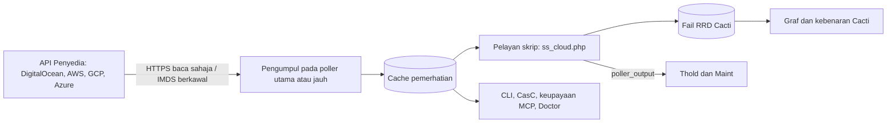

<!-- Source: README.md; SHA256: ac2074a40238686915802803c5efe773f33677f934281e0605e6e87a71a9d27d -->

<!-- translations:start -->
[English](../../../README.md) | [简体中文](../zh-CN/README.md) | [हिन्दी](../hi-IN/README.md) | [Español (España)](../es-ES/README.md) | [Español (Latinoamérica)](../es-419/README.md) | [العربية (السعودية)](../ar-SA/README.md) | [Afrikaans](../af-ZA/README.md) | [አማርኛ](../am-ET/README.md) | [العربية (مصر)](../ar-EG/README.md) | [العربية (المغرب)](../ar-MA/README.md) | [বাংলা](../bn-BD/README.md) | [Bosanski](../bs-BA/README.md) | [Deutsch](../de-DE/README.md) | [فارسی](../fa-IR/README.md) | [Filipino](../fil-PH/README.md) | [Français](../fr-FR/README.md) | [Français (Maroc)](../fr-MA/README.md) | [Français (Sénégal)](../fr-SN/README.md) | [Hausa](../ha-NG/README.md) | [עברית](../he-IL/README.md) | [Hrvatski](../hr-HR/README.md) | [Bahasa Indonesia](../id-ID/README.md) | [Igbo](../ig-NG/README.md) | [Italiano](../it-IT/README.md) | [日本語](../ja-JP/README.md) | [한국어](../ko-KR/README.md) | [Malagasy](../mg-MG/README.md) | [मराठी](../mr-IN/README.md) | [Bahasa Melayu](README.md) | [Nederlands](../nl-NL/README.md) | [Polski](../pl-PL/README.md) | [Português (Brasil)](../pt-BR/README.md) | [Русский](../ru-RU/README.md) | [Kinyarwanda](../rw-RW/README.md) | [Soomaali](../so-SO/README.md) | [Српски](../sr-RS/README.md) | [Svenska](../sv-SE/README.md) | [Kiswahili](../sw-KE/README.md) | [தமிழ்](../ta-IN/README.md) | [తెలుగు](../te-IN/README.md) | [ไทย](../th-TH/README.md) | [Türkçe](../tr-TR/README.md) | [Українська](../uk-UA/README.md) | [اردو](../ur-PK/README.md) | [Tiếng Việt](../vi-VN/README.md) | [isiXhosa](../xh-ZA/README.md) | [Yorùbá](../yo-NG/README.md) | [繁體中文](../zh-TW/README.md) | [isiZulu](../zu-ZA/README.md)
<!-- translations:end -->

# plugin_cloud

Pemalam Cacti 1.2 yang membawa sumber dan metrik daripada penyedia awan awam ke dalam Cacti sebagai peranti, sumber data, dan graf biasa. Beban kerja awan berada bersebelahan rangkaian yang membawanya, di bawah kebenaran Cacti, dan Thold serta Maint memberi amaran dan menyekatnya. Satu pemalam merangkumi DigitalOcean, Amazon Web Services, Google Cloud, dan Microsoft Azure melalui pemacu penyedia baca sahaja dalam PHP tulen.

> **Status: dalam pembangunan, belum ada keluaran (`0.1.0-dev`).** Cawangan ini melaksanakan pemacu PHP tulen untuk DigitalOcean, AWS, Google Cloud, dan Azure, replikasi pengumpul data jauh dan kesihatan ejen baca sahaja, penyedia CasC dan CLI pengendali, keupayaan MCP, dan semakan Doctor. Templat Cacti yang disertakan pada masa ini merangkumi DigitalOcean Droplet dan pengimbang beban (`templates/cloud_digitalocean.xml`); pakej templat Cacti untuk AWS, Google Cloud, dan Azure serta kelayakan akaun langsung di luar DigitalOcean ([fakta penyedia](../../research/provider-facts.md)) belum selesai lagi. Jangan jalankan dalam persekitaran pengeluaran.

## Penyedia yang disokong

Setiap pemacu penyedia didaftarkan dalam `Drivers::production()`, ditawarkan oleh `Provider::released()`, dan dijalankan dalam PHP tulen menggunakan `ext-openssl` serta soket strim tanpa kebergantungan SDK atau masa jalan Composer.

| Penyedia | Medan skop | Sumber kelayakan | Pengesahan | Sumber yang ditemui | Pengumpulan metrik |
|---|---|---|---|---|---|
| DigitalOcean (`digitalocean`) | Tiada (berskop token) | `vault`, `file` | Token pembawa | `droplet`, `load_balancer` | `/v2/monitoring/metrics` dengan kesedaran bahagian had kadar; menyertakan templat Cacti dan pertanyaan data |
| Amazon Web Services (`aws`) | `account_id` (12 digit), `regions` | `vault`, `file`, `instance` | AWS SigV4 PHP tulen (`AWS4-HMAC-SHA256`), pengesahan STS `GetCallerIdentity`, STS `AssumeRole` pilihan, EC2 IMDSv2 (`169.254.169.254`) untuk akaun `instance` | `ec2_instance`, `rds_instance`, `aws_elb` (ALB/NLB) | CloudWatch `GetMetricData` berkelompok (sehingga 500 pertanyaan setiap panggilan) |
| Google Cloud (`gcp`) | `project` | `vault`, `file`, `instance` | JWT akaun perkhidmatan RS256 PHP tulen melalui `ext-openssl` yang ditukar di `oauth2.googleapis.com/token`, atau pelayan metadata GCE (`metadata.google.internal`) untuk akaun `instance` | `gce_instance` melalui `instances.aggregatedList` | Cloud Monitoring `timeSeries.list` |
| Microsoft Azure (`azure`) | `tenant`, `subscription`, `regions` | `vault`, `file`, `instance` | Aliran kelayakan klien Entra ID OAuth2 PHP tulen (`client_secret` sahaja; pengakuan sijil dikecualikan), atau identiti terurus Azure IMDS (`169.254.169.254`) untuk token ARM dan Monitor | `azure_vm` melalui ARM Resource Graph (berhalaman dengan `$skipToken` dan dinyahduplikasi) | Azure Monitor `metrics:getBatch` (sehingga 50 sumber setiap panggilan, mengendalikan pendikitan HTTP 429 dan 529) |

## Keupayaan yang dilaksanakan

### Platform teras, peti besi, dan pengumpul

- **Pemasangan dan kitaran hayat berkawal.** Titik masuk (`setup.php`, `cli/cloud.php`, `poller_cloud.php`, `ss_cloud.php`, dan skrip halaman) boleh dihuraikan pada PHP 8.0 dan menolak PHP di bawah 8.2 atau kekurangan `ext-openssl` tanpa merosakkan Cacti. Naik taraf adalah tersusun, idempoten (`Schema::VERSION = 3`, 9 jadual), dan bertahan daripada gangguan. Nyahpasang mengekalkan jadual pemalam melainkan *Keep Plugin Tables on Uninstall* dinyahaktifkan.
- **Akaun dan kelayakan.** Tambah, sunting, sahkan, dan padam akaun di bawah **Management > Cloud Accounts**. Kelayakan datang daripada peti besi disulitkan AES-256-GCM (`plugin_cloud_secret`, berkunci oleh `/etc/cacti/cloud-vault.key` secara lalai), daripada fail yang dihadkan di dalam *Credential File Directory* yang dikonfigurasikan (`cloud_credential_dir`, kosong secara lalai untuk menolak fail), atau daripada identiti tika penyedia. Kelayakan adalah tulis sahaja dalam UI dan disunting keluar daripada log.
- **Kawalan keluar dan baca sahaja yang ketat.** Setiap pemacu beroperasi di belakang `GuardedTransport` dan `OutboundPolicy`: port HTTPS 443 ke nama hos tepat bagi setiap penyedia, dengan titik akhir metadata port HTTP 80 pautan tempatan (`169.254.169.254`, `metadata.google.internal`) didayakan hanya untuk akaun `instance`. Hanya operasi baca sahaja dalam senarai dibenarkan yang dibenarkan.
- **Pengumpul dan kawalan kos.** `poller_cloud.php` berjalan daripada `poller_bottom` (satu proses bagi setiap poller melalui daftar proses Cacti) dalam `cloud_collector_budget`, memperoleh pajakan setiap akaun, menjalankan penemuan pada `discover_interval`, membaca metrik hanya untuk sumber data Cacti yang aktif (`plugin_cloud_series`), mematuhi `request_share` dan `monthly_ceiling`, serta menyimpan titik data terkini dalam `plugin_cloud_observation` untuk `ss_cloud.php`.
- **Objek Cacti dan anggaran permintaan.** Mengekalkan peranti skop bagi setiap akaun (`plugin_cloud_device`), mengekalkan kaedah pengindeksan semula peranti skop merentasi penyimpanan peranti, mengimport templat DigitalOcean dan pertanyaan data pelayan skrip (`templates/cloud_digitalocean.xml`, `cloud_do_droplet.xml`, `cloud_do_load_balancer.xml`), serta memaparkan anggaran permintaan dan harga senarai pada **New Graphs** (`graphs_new_top_links`) dan **Cloud Health**.

### Pengumpul data jauh

- `INFO` mengisytiharkan `remote_collect:1`. Akaun boleh diberikan kepada mana-mana poller Cacti yang didayakan (`poller_id >= 1`), dan `poller_cloud.php --poller=N` hanya mengumpul akaun yang dimiliki oleh poller tersebut.
- **Cangkuk `replicate_out`.** Mereplikasikan baris berskop poller daripada `plugin_cloud_account`, `plugin_cloud_device`, `plugin_cloud_series`, dan baris teks tersulit daripada `plugin_cloud_secret` (hanya untuk akaun bersandarkan peti besi yang dimiliki oleh poller sasaran) melalui `replicate_out_table()`. Fail kunci peti besi mentah tidak pernah disimpan dalam pangkalan data atau direplikasikan dan kekal setempat pada setiap poller.
- **Cangkuk `remote_agent`.** Mendedahkan ringkasan kesihatan JSON baca sahaja (`action=cloud_health`) yang hanya menerima parameter integer `poller_id` dan `account_id` serta mengembalikan sifar kelayakan, laluan fail, atau rahsia.

### Cangkuk ekosistem (CasC, keupayaan MCP, dan Doctor)

- **Penyedia CasC (`casc_register_providers`).** Mendaftarkan penyedia `cloud` (versi skema `1`) dengan eksport YAML dan XML PHP tulen yang deterministik, pengesahan manifes, perancangan perbezaan, dan pelaksanaan yang disahkan. Kelayakan peti besi dieksport sebagai rujukan `vault:account:<name>`; medan rahsia mentah (`secret`, `secrets`, `token`, `access_token`, `refresh_token`, `password`, `private_key`, `access_key_id`, `secret_access_key`, `session_token`, `client_secret`, `credential`, `credentials`, `vault_key`) ditolak. Pelaksanaan memerlukan SHA-256 tepat `--confirm=<PLAN_HASH>`.
- **MCP / Abilities API (`abilities_register`).** Mendaftarkan tiga keupayaan baca sahaja yang ketat yang dikawal oleh alam Cloud View (`cloud_health.php`) dan skop peranti Cacti untuk pemanggil bukan pentadbir, tanpa mengeluarkan sebarang kelayakan, kunci peti besi, atau laluan fail kelayakan:
  - `cloud-list-accounts` (`provider`, `poller_id` pilihan)
  - `cloud-list-resources` (`account_id`, `type`, `lifecycle` pilihan)
  - `cloud-get-health` (`account_id` pilihan)
- **Semakan Doctor (`doctor_register_checks`).** Mendaftarkan lima semakan diagnostik yang tidak mendedahkan nilai rahsia atau bahan kunci:
  - `cloud_schema`: kekinian versi skema
  - `cloud_vault_key`: kebolehbacaan, kebenaran, dan saiz fail kunci peti besi
  - `cloud_drivers`: pendaftaran pemacu pengeluaran untuk semua penyedia yang dikeluarkan
  - `cloud_accounts_health`: akaun didayakan yang gagal, didikit, atau basi
  - `cloud_poller_intervals`: penjajaran selang pengumpulan akaun yang didayakan dengan selang poller Cacti

## CLI

Jalankan daripada direktori akar Cacti dengan PHP 8.2 atau lebih baharu:

```sh
# Operator and CasC CLI (options use --key=value form)
php plugins/cloud/cli/cloud.php export [--format=yaml|xml]
php plugins/cloud/cli/cloud.php validate --file=<path> [--format=yaml|xml]
php plugins/cloud/cli/cloud.php plan --file=<path> [--format=yaml|xml]
php plugins/cloud/cli/cloud.php apply --file=<path> --confirm=<PLAN_HASH> [--format=yaml|xml]
php plugins/cloud/cli/cloud.php health [--format=text|json] [--poller=<id>]

# Collector entry point (normally started by poller_bottom)
php plugins/cloud/poller_cloud.php [--poller=N] [--force] [--debug]
```

## Peranan akses

| Alam | Akses |
| --- | --- |
| Cloud View | Halaman pemantauan sedia ada. |
| Cloud Operator | Pemantauan serta halaman Operations dan pengakuan triaj peribadi. |
| Cloud Admin | Akses Operator serta konfigurasi sedia ada dan tindakan pentadbiran. |

Selepas menyalin fail naik taraf, buka halaman Plugins sebagai pentadbir untuk mendaftarkan alam. Berikan alam Operator secara eksplisit di bawah **Configuration > Users** atau kumpulan pengguna. Naik taraf mengekalkan ID dan pemberian alam View dan Admin yang sedia ada. Akses Admin mewarisi akses Operator, dan akses Operator mewarisi akses View pada setiap permintaan; ini tidak menambah pemberian tersimpan kepada pengguna atau kumpulan. Tetapan pemalam juga memerlukan akses Cloud Admin sebagai tambahan kepada kebenaran Settings Cacti.

Kebenaran peranti Cacti mengehadkan baris dan tindakan yang tersedia untuk setiap pengguna; objek yang tidak dipetakan memerlukan pentadbir. Operator boleh mengesahkan kelayakan tersimpan bagi akaun yang peranti Cactinya boleh mereka akses. Kelayakan, konfigurasi, pemetaan, pemadaman, dan perubahan pentadbiran lain kekal dalam halaman pentadbiran. Pengakuan hanya bertahan dalam sesi pengguna semasa, paling lama selama satu jam dan hanya selagi pemerhatian yang sama kekal segar. Pemerhatian baharu atau berubah akan membatalkannya. Pengakuan tidak pernah menandakan pengukuran yang gagal sebagai sihat atau menyekat amaran.

## Mengapa

Setiap penyedia awan mempunyai konsol pemantauannya sendiri. Apabila dijalankan bersama Cacti, ia meninggalkan tiga jurang:

- **Kawalan akses berasingan.** Menunjukkan metrik awan kepada pengguna Cacti bermakna memberi mereka log masuk awan.
- **Tiada konteks rangkaian.** Pautan di premis digrafkan dalam Cacti; beban kerja di belakangnya digrafkan dalam konsol setiap penyedia.
- **Makluman berasingan.** Thold dan Maint berfungsi pada sumber data dan peranti Cacti, jadi penggera penyedia dikonfigurasikan dan disekat secara berasingan, sekali bagi setiap penyedia.

Pemalam ini membaca API pemantauan setiap penyedia pada poller Cacti, menyimpan titik data terkini dalam cache, dan menyajikannya kepada pelayan skrip Cacti. Poller Cacti menulis fail RRD, jadi penggambaran graf, kebenaran, Thold, Maint, dan boost berfungsi seperti biasa untuk sebarang data Cacti.

## Komitmen reka bentuk

- **Baca sahaja.** Setiap pemacu hanya boleh membina operasi penyedia dalam senarai dibenarkannya; pemalam tidak pernah mengubah sumber awan. ([ADR 0002](../../decisions/0002-read-only-with-operation-allowlist.md))
- **PHP sahaja, tiada SDK.** Penandatanganan dan pertukaran token dilaksanakan dalam PHP menggunakan sambungan yang sudah diperlukan oleh Cacti. Tiada kebergantungan masa jalan Composer. ([ADR 0003](../../decisions/0003-php-only-without-sdks.md))
- **Kos sebelum pengumpulan.** Pemalam hanya membaca metrik yang mempunyai sumber data Cacti, menunjukkan kiraan permintaan yang dijangka dan kos harga senarai sebelum graf dicipta, serta menguatkuasakan had bulanan. ([ADR 0005](../../decisions/0005-collect-only-what-is-graphed.md))
- **Tiada kelayakan teks biasa dalam pangkalan data.** Kelayakan datang daripada peti besi disulitkan yang dikunci oleh fail di luar pangkalan data, daripada fail kelayakan, atau daripada identiti tika penyedia. ([ADR 0007](../../decisions/0007-credentials-outside-the-database-in-the-clear.md))

## Skop dan status

| Fasa | Skop | Pencapaian | Status |
|---|---|---|---|
| 0, penyelidikan | Pengesahan fakta penyedia, katalog metrik, model kos dan kadar, vektor ujian penandatanganan, percubaan pengangkutan | [M1](https://github.com/somethingwithproof/plugin_cloud/milestone/1) | Selesai, kecuali semakan yang memerlukan akaun penyedia langsung |
| 1, teras dan DigitalOcean | Akaun, peti besi kelayakan, pengangkutan, pengumpul, cache pemerhatian, objek Cacti, templat, anggaran permintaan, halaman kesihatan, DigitalOcean Droplet dan pengimbang beban | [M2](https://github.com/somethingwithproof/plugin_cloud/milestone/2), [M3](https://github.com/somethingwithproof/plugin_cloud/milestone/3), [M4](https://github.com/somethingwithproof/plugin_cloud/milestone/4) | Dilaksanakan; kelayakan perintis M4 belum selesai |
| 2, AWS | SigV4 PHP tulen, STS `AssumeRole`, peranan tika IMDSv2, inventori EC2/RDS/ELB, CloudWatch `GetMetricData` | [M5](https://github.com/somethingwithproof/plugin_cloud/milestone/5) | Pemacu dilaksanakan; templat Cacti dan kelayakan akaun langsung belum selesai |
| 3, Google Cloud | JWT akaun perkhidmatan RS256 PHP tulen, pelayan metadata GCE, inventori Compute Engine, Cloud Monitoring `timeSeries.list` | [M6](https://github.com/somethingwithproof/plugin_cloud/milestone/6) | Pemacu dilaksanakan; templat Cacti dan kelayakan akaun langsung belum selesai |
| 4, Azure | Kelayakan klien Entra ID, identiti terurus IMDS, inventori VM ARM Resource Graph, Azure Monitor `metrics:getBatch` | [M7](https://github.com/somethingwithproof/plugin_cloud/milestone/7) | Pemacu dilaksanakan; templat Cacti dan kelayakan akaun langsung belum selesai |
| 5, pengumpul jauh dan ekosistem | Pengumpul data jauh (`replicate_out`, `remote_agent`), penyedia CasC dan CLI, keupayaan MCP, semakan Doctor | [M8](https://github.com/somethingwithproof/plugin_cloud/milestone/8) | Dilaksanakan |

Di luar skop: mengubah sumber awan, mencipta atau mencerminkan penggera penyedia, laporan pengebilan, log dan jejak, serta enjin makluman milik pemalam. Penyedia lanjut (Hetzner Cloud, Akamai Cloud, Oracle Cloud, dan lain-lain) ialah isu penyelidikan.

## Pemasangan dan konfigurasi

Langkah ini memasang kod pembangunan untuk penilaian. Ia memerlukan Cacti 1.2.31 atau lebih baharu pada PHP 8.2 atau lebih baharu.

1. Salin repositori ke `plugins/cloud` di bawah direktori Cacti anda. Direktori mestilah dinamakan `cloud`.
2. Cipta kunci peti besi di luar akar web pada setiap poller yang menggunakan kelayakan bersandarkan peti besi. Letakkannya dalam direktori yang hanya boleh ditulis oleh root dan pengguna Cacti, dan jadikan fail itu hanya boleh dibaca oleh pengguna yang menjalankan pelayan web dan poller. Pemalam tidak pernah mencipta atau menulis fail ini:

   ```sh
   sudo install -d -m 0750 -o root -g cacti /etc/cacti
   head -c 32 /dev/urandom | sudo tee /etc/cacti/cloud-vault.key > /dev/null
   sudo chown cacti:cacti /etc/cacti/cloud-vault.key
   sudo chmod 0600 /etc/cacti/cloud-vault.key
   ```

   Gantikan `cacti` dengan pengguna yang menjalankan pelayan web dan poller anda. Fail ini menyimpan 32 bait mentah atau 64 aksara perenambelasan. Sandarkannya bersama pangkalan data; tanpanya, kelayakan yang disimpan perlu dimasukkan semula.
3. Dalam Cacti, buka **Configuration > Plugins**, kemudian pasang dan dayakan *Cloud*.
4. Di bawah **Configuration > Settings > Cloud**, tetapkan *Vault Key File* jika anda menggunakan laluan lain, konfigurasikan *Credential File Directory* jika anda merancang untuk menggunakan kelayakan berasaskan fail, dan pastikan *Collector Time Budget* (lalai 240 saat) berada di bawah selang poller.
5. Berikan *Cloud Admin*, *Cloud Operator*, atau *Cloud View* kepada pengguna dan kumpulan di bawah **Configuration > Users**. Pemasangan memberikan Cloud Admin dan Cloud View kepada pentadbir; Cloud Admin merangkumi akses Operator, jadi pentadbir tidak memerlukan pemberian Operator berasingan.
6. Tambah akaun di bawah **Management > Cloud Accounts**, kemudian semak **Management > Cloud Health** untuk amaran.

## Sasaran keserasian

| Komponen | Sasaran |
|---|---|
| Cacti | 1.2.31 atau lebih baharu, tiada tampalan teras |
| PHP | 8.2 atau lebih baharu; titik masuk kekal boleh dihuraikan pada 8.0 supaya masa jalan yang tidak disokong menerima penolakan dan bukannya UI Cacti yang rosak |
| Sambungan PHP | `ext-openssl` (diperlukan oleh Cacti 1.2.31); tiada `ext-curl` dan tiada kebergantungan masa jalan Composer |
| Thold, Maint | Tiada perubahan diperlukan |

## Reka bentuk

- [docs/performance.md](../../performance.md) mempunyai ukuran pengumpul dan halaman kesihatan, bersama perkakasan dan tetapan yang digunakan.
- [docs/PLAN.md](../../PLAN.md) ialah pelan penuh: seni bina, fakta penyedia dan Cacti yang menjadi sandarannya (bersama sumber), kontrak pemacu, aritmetik kos, sempadan keselamatan, pengujian, dan risiko.
- [docs/decisions/](../../decisions/) menyimpan rekod keputusan seni bina bagi pilihan yang telah dibuat.
- [docs/REQUIREMENTS.md](../../REQUIREMENTS.md) memetakan setiap ID keperluan kepada isunya.



## Cara kerja dijejak

- **Pencapaian** mengikut pencapaian pelan. Setiap satunya mempunyai isu epik yang menyenaraikan sub-isu dan bukti keluarannya.
- **Isu** dikelaskan mengikut label: `type: requirement`, `type: research`, `type: decision`, `type: epic`. Isu keperluan menyatakan keperluan bernombor yang boleh diuji (`REQ-AREA-NNN`) dan kriteria penerimaan.
- **Label** juga membawa `area:`, `provider:`, `phase:`, `priority:`, dan `status:`. Lihat [CONTRIBUTING.md](../../../CONTRIBUTING.md#labels).
- [Papan projek](https://github.com/users/somethingwithproof/projects/7) menunjukkan semua isu merentas pencapaian.

## Pembangunan

CI ([.github/workflows/plugin-ci-workflow.yml](../../../.github/workflows/plugin-ci-workflow.yml)) menyemak arkib keluaran dan versi semantik (`bash tests/bin/archive-check.sh`), membuat lint pada titik masuk pada PHP 8.0, menjalankan ujian unit Pest (`phpunit.xml`) dan penyepaduan kitaran hayat (`phpunit-integration.xml`) serta PHPStan tahap 9 merentas PHP 8.2 hingga 8.5 terhadap Cacti `release/1.2.31` dan `1.2.x` dengan `CLOUD_OFFLINE=1`, menyemak penolakan pada PHP 8.1, mengesahkan katalog gettext, mengukur prestasi pengumpulan 1,000 siri dan halaman kesihatan, serta menjalankan linting aliran kerja dan pematuhan REUSE.

Semakan setempat sebelum menolak perubahan:

```sh
bash tests/bin/archive-check.sh
sh tests/lint-workflows.sh
sh locales/build_gettext.sh --check
CACTI_PATH=/path/to/cacti phpstan analyse -c phpstan.neon --no-progress
```

Jalankan Pest dengan `--configuration=phpunit.xml` untuk ujian unit dan peraturan sumber, atau `--configuration=phpunit-integration.xml` dengan `CACTI_PATH` dan `CLOUD_TEST_DATABASE=disposable` terhadap pangkalan data Cacti pakai buang untuk ujian penyepaduan kitaran hayat.

## Menyumbang

Baca [CONTRIBUTING.md](../../../CONTRIBUTING.md). Komit memerlukan pengakuan DCO. Perbincangan reka bentuk berlaku pada isu; keputusan terbuka membawa label `type: decision`.

## Keselamatan

Laporkan kelemahan secara peribadi; lihat [SECURITY.md](../../../SECURITY.md).

## Lesen

GNU General Public License v2.0, lesen yang sama seperti Cacti dan pemalamnya. Lihat [LICENSE](../../../LICENSE).
